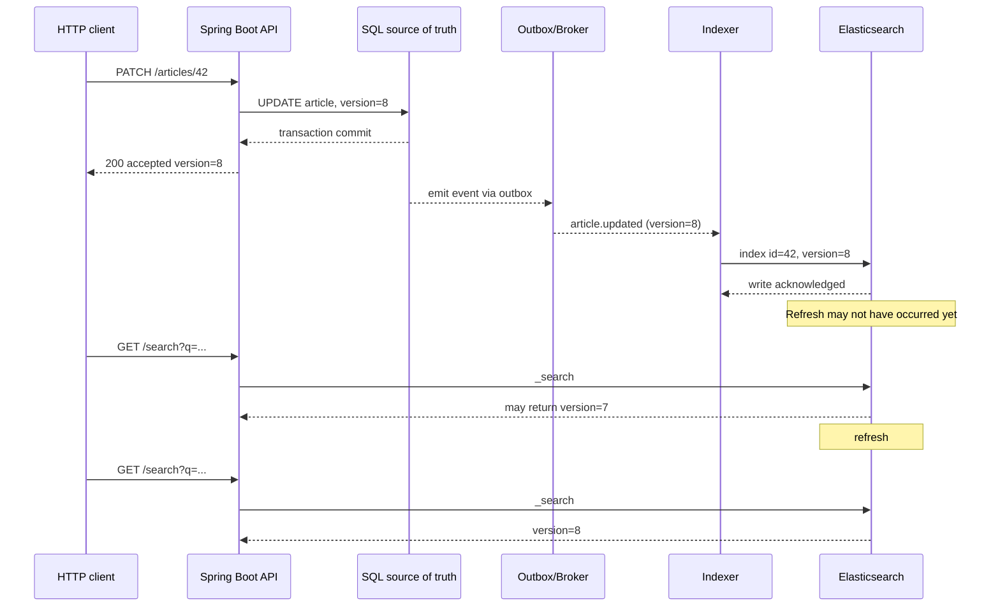
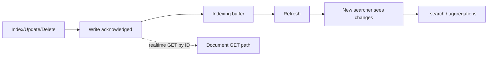
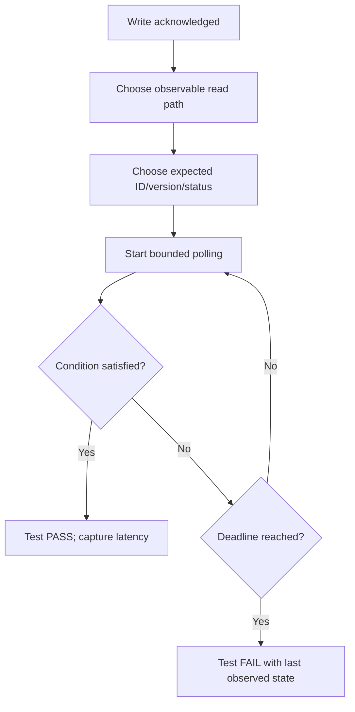

# Testing eventual consistency, index refresh, and waiting for observable conditions

## 1. Why does a successful write still not show up in search?

In systems using **non-SQL data**, a write returning success does not always mean every read path can immediately observe the change. A classic case is **Spring Boot + Spring Data Elasticsearch/OpenSearch**:

1. The application sends a document to a search index.
2. Elasticsearch acknowledges the index/update/delete operation.
3. The data is already readable via **GET by document ID**, yet a **search query** still sees the old state.
4. Only after a **refresh** opens new search segments does the query see the new document or stop seeing a deleted one.

This is **near-real-time search (NRT)** behavior, not automatically a bug. **Refresh** differs from **flush**, **commit**, or business-level synchronization; each operation solves a distinct problem.

This lesson focuses on **"Eventual consistency, index refresh, and waiting for observable conditions"**, with these objectives:

- Distinguish **write acknowledged**, **GET by ID**, **search visibility**, and **projection caught up with events**.
- Explain Elasticsearch refresh mechanics and `refresh=false`, `refresh=true`, and `refresh=wait_for` modes.
- Understand Spring Data Elasticsearch `RefreshPolicy.NONE`, `IMMEDIATE`, and `WAIT_UNTIL`; avoid wrong assumptions about repository defaults.
- Use `IndexOperations.refresh()` in tests needing deterministic checkpoints without overusing it in production.
- Write **eventual assertions** with Awaitility: polling until an **observable** condition holds, with bounded timeouts and clear failure messages.
- Verify creates, updates, deletes, and the latest state/version rather than mere document existence.
- Build an integration test suite using **Java 17 / Spring Boot 3.5 / Spring Data Elasticsearch 5.5 / JUnit 5 / Testcontainers Elasticsearch 8.x** separating deterministic tests from eventual tests.
- Extend the mental model to asynchronous projections, Redis replicas, MongoDB read preferences, Cassandra, and event-driven systems without conflating their consistency models.

## 2. Identifying exactly what you are waiting for

Consider an article management application. A SQL database holds the source of truth; Elasticsearch holds the **read model** for search. When a user updates a title:



There are **at least three independent latencies**:

| Latency | From where to where? | How to test it? |
| --- | --- | --- |
| Source commit → event processed | SQL/Outbox/Broker → Consumer | Wait for projection offset/version or record appearance |
| Indexing request → Elasticsearch ACK | Indexer → Elasticsearch | Verify write response/errors |
| ACK → search visibility | Search buffer → refresh → searcher | Wait for `_search` to return the right document/version, or trigger intentional refresh |

If a test only calls `GET /articles/{id}` against SQL and concludes "search index is synced", it observed **the wrong system**. Conversely, calling Elasticsearch `GET /index/_doc/id` still does not prove `_search` sees that document.

### Expected consistency must be specified explicitly

Example contract:

- **Write API:** returning 201 means the document was accepted by the system, not promised to be searchable immediately.
- **Search API:** new content appears within an observable budget, such as 10 seconds when infrastructure is healthy.
- **Read-your-writes UX:** users are routed to a detail screen reading the source of truth, or the write request uses a wait-for-visibility mode.
- **Projection update:** for event version N, search results must reflect **at least version N**; "ID exists" is not enough.
- **Deletion:** a deleted document eventually disappears from search; before refresh, the old version may still appear.

**Do not impose a 1-second SLA across all systems.** Some Elasticsearch deployments refresh every second, yet refresh intervals can be customized, conditional on idle shards, or disabled. Queues, brokers, and backfills also add delays unrelated to refresh.

## 3. How does near-real-time search work in Elasticsearch?

Elasticsearch builds on Lucene inverted indexes. An index operation writes or updates a document, yet searches do not immediately open newly buffered segments. **Refresh** makes recent changes into searchable segments.



Commonly confused terms:

| Term | Primary meaning | What it does NOT mean |
| --- | --- | --- |
| **Index ACK** | Operation processed/accepted by Elasticsearch per request parameters | Does not promise `_search` sees it right away |
| **Refresh** | Exposes recent changes to search (NRT visibility) | Not fsync/flush or a SQL transaction commit |
| **Flush** | Relates to translog/Lucene commit and durability/recovery | Not an API to make a document searchable immediately |
| **Force merge** | Merges segments for storage/query optimization in specific cases | Never use it to wait for indexing or fix flaky tests |
| **GET by ID** | Normally provides real-time semantics | Different from `_search` queries over inverted indexes |
| **Search visibility** | Queries observe the refreshed state | Does not guarantee consumers processed every business event |

Therefore, **`save(...)` succeeding** and **`_search` returning 0 hits immediately afterward** can both be correct. Time-fragile tests written as (save → search → assert 1) pass and fail unpredictably.

Elasticsearch often defaults to roughly a 1-second refresh interval, though actual behavior depends on index settings, search activity, and deployment type. **Never treat 1 second as an immutable API constant.**

## 4. Refresh modes and their trade-offs

Elasticsearch Index/Update/Delete/Bulk APIs support a refresh policy:

| REST parameter | Spring Data Elasticsearch 5.5 | When the request completes | Trade-off |
| --- | --- | --- | --- |
| `refresh=false` (Elasticsearch REST default) | `RefreshPolicy.NONE` | No dedicated refresh requested; visible after a normal refresh | High throughput, read latency |
| `refresh=true` | `RefreshPolicy.IMMEDIATE` | Forces involved shards to refresh so changes are searchable on return | Expensive under frequent writes; creates many small segments |
| `refresh=wait_for` | `RefreshPolicy.WAIT_UNTIL` | Waits until a refresh makes changes searchable before returning | Avoids forcing immediate refreshes normally; increases request latency |

### Warning about Spring Data repository defaults

In certain Spring Data Elasticsearch code paths, **repository implementations may explicitly refresh when the template's refresh policy is `null`**, whereas `ElasticsearchOperations` without an explicit policy lets the cluster use defaults. Thus these two lines **must not be assumed equivalent**:

```java
repository.save(article);  // Repository may auto-refresh per version defaults.

operations.withRefreshPolicy(RefreshPolicy.NONE)
          .save(article);  // Explicitly request no refresh for this write.
```

To test **search visibility latency**, know the exact API invoked, Spring Data version, mappings, and effective refresh policy. In the sample project, we always specify `RefreshPolicy.NONE`/`IMMEDIATE` so behavior never depends on repository default quirks.

### IMMEDIATE is not a default production choice

Issuing `refresh=true` on every write creates many tiny segments, straining indexing, search, and segment merging. Use it only when synchronous search visibility is explicitly approved and benchmarked.

### WAIT_UNTIL does not mean "force refresh"

`refresh=wait_for` waits for a scheduled refresh and is typically cheaper than forcing an immediate refresh. However, if index setting `index.refresh_interval=-1` (periodic refresh disabled), a `wait_for` request **can block indefinitely** until another actor triggers a refresh; Elasticsearch also limits active refresh listeners. Thus **never** call `WAIT_UNTIL` on an index with auto-refresh intentionally turned off unless another refresh trigger and operational timeout exist.

### Direct Refresh API

```http
POST /articles_nrt/_refresh
```

The Refresh API is synchronous and makes previously indexed changes searchable when it returns. Prefer periodic refresh or `wait_for` over forced refreshes. In **tests requiring an explicit deterministic checkpoint** before assertions, a forced refresh makes sense; however, a test that always forces refresh **no longer tests production eventual behavior**.

## 5. Three test styles and their distinct evidence

| Goal | How to write the test | Reliable evidence |
| --- | --- | --- |
| Verify document field mapping or query builders | Unit test / mocked operations | Java logic is sound; proves nothing about ES refresh |
| Prove writes are not searchable before refresh | Index with `refresh_interval=-1` + write `NONE` + `_search`, then explicit refresh | Clear, deterministic distinction between ACK, GET, and search |
| Prove updates/deletes require refresh | Search after `NONE` write, then refresh index | Inverted index transitions from old version to new version |
| Prove consumer eventually syncs | Poll search for **exact version/status** with Awaitility | Eventual consistency contract observed |
| Prove `WAIT_UNTIL` works | Test on auto-refreshing index with proper client deadline | Write returns only after becoming searchable |
| Prove networking/production config | Testcontainers Elasticsearch/OpenSearch/real cluster | Docker container, client, mappings, search |
| Prove user-facing search API | `@SpringBootTest(RANDOM_PORT)` calling HTTP search endpoint | Controller + security + ES wiring + JSON |
| Prove multiple replicas/availability | Multi-node/multi-shard cluster tests | Aspects a single-node Testcontainers setup omits |

The sample project uses a **1-node Elasticsearch Testcontainers** setup for real signals, **never simulating search with a `Map`** and never relying on default refresh timing races.

## 6. Observable conditions: what should you wait for?

Weakly written test:

```java
service.save(article);
Thread.sleep(2000);
assertEquals(1, service.searchByTag("news").size());
```

Problems:

- Two seconds may be **longer than necessary** when data is ready in 100 ms.
- Two seconds may still be **too short** under heavy CI load or longer refresh intervals.
- On timeout, there is no detail about which document or version was expected.
- If search already saw stale data with the same ID/tag, the test can PASS falsely.

Condition-driven test:

```java
await()
    .atMost(Duration.ofSeconds(10))
    .pollInterval(Duration.ofMillis(100))
    .untilAsserted(() -> {
        List<ArticleDocument> hits = service.findByTag("run-123");
        assertEquals(1, hits.size());
        assertEquals(9L, hits.get(0).getVersion());
        assertEquals("PUBLISHED", hits.get(0).getStatus());
    });
```

This is a **snippet**, requiring imports for Awaitility, JUnit, `Duration`, and the service; the complete runnable file appears in Section 8.

- **Observable condition:** the exact API/query users depend on.
- **Exact version check:** version ≥ N or exact N depending on semantics.
- **Bounded deadline:** the test FAILS clearly if the projection falls behind.
- **Poll interval:** avoid hammering the backend; 50–200 ms fits small test containers, while production tuning depends on traffic.
- **Assertion diagnostics:** on failure, capture expected version, actual version, index, document ID, and last observed status.
- **Do not treat every exception as "not ready yet":** connection refused, auth failures, and broken index mappings are genuine configuration errors.

## 7. Java 17 + Spring Boot 3.5 + Testcontainers Elasticsearch project

The project contains:

- An `ArticleDocument` entity mapped to index `visibility_articles_test`.
- An `ArticleSearchService` using `ElasticsearchOperations` with **explicit refresh policies**.
- `VisibilityIntegrationTest` running against real Elasticsearch in Testcontainers with `@ServiceConnection`.
- `AwaitilityContractTest` verifying polling/timeout mechanics on simple state, runnable without Docker.

**Key design decision:** the integration test index sets `refresh_interval=-1`, disabling periodic auto-refresh. That lets us deterministically prove **document GET differs from `_search`**, and that explicit refresh changes search visibility. When testing production-like auto-refresh or `wait_for`, use a separate index with periodic refresh enabled (see Section 14).

### 7.1. File tree

```text
nrt-visibility-demo/
├── pom.xml
└── src/
    ├── main/
    │   ├── java/example/visibility/
    │   │   ├── VisibilityApplication.java
    │   │   ├── ArticleDocument.java
    │   │   └── ArticleSearchService.java
    │   └── resources/application.properties
    └── test/
        └── java/example/visibility/
            ├── VisibilityIntegrationTest.java
            └── AwaitilityContractTest.java
```

### 7.2. pom.xml

```xml
<?xml version="1.0" encoding="UTF-8"?>
<project xmlns="http://maven.apache.org/POM/4.0.0"
         xmlns:xsi="http://www.w3.org/2001/XMLSchema-instance"
         xsi:schemaLocation="http://maven.apache.org/POM/4.0.0
             https://maven.apache.org/xsd/maven-4.0.0.xsd">
    <modelVersion>4.0.0</modelVersion>

    <parent>
        <groupId>org.springframework.boot</groupId>
        <artifactId>spring-boot-starter-parent</artifactId>
        <version>3.5.0</version>
        <relativePath/>
    </parent>

    <groupId>example</groupId>
    <artifactId>nrt-visibility-demo</artifactId>
    <version>1.0-SNAPSHOT</version>

    <properties>
        <java.version>17</java.version>
    </properties>

    <dependencies>
        <dependency>
            <groupId>org.springframework.boot</groupId>
            <artifactId>spring-boot-starter-data-elasticsearch</artifactId>
        </dependency>

        <dependency>
            <groupId>org.springframework.boot</groupId>
            <artifactId>spring-boot-starter-test</artifactId>
            <scope>test</scope>
        </dependency>

        <dependency>
            <groupId>org.springframework.boot</groupId>
            <artifactId>spring-boot-testcontainers</artifactId>
            <scope>test</scope>
        </dependency>

        <dependency>
            <groupId>org.testcontainers</groupId>
            <artifactId>elasticsearch</artifactId>
            <scope>test</scope>
        </dependency>

        <dependency>
            <groupId>org.testcontainers</groupId>
            <artifactId>junit-jupiter</artifactId>
            <scope>test</scope>
        </dependency>

        <dependency>
            <groupId>org.awaitility</groupId>
            <artifactId>awaitility</artifactId>
            <scope>test</scope>
        </dependency>
    </dependencies>
</project>
```

The Spring Boot parent manages Spring Data, Testcontainers, JUnit, and Awaitility versions. The test Elasticsearch image matches the Elasticsearch 8.x line supported by Spring Data Elasticsearch 5.5/Boot 3.5; when upgrading Boot, check the compatibility matrix and certified container image versions.

### 7.3. application.properties

`src/main/resources/application.properties`:

```properties
spring.main.banner-mode=off
spring.data.elasticsearch.repositories.enabled=false
```

No hardcoded Elasticsearch URL appears because integration tests obtain connection details from Testcontainers. Disabling repository auto-scanning does not prevent `ElasticsearchOperations` from working; the project intentionally uses operations to control refresh policies rather than relying on repository defaults.

**Do not launch the main application outside tests** with this properties file expecting ES connectivity automatically: standalone prod/dev runs require configuring `spring.elasticsearch.uris` and proper security. The project is a test sample where Testcontainers supplies the URL in test scope.

### 7.4. VisibilityApplication.java

`src/main/java/example/visibility/VisibilityApplication.java`:

```java
package example.visibility;

import org.springframework.boot.SpringApplication;
import org.springframework.boot.autoconfigure.SpringBootApplication;

@SpringBootApplication
public class VisibilityApplication {
    public static void main(String[] args) {
        SpringApplication.run(VisibilityApplication.class, args);
    }
}
```

### 7.5. ArticleDocument.java

`src/main/java/example/visibility/ArticleDocument.java`:

```java
package example.visibility;

import org.springframework.data.annotation.Id;
import org.springframework.data.elasticsearch.annotations.Document;
import org.springframework.data.elasticsearch.annotations.Field;
import org.springframework.data.elasticsearch.annotations.FieldType;
import org.springframework.data.elasticsearch.annotations.Setting;

@Document(indexName = "visibility_articles_test", createIndex = false)
@Setting(shards = 1, replicas = 0, refreshInterval = "-1")
public class ArticleDocument {

    @Id
    private String id;

    @Field(type = FieldType.Keyword)
    private String tag;

    @Field(type = FieldType.Keyword)
    private String status;

    @Field(type = FieldType.Long)
    private long version;

    public ArticleDocument() {
    }

    public ArticleDocument(
            String id, String tag, String status, long version) {
        this.id = id;
        this.tag = tag;
        this.status = status;
        this.version = version;
    }

    public String getId() {
        return id;
    }

    public String getTag() {
        return tag;
    }

    public String getStatus() {
        return status;
    }

    public long getVersion() {
        return version;
    }
}
```

- `@Document(createIndex=false)` prevents repository auto-index creation from silently altering test setup.
- `@Setting(refreshInterval="-1")` declares periodic refresh **disabled** when creating the index with entity mappings/settings. Use this only in tests requiring deterministic NRT control.
- `@Field(type=Keyword)` allows exact-string queries on `tag/status` without text analyzer tokenization.
- `version` is a **business event version**, not Elasticsearch's internal `_version` or `_seq_no`.
- Do not share this single fixed index name across multiple parallel test suites on **the same ES cluster**. In the demo, a dedicated container is managed by the test class; if sharing a container across classes, generate unique index names per class/run.

**Why not use `@Document(createIndex=true)`?** Spring Data repositories can auto-create indexes at startup from mapping annotations. In this lesson we want to **control the exact moment the index is created and refreshed**, so we call `operations.indexOps(ArticleDocument.class).createWithMapping()` explicitly.

### 7.6. ArticleSearchService.java

`src/main/java/example/visibility/ArticleSearchService.java`:

```java
package example.visibility;

import java.util.List;

import org.springframework.data.elasticsearch.core.ElasticsearchOperations;
import org.springframework.data.elasticsearch.core.RefreshPolicy;
import org.springframework.data.elasticsearch.core.SearchHit;
import org.springframework.data.elasticsearch.core.SearchHits;
import org.springframework.data.elasticsearch.core.query.Criteria;
import org.springframework.data.elasticsearch.core.query.CriteriaQuery;
import org.springframework.stereotype.Service;

@Service
public class ArticleSearchService {

    private final ElasticsearchOperations operations;

    public ArticleSearchService(ElasticsearchOperations operations) {
        this.operations = operations;
    }

    public ArticleDocument writeWithoutRefresh(ArticleDocument doc) {
        return operations.withRefreshPolicy(RefreshPolicy.NONE)
                .save(doc);
    }

    public ArticleDocument writeAndRefresh(ArticleDocument doc) {
        return operations.withRefreshPolicy(RefreshPolicy.IMMEDIATE)
                .save(doc);
    }

    public ArticleDocument getById(String id) {
        return operations.get(id, ArticleDocument.class);
    }

    public void deleteWithoutRefresh(String id) {
        operations.withRefreshPolicy(RefreshPolicy.NONE)
                .delete(id, ArticleDocument.class);
    }

    public void refreshIndex() {
        operations.indexOps(ArticleDocument.class).refresh();
    }

    public List<ArticleDocument> findByTag(String tag) {
        CriteriaQuery query = new CriteriaQuery(
                new Criteria("tag").is(tag));

        SearchHits<ArticleDocument> found =
                operations.search(query, ArticleDocument.class);

        return found.getSearchHits().stream()
                .map(SearchHit::getContent)
                .toList();
    }
}
```

**Design notes:**

- `operations.withRefreshPolicy(...)` returns an operations view with that policy without mutating global shared bean state.
- `NONE` means "do not request an immediate refresh for this write"; normal periodic refresh would still occur if enabled on the index. In the demo, `refreshInterval=-1` eliminates that variable.
- `IMMEDIATE` forces refresh and suits test setup steps needing immediate search visibility after writes. Never default to it for high-volume writes without benchmarking.
- `getById` uses GET by ID; `findByTag` goes through `_search`. The contrast between them is the core subject of this lesson.
- `deleteWithoutRefresh` removes from the real-time GET path; search continues seeing stale segments until refreshed.

## 8. Integration test with real Elasticsearch: isolated index

`src/test/java/example/visibility/VisibilityIntegrationTest.java`:

```java
package example.visibility;

import static org.awaitility.Awaitility.await;
import static org.junit.jupiter.api.Assertions.assertEquals;
import static org.junit.jupiter.api.Assertions.assertFalse;
import static org.junit.jupiter.api.Assertions.assertNotNull;
import static org.junit.jupiter.api.Assertions.assertNull;
import static org.junit.jupiter.api.Assertions.assertTrue;

import java.time.Duration;
import java.util.List;
import java.util.concurrent.Executors;
import java.util.concurrent.ScheduledExecutorService;
import java.util.concurrent.ScheduledFuture;
import java.util.concurrent.TimeUnit;

import org.junit.jupiter.api.AfterEach;
import org.junit.jupiter.api.BeforeEach;
import org.junit.jupiter.api.Test;
import org.springframework.beans.factory.annotation.Autowired;
import org.springframework.boot.test.context.SpringBootTest;
import org.springframework.boot.testcontainers.service.connection.ServiceConnection;
import org.springframework.data.elasticsearch.core.ElasticsearchOperations;
import org.springframework.data.elasticsearch.core.IndexOperations;
import org.testcontainers.elasticsearch.ElasticsearchContainer;
import org.testcontainers.junit.jupiter.Container;
import org.testcontainers.junit.jupiter.Testcontainers;

@SpringBootTest
@Testcontainers
class VisibilityIntegrationTest {

    @Container
    @ServiceConnection
    static ElasticsearchContainer elasticsearch =
            new ElasticsearchContainer(
                    "docker.elastic.co/elasticsearch/elasticsearch:8.17.4")
                    .withEnv("xpack.security.enabled", "false");

    @Autowired
    ElasticsearchOperations operations;

    @Autowired
    ArticleSearchService service;

    @BeforeEach
    void recreateIndexWithRefreshDisabled() {
        IndexOperations index = operations.indexOps(
                ArticleDocument.class);

        if (index.exists()) {
            index.delete();
        }

        assertTrue(index.createWithMapping(),
                "must create isolated test index");
    }

    @AfterEach
    void deleteTestIndex() {
        IndexOperations index = operations.indexOps(
                ArticleDocument.class);

        if (index.exists()) {
            index.delete();
        }
    }

    @Test
    void writeAckCanPrecedeSearchVisibility() {
        ArticleDocument saved = service.writeWithoutRefresh(
                new ArticleDocument(
                        "doc-1", "tag-create", "DRAFT", 1));

        assertEquals("doc-1", saved.getId());
        assertNotNull(service.getById("doc-1"),
                "realtime GET can see indexed document");
        assertTrue(service.findByTag("tag-create").isEmpty(),
                "search must not see it before refresh");

        service.refreshIndex();

        List<ArticleDocument> hits =
                service.findByTag("tag-create");

        assertEquals(1, hits.size());
        assertEquals("doc-1", hits.get(0).getId());
        assertEquals(1L, hits.get(0).getVersion());
    }

    @Test
    void immediatePolicyMakesWriteSearchableWhenItReturns() {
        service.writeAndRefresh(new ArticleDocument(
                "doc-2", "tag-immediate", "PUBLISHED", 1));

        List<ArticleDocument> hits =
                service.findByTag("tag-immediate");

        assertEquals(1, hits.size());
        assertEquals("PUBLISHED", hits.get(0).getStatus());
    }

    @Test
    void updateIsVisibleToGetBeforeSearchRefresh() {
        service.writeAndRefresh(new ArticleDocument(
                "doc-3", "tag-update", "DRAFT", 1));

        assertEquals("DRAFT",
                service.findByTag("tag-update").get(0).getStatus());

        service.writeWithoutRefresh(new ArticleDocument(
                "doc-3", "tag-update", "PUBLISHED", 2));

        assertEquals(2L, service.getById("doc-3").getVersion());
        assertEquals("DRAFT",
                service.findByTag("tag-update").get(0).getStatus(),
                "search can still show older version");

        service.refreshIndex();

        ArticleDocument refreshed =
                service.findByTag("tag-update").get(0);
        assertEquals("PUBLISHED", refreshed.getStatus());
        assertEquals(2L, refreshed.getVersion());
    }

    @Test
    void deleteRequiresRefreshForSearchToStopReturningDocument() {
        service.writeAndRefresh(new ArticleDocument(
                "doc-4", "tag-delete", "PUBLISHED", 1));

        assertFalse(service.findByTag("tag-delete").isEmpty());

        service.deleteWithoutRefresh("doc-4");

        assertNull(service.getById("doc-4"),
                "realtime GET sees deletion");
        assertFalse(service.findByTag("tag-delete").isEmpty(),
                "search can still see stale segment");

        service.refreshIndex();

        assertTrue(service.findByTag("tag-delete").isEmpty());
    }

    @Test
    void awaitilityWaitsForObservableSearchResult() throws Exception {
        service.writeWithoutRefresh(new ArticleDocument(
                "doc-5", "tag-eventual", "PUBLISHED", 1));

        // Simulate a separate refresh arriving after the write.
        ScheduledExecutorService scheduler =
                Executors.newSingleThreadScheduledExecutor();

        try {
            ScheduledFuture<?> refresh = scheduler.schedule(
                    service::refreshIndex,
                    250,
                    TimeUnit.MILLISECONDS);

            await()
                .atMost(Duration.ofSeconds(8))
                .pollInterval(Duration.ofMillis(100))
                .untilAsserted(() -> {
                    List<ArticleDocument> hits =
                            service.findByTag("tag-eventual");
                    assertEquals(1, hits.size());
                    assertEquals("PUBLISHED", hits.get(0).getStatus());
                });

            // If the background refresh threw an error, do not ignore it.
            refresh.get(2, TimeUnit.SECONDS);
        } finally {
            scheduler.shutdownNow();
        }
    }

    @Test
    void projectionWaitsForExpectedBusinessVersion() throws Exception {
        service.writeAndRefresh(new ArticleDocument(
                "doc-6", "tag-version", "DRAFT", 7));

        // Version 7 is already searchable; asserting mere existence would pass too soon.
        service.writeWithoutRefresh(new ArticleDocument(
                "doc-6", "tag-version", "PUBLISHED", 8));

        ScheduledExecutorService scheduler =
                Executors.newSingleThreadScheduledExecutor();

        try {
            ScheduledFuture<?> refresh = scheduler.schedule(
                    service::refreshIndex,
                    250,
                    TimeUnit.MILLISECONDS);

            await()
                .atMost(Duration.ofSeconds(8))
                .pollInterval(Duration.ofMillis(100))
                .untilAsserted(() -> {
                    List<ArticleDocument> hits =
                            service.findByTag("tag-version");

                    assertEquals(1, hits.size());
                    assertEquals(8L, hits.get(0).getVersion(),
                            "waiting for projection version=8");
                    assertEquals("PUBLISHED",
                            hits.get(0).getStatus());
                });

            refresh.get(2, TimeUnit.SECONDS);
        } finally {
            scheduler.shutdownNow();
        }
    }
}
```

**There are 6 JUnit test methods** in this class. Tests use a real Elasticsearch container and real Spring Data operations, never mocking search results.

### 8.1. Why turn off auto-refresh?

If an index keeps `refresh_interval=1s`, asserting "not searchable right before refresh" is a **race**: the cluster could refresh between save and search, causing `isEmpty()` to fail randomly even though Elasticsearch behaved correctly.

In the demo, `@Setting(refreshInterval="-1")` applies when `index.createWithMapping()` creates the new index. Test setup deletes any old index and recreates it with the desired settings/mappings; **therefore no periodic refresh runs**. Pre-refresh assertions become reliable verification instead of timing roulette.

In production, **never turn off refresh by default** just for predictability. This is a test fixture designed to demonstrate the NRT mechanism.

### 8.2. Why not use ElasticsearchRepository.save()?

Depending on Spring Data Elasticsearch version/config, repositories may explicitly refresh when refresh policy is null. Using that could silently break "unsearchable before refresh" assertions inside the repository layer. This lesson's service explicitly uses `ElasticsearchOperations.withRefreshPolicy(RefreshPolicy.NONE)`.

### 8.3. Why not use @Transactional to roll back the search index?

Elasticsearch writes/refreshes do not join the application's JDBC transaction. `@Transactional` in JPA tests does not undo indexed documents. The test uses `@AfterEach` to delete the fixture index, and the container exists strictly in the test environment.

**Never** call `index.delete()` against a production index or shared cluster. The sample project runs exclusively against Testcontainers; when testing in a shared environment, use run-unique index names or a tightly managed isolated collection/namespace.

### 8.4. Is polling here genuinely needed?

The two Awaitility tests use a scheduler to trigger a refresh after 250 ms. This **deterministically simulates an external refresh signal** and proves the test waits on the `_search` condition. Because periodic refresh is off on the index, removing the scheduler makes the test FAIL on timeout rather than passing by luck.

It **does not measure production Elasticsearch default refresh latency**, simulate a Kafka consumer, or prove every distributed system converges. To test production auto-refresh, create an index with an active interval, avoid manual scheduled refreshes, and wait for search state within a bounded budget.

### 8.5. How should SearchHits be used properly?

`ArticleSearchService.findByTag` uses `CriteriaQuery(new Criteria("tag").is(tag))`, calls `operations.search(...)`, and maps `SearchHit::getContent`. We test the **real query**, not `getById`, because the search API is what exhibits NRT visibility semantics. Tags are unique per test to avoid false positives from other documents.

### 8.6. Update and delete scenarios

- **Update:** real-time GET already sees version 2, while `_search` still sees version 1 until refresh.
- **Delete:** real-time GET already returns null, while `_search` still hits the old segment until refresh.
- After refresh, re-assert the exact new state.
- In production, deletes, routing changes, aliases, or concurrent external writes add complexity; do not extrapolate from a single-shard single-node test that every distributed system guarantees exact-once or ordering.

## 9. Awaitility test without Docker

`src/test/java/example/visibility/AwaitilityContractTest.java`:

```java
package example.visibility;

import static org.awaitility.Awaitility.await;
import static org.junit.jupiter.api.Assertions.assertThrows;
import static org.junit.jupiter.api.Assertions.assertTrue;

import java.time.Duration;
import java.util.concurrent.CompletableFuture;
import java.util.concurrent.TimeUnit;
import java.util.concurrent.atomic.AtomicBoolean;

import org.awaitility.core.ConditionTimeoutException;
import org.junit.jupiter.api.Test;

class AwaitilityContractTest {

    @Test
    void eventuallyPassesWhenObservableFlagChanges() {
        AtomicBoolean ready = new AtomicBoolean(false);

        CompletableFuture.delayedExecutor(
                150, TimeUnit.MILLISECONDS)
            .execute(() -> ready.set(true));

        await()
            .atMost(Duration.ofSeconds(3))
            .pollInterval(Duration.ofMillis(25))
            .untilTrue(ready);

        assertTrue(ready.get());
    }

    @Test
    void neverSatisfiedConditionFailsWithinBudget() {
        assertThrows(ConditionTimeoutException.class, () ->
                await()
                    .atMost(Duration.ofMillis(350))
                    .pollInterval(Duration.ofMillis(25))
                    .until(() -> false));
    }
}
```

**There are 2 JUnit methods** running without a Spring context or Docker. They verify only the polling/timeout behavior of the test harness, **not Elasticsearch consistency**.

Distinction:

- `eventuallyPassesWhenObservableFlagChanges`: when state flips before the deadline, the test PASSES without waiting the full 3 seconds.
- `neverSatisfiedConditionFailsWithinBudget`: when a condition never becomes true, Awaitility throws `ConditionTimeoutException` rather than hanging forever.
- Never replace real container tests with a fake atomic boolean and claim "Elasticsearch refresh tested".

## 10. Running the project and reading results

Requires **JDK 17+, Maven, Testcontainers-compatible Docker/Podman**, and ability to pull the Elasticsearch image when running integration tests.

Run only the Docker-less Awaitility tests:

```bash
mvn -Dtest=AwaitilityContractTest test
```

Run integration tests with the Elasticsearch container:

```bash
mvn -Dtest=VisibilityIntegrationTest test
```

Run all tests:

```bash
mvn test
```

| Test class | Test methods | Docker? | Scope |
| --- | ---: | --- | --- |
| `VisibilityIntegrationTest` | 6 | **Yes** | Real Elasticsearch writes, search, refresh, update/delete, eventual version |
| `AwaitilityContractTest` | 2 | No | Bounded polling/timeout harness |
| **Total** | **8** | Docker needed for full suite | Separates system-under-test from test utility |

**Expected result:** 8 test passes in a compatible environment; no fixed application stdout. This is expected behavior from the example code; this lesson **does not claim Maven was executed in this environment**. When verifying the project, check `target/surefire-reports` to confirm all methods actually ran with zero skipped/aborted tests.

### Checks before diagnosing a failure

- Is the Docker daemon reachable? Was the ES image pulled?
- Does Testcontainers have enough RAM/CPU for ES to boot?
- Did Spring Boot receive port/service connection from `@ServiceConnection` instead of a hardcoded URL?
- Was the index created via `createWithMapping` with `refresh_interval=-1`, or is an old index lingering?
- Did the test use `RefreshPolicy.NONE` instead of repository auto-refresh?
- Did the search query target the exact `Keyword` field and test tag?
- Does the test timeout allow enough margin for CI without using fixed `Thread.sleep`?

Never mark a required integration job `@Disabled` just to keep builds green on Docker-less machines; run it on a container-capable CI runner and state transparently which scope did not run.

## 11. Verifying NRT with plain Elasticsearch REST

When debugging outside Spring Data, you can call the REST API directly; here is the equivalent flow on a **disposable index**, not a script to run in production.

```http
PUT /articles_nrt_demo
Content-Type: application/json

{
  "settings": {
    "number_of_shards": 1,
    "number_of_replicas": 0,
    "index.refresh_interval": "-1"
  },
  "mappings": {
    "properties": {
      "tag": {"type": "keyword"},
      "status": {"type": "keyword"},
      "version": {"type": "long"}
    }
  }
}
```

Write without requesting refresh:

```http
PUT /articles_nrt_demo/_doc/doc-1?refresh=false
Content-Type: application/json

{"tag":"demo","status":"DRAFT","version":1}
```

Check real-time GET by ID:

```http
GET /articles_nrt_demo/_doc/doc-1
```

Check search query:

```http
GET /articles_nrt_demo/_search
Content-Type: application/json

{
  "query": {"term": {"tag": "demo"}}
}
```

Before refresh, `_search` returns 0 hits; with auto-refresh intentionally turned off here, it will stay invisible unless another refresh occurs. Next:

```http
POST /articles_nrt_demo/_refresh
```

Running `_search` again now returns the document.

This is a diagnostic flow: Elasticsearch responses include fields like `_index`, `_seq_no`, `_shards`, and `took` whose values vary across clusters, so **never hardcode exact raw outputs**. Tests should assert `hits.hits[]._source`/ID/version meaningfully.

### Refresh vs. flush in REST

- `POST /index/_refresh`: makes recent data searchable.
- `POST /index/_flush`: separate operation concerning translog commits and durability/recovery, **never use in place of refresh** for search tests.
- `POST /index/_forcemerge`: not a tool for testing eventual consistency.
- Bulk indexing can pass `refresh=wait_for` for **the whole batch**, avoiding many tiny individual refreshes.

## 12. WAIT_UNTIL in Spring Data Elasticsearch

When an application requires "right after writing returns, the next search sees the document", you can use:

```java
// Use only on an index with suitable refresh and operational timeout bounds.
ArticleDocument saved = operations
        .withRefreshPolicy(RefreshPolicy.WAIT_UNTIL)
        .save(article);

// If the call succeeds per contract, the newly written document
// has gone through a refresh and is searchable.
```

**This is a snippet**: `operations` and `article` must be defined as in the project. Never drop this onto the lesson's `refresh_interval=-1` index without triggering an explicit refresh elsewhere: the call can hang for a long time when the cluster does not auto-refresh.

Policy selection guide:

| Need | Usually appropriate policy | What to test |
| --- | --- | --- |
| High-throughput logs/telemetry ingest | NONE | Data eventually searchable within SLA, without forcing refresh per log |
| Single write, UI search must see immediately | WAIT_UNTIL with bounded timeout | Search sees document/version before returning HTTP success |
| Admin/test fixture needing immediate checkpoint | IMMEDIATE or explicit refresh | Use only with stated justification; monitor cost |
| Bulk update across many documents | Bulk + WAIT_UNTIL | Entire batch searchable without excessive refresh calls |
| Event-driven read model | NONE + consumer offset + Awaitility observation | Exact version/status and time budget; not just ACK |

Never choose a policy merely to silence flaky tests without understanding the user-facing consistency contract. Forcing refreshes in production code can degrade performance without fixing upstream broker/consumer lag.

## 13. Waiting for "a document exists" is not enough for projections

Suppose an article is already searchable at version 7, and a consumer is processing event version 8. A test writing:

```java
await().until(() ->
        !service.findByTag("tag-version").isEmpty());
```

will PASS **immediately** because the version 7 document already exists, even though the new event has not been applied yet.

Replace it with:

```java
await()
    .atMost(Duration.ofSeconds(10))
    .pollInterval(Duration.ofMillis(100))
    .untilAsserted(() -> {
        ArticleDocument found =
                service.findByTag("tag-version").stream()
                        .findFirst()
                        .orElseThrow();
        assertEquals(8L, found.getVersion());
        assertEquals("PUBLISHED", found.getStatus());
    });
```

Exact conditions depend on the contract:

- If event versions can arrive out of order and the indexer discards older events, `version >= expectedVersion` acts as a sensible **watermark**.
- If a test verifies a single exact transition, assert `version == expectedVersion` while ensuring no concurrent writer operates outside the test.
- For deletes, wait until the document disappears **and** a tombstone/projection offset ≥ delete version is reached if the system must prevent older events from "resurrecting" the document.
- If business queries rely on analyzers or multi-field mappings, wait on the **user-facing query**, not just `getById`.
- If event consumers handle retries/idempotency, test that no duplicate side effects occur alongside offset checkpoints.

### Why does eventual not mean exactly-once?

Brokers can redeliver events, consumers can retry, and indexes can receive duplicate updates. Use idempotency keys, external versioning, optimistic concurrency control, or ordered projection logic where needed. Seeing the right final document in search does not prove every event was processed exactly once.

### SQL outbox and search index do not share a transaction

When an application commits to SQL and emits an event to update search:

1. SQL commit is an atomic transaction within **SQL**.
2. Event publishing and index writes happen later, and can fail or retry.
3. Elasticsearch refresh adds one more step before search sees the change.
4. No single `@Transactional` Spring JPA annotation can span all three.

Use the outbox pattern, consumer retries/dead-lettering, idempotency, and observability when production consistency requires it.

## 14. Testing real auto-refresh without creating races

With a production-like refresh interval, **never assert that search is empty right after saving**. Because a refresh can fire between the two statements, that negative assertion is racy.

Right approach:

1. Create a **dedicated disposable index** with `index.refresh_interval=1s` or another explicit value.
2. Write the document with `RefreshPolicy.NONE`.
3. Use Awaitility `untilAsserted` to wait for `_search` to return the expected document/version, e.g., within 10 seconds.
4. **Do not force refresh** in this test if the goal is measuring periodic refresh readiness.
5. Record elapsed time from ACK to observable, running repeatedly under realistic CI load.
6. If indexes have idle/no-refresh policies, verify behavior against cluster/version settings instead of assuming a 10-second timeout always suffices.
7. Use a separate index for `WAIT_UNTIL` tests, never one configured with `refresh_interval=-1`.

**Illustrative** example, not part of the project's 8 runnable tests:

```java
// Assume operations connects to an index with periodic refresh.
// Omit all forced refreshes in this test path.
service.writeWithoutRefresh(
        new ArticleDocument("fresh", "tag-auto", "PUBLISHED", 3));

await().atMost(Duration.ofSeconds(10))
       .pollInterval(Duration.ofMillis(100))
       .untilAsserted(() -> {
           ArticleDocument hit = service.findByTag("tag-auto")
                   .stream().findFirst().orElseThrow();
           assertEquals(3L, hit.getVersion());
       });
```

Note this snippet works only when the service's index has periodic refresh configured; **do not run it verbatim against the sample's `-1` setting expecting PASS**. Deterministic mechanism tests and operational auto-refresh tests serve **two different purposes**.

## 15. Designing Awaitility so it never masks real bugs

Awaitility shines with eventual signals, yet misuse still creates misleading tests.

### 15.1. Always bounded

```java
await().atMost(Duration.ofSeconds(8))
       .pollInterval(Duration.ofMillis(100))
       .untilAsserted(() -> assertEquals(
               1, service.findByTag("tag-eventual").size()));
```

Never use `await().forever()` in CI. Even if a business flow can take a while, tests still require deadlines, cancellation, and failure reporting.

### 15.2. Do not ignore all exceptions

**Wrong:**

```java
await().ignoreExceptions()
       .untilAsserted(() -> someSearchAssertion());
```

If search mappings are wrong, auth returns 401/403, aliases are missing, or the cluster is dead, this turns a real configuration error into endless retries ending in a confusing timeout.

If a specific exception is genuinely transient under the contract, ignore **only that exception type**:

```java
await()
    .ignoreException(TemporaryProjectionNotReadyException.class)
    .atMost(Duration.ofSeconds(8))
    .untilAsserted(() -> assertSearchState());
```

This is **illustrative code**; `TemporaryProjectionNotReadyException` and `assertSearchState` must be defined by the application. Never invent a dummy exception just to hide connection refused.

### 15.3. Polling must not cause side effects

Wait conditions should only **read**, never call `save`/`refresh` on each iteration:

```java
// Wrong: each polling iteration mutates the system.
await().until(() -> {
    service.writeAndRefresh(document);
    return !service.findByTag("tag").isEmpty();
});
```

Doing that "self-heals" missing refreshes and stops testing the external event. Also avoid idempotent calls that generate audit/broker side effects or waste resources.

### 15.4. Describe the last observed state

Example:

```java
AtomicReference<String> lastState =
        new AtomicReference<>("not observed");

await().atMost(Duration.ofSeconds(10))
       .pollInterval(Duration.ofMillis(100))
       .untilAsserted(() -> {
           var hits = service.findByTag("tag-version");
           lastState.set(hits.isEmpty()
                   ? "missing"
                   : "version=" + hits.get(0).getVersion());
           assertEquals(8L, hits.get(0).getVersion());
       });
```

**The snippet above needs handling for empty hits**: `hits.get(0)` throws `IndexOutOfBoundsException`. In real test code, assert `hits.size() == 1` before calling `get`, or use `orElseThrow` and record the observed info. Diagnostic traces should include index, docId, expectedVersion, lastActualVersion, and elapsed time, while never printing sensitive payloads.

## 16. Eventual consistency layers beyond Elasticsearch

"Eventual consistency" is not unique to search indexes. However, **index refresh** is terminology specific to Elasticsearch/OpenSearch and does not apply identically across all NoSQL engines.

| System | Cause of visibility delay | Testing the observable condition |
| --- | --- | --- |
| Elasticsearch/OpenSearch | Lucene segment refresh, async indexing pipeline | `_search` returns right document/version after refresh |
| MongoDB replica set | Replication lag, read preference/concern | Reading from designated replica reaches checkpoint; respect read/write concerns |
| Cassandra/Scylla | Quorum/consistency level, replication, and repair | Read at contractual consistency level, verify replica convergence |
| Redis primary/replica | Asynchronous replication lag | Reading from replica reaches expected value/version |
| DynamoDB eventual read | Read API not requesting strongly consistent read | Poll read by same key/policy until target version |
| Kafka→search projection | Event delivery/consumer lag + search refresh | Index version/offset meets expectation and is searchable |
| CQRS materialized view | Asynchronously updated projection | Read model contains new data/version |

Never assume "Elasticsearch 1s refresh" means "Mongo/Cassandra/Redis also converge in 1s". Every backend has its own **consistency contract**, requiring explicit read/write modes and topology awareness.

### A reusable mental model



What changes by technology is **read path, consistency level, time budget, error classes, and cleanup**, never "just sleep 2 more seconds".

## 17. Test isolation and preventing flakiness in CI

### 17.1. Avoid shared indexes

If two tests both write `tag=test` into a shared index, search returns 2 hits and fails even when production code is right. Use test-specific indexes/aliases or unique tags/correlation IDs. In the demo, a container and index are recreated per method; JUnit parallel execution is not enabled for this class.

If your team enables JUnit parallelism project-wide, guard fixtures using fixed index names with `@Execution(SAME_THREAD)`/resource locks or switch to unique index names per test. **Spring Boot's `RANDOM_PORT` does not isolate Elasticsearch indexes.**

### 17.2. Clean up data in the right lifecycle

Never delete a production index because test cleanup accidentally pointed at the wrong datasource. Run tests strictly against Testcontainers/isolated namespaces and verify connection credentials in the test profile. Even when an assertion FAILS, `@AfterEach` still runs, so preserve logs/metrics needed for diagnostics.

### 17.3. Separate startup timeouts from eventual timeouts

- **Container startup:** wait for the Elasticsearch cluster to become ready via Testcontainers; initial image pulls can take a while.
- **Write request:** client request timeouts and transport retries.
- **Refresh/eventual observation:** `await.atMost(...)` bounds business-state visibility.
- **Whole build/test:** Maven/CI job timeout prevents the entire suite from hanging.

Do not lump timeouts across layers together; "waiting up to 8 seconds for search visibility" does not mean the ES container must boot inside 8 seconds.

### 17.4. Never rely on time.Sleep to fix flakiness

`Thread.sleep(1000)` may still fail on slow CI and always slows down fast machines. Use condition-based polling, explicit refresh policies, deadlines, and last-state diagnostics.

### 17.5. Questions to ask when a test FAILS

1. Did the write actually succeed against the right ID/index?
2. Did the query accidentally hit another index's alias or wrong tenant/routing?
3. Is the field `@Field(Keyword)` or `Text`? Does the `term/match` query match the analyzer?
4. Is the refresh interval `-1`, `1s`, or a custom value?
5. Which refresh policy is the Spring Data repository/operations using?
6. Is search returning an older version or zero hits?
7. Has the event consumer actually run yet, or did only SQL commit?
8. Did `ignoreExceptions()` swallow an auth/network/mapping exception?
9. Did another concurrent writer overwrite with an older version?
10. Does the deadline reflect a defined SLA or an arbitrary number?
11. Are index cleanups/creations colliding with another job?
12. Are metrics available for search visibility lag, consumer lag, and refresh cost?

## 18. Troubleshooting: symptoms and fixes

| Symptom | Common cause | Resolution |
| --- | --- | --- |
| `save` succeeds, search returns 0 | Not refreshed yet or wrong index/query | Check get-by-ID, index mapping, refresh policy |
| GET by ID finds doc, `_search` misses it | NRT search visibility | Wait for refresh or trigger intentional refresh |
| Test intermittently sees doc before refresh | Random auto-refresh fired | For negative tests, use `refresh_interval=-1` |
| `refresh=wait_for` hangs | Refresh interval disabled or no refresh occurs | Enable periodic/explicit refresh, set timeouts |
| Search after update still returns old version | Old searcher not refreshed or projection lag | Poll for expected business version |
| Search after delete still returns document | Delete not refreshed yet | Wait until search stops matching, or refresh as test checkpoint |
| Repository test fails to reproduce delay | Repository may force explicit refresh | Use operations with `RefreshPolicy.NONE` |
| False green when checking only ID presence | Stale version still exists | Assert version/status/offset |
| `Thread.sleep` flaps in CI | Variable cluster timing | Awaitility bounded polling |
| Awaitility times out after 401 auth error | Ignored all exceptions | Fail fast on non-transient errors |
| Search returns another test's docs | Shared index/non-unique tag | Isolate indexes and correlation IDs |
| Client hits right ES yet mapping fails | `Keyword`/`Text` analyzer differs from expectation | Check mapping and query DSL |
| Docker missing | Testcontainers fails to start | Run on container-enabled CI runner |
| Mock test passes, real cluster fails | Mocks do not simulate refresh | Add real Elasticsearch integration tests |
| Forcing refresh per write slows indexing | `IMMEDIATE` called too often | Pick `NONE`/`WAIT_UNTIL` per contract |
| Periodic refresh fails to happen as assumed | Idle shard/index settings/cluster load | Inspect settings and refresh telemetry |
| Older version overwrites newer version | Out-of-order consumer events | Version fencing, external version/OCC, idempotency |
| Deleted doc resurrected by old event | Delete lacks tombstone/version tracking | Test delete event ordering and tombstones |
| Zero hits treated as success | Query mismatch, wrong tenant/index | Assert index identity, expected cardinality, and version |
| Green build while integration skipped | Maven filter/CI profile | Check Surefire reports and required jobs |
| Spring Boot 4 imports differ from Boot 3.5 | Changed packages/modules | Follow new major's docs and test starters |

## 19. Observability and SLOs for eventual consistency

A production system should measure how fast "eventual" actually is instead of guessing "it will arrive eventually":

- `projection_lag_seconds`: time from source commit/event timestamp until indexer ack and/or search visibility.
- `index_refresh_total` and `index_refresh_time`: refresh overhead; check metrics matching your ES version.
- Consumer backlog/partition lag, retry counts, and dead-letter queue size.
- P50/P95/P99 time-to-first-search-visible after writes for critical flows.
- Timeout rate of the search visibility contract, broken down by index, tenant, and cluster.
- Skipped/duplicate/stale event counts and OCC conflict counts.
- Index aliases, refresh intervals, shards/replicas, and resource pressure.
- Correlation IDs traced from write to indexer and search; **never log raw PII payloads**.

An example SLO clause might read: "99% of acknowledged updates become searchable within 10 seconds under healthy system conditions." That is only an **example SLO**, not a default Elasticsearch guarantee. Contract tests and synthetic monitoring must use environment-agreed targets rather than unverified arbitrary numbers.

### Waiting deadlines must fail diagnostically

When an eventual test FAILS, messages should report:

```text
Expected: index=visibility_articles_test, id=doc-6,
version=8, status=PUBLISHED within 8s
Last observed: version=7, status=DRAFT
Likely causes: consumer lag, no refresh, wrong index, stale projection
```

This is a **diagnostic message template**, not fixed stdout of the demo code. In the main test, JUnit/Awaitility reports assertion mismatches; enhance with custom failure messages and metrics for faster triage.

## 20. Advanced exercises

1. **Periodic refresh integration:** create an index with a `1s` interval, write with `NONE`, and use Awaitility to wait for search without manual refreshes.
2. **WAIT_UNTIL contract:** write with `RefreshPolicy.WAIT_UNTIL` to an auto-refreshing index and verify search immediately upon return; configure sufficient request deadlines.
3. **Bulk visibility:** bulk-index 100 documents with a single refresh or bulk `wait_for`; compare latency against forcing refresh per document.
4. **Alias migration:** create V1/V2 indexes, swap the alias, and test that the search contract switches cleanly.
5. **Out-of-order updates:** emit version 9 then version 8, ensuring the index retains version 9 via OCC.
6. **Delete tombstones:** delete at version 10 then receive update event version 9, ensuring no resurrection occurs.
7. **Wrong analyzer:** intentionally mix `Text` with `term` queries, then fix mapping/query and observe the difference.
8. **Retry policy:** make a consumer throw a transient exception and retry; ensure tests wait only on truly transient errors without masking auth/mapping failures.
9. **Producer vs. consumer lag:** measure event delivery lag separately from Elasticsearch refresh lag.
10. **Other NoSQL stores:** apply the same pattern to a Redis replica or MongoDB read preference using the backend's exact observable read path and consistency level.

## 21. Acceptance checklist

- [ ] Identified which system holds the source of truth and which holds the search/read projection?
- [ ] Distinguished write ACK, real-time GET, and search query visibility?
- [ ] Avoided fixed `Thread.sleep` to "ensure indexing"?
- [ ] Understood how refresh differs from flush/force merge and DB commits?
- [ ] Selected `refresh=false/true/wait_for` matching the API contract?
- [ ] In Spring Data, identified the exact refresh policy on operations vs. repositories?
- [ ] Pre-refresh tests use an index with refresh interval disabled to avoid races?
- [ ] Real eventual tests **do not** force refresh when verifying auto-refresh or consumer lag?
- [ ] Awaitility specifies `atMost`, `pollInterval`, and side-effect-free read conditions?
- [ ] Wait conditions assert exact ID, tag, status, and version/offset rather than hit counts alone?
- [ ] Create/update/delete tests all assert expected post-refresh search visibility?
- [ ] Deletions account for tombstones/versions under out-of-order events?
- [ ] Search tests target the right index/alias/tenant and `Keyword`/`Text` mappings?
- [ ] Avoided ignoring all exceptions and masking config/network/auth bugs?
- [ ] Testcontainers actually runs the matching Elasticsearch version/cluster?
- [ ] Indexes/test data are isolated from other suites and production?
- [ ] JUnit parallelism is not enabled against a fixed index without locks/isolation?
- [ ] Timeout budgets separate container startup, writes, search observation, and CI limits?
- [ ] Logs/metrics track refresh cost, consumer lag, and search-visible lag?
- [ ] CI runs all integration tests rather than silently skipping Docker jobs?
- [ ] Checked Spring Data/Elastic client/test starter compatibility when upgrading Spring Boot major versions?

## 22. Official references

1. [Elasticsearch — Near real-time search](https://www.elastic.co/docs/manage-data/data-store/near-real-time-search): segment refresh and visibility before/after refresh.
2. [Elasticsearch — The refresh parameter](https://www.elastic.co/docs/reference/elasticsearch/rest-apis/refresh-parameter): `false`, `true`, `wait_for`, and trade-offs.
3. [Elasticsearch — Refresh an index API](https://www.elastic.co/docs/api/doc/elasticsearch/v8/operation/operation-indices-refresh): synchronous refresh requests and caveats.
4. [Spring Data Elasticsearch 5.5 — RefreshPolicy API](https://docs.spring.io/spring-data/elasticsearch/docs/5.5.x/api/org/springframework/data/elasticsearch/core/RefreshPolicy.html): `NONE`, `IMMEDIATE`, `WAIT_UNTIL`.
5. [Spring Data Elasticsearch 5.5 — ElasticsearchOperations API](https://docs.spring.io/spring-data/elasticsearch/reference/5.5/api/java/org/springframework/data/elasticsearch/core/ElasticsearchOperations.html): `withRefreshPolicy` and `IndexOperations`.
6. [Spring Data Elasticsearch — Elasticsearch Operations](https://docs.spring.io/spring-data/elasticsearch/reference/elasticsearch/template.html): `save`, `get`, `search`, `CriteriaQuery`, and result types.
7. [Spring Data Elasticsearch — Index settings](https://docs.spring.io/spring-data/elasticsearch/reference/5.5/elasticsearch/misc.html): `@Setting`, refresh intervals, and index creation.
8. [Spring Data Elasticsearch — Migration Guide 4.1 to 4.2](https://docs.spring.io/spring-data/elasticsearch/reference/migration-guides/migration-guide-4.1-4.2.html): refresh behavior of repositories vs. operations.
9. [Spring Boot 3.5 — Testcontainers](https://docs.spring.io/spring-boot/3.5/reference/testing/testcontainers.html): `@ServiceConnection` and container lifecycle.
10. [Awaitility — User Guide](https://github.com/awaitility/awaitility/wiki/Usage): `untilAsserted`, time budgets, polling, condition timeouts.
11. [OpenSearch — Index document refresh](https://docs.opensearch.org/latest/api-reference/document-apis/index-document/): similar refresh concepts in OpenSearch; check version-specific APIs.

### Note when using Spring Boot 4

The Maven example targets **Spring Boot 3.5.0/Java 17** and Spring Data Elasticsearch 5.5. When upgrading to Boot 4/newer Spring Data majors, verify Elasticsearch client versions, annotation/method packages, and focused test starters per the matching BOM. Never assume an Elasticsearch 8.x cluster is compatible with every Elasticsearch 9.x client, or that Spring Data Elasticsearch clients keep identical refresh defaults.

**Summary:** when testing a non-SQL index, what matters is not "sleeping long enough", but **defining exactly what must become observable**. In Elasticsearch, write ACKs can precede search visibility; refresh governs when results appear. Set explicit refresh policies, use refresh checkpoints for deterministic mechanism tests, and use bounded Awaitility polling to wait for **the exact version and status through the search API itself**.
