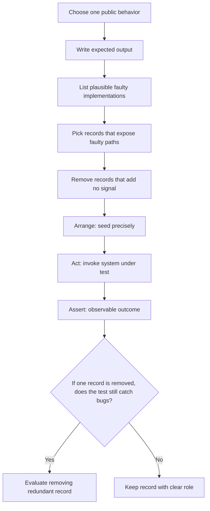

# Test Data — Creating Minimal Data to Observe One Behavior

## 1. Goal: Minimal Data That Still Catches Bugs

A good test does not need to contain huge numbers of records, users, orders, or products. It needs **just enough data to make the behavior under test observable**, while ensuring that a plausible faulty implementation produces a different result from the correct implementation.

For example: an API returns **active** products in the `books` category. If a test only creates one product `books, active=true`, all three of the following programs can PASS:

1. Return all products, with no filtering at all.
2. Filter only `category=books`, forgetting the active condition.
3. Filter both category and active properly.

A single positive witness proves that *the system can return a matching result*, but **does not prove it excludes non-matching results**. To distinguish all three implementations, add exactly two counterexamples (negative witnesses):

| Product | category | active | Role |
| --- | --- | --- | --- |
| `BOOK-OK` | `books` | `true` | Positive witness: **must appear** |
| `BOOK-OFF` | `books` | `false` | Negative witness for active condition: **must not appear** |
| `GAME-OK` | `games` | `true` | Negative witness for category condition: **must not appear** |

Expected result: `["BOOK-OK"]`. If the active condition is omitted, `BOOK-OFF` leaks in; if the category condition is omitted, `GAME-OK` leaks in. These three records form a **minimal distinguishing fixture** for filtering on two independent conditions in this example.

**“Minimal” does not mean “as few as possible regardless of quality.”** Properly minimal data means *no redundant records, yet enough counterexamples for the test to catch errors*. The minimum varies by behavior; for testing “an empty database returns an empty list,” the number of records to create is **0**.

### After This Lesson, You Can

- State a behavior and its observable condition before creating a fixture.
- Distinguish positive witnesses, negative witnesses, boundary values, and required background data.
- Choose the right amount of data for a single predicate, combined predicates, ordering, pagination, and error cases.
- Write **Arrange–Act–Assert** tests with test data created right where it is needed.
- Design independent, repeatable, and readable fixtures without relying on execution order or auto-generated IDs.
- Know when to use literal values, fixture helpers, factories/builders, Mockito stubs, `@Sql`, or Testcontainers.
- Test the real data layer with `@DataJpaTest` and the web contract separately with `@WebMvcTest`.
- Avoid confusing repository mocking with proof that a SQL/JPA query filters properly.
- Avoid hard-to-reproduce random data, shared test data, overly broad seeds, and weak assertions.

## 2. Start from Behavior, Not from the Dataset

An effective test-design workflow:



Ask questions in order:

1. **Which behavior?** For example, “return only active books, ordered by SKU ascending.”
2. **Observed where?** Service return value, HTTP JSON, or repository query?
3. **What expected outcome?** For example `["BOOK-OK"]`.
4. **If a developer forgets one condition, will the test fail?**
5. **Which assertion does each record serve?**
6. **Can a record be removed while keeping the test meaningful?**

Clarify the contract before writing fixtures. If the test vaguely checks “returns right products,” it is easy to add 20 products without knowing why 20 are needed.

### Arrange–Act–Assert

```java
// Arrange: one matching record and two counterexamples.
save("BOOK-OK",  "books", true);
save("BOOK-OFF", "books", false);
save("GAME-OK", "games", true);

// Act: invoke the feature actually under test.
List<String> visible = service.visibleSkus("books");

// Assert: exact result; no unintended data leaks in.
assertEquals(List.of("BOOK-OK"), visible);
```

This is an **illustrative snippet** without `save`/`service` declarations. The full project in Sections 8–13 includes runnable imports, entities, repository, and tests.

Do not add unrelated steps inside the same test—such as creating a user, authenticating over HTTP, building a cart, issuing an invoice, and sending an email—just to test a single filter. If the class under test is only a repository query, those steps are noise.

## 3. Minimum by Behavior: 0, 1, 2, 3, and More

| Behavior to Observe | Suggested Data Count | Why |
| --- | ---: | --- |
| Query when no records exist | **0** | Not seeding is the exact condition under test |
| One valid product is returned | **1** | Proves happy path / serialization |
| One product is excluded due to active=false | **1** | Tests a single negative predicate in isolation |
| Sorting two distinct values | **2** | One element cannot prove ordering |
| Verifying duplicate removal | **2** with the same business key | With only one, duplicates cannot be observed |
| Filtering by category **AND** active | **3** | One match + one near-miss per condition |
| Pagination size=2 with a next page | **3** records in deterministic order | Needs one record overflowing the first page |
| Checking maximum limit N | At least value/collection at N and N+1 | Needs boundary pair distinguishing valid/invalid |
| Atomic transfer | At least **2** accounts | Needs a debit side and a credit side |
| Contention on the same resource | At least 2 actors/requests | Needs interaction that triggers the race |
| Event ordering / stale version | At least 2 events with different versions | Needs to distinguish newer/older |

These are suggested counts for **each specific behavior**, not a rigid law that “every AND test always needs exactly three records.” When tenants, owners, visibility windows, soft deletes, or role permissions are involved, the number of counterexamples grows with the faulty implementations you want to catch. A single record can serve multiple assertions, but you should avoid random fixtures that violate multiple conditions at once, making it unclear which condition actually filtered it out.

### The “No Data” Test Is Often Stronger Than a Large Seed

```java
@Test
void noProductsReturnsEmptyList() {
    // Do not create any records.
    assertEquals(List.of(), service.visibleSkus("books"));
}
```

If this test starts with a `@BeforeEach` that creates 30 shared records, we destroy the empty condition. A “convenient” global fixture can prevent empty-database tests from ever running on a truly empty database.

## 4. Positive Witnesses and Negative Witnesses

A positive witness satisfies every predicate and must appear in the result. A negative witness intentionally violates one predicate and must be excluded from the result.

For `category == books && active == true`:

```text
Category:      books      books      games
Active:        true       false      true
Expected:      KEEP       DROP       DROP
Role:          positive   neg(active) neg(category)
```

**Why should each negative witness violate only one condition?** If you create `games, active=false` as the sole counterexample, it gets excluded even if the code **forgot category** or **forgot active**. The test stays green when either predicate is deleted. A “near miss” that fails only one condition detects mutations much more reliably.

A practical rule of thumb for an AND expression with N independent conditions is to create **one case satisfying all conditions and one case failing each individual condition** when the goal is catching omitted conditions. This N+1 guideline is an intuitive strategy, not a mathematical lower bound for every system or every set of mutants.

### Mutation Testing Variants

Suppose the repository has:

```java
List<Product> findByCategoryAndActiveTrueOrderBySkuAsc(
        String category);
```

Common bugs the test must detect:

| Mutation | Result on Three Records | Correct Test Must |
| --- | --- | --- |
| Active filter omitted | BOOK-OK, BOOK-OFF | FAIL |
| Category filter omitted | BOOK-OK, GAME-OK | FAIL |
| No filtering at all | All three records | FAIL |
| Only right conditions used | BOOK-OK | PASS |
| Sorting changed from ASC to DESC | Still returns BOOK-OK with one match | **Not detected**; needs separate 2-match test |
| JSON field renamed in controller | Repository still correct | Needs separate web-layer test |

Therefore, **one test with multiple negative witnesses cannot replace a sorting test**. Each behavior has its own observability conditions.

## 5. One Behavior per Test ≠ One Assert Line per Test

The “test one behavior” principle does not forbid multiple assertions. If the behavior is “return only active books,” the test can assert at the same time:

- The result contains only the SKU `BOOK-OK`.
- Neither `BOOK-OFF` nor `GAME-OK` is present.
- Order matches the contract, if ordering is part of that same behavior.

However, asserting `count == 1` is **not enough**: if the code accidentally returns `BOOK-OFF` instead of `BOOK-OK`, the count is still one. Comparing exact values or sets intentionally is stronger.

**Do not** cram unrelated behaviors into one test—such as “filters correctly, updates inventory, sends notification, and calculates shipping”—just to reduce test method counts. When it fails, it becomes hard to tell which data caused the problem.

### Reading a Test Like a Specification

Clear name:

```java
void threeRowsDistinguishCategoryAndActiveFilters()
```

Vague name:

```java
void testData1()
```

Test data should reveal **why** it exists; use meaningful SKUs (`BOOK-OK`, `BOOK-OFF`, `GAME-OK`) rather than `a1`, `a2`, `a3`, or meaningless UUIDs when they are key parts of the expected output.

## 6. Essential Properties of Minimal Test Data

### 6.1. Valid Enough to Reach the Target Behavior

To test category filtering, other fields must satisfy required contracts. If the entity requires a non-empty `sku` and valid category, do not create a record missing an SKU and let the DB reject it before the filter query runs. A “short” fixture that is **too invalid to reach the logic under test** is useless.

### 6.2. Capable of Distinguishing Right from Wrong Results

A negative witness should provide a counterexample for an anticipated mutation. Two records with the same category/active values and identical observability only inflate the dataset, unless the behavior involves duplicates, cardinality, pagination, or ordering.

### 6.3. Independent and Deterministic

Use explicit values, a fixed clock when logic depends on time, and a fixed random seed if randomness is truly needed. Avoid tests relying on pre-existing data on a developer machine, specific auto-increment IDs, or query ordering not guaranteed by the query itself.

### 6.4. Isolated Across Test Methods

`@DataJpaTest` normally runs inside a test transaction and rolls back after each test method. Never rely on Test A running before Test B to populate data. With real HTTP calls, the server runs in its own transaction, so rollback on the test thread will not automatically remove data written by the request.

### 6.5. Easy to Observe and Diagnose

When a test fails, product names and expected values should immediately identify which record leaked in. If the entire dataset is `Product("x", "x", true)`, failure messages are rarely helpful.

### 6.6. Free of Sensitive Real Data

Never copy production emails, phone numbers, tokens, passwords, accounts, or customer records into fixtures. For security API tests, use synthetic placeholders unusable outside tests, or data anonymized through an approved process.

## 7. Choose the Test Level Before Choosing the Seeding Strategy

| Test Level | Minimal Data to Use | Cannot Conclude |
| --- | --- | --- |
| Pure function unit test | Literals, records, a few values | Does not prove Spring/JPA/wiring |
| Service unit test with Mockito | One stub return for the tested interaction | Does not prove SQL/JPA query filters properly |
| `@WebMvcTest` | HTTP request and mocked service response | Does not prove real repository/SQL |
| `@DataJpaTest` | A few persisted entities with clear roles | Does not prove HTTP serializer/security |
| `@SpringBootTest` | Dataset sufficient to prove integration wiring | Does not automatically test every external service |
| Real HTTP server / Testcontainers | External resources with dedicated namespaces | Higher setup/isolation cost |
| Contract/consumer test | One message/request matching the contract | Does not prove full business behavior |

**Principle:** choose the smallest layer where the target behavior is still observable. When testing a shipping fee formula, you do not need to boot Tomcat and H2. When testing a derived JPA query, a Mockito repository returning a fake list will not catch a typo in the query method name.

Spring Boot 3.5 provides `@DataJpaTest` in `org.springframework.boot.test.autoconfigure.orm.jpa.DataJpaTest`, `@WebMvcTest` in `org.springframework.boot.test.autoconfigure.web.servlet.WebMvcTest`, and Spring Framework 6.2's `@MockitoBean` in `org.springframework.test.context.bean.override.mockito.MockitoBean`.

## 8. Runnable Project: Spring Boot 3.5, Java 17, Maven

The project has a catalog API and a simple shipping policy:

- `Product` is a JPA entity containing SKU, category, and active.
- `ProductRepository` finds active products in a category, ordered ascending by SKU.
- `CatalogService` maps entity results into a `List<String>` of SKUs.
- `CatalogController` returns a JSON array via `GET /api/catalog/visible?category=books`.
- `ShippingPolicy` is a pure Java class calculating the shipping fee when the order total reaches a threshold.
- Tests are organized by behavior to show when **0, 1, 2, or 3 records** are needed.

There is no Kafka, Docker, security, payment gateway, cron job, or large fixture file. **H2 and Hibernate schema generation are used solely to exercise data and queries** in this lesson; that is **not** a substitute for testing SQL migrations. When schema migrations are needed, write dedicated Flyway/Liquibase tests using `ddl-auto=validate`.

### 8.1. Directory Tree

```text
minimal-test-data-demo/
├── pom.xml
└── src/
    ├── main/
    │   └── java/example/testdata/
    │       ├── TestDataApplication.java
    │       ├── Product.java
    │       ├── ProductRepository.java
    │       ├── CatalogService.java
    │       ├── CatalogController.java
    │       └── ShippingPolicy.java
    └── test/
        └── java/example/testdata/
            ├── CatalogRepositoryTest.java
            ├── CatalogServiceTest.java
            ├── CatalogControllerTest.java
            └── ShippingPolicyTest.java
```

### 8.2. pom.xml

```xml
<?xml version="1.0" encoding="UTF-8"?>
<project xmlns="http://maven.apache.org/POM/4.0.0"
         xmlns:xsi="http://www.w3.org/2001/XMLSchema-instance"
         xsi:schemaLocation="http://maven.apache.org/POM/4.0.0
           https://maven.apache.org/xsd/maven-4.0.0.xsd">
    <modelVersion>4.0.0</modelVersion>

    <parent>
        <groupId>org.springframework.boot</groupId>
        <artifactId>spring-boot-starter-parent</artifactId>
        <version>3.5.0</version>
        <relativePath/>
    </parent>

    <groupId>example</groupId>
    <artifactId>minimal-test-data-demo</artifactId>
    <version>1.0-SNAPSHOT</version>

    <properties>
        <java.version>17</java.version>
    </properties>

    <dependencies>
        <dependency>
            <groupId>org.springframework.boot</groupId>
            <artifactId>spring-boot-starter-web</artifactId>
        </dependency>
        <dependency>
            <groupId>org.springframework.boot</groupId>
            <artifactId>spring-boot-starter-data-jpa</artifactId>
        </dependency>
        <dependency>
            <groupId>com.h2database</groupId>
            <artifactId>h2</artifactId>
            <scope>runtime</scope>
        </dependency>
        <dependency>
            <groupId>org.springframework.boot</groupId>
            <artifactId>spring-boot-starter-test</artifactId>
            <scope>test</scope>
        </dependency>
    </dependencies>
</project>
```

The Spring Boot parent/BOM manages JUnit Jupiter, Mockito, Hibernate, Spring Test, and H2. Do not mix Boot 4 dependencies into a 3.5 project; several test modules and imports changed across major versions.

### 8.3. TestDataApplication.java

`src/main/java/example/testdata/TestDataApplication.java`:

```java
package example.testdata;

import org.springframework.boot.SpringApplication;
import org.springframework.boot.autoconfigure.SpringBootApplication;

@SpringBootApplication
public class TestDataApplication {
    public static void main(String[] args) {
        SpringApplication.run(TestDataApplication.class, args);
    }
}
```

Placing classes in the same package lets Boot's component scan pick up the controller, service, repository, and entities by default.

### 8.4. Product.java

`src/main/java/example/testdata/Product.java`:

```java
package example.testdata;

import jakarta.persistence.Column;
import jakarta.persistence.Entity;
import jakarta.persistence.GeneratedValue;
import jakarta.persistence.GenerationType;
import jakarta.persistence.Id;
import jakarta.persistence.Table;

@Entity
@Table(name = "catalog_products")
public class Product {

    @Id
    @GeneratedValue(strategy = GenerationType.IDENTITY)
    private Long id;

    @Column(nullable = false, length = 40)
    private String sku;

    @Column(nullable = false, length = 40)
    private String category;

    @Column(nullable = false)
    private boolean active;

    protected Product() {
    }

    public Product(String sku, String category, boolean active) {
        this.sku = sku;
        this.category = category;
        this.active = active;
    }

    public Long getId() {
        return id;
    }

    public String getSku() {
        return sku;
    }

    public String getCategory() {
        return category;
    }

    public boolean isActive() {
        return active;
    }
}
```

The entity has only three business attributes to keep data selection clear; `id` is a DB-generated key. Do not assert that IDs equal 1/2/3 because sequences/identity columns can increment even when transactions roll back. Use SKU as a stable test identifier.

### 8.5. ProductRepository.java

`src/main/java/example/testdata/ProductRepository.java`:

```java
package example.testdata;

import java.util.List;
import org.springframework.data.jpa.repository.JpaRepository;

public interface ProductRepository
        extends JpaRepository<Product, Long> {

    List<Product> findByCategoryAndActiveTrueOrderBySkuAsc(
            String category);
}
```

This is a Spring Data derived query:

- `Category` = matches passed `category`.
- `AndActiveTrue` = filters `active = true` only.
- `OrderBySkuAsc` = sorts by SKU ascending.

The method name is the **query contract** tested by the JPA tests. If you mistakenly write `findByCategoryOrderBySkuAsc` without the active condition, the three-record fixture will catch it.

### 8.6. CatalogService.java

`src/main/java/example/testdata/CatalogService.java`:

```java
package example.testdata;

import java.util.List;
import org.springframework.stereotype.Service;

@Service
public class CatalogService {

    private final ProductRepository repository;

    public CatalogService(ProductRepository repository) {
        this.repository = repository;
    }

    public List<String> visibleSkus(String category) {
        return repository
                .findByCategoryAndActiveTrueOrderBySkuAsc(category)
                .stream()
                .map(Product::getSku)
                .toList();
    }
}
```

The service does not touch caches, clocks, or external systems. In the JPA slice test, the real service is added to the context with `@Import(CatalogService.class)`; in the unit test, the service is instantiated via its constructor with a mocked repository.

### 8.7. CatalogController.java

`src/main/java/example/testdata/CatalogController.java`:

```java
package example.testdata;

import java.util.List;
import org.springframework.web.bind.annotation.GetMapping;
import org.springframework.web.bind.annotation.RequestMapping;
import org.springframework.web.bind.annotation.RequestParam;
import org.springframework.web.bind.annotation.RestController;

@RestController
@RequestMapping("/api/catalog")
public class CatalogController {

    private final CatalogService service;

    public CatalogController(CatalogService service) {
        this.service = service;
    }

    @GetMapping("/visible")
    public List<String> visible(
            @RequestParam String category) {
        return service.visibleSkus(category);
    }
}
```

Spring MVC/Jackson serializes `List<String>` into a JSON array. The web layer has no reason to construct three `Product` records; web tests only need to mock a single service response to verify parameter binding and JSON serialization.

### 8.8. ShippingPolicy.java

`src/main/java/example/testdata/ShippingPolicy.java`:

```java
package example.testdata;

public class ShippingPolicy {

    private static final int FREE_FROM_VND = 500_000;
    private static final int STANDARD_FEE_VND = 30_000;

    public int feeFor(int orderTotalVnd) {
        if (orderTotalVnd < 0) {
            throw new IllegalArgumentException(
                    "orderTotalVnd must be non-negative");
        }

        return orderTotalVnd >= FREE_FROM_VND
                ? 0
                : STANDARD_FEE_VND;
    }
}
```

There is no need for customer data, orders, or JPA when the behavior is simply “shipping fee is 0 if total ≥ 500,000 VND.” A few literal inputs suffice to test the boundary. This example uses `int` for whole VND amounts; for currencies with fractional units in real applications, use a proper decimal/currency type instead of uncontrolled floating point.

## 9. JPA Slice Test: Verifying Data Where Each Record Has a Role

`src/test/java/example/testdata/CatalogRepositoryTest.java`:

```java
package example.testdata;

import static org.junit.jupiter.api.Assertions.assertEquals;

import java.util.Arrays;
import java.util.List;
import jakarta.persistence.EntityManager;
import jakarta.persistence.PersistenceContext;
import org.junit.jupiter.api.Test;
import org.springframework.beans.factory.annotation.Autowired;
import org.springframework.boot.test.autoconfigure.orm.jpa.DataJpaTest;
import org.springframework.context.annotation.Import;

@DataJpaTest
@Import(CatalogService.class)
class CatalogRepositoryTest {

    @Autowired
    ProductRepository repository;

    @Autowired
    CatalogService service;

    @PersistenceContext
    EntityManager entityManager;

    private void seed(Product... products) {
        repository.saveAll(Arrays.asList(products));
        repository.flush();
        entityManager.clear();
    }

    @Test
    void threeRowsDistinguishBothFilters() {
        seed(
            new Product("BOOK-OK",  "books", true),
            new Product("BOOK-OFF", "books", false),
            new Product("GAME-OK",  "games", true));

        List<String> result = service.visibleSkus("books");

        assertEquals(List.of("BOOK-OK"), result);
    }

    @Test
    void noSeedMeansNoMatch() {
        // No @BeforeEach seed, so an empty DB is genuinely tested.
        assertEquals(List.of(), service.visibleSkus("books"));
    }

    @Test
    void onePositiveRowProvesExistenceOnly() {
        seed(new Product("BOOK-ONE", "books", true));

        assertEquals(
                List.of("BOOK-ONE"),
                service.visibleSkus("books"));
    }

    @Test
    void twoRowsProveSortingContract() {
        // Intentionally insert in reverse SKU order to test sorting clearly.
        seed(
            new Product("BOOK-Z", "books", true),
            new Product("BOOK-A", "books", true));

        assertEquals(
                List.of("BOOK-A", "BOOK-Z"),
                service.visibleSkus("books"));
    }

    @Test
    void oneInactiveRowIsExcluded() {
        seed(new Product("BOOK-OFF", "books", false));

        assertEquals(List.of(), service.visibleSkus("books"));
    }
}
```

**There are 5 JUnit methods.** Each test chooses a dataset for one specific behavior rather than sharing a global 20-row fixture.

### 9.1. Why Are Three Records Just Enough for Combined Filtering?

`threeRowsDistinguishBothFilters` guards against two bugs:

- If the repository drops `ActiveTrue`, `BOOK-OFF` appears ⇒ assertion fails.
- If the repository drops `Category`, `GAME-OK` appears ⇒ assertion fails.
- If the code returns all rows, both leak in ⇒ fails.
- If both conditions are right, only `BOOK-OK` returns ⇒ passes.

You do not need 200 products and 5 categories to expose these two bugs. Add records only when a new behavior (pagination, multiple tenants, duplicate SKUs, etc.) demands it.

### 9.2. Why Is One Record Not Enough for Sorting?

`onePositiveRowProvesExistenceOnly` is a happy path. If `OrderBySkuAsc` changes to DESC, the result still contains one element. `twoRowsProveSortingContract` creates two **distinct** SKUs and inserts them in Z-then-A order; the contract requires A-then-Z output.

Never rely on insertion/ID order in queries without `ORDER BY`; databases **do not guarantee** natural order. This test explicitly depends on `OrderBySkuAsc`.

### 9.3. Why Flush and Clear?

`repository.flush()` forces JPA changes to be sent to the database before querying. `entityManager.clear()` clears managed entities from the first-level persistence context so results do not rely on the objects just seeded. This makes SQL behavior explicit in repository tests; for many derived queries, the framework also flushes as needed, but **explicit flush/clear makes the test easier to reason about**.

### 9.4. @DataJpaTest and Rollback

In Spring Boot 3.5, `@DataJpaTest` configures JPA repositories, embedded H2 when the driver is present, and a test transaction that **rolls back after each method** by default. Therefore tests must not rely on another test having run first, and `noSeedMeansNoMatch` genuinely observes an empty DB.

Do not add `@Order(1)`/`@Order(2)` to reuse output from an earlier test. If you switch to `@SpringBootTest(RANDOM_PORT)` and send HTTP POSTs via the server thread, the test client's transaction does not automatically roll back writes committed by the server; separate cleanup is required.

### 9.5. This Project Does Not Test Migrations

Because the focus is **test data design**, Hibernate creates tables in the slice's embedded H2 database. That does not prove Flyway/Liquibase migrations are correct. If your goal later is schema migration verification, use a migration-managed datasource and Hibernate `ddl-auto=validate`; do not conflate the two goals and draw false conclusions.

## 10. Unit Testing CatalogService: No Database Needed

`src/test/java/example/testdata/CatalogServiceTest.java`:

```java
package example.testdata;

import static org.junit.jupiter.api.Assertions.assertEquals;
import static org.mockito.Mockito.verify;
import static org.mockito.Mockito.verifyNoMoreInteractions;
import static org.mockito.Mockito.when;

import java.util.List;
import org.junit.jupiter.api.Test;
import org.junit.jupiter.api.extension.ExtendWith;
import org.mockito.InjectMocks;
import org.mockito.Mock;
import org.mockito.junit.jupiter.MockitoExtension;

@ExtendWith(MockitoExtension.class)
class CatalogServiceTest {

    @Mock
    ProductRepository repository;

    @InjectMocks
    CatalogService service;

    @Test
    void mapsRepositoryResultWithoutDatabase() {
        Product only = new Product(
                "BOOK-ONE", "books", true);

        when(repository
                .findByCategoryAndActiveTrueOrderBySkuAsc("books"))
                .thenReturn(List.of(only));

        List<String> actual = service.visibleSkus("books");

        assertEquals(List.of("BOOK-ONE"), actual);
        verify(repository)
                .findByCategoryAndActiveTrueOrderBySkuAsc("books");
        verifyNoMoreInteractions(repository);
    }

    @Test
    void emptyRepositoryResultHasNoEntities() {
        when(repository
                .findByCategoryAndActiveTrueOrderBySkuAsc("books"))
                .thenReturn(List.of());

        assertEquals(List.of(), service.visibleSkus("books"));

        verify(repository)
                .findByCategoryAndActiveTrueOrderBySkuAsc("books");
        verifyNoMoreInteractions(repository);
    }
}
```

**There are 2 unit tests.** They prove:

- The service calls the right dependency/method with the passed category.
- The service maps entities to SKUs properly.
- When the repository returns empty, the service returns empty.
- No H2 or Spring `ApplicationContext` is needed.

They **do not prove** `findByCategoryAndActiveTrueOrderBySkuAsc` actually executes SQL with the right filters. Mockito returns whatever the test predefined. That is why `CatalogRepositoryTest` must exist with three separate persisted records.

### Minimal Mock Data

A mock method stub needs **only the return values actually used**. Do not mock 12 repository methods, 5 services, and 3 HTTP clients if the code under test only executes one query. Unused stubs obscure tests, and Mockito strict stubbing will warn on unused stubs.

## 11. Web MVC Slice: Only One Service Response Needed

`src/test/java/example/testdata/CatalogControllerTest.java`:

```java
package example.testdata;

import static org.mockito.Mockito.verify;
import static org.mockito.Mockito.verifyNoInteractions;
import static org.mockito.Mockito.when;
import static org.springframework.test.web.servlet.request.MockMvcRequestBuilders.get;
import static org.springframework.test.web.servlet.result.MockMvcResultMatchers.content;
import static org.springframework.test.web.servlet.result.MockMvcResultMatchers.status;

import java.util.List;
import org.junit.jupiter.api.Test;
import org.springframework.beans.factory.annotation.Autowired;
import org.springframework.boot.test.autoconfigure.web.servlet.WebMvcTest;
import org.springframework.test.context.bean.override.mockito.MockitoBean;
import org.springframework.test.web.servlet.MockMvc;

@WebMvcTest(CatalogController.class)
class CatalogControllerTest {

    @Autowired
    MockMvc mvc;

    @MockitoBean
    CatalogService service;

    @Test
    void oneServiceResultIsEnoughToCheckJsonSerialization()
            throws Exception {
        when(service.visibleSkus("books"))
                .thenReturn(List.of("BOOK-ONE"));

        mvc.perform(get("/api/catalog/visible")
                    .param("category", "books"))
                .andExpect(status().isOk())
                .andExpect(content().json("[\"BOOK-ONE\"]"));

        verify(service).visibleSkus("books");
    }

    @Test
    void emptyServiceResultProducesEmptyArray()
            throws Exception {
        when(service.visibleSkus("books"))
                .thenReturn(List.of());

        mvc.perform(get("/api/catalog/visible")
                    .param("category", "books"))
                .andExpect(status().isOk())
                .andExpect(content().json("[]"));

        verify(service).visibleSkus("books");
    }

    @Test
    void missingRequiredParameterFailsBeforeService()
            throws Exception {
        // Do not construct any Product or Mockito stub.
        mvc.perform(get("/api/catalog/visible"))
                .andExpect(status().isBadRequest());

        verifyNoInteractions(service);
    }
}
```

**There are 3 MVC tests.** This is a classic example of “just enough data for the behavior under test”:

- Testing JSON serialization needs **one** service result.
- Testing empty JSON needs **one empty list**, no `Product` needed.
- Testing a missing required request parameter needs no data or stubs at all; assert HTTP 400 and verify the service was not called.

`@WebMvcTest` exercises MVC argument resolution and response converters in a test context without opening an HTTP socket. Spring Framework 6.2's `@MockitoBean` creates a mock bean for the controller's dependency. If you need to test a real HTTP socket, full security filter chain, or application wiring, use the appropriate integration level; **do not** add a database to an MVC test just to make fixtures look “realistic.”

## 12. Boundary Test: Minimal Numbers Instead of a Fake Database

`src/test/java/example/testdata/ShippingPolicyTest.java`:

```java
package example.testdata;

import static org.junit.jupiter.api.Assertions.assertEquals;
import static org.junit.jupiter.api.Assertions.assertThrows;

import org.junit.jupiter.api.Test;
import org.junit.jupiter.params.ParameterizedTest;
import org.junit.jupiter.params.provider.CsvSource;

class ShippingPolicyTest {

    private final ShippingPolicy policy = new ShippingPolicy();

    @ParameterizedTest
    @CsvSource({
        "0, 30000",
        "499999, 30000",
        "500000, 0",
        "500001, 0"
    })
    void boundaryIsTestedWithNumbersNotEntities(
            int amountVnd, int expectedFeeVnd) {
        assertEquals(expectedFeeVnd,
                policy.feeFor(amountVnd));
    }

    @Test
    void negativeTotalRejected() {
        assertThrows(IllegalArgumentException.class,
                () -> policy.feeFor(-1));
    }
}
```

**There are 2 method declarations but 5 executions** (4 from `@CsvSource` and 1 `@Test`).

Each chosen value serves a specific purpose:

| Value | Expected | Why Needed |
| ---: | ---: | --- |
| `0` | 30,000 | Tests lowest valid value |
| `499999` | 30,000 | Just below threshold, catches wrong `>` |
| `500000` | 0 | Exactly at threshold, catches `>` instead of `>=` |
| `500001` | 0 | Just above threshold |
| `-1` | Exception | Rejects invalid input |

You do not need an Order entity, customer, address, payment, or Spring context to test a pure Java function. `@ParameterizedTest` makes boundary data clear without duplicating test code.

## 13. Running the Project and Expected Outcomes

Requires JDK 17+, Maven, and access to download dependencies on first run. From the `minimal-test-data-demo` directory:

```bash
mvn test
```

Run each layer individually:

```bash
mvn test -Dtest=CatalogRepositoryTest
mvn test -Dtest=CatalogServiceTest
mvn test -Dtest=CatalogControllerTest
mvn test -Dtest=ShippingPolicyTest
```

| Test Class | Declared Methods | Expected Invocations | Typical Data |
| --- | ---: | ---: | --- |
| `CatalogRepositoryTest` | 5 | 5 | 0, 1, 2, or 3 persisted entities |
| `CatalogServiceTest` | 2 | 2 | 0 or 1 mocked return entity |
| `CatalogControllerTest` | 3 | 3 | 0 or 1 mocked service response |
| `ShippingPolicyTest` | 2 | 5 | Boundaries 499999/500000/500001, negative input |
| **Total** | **12** | **15** | No Docker, external APIs, or production data needed |

**Expected outcome:** 15 test invocations PASS, 0 failures/errors/skips in a compatible environment. This is the **expected** result based on the sample code, not captured stdout from an executed run. The Java code prints nothing to the console, so Maven/Spring log output may vary; read `target/surefire-reports` to verify test discovery and actual invocation counts.

Never claim “suite passes” if `mvn test` was filtered such that key tests did not run. And never bloat fixture sizes just because the test count grows: each test may choose its own small dataset.

### Why Can a Test Be Slow Even with Little Data?

Record count is not the only factor. `@WebMvcTest` and `@DataJpaTest` still initialize a Spring test context; `@SpringBootTest` is heavier still. Keeping data minimal speeds up reading and cleanup, while larger speedups usually come from **picking the right test slice and reusing contexts sensibly**, rather than squeezing every test down to one record.

## 14. When to Create a Test Data Builder or Factory?

If many tests need a valid entity with 10 required fields, repeating all constructor arguments is verbose and error-prone. A builder or helper **reduces noise**, while keeping fields that affect the tested behavior **explicit**.

Example factory:

```java
// Illustrative snippet; not part of the runnable project above.
static Product activeBook(String sku) {
    return new Product(sku, "books", true);
}
```

Reasonable when tests do not vary category or active. However, in `threeRowsDistinguishBothFilters`, writing `new Product("BOOK-OFF", "books", false)` explicitly is clearer because **active=false is the exact reason the record exists**.

### Avoid Builders That Hide Intent

Poor:

```java
// Hides many implicit defaults: hard to see why the item is kept or dropped.
var product = TestDataFactory.anyProduct();
```

Better:

```java
// Expresses the relevant predicate right inside the test.
var product = new Product("BOOK-OFF", "books", false);
```

If the domain has many unrelated fields, you can use a builder:

```java
// Illustrative snippet; builder must be defined in a real project.
var product = aValidProduct()
        .withSku("BOOK-OFF")
        .inCategory("books")
        .inactive()
        .build();
```

A builder reduces noise from unrelated fields, but should not obscure defaults like `active=true` when the test is specifically verifying active logic.

### Object Mother, Test Data Builder, Fixture Factory

| Pattern | Best When | Risk |
| --- | --- | --- |
| Inline literals / `new` object | Few fields, one clear behavior | Repetitive when models are complex |
| Helper `product(sku, category, active)` | Many tests construct valid items the same way | If too generic, obscures case-specific intent |
| Object Mother `aValidOrder()` | Complex domain object with valid defaults | Invisible defaults create implicit coupling |
| Fluent test builder | Many intentional variations | Overly complex builder becomes a mini-framework |
| `@Sql` script | Multi-table relational fixtures with references | Global SQL easily hurts cleanup and transactions |
| Factory + Testcontainers | System integration needing a real DB engine | Slower setup, requires resource isolation |
| Large production snapshot | Migration/performance/load tests | PII, large size, hard to pinpoint cases |

The best choice is the **simplest** pattern where a reader immediately understands why every value is present.

## 15. Minimal Data with Complex JPA Relationships

A test querying an `Order` belonging to a `Customer` may need to create both a `Customer` and an `Order` because the foreign key is required to save properly. Not every related record is “redundant data.”

For example, the behavior “do not show another user's orders” typically needs:

- The querying user.
- One order belonging to that user (**positive witness**).
- One order belonging to another user (**negative witness**).
- Minimal related records to satisfy FK/NOT NULL constraints.

You do not need 50 customers and 300 orders when two orders expose authorization-filtering bugs. However, **security tests must not rely solely on mocked repositories** if bugs could hide in a `WHERE` clause or JPA tenant filter. Pick the layer where the behavior is genuinely observable.

### Creating Each Object to Serve a Specific Role

```text
owner = alice
order_A.owner = alice    -> expected visible
order_B.owner = bob      -> expected hidden
query: visibleOrders(alice)
expected: [order_A]
```

This is a fixture description, not a runnable class. When code requires a tenant, add the tenant field and one near-miss for each predicate. Do not assume that testing users A/B in memory proves real database transaction-level row security.

## 16. Data Beyond SQL: @Sql, @BeforeEach, and Fixtures

### Is @Sql Always Needed?

For very small datasets, `repository.saveAll` directly in the test helps readers see the data next to the assertions. For complex schemas or stored procedures, SQL fixtures can be easier to manage:

```sql
-- Illustrative snippet, not part of the runnable project.
INSERT INTO catalog_products (sku, category, active)
VALUES
    ('BOOK-OK', 'books', TRUE),
    ('BOOK-OFF', 'books', FALSE),
    ('GAME-OK', 'games', TRUE);
```

This is **illustrative SQL**; because the project entity uses an identity ID, H2 schemas typically allow inserts omitting the ID column. For real SQL fixtures, place scripts under `src/test/resources` and use `@Sql` with proper annotation/execution order and transaction semantics; do not create SQL files just for three rows when Java test code is clearer.

### Should You Use @BeforeEach for Shared Seeding?

Only if **every test in the class genuinely needs** the exact same fixture. In the sample project:

- `noSeedMeansNoMatch` requires an empty database.
- `onePositiveRowProvesExistenceOnly` needs 1 row.
- `twoRowsProveSortingContract` needs 2 rows.
- `threeRowsDistinguishBothFilters` needs 3 rows.

If `@BeforeEach` always inserted 3 rows, all four tests would be polluted, requiring extra cleanup or convoluted expectations. Therefore, the `seed(...)` helper is **called locally** inside each test instead of seeding unconditionally.

### @Sql and Rollback

Spring `@Sql` can run before or after a method and either join or bypass the test transaction depending on `SqlConfig.TransactionMode` and configuration. Cleanup scripts can also run after a test, but require understanding execution order and transactions: if data is committed to a shared DB, another test may observe it.

Do not run `TRUNCATE`/`DELETE FROM` across an entire shared database just to reset one test's fixture. For real HTTP integration tests, the test client's transaction does not automatically roll back data committed by the server.

## 17. Time-Dependent Data, Randomness, and IDs

### Fixed Clock

When the behavior is “coupon is valid until 23:59,” creating data with `LocalDate.now()` can fail when CI crosses midnight, changes timezones, or runs slowly. Inject `Clock`:

```java
Clock clock = Clock.fixed(
        Instant.parse("2026-01-01T10:00:00Z"),
        ZoneOffset.UTC);
Instant now = Instant.now(clock);
```

This standard Java snippet requires imports for `java.time.Clock`, `Instant`, and `ZoneOffset`. In production code, the service receives `Clock` via its constructor; tests supply an explicit time. Never call `Thread.sleep` to wait for a coupon to expire when freezing or advancing a clock suffices.

### Randomness with a Fixed Seed

For property-based testing or high-volume data, randomness helps uncover unexpected inputs. However, ordinary regression tests should use **fixed, explainable values**. When using a generator, log the random seed to reproduce failures. Never generate `UUID.randomUUID()` for expected business identifiers when the UUID has nothing to do with the behavior under test.

### Auto-Generated IDs

`@GeneratedValue` does not guarantee IDs start at 1 across runs or rollbacks. Assert `id != null` when proving persistence, or query by a fixed SKU/business identifier. Never hardcode DB-generated IDs from a previous run in assertions.

### Avoid Uncontrolled Timezone/Locale Data

For accented text, case-insensitive comparisons, collations, or datetimes, minimal data must include **the exact values that distinguish the behavior**. For example, a Unicode sorting test should include two strings whose ordering is defined by the contract's collation, rather than assuming every DB sorts Vietnamese identically.

## 18. Designing Data for Boundaries and Error Branches

A test only needs one valid input for a happy path, but typically needs dedicated tests for critical partitions:

| Condition Type | Minimal Fixture | Typical Assertion |
| --- | --- | --- |
| Missing request body | No body | HTTP 400 |
| Null argument | One null (if method accepts it) | Exception or defined behavior |
| Empty collection | `List.of()` | Empty result |
| Single element | `List.of(item)` | Single-item behavior |
| Non-qualifying item | One item failing a single predicate | Excluded from result |
| Numeric threshold | `T−1`, `T`, `T+1` | Catches `>`/`>=` bugs |
| Duplicate key | Two items with same key | Proper uniqueness/rejection/dedup |
| Pagination | Page size N + one extra item | Proper `hasNext`/offset |
| Ordering | Two items with distinct keys | Proper ascending/descending order |
| Authorization | One owned resource, one unowned | No data leakage |
| Status transition | Object in initial state + transition event | Correct new state |
| Retry / idempotency | Same request ID sent twice | Single business side effect |
| Concurrent writes | Two potentially conflicting requests | Constraint/OCC protection |
| Soft delete | One active, one deleted in same scope | Deleted item excluded |

Write **a separate test** for each meaningful branch. Do not pack duplicates, pagination, status, timezones, permissions, and retries into one giant test and call it “minimal” just because it uses one setup.

### Boundary Values Should Match the Rule Exactly

For a threshold of 500,000, use 499999, 500000, and 500001—not just 100 and 1,000,000. Two values far from the threshold will pass even if the developer accidentally wrote `>` instead of `>=`.

## 19. Proving Discriminating Power: Mental Mutation Analysis

You do not need to install a mutation-testing framework right away. Ask yourself: “if I intentionally break the code this way, which test will FAIL?”

For `CatalogRepository`:

- Remove `ActiveTrue` → `threeRowsDistinguishBothFilters` FAILS because `BOOK-OFF` appears.
- Remove the category predicate → the same test FAILS because `GAME-OK` appears.
- Change `Asc` to `Desc` → `twoRowsProveSortingContract` FAILS because `BOOK-Z` comes before `BOOK-A`.
- Always return empty → `onePositiveRowProvesExistenceOnly` FAILS.
- Return an arbitrary row → `threeRowsDistinguishBothFilters` catches it if it isn't `BOOK-OK`, since the test asserts the exact SKU.
- Web controller drops query param forwarding → `CatalogControllerTest` `verify(service).visibleSkus("books")` FAILS.
- Service maps category instead of SKU → `CatalogServiceTest` FAILS expecting `BOOK-ONE`.
- Shipping uses `> 500000` instead of `>= 500000` → `ShippingPolicyTest` FAILS right at the threshold.

A record's role usually corresponds to **a mutant that tests would miss without it**. If you cannot name the mutant or branch a record serves, consider removing it from the fixture.

### Automated Mutation Testing

Tools like PIT can measure mutation scores on Java code. Still, a percentage score alone does not guarantee full coverage of business behavior. Prioritize reasoning about **critical failure branches**, security boundaries, and observable outcomes over optimizing a single metric.

## 20. Common Anti-Patterns

### 20.1. Seeding an Entire Production Sample Database

A 10,000-row `big-test-data.sql` loaded for every test makes results hard to read, fixtures brittle across schema changes, and can even mask bugs due to accidental duplicate matches.

**Fix:** use records with specific roles; large datasets belong in performance, load, or migration tests—not every unit or repository test.

### 20.2. Snapshot Assertions Without Explaining Why Data Exists

Large JSON snapshot comparisons catch differences, but readers cannot tell which fields represent core behavior. Add explicit assertions for exact values, filtered-out cases, statuses, counts, or business versions.

### 20.3. Test with 100 Records Asserting Only Count = 1

More data does not make `assertEquals(1, result.size())` stronger if a wrong record also yields count 1. When identity matters, assert exact IDs/SKUs.

### 20.4. Sharing Data Across Test Methods

One method assumes an earlier method created a user. JUnit may reorder methods or run in parallel; context caching is not transaction cleanup. Every test must establish its own preconditions.

### 20.5. Using Mockito to Test SQL Queries

A mock dutifully returns `List.of(product)` even when the SQL query has no `WHERE` clause. Mock results **cannot** prove repository filtering. Use `@DataJpaTest` with positive and negative witnesses.

### 20.6. Forcing Random Data to “Look Realistic”

Random IDs, timestamps, and names make failures hard to reproduce and can create accidental collisions. Choose clear literals; for fuzz/property-based tests, retain a reproducible seed.

### 20.7. Hiding Everything Inside Test Fixtures

`ProductFixture.defaultProduct()` might flip to `active=false` during a helper edit, breaking dozens of tests at once. For predicates directly under test, write those fields visibly inside the test.

### 20.8. Repository Tests Asserting Against the First-Level Cache

Calling `save` and immediately reading the same entity object does not prove a JPA query hit the database. In repository integration tests, flush/clear or use appropriate queries/JDBC.

### 20.9. Creating Invalid Data During Arrange

If a test aims to check a business rule but the insert fails due to `NOT NULL` or foreign-key errors, the target behavior never ran. Keep unrelated preconditions valid; use intentional negative inputs only when testing those constraints directly.

### 20.10. Using Real User Data

PII, real accounts, tokens, or production data must never be copied into fixtures for “realism.” Use controlled synthetic fixtures.

## 21. When Is Large Data Truly Required?

Do not take minimalism to extremes. Some goals **genuinely require large data**:

- Testing pagination page N and total count: enough records to fill and overflow pages.
- Query performance: data representative of cardinality, skew, indexes, and distributions.
- Migration/backfill: legacy rows in varied states, including nulls, duplicates, and outliers, to catch upgrade bugs.
- Load/concurrency: enough traffic, users, and requests to create contention and races.
- Search relevance: a corpus large enough to distinguish tokenizers, ranking, stemming, and synonyms.
- Batch processing: exceeding chunk sizes and exercising partial failures.
- Property-based testing: many generated inputs to uncover counterexamples.

Even in large tests, **every group of data must have a reason**: a benchmark dataset measures something different from a unit dataset. Never use a large corpus for a simple boolean filter test just because it happens to exist.

### Decision Rules

1. Can the behavior be proven with 0–3 records? Use them.
2. Need to verify boundaries or cardinality? Create N−1, N, or N+1.
3. Need schema interoperability or concurrency? Pick the right integration level and data topology.
4. Need performance validation? Use an intentionally shaped dataset isolated from everyday unit suites.
5. Does a data item add no bug-detection power? Remove it.

## 22. Test Data in CI and Parallel Execution

### Unique Names and Isolation

If CI runs in parallel and multiple classes share an external DB, fixed SKUs like `BOOK-OK` can collide across jobs. Solutions depend on test level:

- Embedded H2 `@DataJpaTest` with per-method rollback: as in this project, fixed SKUs keep assertions readable.
- PostgreSQL/Testcontainers: give each suite or context its own database/schema, or use a test-specific namespace.
- HTTP integration writing to a real containerized database: clean up by test-created IDs without deleting other tests' data.
- Kafka/RabbitMQ/Redis/Elasticsearch: use test-specific topic/key/index prefixes to avoid consuming events or documents from other suites.

**Never** rely on `Thread.sleep` or JUnit method ordering to avoid collisions. Isolation must come from setup and resource ownership.

### Use @DirtiesContext Only When Truly Necessary

`@DirtiesContext` forces Spring TestContext to discard a cached context, slowing down runs. It does not automatically wipe external resources such as external databases or message brokers. For JPA slices with rollback, dirtying the context after each test is usually **unnecessary**.

### Data Cleanup on Failure

If a test FAILS mid-way, cleanup must still execute. Rely on per-method rollback, `try/finally`, `@AfterEach`, or container lifecycles as appropriate. Never let an assertion failure leave dirty state for subsequent tests.

## 23. Applying This to @WebMvcTest, @DataJpaTest, and Full Context

Three test styles for the same use case:

| Question | Appropriate Test | Data Needed |
| --- | --- | --- |
| Does controller accept `category=books` and return a JSON array? | `@WebMvcTest` + `@MockitoBean` | One mocked response |
| Does service map entities to SKUs properly? | Mockito unit test | One `Product` object |
| Does repository actually filter category/active? | `@DataJpaTest` with 3 records | One positive + two near misses |
| Does service work with real repository query + mapping? | `@DataJpaTest @Import(CatalogService.class)` | Same three persisted records |
| Does REST endpoint reach real DB over HTTP socket? | `@SpringBootTest(RANDOM_PORT)` + test HTTP client | A few records/requests, must clean up |
| Are Flyway schemas applied? | DB migration test + `ddl-auto=validate` | Schema versions and upgraded data |
| Is tenant isolation enforced in queries? | Integration with security/tenant filters | One owner + one other owner, plus negative scope |
| Does external event eventually arrive? | Testcontainers + bounded polling | One event/document with clear ID/version |

Not every test needs `@SpringBootTest`. A 30-second full-context test with 50 entities adds no extra signal when a pure Java method can be verified with four numbers.

## 24. Practical Checklist

- [ ] Did you write down a specific observable behavior before creating fixtures?
- [ ] Is there a concrete expected output, not just `notNull` or `size > 0`?
- [ ] Does every record have a clear role: positive, negative, boundary, or data dependency?
- [ ] Can any record be removed without weakening mutation detection?
- [ ] When filtering multiple conditions, is there a separate near-miss for each condition?
- [ ] For sorting, are there at least two distinct values and an explicit order contract in the query?
- [ ] For pagination, does the data hit and cross the page boundary?
- [ ] For empty scenarios, is the test free of a global `@BeforeEach` seed?
- [ ] Are unrelated entity fields kept valid?
- [ ] Is test data readable, with names reflecting expected behavior?
- [ ] Are tests independent of auto-generated IDs, system time, and unseeded randomness?
- [ ] Is `@DataJpaTest` used when verifying real queries?
- [ ] Are Mockito stubs never treated as proof of SQL filtering?
- [ ] Is `@WebMvcTest` used when only verifying the request/response contract?
- [ ] Are only necessary collaborators mocked, with appropriate interaction verification?
- [ ] Are exact returned values asserted instead of just counts when identity matters?
- [ ] Are unit logic boundaries tested with T−1, T, T+1?
- [ ] Are `flush`/`clear` used in repository tests when verifying the DB path?
- [ ] Is test state reset via properly scoped rollback or cleanup?
- [ ] Are production PII and credentials absent from fixtures?
- [ ] Does CI run all required tests without sharing mutable datasets across parallel jobs?
- [ ] Is large data reserved for tests that truly need performance, migration, or concurrency?

## 25. Self-Practice Exercises

1. **Tenant filtering:** add a `tenantId` field and query by category/active/tenant. Create one match and one near-miss per predicate; justify each row.
2. **Soft delete:** add a `deleted` field; design a test that catches code forgetting `deleted=false` without adding redundant data.
3. **Pagination:** add `Pageable` with page size 2; create three sorted records and assert the first page, `hasNext`, and the second page.
4. **Sorting:** use two SKUs with the same category/active inserted in reverse order; verify ascending order regardless of DB identity ordering.
5. **Validation:** create a request DTO with `@NotBlank` and `@Min`; test one invalid field per case so the failing constraint is unambiguous.
6. **Clock:** write a coupon policy with `expiresAt`; use `Clock.fixed` to test right before and right at expiration.
7. **Idempotency:** send two requests with the same `idempotencyKey`; verify only one business side effect occurs.
8. **Mutation challenge:** temporarily remove `ActiveTrue` from the derived query; identify which test fails and which record provides the proof.
9. **Refactor fixtures:** split a global 10-record setup into per-test local datasets; compare clarity and setup speed.
10. **Layer selection:** for the same behavior, write a unit, MVC, and JPA test; explain what evidence each layer **cannot** provide.

## 26. Official References

1. [Spring Boot 3.5 — Testing Spring Boot Applications](https://docs.spring.io/spring-boot/3.5/reference/testing/spring-boot-applications.html): test slices, `@DataJpaTest`, `@WebMvcTest`, rollback, and `@MockitoBean`.
2. [Spring Boot 3.5 — Testing How-to](https://docs.spring.io/spring-boot/3.5/how-to/testing.html): MockMvc, test contexts, and slice configuration.
3. [Spring Framework 6.2 — @MockitoBean](https://docs.spring.io/spring-framework/reference/6.2/testing/annotations/integration-spring/annotation-mockitobean.html): overriding beans in tests.
4. [Spring Framework 6.2 — MockMvc](https://docs.spring.io/spring-framework/reference/6.2/testing/spring-mvc-test-framework.html): request/response assertions without an HTTP server.
5. [Spring Data JPA — Repository Query Methods](https://docs.spring.io/spring-data/jpa/reference/jpa/query-methods.html): queries derived from method names.
6. [Spring Data — Query Keywords Reference](https://docs.spring.io/spring-data/jpa/reference/repositories/query-keywords-reference.html): `True`, `And`, `OrderBy…Asc`, and other keywords.
7. [JUnit Jupiter User Guide](https://docs.junit.org/5.13.4/writing-tests/): `@Test`, `@ParameterizedTest`, `@CsvSource`, and test lifecycle.
8. [Mockito — Verify](https://site.mockito.org/): stubbing, argument verification, and interaction-based assertions.
9. [Spring Framework — TestContext Transaction Management](https://docs.spring.io/spring-framework/reference/6.2/testing/testcontext-framework/tx.html): test-managed transactions, rollback, and caveats.
10. [PIT Mutation Testing](https://pitest.org/): measuring a test suite's ability to detect small logic faults.

### Version Note

This complete project targets **Spring Boot 3.5.0 / Java 17 / Spring Framework 6.2**. Boot 4 reorganizes some test starters and packages, so look up the exact API for your version when upgrading majors rather than guessing package names. The principles of minimal distinguishing fixtures, isolated setups, negative witnesses, and behavior-focused assertions apply across versions.

**Remember:** good test data is neither the largest dataset nor a single record regardless of behavior. It is **the smallest dataset that explains why the right result is right and catches a meaningful faulty implementation**. Start from behavior → pick witnesses with clear roles → test at the right layer → assert the observable outcome.
