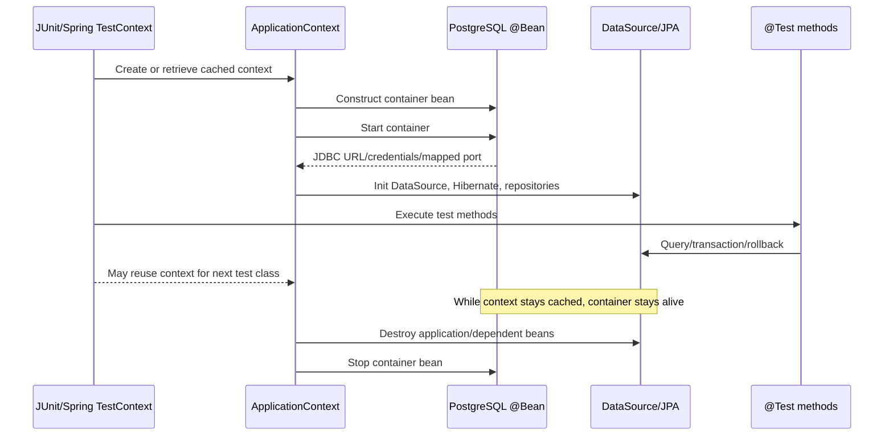

# Testcontainers — Spring-Managed Containers via @Bean in Test Configuration

## 1. The problem to solve

A Spring Boot integration test typically depends on real services such as PostgreSQL, Redis, Kafka, RabbitMQ, or Elasticsearch. Testcontainers spins up these services inside disposable Docker containers, avoiding forcing developers or CI to maintain shared servers.

There are two independent questions:

1. **Who manages the container lifecycle?** The JUnit/Testcontainers extension, a manually controlled static initializer, or **Spring's `ApplicationContext`** itself?
2. **How does Spring Boot receive the connection address?** Static properties, `@DynamicPropertySource`/`DynamicPropertyRegistrar`, or `@ServiceConnection`?

This lesson focuses on **declaring a container as a Spring bean**:

```java
@TestConfiguration(proxyBeanMethods = false)
class PostgresTestConfiguration {

    @Bean
    @ServiceConnection
    PostgreSQLContainer<?> postgresContainer() {
        return new PostgreSQLContainer<>("postgres:16-alpine");
    }
}
```

This is the core snippet; the complete project in Section 9 includes all imports, dependencies, entity, repository, configuration, and JUnit tests.

With Spring Boot 3.5, a `@Bean` whose return type is a Testcontainers `Container` enables Spring Boot to participate in **managing startup/shutdown in the right order**. `@ServiceConnection` creates `ConnectionDetails` so auto-configurations such as JDBC DataSource know the actual JDBC URL, username, and password. This annotation pair works particularly well when Spring TestContext **caches/reuses** an `ApplicationContext` across multiple test classes.

### Learning goals

- Understand the distinct roles of `@TestConfiguration`, `@Bean`, `@Import`, and `@ServiceConnection`.
- Compare bean-managed containers with the JUnit extension's `@Testcontainers + @Container`.
- Explain that the container starts **before application beans** and stops **after dependent beans are destroyed**.
- Understand that the Spring TestContext cache can keep a container alive across multiple test classes rather than restarting it on every test by default.
- Use `PostgreSQLContainer<?>` and `JdbcConnectionDetails` matching the Spring Boot version.
- Build a working Maven/Java 17 project with a real PostgreSQL container and Spring Data JPA.
- Use `@DataJpaTest` with `@AutoConfigureTestDatabase(replace = NONE)` when testing repositories on PostgreSQL.
- Avoid `@DirtiesContext`, manual `start()/stop()`, and duplicated static lifecycles when unnecessary.
- Know when to use `@ServiceConnection(name="redis")` with `GenericContainer<?>`.
- Know how to use `DynamicPropertyRegistrar` when no service-connection factory exists.
- Distinguish the Docker container, application test context, database state, and transaction cleanup.
- Diagnose container startup/readiness/connection errors and run CI reliably.

## 2. Three lifecycle layers, not one

### Layer 1: Testcontainers container

A `PostgreSQLContainer<?>` represents a PostgreSQL server in Docker. The container holds state such as image, mapped port, database name, username/password, `isRunning()` status, logs, and networking.

### Layer 2: Spring ApplicationContext

Spring Boot manages `DataSource`, the connection pool, `EntityManagerFactory`, repositories, services, and test configuration beans. Beans that depend on Postgres may need the database **already started** during initialization and still need the database **still running** during shutdown callbacks.

### Layer 3: JUnit test classes/methods

JUnit creates test instances and runs lifecycle callbacks. Spring TestContext caches contexts, so **the number of `ApplicationContext` creations does not necessarily equal the number of test classes**, and certainly does not equal the number of test methods.



**Key point in Spring Boot 3.5:** container beans are created and started before other beans, then stopped **after** other beans have been destroyed. This ordering matters because the Hikari pool/ORM/client may need to communicate with the backend during shutdown. If the JUnit extension stops a container before a cached Spring context is destroyed, the application may try to close resources against a dead backend.

### Actual lifecycle is not fixed per method

- There is no guarantee that "the container starts once for the entire Maven build."
- A **Spring `ApplicationContext`** can have one container instance managed by it.
- If Spring caches the **same** context across multiple test classes, those classes can share the container.
- If differing test annotations/profiles/properties/imports create separate contexts, there can be **multiple containers**.
- If a context is evicted from the cache due to `@DirtiesContext`, cache eviction, test forks, or when the framework closes the context, that context's container stops.
- Another container can be created when an equivalent context is rebuilt.
- A container living as long as the context **does not mean data is reset after each test method**.

## 3. Comparing container management strategies

| Declaration style | Who starts/stops? | Typical scope | Interaction with Spring context cache |
| --- | --- | --- | --- |
| `@Testcontainers` + static `@Container` | Testcontainers JUnit 5 extension | Within the test class lifecycle | Can stop while the Spring context remains cached |
| `@Testcontainers` + instance `@Container` | JUnit extension | Per test method | Startup cost; context may retain stale connections |
| Static initializer `container.start()` | Self-managed code | Until code/test process decides | Must ensure cleanup/ordering manually |
| `@TestConfiguration` + `@Bean` | **Spring Boot/Spring context** | Per `ApplicationContext` | Synchronizes container with context cache/shutdown |
| `@ImportTestcontainers` | Spring Boot declaration integration | Per imported configuration | Useful when static container declarations already exist |
| Dev launcher `SpringApplication.from(...).with(...)` | Test-classpath dev app's Spring context | While dev launcher runs | Suitable for local development; not a production container |

**Do not put `@Container` on a `@Bean` method** and do not add `@Testcontainers` to a test just to "turn on" a container bean. The two mechanisms serve separate purposes. With a bean-managed lifecycle, Spring Boot starts and stops the declared container itself; the JUnit extension **does not need** to be enabled.

### Traditional JUnit extension example

```java
// Comparison example; do not mix with the main project's @Bean.
@Testcontainers
@SpringBootTest
class OldStyleIntegrationTest {
    @Container
    @ServiceConnection
    static PostgreSQLContainer<?> postgres =
            new PostgreSQLContainer<>("postgres:16-alpine");
}
```

This code can work for **a single** test class. However, with context caching across classes, the extension can stop the container after class A, while the context/Hikari/repositories are reused by class B. Class B may hit "Connection refused" or "Failed to obtain JDBC Connection" even though the first test passed. With a Spring bean-managed container, lifecycle is bound to the cached context, avoiding this failure mode by design.

**Do not infer that every use of static `@Container` is wrong:** it is a valid approach when the test class scope is clear and no context/client beans are reused after the container stops. This lesson simply guides choosing a strategy whose lifecycle matches Spring's.

## 4. What do @TestConfiguration, @Bean, @Import, and @ServiceConnection do?

### @TestConfiguration

`org.springframework.boot.test.context.TestConfiguration` is a `@Configuration` variant for tests. Placing the file under `src/test/java` keeps dev/test containers out of the production artifact under standard Maven build conventions.

```java
@TestConfiguration(proxyBeanMethods = false)
public class PostgresTestConfiguration {
    // test-only beans
}
```

- `proxyBeanMethods=false` avoids `@Bean` method proxy overhead when there are no inter-bean method calls to intercept.
- Test configuration in test sources cleanly separates production runtime from integration test infrastructure.
- **Explicit `@Import(PostgresTestConfiguration.class)`** states which tests use the container; do not rely on `@SpringBootApplication` component scanning to pick up every `@TestConfiguration`.
- A test can import multiple configs, but should only import containers it actually needs.

### @Bean

`@Bean` registers the container in the Spring context:

```java
@Bean
PostgreSQLContainer<?> postgresContainer() {
    return new PostgreSQLContainer<>("postgres:16-alpine");
}
```

Do not manually call `postgresContainer().start()` elsewhere expecting it to be **the same bean**, especially with `proxyBeanMethods=false`: a direct Java method call constructs a brand-new object if invoked manually. Spring manages the bean created through the container factory. There is no need for `@PostConstruct`/`@PreDestroy` or `initMethod="start"`/`destroyMethod="stop"` for patterns already supported by Spring Boot Testcontainers.

**Remember:** declaring a Testcontainers `@Bean` is **different** from listing a Docker image in Docker Compose; Spring Boot provides integrated container bean lifecycle support, and the Docker daemon still must be running to launch the image.

### @ServiceConnection

`org.springframework.boot.testcontainers.service.connection.ServiceConnection` lets Spring Boot create auto-configured `ConnectionDetails` from the container.

```java
@Bean
@ServiceConnection
PostgreSQLContainer<?> postgresContainer() {
    return new PostgreSQLContainer<>("postgres:16-alpine");
}
```

For a typed PostgreSQL container, Spring Boot can generate `JdbcConnectionDetails` (and other applicable connection details when the corresponding dependencies are present). `DataSourceAutoConfiguration` consumes those JDBC details instead of requiring you to assemble the mapped port into `spring.datasource.url`.

What it does **not** do:

- Does not turn an arbitrary HTTP service into a client bean if no integration factory exists.
- Does not create tables, run migrations, or seed business data.
- Does not make JUnit automatically roll back transactions.
- Does not replace the database driver or Testcontainers module.
- Does not guarantee a fixed hostname/port (mapped host ports are typically dynamic).
- Does not verify production-like SSL, authentication, TLS, or DB privileges.

### ServiceConnection precedence

When `ConnectionDetails` exists for a service, Spring Boot auto-configuration can prioritize it over the corresponding connection-related properties. For example, if application sources define `spring.datasource.url` for local dev while the test imports a PostgreSQL container `@ServiceConnection`, `DataSource` can use the test container details instead of the static URL.

Do not write tests intentionally containing production secrets and rely on overrides for safety: test configuration must stay isolated, keeping production credentials out of the test environment.

### @Import

`@Import(PostgresTestConfiguration.class)` wires the test config into a test's context:

```java
@SpringBootTest
@Import(PostgresTestConfiguration.class)
class CustomerIntegrationTest {
}
```

You do not need `@Import` on every service or controller class. Only test classes that need real infrastructure import it; pure Mockito tests do not need Docker.

## 5. Why should the @Bean method return a specific type?

Spring Boot processes `@ServiceConnection` on a bean method **before actually instantiating the container**. To avoid eager initialization, it uses **the return type of the `@Bean` method** to select the connection-details factory.

**Good:**

```java
@Bean
@ServiceConnection
PostgreSQLContainer<?> database() {
    return new PostgreSQLContainer<>("postgres:16-alpine");
}
```

**Error-prone when service inference is needed:**

```java
@Bean
@ServiceConnection
GenericContainer<?> database() {
    return new GenericContainer<>("postgres:16-alpine");
}
```

The `GenericContainer<?>` type does not tell Boot whether this is PostgreSQL or Redis. Spring Boot does not invoke `database()` early just to read the Docker image name. Thus, connection details may not be created as expected.

For a Redis generic container:

```java
@Bean
@ServiceConnection(name = "redis")
GenericContainer<?> redisContainer() {
    return new GenericContainer<>("redis:7-alpine")
            .withExposedPorts(6379);
}
```

`name="redis"` gives Spring Boot a service hint to select `RedisConnectionDetails` when a matching factory and Spring's Redis dependency are on the classpath. **This is an excerpt**, not a runnable Redis project; you must add the Redis starter, Testcontainers dependencies, and declare the bean inside an actual test configuration.

For private/mirrored images, `@ServiceConnection(name="postgres")` or the corresponding service name is sometimes required, because the image repository name may no longer match the default name. A typed container is usually enough to infer the factory from its return type.

## 6. TestContext cache and shutdown ordering

Spring TestContext maintains an application-context cache. If two test classes share the same configuration, active profiles, test properties, imported context, and other cache-key elements, Spring can reuse the same cached context.

```text
CustomerRepositoryIntegrationTest ---\
                                   > Spring Context A ----> Postgres bean A
CustomerServiceIntegrationTest ----/
OtherTests (different profile) --------> Spring Context B -> Postgres bean B
```

This is a **conceptual diagram**, not a claim that two classes in every project always share exactly one context. Caching can be affected by customizers, mocks, dynamic properties, profiles, and test process ordering.

### Benefits

- No need to start a fresh PostgreSQL instance for every method or class.
- Expensive startup cost is amortized across tests sharing the context.
- DataSource/JPA clients share the same lifecycle as the service.
- When the context closes, application beans are destroyed before the container.

### Trade-offs

- **Database state can be shared** across tests using the same context.
- Test A can leave a customer behind if a committed INSERT is not rolled back.
- A test calling `container.stop()` will break connections for **the entire context**.
- `@DirtiesContext` closes the context and can cause a new container to start, forfeiting cache benefits.
- Different context keys ⇒ separate PostgreSQL containers can be created, even when classes import the same config file.

### Proper cleanup

For repository/JPA tests, use test-level `@Transactional` or `@DataJpaTest`'s default rollback where appropriate. With HTTP `RANDOM_PORT`, server requests run in a separate transaction; test-thread rollback **does not automatically revert** rows committed by the server.

When testing commits or asynchronous consumers, use test-specific IDs, `@AfterEach` cleanup for owned data only, or reset disposable schemas per policy — never call `postgres.stop()` after each method.

### `@DirtiesContext` is not `@Rollback`

`@DirtiesContext` tells Spring that the context should not be reused. It does **not** automatically wipe external databases, Kafka topics, Redis keys, or Elasticsearch indexes (unless those resources are owned by the destroyed context/container). Use it when a test alters context configuration or unresettable bean state, not merely because a database row was inserted.

## 7. Choosing exact dependencies for Spring Boot 3.5

The main project uses:

- Spring Boot **3.5.0** parent and **Java 17**.
- `spring-boot-starter-data-jpa` for JPA/Hibernate/DataSource.
- `org.postgresql:postgresql` for the JDBC driver.
- `spring-boot-starter-test` for JUnit Jupiter/Spring Test/AssertJ/Mockito.
- `spring-boot-testcontainers` for `@ServiceConnection` and container bean integration.
- `org.testcontainers:postgresql` for `PostgreSQLContainer<?>`.

**`org.testcontainers:junit-jupiter` is not required** if you only use `@Bean` containers and do not use JUnit `@Testcontainers/@Container`. If another part of the project uses JUnit extension tests, that module can be added separately.

Versions are coordinated by Spring Boot's dependency management/BOM; do not mix Testcontainers 2.x API imports with Boot 3.5/Testcontainers 1.x. When upgrading Boot major versions, verify library/import changes — notably, the PostgreSQL container class changed packages in Testcontainers 2.x.

## 8. Architecture of the sample project

The application has a `customers` table:

- `Customer` entity with a unique email, `ACTIVE` status, and a generated ID.
- `CustomerRepository` using real Spring Data JPA.
- `CustomerService.register(email)` normalizes the email and persists via the repository.
- `PostgresTestConfiguration` provides the PostgreSQL container as a Spring bean.
- Three JUnit classes verify connectivity, repository/constraint enforcement, and the service, including one JPA test slice.
- All tests use **real PostgreSQL in Docker**, not H2.
- Database tables are created via Hibernate `create-drop` **solely to demonstrate lifecycle/JPA**. This is not a Flyway migration test; production should use Flyway/Liquibase and `ddl-auto=validate`.

There is no web controller so HTTP networking is kept out of a lesson focused on Spring-managed Testcontainers.

### Directory tree

```text
spring-managed-container-demo/
├── pom.xml
└── src/
    ├── main/
    │   └── java/example/managedcontainer/
    │       ├── ManagedContainerApplication.java
    │       ├── Customer.java
    │       ├── CustomerRepository.java
    │       └── CustomerService.java
    └── test/
        ├── resources/
        │   └── application-test.properties
        └── java/example/managedcontainer/
            ├── PostgresTestConfiguration.java
            ├── ContainerLifecycleIntegrationTest.java
            ├── CustomerServiceIntegrationTest.java
            └── CustomerJpaSliceTest.java
```

## 9. Complete runnable code — Java 17 / Spring Boot 3.5 / PostgreSQL

### 9.1. pom.xml

```xml
<?xml version="1.0" encoding="UTF-8"?>
<project xmlns="http://maven.apache.org/POM/4.0.0"
         xmlns:xsi="http://www.w3.org/2001/XMLSchema-instance"
         xsi:schemaLocation="http://maven.apache.org/POM/4.0.0
             https://maven.apache.org/xsd/maven-4.0.0.xsd">
    <modelVersion>4.0.0</modelVersion>

    <parent>
        <groupId>org.springframework.boot</groupId>
        <artifactId>spring-boot-starter-parent</artifactId>
        <version>3.5.0</version>
        <relativePath/>
    </parent>

    <groupId>example</groupId>
    <artifactId>spring-managed-container-demo</artifactId>
    <version>1.0-SNAPSHOT</version>

    <properties>
        <java.version>17</java.version>
    </properties>

    <dependencies>
        <dependency>
            <groupId>org.springframework.boot</groupId>
            <artifactId>spring-boot-starter-data-jpa</artifactId>
        </dependency>

        <dependency>
            <groupId>org.postgresql</groupId>
            <artifactId>postgresql</artifactId>
            <scope>runtime</scope>
        </dependency>

        <dependency>
            <groupId>org.springframework.boot</groupId>
            <artifactId>spring-boot-starter-test</artifactId>
            <scope>test</scope>
        </dependency>

        <dependency>
            <groupId>org.springframework.boot</groupId>
            <artifactId>spring-boot-testcontainers</artifactId>
            <scope>test</scope>
        </dependency>

        <dependency>
            <groupId>org.testcontainers</groupId>
            <artifactId>postgresql</artifactId>
            <scope>test</scope>
        </dependency>
    </dependencies>
</project>
```

**Explanation:**

- `spring-boot-starter-data-jpa` brings in Hibernate, Spring Data JPA, and JDBC datasource support.
- `postgresql` runtime driver allows the app/tests to open JDBC connections.
- `spring-boot-testcontainers` adds Boot integration for service connections and container bean lifecycle.
- `org.testcontainers:postgresql` provides the typed PostgreSQL container.
- `spring-boot-starter-test` provides JUnit/Spring testing support.
- `org.testcontainers:junit-jupiter` is absent because the project does not use the JUnit Testcontainers extension.

**Runtime requirement:** A Testcontainers-compatible Docker/Podman runtime must be ready; the first run may need to pull `postgres:16-alpine`. Running `mvn test` genuinely requires a container runtime. If tests are skipped because Docker is missing, do not treat the suite as verified.

### 9.2. ManagedContainerApplication.java

`src/main/java/example/managedcontainer/ManagedContainerApplication.java`:

```java
package example.managedcontainer;

import org.springframework.boot.SpringApplication;
import org.springframework.boot.autoconfigure.SpringBootApplication;

@SpringBootApplication
public class ManagedContainerApplication {

    public static void main(String[] args) {
        SpringApplication.run(ManagedContainerApplication.class, args);
    }
}
```

The main application lives in `src/main`; test-only container config sits separately in `src/test`. Component scanning automatically finds JPA entities, services, and repositories under the main package.

### 9.3. Customer.java

`src/main/java/example/managedcontainer/Customer.java`:

```java
package example.managedcontainer;

import jakarta.persistence.Column;
import jakarta.persistence.Entity;
import jakarta.persistence.GeneratedValue;
import jakarta.persistence.GenerationType;
import jakarta.persistence.Id;
import jakarta.persistence.Table;
import jakarta.persistence.UniqueConstraint;

@Entity
@Table(
    name = "customers",
    uniqueConstraints = @UniqueConstraint(
        name = "uk_customers_email",
        columnNames = "email"
    )
)
public class Customer {

    @Id
    @GeneratedValue(strategy = GenerationType.IDENTITY)
    private Long id;

    @Column(nullable = false, length = 160)
    private String email;

    @Column(nullable = false, length = 24)
    private String status;

    protected Customer() {
        // JPA required constructor.
    }

    public Customer(String email, String status) {
        this.email = email;
        this.status = status;
    }

    public Long getId() {
        return id;
    }

    public String getEmail() {
        return email;
    }

    public String getStatus() {
        return status;
    }
}
```

- `@Entity` and `@Table` map to the `customers` table.
- Unique constraint on `email` allows testing a **real database** property.
- `@GeneratedValue(IDENTITY)` fits PostgreSQL identity handling managed by Hibernate in the demo.
- `protected` no-arg constructor for JPA.
- Emails are synthetic values in `example.test`, never production addresses.

### 9.4. CustomerRepository.java

`src/main/java/example/managedcontainer/CustomerRepository.java`:

```java
package example.managedcontainer;

import java.util.Optional;
import org.springframework.data.jpa.repository.JpaRepository;

public interface CustomerRepository
        extends JpaRepository<Customer, Long> {

    Optional<Customer> findByEmail(String email);
}
```

This repo is **never mocked** in the integration tests, so SQL truly travels to the PostgreSQL container.

### 9.5. CustomerService.java

`src/main/java/example/managedcontainer/CustomerService.java`:

```java
package example.managedcontainer;

import java.util.Locale;
import org.springframework.stereotype.Service;
import org.springframework.transaction.annotation.Transactional;

@Service
public class CustomerService {

    private final CustomerRepository repository;

    public CustomerService(CustomerRepository repository) {
        this.repository = repository;
    }

    @Transactional
    public Long register(String rawEmail) {
        if (rawEmail == null || rawEmail.isBlank()) {
            throw new IllegalArgumentException(
                "email must not be blank");
        }

        String normalized =
                rawEmail.strip().toLowerCase(Locale.ROOT);

        Customer saved = repository.saveAndFlush(
                new Customer(normalized, "ACTIVE"));

        return saved.getId();
    }
}
```

`saveAndFlush` forces Hibernate to execute SQL within the transaction. Java 17 `strip()` and `Locale.ROOT` ensure deterministic normalization without complex locale rules. In production, email normalization requires explicit domain rules rather than assuming "lowercase the entire local-part"; the sample exists solely to test the service plus real database.

### 9.6. application-test.properties

`src/test/resources/application-test.properties`:

```properties
# Demo only: Hibernate generates the schema inside a disposable PostgreSQL.
spring.jpa.hibernate.ddl-auto=create-drop
spring.jpa.open-in-view=false

# Do not run schema.sql/data.sql competing with Hibernate.
spring.sql.init.mode=never

# Container beans start sequentially by default.
spring.testcontainers.beans.startup=sequential
spring.main.banner-mode=off
```

We **do not declare `spring.datasource.url` or pin port 5432**. `@ServiceConnection` passes JDBC connection details from the started container to Boot auto-config. With multiple containers, `spring.testcontainers.beans.startup=parallel` can start them concurrently when independent, but should not be enabled when startup order matters (for instance, when a network/broker/sidecar must be ready first).

In production applications, manage schemas with Flyway/Liquibase and set `ddl-auto=validate` instead of relying on `create-drop`. This lesson intentionally separates container bean lifecycle from migration mechanics.

### 9.7. PostgresTestConfiguration.java — the centerpiece

`src/test/java/example/managedcontainer/PostgresTestConfiguration.java`:

```java
package example.managedcontainer;

import org.springframework.boot.test.context.TestConfiguration;
import org.springframework.boot.testcontainers.service.connection.ServiceConnection;
import org.springframework.context.annotation.Bean;
import org.testcontainers.containers.PostgreSQLContainer;

@TestConfiguration(proxyBeanMethods = false)
public class PostgresTestConfiguration {

    @Bean
    @ServiceConnection
    PostgreSQLContainer<?> postgresContainer() {
        return new PostgreSQLContainer<>("postgres:16-alpine")
                .withDatabaseName("integration_db")
                .withUsername("test_user")
                .withPassword("test_pass");
    }
}
```

**Line-by-line breakdown:**

- File lives in `src/test/java` so the test container is not packaged with main production code.
- `@TestConfiguration(proxyBeanMethods=false)` allows importing the configuration into Spring tests.
- `@Bean` registers the `PostgreSQLContainer<?>` instance in the context.
- Specific return type `PostgreSQLContainer<?>` lets Boot infer the connection-details factory.
- `@ServiceConnection` creates `JdbcConnectionDetails`.
- Image `postgres:16-alpine` pins the major version instead of using `postgres:latest` (the tag can still receive patch updates over time; production fidelity calls for pinning versions/image digests where appropriate).
- `withDatabaseName`, `withUsername`, and `withPassword` configure values for a **disposable test database**, not a production account.
- No `postgres.start()`, `postgres.stop()`, `@Testcontainers`, or `@Container` is needed: lifecycle belongs to Spring Boot's container-bean support.
- No `@DynamicPropertySource` is needed for JDBC under this pattern.
- `withReuse(true)` is not enabled because we want deterministic test-environment isolation.

### Why not add initMethod/destroyMethod?

Spring Boot Testcontainers supports container beans with its own lifecycle: creating/starting them before dependent beans and stopping them after other beans are destroyed. Adding custom lifecycle callbacks or calling start/stop in JUnit hooks risks double-managed lifecycles, wrong ordering, or a container still referenced in context while already dead in Docker.

### Connections can change ports across runs

Docker usually maps internal PostgreSQL port 5432 to a **dynamic host port**. For instance, the port number is not known upfront; service connection obtains it from the container. Never hardcode `localhost:5432` or `localhost:randomKnownPort` in tests.

## 10. Integration test 1 — container alive while DataSource/JPA are ready

`src/test/java/example/managedcontainer/ContainerLifecycleIntegrationTest.java`:

```java
package example.managedcontainer;

import static org.junit.jupiter.api.Assertions.assertEquals;
import static org.junit.jupiter.api.Assertions.assertNotNull;
import static org.junit.jupiter.api.Assertions.assertThrows;
import static org.junit.jupiter.api.Assertions.assertTrue;

import java.sql.Connection;
import java.sql.SQLException;

import javax.sql.DataSource;
import jakarta.persistence.EntityManager;
import jakarta.persistence.PersistenceContext;

import org.junit.jupiter.api.Test;
import org.springframework.beans.factory.annotation.Autowired;
import org.springframework.boot.autoconfigure.jdbc.JdbcConnectionDetails;
import org.springframework.boot.test.context.SpringBootTest;
import org.springframework.context.annotation.Import;
import org.springframework.dao.DataIntegrityViolationException;
import org.springframework.jdbc.core.JdbcTemplate;
import org.springframework.test.context.ActiveProfiles;
import org.springframework.transaction.annotation.Transactional;
import org.testcontainers.containers.PostgreSQLContainer;

@SpringBootTest
@ActiveProfiles("test")
@Import(PostgresTestConfiguration.class)
class ContainerLifecycleIntegrationTest {

    @Autowired
    PostgreSQLContainer<?> postgres;

    @Autowired
    JdbcConnectionDetails connectionDetails;

    @Autowired
    DataSource dataSource;

    @Autowired
    JdbcTemplate jdbc;

    @Autowired
    CustomerRepository repository;

    @PersistenceContext
    EntityManager entityManager;

    @Test
    void springStartsBeanContainerBeforeDataSourceIsUsed()
            throws SQLException {
        assertTrue(postgres.isRunning());

        // Service connection must be backed by the real PostgreSQLContainer.
        assertTrue(connectionDetails.getJdbcUrl()
                .startsWith("jdbc:postgresql:"));

        assertEquals(postgres.getDatabaseName(),
                jdbc.queryForObject(
                    "SELECT current_database()", String.class));

        try (Connection connection = dataSource.getConnection()) {
            assertTrue(connection.isValid(2));
            assertEquals("PostgreSQL",
                    connection.getMetaData()
                              .getDatabaseProductName());
        }
    }

    @Test
    @Transactional
    void repositoryPersistsIntoRealPostgres() {
        Customer saved = repository.saveAndFlush(
                new Customer("repo@example.test", "ACTIVE"));

        assertNotNull(saved.getId());

        // Clear first-level cache, forcing the query to read from DB.
        entityManager.clear();

        Customer loaded = repository
                .findByEmail("repo@example.test")
                .orElseThrow();

        assertEquals("ACTIVE", loaded.getStatus());
        assertEquals("repo@example.test", loaded.getEmail());
        // Spring test transaction rolls back after the method.
    }

    @Test
    @Transactional
    void databaseUniqueConstraintRejectsDuplicateEmail() {
        repository.saveAndFlush(
                new Customer("duplicate@example.test", "ACTIVE"));

        assertThrows(DataIntegrityViolationException.class,
                () -> repository.saveAndFlush(
                    new Customer("duplicate@example.test", "ACTIVE")));

        // After a constraint error in PostgreSQL, the current transaction
        // can enter an aborted state. Do not run further SQL in this method.
        // Test-managed rollback cleans up the transaction on exit.
    }
}
```

**Three JUnit methods** prove:

1. The `@Bean` container started before Spring's `DataSource` was used, because the `DataSource` and real queries work.
2. `@ServiceConnection` supplies the PostgreSQL JDBC URL and matching target DB name.
3. The repository operates against real PostgreSQL, not H2.
4. Flushed entities can be read back after `entityManager.clear()`.
5. The unique constraint is enforced by the database.

One practical detail: when PostgreSQL raises a constraint violation inside an explicit transaction, the transaction can be marked aborted; any subsequent queries in the same transaction fail until rollback. Thus, the duplicate test uses only `assertThrows` and lets Spring roll back. Do not run additional SELECTs after the expected failure.

**Do not claim this test directly observed destroy-callback ordering.** The test proves the database is alive when clients are created and used; Spring Boot's shutdown ordering is documented by the framework and requires dedicated instrumentation if you genuinely need to assert shutdown order.

## 11. Integration test 2 — real service and potentially reusable context

`src/test/java/example/managedcontainer/CustomerServiceIntegrationTest.java`:

```java
package example.managedcontainer;

import static org.junit.jupiter.api.Assertions.assertEquals;
import static org.junit.jupiter.api.Assertions.assertNotNull;
import static org.junit.jupiter.api.Assertions.assertThrows;
import static org.junit.jupiter.api.Assertions.assertTrue;

import org.junit.jupiter.api.Test;
import org.springframework.beans.factory.annotation.Autowired;
import org.springframework.boot.test.context.SpringBootTest;
import org.springframework.context.annotation.Import;
import org.springframework.test.context.ActiveProfiles;
import org.springframework.transaction.annotation.Transactional;
import org.testcontainers.containers.PostgreSQLContainer;

@SpringBootTest
@ActiveProfiles("test")
@Import(PostgresTestConfiguration.class)
class CustomerServiceIntegrationTest {

    @Autowired
    PostgreSQLContainer<?> postgres;

    @Autowired
    CustomerService service;

    @Autowired
    CustomerRepository repository;

    @Test
    @Transactional
    void serviceRegistersCustomerUsingRealDatabase() {
        assertTrue(postgres.isRunning());

        Long id = service.register("  USER@EXAMPLE.TEST ");
        assertNotNull(id);

        Customer saved = repository
                .findByEmail("user@example.test")
                .orElseThrow();

        assertEquals(id, saved.getId());
        assertEquals("ACTIVE", saved.getStatus());
    }

    @Test
    void blankInputIsRejectedBeforeDatabaseWrite() {
        assertThrows(IllegalArgumentException.class,
                () -> service.register("   "));
    }
}
```

**Two JUnit methods** verify service logic and wiring:

- `service.register` genuinely normalizes the email and writes through the real repository.
- `postgres.isRunning()` confirms the backend is up in the second class's method.
- `@Transactional` on the test method creates an outer transaction around the service's default `REQUIRED` transaction and rolls back at the end.
- The invalid input case fails before `saveAndFlush`; no data seeding is needed when testing input validation.
- These two classes have compatible context configurations and **can** share a cached context and single container bean via Spring TestContext. The test **does not assert how many times the container was created**, because the framework might not reuse if cache keys differ, eviction occurs, or CI forks differ.

### How to actually verify context reuse when needed

If the goal is verifying cache infrastructure (distinct from business logic):

1. Enable test context cache logging at `DEBUG` level.
2. Observe cache hits/misses and bean factory/container identity within **the same JVM**.
3. Ensure both test classes have identical `@SpringBootTest` config, `@Import`, active profiles, properties, and mocks.
4. Avoid `@DirtiesContext` when not needed.
5. Do not rely on "two test classes run back-to-back" as a test assertion, because JUnit ordering makes no such guarantee.
6. Do not introduce `container.getMappedPort(...)` into cache keys arbitrarily via dynamic properties on each class.

## 12. JPA slice test — `@DataJpaTest` can also import a `@Bean` container

`@DataJpaTest` loads only the JPA slice instead of the whole application context. When you want real PostgreSQL instead of H2, add `@AutoConfigureTestDatabase(replace = NONE)` and import the container bean configuration.

`src/test/java/example/managedcontainer/CustomerJpaSliceTest.java`:

```java
package example.managedcontainer;

import static org.junit.jupiter.api.Assertions.assertEquals;
import static org.junit.jupiter.api.Assertions.assertTrue;

import org.junit.jupiter.api.Test;
import org.springframework.beans.factory.annotation.Autowired;
import org.springframework.boot.test.autoconfigure.jdbc.AutoConfigureTestDatabase;
import org.springframework.boot.test.autoconfigure.orm.jpa.DataJpaTest;
import org.springframework.context.annotation.Import;
import org.springframework.test.context.ActiveProfiles;
import org.testcontainers.containers.PostgreSQLContainer;

@DataJpaTest
@AutoConfigureTestDatabase(
        replace = AutoConfigureTestDatabase.Replace.NONE)
@ActiveProfiles("test")
@Import(PostgresTestConfiguration.class)
class CustomerJpaSliceTest {

    @Autowired
    PostgreSQLContainer<?> postgres;

    @Autowired
    CustomerRepository repository;

    @Test
    void jpaSliceUsesPostgreSqlContainer() {
        assertTrue(postgres.isRunning());

        repository.saveAndFlush(
                new Customer("slice@example.test", "ACTIVE"));

        Customer customer = repository
                .findByEmail("slice@example.test")
                .orElseThrow();

        assertEquals("ACTIVE", customer.getStatus());
    }
}
```

**One JUnit method**. `@DataJpaTest` manages a test transaction by default and rolls it back after the method. With `Replace.NONE`, Boot does not replace the `DataSource` supplied by the container's service connection with an embedded H2 datasource.

A slice test **is unlikely to share the same context** as the two `@SpringBootTest` classes because bootstrap/test-slice auto-config differs; it may start **a second PostgreSQL container**. That is the right trade-off: the slice loads fewer application beans while still using a real database.

### Why use a typed PostgreSQLContainer bean in the slice?

- The same config class can be reused across multiple test styles.
- The return type is recognized by Boot for service-connection factories.
- Repository tests run real SQL on PostgreSQL instead of relying on H2 compatibility mode.
- Do not add `@Testcontainers`/`@Container` just because a test class is a slice.

## 13. Running the build and expected outcomes

Requirements:

- JDK 17+, Maven, sufficient CPU/RAM.
- Docker/Podman container runtime compatible with Testcontainers.
- Permission to pull `postgres:16-alpine` on first run; digests can be pinned if needed.
- Project files placed at their exact paths in the directory tree.
- No hardcoded local/production JDBC URL in the test profile.

Command:

```bash
mvn test
```

Run individual classes:

```bash
mvn test -Dtest=ContainerLifecycleIntegrationTest
mvn test -Dtest=CustomerServiceIntegrationTest
mvn test -Dtest=CustomerJpaSliceTest
```

Test counts:

| Class | Number of methods | Evidence |
| --- | ---: | --- |
| `ContainerLifecycleIntegrationTest` | 3 | Bean container running, PostgreSQL connection, JPA persistence, UNIQUE |
| `CustomerServiceIntegrationTest` | 2 | Real service normalization, input rejection |
| `CustomerJpaSliceTest` | 1 | Slice test using PostgreSQL container, rollback |
| **Total** | **6** | 6 expected JUnit invocations |

**Expected: 6 tests PASS, 0 failures/errors/skips** in a compatible environment, though this is **not an already executed result** in the lesson. Docker image downloads and context startup can make the first run slower than subsequent ones. Inspect `target/surefire-reports` to verify execution counts, skips, root causes, and confirm both context types actually initialized.

### No fixed stdout

The example makes no `System.out.println` calls, so no fake stdout is shown. Maven, Hikari, Hibernate, and Docker/Testcontainers produce environment-dependent logs; test assertions are the meaningful output. Never hardcode mapped ports, container IDs, or startup durations.

### What proves the container is Spring-managed?

- The `@Bean` method exists inside `@TestConfiguration` and is `@Import`ed into tests.
- Tests use neither `@Testcontainers`/`@Container` nor manual `start()`.
- The Spring context creates the container bean and the JDBC client works when tests run.
- The container is not stopped between test methods while the context remains in use.
- Per Spring Boot 3.5's contract, the container bean is stopped when its `ApplicationContext` is destroyed.

Note: **a test asserting only `isRunning()` does not prove shutdown order**. Combine documentation knowledge with wiring behavior; if you want to verify exact shutdown order, build dedicated instrumentation/lifecycle listeners in test infrastructure rather than pretending an assertion at the end of a test method proves it.

## 14. When there is no @ServiceConnection factory: use DynamicPropertyRegistrar

Not every arbitrary backend has `ConnectionDetails` support. With a `GenericContainer<?>` running a mock HTTP service or custom image, you can register properties from **a Spring-managed container bean**.

Spring Framework 6.2 provides `org.springframework.test.context.DynamicPropertyRegistrar`. Spring Boot 3.5 documentation shows creating a registrar bean accepting the container as a constructor/method argument to ensure the container is ready when reading host/mapped port.

Snippet **outside the main runnable PostgreSQL POM**:

```java
import org.springframework.boot.test.context.TestConfiguration;
import org.springframework.context.annotation.Bean;
import org.springframework.test.context.DynamicPropertyRegistrar;
import org.testcontainers.containers.GenericContainer;

@TestConfiguration(proxyBeanMethods = false)
class CustomHttpContainerConfiguration {

    @Bean
    GenericContainer<?> stubServer() {
        return new GenericContainer<>("wiremock/wiremock:3.9.2")
                .withExposedPorts(8080);
    }

    @Bean
    DynamicPropertyRegistrar stubServerProperties(
            GenericContainer<?> stubServer) {
        return registry ->
                registry.add(
                    "external.service.base-url",
                    () -> "http://" + stubServer.getHost() + ":"
                            + stubServer.getMappedPort(8080));
    }
}
```

- `DynamicPropertyRegistrar` is a Spring bean receiving `GenericContainer<?>` via dependency injection.
- A supplier is registered via `registry.add`, obtaining the container's host and mapped port.
- Property `external.service.base-url` is an **application-specific example name**, not a default Spring Boot property; your client bean must read and use it.
- With a generic container, declare exposed ports and readiness appropriate to the app.
- Add matching container image/custom client dependencies if running this snippet.
- Do not mix `@ServiceConnection` and remapping **the same** JDBC datasource properties unless there is a clear precedence reason and precedence is verified.
- `DynamicPropertyRegistrar` fits bean-managed lifecycles; static `@DynamicPropertySource` is usually more convenient for containers declared as static fields.

### When to use @DynamicPropertySource?

```java
// Snippet for the static-field pattern; do not use with the main @Bean.
@DynamicPropertySource
static void dbProperties(DynamicPropertyRegistry registry) {
    registry.add("spring.datasource.url", postgres::getJdbcUrl);
    registry.add("spring.datasource.username", postgres::getUsername);
    registry.add("spring.datasource.password", postgres::getPassword);
}
```

For this code to run, the test class needs a suitable `postgres` field and resolved startup lifecycle. **Do not copy a static-field snippet into a test using an instance `@Bean`** assuming it can reference a non-static bean during bootstrap.

Prefer `@ServiceConnection` when the technology is supported; use dynamic properties when custom endpoints or settings are needed beyond what connection-details factories provide.

## 15. Multiple @Bean containers and parallel startup

An application may need PostgreSQL + Redis + Kafka:

```java
@TestConfiguration(proxyBeanMethods = false)
class MultiContainerConfiguration {

    @Bean
    @ServiceConnection
    PostgreSQLContainer<?> postgres() {
        return new PostgreSQLContainer<>("postgres:16-alpine");
    }

    @Bean
    @ServiceConnection(name = "redis")
    GenericContainer<?> redis() {
        return new GenericContainer<>("redis:7-alpine")
                .withExposedPorts(6379);
    }
}
```

This is an **excerpt**; to make it runnable, add imports, the Redis starter, and corresponding test dependencies. `PostgreSQLContainer<?>` is a typed container; `GenericContainer<?>` needs `name="redis"`. Boot can automatically supply JDBC/Redis connection details when the corresponding auto-configurations are present.

Spring Boot 3.5 starts container beans **sequentially** by default and provides the property:

```properties
spring.testcontainers.beans.startup=parallel
```

Only use `parallel` when containers are independent and resources suffice. If service A requires B (e.g., app bootstrap depends on broker schema setup), parallel startup can cause races. Even when a container is "running," the application inside still must be **ready**: typed Testcontainers use specialized readiness strategies, while custom `GenericContainer` instances may need `waitingFor(Wait.forHttp(...))` or log/healthcheck waits.

### Choosing the right containers per test

- `@DataJpaTest`: typically needs only PostgreSQL.
- REST controller `@WebMvcTest` with mocked service: **does not need** PostgreSQL/Redis/Kafka.
- Full workflow test: may need all services.
- Kafka consumer test: Kafka container plus DB if persisting/committing data.
- Search projection test: Elasticsearch plus event source, if testing end-to-end.

Do not put every container into a single "GlobalTestConfiguration" for all test slices out of convenience; startup time, memory, and complexity will balloon.

## 16. Impact of @DirtiesContext and parallel JUnit

### @DirtiesContext

`@DirtiesContext` can cause the Spring context to close after a method/class, container beans to stop, and a new context/container to be created when a subsequent matching test runs. That is **lifecycle-correct**, yet very slow if used as routine "DB cleanup."

Prefer transaction rollback, test-specific IDs, schema cleanup, or disposable containers. Dirty the context only when a test modifies bean definitions, environment, or singleton state in a way that cannot be safely reset.

### Parallel tests

When running JUnit in parallel across test classes sharing a context/database:

- Test-level `@Transactional` rollback isolates much DML, yet concurrent tests can still contend on constraints or locks.
- Data committed in test A can become visible to test B; separate tenant/schema/key namespaces or an isolation policy are needed.
- Tests reusing the same unique email will conflict even if each method rolls back when transactions overlap concurrently.
- If a test alters global database settings, indexes, or schemas, serialize it or give it an isolated container/schema.
- With a shared container, tests must never call `stop()`/`close()` manually.

**Container reuse != intentional test data reuse.** Even with a cached context, each test must set up its own preconditions.

### Forked test processes

If Maven Surefire/Failsafe launches multiple JVM forks, each fork has its own Spring context cache. Do not assume container beans are shared across JVMs unless using an explicitly managed reusable container policy. `withReuse(true)` is not a default CI optimization; it can leave tests depending on stale data and requires explicit opt-in.

## 17. Running local development with Testcontainers @Bean

Spring Boot 3.5 lets you use containers during development via the test classpath, without copying container config into the production main artifact.

A launcher under `src/test/java` can be written as:

```java
package example.managedcontainer;

import org.springframework.boot.SpringApplication;

public class LocalDevApplication {

    public static void main(String[] args) {
        SpringApplication
                .from(ManagedContainerApplication::main)
                .with(PostgresTestConfiguration.class)
                .run(args);
    }
}
```

This launcher is **optional** and not part of the core project tree if you only run `mvn test`. Once added, the Spring Boot Maven plugin supports the goal:

```bash
mvn spring-boot:test-run
```

Or run `LocalDevApplication.main` with the **test classpath** in your IDE. The container bean config attaches to the dev application context; Boot starts PostgreSQL before JPA application beans activate and stops it with the context.

Do not treat the dev launcher command as a production deployment. It serves local development, so image credentials, Docker, and init data must be managed as test/dev resources.

### `@RestartScope` with DevTools

When using `spring-boot-devtools`, `@RestartScope` can prevent a container bean from being recreated on every DevTools restart. This is a **development-time** feature, not an improvement to the default JUnit test lifecycle. Ensure matching DevTools dependency/packages; do not add `@RestartScope` to the core project when DevTools is not used.

## 18. Common errors and causes

| Symptom | Cause | Resolution |
|---|---|---|
| `No qualifying bean of type PostgreSQLContainer` | Forgot `@Import` on test config; bean not in context | Import `PostgresTestConfiguration` properly |
| `Connection refused` during JPA init | Container failed to start, wrong URL, or service connection inactive | Check Docker, `spring-boot-testcontainers`, `@ServiceConnection` |
| `Failed to obtain JDBC Connection` in second test class | JUnit extension stopped container while cached context stayed alive | Switch container to a Spring `@Bean` |
| `Failed to find a Docker environment` | Docker daemon/socket/runtime unreachable | Run on a Docker-enabled runner, check permissions |
| `Could not find a valid Docker environment` in CI | Wrong Docker-in-Docker/remote daemon configuration | Supply a valid Docker API to the test runner |
| `Port 5432 already in use` | Hardcoded fixed host port | Use the default dynamic mapped port |
| `No JDBC URL specified` | `@ServiceConnection` failed to create connection details; wrong return type | Use typed `PostgreSQLContainer<?>` and Boot integration |
| `GenericContainer<?>` fails to connect to Redis | Boot cannot infer image/service from method return type | `@ServiceConnection(name="redis")` and Redis starter |
| Bean created but not ready | Missing custom wait strategy | Configure container readiness/wait strategies |
| Database contains previous test data | Cached context/container reused, uncommitted/unrolled-back DML | Test transaction rollback or scoped cleanup |
| Container restarts repeatedly | Cache key changes or `@DirtiesContext` | Align configs and avoid unnecessary dirties |
| Tests pass on H2 but fail on PostgreSQL | Embedded test-database replacement | `Replace.NONE` and verify DB product via query |
| `@DataJpaTest` fails finding `CustomerService` | Slice does not load general services | Do not inject services in a repository slice, or `@Import` if needed |
| App hangs on shutdown | Bean destruction depends on a service already killed by another lifecycle | Use Spring-managed containers for proper ordering |
| `@ServiceConnection` import missing | Boot too old or missing testcontainers module | Use Boot 3.1+ and matching dependency |
| Boot 4 fails to compile with `org.testcontainers.containers.PostgreSQLContainer` | Testcontainers 2.x moved packages | Inspect dependency tree and imports for the new BOM |
| Test with `@Bean` still uses JUnit `@Container` | Two lifecycle managers competing | Remove JUnit extension annotations from the bean pattern |
| Custom external service lacks config | No `ServiceConnection` factory | Use `DynamicPropertyRegistrar` |
| `spring.datasource.url` in test still points to localhost | ConnectionDetails bean not created or config override wrong | Inject `JdbcConnectionDetails` and verify URL |
| Spring context "dies" early | `@DirtiesContext`/cache eviction/test fork | Inspect TestContext cache debug logs |
| CI reports `BUILD SUCCESS` while tests were skipped | Test filters/skip flags/Surefire settings | Check `target/surefire-reports` |
| Tests fail under parallel execution | Shared data, constraint collisions, schema mutations | Parallel isolation or sequential execution |
| Out of Docker disk/RAM | Too many containers, images, or volumes | Clean up test-owned resources and optimize the suite |

### Ordered debugging procedure

1. Confirm Boot parent/BOM and Testcontainers version compatibility.
2. Confirm Docker/Podman runtime meets the test job's needs.
3. Verify `PostgresTestConfiguration` in `src/test/java` and `@Import` on the test class.
4. Verify the `@Bean` method has return type `PostgreSQLContainer<?>` and `@ServiceConnection`.
5. Check Testcontainers logs if image pull/start/readiness fails.
6. Inject `JdbcConnectionDetails` or inspect `DataSource` metadata to verify the actual target.
7. If only the second class fails, check static `@Container` vs Spring context cache.
8. Check `@DirtiesContext`, test slices/profiles, and parallel/fork settings.
9. Check transaction rollback/cleanup before blaming shared data on a container bug.
10. Run the specific test class/method, then the full suite, and inspect Surefire reports.

## 19. Security and reproducibility with test containers

### Credentials and images

- The demo credentials `test_user/test_pass` are strictly for disposable databases.
- Never put production secrets into test configs or logs.
- Pin image major/minor/digest appropriately for reproducible results.
- Avoid `postgres:latest` when tests need consistent behavior.
- Do not open fixed host ports without a clear reason.
- Do not enable container reuse by default in CI.
- Do not mount production directories or the Docker socket into test containers unless truly necessary.
- When networking requires a proxy or private image registry, supply credentials via the CI secret store, never hardcoded.

### Resources

A container is a real process/resource: each Spring context can bring along a DB process, memory, file handles, and image/volume lifecycle. With many test classes, reuse contexts sensibly and avoid needless distinct contexts. However, saving a few startups must never come at the cost of unisolated test data or cross-test dependencies.

### Mapped ports

Testcontainers does not guarantee that host mapped ports stay the same across runs. Do not print a port to logs and treat it as long-lived config; the app obtains connection details from the running container instance dynamically.

## 20. When to choose Bean-managed containers vs other options

| Scenario | Choice | Reason |
| --- | --- | --- |
| Multiple Spring Boot integration tests share the same dependencies | `@TestConfiguration + @Bean @ServiceConnection` | Lifecycle matches context; cache-friendly |
| Need DataSource/JPA and proper shutdown | Spring-managed bean | Client beans are destroyed before the container |
| Plain JUnit test without Spring | `@Testcontainers + @Container` | No Spring context overhead |
| Project already has static container declarations | `@ImportTestcontainers` | Reuses declarations with Spring Boot integration |
| Only testing JSON/controllers with mocked service | `@WebMvcTest`/MockMvc, no DB container | Fewer resources |
| Need one DB per class without Spring context caching | JUnit extension may suffice | Clear class-level lifecycle |
| Custom service without connection details | `@Bean` + `DynamicPropertyRegistrar` | Injects host/mapped port into app properties |
| Local development needs an automatic DB | Test-classpath launcher + container bean | No local Postgres installation required |
| Startup dependencies across multiple containers | Bean configs with explicit readiness/ordering | Improves reliability |
| Strictly need a fresh container per individual test | Weigh isolated context/container vs DB reset | Per-context bean approach may not fit |

Do not pick bean-managed simply because it is newer than the JUnit extension. Pick it when **the lifecycles of Spring client beans and containers need to stay synchronized**, or when context caching risks the JUnit extension stopping the container too early.

## 21. Practical checklist

- [ ] Identified which external services the application tests truly need?
- [ ] Test container configuration declared in `src/test/java`, not packaged with the production artifact?
- [ ] `@TestConfiguration(proxyBeanMethods=false)` explicitly imported into tests that need it?
- [ ] Container declared via `@Bean` with a specific return type?
- [ ] `@ServiceConnection` used when a compatible factory exists?
- [ ] With `GenericContainer<?>`, an appropriate `name` such as `redis` is specified?
- [ ] `@Container`/`@Testcontainers` not mixed with bean-managed lifecycle on the same instance?
- [ ] `start()`/`stop()` not called manually in JUnit hooks when Spring manages the bean?
- [ ] `spring-boot-testcontainers` and Testcontainers module versions match?
- [ ] Real JDBC driver/client dependency present?
- [ ] `@SpringBootTest`/`@DataJpaTest` have proper imports and configuration?
- [ ] In slices using an external DB, embedded DB replacement is disabled?
- [ ] JDBC/DataSource truly points to the PostgreSQL container, not H2 or a local database?
- [ ] Tests have proper rollback/cleanup without assuming context caching resets DB state?
- [ ] No hardcoded host ports or real credentials?
- [ ] Negative constraint tests and real queries exist rather than only `isRunning()`?
- [ ] Avoided `@DirtiesContext` just to clean up a row?
- [ ] For parallel tests, schemas, data, and constraints are isolated?
- [ ] Custom containers define a readiness wait strategy?
- [ ] Local dev launcher uses the test classpath without leaking containers into production?
- [ ] CI actually has Docker and Surefire reports record all tests?
- [ ] When changing Boot/Testcontainers major versions, dependencies and package imports are updated?
- [ ] Do not claim JUnit tests verified shutdown order without dedicated instrumentation?

## 22. Self-check questions

**Question 1.** When a Spring context is reused across two test classes, what does the container bean usually do?

> It stays alive with the cached `ApplicationContext` and serves both classes; it does not stop/restart after each class unless the context is closed or cache configurations differ.

**Question 2.** Why might `@ServiceConnection` on `@Bean GenericContainer<?>` fail to be recognized?

> Spring Boot determines the connection-details factory from the bean method's return type before instantiating the container; `GenericContainer<?>` does not convey a service-specific type, so `name` or another mechanism is required.

**Question 3.** Is `@Testcontainers` required when the container is a `@Bean`?

> No. `@Testcontainers` activates the JUnit extension; a bean-managed container uses the Spring lifecycle.

**Question 4.** Is `assertTrue(postgres.isRunning())` enough to prove JPA works?

> No. You need real DataSource/repository operations and JDBC/JPA queries or business assertions.

**Question 5.** If `@DataJpaTest` replaces PostgreSQL with H2, what does the evidence still cover?

> Only that H2/JPA slice; there is no evidence of real PostgreSQL dialects, constraints, or behavior. Use `Replace.NONE`.

**Question 6.** Why should a test failing a unique constraint avoid running further queries in the same PostgreSQL transaction?

> PostgreSQL puts the transaction into an aborted state after a statement error; rollback is required before running more SQL.

**Question 7.** When should `DynamicPropertyRegistrar` be used instead of `@ServiceConnection`?

> When a backend or custom client lacks a matching service-connection factory, yet you still need the container bean's host/mapped port after startup.

## 23. Official references and versions

1. [Spring Boot 3.5 — Testcontainers](https://docs.spring.io/spring-boot/3.5/reference/testing/testcontainers.html): `@Bean` containers, `@ServiceConnection`, startup/shutdown ordering, cache lifecycle, and `GenericContainer` naming.
2. [Spring Boot 3.5 — Development-time Services](https://docs.spring.io/spring-boot/3.5/reference/features/dev-services.html): Testcontainers dev launcher, `DynamicPropertyRegistrar`, container bean startup policy, and DevTools `@RestartScope`.
3. [Spring Boot 3.5 — Testing Spring Boot Applications](https://docs.spring.io/spring-boot/3.5/reference/testing/spring-boot-applications.html): `@SpringBootTest`, `@DataJpaTest`, and test slices.
4. [Spring Boot 3.5 — ServiceConnection annotation API](https://docs.spring.io/spring-boot/3.5/api/java/org/springframework/boot/testcontainers/service/connection/ServiceConnection.html): `type`, `name`, and connection-details logic.
5. [Testcontainers Java — PostgreSQL module](https://java.testcontainers.org/modules/databases/postgres/): typed Postgres container, JDBC URL, Docker prerequisites.
6. [Testcontainers Java — JUnit Jupiter](https://java.testcontainers.org/test_framework_integration/junit_5/): `@Testcontainers` and `@Container` lifecycle.
7. [Spring Framework 6.2 — TestContext caching](https://docs.spring.io/spring-framework/reference/6.2/testing/testcontext-framework/ctx-management/caching.html): Spring cached contexts, dirtying, eviction, and reuse.
8. [Spring Framework 6.2 — Transaction Management in Tests](https://docs.spring.io/spring-framework/reference/6.2/testing/testcontext-framework/tx.html): rollback and thread/HTTP caveats.
9. [Spring Framework 6.2 — DynamicPropertyRegistrar](https://docs.spring.io/spring-framework/reference/6.2/testing/testcontext-framework/ctx-management/dynamic-property-sources.html): dynamically configuring services via a registrar bean.
10. [Spring Boot Current — Testcontainers](https://docs.spring.io/spring-boot/reference/testing/testcontainers.html): cross-checking newer versions when upgrading Boot/Testcontainers.

### Regarding Spring Boot 4 / Testcontainers 2

The full project code above targets **Spring Boot 3.5.0 / Spring Framework 6.2 / Testcontainers 1.x** with `org.testcontainers.containers.PostgreSQLContainer`. In Spring Boot 4, test modules/starters and the newer Testcontainers major version can change packages, such as `PostgreSQLContainer` moving to `org.testcontainers.postgresql.PostgreSQLContainer` in Testcontainers 2.x. Do not copy 3.5 imports verbatim onto a 4.x BOM and conclude `@Bean` lifecycle support was removed; check the starter, dependency coordinates, version compatibility, and Javadocs for the exact major line first.

**Conclusion:** a container declared with `@Bean` inside `@TestConfiguration` lives with the **Spring `ApplicationContext`**, not per JUnit method. Use `@ServiceConnection` to wire the right database/service, `@Import` to limit scope, test isolation to control data, and avoid mixing lifecycles with `@Container` unnecessarily. This yields sustainable integration tests when Spring's context cache and client beans must continue working across multiple test classes.
