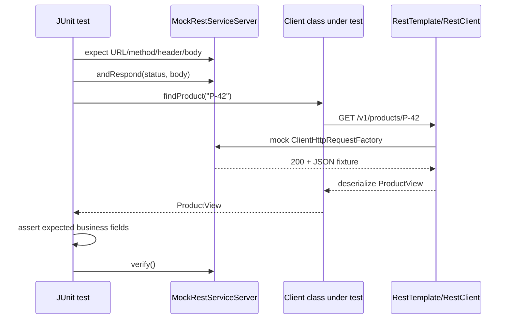

# HTTP Clients and Mocking: MockRestServiceServer with RestTemplate or RestClient by Version

## 1. The problem: testing an application making *outbound* calls without real HTTP

A Spring Boot application frequently calls another system's HTTP API: product lookup, payments, shipping info, addresses, or partner services. When writing tests for an **outbound HTTP client** class, we must prove:

- The client sends the right **HTTP method**, URL, query parameters, and headers.
- The JSON/XML body is serialized per contract.
- The response body is deserialized into the right object.
- 4xx/5xx error responses are handled according to application policy.
- Call counts and, where required, call ordering are correct.
- No unexpected requests slip through uncontrolled by the test.

Do not turn every test into a live request to a partner's staging environment: external services can be slow, offline, rate-limited, mutate data, require secrets, or cause side effects.

Spring Framework provides **`MockRestServiceServer`**, a mock **client-side HTTP server**. It does not open an HTTP port; instead, it attaches a mock `ClientHttpRequestFactory` to `RestTemplate` or `RestClient.Builder`. Client code runs normally, while requests are matched against in-memory expectations and receive specified fake responses.

Conceptual example:

```java
server.expect(requestTo("https://catalog.example.test/v1/products/P-42"))
      .andExpect(method(HttpMethod.GET))
      .andRespond(withSuccess(
          "{\"sku\":\"P-42\",\"stock\":8}",
          MediaType.APPLICATION_JSON));

ProductView result = client.findProduct("P-42");

assertEquals("P-42", result.sku());
assertEquals(8, result.stock());
server.verify();
```

This is an **excerpt**: `server`, `client`, `ProductView`, and imports must be declared. The complete Spring Boot 3.5 / Java 17 project in sections 10–15 contains all those parts.

### Learning objectives

1. Distinguish outbound client tests from `MockMvc`, `WebTestClient`, and a real HTTP server.
2. Pick `RestTemplate` or `RestClient` according to your Spring Boot/Spring Framework version.
3. Use `@RestClientTest` for a test slice that auto-configures builders and the mock server.
4. Use `MockRestServiceServer.bindTo(restTemplate)` or `bindTo(restClientBuilder)` without a Spring context.
5. Explain the difference between `RestTemplateBuilder`'s **`rootUri` + URL path** and `RestClient.Builder`'s **`baseUrl` + full URL**.
6. Verify GET/POST, JSON bodies, headers, response mapping, HTTP 404/503, and request counts.
7. Understand `expect(...)`, `andExpect(...)`, `andRespond(...)`, `verify()`, `reset()`, `ExpectedCount`, and `ignoreExpectOrder(true)`.
8. Avoid "false green" bugs caused by omitting `verify()`, using the wrong builder instance, wrong URLs, or mocking the wrong client.
9. Know the limits regarding TLS, sockets, timeouts, redirects, connection pools, and when WireMock/MockWebServer is needed.
10. Update imports and test starters accurately when upgrading to Spring Boot 4.

## 2. Distinguishing tools by request *direction*

| Component under test | Appropriate tool | Where does the request flow? |
| --- | --- | --- |
| App **calling an external REST API** with `RestTemplate` | `MockRestServiceServer` + `RestTemplate` | Mock client request factory |
| App **calling an external REST API** with `RestClient` | `MockRestServiceServer` + `RestClient.Builder` | Builder bound to a mock request factory |
| App **exposing** a Spring MVC REST endpoint | `@WebMvcTest` + `MockMvc` | Mock `DispatcherServlet` in server context |
| App exposing a WebFlux endpoint | `@WebFluxTest`, `WebTestClient` | Spring reactive server handler chain |
| App **calling a reactive API** with `WebClient` | MockWebServer/WireMock or dedicated `ExchangeFunction` test | `MockRestServiceServer` **does not** replace `WebClient` |
| App calling SOAP via `WebServiceTemplate` | `@WebServiceClientTest` + `MockWebServiceServer` | SOAP message level |
| Real HTTP calls, testing transport | WireMock/OkHttp MockWebServer/HTTP test server | TCP socket, real HTTP stack |
| Testing the whole app + outbound stub | `@SpringBootTest` with mock server bound to the **exact** HTTP client bean | Full Spring context + outbound mock |
| Testing TLS, certificates, network proxies | Test with an appropriate HTTPS server/proxy | Real or closely simulated network infrastructure |

The names look very similar, but they cannot be swapped casually:

- **`MockRestServiceServer`**: mocks the receiving server side **for `RestTemplate`/`RestClient`**.
- **`MockMvc`**: mocks the client sending requests **to the application's REST server**.
- **`MockWebServiceServer`**: mocks a SOAP server for `WebServiceTemplate`.
- **`WireMock`/`MockWebServer`**: a fake HTTP server that actually binds a port.

If the user story is "our application calls a partner API and handles the response," `MockRestServiceServer` is this lesson's core tool—not `MockMvc`.

## 3. How it works



Key steps:

1. The test has a `MockRestServiceServer` **bound to the exact client being invoked**.
2. The test registers `expect(...)` **before** the client sends the request.
3. The client builds the request using real code, e.g., `getForObject(...)` or `restClient.get().retrieve()`.
4. The mock request factory records the request and evaluates request matchers.
5. The response creator returns the declared status/headers/body.
6. The client processes the response using real HTTP message converters and the JSON mapper in the test context.
7. The test asserts the resulting object, exception, or business outcome.
8. `server.verify()` confirms the expectations were met.

No HTTP call reaches `catalog.example.test` during the test if the mock is wired properly. The `.example.test` domain is just a placeholder URI for contract clarity, requiring no DNS or secrets.

### What does verify() check?

- Whether declared expectations were invoked the expected number of times.
- A non-matching request can throw `AssertionError` immediately when handled.
- `verify()` is critical in interaction-focused tests; if you only register an expectation without calling the client method, the test could pass if you forget to verify.
- `verify()` does not guarantee every response field was checked; asserting on the deserialized object is still necessary.
- For async calls, `verify(Duration)` can wait until expected requests execute. This does not replace assertions on business state outside the HTTP client.

## 4. Supported versions: Spring Boot 2.x, 3.x, and 4.x

### 4.1. RestTemplate is older than RestClient

- `RestTemplate` has existed since early Spring Framework releases, offering an imperative API like `getForObject`, `postForObject`, and `exchange`.
- `MockRestServiceServer` has supported `RestTemplate` since Spring Framework 3.x, with `bindTo(RestTemplate)` since Spring Framework 4.3.
- `RestClient` is the synchronous fluent HTTP client introduced in **Spring Framework 6.1** and integrated into **Spring Boot 3.2+**.
- `MockRestServiceServer.bindTo(RestClient.Builder)` has been available since **Spring Framework 6.1**.
- Do not add `RestClient` imports to Spring Boot 3.0/3.1 or Spring Framework 6.0 and expect it to compile: that API did not exist yet there.
- `RestTemplate` remains supported in apps already using it; you do not have to rewrite legacy code just to use the mock server.

### 4.2. Quick reference table

| Platform | RestTemplate | RestClient | Auto test |
| --- | --- | --- | --- |
| Spring Boot 2.x, Spring 5.x | Yes | Not yet | `@RestClientTest` focused on `RestTemplate` |
| Spring Boot 3.0–3.1, Spring 6.0 | Yes | Not yet | `@RestClientTest` with `RestTemplateBuilder` |
| Spring Boot 3.2–3.3, Spring 6.1 | Yes | Yes | `@RestClientTest` supports both builders |
| Spring Boot 3.4–3.5, Spring 6.2 | Yes | Yes | `@RestClientTest` + `MockRestServiceServer` |
| Spring Boot 4.x, Spring Framework 7 | Version-compatibility dependent | Yes | Test starter/package **moved to the RestClient module** |

### 4.3. Imports for Boot 3.5

```java
import org.springframework.boot.test.autoconfigure.web.client.RestClientTest;
import org.springframework.boot.web.client.RestTemplateBuilder;
import org.springframework.test.web.client.MockRestServiceServer;
import org.springframework.web.client.RestClient;
import org.springframework.web.client.RestTemplate;
```

In Boot 3.5, `@RestClientTest` auto-configures the Spring HTTP clients test slice, JSON converters, `RestTemplateBuilder`, `RestClient.Builder`, and `MockRestServiceServer`. The sample code uses parent `spring-boot-starter-parent:3.5.0`, Java 17, and `spring-boot-starter-test`.

### 4.4. Imports and starters for Boot 4

When upgrading to Boot 4, test structures are modularized by technology. Import:

```java
import org.springframework.boot.restclient.test.autoconfigure.RestClientTest;
```

Use focused starters matching the major version:

```xml
<!-- Boot 4 orientation snippet; DO NOT mix into a Boot 3.5 POM. -->
<dependency>
    <groupId>org.springframework.boot</groupId>
    <artifactId>spring-boot-starter-restclient</artifactId>
</dependency>
<dependency>
    <groupId>org.springframework.boot</groupId>
    <artifactId>spring-boot-starter-restclient-test</artifactId>
    <scope>test</scope>
</dependency>
```

- The Spring Boot test annotation package moved from `org.springframework.boot.test.autoconfigure.web.client` to `org.springframework.boot.restclient.test.autoconfigure`.
- `MockRestServiceServer`/`MockRestRequestMatchers` remain under Spring Framework's `org.springframework.test.web.client` in the documented API.
- `RestClient` remains under `org.springframework.web.client`.
- Never copy Boot 4 starters into a 3.5 parent or mix Boot 3.5 imports with Boot 4 test modules.
- On Boot 4, check other Spring Framework 7/client API changes against your BOM before porting code.

## 5. Choosing the @RestClientTest slice

Spring Boot provides a dedicated annotation:

```java
@RestClientTest(MyExternalClient.class)
class MyExternalClientTest {
    @Autowired MyExternalClient client;
    @Autowired MockRestServiceServer server;
}
```

`@RestClientTest(MyExternalClient.class)` specifies the client component under test and auto-configures the needed client builders and mock server. It is **not** `@SpringBootTest`, because it restricts which beans are scanned.

Benefits:

- No need to start Tomcat/an HTTP server to test outbound requests.
- No database, Kafka, Redis, or full `ApplicationContext` needed if the client only depends on builders/properties/JSON.
- The mock server is bound to the client builder via Boot test auto-configuration.
- JSON (Jackson or another configured serializer) is still exercised.
- Expectations live right next to the test code, making contract mismatches obvious.

**Note:** `@RestClientTest` **does not automatically scan all `@Component`/`@ConfigurationProperties` beans**. If the client depends on an auth/token service, other beans, or a properties class, the test must provide them via `@MockitoBean`, `@Import`, `@EnableConfigurationProperties`, or narrow configuration. Avoid importing the entire production configuration just to satisfy missing-bean errors.

### @RestClientTest does not need @ExtendWith

JUnit 5 + Boot test slices already include `SpringExtension`. You do not need to add `@ExtendWith(SpringExtension.class)` in the sample project. This test runs no embedded web server.

### When to use @SpringBootTest?

When you need to test full Spring wiring—interceptors, auth beans, retries, caching, or a business service calling the client—you can use `@SpringBootTest` and attach `MockRestServiceServer` to **the exact client instance used by the application**. Depending on your setup, add `@AutoConfigureMockRestServiceServer` and the right client builder, or bind manually.

Never assume a random `MockRestServiceServer` intercepts every `RestClient.create()`/`new RestTemplate()` in the app: the mock only binds to configured instances/builders.

## 6. RestTemplateBuilder.rootUri differs from RestClient.Builder.baseUrl

This is the easiest trap to hit, causing `AssertionError: Unexpected request` in otherwise valid test logic.

### 6.1. RestTemplateBuilder.rootUri

Client built via:

```java
RestTemplate restTemplate = builder
        .rootUri("https://catalog.example.test")
        .build();

ProductView result = restTemplate.getForObject(
        "/v1/products/{sku}", ProductView.class, "P-42");
```

Inside a `@RestClientTest` slice, the Spring Boot docs specify: if `RestTemplate` uses `RestTemplateBuilder.rootUri(...)`, **the expectation should omit the root URI**:

```java
server.expect(requestTo("/v1/products/P-42"))
      .andRespond(withSuccess(
          "{\"sku\":\"P-42\",\"stock\":8}",
          MediaType.APPLICATION_JSON));
```

Why? Boot's `RootUriTemplateHandler` and mock customizer determine how the request URL reaches the mock request factory. For Boot tests using the builder properly, the expectation is the relative path as shown in the official guide.

**Scope:** This specifically describes **Boot `@RestClientTest` and `RestTemplateBuilder.rootUri`**. If you manually instantiate `new RestTemplate()` and call `MockRestServiceServer.bindTo(...)`, requests carry full URLs since there is no automatic `rootUri`.

### 6.2. RestClient.Builder.baseUrl

Client built via:

```java
RestClient restClient = builder
        .baseUrl("https://catalog.example.test")
        .build();

ProductView result = restClient.get()
        .uri("/v1/products/{sku}", "P-42")
        .retrieve()
        .body(ProductView.class);
```

With `RestClient.Builder` in Boot `@RestClientTest`, the docs state the matcher must use the **full URL**:

```java
server.expect(requestTo(
      "https://catalog.example.test/v1/products/P-42"))
      .andRespond(withSuccess(
          "{\"sku\":\"P-42\",\"stock\":8}",
          MediaType.APPLICATION_JSON));
```

### 6.3. Pitfall prevention table

| Configured client | Request code | MockRestServiceServer expectation in Boot slice |
| --- | --- | --- |
| `RestTemplateBuilder.rootUri("https://catalog.example.test")` | `getForObject("/v1/products/{sku}", …)` | `/v1/products/P-42` |
| `RestTemplateBuilder` **without** `rootUri`, using absolute URL | `getForObject("https://catalog.example.test/...", …)` | `https://catalog.example.test/v1/products/P-42` |
| `RestClient.Builder.baseUrl("https://catalog.example.test")` | `get().uri("/v1/products/{sku}", …)` | `https://catalog.example.test/v1/products/P-42` |
| Manual `MockRestServiceServer.bindTo(new RestTemplate())` | `getForObject("https://catalog.example.test/...", …)` | Full URL |
| Manual `MockRestServiceServer.bindTo(restClientBuilder)` | Builder has `baseUrl`, using relative `uri` | Full URL |

If a test fails, **do not remove `requestTo`** just to turn it green. Compare the actual URI in the failure message, check which builder is used and what `rootUri`/`baseUrl` is configured, and adjust the expectation per framework guidance.

## 7. Request matchers and Response creators

### Request matchers

Imports:

```java
import static org.springframework.test.web.client.match.MockRestRequestMatchers.requestTo;
import static org.springframework.test.web.client.match.MockRestRequestMatchers.method;
import static org.springframework.test.web.client.match.MockRestRequestMatchers.header;
import static org.springframework.test.web.client.match.MockRestRequestMatchers.content;
```

Example:

```java
server.expect(requestTo("https://catalog.example.test/v1/orders"))
      .andExpect(method(HttpMethod.POST))
      .andExpect(content().contentType(MediaType.APPLICATION_JSON))
      .andExpect(content().json(
          "{\"sku\":\"P-42\",\"quantity\":2}"))
      .andRespond(withSuccess(
          "{\"orderId\":\"O-7\",\"state\":\"CREATED\"}",
          MediaType.APPLICATION_JSON));
```

- `requestTo(...)`: exact URL for the test environment.
- `method(HttpMethod.POST)`: HTTP method.
- `header(HttpHeaders.AUTHORIZATION, ...)`: critical headers (authorization/correlation/content negotiation).
- `content().contentType(...)`: request `Content-Type`.
- `content().json(...)`: structural JSON comparison, usually insensitive to whitespace or JSON object key order.
- `jsonPath("$.sku").value("P-42")`: verifies a specific JSON request field when needed.
- `queryParam(...)`: request matcher APIs for query parameters exist in the relevant versions; check Javadocs when using them to avoid raw URL ordering/encoding fragility.

**Never assert only the URL** when behavior depends on body, headers, or an idempotency key. A client can hit the right path with the wrong quantity or a missing authentication header.

### Response creators

Imports:

```java
import static org.springframework.test.web.client.response.MockRestResponseCreators.withSuccess;
import static org.springframework.test.web.client.response.MockRestResponseCreators.withStatus;
import static org.springframework.test.web.client.response.MockRestResponseCreators.withException;
```

Cases:

```java
// JSON success
withSuccess("{\"sku\":\"P-42\",\"stock\":8}",
        MediaType.APPLICATION_JSON);

// HTTP 404 with body (requires matching HTTP method/URL expectation).
withStatus(HttpStatus.NOT_FOUND)
        .contentType(MediaType.APPLICATION_JSON)
        .body("{\"error\":\"not-found\"}");

// HTTP 503: server unavailable.
withStatus(HttpStatus.SERVICE_UNAVAILABLE)
        .contentType(MediaType.TEXT_PLAIN)
        .body("temporarily unavailable");

// Simulated IOException (not a real TCP socket).
withException(new java.net.SocketTimeoutException("simulated timeout"));
```

`withException` simulates an I/O error at the request factory. It is useful for testing client error-handling branches, yet **does not prove** connect/read timeout settings on a real socket. For transport behavior, use a mock HTTP server on a real port.

## 8. ExpectedCount, request ordering, and verify()

### 8.1. One request, exactly once

```java
server.expect(requestTo("https://catalog.example.test/v1/ping"))
      .andRespond(withSuccess("pong", MediaType.TEXT_PLAIN));

client.ping();
server.verify();
```

By default, one expectation matches one request. Assert method and body according to the contract.

### 8.2. Two identical requests

```java
server.expect(ExpectedCount.times(2),
              requestTo("https://catalog.example.test/v1/ping"))
      .andExpect(method(HttpMethod.GET))
      .andRespond(withSuccess("pong", MediaType.TEXT_PLAIN));

client.ping();
client.ping();
server.verify();
```

You can use `ExpectedCount.once()`, `times(n)`, `min(n)`, `max(n)`, `between(min, max)`, or `manyTimes()` depending on version. Do not use `manyTimes` just to avoid knowing the call count; critical retry behavior requires asserting exact bounded counts.

### 8.3. Default ordering

Expectations normally match in the order declared. If a client is expected to call a token endpoint before a data endpoint, order may be part of the contract. For independent requests with no business ordering constraint, you can configure:

```java
MockRestServiceServer server =
    MockRestServiceServer.bindTo(restTemplate)
        .ignoreExpectOrder(true)
        .build();
```

`ignoreExpectOrder(true)` permits out-of-order matching. Do not enable it indiscriminately when ordering is logic under test; wrong ordering in auth token refreshes, idempotency, or workflows can be a bug.

With `ExpectedCount.times(2)`, only the first call of an expectation with count > 1 preserves its position under ordering rules; subsequent calls may interleave per Spring Framework API rules. Never write assertions relying on stronger ordering guarantees than the framework promises.

### 8.4. verify(Duration)

```java
server.verify(Duration.ofSeconds(3));
```

This variant **waits** for all expectations to be fulfilled within a bounded duration, intended for code dispatching requests asynchronously. It does not ensure response-side business state has finished processing; that requires separate assertions. `RestTemplate` and `RestClient` themselves are synchronous, so the sample project calls `verify()` immediately after the method returns.

### 8.5. reset()

`server.reset()` clears recorded requests and current expectations without creating a new HTTP client. It is commonly called in `@BeforeEach`, or a fresh mock server is created per test to avoid leaked state. Do not call reset mid-request, or reset after an error and claim you verified a failed expectation.

## 9. Sample project architecture choices

The example project models an upstream API `catalog.example.test`:

- `GET /v1/products/{sku}` returns `ProductView(sku, stock)`.
- `POST /v1/orders` accepts `OrderRequest(sku, quantity)` and returns `OrderReceipt(orderId, state)`.
- `InventoryRestTemplateClient` uses `RestTemplateBuilder.rootUri`.
- `InventoryRestClientClient` uses `RestClient.Builder.baseUrl`.
- Two separate `@RestClientTest` classes, each injecting the right client and `MockRestServiceServer`.
- One manual-binding test class proving no Spring context is required.
- No HTTP server, datasource, Kafka, real credentials, Testcontainers, or external network.

**Payloads/JSON are intentionally tiny** so request contracts stay easy to inspect; you do not need a seeded database to test an outbound HTTP client.

### Project files

```text
mock-rest-client-demo/
├── pom.xml
└── src/
    ├── main/
    │   ├── java/example/outbound/
    │   │   ├── OutboundApplication.java
    │   │   ├── ProductView.java
    │   │   ├── OrderRequest.java
    │   │   ├── OrderReceipt.java
    │   │   ├── InventoryRestTemplateClient.java
    │   │   └── InventoryRestClientClient.java
    │   └── resources/
    │       └── application.properties
    └── test/
        └── java/example/outbound/
            ├── InventoryRestTemplateClientTest.java
            ├── InventoryRestClientClientTest.java
            └── ManualMockRestServiceServerTest.java
```

## 10. pom.xml — Spring Boot 3.5.0 + Java 17

```xml
<?xml version="1.0" encoding="UTF-8"?>
<project xmlns="http://maven.apache.org/POM/4.0.0"
         xmlns:xsi="http://www.w3.org/2001/XMLSchema-instance"
         xsi:schemaLocation="http://maven.apache.org/POM/4.0.0
             https://maven.apache.org/xsd/maven-4.0.0.xsd">
    <modelVersion>4.0.0</modelVersion>

    <parent>
        <groupId>org.springframework.boot</groupId>
        <artifactId>spring-boot-starter-parent</artifactId>
        <version>3.5.0</version>
        <relativePath/>
    </parent>

    <groupId>example</groupId>
    <artifactId>mock-rest-client-demo</artifactId>
    <version>1.0-SNAPSHOT</version>

    <properties>
        <java.version>17</java.version>
    </properties>

    <dependencies>
        <!-- Spring Web: RestTemplate, RestClient, Jackson converters. -->
        <dependency>
            <groupId>org.springframework.boot</groupId>
            <artifactId>spring-boot-starter-web</artifactId>
        </dependency>

        <!-- JUnit Jupiter, Spring Test, MockRestServiceServer, JSONassert. -->
        <dependency>
            <groupId>org.springframework.boot</groupId>
            <artifactId>spring-boot-starter-test</artifactId>
            <scope>test</scope>
        </dependency>
    </dependencies>
</project>
```

`spring-boot-starter-web` includes server-related dependencies, yet `@RestClientTest` **never starts an embedded server**. If an application is strictly client-only, you can slim down dependencies to only the modules needed; the demo uses `starter-web` so the code compiles and runs cleanly on Boot 3.5 without manually assembling Jackson and Spring Web.

## 11. Main code: application, DTOs, and RestTemplate client

### 11.1. OutboundApplication.java

`src/main/java/example/outbound/OutboundApplication.java`:

```java
package example.outbound;

import org.springframework.boot.SpringApplication;
import org.springframework.boot.autoconfigure.SpringBootApplication;

@SpringBootApplication
public class OutboundApplication {
    public static void main(String[] args) {
        SpringApplication.run(OutboundApplication.class, args);
    }
}
```

No public HTTP controller is needed because the project tests **outbound calls**, not incoming requests.

### 11.2. ProductView.java

`src/main/java/example/outbound/ProductView.java`:

```java
package example.outbound;

public record ProductView(String sku, int stock) {
}
```

### 11.3. OrderRequest.java

`src/main/java/example/outbound/OrderRequest.java`:

```java
package example.outbound;

public record OrderRequest(String sku, int quantity) {
}
```

### 11.4. OrderReceipt.java

`src/main/java/example/outbound/OrderReceipt.java`:

```java
package example.outbound;

public record OrderReceipt(String orderId, String state) {
}
```

Java 17 records work seamlessly with Spring Boot-managed Jackson for simple serialization/deserialization examples. If DTOs use polymorphic annotations, nested collections, or custom serializers, add matching data tests.

### 11.5. application.properties

`src/main/resources/application.properties`:

```properties
partner.catalog.base-url=https://catalog.example.test
spring.main.banner-mode=off
```

The URI above is a **placeholder address not meant for real network calls**. In tests, the mock request factory intercepts requests; do not treat this URI as a production endpoint. Production must configure the real URL via environment/secret manager and proper security policies.

### 11.6. InventoryRestTemplateClient.java

`src/main/java/example/outbound/InventoryRestTemplateClient.java`:

```java
package example.outbound;

import org.springframework.beans.factory.annotation.Value;
import org.springframework.boot.web.client.RestTemplateBuilder;
import org.springframework.stereotype.Service;
import org.springframework.web.client.RestTemplate;

@Service
public class InventoryRestTemplateClient {

    private final RestTemplate template;

    public InventoryRestTemplateClient(
            RestTemplateBuilder builder,
            @Value("${partner.catalog.base-url}") String baseUrl) {

        this.template = builder
                .rootUri(baseUrl)
                .build();
    }

    public ProductView findProduct(String sku) {
        return template.getForObject(
                "/v1/products/{sku}",
                ProductView.class,
                sku);
    }

    public OrderReceipt placeOrder(OrderRequest request) {
        return template.postForObject(
                "/v1/orders",
                request,
                OrderReceipt.class);
    }
}
```

**Why use RestTemplateBuilder instead of new RestTemplate()?**

- Boot's builder carries customizers, message converters, request factory configuration, and the mock server when configured by the test slice.
- `rootUri(baseUrl)` applies to calls passing a URI template string starting with `/`.
- If code writes `new RestTemplate()` directly in the constructor, `@RestClientTest` will not know to attach the server to that instance unless the test manually binds that exact instance.
- Never allocate a fresh `RestTemplate` per request if you want tests and production clients to share configuration.

`RestTemplate.getForObject`/`postForObject` use message converters to read/write JSON. When status is 4xx/5xx, `DefaultResponseErrorHandler` typically raises `HttpClientErrorException`/`HttpServerErrorException`. The test examples exercise those default branches; if your application uses a custom error handler, the exception contract may differ.

## 12. RestClient client — the newer fluent API

`src/main/java/example/outbound/InventoryRestClientClient.java`:

```java
package example.outbound;

import org.springframework.beans.factory.annotation.Value;
import org.springframework.http.MediaType;
import org.springframework.stereotype.Service;
import org.springframework.web.client.RestClient;

@Service
public class InventoryRestClientClient {

    private final RestClient restClient;

    public InventoryRestClientClient(
            RestClient.Builder builder,
            @Value("${partner.catalog.base-url}") String baseUrl) {

        this.restClient = builder
                .baseUrl(baseUrl)
                .build();
    }

    public ProductView findProduct(String sku) {
        return restClient.get()
                .uri("/v1/products/{sku}", sku)
                .accept(MediaType.APPLICATION_JSON)
                .retrieve()
                .body(ProductView.class);
    }

    public OrderReceipt placeOrder(OrderRequest request) {
        return restClient.post()
                .uri("/v1/orders")
                .contentType(MediaType.APPLICATION_JSON)
                .body(request)
                .retrieve()
                .body(OrderReceipt.class);
    }
}
```

- `RestClient.Builder` is an auto-configured Boot bean in Boot 3.2+.
- `baseUrl(...)` applies to relative URIs in `.uri(...)`.
- `retrieve().body(ProductView.class)` uses configured message converters.
- `.accept(MediaType.APPLICATION_JSON)` sets an explicit `Accept` header.
- `.contentType(MediaType.APPLICATION_JSON)` sets `Content-Type` on the POST request.
- On 4xx/5xx, default `RestClient` status handlers typically throw `RestClientResponseException` and subtypes like `HttpClientErrorException.NotFound`/`HttpServerErrorException.ServiceUnavailable`.
- `RestClient` is a **synchronous** fluent client. Do not confuse it with reactive `WebClient`.

**Important:** tests must bind the mock **before `builder.build()`**. Boot `@RestClientTest` supplies a builder already customized with the mock, and then the client constructor invokes `build()`. In manual tests, you must enforce this order yourself.

## 13. @RestClientTest for RestTemplate: 4 JUnit tests

`src/test/java/example/outbound/InventoryRestTemplateClientTest.java`:

```java
package example.outbound;

import static org.junit.jupiter.api.Assertions.assertEquals;
import static org.junit.jupiter.api.Assertions.assertThrows;
import static org.junit.jupiter.api.Assertions.assertNotNull;
import static org.springframework.test.web.client.match.MockRestRequestMatchers.content;
import static org.springframework.test.web.client.match.MockRestRequestMatchers.method;
import static org.springframework.test.web.client.match.MockRestRequestMatchers.requestTo;
import static org.springframework.test.web.client.response.MockRestResponseCreators.withStatus;
import static org.springframework.test.web.client.response.MockRestResponseCreators.withSuccess;

import org.junit.jupiter.api.BeforeEach;
import org.junit.jupiter.api.Test;
import org.springframework.beans.factory.annotation.Autowired;
import org.springframework.boot.test.autoconfigure.web.client.RestClientTest;
import org.springframework.http.HttpMethod;
import org.springframework.http.HttpStatus;
import org.springframework.http.MediaType;
import org.springframework.test.web.client.MockRestServiceServer;
import org.springframework.web.client.HttpClientErrorException;
import org.springframework.web.client.HttpServerErrorException;

@RestClientTest(
    value = InventoryRestTemplateClient.class,
    properties = "partner.catalog.base-url=https://catalog.example.test")
class InventoryRestTemplateClientTest {

    @Autowired
    InventoryRestTemplateClient client;

    @Autowired
    MockRestServiceServer server;

    @BeforeEach
    void resetExpectations() {
        server.reset();
    }

    @Test
    void getProductUsesRelativeExpectationWithRootUri() {
        server.expect(requestTo("/v1/products/P-42"))
              .andExpect(method(HttpMethod.GET))
              .andRespond(withSuccess(
                  """
                  {"sku":"P-42","stock":8}
                  """,
                  MediaType.APPLICATION_JSON));

        ProductView result = client.findProduct("P-42");

        assertNotNull(result);
        assertEquals("P-42", result.sku());
        assertEquals(8, result.stock());
        server.verify();
    }

    @Test
    void postRequestContainsCorrectJsonBody() {
        server.expect(requestTo("/v1/orders"))
              .andExpect(method(HttpMethod.POST))
              .andExpect(content().contentType(
                  MediaType.APPLICATION_JSON))
              .andExpect(content().json(
                  """
                  {"sku":"P-42","quantity":2}
                  """))
              .andRespond(withSuccess(
                  """
                  {"orderId":"O-7","state":"CREATED"}
                  """,
                  MediaType.APPLICATION_JSON));

        OrderReceipt result = client.placeOrder(
                new OrderRequest("P-42", 2));

        assertNotNull(result);
        assertEquals("O-7", result.orderId());
        assertEquals("CREATED", result.state());
        server.verify();
    }

    @Test
    void notFoundIsExposedAsClientError() {
        server.expect(requestTo("/v1/products/UNKNOWN"))
              .andExpect(method(HttpMethod.GET))
              .andRespond(withStatus(HttpStatus.NOT_FOUND)
                  .contentType(MediaType.APPLICATION_JSON)
                  .body("{\"error\":\"product-not-found\"}"));

        HttpClientErrorException.NotFound error =
                assertThrows(
                    HttpClientErrorException.NotFound.class,
                    () -> client.findProduct("UNKNOWN"));

        assertEquals(HttpStatus.NOT_FOUND,
                error.getStatusCode());
        server.verify();
    }

    @Test
    void unavailableIsExposedAsServerError() {
        server.expect(requestTo("/v1/products/P-503"))
              .andExpect(method(HttpMethod.GET))
              .andRespond(withStatus(
                      HttpStatus.SERVICE_UNAVAILABLE)
                  .contentType(MediaType.TEXT_PLAIN)
                  .body("temporarily unavailable"));

        HttpServerErrorException.ServiceUnavailable error =
                assertThrows(
                    HttpServerErrorException.ServiceUnavailable.class,
                    () -> client.findProduct("P-503"));

        assertEquals(HttpStatus.SERVICE_UNAVAILABLE,
                error.getStatusCode());
        server.verify();
    }
}
```

**There are 4 `@Test` methods.**

### Explaining what the tests actually prove

1. **GET success:** builder `rootUri` is used, GET method is right, response JSON is parsed by Jackson into `ProductView`.
2. **POST JSON:** right path, HTTP method, and exact business fields in the request body; Jackson deserializes the response.
3. **404:** status is handled via the default `RestTemplate` error handler. No real HTTP server needed.
4. **503:** throws a 5xx error by default without automatic retry. If the app has a retry policy, test attempt counts/timing separately with the real config.

**Note the URL matchers:** expectations use `/v1/...` and **not** the full `https://catalog.example.test/...` because the test slice uses `RestTemplateBuilder.rootUri(...)`. This follows the Spring Boot 3.5 documentation.

### Why put reset in @BeforeEach?

`server.reset()` clears expectations and recorded requests from the previous test, preventing a test from inheriting mock server state from an earlier method when the Spring context is cached. It does not alter the client builder or break binding; the next test registers fresh expectations and uses the same client. With independent tests, never rely on expectations registered in one method as preconditions for another.

### Should you assert response headers?

If client logic relies on `ETag`, pagination links, `Retry-After`, or `Content-Language`, add assertions for parsed headers and corresponding mock response headers. This project only returns body DTOs, so it does not invent unrelated headers.

## 14. @RestClientTest for RestClient: 5 JUnit tests

`src/test/java/example/outbound/InventoryRestClientClientTest.java`:

```java
package example.outbound;

import static org.junit.jupiter.api.Assertions.assertEquals;
import static org.junit.jupiter.api.Assertions.assertThrows;
import static org.junit.jupiter.api.Assertions.assertNotNull;
import static org.springframework.test.web.client.match.MockRestRequestMatchers.content;
import static org.springframework.test.web.client.match.MockRestRequestMatchers.header;
import static org.springframework.test.web.client.match.MockRestRequestMatchers.method;
import static org.springframework.test.web.client.match.MockRestRequestMatchers.requestTo;
import static org.springframework.test.web.client.response.MockRestResponseCreators.withStatus;
import static org.springframework.test.web.client.response.MockRestResponseCreators.withSuccess;

import org.junit.jupiter.api.BeforeEach;
import org.junit.jupiter.api.Test;
import org.springframework.beans.factory.annotation.Autowired;
import org.springframework.boot.test.autoconfigure.web.client.RestClientTest;
import org.springframework.http.HttpHeaders;
import org.springframework.http.HttpMethod;
import org.springframework.http.HttpStatus;
import org.springframework.http.MediaType;
import org.springframework.test.web.client.ExpectedCount;
import org.springframework.test.web.client.MockRestServiceServer;
import org.springframework.web.client.HttpClientErrorException;
import org.springframework.web.client.HttpServerErrorException;

@RestClientTest(
    value = InventoryRestClientClient.class,
    properties = "partner.catalog.base-url=https://catalog.example.test")
class InventoryRestClientClientTest {

    private static final String BASE =
            "https://catalog.example.test";

    @Autowired
    InventoryRestClientClient client;

    @Autowired
    MockRestServiceServer server;

    @BeforeEach
    void resetExpectations() {
        server.reset();
    }

    @Test
    void getUsesFullUriAndAcceptHeader() {
        server.expect(requestTo(BASE + "/v1/products/P-42"))
              .andExpect(method(HttpMethod.GET))
              .andExpect(header(
                      HttpHeaders.ACCEPT,
                      MediaType.APPLICATION_JSON_VALUE))
              .andRespond(withSuccess(
                  """
                  {"sku":"P-42","stock":8}
                  """,
                  MediaType.APPLICATION_JSON));

        ProductView result = client.findProduct("P-42");

        assertNotNull(result);
        assertEquals("P-42", result.sku());
        assertEquals(8, result.stock());
        server.verify();
    }

    @Test
    void postSendsJsonAndMapsOrderReceipt() {
        server.expect(requestTo(BASE + "/v1/orders"))
              .andExpect(method(HttpMethod.POST))
              .andExpect(content().contentType(
                  MediaType.APPLICATION_JSON))
              .andExpect(content().json(
                  """
                  {"sku":"P-42","quantity":2}
                  """))
              .andRespond(withSuccess(
                  """
                  {"orderId":"O-8","state":"CREATED"}
                  """,
                  MediaType.APPLICATION_JSON));

        OrderReceipt receipt = client.placeOrder(
                new OrderRequest("P-42", 2));

        assertNotNull(receipt);
        assertEquals("O-8", receipt.orderId());
        assertEquals("CREATED", receipt.state());
        server.verify();
    }

    @Test
    void notFoundThrowsTypedClientError() {
        server.expect(requestTo(BASE + "/v1/products/UNKNOWN"))
              .andExpect(method(HttpMethod.GET))
              .andRespond(withStatus(HttpStatus.NOT_FOUND));

        HttpClientErrorException.NotFound error =
                assertThrows(
                    HttpClientErrorException.NotFound.class,
                    () -> client.findProduct("UNKNOWN"));

        assertEquals(HttpStatus.NOT_FOUND,
                error.getStatusCode());
        server.verify();
    }

    @Test
    void serviceUnavailableThrowsTypedServerError() {
        server.expect(requestTo(BASE + "/v1/products/P-503"))
              .andExpect(method(HttpMethod.GET))
              .andRespond(withStatus(
                  HttpStatus.SERVICE_UNAVAILABLE));

        HttpServerErrorException.ServiceUnavailable error =
                assertThrows(
                    HttpServerErrorException.ServiceUnavailable.class,
                    () -> client.findProduct("P-503"));

        assertEquals(HttpStatus.SERVICE_UNAVAILABLE,
                error.getStatusCode());
        server.verify();
    }

    @Test
    void expectedCountConfirmsTwoOutboundCalls() {
        server.expect(
                  ExpectedCount.times(2),
                  requestTo(BASE + "/v1/products/P-9"))
              .andExpect(method(HttpMethod.GET))
              .andRespond(withSuccess(
                  """
                  {"sku":"P-9","stock":9}
                  """,
                  MediaType.APPLICATION_JSON));

        ProductView first = client.findProduct("P-9");
        ProductView second = client.findProduct("P-9");

        assertNotNull(first);
        assertNotNull(second);
        assertEquals("P-9", first.sku());
        assertEquals(9, second.stock());
        server.verify();
    }
}
```

**There are 5 `@Test` methods.** Unlike the `RestTemplate` test in section 13, `requestTo` expectations **include the full base URL** because the client uses `RestClient.Builder.baseUrl(...)`.

### Do not push mock servers into production code

`InventoryRestClientClient` imports neither `MockRestServiceServer` nor `MockRestRequestMatchers`. All mock code lives in `src/test/java`. The production class only receives `RestClient.Builder`; that dependency injection lets tests swap transport for a mock without adding test branches to application logic.

### Why full URL?

Spring Boot 3.5 docs make the distinction clear: `RestClient.Builder` and `RestTemplateBuilder` without `rootUri` both take full-URL expectations. Writing `requestTo("/v1/products/P-42")` in a `RestClient` test causes a mock mismatch even when the client's base URL and resolver are correct.

### An ExpectedCount test is not a "retry policy"

`expectedCountConfirmsTwoOutboundCalls` deliberately invokes the method twice and confirms two requests occurred. It **does not** prove automatic retry. If a client uses Resilience4j/Spring Retry, configure the real retry layer, register failure-then-success responses, and verify call counts plus reasonable backoff/timeouts. Never call the same method twice from the test and label it a retry test.

## 15. Manual binding without a Spring Boot test context: 2 JUnit tests

Sometimes you want to test a plain Java class, legacy migration code creating its own `RestTemplate`, or bind a mock to a special `RestClient.Builder`. `@RestClientTest` is not mandatory.

`src/test/java/example/outbound/ManualMockRestServiceServerTest.java`:

```java
package example.outbound;

import static org.junit.jupiter.api.Assertions.assertEquals;
import static org.springframework.test.web.client.match.MockRestRequestMatchers.method;
import static org.springframework.test.web.client.match.MockRestRequestMatchers.requestTo;
import static org.springframework.test.web.client.response.MockRestResponseCreators.withSuccess;

import org.junit.jupiter.api.Test;
import org.springframework.http.HttpMethod;
import org.springframework.http.MediaType;
import org.springframework.test.web.client.MockRestServiceServer;
import org.springframework.web.client.RestClient;
import org.springframework.web.client.RestTemplate;

class ManualMockRestServiceServerTest {

    private static final String BASE =
            "https://catalog.example.test";

    @Test
    void manuallyBindsToRestTemplateInstance() {
        RestTemplate template = new RestTemplate();

        MockRestServiceServer server =
                MockRestServiceServer.bindTo(template).build();

        server.expect(requestTo(BASE + "/v1/ping"))
              .andExpect(method(HttpMethod.GET))
              .andRespond(withSuccess(
                  "pong", MediaType.TEXT_PLAIN));

        String response = template.getForObject(
                BASE + "/v1/ping", String.class);

        assertEquals("pong", response);
        server.verify();
    }

    @Test
    void manuallyBindsToRestClientBuilderBeforeBuild() {
        RestClient.Builder builder = RestClient.builder()
                .baseUrl(BASE);

        // Order matters: bindTo(builder) BEFORE builder.build().
        MockRestServiceServer server =
                MockRestServiceServer.bindTo(builder).build();

        RestClient client = builder.build();

        server.expect(requestTo(BASE + "/v1/ping"))
              .andExpect(method(HttpMethod.GET))
              .andRespond(withSuccess(
                  "pong", MediaType.TEXT_PLAIN));

        String response = client.get()
                .uri("/v1/ping")
                .retrieve()
                .body(String.class);

        assertEquals("pong", response);
        server.verify();
    }
}
```

**There are 2 `@Test` methods** and no `@SpringBootTest`, `@RestClientTest`, `@Autowired`, or Spring `ApplicationContext`.

### Why bindTo(RestClient.Builder) before build()?

`RestClient` is an object created from the builder. If you write:

```java
RestClient client = RestClient.builder().build();
// ... a MockRestServiceServer.bindTo(otherBuilder) ...
```

then the already-built client never receives the other builder's request factory. The test can accidentally hit the network or record zero requests on the mock server. Ensure **the bound builder is the exact builder used to build the client under test**.

### Why does manual RestTemplate expect a full URL?

`new RestTemplate()` has no `RestTemplateBuilder.rootUri(...)`. The test calls `template.getForObject(BASE + "/v1/ping", ...)`, so the matcher receives a full URL. Do not mechanically apply the path-only rule of Boot's `rootUri` slice to manual binding.

### Can you use createServer(RestTemplate)?

Yes:

```java
MockRestServiceServer server =
        MockRestServiceServer.createServer(template);
```

`createServer(template)` is shorthand for `bindTo(template).build()`. For `RestClient.Builder`, use `bindTo(builder).build()`, and do not assume an equivalent `createServer(RestClient)` overload exists.

## 16. Running Maven and expected results

Requires **JDK 17+**, Maven, and initial dependency downloads. No Docker, WireMock server, partner DNS, or HTTP network beyond Maven artifact fetching is needed.

From the `mock-rest-client-demo` directory:

```bash
mvn test
```

Run a single class:

```bash
mvn test -Dtest=InventoryRestTemplateClientTest
mvn test -Dtest=InventoryRestClientClientTest
mvn test -Dtest=ManualMockRestServiceServerTest
```

| Test class | `@Test` methods | Scope |
| --- | ---: | --- |
| `InventoryRestTemplateClientTest` | 4 | Boot `RestTemplateBuilder` `rootUri`, GET/POST, 404/503 |
| `InventoryRestClientClientTest` | 5 | Boot `RestClient.Builder` `baseUrl`, JSON/header, errors/count |
| `ManualMockRestServiceServerTest` | 2 | Manual `bindTo` `RestTemplate` and `RestClient.Builder` |
| **Total** | **11** | 11 expected JUnit invocations |

**Expected:** 11 tests PASS, 0 failed/error/skipped if the project is created accurately and dependency versions match. This is the **expected** outcome based on the sample code, not an execution result verified during authoring. Inspect `target/surefire-reports` to confirm actual executed test counts and root causes if failures occur.

### Expected outcomes per behavior

- GET `P-42` returns `ProductView("P-42", 8)`.
- POST `OrderRequest("P-42", 2)` must emit JSON containing SKU/quantity and return the fixture `OrderReceipt`.
- 404 throws `HttpClientErrorException.NotFound` via default handlers.
- 503 throws `HttpServerErrorException.ServiceUnavailable` via default handlers.
- Two calls for `P-9` satisfy `ExpectedCount.times(2)`.
- Manual `RestTemplate`/`RestClient` GET `/v1/ping` returns the string `pong`.

Tests do not call `System.out.println`, so there is no fixed application stdout. Maven/Spring logs vary by version and environment; never fabricate concrete console output.

## 17. Limitations that must be understood clearly

### MockRestServiceServer does not test transport over sockets

The mock replaces the request factory. It can test:

- Which URI, method, headers, and body application code selects.
- How message converters serialize/deserialize per the test's configuration.
- How code reacts to stub statuses/bodies.
- Whether HTTP interactions match expected count/sequence.

However, it **does not directly prove**:

- Real DNS/TCP connections succeed.
- TLS handshakes, certificate validation/mTLS, and SNI.
- HTTP proxies, keep-alive, connection pooling, and real redirect policies.
- Real socket connect/read timeouts, chunked transfers, streaming, and real server behavior.
- Wire-level compression, protocol negotiation, HTTP/2, and network fault timing.
- Real OAuth token endpoints/security infrastructure unless tested separately.
- That the production partner's API contract has not changed.

Spring Framework documentation recommends **mock HTTP servers with real ports** such as WireMock/MockWebServer when testing the transport layer and realistic network conditions. `MockRestServiceServer` remains valuable for fast client-contract tests.

### When to choose WireMock or OkHttp MockWebServer?

Choose them when you need to:

- Verify URL encoding and the real TCP request line.
- Simulate delayed responses, abrupt disconnects, or chunking.
- Test redirects, TLS, proxy behavior, or connection pooling.
- Test client timeouts/retries driven by the underlying HTTP library.
- Call from a client unsupported by `MockRestServiceServer`.
- Share a single fake API server across both reactive `WebClient` and synchronous clients.

Do not assume every test needs an open HTTP server: most unit/slice tests verifying client contracts can use fast, isolated, deterministic mock request factories.

## 18. Common mistakes with client instances and builders

### 18.1. Creating a client directly and bypassing Boot's builder

```java
@Service
class FragileClient {
    private final RestTemplate template = new RestTemplate();
}
```

The class creates its own instance, so the mock automatically bound to `RestTemplateBuilder` inside `@RestClientTest` will **not** affect this `template` instance. Fix by injecting `RestTemplateBuilder` to construct the client, or manually binding `MockRestServiceServer` to that exact instance if accessible.

The same applies to `RestClient`: calling `RestClient.create()` directly inside a method builds a client separate from the mocked builder.

### 18.2. Binding after RestClient is already built

Missing the target:

```java
RestClient.Builder original = RestClient.builder();
RestClient client = original.build();
MockRestServiceServer mock =
        MockRestServiceServer.bindTo(original).build();
```

The builder already built the client before its request factory was swapped for the mock. Instead, bind **before** `build()`, as shown in the sample project.

### 18.3. Two RestClient.Builders and one ambiguous expectation

If production classes build API clients A and B from two builders, an auto-configured mock server does not automatically intercept all requests as intended. Separate client configs/tests or bind mock servers to the **right builders**. Be careful when mutating, cloning, or reusing the same builder across multiple clients.

### 18.4. Full URL vs. path-only

- Boot `RestTemplateBuilder` with `rootUri`: expect path-only per docs.
- Boot `RestClient.Builder` with `baseUrl`: expect full URI.
- Manual `RestTemplate` with absolute URL: expect full URI.

Never delete the `requestTo` assertion just to silence an `Unexpected request` error.

### 18.5. Registering expectations after the client has already called out

`MockRestServiceServer.expect(...)` must be set **before** the request runs. Never let a client constructor fire an HTTP request while the test injects the server first and registers expectations inside the test method body—startup may call out, fail, or skip the mock. Design client constructors without network side effects; invoke calls only inside methods or dedicated bootstrap tests.

### 18.6. Forgetting verify()

Registering `server.expect(...)` without calling `verify()` at the end can overlook expectations that never ran. Call `verify()` after business assertions, even when the test expects a 4xx/5xx exception.

### 18.7. Missing or wrong Content-Type

JSON response fixture:

```java
withSuccess("{\"sku\":\"P-42\",\"stock\":8}",
            MediaType.APPLICATION_JSON)
```

Without a JSON `Content-Type`, the message converter may fail to deserialize the DTO. For POST JSON, check `content().json(...)` and `content().contentType(...)` to catch serialization bugs.

### 18.8. Query parameter order/encoding

Clients may encode spaces as `%20`, `+`, or handle `/` differently depending on URI building strategy. With multiple query parameters, raw `requestTo(fullUrl)` becomes order-sensitive; consider parameter-focused request matchers when ordering is not part of the contract. Still verify path, keys, and required values rather than using `anything()` for everything.

### 18.9. Mock body violating the contract

If a fixture returns JSON with wrong data types, the test fails in Jackson parsing before business logic runs. That makes a valid negative test for malformed responses; for the happy path, use JSON matching the real contract so readers know the expected mapping.

### 18.10. Asserting only count or non-null, not fields

A test checking only `assertNotNull(product)` can pass when SKU or stock is wrong. Assert exact observable fields and request bodies. For richer domain logic, verify business behavior rather than mere DTO presence.

## 19. HTTP errors, retries, and timeouts: test what you actually mean to check

### 404 vs. 500

An application may specify:

- 404 product missing ⇒ `Optional.empty()`.
- 503 upstream unavailable ⇒ bounded retry, fallback, or explicit error.
- 400 invalid request ⇒ no retry.
- 429 rate limit ⇒ optionally read `Retry-After` and apply bounded retry.

The sample project **does not implement these policies**: it tests default `RestTemplate`/`RestClient` exceptions. If production code wraps exceptions into domain errors, test those wrappers and business outputs directly; do not copy default expected exceptions when a custom handler changes the contract.

### Testing retry with ExpectedCount

To test real retry behavior:

1. Configure the application's retry layer (Spring Retry, Resilience4j, or custom mechanism).
2. Program the mock server to return transient errors on initial attempts.
3. Program the mock server to return success on a later attempt with deliberate count/order.
4. Call the client/business method **once** (do not invoke it three times manually from the test).
5. Assert the correct output and verify the actual number of HTTP requests sent.
6. Use fake clocks/backoff policies/test schedulers if testing delays; avoid non-deterministic `Thread.sleep`.

Never claim `MockRestServiceServer` provides retry support on its own: it only records expectations and returns responses; retry lives in the code under test.

### Simulating IOException

`withException(new SocketTimeoutException("simulated timeout"))` exercises `ResourceAccessException`/client I/O failure branches via the mock request factory. However, it does not measure real `connectTimeout`/`readTimeout` or DNS behavior. If timeout policy is a core requirement, use a real mock HTTP server with delays/connection resets and measure deadlines and cancellations.

### 204 and null bodies

REST APIs may return `204 No Content`. `retrieve().body(MyDto.class)` or `getForObject` can return null when no body is present, depending on the API. Do not dereference `result.field()` immediately if the contract allows 204; explicitly test the missing-content branch and handle null/`Optional` per policy. A `withSuccess(...)` fixture does not simulate 204; use the status-appropriate response creator.

## 20. @RestClientTest, JSON converters, and properties

### 20.1. @RestClientTest does not scan arbitrary @ConfigurationProperties

A client using:

```java
@ConfigurationProperties(prefix = "partner.catalog")
public record CatalogProperties(String baseUrl, String apiKey) {}
```

This is an excerpt for apps choosing config record binding. In a test slice, you need `@EnableConfigurationProperties(CatalogProperties.class)` or an import of the right config. Do not assume all configuration properties classes are scanned when `@RestClientTest` loads only a single client component.

The main project uses `@Value("${partner.catalog.base-url}")` to minimize bean dependencies and keep the example self-contained.

### 20.2. Authentication headers

If a client must send `Authorization: Bearer ...`, tests should assert:

```java
server.expect(requestTo(
      "https://catalog.example.test/v1/private"))
      .andExpect(header(
          HttpHeaders.AUTHORIZATION,
          "Bearer fake-test-token"))
      .andRespond(withSuccess(
          "{\"status\":\"ok\"}",
          MediaType.APPLICATION_JSON));
```

This is an excerpt, not in the runnable project. Use only **fake tokens**, never real secrets. If the token comes from an OAuth client bean, mock that dependency or test the OAuth flow in a separate integration layer. A fixed header assertion does not prove token refresh or security protocols work.

### 20.3. Custom ObjectMapper and modules

If DTOs use Java Time, polymorphic deserialization, or domain-specific serializers, the test slice normally loads standard Jackson support, while custom components only apply if scanned or imported into the slice. When response mapping diverges from production, check the `ObjectMapper` bean, `Module`s, naming strategy, and message converters in test vs. prod. Use exact JSON body fixtures rather than mocking the return DTO directly and claiming JSON mapping was tested.

### 20.4. Custom RestTemplateBuilder/RestClient.Builder

If custom request factories, logging interceptors, retry handlers, or auth configs are declared outside the slice, tests will not load them automatically. Import only the narrow configuration under test or move a dedicated test to a full context. Never pull the entire application config into every `@RestClientTest` just for one builder customizer.

## 21. When does a test still need a real HTTP server?

| Goal | Is MockRestServiceServer enough? | Replace/supplement with |
| --- | --- | --- |
| GET method, URL, headers, JSON decode | **Enough** with request expectations | No real port needed |
| POST body and JSON serialization | **Enough** | Use `content().json` |
| Default status 404/503 mapping | **Enough** | `withStatus` |
| Business fallback on stubbed response | **Can be enough** if fallback is imported | Full context if many beans are involved |
| Retry count | **Can be enough** if real retry logic is active | `ExpectedCount` and sequence |
| Request timeout/socket connection | **Not enough to prove transport** | MockWebServer/WireMock with delay/reset |
| HTTPS/mTLS/proxy | **No** | HTTPS mock/test server and real client config |
| HTTP/2/chunked/redirect specifics | Not comprehensive | WireMock/MockWebServer/real HTTP |
| Deployed partner API contract | **No** | Contract tests and controlled staging integration |
| Reactive `WebClient` | **Not directly applicable** | Reactive client testing/mocked `ExchangeFunction`/HTTP server |
| SOAP `WebServiceTemplate` | Not applicable | `MockWebServiceServer` |

Do not abandon client slice tests just because integration tests are also needed. Both provide distinct evidence and complement one another.

## 22. Security, test isolation, and CI

- Each test must have independent expectations, never relying on an earlier test calling upstream.
- Call `server.reset()` before each method or build a fresh server to prevent polluted recorded requests.
- Use deliberately fake URIs; never point tests at production domains in case a broken mock triggers real traffic.
- Do not let test initializers hit the network before `MockRestServiceServer` binding completes.
- Never embed access tokens, API keys, cookies, or real customer data in fixtures or logs.
- With multiple outbound clients, separate bean names/configs and write specific matchers instead of overly broad `anything()`.
- Do not enable `ignoreExpectOrder(true)` when request ordering is a business requirement.
- Avoid `ExpectedCount.manyTimes()` when code requires bounded retries.
- If a test is flaky, inspect lifecycle/mock binding rather than adding fixed `Thread.sleep` calls.
- No Docker/MockWebServer is needed for the core suite; if adding transport tests, manage runtime lifecycle separately.
- On CI, inspect `target/surefire-reports` to verify **exactly 11 tests** ran instead of classes being filtered or skipped.
- When upgrading to Boot 4, switch focused test starters and imports together with the parent BOM—never mix old and new packages.

## 23. Systematic troubleshooting

| Symptom | Common cause | Resolution |
| --- | --- | --- |
| `package ...RestClientTest does not exist` | Wrong Boot major import/module | Use Boot 3.5 or Boot 4 package matching your version |
| `RestClient cannot be resolved` | Spring Framework ≤6.0 / Boot ≤3.1 | Use `RestTemplate` or upgrade Boot appropriately |
| `MockRestServiceServer.bindTo(RestClient.Builder)` fails to compile | Spring Framework older than 6.1 | Upgrade via BOM; do not mix stray test JARs |
| `No qualifying bean RestTemplateBuilder` | Boot auto-config not active | `@RestClientTest`/`@SpringBootTest` + builder support |
| `No qualifying bean MockRestServiceServer` | Missing test slice/auto-config | `@RestClientTest` or manual `bindTo` |
| `NoSuchBeanDefinitionException` for client dependency | Slice does not scan unrelated service/property beans | `@MockitoBean`, `@Import`, `@EnableConfigurationProperties` |
| `Unexpected request: /v1/...` | `RestTemplate` `rootUri` matcher used full URL | Expect path-only for Boot `rootUri` |
| `Unexpected request: https://...` | `RestClient` `baseUrl` matcher used path-only | Expect full URL |
| Test hits real network | Used `new` client or wrong builder | Inject Boot builder, bind exact instance before `build()` |
| Test passes even though client sent no request | Missing `verify()` | Verify all expectations |
| `No further requests expected` | Client sent an extra request or retry | Check expected count and code under test |
| `Request content expected JSON but was ...` | Wrong serializer/body/Content-Type | Inspect JSON converter and `content().json` |
| `No suitable HttpMessageConverter` | Body/Content-Type or Jackson modules mismatch | Use `MediaType.APPLICATION_JSON`, check DTO |
| 404 test returns null instead | Custom error handler/`onStatus` altered behavior | Test the custom handler's real contract |
| 503 test runs 3 times | Retry/interceptor loaded in context | Assert intended retry count rather than removing matcher |
| Test pulls in unnecessary DB/Kafka | Used overly broad `@SpringBootTest` | Use `@RestClientTest` slice |
| `@RestClientTest` missing bearer token bean | Auth config bean outside slice | Provide test bean/mock collaborator |
| HTTP timeout test passes while production times out | Mock request factory has no socket | Use a real HTTP mock server test |
| Multiple clients sharing mock cause mismatch | Mock bound to wrong builder/instance | Separate client tests or bind manually per builder |
| Mockito HTTP client mock alters default semantics | Mocked higher than HTTP layer | Use `MockRestServiceServer` to test serialization |
| Old Boot 4 `starter-test` lacks client test support | Modularization | Add `spring-boot-starter-restclient-test` |
| `server.verify()` fails at end | Expectation not hit or wrong count | Trace method path, count, and assertions |
| Build green without running test class | Naming/fork/filter issue | Check Surefire report count |

### Debug sequence

1. Check BOM/Boot/Framework versions before editing imports.
2. Confirm whether the client is `RestTemplate` or `RestClient`—do not confuse with reactive `WebClient`.
3. Confirm **the exact builder or instance used by production code** was replaced with the mock request factory.
4. Read the actual request URL in the error; compare against `rootUri`/`baseUrl` rules.
5. Check method, headers, and query/body serialization.
6. Check response `Content-Type` and JSON fields.
7. Check whether custom error handlers or retry interceptors are loaded in the test context.
8. Call `server.verify()` and inspect request counts.
9. When network behavior is required, move to a real-port HTTP mock server.
10. Run the entire test suite and inspect reports rather than running only one method.

## 24. Acceptance checklist

- [ ] Confirmed this is an **outbound** HTTP client, not a server controller?
- [ ] Spring Boot/Framework version supports `RestClient` if used?
- [ ] `@RestClientTest` imported properly for Boot 3.5 vs. Boot 4?
- [ ] Test starter/dependencies match the parent/BOM major version?
- [ ] Client uses injected `RestTemplateBuilder` or `RestClient.Builder`?
- [ ] No accidental `new RestTemplate()`/`RestClient.create()` outside mock binding?
- [ ] Mock server bound to the **exact instance/builder**, before `RestClient.build()` if manual?
- [ ] `RestTemplateBuilder.rootUri` tests expect path-only?
- [ ] `RestClient.Builder.baseUrl` tests expect full URL?
- [ ] Expectations registered before the client sends the request?
- [ ] Asserts HTTP method, URL, critical headers/body/query params?
- [ ] JSON fixtures have proper `Content-Type` and DTOs parse cleanly?
- [ ] Includes cases for success, 404, 503, or errors per business contract?
- [ ] Uses `ExpectedCount` when request/retry counts matter?
- [ ] Only enables `ignoreExpectOrder` when ordering is outside the contract?
- [ ] Calls `verify()` after business assertions?
- [ ] Tests reset/isolate state between methods?
- [ ] Does not fabricate TCP/TLS/HTTP transport coverage from a mock request factory?
- [ ] Uses appropriate tools if `WebClient`/reactive is required?
- [ ] Contains no real tokens/PII or production URIs in fixtures?
- [ ] Maven Surefire confirms the exact test count with no hidden skips?
- [ ] When upgrading Boot majors, updated test packages and focused starters?

## 25. Further exercises

1. **Query params:** add `findProducts(category, page)`; verify both query params and URL encoding.
2. **Header auth:** add `X-Api-Key` from test config and use `header(...)` to assert the synthetic token.
3. **204 No Content:** issue a DELETE and verify the client handles `void`/`Optional` without null dereference.
4. **400 invalid payload:** return an error body from the server and verify domain exception mapping.
5. **Retry 503→200:** add a real retry policy and verify `ExpectedCount` from a single business method call.
6. **Rate limit 429:** simulate `Retry-After` and test policy compliance with a test clock/scheduler.
7. **RestClient defaultStatusHandler:** add a handler converting 404 into a domain error; assert the new exception instead of the default.
8. **RestTemplate ClientHttpRequestInterceptor:** add a correlation ID header and verify it in the client slice.
9. **Multiple client isolation:** create two REST clients with different `baseUrl`s and bind separate mock servers to each builder.
10. **Transport fidelity:** write a `MockWebServer` test with delay, verify real timeouts, and compare the evidence against the mock request factory.
11. **Spring Boot 4 migration:** switch parent/BOM, client/test starters, new imports, and run equivalent tests.
12. **Mutation testing:** temporarily change GET to POST or omit `quantity`; verify matchers fail the test.

## 26. Official documentation cross-referenced

1. [Spring Boot 3.5 — Testing Spring Boot Applications](https://docs.spring.io/spring-boot/3.5/reference/testing/spring-boot-applications.html): **Auto-configured REST Clients** section; `@RestClientTest`, both builders, mock server, and path-only/full URL rules.
2. [Spring Framework 6.2 — Testing Client Applications](https://docs.spring.io/spring-framework/reference/6.2/testing/spring-mvc-test-client.html): mock request factory, `expect`, `verify`, `ExpectedCount`, `ignoreExpectOrder`, and HTTP mock servers.
3. [Spring Framework 6.2 — MockRestServiceServer API](https://docs.spring.io/spring-framework/docs/6.2.11/javadoc-api/org/springframework/test/web/client/MockRestServiceServer.html): `bindTo(RestTemplate)`, `bindTo(RestClient.Builder)`, `verify(Duration)`, `reset`.
4. [Spring Framework 6.2 — MockRestRequestMatchers API](https://docs.spring.io/spring-framework/docs/6.2.11/javadoc-api/org/springframework/test/web/client/match/MockRestRequestMatchers.html): `requestTo`, `method`, `header`, `content`, `jsonPath`.
5. [Spring Framework 6.2 — MockRestResponseCreators API](https://docs.spring.io/spring-framework/docs/6.2.11/javadoc-api/org/springframework/test/web/client/response/MockRestResponseCreators.html): `withSuccess`, `withStatus`, `withException`.
6. [Spring Framework 6.2 — REST Clients](https://docs.spring.io/spring-framework/reference/6.2/integration/rest-clients.html): `RestClient` fluent API, `RestTemplate`, HTTP message conversion, and status handlers.
7. [Spring Boot 3.5 — RestClientTest Javadoc](https://docs.spring.io/spring-boot/3.5/api/java/org/springframework/boot/test/autoconfigure/web/client/RestClientTest.html): slice scope, attributes, and auto-configured mock server.
8. [Spring Boot 4 — RestClientTest Javadoc](https://docs.spring.io/spring-boot/api/java/org/springframework/boot/restclient/test/autoconfigure/RestClientTest.html): new package for client tests.
9. [Spring Boot 4.0 Migration Guide](https://github.com/spring-projects/spring-boot/wiki/Spring-Boot-4.0-Migration-Guide): test modules/starter `spring-boot-starter-restclient-test`.
10. [Spring Framework — MockMvc](https://docs.spring.io/spring-framework/reference/6.2/testing/spring-mvc-test-framework.html): comparison with inbound server-side tests.
11. [Spring Web Services Client Testing](https://docs.spring.io/spring-ws/reference/testing.html): `MockWebServiceServer` for SOAP, not to be confused with `MockRestServiceServer`.
12. [JUnit Jupiter User Guide](https://docs.junit.org/5.13.4/writing-tests/): test methods, lifecycle, and assertions.

### Conclusion

**`MockRestServiceServer` is an in-memory test tool for outbound synchronous HTTP clients**, usable with both `RestTemplate` and `RestClient`, though mock binding points and URL matcher syntax differ. On Spring Boot 3.5:

- `@RestClientTest` prepares builders and the mock server automatically.
- `RestTemplateBuilder.rootUri` ⇒ typically matches **path-only** inside the Boot test slice.
- `RestClient.Builder.baseUrl` ⇒ matches **full URL**.
- When binding manually, `bindTo(RestClient.Builder)` must run **before `build()`**.
- Always assert method, body, status/errors, and call `verify()`; move to a real HTTP mock server when you need to test network/TLS/timeouts.

Mastering **version-specific APIs + builder instances + expectation URIs** keeps outbound HTTP tests fast, deterministic, and free of overreaching claims.
