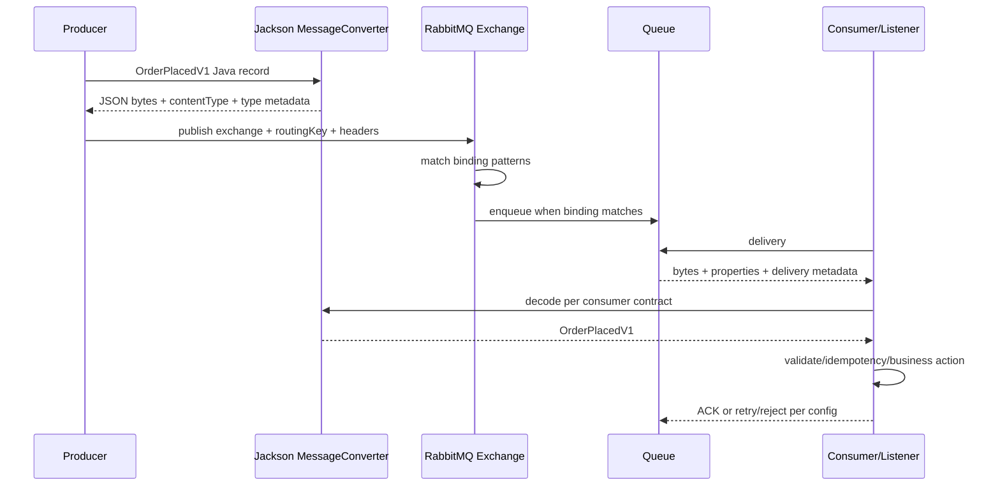
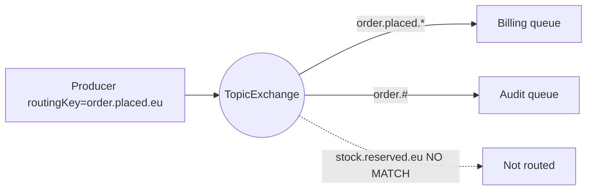

# Messaging — Testing Serialization, Headers, Routing Keys, and Message Schemas

## 1. Problem statement and objectives

In a Spring Boot application using **Messaging**, a producer may call `convertAndSend(...)` without errors yet the consumer still fails to process the message because the **body format is wrong**, **headers lack required metadata**, the **routing key is wrong**, or **schemas between two versions are incompatible**. Checking only that "the publisher method does not throw an exception" provides virtually no proof of the message contract.

A message has at least four distinct parts to observe independently:

1. **Body/payload:** bytes sent over the wire; how JSON/Avro/Protobuf/byte arrays are encoded.
2. **Properties and headers:** `contentType`, `messageId`, `correlationId`, `eventType`, `schemaVersion`, trace/correlation metadata.
3. **Addressing and routing:** exchange + routing key + bindings in RabbitMQ; or topic, key, and partition in Kafka.
4. **Schema/data contract:** required/optional fields, data types, add/modify/remove rules, readability between producers and consumers across multiple versions.

This lesson uses **Spring Boot 3.5, Java 17, Spring AMQP 3.2, RabbitMQ Testcontainers, Jackson, and JUnit 5** to demonstrate thoroughly how to verify each layer. RabbitMQ is the primary example because **routing keys** are an explicit routing component of AMQP 0-9-1. At the end, it compares with Kafka, where **record keys are not equivalent to RabbitMQ routing keys**.

### Lesson objectives

- Distinguish serializing a Java object into bytes from the broker selecting a queue.
- Understand Spring AMQP `RabbitTemplate.convertAndSend` and `Jackson2JsonMessageConverter`.
- Verify wire-format JSON instead of only inspecting Java objects in memory.
- Verify standard message properties and custom headers with the right data types.
- Understand `direct`, `topic`, `fanout`, and `headers` exchanges; `*` and `#` in topic bindings.
- Write tests that catch wrong exchanges, wrong routing keys, missing headers, and schema version mismatches.
- Write backward/forward compatibility contract tests for JSON; know the limits of `@JsonIgnoreProperties(ignoreUnknown=true)`.
- Distinguish producer, consumer, broker routing, and end-to-end event processing tests.
- Use disposable RabbitMQ via Testcontainers instead of sending messages to shared brokers.
- Explain publisher confirms/returns, ACK, retries, dead-lettering, idempotency, and asynchronous observation.
- Avoid confusing Spring AMQP 3.x/Jackson 2 behavior with Spring AMQP 4.x/Jackson 3.

## 2. What steps does a message go through?



**Four distinct categories of errors:**

| Failure point | Symptom | Required testing |
| --- | --- | --- |
| Serialization | Body is Java-serialized bytes or wrong JSON fields | JSON `JsonNode`, content type, round-trip/contract |
| Header | Missing `eventType`/`schemaVersion`/`correlationId` | `MessageProperties` or `@Header` assertions |
| Routing | Right payload yet target queue never receives it | Real broker, exchange/binding/routing key |
| Schema | Old consumer cannot read new messages | V1/V2 contract fixtures and negative cases |

A test that mocks `RabbitTemplate` and only calls `verify(convertAndSend(...))` can prove the producer **passed the right arguments**, but cannot prove that the real RabbitMQ broker applied bindings, the JSON converter actually produced the right wire message, or the consumer deserialized it successfully.

### Route definition must be explicit

In RabbitMQ, a producer **publishes to an exchange** with a routing key; the exchange uses bindings to decide which queues receive it. Producers typically **do not pick queues directly** when using custom exchanges. With the unnamed default exchange `""`, RabbitMQ auto-binds every queue by its queue name — this is a special case and should not be confused with custom direct/topic exchanges.

## 3. Serialization: a Java object is not the wire contract

Suppose an event has the payload:

```json
{
  "eventId": "evt-101",
  "orderId": "ord-101",
  "totalCents": 1250,
  "currency": "USD"
}
```

The wire contract should clearly specify:

- `eventId`: unique ID of the event, used for idempotency.
- `orderId`: order identifier.
- `totalCents`: integer minor units of money, avoiding floating-point drift.
- `currency`: currency code.
- JSON field names and numeric types fixed by contract.
- Do not rely on Java package/class names as a **public contract** between two teams.

A Java record like `OrderPlacedV1` can be encoded to JSON by Jackson, yet having fields in Java code does not prove the message on the broker has a JSON Content-Type. To test the wire contract, inspect the **actual bytes and properties**.

### 3.1. Default converter and Jackson converter

Spring AMQP `RabbitTemplate` has a `MessageConverter`. The default `SimpleMessageConverter` handles Strings, byte arrays, and some forms of Java serialization. **Java native serialization is unsuitable as a cross-language contract, introduces coupling, and carries deserialization risks**.

With Spring AMQP 3.2, use:

```java
@Bean
Jackson2JsonMessageConverter jsonMessageConverter() {
    return new Jackson2JsonMessageConverter("example.messaging");
}
```

- `Jackson2JsonMessageConverter` uses Jackson 2.x to convert objects ↔ bytes.
- `contentType` is set to JSON when serializing.
- Spring AMQP may add type metadata like `__TypeId__`. That is framework metadata, **not a substitute for business-defined `schemaVersion`/`eventType`**.
- Only trust required packages to reduce risk from inbound type metadata; **do not use `"*"` indiscriminately**.
- When `@RabbitListener` declares a concrete payload type, Spring AMQP often infers the target type from the method parameter and may prioritize the inferred type over `__TypeId__`; exact behavior depends on the listener signature and type mapper config.
- For messages from non-Spring systems, define a clear contract for `contentType`, encoding, and type header mapping instead of expecting non-Java producers to emit Java class names.

### 3.2. Content type and encoding

| Property | Example | Why it matters |
| --- | --- | --- |
| `contentType` | `application/json` | Consumer picks the matching decoder |
| `contentEncoding` | `UTF-8` if set | How bytes are interpreted → text |
| `__TypeId__` | `example.messaging.OrderPlacedV1` | Spring-specific type information |
| Body | `{"eventId":"evt-101",...}` | Actual payload on the wire |

`contentType` belongs to message properties; a producer sending JSON bytes with `text/plain` can still cause the consumer's converter to mishandle it. Modern Spring AMQP has some fallbacks for missing/default content types, yet **do not rely on fallbacks when the contract needs certainty**. Tests should assert the expected Content-Type.

### 3.3. Byte[] and JSON structure

Test JSON as a **tree**:

```java
JsonNode json = mapper.readTree(message.getBody());
assertEquals("evt-101", json.get("eventId").asText());
assertEquals(1250, json.get("totalCents").asInt());
```

Do not compare raw JSON strings expecting a single field order, unless field order is genuinely part of the contract (which is rare). JSON object properties have no semantic ordering; whitespace can differ while representing the same message.

## 4. Headers: envelope business metadata

Headers are not all metadata. In RabbitMQ, many fields map to **AMQP BasicProperties**, whereas custom headers live in the headers table. Separate three groups:

| Group | Example | How to inspect |
| --- | --- | --- |
| AMQP standard properties | `contentType`, `messageId`, `correlationId`, `deliveryMode` | `message.getMessageProperties().get...()` |
| Custom application headers | `eventType`, `schemaVersion`, `tenantId` (if permitted), `traceId` | `getHeader("...")` |
| Broker/received metadata | `receivedExchange`, `receivedRoutingKey`, `consumerQueue` | Properties populated by the framework **after delivery** |

### 4.1. Headers and message properties are not always the same

`messageId` and `correlationId` are normally standard properties rather than entries in `getHeaders()`. When the producer calls:

```java
message.getMessageProperties().setMessageId("evt-101");
message.getMessageProperties().setCorrelationId("corr-abc");
message.getMessageProperties().setHeader("schemaVersion", 1);
```

The consumer must read each of the three attributes from its proper place. Avoid writing tests that assert `getHeader("correlationId")` when production code sets the standard `correlationId` property.

### 4.2. Recommended headers

- `eventType`: stable business type such as `order.placed`.
- `schemaVersion`: payload contract version, e.g. integer `1`.
- `correlationId`: links the event to the related request/workflow/trace.
- `messageId` or `eventId`: supports idempotency and debugging.
- `contentType`: `application/json`, Avro, or Protobuf media type accordingly.
- Tracing headers (W3C `traceparent`/`tracestate`) when trace propagation is used.
- `tenantId`/`sourceSystem` only under PII and authorization policies; never send secrets in headers.

**Do not** put authentication tokens, passwords, or PII in headers "for easy debugging". Headers frequently appear in broker inspections, retry queues, and logs.

### 4.3. Checking data types

The AMQP headers table supports types like `String`, `integer`, `long`, `Boolean`, and byte arrays. A `schemaVersion` may be read by a consumer as `Integer` or another `Number` subtype depending on the producer/client/framework. Tests should assert against the **standardized contract**, or check:

```java
Object raw = message.getMessageProperties().getHeader("schemaVersion");
assertEquals(1, ((Number) raw).intValue());
```

This example assumes the contract defines it as numeric; if multiple producers send `"1"` as a String, standardize the schema or add an explicit adapter rather than silently parsing everything.

### 4.4. Routing key is not a custom header

In AMQP, `routingKey` is passed **in `basic.publish`**, not as a key in the custom headers table. After the broker delivers the message, Spring AMQP normally populates `receivedRoutingKey`. Verify via:

```java
assertEquals(
    "order.placed.eu",
    message.getMessageProperties().getReceivedRoutingKey());
```

Adding `setHeader("routingKey","order.placed.eu")` while calling `convertAndSend(exchange, "wrong.key", ...)` will **not** make a RabbitMQ topic exchange route by that fake header.

## 5. Routing in RabbitMQ

### 5.1. Exchanges and bindings



| Exchange type | Matching rule | Example |
| --- | --- | --- |
| `direct` | Routing key **equals** binding key **exactly** | `order.placed.eu` matches only the identical string |
| `topic` | Dot-separated segments; `*` matches one segment, `#` matches 0 or more segments | `order.placed.*` matches `order.placed.eu` but not `order.placed` |
| `fanout` | Copies to all bound queues; **ignores routing key** | Broadcast notifications |
| `headers` | Routes by header conditions instead of ordinary routing keys | Multi-attribute metadata rules |
| Default exchange `""` | Special direct exchange, queues auto-bound by queue name | Send to a queue using its queue name as key |

### 5.2. Topic bindings are easy to get wrong

| Binding pattern | Routing key | Match? | Reason |
| --- | --- | --- | --- |
| `order.placed.*` | `order.placed.eu` | Yes | `*` matches one segment |
| `order.placed.*` | `order.placed.eu.vip` | No | Two segments instead of one |
| `order.placed.*` | `order.placed` | No | Missing final segment |
| `order.#` | `order.placed.eu` | Yes | `#` matches multiple segments |
| `order.#` | `order` | Yes | `#` can match 0 segments |
| `order.#` | `stock.reserved.eu` | No | Does not start with `order` |
| `order.placed.eu` (direct) | `order.placed.us` | No | Not an exact match |

One queue can have **multiple bindings**; one publish can be **copied to multiple queues**. This is publish-subscribe via a topic exchange, not the broker "moving a single message into just one queue".

### 5.3. Unroutable publishes

If a routing key matches no binding, the message may not be placed into any queue. **`RabbitTemplate.convertAndSend` returning does not prove a queue received it**. To detect unroutable messages, configure `mandatory` publisher returns and callbacks with a handling policy; to prove the broker accepted a publish, use publisher confirms. These differ from consumer ACKs.

An integration test can verify this by publishing to **disposable exchanges/queues** and observing both positive and negative queues. A unit test mocking the template cannot prove real broker bindings.

## 6. Message schema design and version compatibility

### 6.1. A schema is a cross-deployment contract

A schema is more than a Java record:

- JSON field names / Avro tags / Protobuf field numbers.
- Types: String, integer, boolean, enum, decimal, array.
- Required vs. optional and default values.
- Business semantics and units (cents vs. dollars).
- Identity fields, timestamps/timezones, and versions.
- Compatibility rules and rollout strategy.

Example V1 contract:

```json
{
  "eventId": "evt-101",
  "orderId": "ord-101",
  "totalCents": 1250,
  "currency": "USD"
}
```

V2 wants to add an optional `campaignCode`:

```json
{
  "eventId": "evt-101",
  "orderId": "ord-101",
  "totalCents": 1250,
  "currency": "USD",
  "campaignCode": "WELCOME"
}
```

If a V1 consumer **ignores unknown fields**, it can read V2 without error. However, if the V1 consumer uses a strict schema with `additionalProperties=false` or a mapper that rejects unknown fields, this change is incompatible. Always test against the **real consumer**, rather than just saying "JSON is flexible".

### 6.2. Backward, forward, and full compatibility

| Direction | Question | Example |
| --- | --- | --- |
| **Backward** | Can the new consumer read **old** messages? | V2 consumer defaults `campaignCode` when receiving V1 |
| **Forward** | Can the old consumer read **new** messages? | V1 consumer ignores the added `campaignCode` |
| **Full** | Are both directions safe? | Adding an optional field + matching rules |
| **Breaking change** | Does some version fail to read or misinterpret? | Changing `totalCents` to `totalDollars`/String, removing `orderId` |

**Adding an optional field is not guaranteed compatible** if business logic changes the semantics of an old field or the producer starts emitting an enum value unsupported by old consumers.

### 6.3. `schemaVersion` header and payload fields

A producer can set `schemaVersion=1` in headers so the consumer selects the right decoder. However, the header value must stay consistent with the body; do not only test "header exists" while skipping body schema checks. Headers can also be stripped during dead-lettering/replay/bridging across platforms unless the bridge is designed properly.

A maintainable strategy:

- `eventType` is a stable event name.
- `schemaVersion` identifies breaking contract versions.
- `messageId`/`eventId` supports deduplication.
- Body uses clear semantic fields without relying on Java FQCNs.
- Consumers have a schema registry or validation layer for multi-language/complex contracts.
- Contract tests keep V1/V2 fixtures and test both producers and consumers.

### 6.4. JSON Schema, Avro, and Protobuf

| Format | Strengths | Testing notes |
| --- | --- | --- |
| JSON | Human-readable, wide ecosystem | Needs explicit JSON Schema/validation because JSON alone does not enforce required fields |
| Avro | Compact binary, schema evolution/resolution | Test writer schema vs. reader schema, defaults, unions; verify schema registry subject compatibility |
| Protobuf | Tagged fields, cross-language, compact | Never reuse deleted field numbers; test unknown fields, reserved tags, and backward/forward compatibility |
| Java serialization | Easy when both sides are Java | Coupling/security risks; **not recommended** as an integration contract |

If using a Schema Registry, CI should check compatibility rules via appropriate APIs/CLI and real fixtures, not just unit tests parsing JSON. In this lesson's RabbitMQ/JSON sample, schemas are checked via record validation and Jackson contract tests; **there is no Schema Registry** in the runnable project.

## 7. Which layer should test what?

| Goal | Unit test | Real RabbitMQ integration test | End-to-end consumer |
| --- | --- | --- | --- |
| Producer selects exchange/key | Mockito verify arguments | Observe received routing key | Observe target queue handler |
| Converter produces right JSON | Test converter/ObjectMapper directly | Check body bytes after broker | Check listener deserialization |
| Headers have right type/value | Test `MessagePostProcessor` | Check `MessageProperties` on receive | `@Header` binding |
| Topic routing `*`/`#` | Test mapping string helper | **Requires real broker** to prove bindings | Can observe consumer |
| Schema V1↔V2 | Fixture-based contract tests | Can send/receive bytes | Old/new consumers tested on shared fixtures |
| Consumer ACK/retry/DLQ | Mock handler logic | Needs broker/container config | Needs real listener/error handling |
| Cross-service tracing/correlation | Check header propagation | Check broker delivery headers | Integration telemetry |
| Performance, durability, quorum | No | Needs production-like topology/config | Load/chaos/recovery tests |

**Do not mix evidence layers:** a converter unit test does not prove RabbitMQ routing; an integration test receiving a message from a queue does not prove the business handler committed to the database, ACKed properly, or prevented duplicates.

## 8. A schema and topology small enough to learn with

The app emits `OrderPlacedV1` to a `TopicExchange` named `learning.events.topic`.

- Billing queue: `learning.billing.order-placed`, binding `order.placed.*`.
- Audit queue: `learning.audit.events`, binding `order.#`.
- Publisher key: `order.placed.eu` or `order.placed.us`.
- Headers: `eventType=order.placed`, `schemaVersion=1`.
- Standard properties: `messageId=eventId`, `correlationId` passed in.
- Body: JSON with `eventId`, `orderId`, `totalCents`, `currency`.
- Publisher validates region before building the routing key to reduce unintended routing bugs.

Thanks to the two queues, publishing `order.placed.eu` must appear in **both billing and audit**; publishing `order.cancelled.eu` must enter only audit; `stock.reserved.eu` must enter neither queue. There is no auto-running `@RabbitListener` in the core project so tests can call `receive` directly without competing against a listener.

### Complete directory tree

```text
messaging-contract-demo/
├── pom.xml
└── src/
    ├── main/
    │   ├── java/example/messaging/
    │   │   ├── MessagingApplication.java
    │   │   ├── OrderPlacedV1.java
    │   │   ├── EventTopology.java
    │   │   └── OrderEventPublisher.java
    │   └── resources/
    │       └── application.properties
    └── test/
        ├── java/example/messaging/
        │   ├── EventSchemaContractTest.java
        │   └── RabbitRoutingIntegrationTest.java
        └── resources/
            └── application-test.properties
```

## 9. pom.xml — Spring Boot 3.5 / Java 17

```xml
<?xml version="1.0" encoding="UTF-8"?>
<project xmlns="http://maven.apache.org/POM/4.0.0"
         xmlns:xsi="http://www.w3.org/2001/XMLSchema-instance"
         xsi:schemaLocation="http://maven.apache.org/POM/4.0.0
             https://maven.apache.org/xsd/maven-4.0.0.xsd">
    <modelVersion>4.0.0</modelVersion>

    <parent>
        <groupId>org.springframework.boot</groupId>
        <artifactId>spring-boot-starter-parent</artifactId>
        <version>3.5.0</version>
        <relativePath/>
    </parent>

    <groupId>example</groupId>
    <artifactId>messaging-contract-demo</artifactId>
    <version>1.0-SNAPSHOT</version>

    <properties>
        <java.version>17</java.version>
    </properties>

    <dependencies>
        <dependency>
            <groupId>org.springframework.boot</groupId>
            <artifactId>spring-boot-starter-amqp</artifactId>
        </dependency>

        <!-- Ensure Jackson 2/ObjectMapper is available in the AMQP sample. -->
        <dependency>
            <groupId>org.springframework.boot</groupId>
            <artifactId>spring-boot-starter-json</artifactId>
        </dependency>

        <dependency>
            <groupId>org.springframework.boot</groupId>
            <artifactId>spring-boot-starter-test</artifactId>
            <scope>test</scope>
        </dependency>

        <dependency>
            <groupId>org.springframework.boot</groupId>
            <artifactId>spring-boot-testcontainers</artifactId>
            <scope>test</scope>
        </dependency>

        <dependency>
            <groupId>org.testcontainers</groupId>
            <artifactId>rabbitmq</artifactId>
            <scope>test</scope>
        </dependency>

        <dependency>
            <groupId>org.testcontainers</groupId>
            <artifactId>junit-jupiter</artifactId>
            <scope>test</scope>
        </dependency>
    </dependencies>
</project>
```

**Why these dependencies:**

- `spring-boot-starter-amqp` provides Spring AMQP, `RabbitTemplate`, AMQP auto-configuration, and listener support.
- `spring-boot-starter-json` provides Jackson for the JSON message converter and `ObjectMapper` used in tests.
- `spring-boot-starter-test` provides JUnit Jupiter, Spring Test, and assertion support.
- `spring-boot-testcontainers` provides `@ServiceConnection` for RabbitMQ.
- `testcontainers:rabbitmq` provides `RabbitMQContainer`.
- `testcontainers:junit-jupiter` provides `@Testcontainers`/`@Container` lifecycle.
- Boot 3.5 Parent/BOM manages compatible versions. **Do not** use Testcontainers 2.x class imports or Spring AMQP 4.x Jackson 3 converters in this Boot 3.5 project.

Requirements: **JDK 17+, Maven, Docker/Podman compatible with Testcontainers**. Schema unit tests require no Docker; RabbitMQ integration tests require a container runtime.

## 10. Production source code — event entity and topology

### 10.1. MessagingApplication.java

`src/main/java/example/messaging/MessagingApplication.java`:

```java
package example.messaging;

import org.springframework.boot.SpringApplication;
import org.springframework.boot.autoconfigure.SpringBootApplication;

@SpringBootApplication
public class MessagingApplication {

    public static void main(String[] args) {
        SpringApplication.run(MessagingApplication.class, args);
    }
}
```

No web server/controller: the demo focuses on messaging. When running the main app standalone outside tests, configure a real or local/dev RabbitMQ broker. `@ServiceConnection` belongs only in the test class.

### 10.2. OrderPlacedV1.java — explicit wire contract

`src/main/java/example/messaging/OrderPlacedV1.java`:

```java
package example.messaging;

import com.fasterxml.jackson.annotation.JsonIgnoreProperties;

@JsonIgnoreProperties(ignoreUnknown = true)
public record OrderPlacedV1(
        String eventId,
        String orderId,
        int totalCents,
        String currency) {

    public OrderPlacedV1 {
        if (eventId == null || eventId.isBlank()) {
            throw new IllegalArgumentException(
                    "eventId must not be blank");
        }
        if (orderId == null || orderId.isBlank()) {
            throw new IllegalArgumentException(
                    "orderId must not be blank");
        }
        if (totalCents < 0) {
            throw new IllegalArgumentException(
                    "totalCents must be non-negative");
        }
        if (currency == null || currency.isBlank()) {
            throw new IllegalArgumentException(
                    "currency must not be blank");
        }
    }
}
```

This is a Java 17 record and also the **V1 message DTO**:

- Keeps concrete field names and data types, never exposing a JPA entity.
- The compact constructor validates basic business constraints; if `orderId` is missing, Jackson passes `null` to the constructor and an error is raised.
- `@JsonIgnoreProperties(ignoreUnknown=true)` demonstrates how an **old reader can ignore new fields**. This alone does not guarantee all schema evolution is safe.
- When making a breaking field change, create an explicit V2 DTO/schema or compatibility adapter rather than silently changing `totalCents` to a different monetary unit.

### 10.3. EventTopology.java — topic exchange, queues, bindings, converter

`src/main/java/example/messaging/EventTopology.java`:

```java
package example.messaging;

import org.springframework.amqp.core.Binding;
import org.springframework.amqp.core.BindingBuilder;
import org.springframework.amqp.core.Queue;
import org.springframework.amqp.core.QueueBuilder;
import org.springframework.amqp.core.TopicExchange;
import org.springframework.amqp.support.converter.Jackson2JsonMessageConverter;
import org.springframework.context.annotation.Bean;
import org.springframework.context.annotation.Configuration;
import org.springframework.beans.factory.annotation.Qualifier;

@Configuration(proxyBeanMethods = false)
public class EventTopology {

    public static final String EXCHANGE =
            "learning.events.topic";

    public static final String BILLING_QUEUE =
            "learning.billing.order-placed";

    public static final String AUDIT_QUEUE =
            "learning.audit.events";

    @Bean
    TopicExchange eventExchange() {
        return new TopicExchange(EXCHANGE, true, false);
    }

    @Bean
    Queue billingQueue() {
        return QueueBuilder.durable(BILLING_QUEUE).build();
    }

    @Bean
    Queue auditQueue() {
        return QueueBuilder.durable(AUDIT_QUEUE).build();
    }

    @Bean
    Binding billingBinding(
            @Qualifier("billingQueue") Queue queue,
            @Qualifier("eventExchange") TopicExchange exchange) {

        return BindingBuilder.bind(queue)
                .to(exchange)
                .with("order.placed.*");
    }

    @Bean
    Binding auditBinding(
            @Qualifier("auditQueue") Queue queue,
            @Qualifier("eventExchange") TopicExchange exchange) {

        return BindingBuilder.bind(queue)
                .to(exchange)
                .with("order.#");
    }

    @Bean
    Jackson2JsonMessageConverter jsonMessageConverter() {
        return new Jackson2JsonMessageConverter(
                "example.messaging");
    }
}
```

**Design points:**

- `TopicExchange` is **durable** and non-auto-delete; queues are also durable. Tests run on a disposable broker; **durable does not mean** every message automatically persists if delivery mode is wrong or queue/broker config is incomplete.
- `billingBinding` uses `order.placed.*`, receiving order-placed events with an exact single-segment region.
- `auditBinding` uses `order.#`, receiving all order events.
- `@Qualifier` selects the right queue when multiple `Queue` beans exist.
- `Jackson2JsonMessageConverter` is wired into `RabbitTemplate` by Boot auto-configuration when registered as a matching converter bean.
- `RabbitAdmin`/broker declaration creates exchanges/queues/bindings from Spring declarable beans on connection per Boot defaults.
- In production when multiple services declare topology, verify ownership, permissions, conflicting queue attributes, and deployment processes; do not treat auto-declaration as schema migration for every broker.

### 10.4. OrderEventPublisher.java — headers after serialization

`src/main/java/example/messaging/OrderEventPublisher.java`:

```java
package example.messaging;

import java.util.Set;

import org.springframework.amqp.core.MessageDeliveryMode;
import org.springframework.amqp.rabbit.core.RabbitTemplate;
import org.springframework.stereotype.Service;

@Service
public class OrderEventPublisher {

    private static final Set<String> REGIONS =
            Set.of("eu", "us");

    private final RabbitTemplate template;

    public OrderEventPublisher(RabbitTemplate template) {
        this.template = template;
    }

    public void publish(
            OrderPlacedV1 event,
            String region,
            String correlationId) {

        if (!REGIONS.contains(region)) {
            throw new IllegalArgumentException(
                    "unsupported region: " + region);
        }

        if (correlationId == null || correlationId.isBlank()) {
            throw new IllegalArgumentException(
                    "correlationId must not be blank");
        }

        String routingKey = "order.placed." + region;

        template.convertAndSend(
                EventTopology.EXCHANGE,
                routingKey,
                event,
                message -> {
                    var properties = message.getMessageProperties();

                    properties.setHeader(
                            "eventType", "order.placed");
                    properties.setHeader(
                            "schemaVersion", 1);

                    properties.setMessageId(event.eventId());
                    properties.setCorrelationId(correlationId);
                    properties.setDeliveryMode(
                            MessageDeliveryMode.PERSISTENT);

                    return message;
                });
    }
}
```

**Explanation:**

- `convertAndSend(exchange, routingKey, object, postProcessor)` converts the DTO to a message and then lets you adjust properties/headers.
- Restricts regions to the `eu`/`us` whitelist; avoids building routing keys directly from arbitrary input.
- `messageId` uses `eventId` so receivers can deduplicate.
- `correlationId` ties logs/traces across workflows.
- `schemaVersion` and `eventType` are custom headers, independent of Java class names.
- `deliveryMode=PERSISTENT` is one piece of durability, **not enough** to guarantee end-to-end delivery: publisher confirms, queue durability/type, broker crash/replication, consumer ACK, and retry policies also apply.
- The method currently returns `void`; `convertAndSend` completing **is not** a consumer ACK. To verify broker acceptance, configure publisher confirms/returns separately and test callbacks.

### 10.5. application.properties

`src/main/resources/application.properties`:

```properties
spring.main.banner-mode=off

# Production broker credentials/hostname must come from environment config.
# Do not hard-code localhost or real credentials here.

# Allow RabbitAdmin to declare Queue/Exchange/Binding beans.
spring.rabbitmq.dynamic=true
```

Do not write `spring.rabbitmq.host=localhost` just for a Testcontainers demo. The container integration test supplies connection details via `@ServiceConnection`. When running the main app outside tests, configure a valid local/dev/prod broker and manage secrets per policy.

### 10.6. application-test.properties

`src/test/resources/application-test.properties`:

```properties
spring.main.banner-mode=off
spring.rabbitmq.dynamic=true

# No automatic @RabbitListener in the core project.
# Tests explicitly call receive() to avoid queue competition.
```

Each test class runs with `@ActiveProfiles("test")`, using its own `RabbitMQContainer`. No Kafka/Redis/SQL or shared broker is needed.

## 11. Unit test: schemas and converters without a broker

`src/test/java/example/messaging/EventSchemaContractTest.java`:

```java
package example.messaging;

import static org.junit.jupiter.api.Assertions.assertEquals;
import static org.junit.jupiter.api.Assertions.assertFalse;
import static org.junit.jupiter.api.Assertions.assertThrows;
import static org.junit.jupiter.api.Assertions.assertTrue;

import java.nio.charset.StandardCharsets;

import com.fasterxml.jackson.databind.JsonMappingException;
import com.fasterxml.jackson.databind.JsonNode;
import com.fasterxml.jackson.databind.ObjectMapper;

import org.junit.jupiter.api.Test;
import org.springframework.amqp.core.Message;
import org.springframework.amqp.core.MessageProperties;
import org.springframework.amqp.support.converter.Jackson2JsonMessageConverter;

class EventSchemaContractTest {

    private final ObjectMapper mapper = new ObjectMapper();

    private static OrderPlacedV1 example() {
        return new OrderPlacedV1(
                "evt-101", "ord-101", 1250, "USD");
    }

    @Test
    void v1WireFormatContainsStableFieldsAndNumericAmount()
            throws Exception {

        String json = mapper.writeValueAsString(example());
        JsonNode tree = mapper.readTree(json);

        assertEquals("evt-101",
                tree.get("eventId").asText());
        assertEquals("ord-101",
                tree.get("orderId").asText());
        assertEquals(1250,
                tree.get("totalCents").asInt());
        assertEquals("USD",
                tree.get("currency").asText());
        assertTrue(tree.get("totalCents").isNumber());

        // No extra fields beyond the V1 contract.
        assertEquals(4, tree.size());
    }

    @Test
    void futureOptionalFieldCanBeIgnoredByOldReader()
            throws Exception {

        String v2 = """
            {
              "eventId":"evt-101",
              "orderId":"ord-101",
              "totalCents":1250,
              "currency":"USD",
              "campaignCode":"WELCOME"
            }
            """;

        OrderPlacedV1 oldConsumer =
                mapper.readValue(v2, OrderPlacedV1.class);

        assertEquals(example(), oldConsumer);
    }

    @Test
    void missingRequiredBusinessFieldIsRejected() {
        String invalid = """
            {
              "eventId":"evt-101",
              "totalCents":1250,
              "currency":"USD"
            }
            """;

        assertThrows(JsonMappingException.class,
                () -> mapper.readValue(
                        invalid, OrderPlacedV1.class));
    }

    @Test
    void invalidNumberDoesNotSilentlyBecomeAmount() {
        String invalid = """
            {
              "eventId":"evt-101",
              "orderId":"ord-101",
              "totalCents":"not-an-integer",
              "currency":"USD"
            }
            """;

        assertThrows(JsonMappingException.class,
                () -> mapper.readValue(
                        invalid, OrderPlacedV1.class));
    }

    @Test
    void amqpConverterWritesJsonAndPreservesHeaders()
            throws Exception {

        Jackson2JsonMessageConverter converter =
                new Jackson2JsonMessageConverter(
                        "example.messaging");

        MessageProperties properties = new MessageProperties();
        properties.setHeader("eventType", "order.placed");
        properties.setHeader("schemaVersion", 1);
        properties.setMessageId("evt-101");
        properties.setCorrelationId("corr-101");

        Message message = converter.toMessage(
                example(), properties);

        assertEquals(MessageProperties.CONTENT_TYPE_JSON,
                message.getMessageProperties().getContentType());

        String raw = new String(
                message.getBody(), StandardCharsets.UTF_8);
        assertTrue(raw.contains("ord-101"));
        assertFalse(raw.contains(
                "java.io.ObjectOutputStream"));

        assertEquals("order.placed",
                message.getMessageProperties()
                        .getHeader("eventType"));
        assertEquals(1,
                ((Number) message.getMessageProperties()
                        .getHeader("schemaVersion"))
                        .intValue());
        assertEquals("corr-101",
                message.getMessageProperties()
                        .getCorrelationId());

        JsonNode actual = mapper.readTree(message.getBody());
        assertEquals(1250,
                actual.get("totalCents").asInt());

        Object restored = converter.fromMessage(message);
        assertEquals(example(), restored);
    }
}
```

**There are 5 `@Test` methods**, requiring no Spring context, Docker, or RabbitMQ.

### Meaning of each unit test

| Test | Proves | Does not prove |
| --- | --- | --- |
| `v1WireFormatContainsStableFieldsAndNumericAmount` | V1 JSON field names and types are right | Which broker queue receives it |
| `futureOptionalFieldCanBeIgnoredByOldReader` | V1 consumer ignores a new optional field | That every V2 change is safe |
| `missingRequiredBusinessFieldIsRejected` | Missing `orderId` rejected by constructor validation | That a JSON Schema Registry enforces it |
| `invalidNumberDoesNotSilentlyBecomeAmount` | Wrong-type string does not map to amount | That every producer sends the right contract |
| `amqpConverterWritesJsonAndPreservesHeaders` | Converter produces JSON and preserves properties | Bindings/broker delivery/ACK |

**Note:** A primitive `int` on a Java record may receive `0` when the JSON field is omitted, depending on Jackson config. Therefore, to require `totalCents` to be **present**, beyond `>=0` in the constructor you also need validation/deserialization policy or a schema validator enforcing required fields. This test only proves `"not-an-integer"` is rejected, not that every required property is enforced. That is an important limitation of "Java DTO as schema".

### Why not compare raw JSON strings?

Object properties in JSON have no semantic order. `ObjectMapper` may write fields in record declaration order while another system reorders them equivalently. Use `JsonNode` and field-level assertions for the contract; if snapshot/golden files are needed, normalize before comparing.

## 12. Integration test: real RabbitMQ in Testcontainers

`src/test/java/example/messaging/RabbitRoutingIntegrationTest.java`:

```java
package example.messaging;

import static org.junit.jupiter.api.Assertions.assertArrayEquals;
import static org.junit.jupiter.api.Assertions.assertEquals;
import static org.junit.jupiter.api.Assertions.assertNotNull;
import static org.junit.jupiter.api.Assertions.assertNull;
import static org.junit.jupiter.api.Assertions.assertTrue;

import java.nio.charset.StandardCharsets;

import com.fasterxml.jackson.databind.JsonNode;
import com.fasterxml.jackson.databind.ObjectMapper;

import org.junit.jupiter.api.BeforeEach;
import org.junit.jupiter.api.Test;
import org.springframework.amqp.core.Message;
import org.springframework.amqp.core.MessageProperties;
import org.springframework.amqp.rabbit.core.RabbitAdmin;
import org.springframework.amqp.rabbit.core.RabbitTemplate;
import org.springframework.beans.factory.annotation.Autowired;
import org.springframework.boot.test.context.SpringBootTest;
import org.springframework.boot.testcontainers.service.connection.ServiceConnection;
import org.springframework.test.context.ActiveProfiles;
import org.testcontainers.containers.RabbitMQContainer;
import org.testcontainers.junit.jupiter.Container;
import org.testcontainers.junit.jupiter.Testcontainers;

@SpringBootTest
@ActiveProfiles("test")
@Testcontainers
class RabbitRoutingIntegrationTest {

    @Container
    @ServiceConnection
    static RabbitMQContainer rabbit =
            new RabbitMQContainer("rabbitmq:3.13-alpine");

    @Autowired
    RabbitTemplate template;

    @Autowired
    RabbitAdmin admin;

    @Autowired
    OrderEventPublisher publisher;

    @Autowired
    ObjectMapper mapper;

    private static OrderPlacedV1 event(String id) {
        return new OrderPlacedV1(
                id, "ord-101", 1250, "USD");
    }

    @BeforeEach
    void purgeBothQueuesSynchronously() {
        // noWait=false: wait for the broker to finish purging.
        // Only safe on a disposable test broker.
        admin.purgeQueue(EventTopology.BILLING_QUEUE, false);
        admin.purgeQueue(EventTopology.AUDIT_QUEUE, false);
    }

    @Test
    void wireBodyAndHeadersSurviveBrokerDelivery()
            throws Exception {

        publisher.publish(
                event("evt-201"), "eu", "corr-201");

        Message message = template.receive(
                EventTopology.BILLING_QUEUE, 5000);

        assertNotNull(message);

        MessageProperties props =
                message.getMessageProperties();

        assertEquals(MessageProperties.CONTENT_TYPE_JSON,
                props.getContentType());
        assertEquals("evt-201", props.getMessageId());
        assertEquals("corr-201", props.getCorrelationId());
        assertEquals("order.placed",
                props.getHeader("eventType"));
        assertEquals(1,
                ((Number) props.getHeader("schemaVersion"))
                        .intValue());

        assertEquals(EventTopology.EXCHANGE,
                props.getReceivedExchange());
        assertEquals("order.placed.eu",
                props.getReceivedRoutingKey());

        JsonNode json = mapper.readTree(message.getBody());
        assertEquals("evt-201",
                json.get("eventId").asText());
        assertEquals("ord-101",
                json.get("orderId").asText());
        assertEquals(1250,
                json.get("totalCents").asInt());
        assertEquals("USD",
                json.get("currency").asText());
    }

    @Test
    void topicExchangeCopiesMatchingEventToTwoQueues() {
        publisher.publish(
                event("evt-202"), "us", "corr-202");

        Message billing = template.receive(
                EventTopology.BILLING_QUEUE, 5000);
        Message audit = template.receive(
                EventTopology.AUDIT_QUEUE, 5000);

        assertNotNull(billing);
        assertNotNull(audit);

        assertArrayEquals(billing.getBody(), audit.getBody());
        assertEquals("order.placed.us",
                billing.getMessageProperties()
                        .getReceivedRoutingKey());
        assertEquals("order.placed.us",
                audit.getMessageProperties()
                        .getReceivedRoutingKey());
    }

    @Test
    void cancelledOrderMatchesAuditButNotBilling() {
        MessageProperties properties = new MessageProperties();
        properties.setContentType(
                MessageProperties.CONTENT_TYPE_JSON);

        Message message = new Message(
                "{}".getBytes(StandardCharsets.UTF_8),
                properties);

        template.send(
                EventTopology.EXCHANGE,
                "order.cancelled.eu",
                message);

        Message audit = template.receive(
                EventTopology.AUDIT_QUEUE, 5000);
        Message billing = template.receive(
                EventTopology.BILLING_QUEUE, 300);

        assertNotNull(audit);
        assertNull(billing);
        assertEquals("order.cancelled.eu",
                audit.getMessageProperties()
                        .getReceivedRoutingKey());
    }

    @Test
    void springJsonConverterCanDecodeMessageFromBroker() {
        OrderPlacedV1 expected = event("evt-203");

        publisher.publish(
                expected, "eu", "corr-203");

        Message raw = template.receive(
                EventTopology.BILLING_QUEUE, 5000);

        assertNotNull(raw);

        Object decoded = template.getMessageConverter()
                .fromMessage(raw);

        assertTrue(decoded instanceof OrderPlacedV1);
        assertEquals(expected, decoded);
    }

    @Test
    void unrelatedRoutingKeyDoesNotEnterEitherQueue() {
        MessageProperties properties = new MessageProperties();
        properties.setContentType(
                MessageProperties.CONTENT_TYPE_JSON);

        template.send(
                EventTopology.EXCHANGE,
                "stock.reserved.eu",
                new Message(
                    "{}".getBytes(StandardCharsets.UTF_8),
                    properties));

        assertNull(template.receive(
                EventTopology.BILLING_QUEUE, 300));
        assertNull(template.receive(
                EventTopology.AUDIT_QUEUE, 300));
    }
}
```

**There are 5 `@Test` methods**, using a **real RabbitMQ broker** and real client/bindings, without mocking `RabbitTemplate`.

### 12.1. Why is @ServiceConnection needed?

`@ServiceConnection` from `spring-boot-testcontainers` creates `RabbitConnectionDetails` based on `RabbitMQContainer`. Spring Boot automatically provides the host, port, and credentials configured by Testcontainers, avoiding hard-coding `localhost:5672`.

`@Testcontainers` + static `@Container` here uses the JUnit extension to start/stop the container for the test class. If multiple Spring test classes share a cached `ApplicationContext`, consider a **Spring-managed container `@Bean`** so its lifecycle is tied to the context and the container does not stop before the context; see Spring Boot Testcontainers docs. In this project there is only one `@SpringBootTest` integration class while schema tests are pure Java, so a static class-scoped container fits.

### 12.2. Why purge before each test?

The demo uses two **fixed queue names** and a disposable broker. If a prior publish left an event in the audit queue, the next test could pick up the old event and fail or pass falsely. `RabbitAdmin.purgeQueue(queue, false)` waits for purging to finish so each test starts with empty queues.

- Never purge staging/production queues!
- Do not use `purgeQueue(..., true)` when the test needs purging guaranteed complete before publishing: `noWait=true` can race.
- Do not enable JUnit parallel execution on classes with shared queues unless using resource locks or distinct namespaces.
- In larger systems, generate queue/exchange names per test run or correlation ID and clean up by resource ownership.

### 12.3. Why is there no `@RabbitListener` in the runnable project?

If both `@RabbitListener(queues=BILLING_QUEUE)` ran automatically and `RabbitTemplate.receive(BILLING_QUEUE)` ran in the same test, both would be **competing consumers on one queue**. The listener could grab the message first, causing `receive` to return `null` and making CI flaky. The lesson avoids the race by having the test read directly.

Section 14 shows a realistic consumer and how to test it separately with a dedicated queue.

### 12.4. What do the broker tests prove?

- `wireBodyAndHeadersSurviveBrokerDelivery`: JSON body and business/AMQP properties survive broker transit; exact exchange/routing key received.
- `topicExchangeCopiesMatchingEventToTwoQueues`: one message matches both billing and audit bindings and is copied to both queues.
- `cancelledOrderMatchesAuditButNotBilling`: pattern `order.#` matches while `order.placed.*` does not.
- `springJsonConverterCanDecodeMessageFromBroker`: the converter reads back the published DTO after broker delivery.
- `unrelatedRoutingKeyDoesNotEnterEitherQueue`: unmatched keys leave both queues empty. This **does not** prove the publisher gets notified of unroutable messages via confirms/returns.

### 12.5. Do not infer at-least-once/ordering from this lesson

RabbitMQ can redeliver messages if a consumer crashes before ACK, and ordering is affected by multiple consumers, prefetch, retries, and requeues. These tests only verify **routing and message contracts in simple scenarios**. If an application requires at-least-once/idempotency or per-aggregate FIFO, write dedicated tests for producer confirms, consumer ACK/NACK, duplicate delivery, and coordination.

## 13. Running Maven and expected results

Requirements: **JDK 17+, Maven**; for integration tests, **Docker/Podman compatible with Testcontainers** and ability to pull `rabbitmq:3.13-alpine`.

Run JSON/schema unit tests (no Docker):

```bash
mvn test -Dtest=EventSchemaContractTest
```

Run broker tests:

```bash
mvn test -Dtest=RabbitRoutingIntegrationTest
```

Run everything:

```bash
mvn test
```

| Test class | `@Test` count | Docker required? | Scope |
| --- | ---: | --- | --- |
| `EventSchemaContractTest` | 5 | No | JSON fields, schema evolution, invalid data, converter/properties |
| `RabbitRoutingIntegrationTest` | 5 | Yes | Wire JSON + headers, topic routing, broker delivery, and decoding |
| **Total** | **10** | Yes when running all | Two complementary layers |

**Expected result:** 10 tests PASS, 0 failed/errors/skipped in a compatible environment. This is the **expected result based on the example**, not actual execution logs from this session. Read `target/surefire-reports` to verify JUnit discovery, executed test counts, and failure causes.

### Environmental factors that can make tests fail

- Docker daemon unreachable or unable to pull the RabbitMQ image.
- Missing `spring-boot-testcontainers`/`@ServiceConnection` causing Spring Boot to try connecting to a localhost broker.
- `RabbitAdmin` not auto-configured due to `spring.rabbitmq.dynamic=false` or a custom `AmqpAdmin`.
- Exchange/queue/binding declaration rejected due to same name with different attributes.
- Container readiness too slow under CI resource pressure.
- Tests running in parallel on the same queue stealing each other's messages.
- Background consumer accidentally running on a queue where the test calls `receive`.
- Converter not attached to `RabbitTemplate` because a custom template bean bypassed it.
- Publisher routing with the wrong key/broker lacking the binding.
- JSON type metadata package not trusted or wrong consumer target type.
- Header type mismatch against numeric/string contract.

Do not use `Thread.sleep(1000)` to "fix" routing tests. Inspect topology, connections, message properties, `receive(queue, timeout)`, and competing consumers.

## 14. Realistic consumer with `@RabbitListener`

In production, applications normally use a listener instead of manually receiving messages in tests:

```java
// ILLUSTRATIVE SNIPPET — do not add to the same queue of a project
// that actively calls RabbitTemplate.receive(), to avoid competing consumers.

import org.springframework.amqp.rabbit.annotation.RabbitListener;
import org.springframework.messaging.handler.annotation.Header;
import org.springframework.messaging.handler.annotation.Payload;

@RabbitListener(queues = EventTopology.BILLING_QUEUE)
public void onOrderPlaced(
        @Payload OrderPlacedV1 event,
        @Header("eventType") String eventType,
        @Header("schemaVersion") Integer schemaVersion) {

    if (!"order.placed".equals(eventType)
            || schemaVersion != 1) {
        throw new IllegalArgumentException(
                "Unsupported message contract");
    }

    // Idempotent business handling:
    // 1. Check whether eventId was already processed.
    // 2. Write to DB atomically per transaction policy.
    // 3. ACK after success per listener config.
}
```

**This is an illustrative method snippet**, which must be placed inside a bean like `@Component` with complete imports/config, not a standalone Java class. Do not add it to the core project if integration tests also `receive()` from `BILLING_QUEUE`.

### How to test listeners properly

1. Create a dedicated **listener-only queue**/binding in test config, or separate integration test classes/contexts to prevent competing consumers.
2. Use the real consumer bean and inject a thread-safe observable sink, e.g., `BlockingQueue<ProcessedEvent>` in tests only.
3. Publish messages through `RabbitTemplate` to a real exchange.
4. Use Awaitility or `poll(timeout)` to wait for the exact event ID/version to be processed; **never use fixed sleeps**.
5. Assert the handler received the decoded DTO and headers; verify schema version failures follow reject/retry/DLQ policies.
6. Use test-specific IDs and proper cleanup/consumer lifecycles; avoid global queues.
7. If the handler writes to a database, wait for **committed state** before asserting, not just handler entry.
8. If using manual acknowledgments, verify ACK/NACK/requeue explicitly; `@RabbitListener` default containers normally auto-ACK on success/failure semantics, though config can differ.

### `@Header` and AMQP metadata

Business headers like `eventType` and `schemaVersion` can be injected with `@Header("...")`. The routing key is received by the consumer as AMQP received-routing-key metadata (Spring AMQP mapping has corresponding constants). Do not add a fake custom header `routingKey` and believe the broker routed by it.

### Spring converters in listeners

Spring AMQP supports inferred types from `@RabbitListener` parameters and converters based on content type/type metadata. A non-Java producer sending JSON without `__TypeId__` can still map to a concrete DTO if the listener signature/config is set appropriately; test that exact implementation version. If a listener accepts an interface, abstract class, generics, or polymorphic DTO, type mapping is trickier and needs corresponding fixtures.

## 15. Schema evolution: how to go from V1 to V2?

### 15.1. Adding an optional field

V2 has `campaignCode`:

```json
{
  "eventId": "evt-101",
  "orderId": "ord-101",
  "totalCents": 1250,
  "currency": "USD",
  "campaignCode": "WELCOME"
}
```

A V1 consumer with `@JsonIgnoreProperties(ignoreUnknown=true)` can parse when the new field does not affect existing fields. The unit test `futureOptionalFieldCanBeIgnoredByOldReader` verifies exactly that.

However, a new V2 consumer reading V1 events needs a default/null policy:

```java
// SNIPPET, not a runnable file in the core project.
public record OrderPlacedV2(
        String eventId,
        String orderId,
        int totalCents,
        String currency,
        String campaignCode) {}
```

If `campaignCode` is absent, Jackson may pass `null` for the String; the V2 consumer must handle `null` or apply a schema default. Never assume every new field automatically gets a non-null default if application validation rejects nulls.

### 15.2. Changing data types

Changing `totalCents: int` to `totalCents: String` while keeping the same field name is a **breaking risk**. Jackson may coerce certain numeric/string values depending on config, making a test pass accidentally while carrying wrong semantics. Verify JSON types, schema validation, and cross-version contracts using the real converter config.

### 15.3. Renaming fields

If `orderId` is renamed to `purchaseId` and the old field is dropped immediately, V1 consumers can receive `null` or fail. Safer paths include dual-write/alias/deprecation periods, or defining a new `eventType`/`schemaVersion` and deploying readers that support the transition period.

### 15.4. Enums and unknown values

A V1 consumer understands `NEW`/`PAID`, yet a V2 producer sending `PARTIALLY_REFUNDED` can break the enum mapper. You can define an `UNKNOWN` fallback or explicit policy, rather than relying on "ignore unknown properties" as a cure for unknown enum values.

### 15.5. Time and currency

- Timestamps must include timezone/offset or use a standard instant, not the producer's implicit local time.
- Amounts should have fixed units; `totalCents` and `totalVnd` have different semantics.
- Decimals require defined rounding/scale; avoid `double` for money.
- The `schemaVersion` header does not replace these semantic rules.

## 16. Header contracts across languages

### Business IDs

Example:

```text
eventType      = "order.placed"
schemaVersion  = 1
messageId      = "evt-101"
correlationId  = "checkout-req-77"
routingKey     = "order.placed.eu"
contentType    = "application/json"
```

- `messageId` identifies a single event.
- `correlationId` ties workflow steps together.
- `eventType` is the business event name.
- `schemaVersion` lets consumers choose the right parser/migration path.
- `routingKey` is the AMQP envelope routing value, **not** a custom header.
- `contentType` selects the converter.

Across HTTP/Kafka/AMQP bridges, specify the mapping for every field and type so nothing is lost or truncated. Kafka headers are byte arrays, while RabbitMQ AMQP header tables support multiple scalar types; crossing a bridge does not automatically preserve `Integer`, `String`, UUID, or trace context.

### Headers that may be altered

Brokers/frameworks can add `x-death` (dead-letter metadata), consumer tags, received routing keys, delivery counts, or retry-plugin-specific headers. Business tests should assert only the fields in **their own contract**, rather than snapshotting all framework headers and treating every library upgrade difference as a regression.

## 17. Differences from Kafka — do not equate routing keys

### 17.1. Kafka keys and RabbitMQ routing keys

| Concept | RabbitMQ AMQP | Apache Kafka |
| --- | --- | --- |
| Primary publish address | Exchange + routing key | Topic |
| How destination is decided | Exchange matches bindings and routing key → one/many queues | Producer picks partition (via partitioner/key) inside topic |
| Message key | Routing key in the publish envelope | Record key is bytes/value encoded by serializer |
| Consumer reads | Queue with ACK/NACK | Topic-partitions with offsets/consumer groups |
| Headers | AMQP headers table + BasicProperties | List of key/byte[] headers |
| Ordering | Depends on queue/consumers/requeue | Usually ordered within each partition |
| Schema | Per payload contract, no built-in registry | Often has a registry when using Avro/Protobuf/JSON Schema |

In Kafka, `ProducerRecord.key` is typically used to select a partition and keep matching keys together, though partitioning also depends on the partitioner, partition count, and config. It **does not** pick arbitrary topics or behave like a RabbitMQ topic exchange `order.placed.*`.

### 17.2. Kafka serialization

Spring Kafka 3.x uses serializers/deserializers to convert keys/values ↔ bytes; JSON has variants such as `JsonSerializer`/`JsonDeserializer` depending on version, with dedicated type headers. Newer Spring Kafka releases rename or change Jackson integrations; read the docs for your exact version.

Conceptual example configuration:

```properties
# ILLUSTRATIVE SAMPLE, not RabbitMQ project properties.
spring.kafka.producer.key-serializer=org.apache.kafka.common.serialization.StringSerializer
spring.kafka.producer.value-serializer=org.springframework.kafka.support.serializer.JsonSerializer
spring.kafka.consumer.key-deserializer=org.apache.kafka.common.serialization.StringDeserializer
spring.kafka.consumer.value-deserializer=org.springframework.kafka.support.serializer.JsonDeserializer
```

This is **not** a standalone runnable Kafka configuration: it still needs bootstrap servers, target consumer types, trusted packages, group ID, and topics. Never add these properties to the RabbitMQ project. When testing Kafka, verify:

- Producer topic/key/value/headers.
- Serialized bytes, type mapping, and schema registry policy.
- Consumer deserialization and error handlers.
- Partition/offset behavior on a real broker/Testcontainers.
- Never use a RabbitMQ `TopicExchange` to explain Kafka partitioning.

### 17.3. Schema Registry

Confluent Schema Registry or an equivalent registry can enforce compatibility when schemas are registered. Schema testing needs:

- Contract unit tests with writer/reader versions.
- Registry compatibility checks in CI per subject naming/versioning policy.
- Integration tests producer→broker→consumer using real serializers.
- Rollback/replay policies and handling of older messages.

Never assume every RabbitMQ/Kafka installation includes a Schema Registry. The main project uses JSON + contract tests without a registry.

## 18. Publisher confirms, returns, and consumer ACKs

**Three distinct mechanisms:**

| Mechanism | Question answered | What it does not prove |
| --- | --- | --- |
| Publisher confirm | To what extent did the broker accept/process the publish per confirm semantics? | That the consumer processed business logic |
| Publisher return (mandatory) | Did the message fail to route to any queue? | That delivery was eventually ACKed |
| Consumer ACK/NACK | Did the consumer accept/reject a delivery per policy? | That the producer observed end-to-end business success |

To guarantee more than "`convertAndSend` threw no exception":

1. Enable publisher confirm mode and publisher returns/mandatory per Spring Boot/RabbitMQ version.
2. Attach correlation data to publishes and callbacks.
3. Handle NACKs/returns differently per policy.
4. Record retries/outbox entries when publishing fails.
5. Process idempotently on the consumer using `eventId`.
6. ACK only after the business transaction reaches an appropriate checkpoint.
7. Design a DLQ and poison-message policy (max retries, delay, observability).
8. Monitor queue depth, unacked counts, redelivery rates, and consumer lag.

The sample verifies **message contracts/routing**; it does not claim to verify publisher confirms, broker cluster replication, quorum queue durability, or end-to-end exactly-once.

## 19. Retries, dead-lettering, and handling malformed schemas

A message with JSON missing a field can trigger a conversion exception **before the listener business method even runs**. If a poison message is retried infinitely, the queue can stall.

Test plan should cover:

- **Transient errors** (temporary DB/network issues): bounded retries with backoff.
- **Permanent schema errors** (invalid JSON/unsupported `schemaVersion`): reject or route to DLQ without infinite loops.
- **Unknown `eventType`**: deliberately reject/ignore; never parse as another event and write corrupt data.
- **Duplicate `eventId`**: consumer idempotency so side effects are not applied twice.
- **Out-of-order versions**: business aggregate version fencing when ordering matters.
- **Replay**: old/new consumer version compatibility, schema registry, and deduplication.
- **Correlation**: preserve `messageId`/`correlationId`/trace headers when republishing for retry/DLQ per policy.

Never assume a rejected RabbitMQ message automatically goes to a DLQ: the queue must be configured with a dead-letter exchange/routing and matching policies. Never assume every listener exception triggers finite retries; check the exact listener container factory, error handler, retry interceptor, and acknowledge mode.

## 20. Determinism and isolation in testing

### 20.1. Disposable test brokers

With `RabbitMQContainer`, created queues/exchanges exist only inside the test broker. Never point tests at production hosts/credentials. Never call `admin.purgeQueue(...)` on a shared broker.

### 20.2. Avoiding competing consumers

A queue distributes messages to one of its competing consumers per broker delivery. If a test both calls `RabbitTemplate.receive` and runs `@RabbitListener` on that queue, whichever receives first wins a race. Separate queues/contexts or use an observed sink in the handler.

### 20.3. Cleaning up state properly

- In the demo, `@BeforeEach` purges both queues synchronously because the broker is completely disposable.
- In large integration suites, namespace exchange/queue names per run or use dedicated containers.
- Never rely on test method order to leave messages for a subsequent test.
- Never use unrecorded random timestamps/UUIDs for expected values; explicit event IDs aid debugging.
- If JUnit parallel execution is enabled, isolate topologies or serialize tests sharing a queue.

### 20.4. Bounded waiting

`RabbitTemplate.receive(queue, 5000)` waits up to a finite limit per API. When testing asynchronous listeners, use Awaitility or a blocking queue with a timeout; **never** use fixed `Thread.sleep(2000)`. Every test must fail clearly when no message is observed.

### 20.5. Do not make tests green by mocking the broker

Mockito verifying that `template.convertAndSend(EXCHANGE, KEY, ...)` was called does not cover:

- Whether the exchange exists.
- Whether the binding pattern is right.
- Whether `RabbitAdmin` declared the queue properly.
- Whether the broker routed to the target queue.
- Whether headers survived serialization.
- Whether the inbound converter accepted the payload.

Mock tests are useful for pure Java producer logic, yet at least one broker integration test is essential for critical routing/messaging contracts.

## 21. Troubleshooting

| Symptom | Possible cause | How to resolve |
| --- | --- | --- |
| `RabbitTemplate.convertAndSend` succeeds yet no message arrives | Routing key mismatch or unroutable publish | Check exchange/bindings/returns and broker tests |
| Message enters audit yet misses billing | `order.#` matches while `order.placed.*` does not | Verify exact segment count in routing key |
| `contentType=application/x-java-serialized-object` | Using `SimpleMessageConverter`/Java serialization | Configure JSON converter |
| Consumer receives `byte[]` instead of DTO | Wrong Content-Type/type mapping/inferred type | Verify converters on both producer and consumer |
| `ClassNotFoundException`/untrusted type | `__TypeId__` points to unknown Java class or untrusted package | Use target type/mapping whitelist |
| Message headers missing `schemaVersion` | Publisher omitted it or bridge dropped header | Check `MessagePostProcessor` and consumer props |
| `correlationId` in header yet test misses it | Confusing `BasicProperties` vs. custom header | Check `getCorrelationId()` |
| `ReceivedRoutingKey` differs from custom `routingKey` header | Fake header does not participate in exchange routing | Check `convertAndSend(exchange,key,...)` |
| Unknown JSON field breaks old consumer | Strict `ObjectMapper`/JSON schema | Test V2 fixture against V1 reader |
| Missing field does not fail | Primitive default/null with no required validation | Add JSON Schema or constructor/validator |
| New enum breaks consumer | V1 consumer does not recognize V2 enum | Design `UNKNOWN`/migration/versioning |
| Passes individually, fails in suite | Shared queues/state or competing listener | Synchronous purge, isolated namespaces, avoid parallel |
| `purgeQueue(...,true)` causes flakiness | No-wait purge has not completed | Use `false` when synchronization is needed |
| `RabbitAdmin` fails to declare exchanges | `spring.rabbitmq.dynamic=false`, missing beans, or connection failure | Check topology/`AmqpAdmin` and logs |
| Broker test fails to connect | Docker/Testcontainers/image or `@ServiceConnection` missing | Check Docker, container readiness, and dependencies |
| JSON body field names changed | Jackson naming policy or DTO refactor | Wire JSON contract tests |
| Producer uses wrong exchange | Hard-coded string drifted from config | Topology constants/contracts and routing tests |
| 404/HTTP test used for AMQP | Protocol confusion | Test `RabbitTemplate`/listeners and AMQP semantics |
| Quorum queue behaves differently from classic queue | Different topology/routing/durability from production | Integration-test with matching queue types/cluster |
| Test sends message and hangs forever | Missing timeout or consumer never ACKs | Bounded polling, check logs/queue depth |
| Poison message retries endlessly | Missing DLQ/retry limit | Configure reject/DLQ and test it |
| Spring AMQP 4 cannot import `Jackson2JsonMessageConverter` | Jackson 3 migration | Use the version-appropriate converter |
| Kafka key treated as routing key | Conflating RabbitMQ and Kafka semantics | Write separate topic/partition/key tests |
| Build green yet Rabbit tests skipped | Maven filter/CI lacks Docker | Inspect Surefire reports, enforce mandatory job |
| Consumer test asserts payload only, skipping headers | Missing contract metadata checks | Assert `eventType`/`schemaVersion`/correlation |
| Persistent message lost on broker failure | Insufficient queue topology/confirms/replication | Publisher confirms, durable/quorum, disaster tests |

A solid debugging order: **verify broker/connection → exchange/queue/binding → actual routing key → contentType/body bytes → headers/type mapping → listener conversion → business idempotency/ACK**. Read the root cause first rather than tweaking converters to mask routing errors.

## 22. CI/CD and release contracts

A sound pipeline:

| Stage | Checks | Expected outcome |
| --- | --- | --- |
| DTO/JSON unit | V1 fixtures, missing/extra/invalid fields | Explicit schema contract |
| Converter unit | `toMessage/fromMessage`, `contentType`, headers | Accurate wire JSON |
| Publisher unit | Exchange/key/headers mapping from business input | No wrong keys |
| Broker integration | `RabbitMQContainer`, positive/negative topic bindings | Exact queues receive |
| Consumer integration | Real listener, decoder, ACK/DLQ | Handler behaves per contract |
| Contract compatibility | Producer V2 ↔ Consumer V1/V2 fixtures | No policy-violating breaking changes |
| Staging | Quorum queues, auth/TLS, DLX, tracing, scale | Matches deployment |
| Production monitoring | Confirm/return, unroutable count, DLQ/lag | Alerts and replay plan ready |

**Avoid running everything on mocks:** routing keys/bindings require a real broker. **Avoid requiring Docker for every test:** pure Java JSON schema contract tests run faster and give immediate PR feedback.

### Security and access control

- Never put PII or credentials in body/header fixtures.
- Never connect to production brokers in tests.
- Give producer/consumer credentials least-privilege access to needed exchanges/queues.
- Do not trust all Java classes via `trustedPackages("*")` without a threat model and broker controls.
- If using Schema Registry secrets, pull them from the CI secret store.
- Log useful metadata while sanitizing payloads and headers that could hold personal data.
- Cross-tenant routing must verify business isolation, not just matching string keys.

## 23. Acceptance checklist

- [ ] Defined message contract separating payload, headers, routing, and schema?
- [ ] Serialization verified using body bytes/JSON tree, not just Java objects?
- [ ] Content-Type and encoding match the consumer?
- [ ] Converters configured properly on both producer and listener?
- [ ] Java native serialization avoided as a cross-service contract?
- [ ] Spring-specific type headers not treated as the public schema contract?
- [ ] Trusted packages/type mappings not overly permissive?
- [ ] `eventType` and `schemaVersion` headers match expected values and types?
- [ ] `messageId`/`correlationId` checked as standard properties?
- [ ] `receivedExchange`/`receivedRoutingKey` asserted after broker delivery?
- [ ] Routing key set via publish API, not a fake custom header?
- [ ] Topic `*`/`#` tested for both matches and non-matches?
- [ ] Exchange/queue/binding topology verified on a real RabbitMQ broker?
- [ ] Tests avoid competing listeners and manual consumers on the same queue?
- [ ] Purge/cleanup runs only on disposable test brokers?
- [ ] Tests use finite timeouts rather than fixed sleeps?
- [ ] Producer V2 event fixtures readable by V1 consumers per policy?
- [ ] New consumers can read old messages when backward compatibility is required?
- [ ] Missing required fields/invalid numbers/enums handled explicitly?
- [ ] `schemaVersion` header does not replace body validation?
- [ ] Publisher confirms/returns strategy in place for unroutable messages?
- [ ] Consumer ACK/NACK, retries, DLQ, and poison messages tested separately?
- [ ] Business processing is idempotent by `eventId`?
- [ ] Kafka record keys not equated with RabbitMQ routing keys?
- [ ] CI verifies test counts and that Testcontainers jobs actually execute?
- [ ] When upgrading Boot/Spring AMQP major versions, Jackson 2/3 converters checked?

## 24. Self-practice exercises

1. Add a `learning.fraud.order-events` queue bound to `order.placed.us`; write a test verifying it receives only US events.
2. Change the publisher key to `order.placed.eu.vip`; prove billing's `order.placed.*` binding does not match.
3. Try `order.#` with routing keys `order` and `order.cancelled.eu`, asserting audit receives both.
4. Add a `traceparent` header in `MessagePostProcessor` and test propagation.
5. Add `tenantId` and design tests guarding against cross-tenant routing/sensitive metadata leaks.
6. Create a V2 consumer with an optional/default `campaignCode` field, testing both backward and forward fixtures.
7. Use JSON Schema to enforce required `totalCents`; prove a missing primitive field does not silently become `0`.
8. Write a test for an unknown Jackson enum value; define an `UNKNOWN` or DLQ policy.
9. Add publisher returns/mandatory and test that an unmatched routing key triggers the return callback.
10. Add publisher confirms and test broker acknowledgement, without treating it as consumer ACK.
11. Create a dedicated listener queue and use Awaitility to wait for the handler to process an `eventId`.
12. Deliver the same `eventId` twice to a consumer; verify the business side effect happens only once.
13. Create an undeserializable failure case and verify the message goes to the DLQ instead of retrying infinitely.
14. Test a V1 consumer reading a V2 event with strict unknown-field rejection; explain the compatibility break.
15. Compare sending the same business event over Kafka: separate topic, key, partition, headers, and serializers.

## 25. Official References

1. [Spring Boot 3.5 — Messaging: AMQP](https://docs.spring.io/spring-boot/3.5/reference/messaging/amqp.html): `RabbitTemplate`/`RabbitAdmin`/listener auto-configuration.
2. [Spring Boot 3.5 — Testcontainers](https://docs.spring.io/spring-boot/3.5/reference/testing/testcontainers.html): `@ServiceConnection` and `RabbitMQContainer`.
3. [Spring AMQP 3.2 — Message Converters](https://docs.spring.io/spring-amqp/reference/3.2/amqp/message-converters.html): `Jackson2JsonMessageConverter`, type headers, content type, trusted packages.
4. [Spring AMQP 3.2 — Sending Messages](https://docs.spring.io/spring-amqp/reference/3.2/amqp/sending-messages.html): `RabbitTemplate.convertAndSend`, post processors, and publisher confirms.
5. [Spring AMQP — Receiving Messages](https://docs.spring.io/spring-amqp/reference/amqp/receiving-messages/async-annotation-driven/conversion.html): `@RabbitListener` and inferred target types.
6. [Spring AMQP 3.2 — RabbitAdmin API](https://docs.spring.io/spring-amqp/docs/3.2.5/api/org/springframework/amqp/rabbit/core/RabbitAdmin.html): queue declaration and `purgeQueue(queue,false)`.
7. [RabbitMQ — Exchanges](https://www.rabbitmq.com/docs/exchanges): direct/topic/fanout/headers/default exchanges and wildcard rules.
8. [RabbitMQ — Publisher Confirms](https://www.rabbitmq.com/docs/confirms): publisher confirmations vs. consumer acknowledgments.
9. [RabbitMQ — Dead Letter Exchanges](https://www.rabbitmq.com/docs/dlx): dead-letter policies and retry considerations.
10. [Spring Kafka — Serialization and Deserialization](https://docs.spring.io/spring-kafka/reference/kafka/serdes.html): key/value serializers, JSON type headers, mapping.
11. [Spring Kafka — Headers](https://docs.spring.io/spring-kafka/reference/kafka/headers.html): record headers/`byte[]` and type metadata.
12. [Testcontainers Java — RabbitMQ](https://java.testcontainers.org/modules/rabbitmq/): `RabbitMQContainer` and test broker lifecycle.
13. [JSON Schema Specification](https://json-schema.org/specification): required fields/type contracts.
14. [Apache Avro Specification](https://avro.apache.org/docs/current/specification/): schema resolution and reader/writer compatibility.
15. [Protocol Buffers — Updating a Message Type](https://protobuf.dev/programming-guides/proto3/#updating): reserved field numbers and compatibility.

### Spring Boot 4 / Spring AMQP 4 note

The sample project pins **Spring Boot 3.5.0 / Spring AMQP 3.2 / Jackson 2** with `Jackson2JsonMessageConverter`. In Spring AMQP 4/Jackson 3, the new converter is `JacksonJsonMessageConverter`; several Jackson 2 APIs are deprecated for migration. When upgrading Boot major versions, verify starters/modules/Jackson BOM, package imports, and type mapper/trust settings against the version-specific docs. Never just bump dependency versions and assume all converter APIs stay identical.

**Remember:** an event can have **the right Java object yet the wrong wire format**, **the right body yet missing headers**, **the right headers yet go to the wrong queue**, or **route properly yet fail to parse on an older consumer**. Reliable messaging tests must include separate assertions for **serialization + headers + exchange/routing key + schema evolution**, followed by consumer ACK/retry/idempotency tests matching system risk.