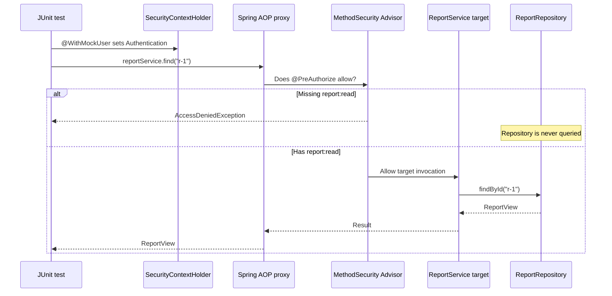

# Security — Testing Method Security Through the Spring Proxy

## 1. Why can a method security test produce a “false green”?

In a Spring Boot application, protecting HTTP endpoints with `SecurityFilterChain` is important yet insufficient. The same service may be called by REST controllers, scheduled jobs, messaging listeners, GraphQL resolvers, batch jobs, or another service. If access checks on sensitive data live solely at the web layer, an internal call path can bypass them.

Spring Security supports **method-level authorization** with annotations like `@PreAuthorize` and `@PostAuthorize`. However, in the common default mode, these annotations **are enforced by a Spring AOP proxy**, not by the JVM every time it encounters an annotation in Java source.

Consider:

```java
@Service
class ReportService {
    @PreAuthorize("hasRole('ADMIN')")
    public String secret() {
        return "confidential";
    }
}
```

A test:

```java
ReportService service = new ReportService();
assertEquals("confidential", service.secret());
```

can PASS even with no authenticated user, because `new ReportService()` creates a **plain Java object that bypasses the Spring proxy**. This snippet illustrates a *testing trap*, not a valid security test.

This lesson shows how to test **at the exact Spring proxy interception point**:

- `@EnableMethodSecurity` is genuinely active in the `ApplicationContext`.
- Tests inject the **Spring-managed bean** via `@Autowired`.
- Users/permissions are set using `@WithMockUser`, `@WithAnonymousUser`, `@WithUserDetails`, or `@WithSecurityContext` as appropriate.
- Unauthorized calls must throw `AccessDeniedException`; with `@PreAuthorize`, **business logic is never invoked**.
- Authorized calls must invoke dependencies and return the right data.
- `@PostAuthorize` checks after the method completes; tests must prove it **behaves differently** from pre-checks.
- Tests avoid traps: `this.method()` self-invocation, `private`/`final` methods, JDK/CGLIB proxies, mocking the wrong bean, role prefixes, wrong SpEL, and test contexts missing security config.

The sample project uses **Java 17, Spring Boot 3.5, Spring Security 6.5, JUnit Jupiter, `spring-security-test`, and `MockitoBean`**. It needs no Docker, database, or HTTP server because the goal is testing **service method calls through the proxy**.

## 2. Two distinct security boundaries

| Boundary | Example | Observation tool |
| --- | --- | --- |
| **HTTP request authorization** | Only ADMIN may `DELETE /reports/{id}` | `MockMvc` + `SecurityFilterChain`/filter chain |
| **Method authorization** | Only ADMIN may invoke `ReportService.delete(...)`, even from a scheduler | Spring context + proxied service + `@WithMockUser` |
| **Resource ownership** | Users may only read reports they own | `@PostAuthorize` or permission evaluator |
| **Domain/business validation** | Invalid ID, report does not exist | Business exception/validation tests |
| **Data isolation** | Tenant A cannot query Tenant B rows | Service + repository/DB integration, tenant filters |
| **Authentication** | JWT signature, expired token, OAuth2 flow | HTTP/security integration, real/custom authentication |

**Do not confuse a 403 at the controller with proof that the service is protected by a proxy.** A request can be denied by the Spring Security HTTP filter before the controller ever calls the service, even if `@EnableMethodSecurity` was omitted or the service method has no annotation. Proper method security tests invoke the **service bean** and verify the proxy's reaction at the method boundary.

### Flow example



## 3. What does a Spring proxy actually do?

Spring AOP places a **proxy object** between caller and target bean:

1. Spring instantiates the target `ReportService` bean.
2. Spring Security's method-security infrastructure detects protected methods/annotations.
3. Spring builds or contributes an advisor to the corresponding AOP proxy.
4. Callers receive that bean reference from `ApplicationContext` (normally the proxy).
5. When a caller invokes a method through the proxy, the authorization interceptor reads `Authentication` from `SecurityContextHolder`, evaluates SpEL, and allows or denies.
6. Only when allowed does the interceptor invoke the target method.
7. With `@PostAuthorize`, once the target returns, the interceptor evaluates `returnObject` before returning the value to the caller.

### Not every call goes through the proxy

```text
JUnit / Controller / Service A
           |
           v
     Spring proxy
           |
     Authorization advice
           |
           v
     Target ReportService
           |
           +---- this.otherMethod() ----> Target method directly
                                             (BYPASSES advice)
```

- External call through the **bean proxy**: authorization has a chance to run.
- `this.otherMethod()` inside the same object: **self-invocation**, bypassing the proxy in Spring AOP proxy mode.
- `new ReportService(...)`: no Spring proxy.
- Mocking `ReportService` instead of using the real bean: behavior is programmed by Mockito, proving nothing about annotation enforcement.
- `private` and `final` methods/classes have proxying limitations depending on JDK/CGLIB.

**Core check:** inject the service, use `AopUtils.isAopProxy(service)` as a baseline assertion, then run **at least one denied test**. Checking `isAopProxy` alone is still insufficient: a bean can be proxied for `@Transactional` or another aspect without any method-security interceptor.

## 4. Enabling method security properly

Spring Boot starter security **does not enable** method security automatically. With Spring Security 6.5, declare:

```java
@Configuration
@EnableMethodSecurity
class MethodSecurityConfiguration {
}
```

Or place `@EnableMethodSecurity` directly on the `@SpringBootApplication` class in a simple project. The sample below uses that approach.

`@EnableMethodSecurity` enables this group by default:

- `@PreAuthorize`: evaluates an expression **before** the method runs.
- `@PostAuthorize`: evaluates an expression against the **return value**.
- `@PreFilter`: filters a specified input collection.
- `@PostFilter`: filters an output collection.

Other annotations are off by default:

```java
// Illustrative configuration for an application REQUIRING @Secured/@RolesAllowed.
@EnableMethodSecurity(
    securedEnabled = true,
    jsr250Enabled = true)
class MethodSecurityConfiguration {
}
```

- `@Secured("ROLE_ADMIN")` requires `securedEnabled=true`.
- Jakarta/JSR-250 `@RolesAllowed("ADMIN")` requires `jsr250Enabled=true`.
- Never assume an annotation on a method means its interceptor is registered.
- `@EnableGlobalMethodSecurity` is the older mechanism; in Spring Security 6.x, prefer `@EnableMethodSecurity`.
- Never stack multiple `@PreAuthorize` annotations on the same method; combine conditions in one expression or use a policy bean.

### Proxy mode and AspectJ

`@EnableMethodSecurity` defaults to **proxy-based Spring AOP**. Spring Security also supports bytecode weaving (AspectJ) with separate configuration and different self-invocation behavior. This lesson **tests Spring proxy mode only** and does not assume AspectJ weaving semantics.

## 5. How do @PreAuthorize and @PostAuthorize differ?

| Annotation | Evaluation point | Example | Testing consequence |
| --- | --- | --- | --- |
| `@PreAuthorize` | **Before** target method | `hasAuthority('report:read')` | When denied, repository is **never called** |
| `@PostAuthorize` | **After** target returns | `returnObject.owner() == authentication.name` | Repository **was called**, yet caller never receives the result |
| `@PreFilter` | Before method, filters input collection | `filterObject.owner == authentication.name` | Target receives filtered list |
| `@PostFilter` | After method, filters output collection | `filterObject.owner == authentication.name` | Caller sees only permitted elements |

A method bearing both `@PreAuthorize` and `@PostAuthorize` must satisfy **both**: first permission to call, then permission to receive the return value.

### Warning on @PostAuthorize side effects

`@PostAuthorize` runs **after** the target. Therefore, it is **unsuitable as the sole check on data-mutating methods**:

```java
// AVOID: the DB may already commit/flush before access is denied.
@PostAuthorize("returnObject.owner() == authentication.name")
public Payment transferMoney(...) {
    // Writes money or triggers external side effects.
}
```

This example is a **non-standalone illustrative snippet**. Instead of “write first, check permission after”, verify access with `@PreAuthorize` or a policy service before side effects occur. When ownership lives in the DB, use `@PreAuthorize("@reportAuth.canEdit(authentication, #p0)")` with a policy bean/repository and a clear transaction strategy.

## 6. Roles, authorities, and principals

`@WithMockUser` from `spring-security-test` injects a fake `Authentication` into `SecurityContextHolder`. It **is not a Mockito mock of the service** and requires no real account.

For example:

```java
@WithMockUser(username = "alice", roles = "ADMIN")
```

grants authority `ROLE_ADMIN`. Meanwhile:

```java
@WithMockUser(
    username = "alice",
    authorities = {"report:read", "ROLE_ADMIN"})
```

grants those exact two authority strings.

| In expression | Test user needs | Common mistake |
| --- | --- | --- |
| `hasRole('ADMIN')` | `ROLE_ADMIN` | `ADMIN` **is not automatically equivalent** |
| `hasAuthority('report:read')` | `report:read` | `ROLE_USER` cannot substitute |
| `isAuthenticated()` | Authenticated principal (non-anonymous) | `@WithMockUser` is always a fake authenticated user |
| `authentication.name` | Username on `Authentication` | Not necessarily a database user ID |
| `hasAnyRole('ADMIN','EDITOR')` | `ROLE_ADMIN` or `ROLE_EDITOR` | Do not pass `ROLE_` twice into `hasRole` |
| `hasAuthority('ROLE_ADMIN')` | Exact `ROLE_ADMIN` | Different from bare string `ADMIN` |

An application may configure a role prefix other than `ROLE_`, so tests must follow the **real security config**. The main example keeps the default prefix.

### @WithMockUser does not test JWTs

When `@WithMockUser` places an accepted authentication into context, the test **does not verify** JWT signatures, issuer/audience, token expiry, bearer token filters, or JWT claim-to-authority mapping. Add dedicated HTTP/OAuth2 resource server tests when those behaviors are the goal.

## 7. Picking the right test level

| Goal | Recommended test | Evidence |
| --- | --- | --- |
| Pure Java business logic | `new Service(mockRepo)` | Algorithm/business logic works, **does not** prove method security |
| Does `@PreAuthorize` block method calls? | `@SpringBootTest` / Spring context + injected service | Spring proxy + authorization |
| Does `@PostAuthorize` block returned objects? | Spring context + mock collaborator + `@WithMockUser` | Return-object authorization |
| Does the method require exact authority/role? | Parameterized identities/authorities | Positive/negative authorization matrix |
| Does the endpoint return proper 401/403? | `@WebMvcTest` + MockMvc/security config, or HTTP integration | Security filter chain and response translation |
| Are JWT claims mapped to authorities? | OAuth2 resource server integration test | Authentication/claims mapping |
| Is the repository tenant filter right? | JPA/Testcontainers integration | SQL filtering and row isolation |
| Self-invocation under Spring AOP? | Spring bean boundary test + code review | Proxy does not intercept internal calls |
| Async/reactive security context | Executor/reactor-specific integration | Context propagation across threads/reactive chains |

**Principle:** to prove method security **through the proxy**, call the real Spring bean rather than inspecting annotations via reflection or verifying a mocked service with Mockito.

## 8. Maven/Java 17 sample project

The minimal yet complete project includes a `ReportService`:

- `find(id)`: only callers with authority `report:read` may call.
- `delete(id)`: only `ROLE_ADMIN` may call.
- `findOwned(id)`: must have `report:read` **and** own the report or be ADMIN.
- `createForOwner(owner)`: username must match `owner` or caller must be ADMIN.
- `ReportRepository` is the dependency for reading/deleting data. In Spring integration tests, **mock only the repository**; `ReportService` remains the real bean wrapped by the security proxy.
- `ReportView` is a record; no JPA/SQL is used in this lesson.
- An `InMemoryReportRepository` gives the app an implementation when booted normally. Integration tests use `@MockitoBean` to replace it with a mock for controlling inputs and verifying side effects.
- A separate unit test illustrates **`new` construction without a proxy**.

### Directory tree

```text
method-security-proxy-demo/
├── pom.xml
└── src/
    ├── main/
    │   ├── java/example/methodsecurity/
    │   │   ├── MethodSecurityApplication.java
    │   │   ├── ReportView.java
    │   │   ├── ReportRepository.java
    │   │   ├── InMemoryReportRepository.java
    │   │   └── ReportService.java
    │   └── resources/
    │       └── application.properties
    └── test/
        └── java/example/methodsecurity/
            ├── ReportServiceMethodSecurityTest.java
            └── DirectConstructionIsNotSecurityTest.java
```

## 9. pom.xml

```xml
<?xml version="1.0" encoding="UTF-8"?>
<project xmlns="http://maven.apache.org/POM/4.0.0"
         xmlns:xsi="http://www.w3.org/2001/XMLSchema-instance"
         xsi:schemaLocation="http://maven.apache.org/POM/4.0.0
             https://maven.apache.org/xsd/maven-4.0.0.xsd">
    <modelVersion>4.0.0</modelVersion>

    <parent>
        <groupId>org.springframework.boot</groupId>
        <artifactId>spring-boot-starter-parent</artifactId>
        <version>3.5.0</version>
        <relativePath/>
    </parent>

    <groupId>example</groupId>
    <artifactId>method-security-proxy-demo</artifactId>
    <version>1.0-SNAPSHOT</version>

    <properties>
        <java.version>17</java.version>
    </properties>

    <dependencies>
        <dependency>
            <groupId>org.springframework.boot</groupId>
            <artifactId>spring-boot-starter</artifactId>
        </dependency>

        <dependency>
            <groupId>org.springframework.boot</groupId>
            <artifactId>spring-boot-starter-security</artifactId>
        </dependency>

        <dependency>
            <groupId>org.springframework.boot</groupId>
            <artifactId>spring-boot-starter-test</artifactId>
            <scope>test</scope>
        </dependency>

        <dependency>
            <groupId>org.springframework.security</groupId>
            <artifactId>spring-security-test</artifactId>
            <scope>test</scope>
        </dependency>
    </dependencies>
</project>
```

**Why only four dependencies?**

- `spring-boot-starter`: Spring Boot core, component scan, and logging.
- `spring-boot-starter-security`: method security infrastructure, Spring Security core/config.
- `spring-boot-starter-test`: JUnit Jupiter, Mockito, Spring Test/`@MockitoBean`.
- `spring-security-test`: `@WithMockUser`, `@WithAnonymousUser`, and `SecurityContext` test listeners.

`spring-boot-starter-web` is omitted because this core project does not test HTTP controllers or MockMvc. No Docker, H2, Kafka, or OAuth2 server is required to verify proxy method authorization. The Spring Boot 3.5 parent aligns versions; do not randomly pull a different `security-test` major version than `security-core`.

## 10. Main application and database-free repository

### 10.1. MethodSecurityApplication.java

`src/main/java/example/methodsecurity/MethodSecurityApplication.java`:

```java
package example.methodsecurity;

import org.springframework.boot.SpringApplication;
import org.springframework.boot.autoconfigure.SpringBootApplication;
import org.springframework.security.config.annotation.method.configuration.EnableMethodSecurity;

@SpringBootApplication
@EnableMethodSecurity
public class MethodSecurityApplication {

    public static void main(String[] args) {
        SpringApplication.run(MethodSecurityApplication.class, args);
    }
}
```

**The decisive line is `@EnableMethodSecurity`.** Without it, code still compiles and method annotations stay in class files, yet **method authorization interceptors may never be registered**. Calling the service through the Spring context in a denied test detects this change immediately.

In larger projects, you may place the annotation on a dedicated `@Configuration` imported by the main config. Never enable it only in tests while production omits it; verify **production config** enables method security.

### 10.2. ReportView.java

`src/main/java/example/methodsecurity/ReportView.java`:

```java
package example.methodsecurity;

public record ReportView(
        String id,
        String owner,
        String title) {
}
```

Java 17 records generate public accessors `id()`, `owner()`, `title()`. The expression `returnObject.owner()` invokes the record accessor via SpEL.

### 10.3. ReportRepository.java

`src/main/java/example/methodsecurity/ReportRepository.java`:

```java
package example.methodsecurity;

import java.util.Optional;

public interface ReportRepository {

    Optional<ReportView> findById(String id);

    void deleteById(String id);
}
```

This is not a Spring Data JPA repository. The primary test target is method authorization on the service; the repository serves as a **collaborator** proving whether the method body executed.

### 10.4. InMemoryReportRepository.java

`src/main/java/example/methodsecurity/InMemoryReportRepository.java`:

```java
package example.methodsecurity;

import java.util.Map;
import java.util.Optional;
import java.util.concurrent.ConcurrentHashMap;

import org.springframework.stereotype.Repository;

@Repository
public class InMemoryReportRepository implements ReportRepository {

    private final Map<String, ReportView> reports =
            new ConcurrentHashMap<>();

    public InMemoryReportRepository() {
        reports.put(
                "r-1",
                new ReportView("r-1", "alice", "Quarterly review"));
        reports.put(
                "r-2",
                new ReportView("r-2", "bob", "Personal draft"));
    }

    @Override
    public Optional<ReportView> findById(String id) {
        return Optional.ofNullable(reports.get(id));
    }

    @Override
    public void deleteById(String id) {
        reports.remove(id);
    }
}
```

This repository lets the project boot a Spring application context outside tests. Data is **synthetic demo data**, not a production data store or proof of SQL row-level security.

In tests, `@MockitoBean ReportRepository repository` replaces this collaborator with a Mockito mock. That does not remove `@PreAuthorize` from `ReportService` because **the service itself is not mocked**.

### 10.5. application.properties

`src/main/resources/application.properties`:

```properties
spring.main.banner-mode=off
```

No database URL, HTTP port, or token is needed for the example. If a production app uses external authentication or JWTs, configure appropriate security configs/handlers; this project focuses on proxied method authorization once `Authentication` is present.

## 11. Protected service — ReportService.java

`src/main/java/example/methodsecurity/ReportService.java`:

```java
package example.methodsecurity;

import java.util.NoSuchElementException;

import org.springframework.security.access.prepost.PostAuthorize;
import org.springframework.security.access.prepost.PreAuthorize;
import org.springframework.stereotype.Service;

@Service
public class ReportService {

    private final ReportRepository repository;

    public ReportService(ReportRepository repository) {
        this.repository = repository;
    }

    @PreAuthorize("hasAuthority('report:read')")
    public ReportView find(String id) {
        return repository.findById(id)
                .orElseThrow(NoSuchElementException::new);
    }

    @PreAuthorize("hasRole('ADMIN')")
    public void delete(String id) {
        repository.deleteById(id);
    }

    @PreAuthorize("hasAuthority('report:read')")
    @PostAuthorize(
        "returnObject.owner() == authentication.name or hasRole('ADMIN')")
    public ReportView findOwned(String id) {
        return repository.findById(id)
                .orElseThrow(NoSuchElementException::new);
    }

    @PreAuthorize(
        "#p0 == authentication.name or hasRole('ADMIN')")
    public String createForOwner(String owner) {
        return "folder:" + owner;
    }
}
```

### 11.1. find: explicit permission

`hasAuthority('report:read')` requires the exact authority string. `ROLE_ADMIN` does not automatically include `report:read`. If you want ADMIN to bypass read checks by default, state it explicitly in the expression:

```java
@PreAuthorize(
    "hasAuthority('report:read') or hasRole('ADMIN')")
```

This project intentionally **omits** that bypass on `find`; it tests the exact chosen contract.

### 11.2. delete: admin role

`hasRole('ADMIN')` looks for `ROLE_ADMIN` under the default role prefix. Tests prove that bare authority `ADMIN` without the prefix **is insufficient**. That catches common JWT group/role mapping mistakes.

### 11.3. findOwned: pre + post

The caller must hold `report:read` first, and afterward `returnObject.owner()` must match `authentication.name` or the caller must hold `ROLE_ADMIN`.

- Missing `report:read`: repository **is not called**.
- Has `report:read` yet is not the owner: repository **was called**, and the object is blocked from returning to the caller.
- Has `report:read` and is the owner: caller receives `ReportView`.
- Has `report:read` + `ROLE_ADMIN`: caller receives another user's report.

Reading first and denying afterward can be acceptable in a **read-only** example; real systems must evaluate logging, caching, timing/side channels, and data-access enforcement at the repository/tenant boundary.

### 11.4. createForOwner: method argument expression

`#p0` references the **first parameter** of the method, avoiding dependence on compiler parameter names. `#owner` also works when the framework has parameter-name metadata (`-parameters`, `@P`, or supported mechanisms), provided parameter discovery is properly configured.

**Never** concatenate user input into a SpEL expression string at runtime. The expression is static inside the annotation; `owner` is a value compared by the expression, not SpEL code to evaluate.

## 12. Primary integration test — Spring bean proxy and SecurityContext

`src/test/java/example/methodsecurity/ReportServiceMethodSecurityTest.java`:

```java
package example.methodsecurity;

import static org.junit.jupiter.api.Assertions.assertEquals;
import static org.junit.jupiter.api.Assertions.assertNotNull;
import static org.junit.jupiter.api.Assertions.assertThrows;
import static org.junit.jupiter.api.Assertions.assertTrue;
import static org.mockito.Mockito.verify;
import static org.mockito.Mockito.verifyNoInteractions;
import static org.mockito.Mockito.when;

import java.util.NoSuchElementException;
import java.util.Optional;

import org.junit.jupiter.api.Test;
import org.springframework.aop.support.AopUtils;
import org.springframework.beans.factory.annotation.Autowired;
import org.springframework.boot.test.context.SpringBootTest;
import org.springframework.security.access.AccessDeniedException;
import org.springframework.security.test.context.support.WithAnonymousUser;
import org.springframework.security.test.context.support.WithMockUser;
import org.springframework.test.context.bean.override.mockito.MockitoBean;

@SpringBootTest(
    webEnvironment = SpringBootTest.WebEnvironment.NONE)
class ReportServiceMethodSecurityTest {

    @Autowired
    ReportService service;

    @MockitoBean
    ReportRepository repository;

    private static ReportView aliceReport() {
        return new ReportView("r-1", "alice", "Quarterly review");
    }

    private static ReportView bobReport() {
        return new ReportView("r-2", "bob", "Personal draft");
    }

    @Test
    void injectedServiceReallyIsAnAopProxy() {
        assertNotNull(service);
        assertTrue(AopUtils.isAopProxy(service),
                "method security needs a Spring AOP proxy");
    }

    @Test
    @WithMockUser(
        username = "alice",
        authorities = "report:read")
    void permittedReadCallsRepository() {
        when(repository.findById("r-1"))
                .thenReturn(Optional.of(aliceReport()));

        ReportView result = service.find("r-1");

        assertEquals("r-1", result.id());
        assertEquals("alice", result.owner());
        verify(repository).findById("r-1");
    }

    @Test
    @WithMockUser(
        username = "bob",
        authorities = "report:write")
    void missingAuthorityDeniedBeforeQuery() {
        assertThrows(AccessDeniedException.class,
                () -> service.find("r-1"));

        verifyNoInteractions(repository);
    }

    @Test
    @WithMockUser(
        username = "admin",
        roles = "ADMIN")
    void adminCanDelete() {
        service.delete("r-1");

        verify(repository).deleteById("r-1");
    }

    @Test
    @WithMockUser(
        username = "alice",
        roles = "USER")
    void ordinaryUserCannotDelete() {
        assertThrows(AccessDeniedException.class,
                () -> service.delete("r-1"));

        verifyNoInteractions(repository);
    }

    @Test
    @WithMockUser(
        username = "alice",
        authorities = "ADMIN")
    void authorityAdminWithoutRolePrefixCannotDelete() {
        assertThrows(AccessDeniedException.class,
                () -> service.delete("r-1"));

        verifyNoInteractions(repository);
    }

    @Test
    @WithMockUser(
        username = "alice",
        authorities = "report:read")
    void ownerCanReadOwnedReport() {
        when(repository.findById("r-1"))
                .thenReturn(Optional.of(aliceReport()));

        ReportView result = service.findOwned("r-1");

        assertEquals("alice", result.owner());
        verify(repository).findById("r-1");
    }

    @Test
    @WithMockUser(
        username = "bob",
        authorities = "report:read")
    void nonOwnerReadIsBlockedAfterLookup() {
        when(repository.findById("r-1"))
                .thenReturn(Optional.of(aliceReport()));

        assertThrows(AccessDeniedException.class,
                () -> service.findOwned("r-1"));

        // @PostAuthorize happens AFTER the target method:
        verify(repository).findById("r-1");
    }

    @Test
    @WithMockUser(
        username = "admin",
        authorities = {"report:read", "ROLE_ADMIN"})
    void adminCanReadOtherOwnersReport() {
        when(repository.findById("r-2"))
                .thenReturn(Optional.of(bobReport()));

        ReportView result = service.findOwned("r-2");

        assertEquals("bob", result.owner());
        verify(repository).findById("r-2");
    }

    @Test
    @WithMockUser(
        username = "alice",
        roles = "USER")
    void ownerCanCreateUnderTheirName() {
        assertEquals(
                "folder:alice",
                service.createForOwner("alice"));

        verifyNoInteractions(repository);
    }

    @Test
    @WithMockUser(
        username = "bob",
        roles = "USER")
    void differentUserCannotCreateUnderOtherName() {
        assertThrows(AccessDeniedException.class,
                () -> service.createForOwner("alice"));

        verifyNoInteractions(repository);
    }

    @Test
    @WithAnonymousUser
    void anonymousCannotRead() {
        assertThrows(AccessDeniedException.class,
                () -> service.find("r-1"));

        verifyNoInteractions(repository);
    }

    @Test
    @WithMockUser(
        username = "alice",
        authorities = "report:read")
    void missingRecordIsBusinessFailureNotAccessDenied() {
        when(repository.findById("missing"))
                .thenReturn(Optional.empty());

        assertThrows(NoSuchElementException.class,
                () -> service.find("missing"));

        verify(repository).findById("missing");
    }
}
```

**There are 13 `@Test` methods** in this class.

### What makes this a method-security integration test

1. `@SpringBootTest` builds an `ApplicationContext` with `MethodSecurityApplication` and `@EnableMethodSecurity`.
2. `@Autowired ReportService` injects the **Spring bean** from context rather than `new ReportService(...)`.
3. `@MockitoBean ReportRepository` replaces only the target's dependency to inspect queries/side effects without removing the service's security proxy.
4. `@WithMockUser` establishes `Authentication`/authorities via the Spring Security test listener prior to each test.
5. `@WithAnonymousUser` sets an anonymous identity intentionally.
6. `assertThrows(AccessDeniedException.class)` verifies the authorization advisor at the bean boundary.
7. `verifyNoInteractions(repository)` proves `@PreAuthorize` blocks **before** querying.
8. `verify(repository).findById(...)` in `nonOwnerReadIsBlockedAfterLookup` proves `@PostAuthorize` blocks **after** reading.
9. `AopUtils.isAopProxy(service)` is a supporting signal, not a replacement for denied tests.

### On MockitoBean reset

Spring Framework 6.2's `@MockitoBean` resets mocks per test lifecycle by default (typically after each test method), preventing stubs/interactions from leaking unintentionally. Never rely on JUnit method ordering. If custom reset modes are configured, clean up mocks explicitly.

### Why does this test avoid HTTP?

`WebEnvironment.NONE` avoids booting a servlet/web server. The topic is service method security; invoking the proxied method directly is sufficient to observe authorization at that layer. HTTP 401/403 status mapping is a separate concern: there is no HTTP `ExceptionTranslationFilter` here; `AccessDeniedException` is thrown directly to the test.

## 13. Illustrative unit test: `new` cannot prove annotations

`src/test/java/example/methodsecurity/DirectConstructionIsNotSecurityTest.java`:

```java
package example.methodsecurity;

import static org.junit.jupiter.api.Assertions.assertEquals;
import static org.junit.jupiter.api.Assertions.assertFalse;
import static org.mockito.Mockito.mock;
import static org.mockito.Mockito.when;

import java.util.Optional;

import org.junit.jupiter.api.Test;
import org.springframework.aop.support.AopUtils;

class DirectConstructionIsNotSecurityTest {

    @Test
    void directlyConstructedServiceBypassesAnnotations() {
        ReportRepository repository = mock(ReportRepository.class);

        when(repository.findById("r-1"))
                .thenReturn(Optional.of(
                    new ReportView(
                        "r-1", "alice", "Quarterly review")));

        // NOT going through Spring container/MethodSecurity proxy.
        ReportService rawService = new ReportService(repository);

        assertFalse(AopUtils.isAopProxy(rawService));

        // This result demonstrates RISK, not proper security:
        // even with no authentication in SecurityContext,
        // annotations are not enforced on a raw instance.
        assertEquals(
                "r-1",
                rawService.find("r-1").id());
    }
}
```

**1 additional `@Test` method.** Project total: **14 methods** (13 Spring integration + 1 unit demonstration).

This test must never be used as a “security passed” criterion. It intentionally **proves Java class annotations do not enforce themselves**. Having only this test without `ReportServiceMethodSecurityTest` would let the application forget to enable method security altogether while the suite stayed green.

### Why not mock ReportService itself?

`@MockitoBean ReportService service` replaces the `@PreAuthorize`-annotated bean with a Mockito mock. An `assertThrows` driven by `when(mock.delete(...)).thenThrow(...)` only proves the test programmed the mock to throw; it proves nothing about the real method interceptor. In method security tests, **mock collaborators beneath the service**, never the service whose protection you are verifying.

## 14. Running tests and interpreting results

From `method-security-proxy-demo`, with JDK 17+ and Maven:

```bash
mvn test
```

Run individually:

```bash
mvn test -Dtest=ReportServiceMethodSecurityTest
mvn test -Dtest=DirectConstructionIsNotSecurityTest
```

| Class | JUnit methods | What it proves |
| --- | ---: | --- |
| `ReportServiceMethodSecurityTest` | 13 | Spring proxy, pre/post authorization, role/authority, owner, anonymous, business error |
| `DirectConstructionIsNotSecurityTest` | 1 | Raw Java object is **not** guarded by Spring proxy |
| **Total** | **14** | 14 expected test runs |

**Expectation:** 14 tests PASS, 0 failures/errors/skips in a compatible environment. This is an **expectation from the example**, not an observed run log here. Never fabricate stdout, test durations, or Maven outcomes. When running for real, inspect `target/surefire-reports` to verify tests were discovered and none were skipped.

### Reading a failure correctly

| Failure | First hypothesis |
| --- | --- |
| `assertTrue(isAopProxy(service))` fails | Method security disabled; service lacks an advisor |
| `missingAuthorityDeniedBeforeQuery` still calls repository | Bean bypassed proxy or annotation bypassed |
| `adminCanDelete` denied | Missing `ROLE_ADMIN` / different role prefix / changed annotation policy |
| `authorityAdminWithoutRolePrefixCannotDelete` unexpectedly PASSES | Role semantics/config changed or service not intercepted |
| `nonOwnerReadIsBlockedAfterLookup` throws no `AccessDenied` | `@PostAuthorize` inactive, wrong `returnObject`/username expression |
| `nonOwnerRead...` repository never called | Another precondition blocked earlier; test no longer isolates post-authorization |
| `anonymousCannotRead` fails with different exception | Inspect `SecurityContext`/test listener and root cause |
| `missingRecordIsBusinessFailureNotAccessDenied` denied | Test identity lacks `report:read` or service policy changed |
| `DirectConstruction...` unexpectedly security-intercepted | Non-proxy instrumentation/weaving active, or test is not actually using a raw instance |

**Important:** `AopUtils.isAopProxy` only checks for a proxy, not specifically a method-security advisor. If a bean is proxied for caching, transactions, or metrics, that check can PASS even when `@PreAuthorize` does not run. Denied tests are the crucial evidence.

## 15. Self-invocation: the most famous trap

### 15.1. Bug-prone code

```java
@Service
class DangerousReportFacade {

    public void exportAllReports() {
        this.deleteAllReports(); // BYPASSES method-security proxy.
    }

    @PreAuthorize("hasRole('ADMIN')")
    public void deleteAllReports() {
        // Sensitive operation.
    }
}
```

If tests only call `deleteAllReports()` **from outside the proxy**, tests will PASS/FAIL by role as expected. Yet the path `exportAllReports() -> this.deleteAllReports()` runs directly inside the target object, skipping `deleteAllReports`'s method-security interceptor in proxy mode.

This is dangerous because **testing a single method annotation in isolation does not cover all real call paths**.

### 15.2. Preferred fix: separate bean boundaries

```java
@Service
class AdminDeletionService {

    @PreAuthorize("hasRole('ADMIN')")
    public void deleteAllReports() {
        // Sensitive operation.
    }
}

@Service
class ReportExportFacade {

    private final AdminDeletionService adminDeletionService;

    ReportExportFacade(
            AdminDeletionService adminDeletionService) {
        this.adminDeletionService = adminDeletionService;
    }

    public void runAdministrativeCleanup() {
        adminDeletionService.deleteAllReports();
        // Call passes through the injected Spring proxy of another bean.
    }
}
```

This is an **architectural excerpt**; classes must be placed in proper files/packages with real behavior defined before running. Avoid an unguarded public facade calling destructive actions via `this`. If the facade itself is a security boundary, annotate the facade too and test both paths.

### 15.3. Avoid favoring self-injection or AopContext

You could inject a self-proxy or call `AopContext.currentProxy()` with proxy exposure enabled, yet both couple business code to AOP infrastructure, invite circular dependencies, and complicate testing. **Extracting a policy-owning service** is usually cleaner.

### 15.4. Test call paths, not just annotations

If you have Controller -> Facade -> ProtectedService, invoke a representative entrypoint with an under-privileged user and confirm the protected action **never runs**, in addition to testing `ProtectedService` directly. That proves the production call path does not accidentally bypass the proxy.

## 16. JDK dynamic proxies, CGLIB, and hard-to-proxy methods

Spring AOP uses two main proxy mechanisms:

- **JDK dynamic proxy**: typically proxies via interfaces.
- **CGLIB class-based proxy**: creates a subclass proxy of the target class.

Actual selection depends on interfaces, AOP settings, and Spring Boot auto-configuration; **never hardcode assumptions that every Spring Boot project uses the same proxy type**. Resilient tests assert `AopUtils.isAopProxy` and test behavior rather than asserting class names contain `$$SpringCGLIB$$`.

### Notable limitations

| Case | Risk |
| --- | --- |
| `private` method | Cannot be overridden/intercepted by Spring AOP proxies |
| `final` method with class proxy | CGLIB cannot override -> advice never runs on that method |
| `final` class with class proxy | Subclass proxy cannot be generated |
| `this.method()` | Self-invocation bypasses proxy |
| Object created with `new` | Outside Spring proxy lifecycle |
| JDK proxy and method only on concrete class | Callers via interface proxy cannot reach that method |
| Kotlin classes final by default | Requires `open`/all-open plugin when using class proxies |
| Non-public method/visibility | Restricted depending on framework/proxy type |
| Bean outside `ApplicationContext` | Lacks Spring's method security advisor |

Standard remedies are **public service methods**, non-final classes when class proxies are used, clear interfaces when JDK proxies are used, Spring DI, and avoiding self-invocation.

### Interface annotations vs implementation annotations

Spring Security supports method security annotations on interfaces or classes/methods, though conflicts can arise across inheritance or multiple interfaces. Place policies in one clear location instead of putting conflicting annotations across multiple interfaces for the same method. Test the actual bean type and invoke through the same interface/class production callers use.

### AspectJ is not a JDK proxy

AspectJ weaving applies advice directly into bytecode and behaves differently with self-invocation. If a project configures `@EnableMethodSecurity(mode = AdviceMode.ASPECTJ)`, separate weaving/AspectJ dependencies and tests are required; the sample code **does not use that mode**.

## 17. Distinguishing exceptions and HTTP statuses

When invoking a service bean directly:

```java
assertThrows(AccessDeniedException.class,
        () -> service.delete("r-1"));
```

is an assertion of **method authorization**.

When invoking over HTTP with a Spring Security filter chain, outcomes may be:

- **401 Unauthorized** if unauthenticated and the authentication entry point requires login.
- **403 Forbidden** if authenticated yet unauthorized.
- Redirect to a login page in form-login setups (not always 401).
- A different error body/status with custom `AccessDeniedHandler`, `AuthenticationEntryPoint`, or exception mapping.

Do not assert HTTP 403 when a test sends no HTTP request, and do not assume every `AccessDeniedException` becomes HTTP 403 if execution happens in a scheduler/listener without `ExceptionTranslationFilter`.

### Anonymous vs no Authentication

`@WithAnonymousUser` puts an anonymous principal into the security context; it is not necessarily identical to a method call **with no `Authentication` object**. To test the exact missing-security-context case, omit user annotations and assert the matching exception (by default in many cases `AuthenticationCredentialsNotFoundException`). Expect the exact exception dictated by the interceptor and `SecurityContext` setup rather than lumping every missing context into 403.

## 18. @WithMockUser, @WithUserDetails, and @WithSecurityContext

### 18.1. @WithMockUser

Ideal when only username and authorities matter. It builds a Spring Security `User` test principal without hitting a user database or simulating custom JWT principals.

```java
@WithMockUser(
    username = "alice",
    authorities = {"report:read", "ROLE_USER"})
```

### 18.2. @WithUserDetails

When app code expects a custom `UserDetails` from `UserDetailsService`:

```java
// Excerpt: test context must contain a UserDetailsService
// that finds "alice" and returns the app's principal type.
@Test
@WithUserDetails("alice")
void readsWithRealUserDetailsService() {
    // Call real proxied bean.
}
```

`@WithUserDetails` requires the user to exist in the test `UserDetailsService`. If the test context lacks that service or user fixture, setup fails before the test method runs.

### 18.3. @WithSecurityContext

When needing a principal with tenant, claims, or a custom `Authentication`, build a meta-annotation with `@WithSecurityContext(factory = ...)`. The factory constructs a `SecurityContext` via `SecurityContextHolder.createEmptyContext()` and sets a valid `Authentication`.

```java
// Illustrative annotation declaration; requires a matching factory definition.
@Retention(RetentionPolicy.RUNTIME)
@WithSecurityContext(factory = TenantUserContextFactory.class)
public @interface WithTenantUser {
    String username();
    String tenant();
}
```

**This is a snippet, not in the runnable project** because `TenantUserContextFactory` is an application-defined type. For multi-tenant security, assertions must verify the right tenant and database queries, not just a tenant string in a fake principal.

### 18.4. Test listener lifecycle

Spring Security Test uses `WithSecurityContextTestExecutionListener` to set context before tests run and clean up afterward. By default, context is populated before JUnit `@BeforeEach`. If you need identity setup **after `@BeforeEach` yet before the test method**, set `setupBefore = TestExecutionEvent.TEST_EXECUTION` on supported annotations. Understand lifecycle ordering before relying on auth during setup.

## 19. @PreAuthorize expressions and parameter names

In the sample code:

```java
@PreAuthorize(
    "#p0 == authentication.name or hasRole('ADMIN')")
public String createForOwner(String owner) { ... }
```

`#p0` references the first parameter without relying on the name `owner`. Alternatives include:

- `#owner`: requires parameter-name discovery metadata.
- `@P("owner")` on the parameter: supplies the name to Spring Security's expression handler in supported versions.
- Compiler `-parameters`: preserves parameter names for Java reflection.
- `authentication.name`: the username from `Authentication`, **not automatically a DB owner ID**.
- `principal.username`/custom properties: depends on the active principal type.
- `@policyBean.canRead(authentication, #p0)`: delegates complex rules to a bean; requires testing that bean and its real dependencies.

### Guard against fail-open SpEL

Never write loose expressions like `hasRole('ADMIN') or true` to make tests “less red”. Missing principals, null resources, or unresolved expressions must fail **fail-closed** per policy. Test negative permissions, not just happy paths.

### Policy bean example

```java
// Illustrative snippet requiring a ReportPolicy Spring bean definition.
@PreAuthorize(
    "@reportPolicy.canRead(authentication, #p0)")
public ReportView find(String id) {
    return repository.findById(id).orElseThrow();
}
```

If the policy bean queries a database or cache, unit tests cover its logic while proxy integration tests keep the real policy bean and mock deeper dependencies if needed.

## 20. Pre and post authorization with transactions

Both method security and `@Transactional` commonly use Spring AOP advisors. When combined:

- `@PreAuthorize` should block unauthorized actions **before side effects**.
- `@PostAuthorize` runs after the method, possibly when DB writes have already flushed/committed depending on advisor ordering and transaction management.
- If a method calls external APIs, publishes to Kafka/RabbitMQ, writes files, or triggers payments, Spring transactions cannot roll back non-DB side effects.
- Advisor ordering depends on configuration and can affect when transactions start or end.
- Never assume throwing `AccessDeniedException` from `@PostAuthorize` guarantees everything inside rolled back.
- For ownership checks, design policy queries/transactions so TOCTOU races cannot happen while resource ownership/roles change.

### A safer contract

1. Reject static roles/permissions in `@PreAuthorize`.
2. When DB ownership is needed, check ownership in a policy service before mutating.
3. Perform writes inside an appropriate transaction after checks pass.
4. Enforce DB/tenant scoping if data is multi-tenant.
5. Test that denied paths **never invoke write collaborators** and leave zero side effects.
6. Test failures/retries/concurrency with integration tests when real conditions demand it.

### A test anti-pattern

```java
when(repository.deleteById(...)).thenThrow(...);
// ...
```

This **is invalid Mockito syntax** for `void` methods (`doThrow(...).when(mock)...` is the valid form). In our core lesson we do not mock exceptions on delete; the denied test simply uses `verifyNoInteractions(repository)`, and the allowed admin test uses `verify(repository).deleteById(...)`. That is simple, accurate, and avoids false confidence.

## 21. @WebMvcTest and how it differs from service security tests

`@WebMvcTest(ReportController.class)` loads only the web slice. If the controller injects `ReportService` and tests use `@MockitoBean ReportService` to make JSON assertions, the real service's `@PreAuthorize` **is never tested**.

To test both HTTP security and method security:

- In a web slice: import the real service and method-security config, mocking the **repository** instead of the service.
- Or use `@SpringBootTest` + `@AutoConfigureMockMvc` with the real security config, at higher context cost.
- Execute HTTP requests with `@WithMockUser` or `SecurityMockMvcRequestPostProcessors.user(...)` as needed.
- Assert status/response **and** verify downstream collaborators to confirm requests went through method security.
- Ensure Spring Security filters are registered on MockMvc if HTTP layers are in scope.
- If method-security config lives in a class omitted by the slice, the test may check HTTP filters while lacking method advisors.

### Never conclude from a lone 403

Suppose a controller endpoint restricts access to ADMIN via `authorizeHttpRequests`, while the service lacks `@PreAuthorize`. A MockMvc test for USER still passes with 403. To verify the **service boundary itself is protected**, invoke the service bean directly in an independent test like the sample project.

## 22. @MockitoBean and @MockitoSpyBean: proper limits

Spring Framework 6.2 provides:

- `@MockitoBean`: replaces/registers a mock bean in the `ApplicationContext`.
- `@MockitoSpyBean`: wraps a real bean with a Mockito spy to observe behavior; still requires care around AOP proxies and lifecycles.
- `@Mock` in plain Mockito/JUnit tests: creates neither Spring beans nor security advisors.

### What to choose for method security tests?

| Approach | Valid conclusion |
| --- | --- |
| `@Autowired ReportService` + `@MockitoBean ReportRepository` | **Right** for testing Spring method security on the real service |
| `@MockitoBean ReportService` + stubbed denied exception | **Wrong evidence**: test only verifies Mockito |
| `@InjectMocks ReportService` + `@Mock ReportRepository` | Useful for logic, **no Spring proxy** |
| `@MockitoSpyBean ReportService` | Usable in specific cases, yet prone to proxy/spy and reset confusion |
| `AopUtils.isAopProxy` | AOP signal, **insufficient** to prove policy |
| Unit test `new ReportService(mockRepo)` | Tests pure business logic; annotations are unenforced |

In real security tests with Mockito, avoid stubbing `when(service.delete(...))` on void methods and avoid mocking the annotated service itself. Prefer **short tests with negative witnesses**.

## 23. Security in @Async, scheduled, and reactive code

### SecurityContextHolder and threads

Spring Security's `SecurityContextHolder` typically uses `ThreadLocal` in servlet-style apps. `@WithMockUser` binds `Authentication` to the test execution thread; other threads or `@Async` methods do not inherit that context automatically.

For async tasks, use context propagation such as `DelegatingSecurityContextExecutor`/`DelegatingSecurityContextAsyncTaskExecutor` or matching framework integration. Tests must invoke through the real executor rather than calling an async method directly and claiming security context propagated.

**Never** switch the entire application to global `SecurityContextHolder.MODE_GLOBAL` just to silence failing tests: identities can leak across requests and threads.

### Scheduled jobs and messaging consumers

A scheduler or Rabbit/Kafka listener normally lacks an HTTP end-user `Authentication`. If it invokes a `@PreAuthorize` method:

- Define a dedicated service identity/authority policy.
- Do not silently skip method security on non-HTTP paths.
- Supply an appropriate authentication for the system actor, or separate intentionally authorized internal methods.
- Test invocations through the Spring proxy from the scheduler/listener boundary rather than unit-calling the target alone.
- For tenant-scoped message events, verify tenant boundaries via policy and database queries.

### Reactive method security

WebFlux/Reactor uses `ReactiveSecurityContextHolder` rather than `ThreadLocal` alone. `@EnableReactiveMethodSecurity` and reactive method-security constructs follow distinct rules and tests require Reactor context setup. The Java 17 project here uses **imperative method security**; never copy these test snippets verbatim to reactive streams without adaptation.

## 24. Checking proxies without coupling to implementation details

`AopUtils.isAopProxy(service)` returns true for both JDK and CGLIB proxies. Tests should avoid depending on:

- Generated class names containing `$$EnhancerBySpringCGLIB$$` or `$$SpringCGLIB$$`.
- Exact advisor counts when transactions, caching, or metrics are added.
- A fixed proxy type across Spring versions.
- Internal implementation class names like `AuthorizationManagerBeforeMethodInterceptor`.
- Internal aspect ordering when not part of the public contract.

**Test observable public behavior:** unauthorized calls are rejected, authorized calls succeed, pre-checks block dependencies, and post-checks reject return objects. If debugging requires inspecting `Advised` advisors, avoid locking integration tests to advisor list snapshots.

### AopUtils does not replace negative tests

A `@Transactional` bean is already a proxy even without method security. Thus proxy checks are strictly supplementary; at minimum, test an **unauthorized user** and confirm the method does not run.

## 25. Common mistakes

| Symptom | Possible cause | Fix |
| --- | --- | --- |
| `@PreAuthorize` appears in source yet any user can call it | Forgot `@EnableMethodSecurity` | Enable in production config |
| Denied test does not fail | Called `new Service()` instead of Spring bean | `@Autowired` proxied service |
| Security test stays green with mocked service | `@MockitoBean` placed on service | Mock repository/collaborator, keep real service |
| `AopUtils.isAopProxy` returns false | Method-security infra disabled or method un-advised | Check annotations/config/visibility |
| `isAopProxy` true yet rules do not run | Proxied for transactions/caching, not security | Test denied behavior |
| Direct `delete` blocked, `this.delete` not blocked | Self-invocation | Separate bean boundaries / change call path |
| `private`/`final` method not blocked | Proxy cannot intercept | Fix visibility/class/proxy mode |
| `hasRole('ADMIN')` denies authority `ADMIN` | Missing `ROLE_` prefix | Use `roles="ADMIN"` or `ROLE_ADMIN` |
| `hasAuthority('report:read')` fails with `ROLE_USER` | Wrong permission type | Supply exact fine-grained authority |
| `@Secured` does nothing | `securedEnabled=false` by default | Enable flag if used |
| `@RolesAllowed` does nothing | `jsr250Enabled=false` by default | Enable flag if used |
| SpEL `#owner` fails to resolve | Missing Java parameter metadata | Use `#p0`, `@P`, or `-parameters` |
| `@PostAuthorize` denies yet repository ran | Expected after-method semantics | Do not use it as a pre-guard for side effects |
| HTTP test returns 403 yet service is unprotected | Only HTTP filters blocked | Write dedicated service proxy integration test |
| `@WithMockUser` test principal differs from production | App needs JWT/custom principal | `@WithSecurityContext` or JWT auth tests |
| Mockito `verifyNoInteractions` fails unexpectedly | Bean called during fixture setup or policy bean query | Check setup/context and exact collaborator |
| Test passes alone, fails in suite | Leaked `SecurityContext` or shared bean/mock state | Use Spring Security test listeners/reset/context isolation |
| `NoSuchBeanDefinitionException` for `ReportRepository` | Missing bean or test mock not created | Check component scan, `@MockitoBean`, and target |
| SpEL method on `returnObject` fails | Return type/nullability/record accessor differs | Verify expression against actual DTO |
| Method call throws `AuthenticationCredentialsNotFoundException` | `SecurityContext` lacks `Authentication` | Set proper test identity and handle entrypoint |
| `@Async` method denied despite `@WithMockUser` | Context not propagated across executor | Use delegating security executor / integration test |
| `@WebMvcTest` method security inactive | Slice lacks security config/service bean | Import right config or use full context |
| Build green yet tests skipped | Maven filter, naming, disabled | Inspect Surefire reports |
| Spring Boot 4 imports changed | Spring Security 7/Boot 4 modularization | Check docs/BOM for target major version |

### Debugging workflow

1. Confirm tests call the **Spring-managed bean**, not a raw target/`new` instance.
2. Confirm `@EnableMethodSecurity` is active in the actual context.
3. Confirm `spring-security-test` is on the test classpath and `@WithMockUser` grants expected authorities.
4. Safely inspect/log usernames/authorities if needed; never log passwords/tokens/secrets.
5. Check `hasRole` vs `hasAuthority` and prefixes.
6. Check `AopUtils.isAopProxy` and public/final/interface visibility.
7. Look for self-invocation and non-proxied call paths.
8. Check that `@PreAuthorize`/`@PostAuthorize` are applied at the right phase.
9. Over HTTP, distinguish filter-level 403 from method-level denial.
10. For async/reactive code, check `SecurityContext` propagation.
11. Inspect test reports and root causes before altering policies to “turn tests green”.

## 26. Acceptance checklist

- [ ] `@EnableMethodSecurity` enabled in **production/application config**?
- [ ] Tests inject the **real bean via `@Autowired`**?
- [ ] Avoided using `new ReportService` as proof of method security?
- [ ] Avoided `@MockitoBean` on the service under test?
- [ ] `@MockitoBean` placed only on dependencies needing control?
- [ ] Checked `AopUtils.isAopProxy` and at least one denied case?
- [ ] `@WithMockUser` specifies exact usernames, roles, or authorities?
- [ ] `hasRole('ADMIN')` tested with `ROLE_ADMIN` and negative bare `ADMIN`?
- [ ] `hasAuthority` tested with the exact permission string?
- [ ] `@PreAuthorize` denial prevents calling business dependencies?
- [ ] `@PostAuthorize` denial acknowledges the method **may have already executed**?
- [ ] Tests cover right owner, wrong owner, and admin bypass per contract?
- [ ] Tests cover anonymous or unauthenticated callers appropriately?
- [ ] Tests cover business errors when an authorized user calls?
- [ ] Business errors are not conflated with `AccessDenied` just to make tests green?
- [ ] Parameter expressions use discoverable names or `#p0`?
- [ ] Avoided using `@PostAuthorize` as the sole guard for writes/side effects?
- [ ] No self-invocation bypasses method advisors?
- [ ] Service methods have proper visibility and are non-final per proxy type?
- [ ] `@Secured`/`@RolesAllowed` used only when explicitly enabled?
- [ ] HTTP security and method security tested at both layers?
- [ ] Avoided claiming `@WithMockUser` tests JWT/OAuth/HTTP authentication?
- [ ] `SecurityContext` propagation tested for `@Async`/reactive code?
- [ ] Test fixtures use synthetic data, never PII or real credentials?
- [ ] CI runs all tests and inspects skipped/failed counts?

## 27. Advanced exercises

1. **Disable annotation:** temporarily remove `@EnableMethodSecurity`, observe which negative tests fail, then restore it.
2. **Role prefix:** change `roles="ADMIN"` to `authorities="ADMIN"` and observe `hasRole` fail.
3. **Permission + role:** change to `@PreAuthorize("hasAuthority('report:read') or hasRole('ADMIN')")` and update the positive/negative matrix.
4. **Owner condition:** change `returnObject.owner()` to a wrong field to confirm post-check tests fail.
5. **Self-invocation:** build a `Facade` calling a protected method via `this`, observe the bypass, then extract a separate bean to fix it.
6. **Method params:** use `@P("owner")` on the parameter and `#owner` in the expression; run with and without `-parameters`.
7. **Custom principal:** build a `@WithSecurityContext` annotation with tenant and assert the same user in another tenant is denied.
8. **Policy bean:** replace inline SpEL owner logic with `@reportPolicy.canRead(authentication, #p0)` and test the bean with its dependencies.
9. **HTTP boundary:** add a controller and `MockMvc`; verify the service layer still protects even if the HTTP endpoint is broader than intended.
10. **Async boundary:** invoke the service through an `@Async` executor with and without `SecurityContext` delegation; test without `sleep`.
11. **Transactional write:** add an update method and verify pre-checks genuinely prevent `repository.save`.
12. **JDK vs CGLIB:** introduce a service interface and vary proxy config; assert behavior only, never class names.
13. **Secured/JSR-250:** enable `securedEnabled`/`jsr250Enabled` and test the matching annotations.
14. **Denied side effects:** add an audit collaborator; verify blocked `@PreAuthorize` never sends messages or writes to DB.
15. **Mutation testing:** change `hasAuthority('report:read')` to `permitAll()` and confirm negative tests fail.

## 28. Official documentation

1. [Spring Security 6.5 — Method Security](https://docs.spring.io/spring-security/reference/6.5/servlet/authorization/method-security.html): `@EnableMethodSecurity`, Spring AOP interceptors, pre/post authorization, and policy expressions.
2. [Spring Security 6.5 — Testing Method Security](https://docs.spring.io/spring-security/reference/6.5/servlet/test/method.html): `@WithMockUser`, `@WithAnonymousUser`, `@WithUserDetails`, `@WithSecurityContext`, and test listeners.
3. [Spring Framework 6.2 — AOP Proxying Mechanisms](https://docs.spring.io/spring-framework/reference/6.2/core/aop/proxying.html): JDK/CGLIB, method visibility/final, self-invocation, and recommendations.
4. [Spring Boot 3.5 — Testing Spring Boot Applications](https://docs.spring.io/spring-boot/3.5/reference/testing/spring-boot-applications.html): `@SpringBootTest`, Spring context caching, and `@MockitoBean`.
5. [Spring Framework 6.2 — @MockitoBean and @MockitoSpyBean](https://docs.spring.io/spring-framework/reference/6.2/testing/annotations/integration-spring/annotation-mockitobean.html): mocking/spying Spring beans in the test context.
6. [Spring Security 6.5 — Authorization Architecture](https://docs.spring.io/spring-security/reference/6.5/servlet/authorization/architecture.html): `AuthorizationManager`, roles/authorities, and security decisions.
7. [Spring Security 6.5 — Spring MVC Test Integration](https://docs.spring.io/spring-security/reference/6.5/servlet/test/mockmvc/index.html): filter chain vs method authorization when testing HTTP endpoints.
8. [Spring Security 6.5 — SecurityContextHolder](https://docs.spring.io/spring-security/reference/6.5/servlet/authentication/architecture.html): `Authentication`, `SecurityContext`, and thread context.
9. [Spring Framework 6.2 — TestContext Transaction Management](https://docs.spring.io/spring-framework/reference/6.2/testing/testcontext-framework/tx.html): test transactions and rollback boundaries.
10. [Spring Security — Current Method Security Reference](https://docs.spring.io/spring-security/reference/servlet/authorization/method-security.html): checking changes when upgrading Spring Security major versions.
11. [Spring Boot 4 — Testing](https://docs.spring.io/spring-boot/reference/testing/index.html): module/starter and API changes when upgrading from Boot 3.5.

### Boot 4 / Security 7 note

The project code targets **Spring Boot 3.5.0 / Spring Security 6.5 / Java 17**. Spring Boot 4 and Spring Security 7 introduce module/starter restructurings and may alter authorization/testing details. When upgrading major versions, consult the matching BOM, Javadoc, and reference docs; **never assume** every import and setting from 3.5 carries over unchanged.

**Conclusion:** when testing method security, what matters most is not whether an annotation appears in source or whether `AopUtils.isAopProxy` returns true, but that **an external call through the Spring-managed proxy with a proper `Authentication`** is genuinely permitted or denied per policy. Denied-path tests must confirm dependencies are never called under `@PreAuthorize`; `@PostAuthorize` tests must recognize the method ran before the return object was blocked. Always check self-invocation, role prefixes, custom principals, and non-HTTP callers to avoid “false-green security”.
