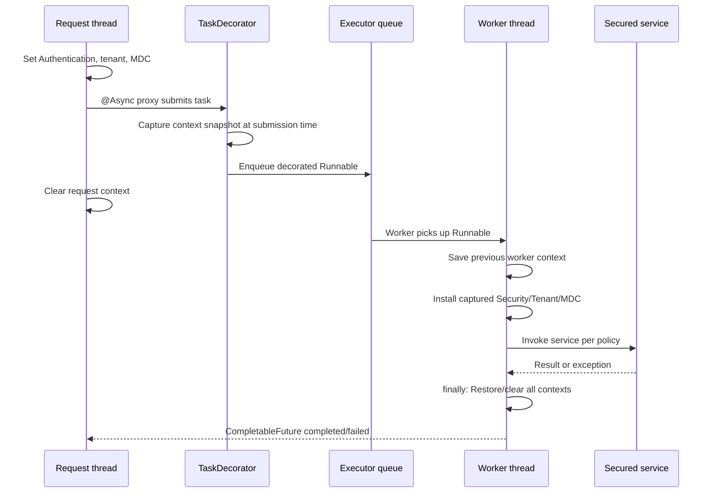

# Async and Scheduling — Propagating SecurityContext, Tenant, and Correlation ID to Tasks

## 1. The problem: asynchronous tasks do not automatically carry request context

In Spring Boot, an HTTP request may be handled on an `http-nio-...` thread and subsequently call `@Async` to send an email, generate a report, update a read model, write an audit log, or perform long-running work. On the request thread, the following information may be present:

- **SecurityContext**: `Authentication`, principal, and authorities, stored by Spring Security in `SecurityContextHolder`.
- **Tenant context**: the request's tenant ID, possibly stored in an application-defined `ThreadLocal`.
- **Correlation ID**: business workflow tracing ID, typically placed in **SLF4J MDC** under a key such as `correlationId`.
- **Tracing/Observation context**: trace ID, span ID, and metadata from Micrometer/OpenTelemetry, with its own lifecycle.

When handing work off to another thread, those `ThreadLocal` values **do not automatically appear on the worker thread**. Code that looks reasonable:

```java
MDC.put("correlationId", "req-123");
TenantContext.set("tenant-a");

asyncService.processOrder("order-42");
```

only proves the caller set the metadata; it does **not** prove `processOrder` sees it. When a pool reuses threads, there is an even more serious risk: a task can read **stale context from a previous task** if someone forgets cleanup.

This lesson focuses on the topic **"Propagating SecurityContext, tenant, and correlation ID to tasks"** in Spring Boot testing. The goal is to **capture cleanly at task submission, install cleanly at execution, restore/clear in `finally`, and verify zero context leakage when threads are reused**.

### Learning outcomes

After this lesson you can:

1. Distinguish request threads, task submission, executor queues, worker threads, and scheduled jobs.
2. Understand that `SecurityContextHolder`, tenant `ThreadLocal`, and `MDC` operate independently.
3. Use `ThreadPoolTaskExecutor.setTaskDecorator(...)` to propagate all three contexts.
4. Know Spring Security's official `DelegatingSecurityContextAsyncTaskExecutor` option.
5. Avoid mistaking `MODE_INHERITABLETHREADLOCAL` for a general solution for thread pools.
6. Distinguish **propagated metadata** from **actually authorized tenant access**.
7. Write Spring integration tests with `@Async`, `@WithMockUser`, `@PreAuthorize`, `CompletableFuture`, and bounded timeouts.
8. Test two different users on the same thread pool worker without mixing identities.
9. Test that after a task throws an exception, the next task still receives a clean context.
10. Distinguish handling for `@Scheduled`, queues, `CompletableFuture.supplyAsync`, virtual threads, and Reactor.

## 2. Three different contexts, three different purposes

| Type | Familiar API | Purpose | Risk if propagated wrongly |
| --- | --- | --- | --- |
| Security | `SecurityContextHolder.getContext().getAuthentication()` | Who is acting and with what authorities | Running actions with someone else's permissions |
| Tenant | `TenantContext.get()` (app-defined) | Which data/namespace is being processed | Leaking or modifying another tenant's data |
| Correlation ID | `MDC.get("correlationId")` | Correlating logs of a workflow | Cross-request logs, hard incident investigation |
| Trace context | Micrometer/OTel APIs | Distributed tracing, spans | Lost/skewed traces, wrong parent span |
| Locale/time zone | `LocaleContextHolder` or business parameters | Localization, display time | Using another request's locale |
| Transaction | `TransactionSynchronizationManager` | DB transaction of thread | **Must NOT transfer transaction wholesale** across threads |

**`SecurityContext` is not synonymous with tenant context**: a user might hold rights in tenant A while `TenantContext.set("tenant-b")` is mistakenly called. Copying a tenant ID without checking it against the `Authentication`'s authorities is **not enough to protect multitenancy**.

**MDC is not a security mechanism**: putting `MDC.put("tenantId", ...)` only affects logging; it does not enforce `WHERE tenant_id = ...` on database queries.

**Do not propagate JDBC transactions via `ThreadLocal` copying.** Transactions/`EntityManager`s are bound to a thread and own resources with distinct lifecycles; `@Async` needs an independent transaction boundary if the task writes to the DB.

## 3. Exact mechanism: submission thread vs worker thread



**Why capture at submission?**

Suppose the pool is busy for 3 seconds. Request A submits a task and then the request thread changes identity or returns to its pool. If the task captured context **when starting execution**, it might see `null` or data no longer belonging to request A. Instead, **package the snapshot inside the `Runnable` right at submission**.

**Why clean up in `finally`?**

A pool worker can execute task B right after task A. If A throws an exception, cleanup statements placed after `delegate.run()` will be skipped. `finally` guarantees cleanup on success, error, timeout, or interruption.

### Two distinct moments in time

| Moment | Where it runs | Required action |
| --- | --- | --- |
| Before enqueue | Caller | Capture `SecurityContext`, tenant, and MDC |
| When worker starts | Worker | Save preexisting context then install snapshot |
| After body | Worker | Restore previous (or clear) inside `finally` |
| After caller returns HTTP | Request thread | Clear original request context per web/security lifecycle |
| After future completes | Caller or continuation thread | Await and verify result/exception at the proper boundary |

Do not capture context in a singleton `TaskDecorator` constructor; if you do, **every request reuses the exact same context** from bean startup time. Capture must happen **inside `decorate(Runnable)`**, which runs when the executor accepts a task.

## 4. @Async and the Spring proxy

To enable `@Async`:

```java
@Configuration
@EnableAsync
class AsyncConfiguration {
}
```

Then annotate:

```java
@Service
class ReportWorker {
    @Async("contextTaskExecutor")
    public CompletableFuture<String> generate() {
        return CompletableFuture.completedFuture("created");
    }
}
```

In standard Spring AOP proxy mode:

- The caller must invoke the **Spring-managed bean** from outside, not `new ReportWorker()`.
- Internal `this.generate()` within the same bean **does not go through the `@Async` proxy**, so it may run synchronously.
- `@Async("contextTaskExecutor")` explicitly specifies the executor bean, avoiding confusion with executors for web requests or other jobs.
- With `CompletableFuture<T>`, tests wait via `get(timeout, unit)`/`join()` and assert results or failure causes.
- With `void @Async`, exceptions go through `AsyncUncaughtExceptionHandler` rather than a caller `Future` to assert.
- With `@Scheduled`, the framework invokes the method on a schedule; **there is no request caller identity** to propagate automatically.

A test checking only that a method returns `CompletableFuture` is not enough to prove it ran on another worker. The example below asserts both thread prefix and context snapshots.

## 5. Three implementation options and how to choose

| Approach | Good fit when | Caveats |
| --- | --- | --- |
| Custom `TaskDecorator` for Security + tenant + MDC | Explicit control over each `ThreadLocal` is needed | Snapshot, restore, nulls, and exceptions are easy to get wrong |
| Spring Security `DelegatingSecurityContextAsyncTaskExecutor` + tenant/MDC decorator | You want Spring Security to handle security context natively | Avoid double wrapping and check underlying executor lifecycle |
| Spring Framework `ContextPropagatingTaskDecorator` + Micrometer Context Propagation | Observation/tracing/`ThreadLocalAccessor`s are already registered | Custom tenant/`SecurityContext` do not automatically have registered accessors |

The runnable lesson implements **one `TaskDecorator` managing all three contexts** to demonstrate capture/restore in full. Section 21 and 22 present the official Spring Security wrapper and Spring Framework/Micrometer options to avoid maintaining boilerplate in large apps.

## 6. Safe design: snapshot without sharing a mutable SecurityContext

An error-prone approach:

```java
// EASY TO BREAK if the same SecurityContext is mutated after enqueueing.
SecurityContext captured = SecurityContextHolder.getContext();
return () -> {
    SecurityContextHolder.setContext(captured);
    delegate.run();
};
```

If the caller alters the `Authentication` on that exact `SecurityContext`, the task may observe the new state instead of the state at submission. And lacking `finally` creates leak risks.

A safer approach for the sample:

1. Read `Authentication` on the caller.
2. Create a **new `SecurityContext`** and attach the `Authentication` reference to it.
3. Copy the tenant `String` (immutable).
4. Use `MDC.getCopyOfContextMap()` rather than holding an internal map.
5. On the worker, save previous contexts.
6. Install captured snapshots.
7. `try/finally` to restore all contexts even on exceptions.

**Important limitation:** creating a new `SecurityContext` **does not deep-clone `Authentication`/principal**. If `Authentication` or the principal holds mutable state, threads can still share the object. Production policies should use immutable/minimal authenticated identities, expiring tokens/capabilities, and avoid keeping sensitive credentials in background queues for long periods.

### Restore previous or just clear?

- **Restore previous** is helpful if a decorated task runs nested inside an existing context, or if an executor uses `CallerRunsPolicy` to run inline on the caller.
- **Clear** is sufficient when workers always start clean with no nested contexts, yet can wipe out the caller's context if a task executes inline.
- On a dedicated thread pool, previous context is normally empty. If a worker already has stale context from undecorated code, restoring stale context can preserve that bug; therefore **all code paths into the pool must be uniformly guarded** with no-leak tests. Never share a raw executor with tasks bypassing the decorator.

## 7. Sample Java 17 + Spring Boot 3.5 project

The project demonstrates:

- `TenantContext`: application-managed `ThreadLocal<String>` and a `Scope` to restore context.
- `ContextView`: immutable DTO capturing username, tenant, correlation ID, and thread name **inside the task**.
- `ContextTaskDecorator`: packages `SecurityContext` + Tenant + MDC.
- `AsyncConfiguration`: single-worker `ThreadPoolTaskExecutor` to test thread reuse.
- `TenantAccessPolicy`: **verifies tenant authority**, since `tenantId` in `ThreadLocal` is not proof of permission.
- `ProtectedTaskService`: method with `@PreAuthorize` called **through a Spring proxy** on the worker thread.
- `AsyncTaskWorker`: `@Async` capturing context, running guarded actions, deliberate exceptions, and blocking tasks to test capture timing.
- `ContextPropagationIntegrationTest`: tests propagation, tenant authorization, zero leaks, and queue timing.
- `TenantContextTest`: unit tests for scope/validation.

### Directory tree

```text
async-context-demo/
├── pom.xml
└── src/
    ├── main/
    │   ├── java/example/asynccontext/
    │   │   ├── AsyncContextApplication.java
    │   │   ├── TenantContext.java
    │   │   ├── ContextView.java
    │   │   ├── ContextTaskDecorator.java
    │   │   ├── AsyncConfiguration.java
    │   │   ├── TenantAccessPolicy.java
    │   │   ├── ProtectedTaskService.java
    │   │   └── AsyncTaskWorker.java
    │   └── resources/application.properties
    └── test/
        └── java/example/asynccontext/
            ├── ContextPropagationIntegrationTest.java
            └── TenantContextTest.java
```

## 8. pom.xml

```xml
<?xml version="1.0" encoding="UTF-8"?>
<project xmlns="http://maven.apache.org/POM/4.0.0"
         xmlns:xsi="http://www.w3.org/2001/XMLSchema-instance"
         xsi:schemaLocation="http://maven.apache.org/POM/4.0.0
             https://maven.apache.org/xsd/maven-4.0.0.xsd">
    <modelVersion>4.0.0</modelVersion>

    <parent>
        <groupId>org.springframework.boot</groupId>
        <artifactId>spring-boot-starter-parent</artifactId>
        <version>3.5.0</version>
        <relativePath/>
    </parent>

    <groupId>example</groupId>
    <artifactId>async-context-demo</artifactId>
    <version>1.0-SNAPSHOT</version>

    <properties>
        <java.version>17</java.version>
    </properties>

    <dependencies>
        <dependency>
            <groupId>org.springframework.boot</groupId>
            <artifactId>spring-boot-starter</artifactId>
        </dependency>

        <dependency>
            <groupId>org.springframework.boot</groupId>
            <artifactId>spring-boot-starter-security</artifactId>
        </dependency>

        <dependency>
            <groupId>org.springframework.boot</groupId>
            <artifactId>spring-boot-starter-test</artifactId>
            <scope>test</scope>
        </dependency>

        <dependency>
            <groupId>org.springframework.security</groupId>
            <artifactId>spring-security-test</artifactId>
            <scope>test</scope>
        </dependency>
    </dependencies>
</project>
```

- Spring Boot starter supplies Logback/SLF4J MDC via default logging.
- Security starter supplies `SecurityContextHolder`, method security, and authentication APIs.
- `spring-security-test` supports `@WithMockUser` in Spring tests.
- `@Async`, `TaskDecorator`, and `ThreadPoolTaskExecutor` come from Spring Framework.
- No `spring-boot-starter-web`, database, Docker, or HTTP server is needed for proxy/executor tests.
- The parent manages Spring Framework 6.2 and Spring Security 6.5 versions corresponding to Boot 3.5.

With Spring Boot 4 and Spring Security 7, check dependency modules/Javadoc against the new BOM instead of copying Boot 3.5 imports blindly.

## 9. AsyncContextApplication.java

`src/main/java/example/asynccontext/AsyncContextApplication.java`:

```java
package example.asynccontext;

import org.springframework.boot.SpringApplication;
import org.springframework.boot.autoconfigure.SpringBootApplication;
import org.springframework.security.config.annotation.method.configuration.EnableMethodSecurity;

@SpringBootApplication
@EnableMethodSecurity
public class AsyncContextApplication {

    public static void main(String[] args) {
        SpringApplication.run(AsyncContextApplication.class, args);
    }
}
```

`@EnableMethodSecurity` is enabled so `ProtectedTaskService` actually checks `Authentication` when called **through the proxy**. Do not simply annotate methods and assume Spring Boot's security starter enables method security automatically.

## 10. TenantContext.java: ThreadLocal and scope with cleanup

`src/main/java/example/asynccontext/TenantContext.java`:

```java
package example.asynccontext;

public final class TenantContext {

    private static final ThreadLocal<String> CURRENT =
            new ThreadLocal<>();

    private TenantContext() {
    }

    public static void set(String tenantId) {
        if (tenantId == null || tenantId.isBlank()) {
            throw new IllegalArgumentException(
                    "tenantId must not be blank");
        }
        CURRENT.set(tenantId);
    }

    public static String get() {
        return CURRENT.get();
    }

    public static String requireTenant() {
        String value = CURRENT.get();
        if (value == null) {
            throw new IllegalStateException(
                    "no tenant in current thread");
        }
        return value;
    }

    public static void clear() {
        CURRENT.remove();
    }

    public static Scope open(String tenantId) {
        String previous = CURRENT.get();
        set(tenantId);

        return () -> {
            if (previous == null) {
                CURRENT.remove();
            } else {
                CURRENT.set(previous);
            }
        };
    }

    @FunctionalInterface
    public interface Scope extends AutoCloseable {
        @Override
        void close();
    }
}
```

### When to use Scope?

```java
try (TenantContext.Scope ignored =
        TenantContext.open("tenant-a")) {
    // Run an operation with tenant-a.
}
// Automatically restores previous tenant, or removes if none initially.
```

`open` has scoped-resource semantics: when code nests another tenant context and exits, it restores the earlier context. This is useful for schedulers/batches processing multiple tenants sequentially.

**This is strictly a metadata carrier**, not tenant authentication. If `tenantId` comes from a client-supplied header, the backend must validate it against claims/principal, organization, ACL, or policy service before trusting it.

## 11. ContextView.java: observable snapshot

`src/main/java/example/asynccontext/ContextView.java`:

```java
package example.asynccontext;

import org.slf4j.MDC;
import org.springframework.security.core.Authentication;
import org.springframework.security.core.context.SecurityContextHolder;

public record ContextView(
        String username,
        String tenantId,
        String correlationId,
        String threadName) {

    public static ContextView current() {
        Authentication auth = SecurityContextHolder.getContext()
                .getAuthentication();

        return new ContextView(
                auth == null ? null : auth.getName(),
                TenantContext.get(),
                MDC.get("correlationId"),
                Thread.currentThread().getName());
    }
}
```

Instead of weakly asserting log text, tests **read the values present on the worker thread** through this record, keeping assertions exact and deterministic. In production code, correlation ID should still be emitted in log formats/tracing; the record serves as an observability probe for the sample.

## 12. ContextTaskDecorator.java: the core of this lesson

`src/main/java/example/asynccontext/ContextTaskDecorator.java`:

```java
package example.asynccontext;

import java.util.Map;

import org.slf4j.MDC;
import org.springframework.core.task.TaskDecorator;
import org.springframework.security.core.Authentication;
import org.springframework.security.core.context.SecurityContext;
import org.springframework.security.core.context.SecurityContextHolder;

public class ContextTaskDecorator implements TaskDecorator {

    @Override
    public Runnable decorate(Runnable delegate) {

        // This is the SUBMISSION THREAD, not the worker thread.
        Authentication auth = SecurityContextHolder.getContext()
                .getAuthentication();

        SecurityContext capturedSecurity =
                SecurityContextHolder.createEmptyContext();
        capturedSecurity.setAuthentication(auth);

        String capturedTenant = TenantContext.get();
        Map<String, String> capturedMdc =
                MDC.getCopyOfContextMap();

        return () -> {
            // This is the WORKER THREAD.
            SecurityContext previousSecurity =
                    SecurityContextHolder.getContext();

            String previousTenant = TenantContext.get();
            Map<String, String> previousMdc =
                    MDC.getCopyOfContextMap();

            try {
                SecurityContextHolder.setContext(capturedSecurity);

                if (capturedTenant == null) {
                    TenantContext.clear();
                } else {
                    TenantContext.set(capturedTenant);
                }

                if (capturedMdc == null) {
                    MDC.clear();
                } else {
                    MDC.setContextMap(capturedMdc);
                }

                delegate.run();
            } finally {
                // Always restore all contexts, even when the task fails.
                if (previousMdc == null) {
                    MDC.clear();
                } else {
                    MDC.setContextMap(previousMdc);
                }

                if (previousTenant == null) {
                    TenantContext.clear();
                } else {
                    TenantContext.set(previousTenant);
                }

                SecurityContextHolder.setContext(previousSecurity);
            }
        };
    }
}
```

### Details to grasp

**1. `decorate(...)` runs at submission.** At that moment, the caller's user/tenant/correlation are still present; they are captured per task. Never store `capturedSecurity` in a singleton field of the decorator.

**2. Creating a separate `SecurityContext`:** the sample copies the **`Authentication` reference** into a new `SecurityContext`; it does not deep-copy the principal. This snapshots the context container + metadata, not making the authentication object deeply immutable.

**3. MDC map is copied:** `MDC.getCopyOfContextMap()` returns a snapshot map or `null`. When MDC is absent, you must call `MDC.clear()` instead of retaining data from the previous task.

**4. Null tenant is also a meaningful state:** a task with no tenant must not inherit an old tenant from the thread pool.

**5. Restoring in `finally`:** `MDC`, tenant, and `SecurityContext` are restored after both success and exceptions. With nested execution/`CallerRunsPolicy`, restoring previous state is usually better than clearing unconditionally.

**6. Restoration order:** the sample restores MDC, tenant, then security. Other apps do not need this exact order, provided all three are restored consistently. If `MDC.setContextMap` or a special accessor could throw, production code should wrap cleanup robustly so one failure does not prevent restoring the remaining contexts.

**7. Do not propagate transactions/sessions:** the sample intentionally does **not** copy `TransactionSynchronizationManager`, `EntityManager`, request attributes, or raw security credentials.

### On thread reuse

If the pool has one worker and runs task A (alice/tenant-a), then task B (bob/tenant-b), then task C with no context, all three must observe:

```text
A: alice / tenant-a / corr-a
B: bob   / tenant-b / corr-b
C: null  / null     / null
```

Even on the **exact same Java thread**, task A's data must never appear in B or C. The test suite below intentionally constructs this exact scenario.

## 13. AsyncConfiguration.java: explicitly named executor, bounded queue

`src/main/java/example/asynccontext/AsyncConfiguration.java`:

```java
package example.asynccontext;

import org.springframework.context.annotation.Bean;
import org.springframework.context.annotation.Configuration;
import org.springframework.scheduling.annotation.EnableAsync;
import org.springframework.scheduling.concurrent.ThreadPoolTaskExecutor;

@Configuration(proxyBeanMethods = false)
@EnableAsync
public class AsyncConfiguration {

    @Bean("contextTaskExecutor")
    ThreadPoolTaskExecutor contextTaskExecutor() {
        ThreadPoolTaskExecutor executor =
                new ThreadPoolTaskExecutor();

        executor.setCorePoolSize(1);
        executor.setMaxPoolSize(1);
        executor.setQueueCapacity(20);
        executor.setThreadNamePrefix("context-");

        executor.setTaskDecorator(
                new ContextTaskDecorator());

        executor.setWaitForTasksToCompleteOnShutdown(true);
        executor.setAwaitTerminationSeconds(5);

        return executor;
    }
}
```

A single worker is a **test/demo choice** to prove thread reuse clearly. In production, size core/max/queue/backpressure for latency, workload, and resources; a single-thread pool can cause severe bottlenecks.

**Do not manually call `executor.initialize()`** in the sample bean method; Spring's `ThreadPoolTaskExecutor` bean lifecycle invokes initialization and destruction with the context. If creating an executor manually outside Spring, initialize and shut it down intentionally.

### Why name the bean?

`@Async("contextTaskExecutor")` explicitly routes tasks to the decorated executor. If you just declare a custom executor and let framework/web integrations choose, some paths may use a different executor. Spring Boot 3.5 auto-configures `AsyncTaskExecutor` when no custom bean exists; when custom beans exist, rules vary across `taskExecutor`, `applicationTaskExecutor`, `AsyncConfigurer`, and `spring.task.execution.mode`. Tests must verify the **real executor used**, rather than guessing from property names.

### Bounded queues and CallerRunsPolicy

- Unbounded queues can accumulate many tasks holding security/tenant contexts, consuming memory and extending snapshot lifetimes.
- When the queue is full, the executor can reject tasks. Do not assume a rejected task ran; handle `TaskRejectedException`/backpressure per contract.
- With `CallerRunsPolicy`, tasks can run directly on the **caller thread**. Thus having the decorator restore previous contexts is essential so the caller is not unexpectedly wiped.
- Sharing one `TaskExecutor` across HTTP requests and background business work is discouraged when isolation/capacity needs differ.

## 14. TenantAccessPolicy.java: propagating tenant does not mean authorized

`src/main/java/example/asynccontext/TenantAccessPolicy.java`:

```java
package example.asynccontext;

import org.springframework.security.core.Authentication;
import org.springframework.stereotype.Component;

@Component("tenantAccessPolicy")
public class TenantAccessPolicy {

    public boolean canRun(
            Authentication authentication, String tenantId) {

        if (authentication == null || tenantId == null) {
            return false;
        }

        return authentication.getAuthorities().stream()
                .anyMatch(authority ->
                        ("tenant:" + tenantId)
                                .equals(authority.getAuthority()));
    }
}
```

This is an **illustrative policy**, using the `tenant:<id>` authority naming convention so tests can check it easily. In production, tenant permissions may reside in JWT claims, ACLs, or membership records and require verifying validity/freshness. Never read `TenantContext.get()` from a header and trust it carries authorization.

Proper mental model:

```text
TenantContext = tenant currently being processed
Authentication = principal and verified authorities
TenantAccessPolicy = check whether this principal is allowed to handle this tenant?
```

## 15. ProtectedTaskService.java: real authorization check on the worker

`src/main/java/example/asynccontext/ProtectedTaskService.java`:

```java
package example.asynccontext;

import org.springframework.security.access.prepost.PreAuthorize;
import org.springframework.stereotype.Service;

@Service
public class ProtectedTaskService {

    @PreAuthorize(
        "hasAuthority('task:execute') and " +
        "@tenantAccessPolicy.canRun(authentication, #p0)")
    public String process(String tenantId) {
        return "processed:" + tenantId;
    }
}
```

- `@PreAuthorize` intercepts before the target method executes.
- `hasAuthority('task:execute')` requires the business permission.
- `@tenantAccessPolicy.canRun(authentication, #p0)` validates tenant authority.
- `#p0` refers to the first argument without relying on parameter name discovery.
- The caller must go through `ProtectedTaskService`'s Spring proxy for the interceptor to fire.
- If `SecurityContext` is not propagated, the worker gets denied due to missing `Authentication`.
- If a stale tenant leaks from a previous task, the policy check may falsely allow or deny access.

**Scope:** this models the authorization contract; it does not replace database row-level filters or cross-tenant query protection. Real systems must also enforce protection below the service layer.

## 16. AsyncTaskWorker.java: observable Future-returning tasks

`src/main/java/example/asynccontext/AsyncTaskWorker.java`:

```java
package example.asynccontext;

import java.util.concurrent.CompletableFuture;
import java.util.concurrent.CountDownLatch;
import java.util.concurrent.TimeUnit;

import org.springframework.scheduling.annotation.Async;
import org.springframework.stereotype.Service;

@Service
public class AsyncTaskWorker {

    private final ProtectedTaskService protectedService;

    public AsyncTaskWorker(ProtectedTaskService protectedService) {
        this.protectedService = protectedService;
    }

    @Async("contextTaskExecutor")
    public CompletableFuture<ContextView> observe() {
        return CompletableFuture.completedFuture(
                ContextView.current());
    }

    @Async("contextTaskExecutor")
    public CompletableFuture<String> runProtected() {
        String tenantId = TenantContext.requireTenant();

        return CompletableFuture.completedFuture(
                protectedService.process(tenantId));
    }

    @Async("contextTaskExecutor")
    public CompletableFuture<Void> failIntentionally() {
        throw new IllegalStateException("intentional failure");
    }

    @Async("contextTaskExecutor")
    public CompletableFuture<Void> hold(
            CountDownLatch entered, CountDownLatch release) {

        entered.countDown();

        try {
            if (!release.await(10, TimeUnit.SECONDS)) {
                throw new IllegalStateException(
                        "worker hold timed out");
            }
        } catch (InterruptedException ex) {
            Thread.currentThread().interrupt();
            throw new IllegalStateException(
                    "worker interrupted", ex);
        }

        return CompletableFuture.completedFuture(null);
    }
}
```

Why `CompletableFuture`?

- Callers can wait with `get(5, TimeUnit.SECONDS)` and assert the exact values the worker observed.
- When `runProtected` throws `AccessDeniedException`, the Future fails; callers receive `ExecutionException` with the cause to inspect.
- With `void @Async`, exceptions may never reach the caller and tests easily false-pass.
- `hold` creates a **controlled** queue backlog using two `CountDownLatch`es, without using `Thread.sleep` to guess when the worker is busy.
- `hold` is not a production API; it is a helper proving context is captured **at enqueue time**, not when the worker starts.

Important: `protectedService.process(...)` calls **another Spring bean**, not `this.protectedMethod()` self-invocation; hence the method-security proxy gets a real chance to evaluate the propagated `Authentication`.

## 17. application.properties

`src/main/resources/application.properties`:

```properties
spring.main.banner-mode=off

# Demo configures the executor bean explicitly in AsyncConfiguration.
# Do not declare SecurityContext in properties or rely on a default user.
```

No secrets, database URLs, HTTP server, or external queues. Running the main application standalone boots the context and executor; JUnit tests inject those exact Spring beans.

## 18. Integration tests: testing propagation, authorization, and cleanup

`src/test/java/example/asynccontext/ContextPropagationIntegrationTest.java`:

```java
package example.asynccontext;

import static org.junit.jupiter.api.Assertions.assertEquals;
import static org.junit.jupiter.api.Assertions.assertInstanceOf;
import static org.junit.jupiter.api.Assertions.assertNotEquals;
import static org.junit.jupiter.api.Assertions.assertNull;
import static org.junit.jupiter.api.Assertions.assertThrows;
import static org.junit.jupiter.api.Assertions.assertTrue;

import java.util.concurrent.CompletableFuture;
import java.util.concurrent.CountDownLatch;
import java.util.concurrent.ExecutionException;
import java.util.concurrent.Executor;
import java.util.concurrent.TimeUnit;

import org.junit.jupiter.api.AfterEach;
import org.junit.jupiter.api.Test;
import org.slf4j.MDC;
import org.springframework.beans.factory.annotation.Autowired;
import org.springframework.beans.factory.annotation.Qualifier;
import org.springframework.boot.test.context.SpringBootTest;
import org.springframework.security.access.AccessDeniedException;
import org.springframework.security.authentication.UsernamePasswordAuthenticationToken;
import org.springframework.security.core.authority.AuthorityUtils;
import org.springframework.security.core.context.SecurityContext;
import org.springframework.security.core.context.SecurityContextHolder;
import org.springframework.security.test.context.support.WithMockUser;

@SpringBootTest(
    webEnvironment = SpringBootTest.WebEnvironment.NONE)
class ContextPropagationIntegrationTest {

    @Autowired
    AsyncTaskWorker worker;

    @Autowired
    @Qualifier("contextTaskExecutor")
    Executor executor;

    private static void asUser(
            String username, String... authorities) {

        SecurityContext context =
                SecurityContextHolder.createEmptyContext();

        context.setAuthentication(
                new UsernamePasswordAuthenticationToken(
                        username,
                        "N/A",
                        AuthorityUtils.createAuthorityList(
                                authorities)));

        SecurityContextHolder.setContext(context);
    }

    @AfterEach
    void cleanupCallerThread() {
        TenantContext.clear();
        MDC.clear();
        SecurityContextHolder.clearContext();
    }

    @Test
    @WithMockUser(
        username = "alice",
        authorities = {"task:execute", "tenant:tenant-a"})
    void propagatesAllThreeContextsAndAllowsProtectedAction()
            throws Exception {

        TenantContext.set("tenant-a");
        MDC.put("correlationId", "corr-101");

        ContextView view =
                worker.observe().get(5, TimeUnit.SECONDS);

        assertEquals("alice", view.username());
        assertEquals("tenant-a", view.tenantId());
        assertEquals("corr-101", view.correlationId());

        assertTrue(view.threadName().startsWith("context-"));
        assertNotEquals(
                Thread.currentThread().getName(),
                view.threadName());

        assertEquals(
                "processed:tenant-a",
                worker.runProtected().get(5, TimeUnit.SECONDS));

        // Caller's context is not stolen by the decorator.
        assertEquals("alice",
                SecurityContextHolder.getContext()
                        .getAuthentication().getName());
        assertEquals("tenant-a", TenantContext.get());
        assertEquals("corr-101", MDC.get("correlationId"));
    }

    @Test
    @WithMockUser(
        username = "bob",
        authorities = {"task:execute", "tenant:tenant-b"})
    void propagatedTenantMustStillMatchAuthorization()
            throws Exception {

        // tenant-a metadata can be set; it does NOT grant permission.
        TenantContext.set("tenant-a");
        MDC.put("correlationId", "corr-102");

        ExecutionException error = assertThrows(
                ExecutionException.class,
                () -> worker.runProtected()
                        .get(5, TimeUnit.SECONDS));

        assertInstanceOf(
                AccessDeniedException.class, error.getCause());
    }

    @Test
    @WithMockUser(
        username = "bob",
        authorities = {"tenant:tenant-b"})
    void missingTaskPermissionIsDeniedInsideAsyncWorker()
            throws Exception {

        TenantContext.set("tenant-b");

        ExecutionException error = assertThrows(
                ExecutionException.class,
                () -> worker.runProtected()
                        .get(5, TimeUnit.SECONDS));

        assertInstanceOf(
                AccessDeniedException.class, error.getCause());
    }

    @Test
    void missingCallerContextIsObservedAsEmpty() throws Exception {
        ContextView view =
                worker.observe().get(5, TimeUnit.SECONDS);

        assertNull(view.username());
        assertNull(view.tenantId());
        assertNull(view.correlationId());
        assertTrue(view.threadName().startsWith("context-"));
    }

    @Test
    void singlePooledThreadDoesNotMixUsersOrTenants()
            throws Exception {

        asUser("alice", "task:execute", "tenant:tenant-a");
        TenantContext.set("tenant-a");
        MDC.put("correlationId", "corr-a");

        ContextView first =
                worker.observe().get(5, TimeUnit.SECONDS);

        // Same JUnit thread switches to a different identity.
        asUser("bob", "task:execute", "tenant:tenant-b");
        TenantContext.set("tenant-b");
        MDC.put("correlationId", "corr-b");

        ContextView second =
                worker.observe().get(5, TimeUnit.SECONDS);

        SecurityContextHolder.clearContext();
        TenantContext.clear();
        MDC.clear();

        ContextView empty =
                worker.observe().get(5, TimeUnit.SECONDS);

        // Single worker in pool to intentionally reuse the thread.
        assertEquals(first.threadName(), second.threadName());
        assertEquals(second.threadName(), empty.threadName());

        assertEquals("alice", first.username());
        assertEquals("tenant-a", first.tenantId());
        assertEquals("corr-a", first.correlationId());

        assertEquals("bob", second.username());
        assertEquals("tenant-b", second.tenantId());
        assertEquals("corr-b", second.correlationId());

        assertNull(empty.username());
        assertNull(empty.tenantId());
        assertNull(empty.correlationId());
    }

    @Test
    void exceptionStillCleansUpBeforeNextTask()
            throws Exception {

        asUser("alice", "task:execute", "tenant:tenant-a");
        TenantContext.set("tenant-a");
        MDC.put("correlationId", "corr-fail");

        ExecutionException error = assertThrows(
                ExecutionException.class,
                () -> worker.failIntentionally()
                        .get(5, TimeUnit.SECONDS));

        assertInstanceOf(
                IllegalStateException.class, error.getCause());

        SecurityContextHolder.clearContext();
        TenantContext.clear();
        MDC.clear();

        ContextView next =
                worker.observe().get(5, TimeUnit.SECONDS);

        assertNull(next.username());
        assertNull(next.tenantId());
        assertNull(next.correlationId());
    }

    @Test
    void queuedTaskUsesContextAtSubmissionNotAtExecution()
            throws Exception {

        CountDownLatch entered = new CountDownLatch(1);
        CountDownLatch release = new CountDownLatch(1);

        try {
            CompletableFuture<Void> blocker =
                    worker.hold(entered, release);

            assertTrue(entered.await(5, TimeUnit.SECONDS),
                    "worker must occupy the single pool thread");

            asUser("alice", "tenant:tenant-a");
            TenantContext.set("tenant-a");
            MDC.put("correlationId", "corr-queued-a");

            // This task waits in the queue; snapshot was already captured.
            CompletableFuture<ContextView> queued =
                    worker.observe();

            asUser("bob", "tenant:tenant-b");
            TenantContext.set("tenant-b");
            MDC.put("correlationId", "corr-queued-b");

            release.countDown();
            blocker.get(5, TimeUnit.SECONDS);

            ContextView observed =
                    queued.get(5, TimeUnit.SECONDS);

            assertEquals("alice", observed.username());
            assertEquals("tenant-a", observed.tenantId());
            assertEquals(
                    "corr-queued-a", observed.correlationId());
        } finally {
            release.countDown();
        }
    }

    @Test
    void directExecutorSubmissionAlsoGetsDecorator()
            throws Exception {

        asUser("worker-user", "tenant:tenant-d");
        TenantContext.set("tenant-d");
        MDC.put("correlationId", "corr-direct");

        CompletableFuture<ContextView> result =
                new CompletableFuture<>();

        executor.execute(() ->
                result.complete(ContextView.current()));

        ContextView view =
                result.get(5, TimeUnit.SECONDS);

        assertEquals("worker-user", view.username());
        assertEquals("tenant-d", view.tenantId());
        assertEquals("corr-direct", view.correlationId());
        assertTrue(view.threadName().startsWith("context-"));
    }

    @Test
    @WithMockUser(
        username = "alice",
        authorities = {"task:execute", "tenant:tenant-a"})
    void evenAuthorizedUserNeedsExplicitTenantContext()
            throws Exception {

        // Tenant not set: must not silently pick a default tenant.
        ExecutionException error = assertThrows(
                ExecutionException.class,
                () -> worker.runProtected()
                        .get(5, TimeUnit.SECONDS));

        assertInstanceOf(
                IllegalStateException.class, error.getCause());
    }
}
```

**There are 9 JUnit `@Test` methods in this class.**

### Exact meaning of each test

| Test | Evidence |
| --- | --- |
| `propagatesAllThreeContextsAndAllowsProtectedAction` | Auth/tenant/MDC reach worker and method security allows it |
| `propagatedTenantMustStillMatchAuthorization` | Tenant metadata does not grant permission; wrong tenant denied |
| `missingTaskPermissionIsDeniedInsideAsyncWorker` | Has tenant right but lacks business permission, still fails |
| `missingCallerContextIsObservedAsEmpty` | Task with no caller context does not read stale thread data |
| `singlePooledThreadDoesNotMixUsersOrTenants` | Same worker processes alice→bob→empty with no leak |
| `exceptionStillCleansUpBeforeNextTask` | Exception leaves no identity/tenant/correlation behind |
| `queuedTaskUsesContextAtSubmissionNotAtExecution` | Context is captured at enqueue time, before caller switches user |
| `directExecutorSubmissionAlsoGetsDecorator` | Not just `@Async` — `executor.execute` is decorated too |
| `evenAuthorizedUserNeedsExplicitTenantContext` | Does not silently fall back to a default tenant |

### Why not use Thread.sleep?

- `CountDownLatch` controls a worker actually holding a task.
- `CompletableFuture.get(5, TimeUnit.SECONDS)` bounds wait duration.
- Does not rely on "after 100 ms the worker must have run".
- On failure, the test reports exactly which condition failed (username/tenant/correlation or exception cause).
- A single-thread pool makes thread reuse observable without guessing which worker is selected.

### JUnit parallel execution requirements

This test class is **not designed to run methods in parallel**, because it uses a single-worker pool and tests hold context state on the caller test thread. If project-wide JUnit parallel execution is enabled, apply `@Execution(SAME_THREAD)` or a resource lock to this class, or isolate contexts/executors; do not assume `@WithMockUser` tests safely share `SecurityContextHolder` across arbitrary parallel threads without design.

### Have tests proved context is cleaned inside the worker?

The tests prove **no task A data leaks to subsequent tasks going through the same decorated executor**. They do not prove the entire JVM has no raw executors or library threads leaking, nor do they inspect thread-locals outside the three contexts in this lesson. Audit every execution pathway used in the system.

## 19. TenantContextTest.java: small unit tests for lifecycle

`src/test/java/example/asynccontext/TenantContextTest.java`:

```java
package example.asynccontext;

import static org.junit.jupiter.api.Assertions.assertEquals;
import static org.junit.jupiter.api.Assertions.assertNull;
import static org.junit.jupiter.api.Assertions.assertThrows;

import org.junit.jupiter.api.AfterEach;
import org.junit.jupiter.api.Test;

class TenantContextTest {

    @AfterEach
    void clearAfterTest() {
        TenantContext.clear();
    }

    @Test
    void blankTenantIsRejected() {
        assertThrows(IllegalArgumentException.class,
                () -> TenantContext.set(" "));
    }

    @Test
    void missingTenantFailsFast() {
        TenantContext.clear();

        assertThrows(IllegalStateException.class,
                TenantContext::requireTenant);
    }

    @Test
    void nestedScopeRestoresEarlierTenant() {
        TenantContext.set("tenant-outer");

        try (TenantContext.Scope scope =
                TenantContext.open("tenant-inner")) {

            assertEquals("tenant-inner",
                    TenantContext.requireTenant());
        }

        assertEquals("tenant-outer",
                TenantContext.requireTenant());

        TenantContext.clear();
        assertNull(TenantContext.get());
    }
}
```

**There are 3 JUnit `@Test` methods.** No Spring context, Docker, or `@Async` in this class. Total sample: **12 test methods** (9 integration + 3 unit), each running once.

## 20. Running the sample and expected outcomes

Requires **JDK 17+, Maven**, and ability to resolve Maven dependencies. No Docker needed. From the `async-context-demo` directory:

```bash
mvn test
```

Run individually:

```bash
mvn test -Dtest=ContextPropagationIntegrationTest
mvn test -Dtest=TenantContextTest
```

| Class | Methods | Needs Spring context? | Contents |
| --- | ---: | --- | --- |
| `ContextPropagationIntegrationTest` | 9 | Yes | `@Async`, proxy/method security, snapshots, no-leak |
| `TenantContextTest` | 3 | No | Tenant set/get/require/scope lifecycle |
| **Total** | **12** | Spring for integration | No Docker, no HTTP server |

**Expected result:** 12 tests PASS, zero failures/errors/skips on compatible JDK/Boot. This is an **expectation from the example code**, not a claim that Maven was executed. When running, inspect `target/surefire-reports`, test discovery, and actual root causes on failure.

There is no fixed application stdout; worker thread names come from `setThreadNamePrefix("context-")`, and suffixes must not be hard-coded. Tests assert only the prefix and exact username/tenant/correlation values.

### Clues when tests fail

- If `@Async` is inactive, `view.threadName()` will be the JUnit thread instead of `context-...`.
- If `SecurityContext` does not propagate, `runProtected` will be denied despite `@WithMockUser` having authorities.
- If `TenantContext` does not propagate, `TenantContext.requireTenant()` fails.
- If MDC does not propagate, `correlationId` in the view is `null`.
- If cleanup is missing, the alice→bob→empty test sees stale tenant/correlation.
- If captured when the worker starts instead of at submission, the queued-task test sees Bob or `null`.
- If `@EnableMethodSecurity` is off, negative permission tests fail to throw `AccessDeniedException`.

## 21. Official approach: DelegatingSecurityContextAsyncTaskExecutor

Spring Security provides `org.springframework.security.task.DelegatingSecurityContextAsyncTaskExecutor`. It wraps `Runnable`/`Callable` with delegating security context wrappers. With the constructor **not taking a fixed `SecurityContext`**, the wrapper captures the current `SecurityContext` when the task is submitted.

Conceptual configuration example (not a core project file):

```java
@Bean("rawContextPool")
ThreadPoolTaskExecutor rawContextPool() {
    ThreadPoolTaskExecutor raw = new ThreadPoolTaskExecutor();
    raw.setCorePoolSize(4);
    raw.setMaxPoolSize(8);
    raw.setQueueCapacity(100);

    // This decorator ONLY captures tenant + MDC, NOT Security.
    raw.setTaskDecorator(new TenantAndMdcDecorator());
    return raw;
}

@Bean("contextTaskExecutor")
AsyncTaskExecutor contextTaskExecutor(
        @Qualifier("rawContextPool") ThreadPoolTaskExecutor raw) {

    return new DelegatingSecurityContextAsyncTaskExecutor(raw);
}
```

**This is an illustrative snippet, not standalone runnable:** `TenantAndMdcDecorator` must be defined and imports/`@Configuration` added. In this design:

- Spring Security's wrapper owns **`SecurityContext`**.
- The raw pool's decorator owns **Tenant/MDC**.
- `@Async` references the wrapped `contextTaskExecutor`.
- The raw pool is a separate bean so Spring manages initialize/shutdown.
- Do not use `rawContextPool` directly for workflows needing security propagation.
- Do not also attach the core project's `ContextTaskDecorator` (which already captures Security) to this wrapped pool unless double wrappers and lifecycles are explicitly analyzed.

### Static vs dynamic SecurityContext

`new DelegatingSecurityContextAsyncTaskExecutor(raw, fixedContext)` applies a **fixed system identity** to every task; very different from capturing the submitting user. Using a fixed context for request-driven tasks can accidentally execute every request with system privileges — a privilege escalation risk. Use it for system jobs only when policy and identity are explicitly designed.

`DelegatingSecurityContextAsyncTaskExecutor(raw)` targets the current caller context. When using it, rewrite the alice→bob→empty and permission-deny tests to verify the implementation/version/config works as intended.

### Why doesn't simply "adding @Async" preserve SecurityContext?

By default `SecurityContextHolder` uses `ThreadLocal`. A task running on a different thread does not automatically receive the current authentication. `DelegatingSecurityContext...` or an explicit decorator/accessor is the transport mechanism — `@Async` does not carry users along automatically.

## 22. ContextPropagatingTaskDecorator and Micrometer

Spring Framework 6.1+ provides `org.springframework.core.task.support.ContextPropagatingTaskDecorator`, which uses Micrometer Context Propagation to capture/restore contexts **registered via `ThreadLocalAccessor`/context registry**. It is very useful for:

- Micrometer Observation context.
- Logging/tracing MDC per configured instrumentation.
- Other `ThreadLocal`s **when a matching accessor is registered**.

Conceptual example:

```java
ThreadPoolTaskExecutor executor = new ThreadPoolTaskExecutor();
executor.setTaskDecorator(
        new ContextPropagatingTaskDecorator());
```

**Do not assume any custom `TenantContext` or Spring Security `Authentication` transfers automatically just by setting this decorator.** Verify the registry, Micrometer `context-propagation` dependency, framework integrations, and accessors, and test with concrete values.

### Why be cautious with multiple layers?

If Micrometer, OTel instrumentation, Spring Security delegating wrappers, and custom `TaskDecorator`s all touch `SecurityContext`/MDC, you can run into:

- Snapshots captured at different moments.
- Overwriting an MDC map set by tracing instrumentation.
- Restoring in the wrong order.
- Duplication or context leaks across nested tasks.
- Small per-task capture/restore overhead.

Choose **one clear ownership model per context**, then test across the actual executor path.

### Comparison

| Approach | Security | Tenant | MDC | Notes |
| --- | --- | --- | --- | --- |
| Sample `ContextTaskDecorator` | Explicit | Explicit | Explicit | Easy to understand, must maintain yourself |
| `DelegatingSecurityContextAsyncTaskExecutor` | Official Spring Security | Not handled automatically | Not handled automatically | Combine tenant/MDC separately |
| `ContextPropagatingTaskDecorator` | Only with matching accessor/support | Only with custom accessor | When registered/instrumented | Check registry/versions |
| `InheritableThreadLocal` | May inherit on child thread creation | Setup-dependent | Does not solve general MDC | Unreliable with reusable pools |
| Pass identity + tenant as method args | Explicit data | Explicit data | Correlation passed as arg | Great for durable jobs / message payloads |

## 23. Why doesn't InheritableThreadLocal solve thread pools?

`SecurityContextHolder.MODE_INHERITABLETHREADLOCAL` can let a **newly created thread** inherit its parent's context at creation time. However, `ThreadPoolTaskExecutor` reuses threads:

1. A worker thread may be created early by request A.
2. Request B submits a task to that already-existing worker.
3. No new "inherit" event happens for B.
4. Without cleanup, B reads A; with cleanup, B sees null.
5. There is no guarantee MDC or custom tenant `ThreadLocal`s propagate either.

Therefore **do not enable `MODE_INHERITABLETHREADLOCAL` app-wide to fix lost `Authentication` in `@Async`**, especially with thread pools. Use explicit task wrappers/decorators or pass context fields explicitly in message contracts.

## 24. @Scheduled: no user request to inherit

A scheduled job is invoked by a scheduler thread per cron/fixed delay/rate. It is **not triggered by a specific HTTP request**, so "copying the current user" makes no sense or becomes a security flaw.

Example of a multi-tenant job:

```java
// ARCHITECTURAL SNIPPET, not in the runnable project.
// Requires @EnableScheduling, a scheduled bean, and a trusted tenant list.
@Scheduled(cron = "0 0 2 * * *")
public void nightlyJob() {
    for (String tenantId : trustedTenantRegistry.listTenants()) {
        String correlationId = "nightly-" + UUID.randomUUID();

        try (TenantContext.Scope ignored =
                TenantContext.open(tenantId)) {
            MDC.put("correlationId", correlationId);

            // Submit only after valid tenant/MDC are established.
            worker.processTenant(tenantId);
        } finally {
            MDC.remove("correlationId");
        }
    }
}
```

Here `trustedTenantRegistry`, `worker.processTenant`, and imports must be defined by the application; the snippet does not compile standalone. Define a dedicated **service identity/authorization** for the scheduler if tasks invoke `@PreAuthorize` methods, rather than borrowing admin rights from an old request.

### Guidelines for schedulers

- Give each run its own correlation ID; give each tenant/job clear ownership and authorization.
- If a job loops over tenants, set tenant context **per iteration** and clean up after each iteration.
- When submitting async tasks, capture context at submit time; if execution happens after `finally` clears the caller, the task retains its snapshot.
- Do not grant a global "ADMIN system user" to every job when narrow read/action authorities suffice.
- Durable schedules should carry explicit tenant IDs/actors in persistent job payloads across retries/JVMs.
- Do not enable `@EnableScheduling` in tests just to prove propagation if tests don't need real clocks/triggers: background timers make suites flaky.

### Spring ThreadPoolTaskScheduler

Spring Framework 6.2 supports `ThreadPoolTaskScheduler.setTaskDecorator`, yet when a periodic callback is scheduled, thread pools and wrapper types affect **when context is captured**. For periodic jobs pre-registered at startup with no HTTP request, do not treat a decorator as a way to bring an HTTP request's user into tomorrow's scheduled run.

## 25. CompletableFuture and raw executors can bypass decorators

A common pitfall:

```java
// Bypasses Spring "contextTaskExecutor": uses common ForkJoinPool.
CompletableFuture.supplyAsync(() -> {
    return TenantContext.get();
});
```

`CompletableFuture.supplyAsync(...)` **without an executor argument** uses `ForkJoinPool.commonPool()`, not Spring's `contextTaskExecutor`. To use the decorated pool:

```java
CompletableFuture.supplyAsync(
        TenantContext::get,
        contextTaskExecutor);
```

This is a **snippet**, requiring an injected `Executor contextTaskExecutor`. Also check executor selection on `thenApplyAsync`, `thenComposeAsync`, and other async continuations. Non-async `thenApply` can run on whichever thread completes the stage (caller or worker), so which context is present depends on timing.

**Context propagation is not transitive magic**: if task A submits task B to another executor, B must be submitted to a propagating executor or receive identity/tenant/correlation as explicit data.

## 26. Correlation ID: log context and distributed traces differ

`MDC.put("correlationId","corr-101")` lets logs on the current thread include the `correlationId` field when your Logback pattern/encoder outputs it. However:

- MDC is only a thread-local logging map, not a global log store.
- Copying MDC to a worker does not automatically send `X-Correlation-ID` on outbound HTTP requests.
- Copying MDC does not automatically add message headers to Kafka/RabbitMQ.
- Correlation IDs may differ from W3C `traceparent`/`traceId`; do not merge them into one ID unless your observability policy defines them so.
- Tracing instrumentation may populate `traceId`/`spanId` in MDC; a manual `MDC.setContextMap` can overwrite newer fields if timing/accessors aren't coordinated.
- Mask PII/security-sensitive metadata and follow audit policies when logging.

### Across HTTP or message brokers

Across process/JVM boundaries, `ThreadLocal` does not exist in the target process. Pass metadata via **HTTP headers, message headers, or payload contracts**, and validate the origin and tenant access on the receiving side. Never transmit a serialized Java `SecurityContext` over the network or let downstream services blindly trust caller-chosen tenant headers.

## 27. Context leaks: a critical issue, not just messy logs

Suppose a single-thread worker pool omits cleanup:

```text
Task A: Security=alice, Tenant=tenant-a, MDC=corr-a
        (forgot to clear)
Task B: no user/tenant, runs on the same thread
        (reads alice/tenant-a from stale ThreadLocal)
Task C: user bob, but forgot to set tenant
        (might use tenant-a if not cleared)
```

Consequences can include:

- Reading or writing the wrong tenant's data.
- Audit logs attributing actions to the wrong person.
- A protected method evaluating authorities from a prior user.
- Task B's correlation ID appearing in A's traces/logs.
- Failing tasks leaving partial context behind, producing bugs that appear only in CI/prod.

**A no-leak test suite must do more than "assert the worker saw the user".** It must run **multiple consecutive tasks on the same pooled thread**, including an unauthenticated/context-free task and a task that throws an exception, verifying every `ThreadLocal` is empty or matches its exact snapshot.

### Protecting across many threads

A 1-worker pool cleanly demonstrates thread reuse. With production pools of 8–32 workers, concurrency/stress tests should span multiple users/tenants and executor scheduling patterns. Do not substitute thousand-iteration stress runs for readable deterministic tests with negative cases.

## 28. Behavioral testing matrix

| Scenario | Caller context | Action to observe | Expected |
| --- | --- | --- | --- |
| Authenticated allowed | alice + `task:execute` + `tenant:A` | `runProtected(A)` | Success |
| Tenant mismatch | bob has `tenant:B`, metadata=`A` | `runProtected(A)` | `AccessDeniedException` |
| Missing business authority | bob has `tenant:B`, lacks `task:execute` | `runProtected(B)` | `AccessDeniedException` |
| No context | Security=null; tenant=null; MDC=null | `observe` | All three null |
| User A → B | A then B on same worker | multiple `observe` calls | Each task gets its own context |
| Error cleanup | Task A throws `IllegalStateException` | Task B empty `observe` | Task B sees nothing from A |
| Queued delayed task | Submit Alice, switch caller to Bob | `observe` queued | Still Alice |
| Direct executor | `executor.execute(Runnable)` | `ContextView.current` | Propagation works |
| Missing tenant | Alice has task authority, tenant unset | `runProtected` | Fail fast, no default picked |
| Continuation/other pool | `supplyAsync`/`thenApplyAsync` | `ContextView.current` | Context present only if propagated on that executor |
| Scheduler no user | job without HTTP request | protected action | Needs explicit service identity/policy |
| HTTP→Kafka→consumer | New JVM/thread | Read metadata | Must use headers/payload, not `ThreadLocal` |

## 29. Common anti-patterns

### 29.1. Copying one global SecurityContext for all tasks

Wrong:

```java
private final SecurityContext context =
        SecurityContextHolder.getContext();
```

If this field lives on a singleton executor/decorator, all tasks may use the startup thread's identity or share a mutable instance. **Capture per submission**.

### 29.2. Disabling security on background work due to missing context

When `@PreAuthorize` rejects a worker lacking a user, "fixing" it with `permitAll()` or turning off method security is a dangerous fail-open. Use controlled propagation for user-driven tasks or explicit least-privilege system identities for jobs.

### 29.3. Using MDC tenant as authorization

`MDC.put("tenant","a")` is just a log field; it enforces no DB tenant scoping. Validate tenants against authenticated membership/policy and database safeguards.

### 29.4. Clearing only on success

`delegate.run(); MDC.clear();` skips cleanup if the task throws. Use `finally` and test the error path.

### 29.5. Reading context in the worker instead of capturing at submit

If the caller clears context before the worker dequeues, the async task sees null or stale data. Snapshot inside `TaskDecorator.decorate`.

### 29.6. `@Async` self-invocation

`this.sendAsync()` normally fails to trigger the AOP proxy. Test the service bean from another caller or split out a separate `@Async` worker.

### 29.7. Using `InheritableThreadLocal` with pooled threads

Inherits only at thread creation, not per submission. Does not make thread-pool reuse safe.

### 29.8. Propagating transactions/sessions

Do not keep a request's `EntityManager` or JDBC transaction for another worker thread. Start an independent transaction for the task with clear idempotency/retries.

### 29.9. `CompletableFuture` on common pool

`CompletableFuture.supplyAsync` without an executor argument bypasses Spring's decorated executor. Pass the right executor or explicit task context.

### 29.10. Future fails yet the test does not wait

`worker.runProtected();` followed by the test returning can pass even though the `Future` completed exceptionally. Use `get(timeout)` and inspect `ExecutionException.getCause()`.

### 29.11. Hard-coding `Thread.sleep` to test context

`Thread.sleep(500)` proves neither that enqueue happened nor that the task ran; use `CountDownLatch`, `Future`, or bounded Awaitility.

### 29.12. Keeping `Authentication`/tenant in a queue long-term without checking expiry

A queued task executing hours after an account was locked or tenant access revoked may rely on a stale authorization snapshot. For durable jobs, choose to **re-authorize at execution time** or pass identity/resource IDs in the message to resolve fresh permissions; do not serialize `SecurityContext` objects or long-lived credentials.

## 30. Failures and troubleshooting

| Symptom | Common cause | How to check/fix |
| --- | --- | --- |
| `SecurityContextHolder.getContext().getAuthentication()==null` inside `@Async` | `SecurityContext` not propagated | Use decorated executor or `DelegatingSecurityContext...` |
| Tenant null in worker | `TenantContext` is a separate `ThreadLocal` | Capture tenant per task, set on worker |
| MDC correlation ID null | MDC not propagated | Copy MDC map and restore after task |
| Worker sees user A during task B | Context leak / thread reuse | Test A→B→empty on same worker, `finally` cleanup |
| Failing task pollutes thread | Cleanup placed after `run()` | Restore/clear in `finally` |
| `@WithMockUser` in JUnit yet protected method denied | `@Async` executor doesn't carry Auth | Check decorator and exact `@Async` qualifier |
| `@PreAuthorize` has no effect | Forgot `@EnableMethodSecurity` or self-invocation | Enable config, call proxied bean via DI |
| Tenant A accessed by tenant B user | Trusted `TenantContext` without checking policy | Tenant authority/ACL validation, DB scoping |
| Test missing tenant still passes | Default tenant fallback | Fail fast in `requireTenant` |
| Async method runs on JUnit thread | Missing `@EnableAsync`/self-invocation/wrong executor | Assert thread prefix, call external bean proxy |
| Caller context vanishes after submit | Decorator cleared under `CallerRunsPolicy` | Save/restore previous, don't blindly clear |
| Tests occasionally fail on CI | Timing/scheduler differences | `Future.get` timeout, latch, deterministic queue |
| `AccessDeniedException` is wrapped | `@Async` returns `Future` | Inspect `ExecutionException.getCause()` |
| Callback after `@Async` lacks MDC | Callback ran on another pool | Explicit executor for async stages |
| `CompletableFuture.supplyAsync` loses security | Common pool | Pass decorated executor |
| `@Scheduled` job runs as wrong user | Scheduler has no request identity | Explicit service identity and tenant per job |
| Duplicate MDC trace fields | Multiple decorators/instrumentations | Single ownership plan, verify registered accessors |
| `ContextPropagatingTaskDecorator` drops tenant | No `ThreadLocalAccessor` registered | Register accessor or use explicit decorator |
| No-leak test passes yet prod leaks | Production path uses a different executor | Enumerate all submit points/executors |
| Pooled workers run too many tasks | Queue too big / max pool small | Bounded queue, backpressure, metrics |
| Virtual threads behave differently | Java 21 / Boot config changed | Test against exact JVM/executor mode |
| Logs contain credentials/PII | Over-dumping context | Mask fields, log safe IDs |
| Spring test context fails to start | Missing bean/proxy config | Inspect root cause, `@EnableAsync`/`@EnableMethodSecurity` |
| Maven tests skipped | CI filters / Surefire settings | Check `target/surefire-reports` |

### Diagnostic sequence

1. Identify the **caller thread**, executor bean, and actual worker thread.
2. Verify `@Async("...")` actually goes through a real proxy.
3. Verify contexts are set **before** submission.
4. Verify `decorate()` captures per task and stores no singleton snapshot.
5. Verify the worker receives all three: security/tenant/MDC.
6. Verify `@PreAuthorize` is applied on a separate proxied bean.
7. Check exceptions and `Future` causes.
8. Check cleanup in `finally` when a task throws.
9. Run A→B→empty on the same worker, then test queue capture.
10. If HTTP/tracing are involved, verify boundary propagation via headers and registries.

## 31. Security and operational observability

In production, safe context propagation requires constraints:

- **Never** put plaintext passwords, bearer tokens, or secrets inside MDC/tenant fields.
- Copy only the metadata genuinely needed for the job.
- Validate tenant IDs against token/claims or membership policies before using them.
- For long-running tasks, enforce timeouts, cancellation, and re-authorization if permissions can change.
- Full queues must reject/apply backpressure explicitly, never falling back silently to a default system user.
- Correlation IDs must be generated/trusted at boundaries, avoiding log injection or unbounded strings from untrusted headers.
- Log only `principalName` and tenant ID per privacy policy; never log the entire `Authentication`.
- Metrics: active/queued/rejected tasks, execution latency, tenant mismatch denials, missing context, correlation propagation failures.
- Trace context via Micrometer/OpenTelemetry per official instrumentation; test IDs and spans where needed.
- `ThreadPoolTaskExecutor` must shut down cleanly per lifecycle without holding queues of sensitive context indefinitely.
- For scheduled jobs, use narrow-privilege service accounts and audit actor types distinguishing system from user.
- Avoid changing `SecurityContextHolder`'s global strategy just because tests feel tricky.
- For async database reads, tenant filtering at the DB/query layer must still be verified with integration tests.

### Context objects do not replace access control

A task carrying `username=alice`, `tenant=tenant-b`, and `correlationId=req-123` is not necessarily valid. Copying three fields successfully does not make authorization right. The sample test suite separates:

1. **Propagation**: exact values arrive on the worker.
2. **Authorization**: `TenantAccessPolicy` checks whether `auth` has tenant/task permission.
3. **No-leak**: subsequent tasks see nothing from prior tasks.

All three are needed for confidence in multi-tenant environments.

## 32. Acceptance checklist

- [ ] Identified all contexts to propagate (security/tenant/MDC/tracing)?
- [ ] Know which contexts are security-sensitive vs logging-only?
- [ ] `@EnableAsync` enabled, and `@Async` methods called via Spring proxy?
- [ ] Executor bean explicitly chosen via `@Async("contextTaskExecutor")`?
- [ ] `TaskDecorator` **captures at submission**, not inside a singleton constructor?
- [ ] New `SecurityContext` created instead of reusing a global mutable container?
- [ ] Accounted for `Authentication`/principal references not being deep-cloned?
- [ ] Tenant ID is an immutable `String` set/cleared explicitly?
- [ ] MDC map uses `getCopyOfContextMap()` and `setContextMap()/clear()`?
- [ ] Null `SecurityContext` `Authentication`, tenant, and MDC handled properly?
- [ ] All three restored/cleared in `finally`?
- [ ] Both success and exception paths go through the decorated executor in tests?
- [ ] Tested A→B→empty on the same worker to prove zero leaks?
- [ ] Queue backlog test confirms snapshot is taken at **submit time**?
- [ ] `@WithMockUser` propagates to the worker per `@Async` contract?
- [ ] Method security is enforced on a Spring-managed proxied bean?
- [ ] Negative tests exist for missing task authority and tenant permission?
- [ ] Tenant `ThreadLocal` is not treated as authorization or database isolation?
- [ ] JDBC transactions/`EntityManager` are not propagated across threads?
- [ ] `CompletableFuture`s are joined/`get` with timeouts in tests?
- [ ] `Thread.sleep` is not used to guess when tasks ran?
- [ ] `@Scheduled` jobs have explicit actor/tenant/correlation policies?
- [ ] `InheritableThreadLocal` is not relied on for reusable thread pools?
- [ ] Async `CompletableFuture` stages specify the right executor at each boundary?
- [ ] Uncontrolled overlapping context-propagation layers are avoided?
- [ ] Re-authorization exists when long-running queued tasks/permissions can expire?
- [ ] CI runs all tests and checks reports, with no silent skips?
- [ ] No PII/secrets copied into MDC, logs, or queue snapshots?

## 33. Advanced exercises

1. Remove `setTaskDecorator` and run tests; identify which assertions catch the missing propagation.
2. Delete the `finally` tenant/MDC cleanup and run the A→B→empty test; explain why leaks may only surface on the same worker.
3. Raise the pool to 4 threads and write a concurrent test with multiple users/tenants; compare with the single-thread deterministic test.
4. Remove `@EnableAsync`, observe thread assertions, then restore it.
5. Remove `@EnableMethodSecurity`, confirm negative auth cases stop failing properly.
6. Use `DelegatingSecurityContextAsyncTaskExecutor` for security and a separate decorator for MDC/tenant; re-run the suite.
7. Add Micrometer Context Propagation and a `ThreadLocalAccessor` for `TenantContext`, avoiding double-propagation.
8. Test `CompletableFuture.thenApplyAsync` on the common pool vs the explicit decorated executor.
9. Create a system account with only `task:execute` for a scheduled job; test tenant ACLs separately.
10. Propagate trace ID/`traceparent` via outbound HTTP/message headers, not just MDC logging.
11. Move an async task onto RabbitMQ/Kafka; define which contract metadata must travel in the message.
12. Add a fixed clock to a job expiry policy to test authorization evaluated at execution time vs enqueue time.
13. Trigger queue saturation and verify rejected tasks are not mistaken for success.
14. Add a DB write with `@Transactional` on the worker, verifying separate transactions and tenant query filters.
15. Test null tenant + valid security and prove fail-closed behavior.
16. Throw an exception in the worker then submit a second task, confirming zero identity leaks.
17. Create nested `TenantContext.open` scopes and test restoring the prior tenant even when an exception occurs.
18. Compare Java 17 thread pools with Java 21 virtual threads without making assumptions about inheritance.

## 34. Official references

1. [Spring Boot 3.5 — Task Execution and Scheduling](https://docs.spring.io/spring-boot/3.5/reference/features/task-execution-and-scheduling.html): executor bean selection, `@EnableAsync`, `ThreadPoolTaskExecutor`, schedulers, and virtual threads.
2. [Spring Framework 6.2 — Scheduling and Asynchronous Execution](https://docs.spring.io/spring-framework/reference/6.2/integration/scheduling.html): `@Async`, `@Scheduled`, `TaskDecorator`, `ThreadPoolTaskExecutor`.
3. [Spring Framework 6.2 — TaskDecorator API](https://docs.spring.io/spring-framework/docs/6.2.x/javadoc-api/org/springframework/core/task/TaskDecorator.html): wrapping `Runnable`, context setup/cleanup, and exception caveats.
4. [Spring Framework 6.2 — ThreadPoolTaskExecutor API](https://docs.spring.io/spring-framework/docs/6.2.x/javadoc-api/org/springframework/scheduling/concurrent/ThreadPoolTaskExecutor.html): `setTaskDecorator`, pool/queue settings, lifecycle.
5. [Spring Security 6.5 — Concurrency Support](https://docs.spring.io/spring-security/reference/6.5/features/integrations/concurrency.html): `DelegatingSecurityContextRunnable/Executor`, capture, and cleanup.
6. [Spring Security 6.5 — DelegatingSecurityContextAsyncTaskExecutor API](https://docs.spring.io/spring-security/reference/6.5/api/java/org/springframework/security/task/DelegatingSecurityContextAsyncTaskExecutor.html): security context wrapper for `AsyncTaskExecutor`.
7. [Spring Security 6.5 — Method Security](https://docs.spring.io/spring-security/reference/6.5/servlet/authorization/method-security.html): `@EnableMethodSecurity`, `@PreAuthorize`, and proxy semantics.
8. [Spring Security 6.5 — Testing Method Security](https://docs.spring.io/spring-security/reference/6.5/servlet/test/method.html): `@WithMockUser` and testing `SecurityContextHolder`.
9. [Spring Framework 6.2 — ContextPropagatingTaskDecorator API](https://docs.spring.io/spring-framework/docs/6.2.x/javadoc-api/org/springframework/core/task/support/ContextPropagatingTaskDecorator.html): Micrometer Context Propagation and logging/observation contexts.
10. [Micrometer Context Propagation](https://docs.micrometer.io/context-propagation/reference/): `ContextSnapshot`, `ThreadLocalAccessor`, registry.
11. [SLF4J MDC documentation](https://www.slf4j.org/manual.html#mdc): MDC log context, `ThreadLocal` semantics.
12. [Spring Framework 6.2 — AOP Proxying](https://docs.spring.io/spring-framework/reference/6.2/core/aop/proxying.html): self-invocation across Spring proxies.
13. [Spring Framework 6.2 — @Scheduled Javadoc](https://docs.spring.io/spring-framework/docs/6.2.x/javadoc-api/org/springframework/scheduling/annotation/Scheduled.html): scheduled callbacks and triggers.

### Note on Spring Boot 4 / Java 21+

The sample targets **Java 17 / Spring Boot 3.5.0 / Spring Framework 6.2 / Spring Security 6.5**. With Java 21, Spring Boot can use virtual threads via `spring.threads.virtual.enabled=true`; the execution/scheduling model changes, yet **you still must manage security/tenant/tracing boundaries**. With Boot 4/Security 7, check test starters, proxy configurations, and API changes against the exact major BOM; do not mix imports or dependencies across major versions.

**Conclusion:** Propagating context accurately across `@Async` or an executor is more than copying three values. You must **capture on the caller at submit time**, **install on the worker**, **restore in `finally`**, and **test on the same pooled thread** to prove zero leaks. `SecurityContext` must be paired with real tenant policies, MDC serves logging only, and scheduled/durable jobs need their own identity and tenant contracts rather than assuming an HTTP request exists.