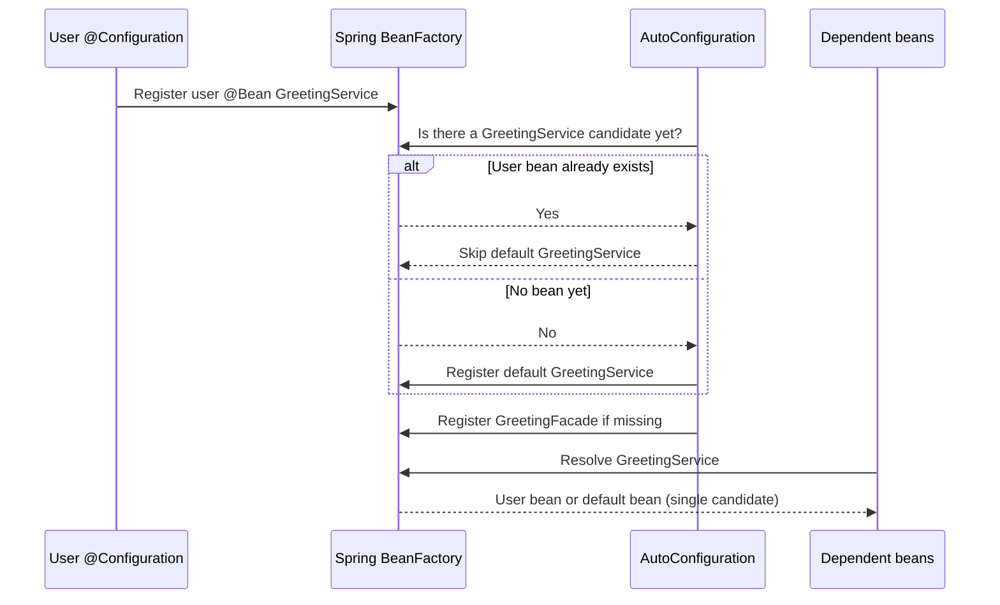

# Auto-Configuration Testing — Verifying That Auto-Configuration Backs Off for User Configuration

## 1. Problem: starters must be convenient without being intrusive

A Spring Boot library can supply pre-built beans so an application works immediately after adding a dependency. For instance, a notification starter provides `NotificationClient`, a logging starter creates `AuditPublisher`, or a partner integration library supplies a default `GreetingService`.

However, **user configuration must have the final say**. If an application has already declared a bean implementing the same contract, auto-configuration must not register an extra default bean that causes ambiguity. This is Spring Boot's **back-off** behavior.

Example:

```java
@AutoConfiguration
class GreetingAutoConfiguration {

    @Bean
    @ConditionalOnMissingBean(GreetingService.class)
    GreetingService greetingService() {
        return name -> "Hello, " + name;
    }
}
```

When the application **does not yet have** `GreetingService`, Spring Boot can create the default bean. When the user declares:

```java
@Configuration(proxyBeanMethods = false)
class UserConfiguration {

    @Bean("myOwnGreeting")
    GreetingService myOwnGreeting() {
        return name -> "Welcome, " + name;
    }
}
```

then proper auto-configuration must **not create** the default bean. The name `myOwnGreeting` differs from `greetingService`, yet **the contract type `GreetingService` matches**, so the *type*-based condition must detect it.

An acceptable test does not merely assert "context starts". It must prove:

1. **The fallback exists** when no user configuration is present.
2. **The fallback disappears** when a matching user bean exists.
3. The final bean **is the exact user bean**, not a renamed default bean.
4. Other **still-valid** auto-config beans are still created and use the custom bean.
5. Other conditions such as properties, classpath, context hierarchy, and auto-config ordering do not break back-off.
6. There is no need to enable `spring.main.allow-bean-definition-overriding=true` to make it work.

This lesson uses **Spring Boot 3.5.0, Java 17, Maven, JUnit Jupiter, AssertJ, ApplicationContextRunner** to test a sample auto-configuration in small, isolated, deterministic contexts.

## 2. Distinguishing three mechanisms often loosely called "override"

| Mechanism | Nature | What to verify |
| --- | --- | --- |
| **Auto-configuration back-off** | Default bean **is not registered** when a user bean is detected | No default bean; only the matching user bean |
| **Bean-definition overriding** | Two bean definitions **with the same name** where the later one replaces the earlier one | A different mechanism; never use as a back-off strategy |
| **@Primary / @Qualifier** | Multiple beans **both exist**; DI picks one candidate | Bean count still > 1; does not prove default backed off |
| **ConditionalOnProperty** | Feature configuration enabled/disabled via Environment | May skip auto bean; does not delete user beans |
| **@ConditionalOnSingleCandidate** | Runs only when one matching candidate or a clear primary exists | Useful for wiring; does not replace missing-bean back-off |
| **Bean replacement in tests** | MockitoBean/mock or test bean overrides | Easily hides real registration; never use as sole proof |

**Backing off** means auto-config proactively refrains from supplying a bean the user already supplied. It does not mean creating the auto-config bean first and later replacing it via a same-name definition.

### Example of a misconception

```java
// Not proof that auto-configuration backed off.
@Bean("greetingService")
GreetingService greetingService() {
    return new CustomGreetingService();
}
```

If auto-config also tries to register a bean named `greetingService` and the application enables definition overriding, the program may start yet rely on **overriding by bean name**, proving nothing about the condition. A stronger check uses a user bean with a **different name**, asserts **absence** of the default bean, and checks reference identity.

## 3. Spring Boot mechanism: conditions observe bean definitions

`@ConditionalOnMissingBean` is a `BeanFactory`-based condition. It checks the **bean definitions already processed up to evaluation time**.



A common bug source: **conditions cannot see the future**. If a bean definition of the required type has not been registered when the condition runs, Spring Boot cannot guess it will appear later.

Spring Boot orders auto-configuration classes **after user configurations**, making `@ConditionalOnBean`/`@ConditionalOnMissingBean` especially suited for auto-configuration. Still, if two auto-configurations depend on each other, declare ordering explicitly with `@AutoConfiguration(after = ...)` or `@AutoConfigureAfter`.

### Do not confuse registration with instantiation

- **Registration/condition evaluation:** decides which bean definitions are declared.
- **Instantiation:** Spring constructs bean objects, performs dependency injection, and runs lifecycle callbacks.
- `@AutoConfiguration(after=...)` alters the order in which **definitions are processed**, without forcing objects to be instantiated before one another.
- A bean may be declared yet uninstantiated if lazy; "definition exists" is usually enough for bean conditions.
- Bean conditions can rely on the **return type** of a `@Bean` method; if the method returns `Object` or an overly broad interface, metadata may be insufficient to detect the desired implementation.

Never write tests relying on "bean A's constructor prints before bean B" to prove auto-config ordering. Verify expected bean definitions/conditions and the injection graph instead.

## 4. `@ConditionalOnMissingBean`: type, name, search, and candidate semantics

### 4.1. By type — usually the best fit

```java
@Bean
@ConditionalOnMissingBean(GreetingService.class)
GreetingService greetingService() { ... }
```

Meaning: when a matching `GreetingService` candidate already exists, the default bean will not register. The user's bean **does not need to share the name**.

If the annotation omits `value`/`type`/`name`/`annotation` on a `@Bean` method, Spring Boot infers the type from **the method's return type**:

```java
@Bean
@ConditionalOnMissingBean
GreetingService greetingService() { ... }
```

This also backs off by `GreetingService`. In the sample lesson, we explicitly write `GreetingService.class` to make the override contract visible and prevent a return-type refactor from silently altering condition behavior.

### 4.2. By name — different meaning from type

```java
@Bean("systemClock")
@ConditionalOnMissingBean(name = "systemClock")
Clock defaultClock() { ... }
```

A **name**-based condition watches for a bean named `systemClock`. A user `Clock` bean named `customClock` may **not** make this condition back off. Use this only when the bean name itself is a contract to protect.

**Warning:** the snippet above is an excerpt requiring proper imports/`Clock` before compiling. When an app should be able to swap any `Clock` implementation, conditioning by **type `Clock.class`** is normally the standard choice.

### 4.3. By type String, annotation, ignored, and hierarchy

`@ConditionalOnMissingBean` supports:

- `value = {SomeType.class}` or `type = "fully.qualified.TypeName"`.
- `name = "beanName"`.
- `annotation = SomeMarker.class`.
- `ignored = ...` / `ignoredType = ...` to exclude certain candidates.
- `parameterizedContainer = ...` to inspect matching generic container types.
- `search = SearchStrategy.ALL/CURRENT/ANCESTORS` to control search scope across parent-child contexts.

**Do not mistake `SearchStrategy.ALL` for scanning the entire JVM.** It applies strictly to the `ApplicationContext` hierarchy. By default, a candidate in a parent context can affect missing-bean conditions in a child. In systems without parent contexts, behavior is simpler.

### 4.4. Autowire-candidate and default-candidate

Conditions observe bean candidates per framework rules, not merely "every class instance implementing the interface matches". Definitions that are not autowire candidates or default candidates are ignored; details can vary across Spring Framework/Boot versions.

Therefore, if a user bean is marked not to participate in autowiring, do not assume it will block the fallback. Add a dedicated test for this edge case if your starter supports special scopes or candidate flags.

### 4.5. `@Primary` does not make the default bean exist

If two user beans both implement `GreetingService` and one is `@Primary`, auto-config must still back off because **user beans already exist**. `@Primary` merely helps DI choose one of the two when a single candidate is needed; it does not make the missing-bean condition see "zero beans".

## 5. Proper role of `@AutoConfiguration` and the imports file

In Spring Boot 3.x, an auto-configuration is marked:

```java
@AutoConfiguration
public class GreetingAutoConfiguration {
    // @Bean methods with conditions
}
```

For a library to be discovered automatically by a Spring Boot app when added as a dependency, the JAR needs:

```text
META-INF/spring/org.springframework.boot.autoconfigure.AutoConfiguration.imports
```

with one fully qualified auto-configuration class name per **line**:

```text
example.autoconfig.GreetingAutoConfiguration
example.autoconfig.GreetingReporterAutoConfiguration
```

- The file lives under `src/main/resources` in the library.
- Spring Boot reads import candidates when the app uses `@EnableAutoConfiguration` (usually via `@SpringBootApplication`).
- **Do not** add `@ComponentScan` to an auto-configuration to scan components automatically.
- Place auto-configurations outside the application's component-scan package; Spring Boot recommends loading them solely via the imports file.
- Do not confuse legacy `META-INF/spring.factories` with Boot 3.x registration.
- `@AutoConfiguration(after=GreetingAutoConfiguration.class)` declares ordering relationships when one auto-config depends on bean definitions from another.
- Tests in `ApplicationContextRunner` **explicitly** supply `AutoConfigurations.of(...)`, so they do not assume a `@SpringBootApplication` is scanning them.

That is why the runnable project is **a library sample** needing no HTTP controller or standalone `MainApplication`: the goal is verifying bean registration and conditional behavior, not a web server.

## 6. `@ConditionalOnBean`, `@ConditionalOnSingleCandidate`, and dependency graphs

A second-tier auto-configuration wants to create `GreetingReporter` only when `GreetingFacade` exists. Then:

```java
@AutoConfiguration(after = GreetingAutoConfiguration.class)
@ConditionalOnBean(GreetingFacade.class)
class GreetingReporterAutoConfiguration {
    // ...
}
```

If `GreetingFacade` is defined by the user, `Reporter` is still created; if no facade exists, `Reporter` should be absent.

**Do not place `@ConditionalOnMissingBean(GreetingService.class)` at the class level** if the auto-configuration also provides other beans that remain useful when the user replaces the service. A class-level condition can wipe out the facade/reporter too, violating intent.

Design choices:

| Condition placement | When user provides GreetingService | Create GreetingFacade? |
| --- | --- | --- |
| `@ConditionalOnMissingBean` on **service bean** | Skips default service | Yes, if no facade exists yet |
| `@ConditionalOnMissingBean` on **entire auto-config class** | Skips whole class | No, likely a design flaw |
| `@ConditionalOnMissingBean(GreetingFacade.class)` on facade bean | Backs off facade only if user created one | Correct |
| `@ConditionalOnBean(GreetingFacade.class)` on Reporter auto-config | Reporter only when facade exists | Correct if processing order holds |

If a downstream bean requires "a single candidate client", use `@ConditionalOnSingleCandidate(Client.class)` instead of `@ConditionalOnBean(Client.class)`, since multiple competing beans make injection ambiguous. `@Primary` can clarify a single primary candidate for `@ConditionalOnSingleCandidate`. Each class should still have positive/negative tests.

## 7. Back-off test matrix

A solid auto-configuration must test **without user beans** and **with user beans**, at minimum:

| Scenario | Default service | User service | Facade | Reporter |
| --- | --- | --- | --- | --- |
| No user config | Present | Absent | Auto | Auto |
| Differently named user service bean | **Absent** | Present | Auto uses user bean | Auto |
| User service via `withBean(...)` | **Absent** | Present | Auto uses user object | Auto |
| User defines facade | Auto service remains | Possibly absent | **User facade** | Auto uses user facade |
| User defines reporter | Auto service remains | Possibly absent | Auto | **User reporter** |
| `demo.greeting.prefix=Bonjour` | Present, custom prefix | Absent | Auto | Auto |
| `demo.greeting.enabled=false` | Absent | Absent | Absent | Absent |
| Feature disabled + user service | Absent | Still present | Absent unless user declared | Absent |
| Feature disabled + user facade | Absent | Absent | Still user facade | Auto reporter may exist |
| Two user services, one `@Primary` | **Absent** | Two | Auto uses primary | Auto |
| Unrelated `String` bean | Present | Absent | Auto | Auto |
| Load only Reporter auto-config, no facade | Absent (service auto-config not loaded) | Absent | Absent | Absent |

Each scenario is verified with **a fresh context per run**, without mutating global application state or needing `@DirtiesContext`.

## 8. Why is `ApplicationContextRunner` better suited than `@SpringBootTest`?

`ApplicationContextRunner` creates a small `ApplicationContext` containing **just the configuration classes and properties** the test needs. It is purpose-built for testing auto-configuration.

### Advantages

- Tests are isolated, without booting the entire application or web server.
- Each `run(...)` creates an isolated context and closes it automatically after the callback.
- Can supply specific user configs via `withUserConfiguration(...)`.
- Can register beans directly via `withBean(...)`.
- Can add environment properties via `withPropertyValues(...)`.
- Can simulate absent classpaths via `FilteredClassLoader`.
- Can simulate parent contexts via `withParent(...)`.
- Can load auto-configurations with Boot ordering via `AutoConfigurations.of(...)`.
- AssertJ offers assertion helpers such as `hasSingleBean`, `doesNotHaveBean`, and `hasFailed`.

**Official note:** `ApplicationContextRunner` cannot be used when running tests directly inside a native image; if native testing is required, use a separate native testing strategy.

### Fluent nature, never mutates the base runner

```java
private final ApplicationContextRunner runner =
        new ApplicationContextRunner()
                .withConfiguration(
                    AutoConfigurations.of(
                        GreetingAutoConfiguration.class));
```

Each `runner.withUserConfiguration(...).run(...)` produces a context setup variant for that test without needing to remove the user bean afterward. This keeps tests independent of JUnit execution order.

### When is `@SpringBootTest` still needed?

When verifying that an auto-config is genuinely discovered through a starter JAR, coordinates with dozens of auto-configurations, handles custom scanning, application-specific conditions, or a full bean graph, add at least one **full integration/smoke test** with `@SpringBootTest`. However, never use the full context as your only tool for condition combinations — it is slow and introduces noisy dependencies.

## 9. Sample project — Java 17 / Spring Boot 3.5.0

The example library includes:

- `GreetingService`: SPI interface users can implement themselves.
- `DefaultGreetingService`: default implementation from auto-config.
- `GreetingProperties`: configuration properties with defaults.
- `GreetingFacade`: bean depending on `GreetingService`, which must use the custom service if supplied by the user.
- `GreetingReporter`: downstream bean using the facade.
- `GreetingAutoConfiguration`: provides default service/facade if missing; includes a feature flag.
- `GreetingReporterAutoConfiguration`: creates Reporter when facade exists, respecting auto-config ordering.
- `AutoConfiguration.imports`: registration inside the library.
- `GreetingAutoConfigurationTest`: test matrix verifying fallback/back-off/identity/feature flag/primary and dependency graph.

### Exact directory tree

```text
greeting-autoconfig-demo/
├── pom.xml
└── src/
    ├── main/
    │   ├── java/example/autoconfig/
    │   │   ├── GreetingService.java
    │   │   ├── DefaultGreetingService.java
    │   │   ├── GreetingProperties.java
    │   │   ├── GreetingFacade.java
    │   │   ├── GreetingReporter.java
    │   │   ├── GreetingAutoConfiguration.java
    │   │   └── GreetingReporterAutoConfiguration.java
    │   └── resources/META-INF/spring/
    │       └── org.springframework.boot.autoconfigure.AutoConfiguration.imports
    └── test/java/example/autoconfig/
        └── GreetingAutoConfigurationTest.java
```

All imports, classes, dependencies, and tests needed to run `mvn test` appear below. No database, Docker, HTTP server, or config secrets needed.

## 10. pom.xml

```xml
<?xml version="1.0" encoding="UTF-8"?>
<project xmlns="http://maven.apache.org/POM/4.0.0"
         xmlns:xsi="http://www.w3.org/2001/XMLSchema-instance"
         xsi:schemaLocation="http://maven.apache.org/POM/4.0.0
             https://maven.apache.org/xsd/maven-4.0.0.xsd">
    <modelVersion>4.0.0</modelVersion>

    <parent>
        <groupId>org.springframework.boot</groupId>
        <artifactId>spring-boot-starter-parent</artifactId>
        <version>3.5.0</version>
        <relativePath/>
    </parent>

    <groupId>example</groupId>
    <artifactId>greeting-autoconfig-demo</artifactId>
    <version>1.0-SNAPSHOT</version>
    <packaging>jar</packaging>

    <properties>
        <java.version>17</java.version>
    </properties>

    <dependencies>
        <!-- Spring Boot core/auto-configuration and runtime context. -->
        <dependency>
            <groupId>org.springframework.boot</groupId>
            <artifactId>spring-boot-starter</artifactId>
        </dependency>

        <!-- JUnit Jupiter + ApplicationContextRunner + AssertJ. -->
        <dependency>
            <groupId>org.springframework.boot</groupId>
            <artifactId>spring-boot-starter-test</artifactId>
            <scope>test</scope>
        </dependency>
    </dependencies>
</project>
```

`spring-boot-starter` supplies Boot core, auto-configuration infrastructure, Spring context, and logging. `spring-boot-starter-test` brings `spring-boot-test`, JUnit Jupiter, and AssertJ. **No need** to add `spring-boot-starter-web` just to test `@ConditionalOnMissingBean`.

When building a starter for real users, you can separate the `autoconfigure` module from the `starter` module to avoid pulling unnecessary dependencies; this single-module example favors simplicity. Never name artifacts starting with Spring Boot's open-source `spring-boot-` prefix if they are not part of the Spring Boot project.

## 11. GreetingService.java — user-replaceable contract

`src/main/java/example/autoconfig/GreetingService.java`:

```java
package example.autoconfig;

@FunctionalInterface
public interface GreetingService {

    String greet(String name);
}
```

This is an **SPI/contract**. User applications can implement another class, use a lambda, declare a `@Bean`, or inject a bean from the test runner.

A condition **targeting `GreetingService.class`** expresses the intent: "if the user has any implementation of this contract, back off". If the condition checked only `DefaultGreetingService.class`, a custom implementation of a **different concrete type** would fail to suppress the fallback — defeating the purpose.

## 12. DefaultGreetingService.java — default implementation

`src/main/java/example/autoconfig/DefaultGreetingService.java`:

```java
package example.autoconfig;

public record DefaultGreetingService(String prefix)
        implements GreetingService {

    @Override
    public String greet(String name) {
        return prefix + ", " + name;
    }
}
```

A Java 17 record holds simple immutable state. Auto-configuration creates it when no matching user `GreetingService` exists. It is not a `@Component` picked up automatically by component scanning — the bean is created **solely via the conditional `@Bean` method**.

Putting `@Component` on `DefaultGreetingService` or placing it under component scan could register the bean regardless of conditions, breaking the starter's back-off contract.

## 13. GreetingProperties.java — starter-specific configuration

`src/main/java/example/autoconfig/GreetingProperties.java`:

```java
package example.autoconfig;

import org.springframework.boot.context.properties.ConfigurationProperties;

@ConfigurationProperties(prefix = "demo.greeting")
public class GreetingProperties {

    private String prefix = "Hello";

    public String getPrefix() {
        return prefix;
    }

    public void setPrefix(String prefix) {
        this.prefix = prefix;
    }
}
```

The library's properties live under their own namespace `demo.greeting`. Do not use `spring.*` or `server.*` for a custom library to avoid colliding with Spring Boot core properties.

When auto-config enables `@EnableConfigurationProperties(GreetingProperties.class)`, Spring binds `demo.greeting.prefix` into the bean. **Customizing a property does not replace the bean**; it only configures the default implementation if the default bean is actually created.

For a clearer production starter, add validation and metadata annotation processing; for this exercise, we prioritize testing registration and property-driven behavior.

## 14. GreetingFacade.java — dependency must use the right bean

`src/main/java/example/autoconfig/GreetingFacade.java`:

```java
package example.autoconfig;

public class GreetingFacade {

    private final GreetingService service;

    public GreetingFacade(GreetingService service) {
        this.service = service;
    }

    public String render(String person) {
        return service.greet(person);
    }

    public GreetingService delegate() {
        return service;
    }
}
```

The `delegate()` method is an illustrative accessor to test **reference identity** of the injected service. Crucial goal: when the user creates `partnerService`, the auto-created facade must use **that exact bean**, instead of silently calling `new DefaultGreetingService(...)` inside the factory.

Wrong pattern:

```java
@Bean
@ConditionalOnMissingBean(GreetingFacade.class)
GreetingFacade greetingFacade(GreetingProperties props) {
    // WRONG: ignores the custom GreetingService supplied by the user.
    return new GreetingFacade(
            new DefaultGreetingService(props.getPrefix()));
}
```

Right pattern is accepting the bean dependency:

```java
@Bean
@ConditionalOnMissingBean(GreetingFacade.class)
GreetingFacade greetingFacade(GreetingService service) {
    return new GreetingFacade(service);
}
```

When the user swaps the service, DI automatically wires the right implementation.

## 15. GreetingReporter.java — second-tier dependent bean

`src/main/java/example/autoconfig/GreetingReporter.java`:

```java
package example.autoconfig;

public record GreetingReporter(GreetingFacade facade) {

    public String report(String name) {
        return "report:" + facade.render(name);
    }
}
```

This bean verifies that a **later auto-config** can consume beans created by the user or an earlier auto-config. Service back-off **does not** wipe out the rest of the valid bean ecosystem.

## 16. GreetingAutoConfiguration.java — back-off rules

`src/main/java/example/autoconfig/GreetingAutoConfiguration.java`:

```java
package example.autoconfig;

import org.springframework.boot.autoconfigure.AutoConfiguration;
import org.springframework.boot.autoconfigure.condition.ConditionalOnMissingBean;
import org.springframework.boot.autoconfigure.condition.ConditionalOnProperty;
import org.springframework.boot.context.properties.EnableConfigurationProperties;
import org.springframework.context.annotation.Bean;

@AutoConfiguration
@EnableConfigurationProperties(GreetingProperties.class)
@ConditionalOnProperty(
        prefix = "demo.greeting",
        name = "enabled",
        havingValue = "true",
        matchIfMissing = true)
public class GreetingAutoConfiguration {

    @Bean("greetingService")
    @ConditionalOnMissingBean(GreetingService.class)
    GreetingService greetingService(GreetingProperties properties) {
        return new DefaultGreetingService(
                properties.getPrefix());
    }

    @Bean("greetingFacade")
    @ConditionalOnMissingBean(GreetingFacade.class)
    GreetingFacade greetingFacade(GreetingService service) {
        return new GreetingFacade(service);
    }
}
```

### Breakdown of each annotation

**`@AutoConfiguration`:** defines the class as an auto-config candidate. By itself, this does not mean test contexts load it unless `AutoConfigurations.of(...)` is supplied or an app uses Boot auto-config imports.

**`@EnableConfigurationProperties`:** registers `GreetingProperties` and binds `demo.greeting.prefix`.

**Class-level `@ConditionalOnProperty(... enabled ...)`:** both **bean methods** run only when the feature is enabled (enabled by default since `matchIfMissing = true`). When the property is false, this auto-config registers neither service nor facade. Still, **user beans are never automatically removed**.

**`@ConditionalOnMissingBean(GreetingService.class)` on service:** if the user defines any implementation of `GreetingService`, the default service is not registered.

**`@ConditionalOnMissingBean(GreetingFacade.class)` on facade:** if the user already provides a facade, the default facade is not registered. This condition is independent of whether the user replaced the service.

**`GreetingFacade(GreetingService service)`:** Boot injects the surviving service candidate after condition evaluation. With a user service, the facade gets the user service. With the default service, it gets the default.

### Why not put `@ConditionalOnMissingBean` at the class level?

If you write:

```java
@AutoConfiguration
@ConditionalOnMissingBean(GreetingService.class)
class WrongAutoConfiguration { ... }
```

then when the user provides a service, the entire class is skipped, including helper beans like `GreetingFacade` that the user never defined. That may suit an auto-config dedicated solely to that one service, but is **wrong** for our sample's goal. Place conditions on individual bean methods according to actual back-off scope.

### Why does the bean name still matter even though back-off is by type?

The name `greetingService` gives assertions a handle to verify the default no longer exists when a differently named user service is present. The name is a **test signal**, while back-off logic itself uses the type `GreetingService.class`. The two are not equivalent.

## 17. GreetingReporterAutoConfiguration.java — ordering and downstream

`src/main/java/example/autoconfig/GreetingReporterAutoConfiguration.java`:

```java
package example.autoconfig;

import org.springframework.boot.autoconfigure.AutoConfiguration;
import org.springframework.boot.autoconfigure.condition.ConditionalOnBean;
import org.springframework.boot.autoconfigure.condition.ConditionalOnMissingBean;
import org.springframework.context.annotation.Bean;

@AutoConfiguration(after = GreetingAutoConfiguration.class)
@ConditionalOnBean(GreetingFacade.class)
public class GreetingReporterAutoConfiguration {

    @Bean("greetingReporter")
    @ConditionalOnMissingBean(GreetingReporter.class)
    GreetingReporter greetingReporter(GreetingFacade facade) {
        return new GreetingReporter(facade);
    }
}
```

**Reason for `after`:**

- When Boot evaluates `@ConditionalOnBean(GreetingFacade.class)`, the facade definition from the earlier auto-config **has already had a chance to register**.
- Without defined ordering after that class, the condition could be evaluated before the definition that would otherwise appear.
- Spring Boot sorts auto-configurations by annotations, not by the order classes are passed to `AutoConfigurations.of(...)`.
- `@ConditionalOnMissingBean(GreetingReporter.class)` lets users swap their own reporter without deleting auto service/facade.
- Class-level `@ConditionalOnBean` means if there is no facade, **Reporter auto-config** is not applied.
- If the user defines their own facade while the main feature is disabled, reporter auto-config **can still run** — the two conditions are not implicitly tied to the same feature flag.

### Ordering does not guarantee object construction order

Tests do not require `GreetingAutoConfiguration`'s constructor to run before `GreetingReporterAutoConfiguration`'s constructor. They only require the `BeanFactory` to hold the right dependency graph after refresh. That is the observable public contract.

## 18. AutoConfiguration.imports — library registration

`src/main/resources/META-INF/spring/org.springframework.boot.autoconfigure.AutoConfiguration.imports`:

```text
example.autoconfig.GreetingAutoConfiguration
example.autoconfig.GreetingReporterAutoConfiguration
```

No separate `spring.factories` entry is needed to register auto-configs on Spring Boot 3.5. Do not annotate the two auto-config classes with `@Component` relying on component scanning: the imports file is the standard path.

When renaming packages/classes, check `AutoConfiguration.replacements` for migrating existing auto-config class names, especially if consumers use `exclude` or `before/after` references.

In `ApplicationContextRunner` tests, we pass `AutoConfigurations.of(...)` explicitly to verify isolated conditions; the imports file goes into the library JAR to enable **real discovery** when consumer applications add the starter. To prove the imports file is packaged properly and discovered by a consumer app, a separate smoke test/application context is required and must not be inferred from runner tests alone.

## 19. Complete test class — GreetingAutoConfigurationTest.java

`src/test/java/example/autoconfig/GreetingAutoConfigurationTest.java`:

```java
package example.autoconfig;

import static org.assertj.core.api.Assertions.assertThat;

import org.junit.jupiter.api.Test;

import org.springframework.boot.autoconfigure.AutoConfigurations;
import org.springframework.boot.test.context.runner.ApplicationContextRunner;
import org.springframework.context.annotation.Bean;
import org.springframework.context.annotation.Configuration;
import org.springframework.context.annotation.Primary;

class GreetingAutoConfigurationTest {

    // Intentionally reversed argument order: AutoConfigurations.of
    // must use Boot auto-configuration ordering/after metadata.
    private final ApplicationContextRunner runner =
            new ApplicationContextRunner()
                .withConfiguration(AutoConfigurations.of(
                    GreetingReporterAutoConfiguration.class,
                    GreetingAutoConfiguration.class));

    @Test
    void defaultsExistWhenNoUserBeanIsProvided() {
        runner.run(context -> {
            assertThat(context).hasSingleBean(GreetingService.class);
            assertThat(context).hasSingleBean(GreetingFacade.class);
            assertThat(context).hasSingleBean(GreetingReporter.class);

            GreetingService service =
                    context.getBean(GreetingService.class);

            assertThat(service)
                    .isInstanceOf(DefaultGreetingService.class);
            assertThat(service.greet("Lan"))
                    .isEqualTo("Hello, Lan");

            assertThat(context.getBean(GreetingFacade.class)
                    .delegate()).isSameAs(service);

            assertThat(context.getBean(GreetingReporter.class)
                    .report("QA")).isEqualTo("report:Hello, QA");
        });
    }

    @Test
    void userServiceWithDifferentNameMakesDefaultBackOff() {
        runner.withUserConfiguration(UserServiceConfiguration.class)
                .run(context -> {

            assertThat(context).hasSingleBean(GreetingService.class);
            assertThat(context).hasBean("partnerGreetingService");
            assertThat(context).doesNotHaveBean("greetingService");

            GreetingService supplied =
                    context.getBean("partnerGreetingService",
                            GreetingService.class);

            assertThat(context.getBean(GreetingService.class))
                    .isSameAs(supplied);
            assertThat(context.getBean(GreetingFacade.class)
                    .delegate()).isSameAs(supplied);

            assertThat(context.getBean(GreetingFacade.class)
                    .render("Lan")).isEqualTo("Welcome, Lan");

            assertThat(context.getBean(GreetingReporter.class)
                    .report("Lan")).isEqualTo("report:Welcome, Lan");
        });
    }

    @Test
    void programmaticallyRegisteredUserBeanWinsByType() {
        GreetingService userObject = name -> "Hola, " + name;

        runner.withBean("externalGreeting",
                        GreetingService.class,
                        () -> userObject)
                .run(context -> {

            assertThat(context).hasSingleBean(GreetingService.class);
            assertThat(context).hasBean("externalGreeting");
            assertThat(context).doesNotHaveBean("greetingService");

            assertThat(context.getBean(GreetingService.class))
                    .isSameAs(userObject);
            assertThat(context.getBean(GreetingFacade.class)
                    .delegate()).isSameAs(userObject);
        });
    }

    @Test
    void customFacadeSuppressesOnlyDefaultFacade() {
        runner.withUserConfiguration(UserFacadeConfiguration.class)
                .run(context -> {

            assertThat(context).hasSingleBean(GreetingService.class);
            assertThat(context.getBean(GreetingService.class))
                    .isInstanceOf(DefaultGreetingService.class);

            assertThat(context).hasSingleBean(GreetingFacade.class);
            assertThat(context).hasBean("customFacade");
            assertThat(context).doesNotHaveBean("greetingFacade");

            assertThat(context.getBean(GreetingFacade.class)
                    .render("Lan")).isEqualTo("Manual: Lan");

            assertThat(context.getBean(GreetingReporter.class)
                    .report("Lan"))
                    .isEqualTo("report:Manual: Lan");
        });
    }

    @Test
    void customReporterSuppressesOnlyDefaultReporter() {
        runner.withUserConfiguration(UserReporterConfiguration.class)
                .run(context -> {

            assertThat(context).hasSingleBean(GreetingService.class);
            assertThat(context).hasSingleBean(GreetingFacade.class);
            assertThat(context).hasSingleBean(GreetingReporter.class);

            assertThat(context).hasBean("customReporter");
            assertThat(context).doesNotHaveBean("greetingReporter");

            assertThat(context.getBean(GreetingReporter.class)
                    .report("QA"))
                    .isEqualTo("report:UserReport:QA");
        });
    }

    @Test
    void propertyCustomizesAutoProvidedService() {
        runner.withPropertyValues(
                    "demo.greeting.prefix=Bonjour")
                .run(context -> {

            GreetingService service =
                    context.getBean(GreetingService.class);

            assertThat(service)
                    .isInstanceOf(DefaultGreetingService.class);
            assertThat(service.greet("Lan"))
                    .isEqualTo("Bonjour, Lan");
            assertThat(context.getBean(GreetingFacade.class)
                    .render("Lan")).isEqualTo("Bonjour, Lan");
        });
    }

    @Test
    void propertyDoesNotReplaceAnExistingUserService() {
        runner.withUserConfiguration(UserServiceConfiguration.class)
                .withPropertyValues(
                    "demo.greeting.prefix=Bonjour")
                .run(context -> {

            assertThat(context).hasSingleBean(GreetingService.class);
            assertThat(context).doesNotHaveBean("greetingService");
            assertThat(context.getBean(GreetingService.class)
                    .greet("Lan")).isEqualTo("Welcome, Lan");
        });
    }

    @Test
    void featureFlagFalseDisablesAutoProvidedBeans() {
        runner.withPropertyValues(
                    "demo.greeting.enabled=false")
                .run(context -> {

            assertThat(context)
                    .doesNotHaveBean(GreetingService.class);
            assertThat(context)
                    .doesNotHaveBean(GreetingFacade.class);
            assertThat(context)
                    .doesNotHaveBean(GreetingReporter.class);
        });
    }

    @Test
    void disablingAutoConfigDoesNotDeleteUserService() {
        runner.withUserConfiguration(UserServiceConfiguration.class)
                .withPropertyValues(
                    "demo.greeting.enabled=false")
                .run(context -> {

            assertThat(context).hasSingleBean(GreetingService.class);
            assertThat(context).hasBean("partnerGreetingService");
            assertThat(context).doesNotHaveBean("greetingService");
            assertThat(context)
                    .doesNotHaveBean(GreetingFacade.class);
            assertThat(context)
                    .doesNotHaveBean(GreetingReporter.class);
        });
    }

    @Test
    void independentReporterCanUseUserFacadeEvenWhenDisabled() {
        runner.withUserConfiguration(UserFacadeConfiguration.class)
                .withPropertyValues(
                    "demo.greeting.enabled=false")
                .run(context -> {

            assertThat(context)
                    .doesNotHaveBean(GreetingService.class);
            assertThat(context).hasSingleBean(GreetingFacade.class);
            assertThat(context).hasSingleBean(GreetingReporter.class);

            assertThat(context).hasBean("customFacade");
            assertThat(context.getBean(GreetingReporter.class)
                    .report("Lan")).isEqualTo("report:Manual: Lan");
        });
    }

    @Test
    void twoUserServicesWithPrimaryStillPreventFallback() {
        runner.withUserConfiguration(MultipleUserServicesConfiguration.class)
                .run(context -> {

            assertThat(context).doesNotHaveBean("greetingService");
            assertThat(context.getBeanNamesForType(
                    GreetingService.class))
                    .containsExactlyInAnyOrder(
                        "primaryUserService",
                        "secondaryUserService");

            GreetingService primary =
                    context.getBean("primaryUserService",
                            GreetingService.class);

            assertThat(context.getBean(GreetingFacade.class)
                    .delegate()).isSameAs(primary);

            assertThat(context.getBean(GreetingReporter.class)
                    .report("QA")).isEqualTo("report:Primary:QA");
        });
    }

    @Test
    void unrelatedStringBeanDoesNotSuppressDefault() {
        runner.withBean("unrelatedText", String.class,
                        () -> "unrelated")
                .run(context -> {

            assertThat(context).hasSingleBean(GreetingService.class);
            assertThat(context.getBean(GreetingService.class))
                    .isInstanceOf(DefaultGreetingService.class);
            assertThat(context.getBean("unrelatedText"))
                    .isEqualTo("unrelated");
        });
    }

    @Test
    void reporterAloneDoesNotLoadWithoutFacade() {
        new ApplicationContextRunner()
                .withConfiguration(AutoConfigurations.of(
                    GreetingReporterAutoConfiguration.class))
                .run(context -> {

            assertThat(context)
                    .doesNotHaveBean(GreetingService.class);
            assertThat(context)
                    .doesNotHaveBean(GreetingFacade.class);
            assertThat(context)
                    .doesNotHaveBean(GreetingReporter.class);
        });
    }

    @Configuration(proxyBeanMethods = false)
    static class UserServiceConfiguration {

        @Bean("partnerGreetingService")
        GreetingService userGreetingService() {
            return name -> "Welcome, " + name;
        }
    }

    @Configuration(proxyBeanMethods = false)
    static class UserFacadeConfiguration {

        @Bean("customFacade")
        GreetingFacade manualFacade() {
            return new GreetingFacade(
                    name -> "Manual: " + name);
        }
    }

    @Configuration(proxyBeanMethods = false)
    static class UserReporterConfiguration {

        @Bean("customReporter")
        GreetingReporter manualReporter() {
            return new GreetingReporter(
                new GreetingFacade(
                    name -> "UserReport:" + name));
        }
    }

    @Configuration(proxyBeanMethods = false)
    static class MultipleUserServicesConfiguration {

        @Bean("primaryUserService")
        @Primary
        GreetingService main() {
            return name -> "Primary:" + name;
        }

        @Bean("secondaryUserService")
        GreetingService secondary() {
            return name -> "Secondary:" + name;
        }
    }
}
```

**Total: 13 JUnit `@Test` methods**, each method creating one context scenario. No `@SpringBootTest`, Docker, database, web server, or external environment.

### Detailed explanation of key tests

**`defaultsExistWhenNoUserBeanIsProvided`:** there must be exactly one `GreetingService` of the default type, with the right prefix, and downstream facade/reporter must work. This proves the starter "works out of the box".

**`userServiceWithDifferentNameMakesDefaultBackOff`:** *this is the most important test in the lesson*. The user bean named `partnerGreetingService` differs from default `greetingService`. The test verifies **`hasSingleBean`**, **absence of the default bean name**, exact identity matching the user object, and that facade/reporter use the user service.

**`programmaticallyRegisteredUserBeanWinsByType`:** uses `ApplicationContextRunner.withBean("externalGreeting", GreetingService.class, supplier)` to simulate a user bean without creating a `@Configuration` class. Asserts object **`isSameAs`**, not merely matching output.

**`customFacadeSuppressesOnlyDefaultFacade`:** user replaces the facade **without** replacing the service. The default service remains; only the default facade is skipped. Reporter must receive the user facade.

**`customReporterSuppressesOnlyDefaultReporter`:** user replaces the reporter while service and facade remain defaults. This tests **per-bean** conditions rather than disabling the entire auto-config.

**`propertyCustomizesAutoProvidedService`:** `demo.greeting.prefix` alters default behavior without adding a user bean.

**`propertyDoesNotReplaceAnExistingUserService`:** changing the property must not accidentally re-create the default bean or overwrite the user service.

**`featureFlagFalseDisablesAutoProvidedBeans`:** when the feature is off and there are no user beans, service/facade are absent, and reporter is absent too due to the missing facade.

**`disablingAutoConfigDoesNotDeleteUserService`:** the feature flag acts on auto-config, not as a command to wipe all beans implementing the interface. The user-provided service remains.

**`independentReporterCanUseUserFacadeEvenWhenDisabled`:** a subtle case. User provides a facade while the main auto-config is disabled; Reporter auto-config has its own `@ConditionalOnBean(GreetingFacade.class)` so it still creates the reporter. This matches the sample contract; if an application wants **the reporter disabled too when the feature flag is false**, add the property condition to the reporter auto-config or adjust the design rather than assuming it disables automatically.

**`twoUserServicesWithPrimaryStillPreventFallback`:** two user services exist; `@Primary` selects the object for facade, while the fallback default still is not created. The test prevents confusing "primary chooses bean" with "back-off".

**`unrelatedStringBeanDoesNotSuppressDefault`:** only an unrelated `String` bean exists, so the `GreetingService.class` condition must match and create the default.

**`reporterAloneDoesNotLoadWithoutFacade`:** proves `@ConditionalOnBean(GreetingFacade.class)` on the second auto-config does not fabricate facade/service itself, and creates no reporter bean when the dependency is absent.

## 20. Why is asserting "one bean exists" not enough?

A test such as:

```java
assertThat(context).hasSingleBean(GreetingService.class);
```

can PASS because the default bean exists, **even when the user expected a custom bean to be chosen**. And a test such as:

```java
assertThat(context.getBean(GreetingService.class)
        .greet("Lan")).isEqualTo("Welcome, Lan");
```

could PASS if a default service accidentally produced the same output, without proving it is the user-defined object.

A solid back-off assertion combines **three witnesses**:

1. **User bean present** under its declared name and matching type.
2. **Default bean not registered** (`doesNotHaveBean("greetingService")`).
3. **Identity**: `context.getBean(GreetingService.class)` and downstream dependencies `isSameAs(userBean)`.

Include `hasSingleBean(GreetingService.class)` to catch both default + user coexisting, which causes ambiguous injection or silent `@Primary` masking. This is far stronger evidence than asserting the context starts.

### Eliminating false positives from `@Primary`

If a test context has both default + user and the user bean has `@Primary`, `context.getBean(GreetingService.class)` picks the user bean and gives the right output. However, the default **still exists** and could be injected by qualifier/name elsewhere. Tests must assert **default absent**, not just the final injected object.

### Eliminating false positives from bean overriding

If both configs share the same bean name and bean-definition overriding is enabled, the user bean may replace the default definition by order. Testing with a different name avoids this path. There is no need to enable `spring.main.allow-bean-definition-overriding=true` in the sample project; proper back-off works on its own.

## 21. `@Bean` return types matter more than many realize

Conditions evaluate based on bean metadata, including the **declared return type** of `@Bean` methods. For example:

```java
@Bean
Object userGreeting() {
    return new CustomGreetingService();
}
```

The runtime bean created is a `GreetingService`, yet when bean definitions are processed, the declared type is only `Object`. Depending on context/type prediction, `@ConditionalOnMissingBean(GreetingService.class)` may **fail to see** the implementation and register the default. Upon refresh, the app can end up with two beans of the same type or unexpected behavior.

Better:

```java
@Bean
GreetingService userGreeting() {
    return new CustomGreetingService();
}
```

or declare an appropriately specific concrete return type. Spring Boot docs recommend `@Bean` methods expose **as much type information as possible**, especially when using bean conditions.

### When returning an interface still makes sense

In the sample `GreetingAutoConfiguration`, the method returns `GreetingService` and the condition **explicitly names `GreetingService.class`**. This intentionally establishes the SPI contract as the type users override. For integrations needing to detect specific subclasses/concrete types, expose the appropriate return type and write additional tests.

### Generic factory beans

Some bean definitions represent `FactoryBean<T>` or containers like `ObjectProvider<T>`. `@ConditionalOnMissingBean` provides `parameterizedContainer` and `ignored` options for these situations. Do not assume `ObjectProvider<GreetingService>` counts as a direct `GreetingService` bean; verify actual candidate matching semantics for your Boot version.

## 22. Bean names, qualifiers, and type/name conditions

### Test by type

```java
@ConditionalOnMissingBean(GreetingService.class)
```

Appropriate when the contract is "if the user has any bean implementing the interface, defer to it".

### Test by name

```java
@ConditionalOnMissingBean(name = "greetingService")
```

Appropriate when the bean name itself is an intentional public contract. However, if the user declares `@Bean("partnerGreetingService")`, a name-based condition sees **`greetingService` missing** and may create the default, leaving two beans for the same interface.

### Combined type/name conditions

```java
@ConditionalOnMissingBean(
    value = GreetingService.class,
    name = "greetingService")
```

Per condition semantics, **none** of the specified criteria may match for the condition to pass. Do not read it casually as "missing only when no bean has both type and name"; understand precisely that each requirement is checked independently. When policy is genuinely one SPI implementation, use a **type**-based condition to avoid unnecessary complexity.

### `@Qualifier` cannot rescue a wrong condition

An application may resolve DI with:

```java
@Qualifier("partnerGreetingService")
GreetingService service
```

yet if the auto-created default still exists, it can still be injected elsewhere and cause inconsistent behavior. `@Qualifier` resolves injection points; it **does not** prove proper back-off.

## 23. When the user provides multiple candidates

With two user `GreetingService` beans:

- `@ConditionalOnMissingBean(GreetingService.class)` must back off because **candidates already exist**.
- Without `@Primary` or a qualifier, `GreetingFacade(GreetingService)` may fail with `NoUniqueBeanDefinitionException` when Spring needs to inject a single bean.
- With `@Primary`, injection succeeds; tests prove the default is not created.
- If intentionally supporting multiple implementations, auto-config design should inject `List<GreetingService>`/`Map<String,GreetingService>` or provide a selection property and clear conflict policy.
- `@ConditionalOnSingleCandidate(GreetingService.class)` is useful when you want to create a client/facade only if a single clear or primary dependency exists.

**Never secretly enable bean overriding** to dodge ambiguity; it does not even resolve two **differently named** beans of the same type.

## 24. `@ConditionalOnProperty` and the difference between "disabled" and "user override"

Feature flag:

```java
@ConditionalOnProperty(
    prefix = "demo.greeting",
    name = "enabled",
    havingValue = "true",
    matchIfMissing = true)
```

produces these cases:

| Property | Main auto-config condition | Outcome |
| --- | --- | --- |
| Absent | Matches due to matchIfMissing=true | Can create default service/facade if user beans missing |
| `demo.greeting.enabled=true` | Matches | Can create defaults if user beans missing |
| `demo.greeting.enabled=false` | Does not match | Neither auto bean created |
| Value other than `true` | Does not match per havingValue | No auto beans created |
| false + user service | Main auto-config does not match | User service still exists |
| false + user facade | Main auto-config does not match | Separate reporter can still match due to user facade |

**Never** describe property off as "the entire `ApplicationContext` has no bean of that type". It only prevents the corresponding auto-configuration, unless no other registration source provides those beans.

### If you want one flag to turn off the whole feature

Add `@ConditionalOnProperty` to **every auto-configuration class belonging to the feature** or organize conditions/feature boundaries consistently. Then test user-bean semantics separately: disabling auto-config must never delete user beans.

## 25. Classpath conditions: `@ConditionalOnClass` and `FilteredClassLoader`

Starters often create beans only when a third-party library is on the classpath:

```java
@AutoConfiguration
@ConditionalOnClass(name = "com.vendor.client.VendorClient")
class VendorClientAutoConfiguration {
}
```

For an auto-config needing an optional dependency:

- Use `@ConditionalOnClass`/`@ConditionalOnMissingClass`.
- Test with `FilteredClassLoader` to simulate the missing class.
- If a `@Bean` method returns a type existing only in the optional dependency, **extract a nested `@Configuration`** with the classpath condition; otherwise the JVM may load the method/class before the condition protects it and throw `NoClassDefFoundError`.
- Never invent a fake dependency in tests and claim auto-config handles missing classpaths.

Example classpath check (snippet, **not part of the runnable project since `VendorClient` is not in dependencies**):

```java
new ApplicationContextRunner()
    .withClassLoader(new FilteredClassLoader("com.vendor.client"))
    .withConfiguration(AutoConfigurations.of(
        VendorClientAutoConfiguration.class))
    .run(context -> {
        assertThat(context).doesNotHaveBean("vendorClient");
    });
```

Define/configure/import the corresponding classes to run this snippet. Purpose: shows missing-class is not tested via Mockito mocks and stays separate from missing-bean conditions.

### Class conditions and user overrides are independent

A good starter may require **both that the class exists** and **that no user bean exists yet**. Test combinations:
1. Class present, user absent -> default.
2. Class present, user present -> back-off.
3. Class absent, user absent -> no default.
4. Class absent yet user bean optional via another API -> verify specific design.

## 26. Parent-child `ApplicationContext` and `SearchStrategy`

By default, `@ConditionalOnMissingBean` can consider bean candidates in parent contexts per `search=SearchStrategy.ALL`. In applications with child contexts (e.g., modular web apps or parent-child tests), a user bean in the parent can prevent the default in the child **from being created**.

To check only the current context:

```java
@ConditionalOnMissingBean(
    value = GreetingService.class,
    search = SearchStrategy.CURRENT)
```

This is an excerpt requiring `import SearchStrategy`. `CURRENT` ignores the parent. Use only when the child's bean scope genuinely needs an independent fallback from the parent; otherwise you may end up with two `GreetingService` beans in the hierarchy and unexpected DI behavior.

### Testing parent contexts if the project uses hierarchies

You can use `ApplicationContextRunner.withParent(parentContext)` to build a child runner and test:

- Parent has user bean, child lacks user bean.
- With `ALL`, does the child default back off?
- With `CURRENT`, is the child default created?
- Does child dependency injection pick the bean in child or parent?
- Does parent/child shutdown order affect resource lifecycles?

The core project does not use a context hierarchy; do not add parents just for coverage when most applications have a single context.

## 27. Debug `ConditionEvaluationReport` instead of guessing

When a default bean appears unexpectedly, first ask: **which condition matched and why?**

Spring Boot records `ConditionEvaluationReport` for conditions:

- Positive matches: conditions matched, configuration may apply.
- Negative matches: conditions did not match, usually detailing candidates/types/properties.
- Unconditional auto-configuration classes: have no corresponding conditions.
- Not every bean appears in the report; the report focuses on conditional auto-configurations.

With `ApplicationContextRunner`:

```java
import org.springframework.boot.autoconfigure.logging.ConditionEvaluationReportLoggingListener;
import org.springframework.boot.logging.LogLevel;
import org.springframework.boot.test.context.runner.ApplicationContextRunner;

ApplicationContextRunner debugRunner =
        new ApplicationContextRunner()
            .withInitializer(
                ConditionEvaluationReportLoggingListener
                    .forLogLevel(LogLevel.INFO));
```

This is a logger snippet, not replacing the runner in the full test class. Call `debugRunner.withConfiguration(...).run(...)` to print the report depending on logging config. Spring Boot 3.5 can also print condition reports in some test failure flows.

**Do not assert verbatim report text/ordering** as the primary check for back-off tests: wording changes across versions. Prefer asserting beans and behavior like the sample tests; use the report for diagnosis.

### Practical investigation checklist

1. Confirm `GreetingAutoConfiguration` was imported.
2. Confirm the context loaded the user `@Configuration`.
3. Check whether the `@Bean` declared return type matches the interface.
4. Check whether `@ConditionalOnMissingBean` checks by type or by name.
5. Check the bean is not ignored due to autowire/default-candidate settings.
6. Check feature flags and profile/property sources.
7. Check ordering among auto-config classes.
8. Inspect `ConditionEvaluationReport` for condition decisions.
9. Reproduce the minimal scenario with `ApplicationContextRunner`.
10. Run a full-app smoke test after fixing to verify imports-file discovery.

## 28. Processing order of user `@Configuration` and auto-configuration

Spring Boot normally processes user-defined bean definitions before auto-configuration beans. That is the foundation for `@ConditionalOnMissingBean` back-off.

Still, there are edge cases:

- A class annotated `@Configuration` that was never scanned/imported into the context: conditions cannot see it.
- Another auto-config defining the candidate after the current auto-config: needs `after`/`before` to prevent premature evaluation.
- A `@Bean Object someBean()` hiding the implementation type at registration time: type detection loses precision.
- A factory/conditional bean from another configuration appearing only when properties/classpath match.
- Circular dependencies, lifecycles, and `@DependsOn` affect bean creation, **never replacing order metadata**.
- User configuration containing a bean marked non-candidate: conditions may ignore it per semantics.
- A test running only `@SpringBootTest` with global test component scanning may unintentionally add unrelated configurations and change conditions from production.

**Keep test contexts explicit**: in runners, specify `withUserConfiguration(UserConfig.class)` and `withConfiguration(AutoConfigurations.of(...))` explicitly rather than scanning the whole test package broadly.

## 29. `@Primary`, `@ConditionalOnSingleCandidate`, and bean uniqueness

A `@Primary` bean remains a normal bean and participates in candidate lookup. With 2 user services and 1 primary:

```java
@Configuration(proxyBeanMethods = false)
class UserServices {

    @Bean
    @Primary
    GreetingService primary() {
        return name -> "primary:" + name;
    }

    @Bean
    GreetingService secondary() {
        return name -> "secondary:" + name;
    }
}
```

Two user beans exist => auto fallback must not register. Spring injection `GreetingFacade(GreetingService)` receives primary.

`@ConditionalOnSingleCandidate(GreetingService.class)` fits in another auto-config when a single candidate or one clear primary is required. Yet when the goal is "do not create default if *any* user `GreetingService` exists", `@ConditionalOnMissingBean` remains the right guard.

Never write a unit test looking only at `getBean(GreetingService.class)`, since `@Primary` can hide an erroneously registered default bean. Check **bean names for type** and **absence of the default name** as in the sample.

## 30. When should `@ConditionalOnMissingBean` go at the class level?

There are valid cases:

```java
@AutoConfiguration
@ConditionalOnMissingBean(AuditPipeline.class)
class AuditPipelineAutoConfiguration {

    @Bean
    AuditPipeline auditPipeline() { ... }

    @Bean
    AuditHelper helper() { ... }
}
```

If `AuditHelper` makes sense only when the auto-config owns `AuditPipeline`, skipping the whole configuration when a user pipeline exists may be right. However, if the helper should be shared across all pipelines, a class-level condition causes the helper to disappear. Base the decision on the **public contract**, not simply where the annotation is most convenient to place.

**Test dependencies still needed on override.** User replaces the service, yet still needs health indicators, metrics binders, report publishers, or interceptors? Place per-bean conditions appropriately and test each behavior separately.

## 31. Testing negative cases properly

A suite with only PASS cases for default/user setups can miss bugs. Strong negative witnesses:

| Intentional mutation/bug | Which test must fail? |
| --- | --- |
| Remove `@ConditionalOnMissingBean(GreetingService.class)` | `userServiceWithDifferentNameMakesDefaultBackOff` and bean uniqueness |
| Change condition to `name="greetingService"` | Differently named user bean leaves fallback active; test fails |
| Have facade call `new DefaultGreetingService` itself | Identity check and custom output fail |
| Remove `@ConditionalOnMissingBean(GreetingFacade.class)` | User facade test hits duplicate/failure |
| Omit `@ConditionalOnMissingBean(GreetingReporter.class)` | User reporter test hits duplicate/failure |
| Remove `@AutoConfiguration(after=...)` | Reporter test can fail depending on registration order |
| Put `@ConditionalOnMissingBean(GreetingService.class)` at class level | User service wipes out auto facade/reporter |
| Change `matchIfMissing=false` | No-property default test fails |
| Remove enabled condition | Disabled property test fails |
| Let custom prefix override user service | User+property test fails |
| Assert only `@Primary` chosen, omit default absent | Mutation may go undetected |

**Mutation testing** (PIT or temporary edits on a local branch) helps prove tests catch real bugs. Never commit intentional mutations to source.

## 32. Running Maven — expected results

Requirements:

- JDK **17+**.
- Maven 3.x compatible with Spring Boot 3.5.
- Ability to download Maven artifacts if not yet cached.
- All files created at the exact package/resource paths in section 9.
- No Docker, broker, database, or web server required.

Inside `greeting-autoconfig-demo`:

```bash
mvn test
```

Run just the class:

```bash
mvn test -Dtest=GreetingAutoConfigurationTest
```

Counts:

| Test class | `@Test` methods | Purpose |
| --- | ---: | --- |
| `GreetingAutoConfigurationTest` | **13** | Defaults, user overrides, dependency graph, properties, primary, negative cases |
| **Total** | **13** | 13 expected test runs |

**Expected: 13 tests PASS, 0 failures/errors/skips** in a compatible environment. This is **expected from source**, not a `mvn test` result executed while authoring this lesson. When running, inspect `target/surefire-reports` to verify execution counts, test discovery, and root causes if any error occurs.

There is no fixed Java stdout; JUnit/Spring Boot logs and execution times depend on the environment. Never fabricate pass counts from unexecuted logs.

### When tests expect startup errors instead of asserting failures

`ApplicationContextRunner.run(...)` lets you inspect failed startups:

```java
runner.withUserConfiguration(BadConfig.class)
      .run(context -> {
          assertThat(context).hasFailed();
          assertThat(context.getStartupFailure())
              .hasRootCauseInstanceOf(
                  NoUniqueBeanDefinitionException.class);
      });
```

**Snippet outside runnable project**: requires creating `BadConfig` and importing `NoUniqueBeanDefinitionException`. It shows how to assert an **intentional** failure when multiple beans exist without a primary. Never write a test that "passes if context fails" for a case meant to succeed; negative tests must pinpoint the exact expected error.

## 33. Verifying registration in the JAR when releasing a starter

Unit runner tests load auto-config classes **explicitly**. They do not prove Spring Boot will discover them via `AutoConfiguration.imports` in a consumer application.

A release checklist:

1. Build the JAR via `mvn package`.
2. Verify `META-INF/spring/org.springframework.boot.autoconfigure.AutoConfiguration.imports` is included.
3. Verify names in the imports file match compiled classes.
4. A small consumer application adds the starter dependency and runs `@SpringBootTest` with `@SpringBootApplication`.
5. No user bean declared => fallback appears.
6. Differently named user bean present => fallback backs off.
7. If consumer declares exclusions (`excludeName` / `spring.autoconfigure.exclude`), behavior is clear.
8. Ensure auto-config is not directly component-scanned, causing duplicate registrations.
9. Release documentation clearly describes SPI overrides and properties namespaces.

Do not use `@Import(GreetingAutoConfiguration.class)` inside the consumer as a shortcut when proving **auto-discovery**. `@Import` makes the bean appear even if the imports file is missing — a falsely green test.

### Difference between `AutoConfigurations.of` and `@Import`

- `AutoConfigurations.of(...)`: Spring Boot test helper sorting auto-configurations by ordering metadata, ideal for runners.
- `@ImportAutoConfiguration(...)`: Spring Boot annotation adding auto-configs to a context/slice with proper semantics.
- `@Import(...)`: standard Spring import; may not mirror full auto-configuration ordering/filtering behavior.
- **Do not treat a test using only `@Import` as proof the starter auto-activates in a real app.**

## 34. Common mistakes and root causes

| Symptom | Likely cause | Fix/test |
| --- | --- | --- |
| User has GreetingService yet default still appears | Missing/wrong `@ConditionalOnMissingBean` | Guard by `GreetingService.class` and test differently named user bean |
| Two implementations, injection fails | Default failed to back off or multiple user beans lack primary | Assert bean names, design selection |
| Works only when user bean has same name | Relying on bean definition overriding | Use differently named user bean in tests |
| `@Primary` lets app run yet default remains | Primary only resolves DI | Assert default absent, one-bean policy |
| Facade still uses default despite user service | Facade calls `new` on service itself | Inject `GreetingService` via Spring |
| User custom facade yet auto facade duplicated | Missing `@ConditionalOnMissingBean(GreetingFacade.class)` | Guard each bean |
| User custom reporter yet auto reporter duplicated | Missing missing-bean guard on reporter | Guard `GreetingReporter.class` |
| Reporter disappears when user replaces service | Condition placed on entire class in wrong scope | Use per-bean conditions |
| Reporter missing though auto facade exists | Wrong auto-config ordering | `@AutoConfiguration(after=...)` |
| Property enabled=false yet user service remains | Likely the intended semantics | Distinguish disabling auto vs deleting user beans |
| Prefix property has no effect | Missing `@EnableConfigurationProperties`/broken binding | Test withPropertyValues |
| Condition misses bean returning Object | Declared return type lacks type info | Declare explicit interface/concrete type |
| `@ConditionalOnMissingBean(name="...")` fails to back off by type | Wrong condition scope | Use value/type per contract |
| Parent bean unexpectedly suppresses child default | `SearchStrategy.ALL` | Pick CURRENT if fitting use case, test hierarchy |
| Context fails when optional class absent | `@Bean` method reference loaded early | Nested `@Configuration` + `@ConditionalOnClass` |
| Classpath missing yet auto-config still active | Missing class condition | `FilteredClassLoader` test |
| Tests pass yet consumer app lacks bean | Missing `AutoConfiguration.imports` | Check JAR packaging + smoke test |
| Auto-config scanned despite no imports entry | Placed inside component-scan package | Separate packages, import only via Boot |
| Conditions behave inconsistently across versions | Bean type metadata/candidate semantics | Check Javadoc/ConditionEvaluationReport |
| Test asserts only hasSingleBean yet gets wrong object | Missing identity check | `isSameAs(user bean)` |
| Test uses `@MockitoBean` to replace default | Mock tests do not reflect real registration | `withUserConfiguration`/`withBean` |
| Full context tests very slow | `@SpringBootTest` too broad | `ApplicationContextRunner` |
| Context runner lacks web beans | Runner creates non-web context | `WebApplicationContextRunner` if web-specific |
| `@ConditionalOnBean` match depends on order | Bean definition not registered yet | Order auto-configs after/before |
| Tests fail inside native image | `ApplicationContextRunner` unsupported | Use native-specific test strategy |
| Tests skipped by Maven filter | Surefire config/test naming | Inspect `target/surefire-reports` |

### Sequence for investigating a back-off regression

1. Reproduce the smallest case using `ApplicationContextRunner`.
2. Check whether the class was loaded via `AutoConfigurations.of`.
3. Add `withUserConfiguration(UserServiceConfig.class)` with a **differently named** bean.
4. Assert `hasSingleBean` + `doesNotHaveBean(defaultName)` + `isSameAs(user)`.
5. If it fails, inspect whether `@ConditionalOnMissingBean` checks the right type.
6. Check the declared return type of the user `@Bean`.
7. Check class-level conditions and enabled/properties.
8. Check `@AutoConfiguration(after=...)` ordering of dependencies.
9. Use `ConditionEvaluationReport` to read matched/unmatched conditions.
10. Run a full consumer smoke test to rule out missing imports packaging.

## 35. When to add WebApplicationContextRunner / ReactiveWebApplicationContextRunner?

The sample `ApplicationContextRunner` creates a **non-web** context. If an auto-config runs only in a servlet app:

```java
@ConditionalOnWebApplication(type =
        ConditionalOnWebApplication.Type.SERVLET)
```

then non-web tests will not activate it. Use `WebApplicationContextRunner`, and for reactive conditionals use `ReactiveWebApplicationContextRunner`.

These are the two official tools in the Spring Boot test module. Never fake a web context by registering a `String` bean named `requestScope` expecting servlet conditions to match; the framework checks specific web environment/context criteria.

**Back-off semantics stay identical**; only the environment context type differs.

## 36. Testing configuration order and `@ConditionalOnMissingBean`

An advanced scenario: auto-config A provides `GreetingService`, and auto-config B also provides a fallback for that contract. If B is processed **before** A, B may register its default before A appears; A then backs off, causing the app to pick fallback B unexpectedly.

Express precedence clearly:

- B should defer to A => `@AutoConfiguration(after = A.class)`.
- A should defer to B => declare the inverse relation.
- If a last-resort default fallback is needed, place it after higher-priority configs.
- Test by passing configs in reversed order into `AutoConfigurations.of(...)` to verify Boot sorting, as in the sample.
- Never confuse **method call order within one `@Configuration`** with auto-configuration class ordering.
- Never use `@Order` on `@Bean` in place of `@AutoConfiguration(after=...)`.

If two auto-configs have circular after/before relations, redesign the dependency graph instead of patching condition registration with multiple `@DependsOn` annotations.

## 37. Security, performance, and operations

Even though the topic is testing, auto-configuration has major runtime impact:

- **Never** initialize production connections, thread pools, schedulers, or clients from a fallback when the user already provided a replacement bean.
- Every default needs sensible timeouts, resource budgets, and shutdown policies.
- Never add global admin privileges, credentials, or insecure SSL in auto-config.
- Never log secrets from configuration properties or bean definitions.
- An auto-config with expensive beans can slow integration tests; `ApplicationContextRunner` verifies conditional registration without opening networks.
- Yet if an auto-config manages real external resources, write integration tests verifying lifecycle/cleanup.
- Carefully test `@ConditionalOnProperty(matchIfMissing=true)` because default-on features can trigger startup side effects in consumer apps.
- Never turn bean-definition overriding into a workaround: it depends on naming/order and can cost users extensibility.
- Monitor startup condition reports for behavioral shifts after Boot upgrades.
- Never rely on undeclared registration order between unrelated auto-config classes.

## 38. Acceptance checklist

- [ ] Auto-config class has `@AutoConfiguration` and is in the right imports file?
- [ ] Auto-configuration is **not** inside application component scanning?
- [ ] Default beans are guarded by explicit missing-bean conditions?
- [ ] Conditions target **type** when the contract allows users to swap implementations?
- [ ] Conditions target name only when the name is a genuine contract?
- [ ] User bean with a different name yet same interface prevents default **registration**?
- [ ] Both `hasSingleBean` and `doesNotHaveBean(defaultName)` are asserted?
- [ ] `isSameAs(userBean)` proves the identity of the user-provided bean?
- [ ] Dependent beans inject the user service rather than calling `new DefaultService`?
- [ ] User replacing facade/reporter does not remove other still-valid auto beans?
- [ ] Class-level conditions have accurate scope without accidentally skipping the whole auto-config?
- [ ] `@AutoConfiguration(after/before)` expresses dependencies between auto-configurations?
- [ ] Never confuse registration order with object instantiation?
- [ ] `@Primary` only resolves DI; tests still verify default absence?
- [ ] Two user beans do not cause a third default bean to appear?
- [ ] Disabled feature flag blocks auto beans without deleting user beans?
- [ ] Prefix property customizes the default without overriding the user service?
- [ ] Bean return types expose enough metadata for condition evaluation?
- [ ] Candidate flags/hierarchies are tested if special use cases apply?
- [ ] Missing classpath conditions are protected by nested configs when needed?
- [ ] Runner tests are isolated, needing neither `@DirtiesContext` nor external services?
- [ ] At least one full consumer smoke test verifies imports-file discovery when publishing a starter?
- [ ] Test-level mock services are not used as proof of auto-config back-off?
- [ ] `allow-bean-definition-overriding` is not enabled to make tests pass?
- [ ] JUnit/Surefire reports confirm tests actually executed without skipping?
- [ ] APIs/versions match Spring Boot 3.5 in the sample project?

## 39. Self-check exercises

**Question 1.** User declares `@Bean("myService") GreetingService`, yet auto-config is guarded with `@ConditionalOnMissingBean(GreetingService.class)` — what happens?

> The default service **does not register** because a type-matching candidate already exists, even with a different bean name. The dependent facade receives the user service if injection is unambiguous.

**Question 2.** Why is `@Primary` insufficient to prove back-off?

> Primary only chooses a bean during injection; both default and custom can still coexist. You must assert the default bean name is **absent** and verify bean count/identity.

**Question 3.** What bug can `@ConditionalOnMissingBean` at the class level cause?

> When the user replaces one bean, the entire class is skipped, causing other beans the user never replaced to vanish too. Condition scope must match the contract.

**Question 4.** Why is `withUserConfiguration(...)` better than mutating a running Spring context?

> Each context run has a deterministic set of beans/properties and closes after the callback; it neither contaminates other tests nor depends on execution order.

**Question 5.** Why might `@AutoConfiguration(after=...)` not guarantee bean A's constructor runs before bean B's?

> After/before adjusts **registration order**, whereas **instantiation order** depends on DI and lifecycles, not fixed definition order.

**Question 6.** Does a user bean `@Bean Object someService()` that returns an implementation at runtime guarantee back-off?

> Not guaranteed: conditions inspect bean metadata at registration time; an overly broad declared type may fail to match properly. Declare an explicit interface/contract return type.

**Question 7.** Does `enabled=false` delete user-declared beans?

> No. It only stops the conditioned auto-configuration from matching. Independently registered user beans continue to exist.

**Question 8.** Do runner tests prove the JAR's imports file works in another application?

> No. Runners explicitly select `AutoConfigurations`. Packaging inspection / consumer integration smoke tests are required to prove auto-discovery.

## 40. Official references

1. [Spring Boot 3.5 — Creating Your Own Auto-configuration](https://docs.spring.io/spring-boot/3.5/reference/features/developing-auto-configuration.html): `@AutoConfiguration`, imports file, ordering, class/bean/property conditions, and `ApplicationContextRunner`.
2. [Spring Boot 3.5 — ConditionalOnMissingBean Javadoc](https://docs.spring.io/spring-boot/3.5/api/java/org/springframework/boot/autoconfigure/condition/ConditionalOnMissingBean.html): by type/name, default return type, search, ignored candidates, and processing-order caveats.
3. [Spring Boot 3.5 — ConditionalOnBean Javadoc](https://docs.spring.io/spring-boot/3.5/api/java/org/springframework/boot/autoconfigure/condition/ConditionalOnBean.html): positive bean condition, class-level/bean-level semantics.
4. [Spring Boot 3.5 — ConditionalOnSingleCandidate Javadoc](https://docs.spring.io/spring-boot/3.5/api/java/org/springframework/boot/autoconfigure/condition/ConditionalOnSingleCandidate.html): single/primary candidate resolution.
5. [Spring Boot 3.5 — ApplicationContextRunner Javadoc](https://docs.spring.io/spring-boot/3.5/api/java/org/springframework/boot/test/context/runner/ApplicationContextRunner.html): non-web test context runner.
6. [Spring Boot 3.5 — AbstractApplicationContextRunner Javadoc](https://docs.spring.io/spring-boot/3.5/api/java/org/springframework/boot/test/context/runner/AbstractApplicationContextRunner.html): `withBean`, `withUserConfiguration`, `withPropertyValues`, and `withParent`.
7. [Spring Boot 3.5 — AutoConfigurations Javadoc](https://docs.spring.io/spring-boot/3.5/api/java/org/springframework/boot/autoconfigure/AutoConfigurations.html): auto-configuration ordering in tests.
8. [Spring Boot 3.5 — Testing Spring Boot Applications](https://docs.spring.io/spring-boot/3.5/reference/testing/spring-boot-applications.html): context testing, slices, and full integration tests.
9. [Spring Boot 3.5 — ConditionEvaluationReportLoggingListener API](https://docs.spring.io/spring-boot/3.5/api/java/org/springframework/boot/autoconfigure/logging/ConditionEvaluationReportLoggingListener.html): condition diagnostics.
10. [Spring Framework 6.2 — Using @Bean and @Configuration](https://docs.spring.io/spring-framework/reference/6.2/core/beans/java/bean-annotation.html): Bean metadata, injection, and configuration classes.
11. [Spring Framework 6.2 — @Primary/@Qualifier](https://docs.spring.io/spring-framework/reference/6.2/core/beans/annotation-config/autowired-primary.html): candidate selection vs registration.
12. [Spring Boot 3.5 — Configuration Properties](https://docs.spring.io/spring-boot/3.5/reference/features/external-config.html): property binding and Environment conditions.
13. [Spring Boot Current — Developing Auto-configuration](https://docs.spring.io/spring-boot/reference/features/developing-auto-configuration.html): checking changed APIs when upgrading majors.

### Spring Boot 4: check modules/imports per major version

The sample project targets **Spring Boot 3.5.0 / Spring Framework 6.2 / Java 17**. Spring Boot 4 further modularizes test/autoconfiguration modules. When upgrading to 4.x:

- Use the parent/BOM of the same major version and official module dependencies.
- Check imports for `ApplicationContextRunner`/`AutoConfigurations`/conditional annotations against Boot 4 Javadoc.
- Never mix `starter-test`, auto-configs, and test utilities from Boot 3.5 with Boot 4.
- Keep the **behavior contract** intact: default when user bean is missing, back-off when user bean exists, downstream uses user bean — then run the suite on the new major version.

**Conclusion:** Reliable Spring Boot auto-configuration must **supply defaults when needed** and **back off when users configure their own**, never relying on bean-name overriding or `@Primary` to mask bugs. A strong `ApplicationContextRunner` suite verifies **absence of defaults**, **presence and identity of user beans**, **downstream wiring**, **properties**, and **ordering/conditions** in isolated contexts.