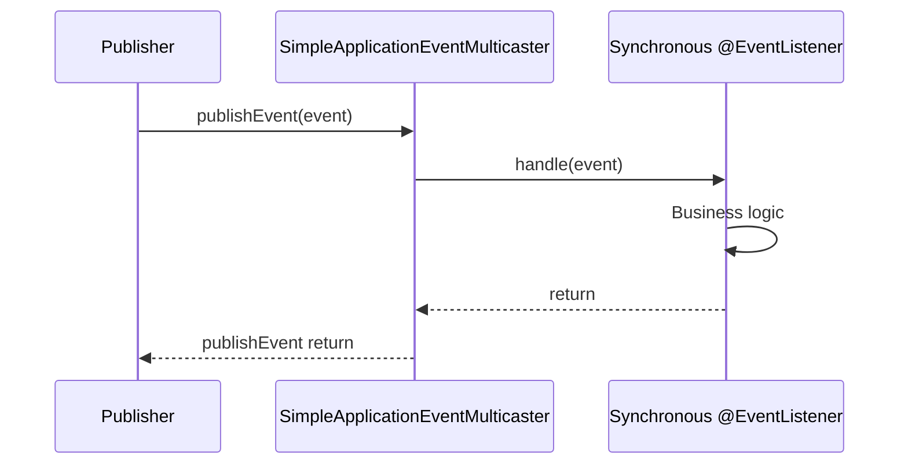
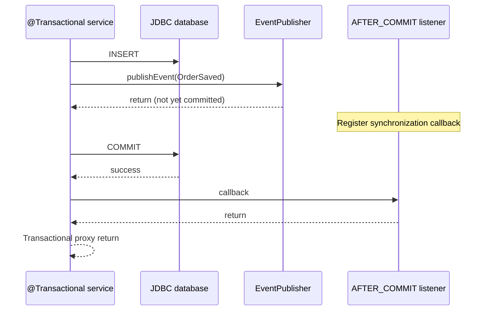

# Events and Observability: Distinguishing Published Events from Completed Listeners

## 1. Why Are These Two States Different?

In Spring Boot, code may call:

```java
publisher.publishEvent(new OrderCreated("ord-42"));
```

but that **does not automatically prove** the listener has finished processing the order. According to the Spring Framework 6.2 Javadoc for `ApplicationEventPublisher`, `publishEvent` is a **hand-off to the event multicaster**, not a promise that every listener runs synchronously, asynchronously, or immediately. In many applications, the call can return while listener work is queued in an executor, still running, or merely registered as a transaction callback.

Four milestones are easily confused:

| Milestone | Meaning | How to Verify |
| --- | --- | --- |
| **Published** | Publisher calls `publishEvent` and infrastructure records the event | `@RecordApplicationEvents`, `ApplicationEvents`, verify publisher |
| **Dispatched/started** | Listener is triggered / entered the method | `CountDownLatch started` or entry metric |
| **Processed successfully** | Listener logic reaches its success condition | Future/outcome, listener state, business assertion |
| **Durable outcome** | DB commit, external response, or broker ACK matches contract | Database/HTTP/broker integration test |

**Do not conclude “processed” from an assertion that only checks “published”.** Even a listener method returning does not by itself prove an email reached an inbox or downstream committed; it may simply have submitted another task.

### Learning Objectives

1. Distinguish synchronous `@EventListener`, `@Async @EventListener`, and a custom `ApplicationEventMulticaster`.
2. Understand `@TransactionalEventListener(AFTER_COMMIT)` and `AFTER_ROLLBACK`.
3. Write publication tests using `@RecordApplicationEvents`.
4. Write separate completion tests using `CountDownLatch`/`CompletableFuture`/observable business state.
5. Verify “publish returns while listener is still incomplete” without `Thread.sleep`.
6. Know when sync exceptions propagate to the publisher and async exceptions do not.
7. Align metrics/logs/traces with the event lifecycle.
8. Use an outbox/broker when durability across JVM restarts is needed.

## 2. How Internal Spring Events Work

`ApplicationEventPublisher` offers `publishEvent(ApplicationEvent)` and `publishEvent(Object)`. Spring supports Java POJO/record events; if the payload does not extend `ApplicationEvent`, Spring can wrap it in `PayloadApplicationEvent`.

```java
public record PaymentRequested(String paymentId) {}

@EventListener
public void onPayment(PaymentRequested event) {
    // Consumer receives the event object within the same ApplicationContext.
}
```

This is a snippet, not a standalone runnable file. By default, `SimpleApplicationEventMulticaster` processes regular `@EventListener` methods **synchronously** on the caller thread, but that is a default configuration property, **not an invariant guarantee of the publisher API**.



### When a Synchronous Listener Throws an Error

If a synchronous listener throws a runtime exception and the multicaster has no `ErrorHandler` intercepting it, the exception can propagate to the publisher and cause transaction rollback per policy. One failing listener can also prevent remaining listeners from being invoked. **Do not assume fan-out completed when one listener throws.**

### When a Listener Uses @Async

```java
@Async("eventExecutor")
@EventListener
public void on(PaymentRequested event) {
    // May start AFTER the publisher returns.
}
```

With `@EnableAsync` and a proper executor, invocation is handed off to a worker. The caller can finish while the listener is still queued or running. Exceptions from a `void @Async` listener go through `AsyncUncaughtExceptionHandler`/logging and do not automatically return to the publisher call stack.

Spring Framework allows synchronous listeners to emit a follow-up event via return value in some cases, whereas **async listeners do not use method return values** to emit further events. If needed, inject `ApplicationEventPublisher` and publish an explicit completion event.

### Custom Multicaster

An executor can be attached to a bean named `applicationEventMulticaster`:

```java
@Bean("applicationEventMulticaster")
ApplicationEventMulticaster eventMulticaster(TaskExecutor executor) {
    SimpleApplicationEventMulticaster m =
            new SimpleApplicationEventMulticaster();
    m.setTaskExecutor(executor);
    return m;
}
```

This is a snippet needing imports and a configuration bean. With it, async-capable listeners can run on workers even without `@Async`. However, `ApplicationListener.supportsAsyncExecution()` lets certain listeners (especially transaction-synchronized ones) require running on the publisher thread to preserve transaction synchronization. Thus **you cannot assume every listener is submitted to the pool**.

## 3. Transactions: Published Does Not Mean Committed

`@TransactionalEventListener` binds a listener to a transaction phase:

| Phase | When Does the Listener Run? | Risk of Misinference |
| --- | --- | --- |
| `BEFORE_COMMIT` | Before commit | Commit can still fail afterward |
| `AFTER_COMMIT` | After successful commit (default) | Does not imply downstream processing is durable |
| `AFTER_ROLLBACK` | After rollback | Event was published, yet the business write rolled back |
| `AFTER_COMPLETION` | After commit or rollback | Must determine the specific outcome |

`fallbackExecution=false` is the default: publishing **without an active transaction** means a transactional listener normally **does not run**. Enable `fallbackExecution=true` only when you intend to allow non-transactional execution and understand the timing difference.



**Caution:** after commit, transaction resources may still remain accessible. DB writes inside an `AFTER_COMMIT` listener might not commit as expected without opening a new transaction such as `REQUIRES_NEW` on an appropriate bean/proxy. For critical side effects, use an explicit transaction or an outbox. `@TransactionalEventListener` does not create a durable queue.

### @Transactional on Test Methods Can Mislead

Spring Test usually rolls back a test-managed transaction at the end of a test. If a test method has `@Transactional` and the service uses REQUIRED propagation and joins that transaction, `AFTER_COMMIT` **does not run when the service returns**, even though production code may be fine. The example below avoids an outer transaction in JUnit; transactions are controlled via a service/proxy or `TransactionTemplate`.

## 4. Testing by Kind of Evidence

| Question | Tool | What to Assert |
| --- | --- | --- |
| Did the publisher emit the right event? | `@RecordApplicationEvents` or Mockito | Event type, id, payload |
| Did the sync listener process before return? | Real `@EventListener` | State after publish |
| Did the async listener start? | `CountDownLatch started` | Bounded await |
| Is the async listener still incomplete? | Controlled gate | Success state remains false |
| Did the async listener complete successfully? | Finished latch + result marker | Both completion and success |
| Did the transaction callback hit the right phase? | H2/JDBC + transaction manager | Before/after commit, rollback |
| Was the external side effect reached? | HTTP/broker/DB integration | Contract-specific commit/ACK |
| Are events preserved across JVM crashes? | Outbox/durable queue recovery test | Replay and idempotency |

A test like:

```java
verify(mockPublisher).publishEvent(any(OrderCreated.class));
```

only proves **a method call on the mock**. Because the publisher is mocked, a real multicaster/listener might not even exist. It is a valid producer unit test, not a listener completion test.

### @RecordApplicationEvents

Spring TestContext supports `@RecordApplicationEvents` and `ApplicationEvents.stream(EventType.class)`. The event recorder only stores events emitted in the test scope; **it does not store listener completion status**. A test can verify the recorder observed an async event while the listener is still held back by a latch—the runnable example below does exactly that.

## 5. Complete Sample Project — Spring Boot 3.5, Java 17

The project defines distinct event types:

- `Events.SyncSignal`: synchronous.
- `Events.BadSyncSignal`: intentionally throws inside a synchronous listener.
- `Events.AsyncSignal`: runs on a worker with a gate to control state.
- `Events.StoredSignal`: tied to JDBC commit/rollback.

No Docker, broker, or web server is used. H2 is used to test real transactions, not to simulate broker durability.

```text
event-publication-completion/
├── pom.xml
└── src/
    ├── main/
    │   ├── java/example/eventtest/
    │   │   ├── EventTestApplication.java
    │   │   ├── Events.java
    │   │   ├── SyncEventListener.java
    │   │   ├── AsyncExecutorConfig.java
    │   │   ├── AsyncEventListener.java
    │   │   ├── EventJournalService.java
    │   │   └── TxEventListener.java
    │   └── resources/
    │       ├── application.properties
    │       └── schema.sql
    └── test/java/example/eventtest/
        ├── SyncEventTest.java
        ├── AsyncEventTest.java
        └── TxEventTest.java
```

## 6. pom.xml

```xml
<?xml version="1.0" encoding="UTF-8"?>
<project xmlns="http://maven.apache.org/POM/4.0.0"
         xmlns:xsi="http://www.w3.org/2001/XMLSchema-instance"
         xsi:schemaLocation="http://maven.apache.org/POM/4.0.0
           https://maven.apache.org/xsd/maven-4.0.0.xsd">
    <modelVersion>4.0.0</modelVersion>
    <parent>
        <groupId>org.springframework.boot</groupId>
        <artifactId>spring-boot-starter-parent</artifactId>
        <version>3.5.0</version>
        <relativePath/>
    </parent>
    <groupId>example</groupId>
    <artifactId>event-publication-completion</artifactId>
    <version>1.0-SNAPSHOT</version>
    <properties>
        <java.version>17</java.version>
    </properties>
    <dependencies>
        <dependency>
            <groupId>org.springframework.boot</groupId>
            <artifactId>spring-boot-starter</artifactId>
        </dependency>
        <dependency>
            <groupId>org.springframework.boot</groupId>
            <artifactId>spring-boot-starter-jdbc</artifactId>
        </dependency>
        <dependency>
            <groupId>com.h2database</groupId>
            <artifactId>h2</artifactId>
            <scope>runtime</scope>
        </dependency>
        <dependency>
            <groupId>org.springframework.boot</groupId>
            <artifactId>spring-boot-starter-test</artifactId>
            <scope>test</scope>
        </dependency>
    </dependencies>
</project>
```

- Spring Boot starter: event infrastructure, ApplicationContext, logging.
- JDBC starter: `JdbcTemplate` and transaction manager.
- H2 runtime: embedded DB to test commit/rollback.
- Test starter: JUnit Jupiter, Spring TestContext, assertions, and event recorder.
- Parent 3.5.0/BOM manages dependency versions; do not mix Spring Framework 7/Boot 4 APIs into this sample.

## 7. Application, DTOs, and Synchronous Listener

`src/main/java/example/eventtest/EventTestApplication.java`:

```java
package example.eventtest;

import org.springframework.boot.SpringApplication;
import org.springframework.boot.autoconfigure.SpringBootApplication;
import org.springframework.scheduling.annotation.EnableAsync;

@SpringBootApplication
@EnableAsync
public class EventTestApplication {
    public static void main(String[] args) {
        SpringApplication.run(EventTestApplication.class, args);
    }
}
```

`src/main/java/example/eventtest/Events.java`:

```java
package example.eventtest;

public final class Events {
    private Events() {}

    public record SyncSignal(String id) {}
    public record BadSyncSignal(String id) {}
    public record AsyncSignal(String id) {}
    public record StoredSignal(String id) {}
}
```

Java 17 records are simple immutable payloads. In production, include `eventId`/`correlationId` and a stable schema contract instead of mutable JPA entities or lazy proxies.

`src/main/java/example/eventtest/SyncEventListener.java`:

```java
package example.eventtest;

import java.util.Queue;
import java.util.concurrent.ConcurrentLinkedQueue;

import org.springframework.context.event.EventListener;
import org.springframework.stereotype.Component;

@Component
public class SyncEventListener {
    private final Queue<String> completed =
            new ConcurrentLinkedQueue<>();

    @EventListener
    public void handle(Events.SyncSignal event) {
        completed.add(event.id());
    }

    @EventListener
    public void fail(Events.BadSyncSignal event) {
        throw new IllegalStateException(
                "sync-error:" + event.id());
    }

    public boolean completed(String id) {
        return completed.contains(id);
    }

    public void clear() {
        completed.clear();
    }
}
```

`completed` is only an **in-memory probe**. Sync tests use it to observe that the method reached its success marker. If a listener actually sends an email, assert the email client/broker/DB outcome according to contract rather than substituting a fake probe and claiming the system delivered it.

## 8. Executor and Asynchronous Listener

`src/main/java/example/eventtest/AsyncExecutorConfig.java`:

```java
package example.eventtest;

import org.springframework.context.annotation.Bean;
import org.springframework.context.annotation.Configuration;
import org.springframework.scheduling.concurrent.ThreadPoolTaskExecutor;

@Configuration(proxyBeanMethods = false)
public class AsyncExecutorConfig {
    @Bean("eventExecutor")
    ThreadPoolTaskExecutor eventExecutor() {
        ThreadPoolTaskExecutor executor =
                new ThreadPoolTaskExecutor();
        executor.setCorePoolSize(1);
        executor.setMaxPoolSize(1);
        executor.setQueueCapacity(10);
        executor.setThreadNamePrefix("event-worker-");
        executor.setWaitForTasksToCompleteOnShutdown(true);
        executor.setAwaitTerminationSeconds(5);
        return executor;
    }
}
```

Intentionally configured with **a single worker** so that when task A is blocked, task B is queued and has not started yet. This is a demo/test configuration, not a default preset for real workloads.

`src/main/java/example/eventtest/AsyncEventListener.java`:

```java
package example.eventtest;

import java.util.Map;
import java.util.Set;
import java.util.concurrent.ConcurrentHashMap;
import java.util.concurrent.CountDownLatch;
import java.util.concurrent.TimeUnit;

import org.springframework.context.event.EventListener;
import org.springframework.scheduling.annotation.Async;
import org.springframework.stereotype.Component;

@Component
public class AsyncEventListener {
    private final Set<String> succeeded =
            ConcurrentHashMap.newKeySet();
    private final Map<String, String> workerNames =
            new ConcurrentHashMap<>();

    private volatile CountDownLatch started =
            new CountDownLatch(0);
    private volatile CountDownLatch gate =
            new CountDownLatch(0);
    private volatile CountDownLatch finished =
            new CountDownLatch(0);

    public void arm(int count) {
        if (count < 1) {
            throw new IllegalArgumentException(
                    "count must be positive");
        }
        succeeded.clear();
        workerNames.clear();
        started = new CountDownLatch(1);
        gate = new CountDownLatch(1);
        finished = new CountDownLatch(count);
    }

    @Async("eventExecutor")
    @EventListener
    public void handle(Events.AsyncSignal event) {
        CountDownLatch s = started;
        CountDownLatch g = gate;
        CountDownLatch f = finished;

        workerNames.put(event.id(),
                Thread.currentThread().getName());
        s.countDown();

        try {
            if (!g.await(10, TimeUnit.SECONDS)) {
                throw new IllegalStateException(
                        "async listener gate timed out");
            }
            succeeded.add(event.id());
        } catch (InterruptedException ex) {
            Thread.currentThread().interrupt();
            throw new IllegalStateException(
                    "async listener interrupted", ex);
        } finally {
            f.countDown();
        }
    }

    public boolean awaitStarted(long seconds)
            throws InterruptedException {
        return started.await(seconds, TimeUnit.SECONDS);
    }

    public void release() {
        gate.countDown();
    }

    public boolean awaitFinished(long seconds)
            throws InterruptedException {
        return finished.await(seconds, TimeUnit.SECONDS);
    }

    public boolean started(String id) {
        return workerNames.containsKey(id);
    }

    public boolean succeeded(String id) {
        return succeeded.contains(id);
    }

    public String workerName(String id) {
        return workerNames.get(id);
    }
}
```

### Why Are Three Signals Needed?

- `started` latch: proves the listener has entered the method.
- `gate`: holds the listener back from reaching the success marker until the test allows it.
- `finished` latch: method ended, even on exception because of `finally`.

**Finished does not automatically mean succeeded.** In tests, after `awaitFinished`, also assert `succeeded(id)`. A common mistake is counting down in `finally` and then treating count 0 as proof of business success.

### When Should State Be Captured?

The listener captures local references to the latches at the start of the invocation. Tests in a class reset the probe before each method and wait for all work to finish; do not run in parallel on the same singleton probe.

## 9. DB Writing Service and Transactional Listeners

`src/main/java/example/eventtest/EventJournalService.java`:

```java
package example.eventtest;

import org.springframework.context.ApplicationEventPublisher;
import org.springframework.jdbc.core.JdbcTemplate;
import org.springframework.stereotype.Service;
import org.springframework.transaction.annotation.Transactional;

@Service
public class EventJournalService {
    private final JdbcTemplate jdbc;
    private final ApplicationEventPublisher publisher;

    public EventJournalService(
            JdbcTemplate jdbc,
            ApplicationEventPublisher publisher) {
        this.jdbc = jdbc;
        this.publisher = publisher;
    }

    @Transactional
    public void insertAndPublish(String id, boolean fail) {
        jdbc.update(
                "INSERT INTO event_log (event_id) VALUES (?)",
                id);
        publisher.publishEvent(new Events.StoredSignal(id));

        if (fail) {
            throw new IllegalStateException(
                    "rollback:" + id);
        }
    }
}
```

`src/main/java/example/eventtest/TxEventListener.java`:

```java
package example.eventtest;

import java.util.Queue;
import java.util.concurrent.ConcurrentLinkedQueue;

import org.springframework.stereotype.Component;
import org.springframework.transaction.event.TransactionPhase;
import org.springframework.transaction.event.TransactionalEventListener;

@Component
public class TxEventListener {
    private final Queue<String> committed =
            new ConcurrentLinkedQueue<>();
    private final Queue<String> rolledBack =
            new ConcurrentLinkedQueue<>();

    @TransactionalEventListener(
        phase = TransactionPhase.AFTER_COMMIT)
    public void afterCommit(Events.StoredSignal event) {
        committed.add(event.id());
    }

    @TransactionalEventListener(
        phase = TransactionPhase.AFTER_ROLLBACK)
    public void afterRollback(Events.StoredSignal event) {
        rolledBack.add(event.id());
    }

    public boolean committed(String id) {
        return committed.contains(id);
    }

    public boolean rolledBack(String id) {
        return rolledBack.contains(id);
    }

    public void clear() {
        committed.clear();
        rolledBack.clear();
    }
}
```

`@Transactional` requires calls to pass through the Spring-managed **proxy**, not `new EventJournalService(...)` or self-invocation via `this.method()`. When a runtime exception is thrown out of the method, the transaction rolls back by default; the event was published, yet `AFTER_COMMIT` does not run.

## 10. H2 Configuration

`src/main/resources/application.properties`:

```properties
spring.main.banner-mode=off
spring.datasource.generate-unique-name=true
spring.sql.init.mode=always
```

`src/main/resources/schema.sql`:

```sql
CREATE TABLE IF NOT EXISTS event_log (
    event_id VARCHAR(80) PRIMARY KEY
);
```

Embedded H2 + starter-jdbc provides a DataSource/JdbcTemplate and PlatformTransactionManager. The schema runs when the Boot context initializes; tests delete rows before each method so they do not depend on test order. It neither points to a production DB nor contains real passwords.

## 11. Synchronous Tests: 3 JUnit Methods

`src/test/java/example/eventtest/SyncEventTest.java`:

```java
package example.eventtest;

import static org.junit.jupiter.api.Assertions.assertEquals;
import static org.junit.jupiter.api.Assertions.assertThrows;
import static org.junit.jupiter.api.Assertions.assertTrue;

import org.junit.jupiter.api.BeforeEach;
import org.junit.jupiter.api.Test;
import org.springframework.beans.factory.annotation.Autowired;
import org.springframework.boot.test.context.SpringBootTest;
import org.springframework.context.ApplicationEventPublisher;
import org.springframework.test.context.event.ApplicationEvents;
import org.springframework.test.context.event.RecordApplicationEvents;

@SpringBootTest(
    webEnvironment = SpringBootTest.WebEnvironment.NONE)
@RecordApplicationEvents
class SyncEventTest {
    @Autowired ApplicationEventPublisher publisher;
    @Autowired SyncEventListener listener;

    @BeforeEach
    void reset() {
        listener.clear();
    }

    @Test
    void synchronousListenerCompletesBeforePublisherReturns() {
        publisher.publishEvent(
                new Events.SyncSignal("sync-101"));

        assertTrue(listener.completed("sync-101"));
    }

    @Test
    void publicationAndListenerCompletionAreDistinctAssertions(
            ApplicationEvents events) {

        publisher.publishEvent(
                new Events.SyncSignal("sync-102"));

        long count = events.stream(Events.SyncSignal.class)
                .filter(e -> e.id().equals("sync-102"))
                .count();

        assertEquals(1L, count);          // Published.
        assertTrue(listener.completed("sync-102")); // Completed.
    }

    @Test
    void synchronousFailureCanPropagateToPublisher() {
        IllegalStateException error = assertThrows(
                IllegalStateException.class,
                () -> publisher.publishEvent(
                    new Events.BadSyncSignal("bad-1")));

        assertTrue(error.getMessage()
                .contains("sync-error:bad-1"));
    }
}
```

- Test 1 verifies default synchronous semantics with a real listener.
- Test 2 uses **two witnesses**: the recorder for publication, listener state for completion.
- Test 3 proves a sync listener exception can propagate to the publisher under default behavior.

If the application configures a custom multicaster ErrorHandler, the assertions about exceptions and ordering must follow the real configuration instead of assuming defaults.

## 12. Asynchronous Tests: 4 JUnit Methods

`src/test/java/example/eventtest/AsyncEventTest.java`:

```java
package example.eventtest;

import static org.junit.jupiter.api.Assertions.assertEquals;
import static org.junit.jupiter.api.Assertions.assertFalse;
import static org.junit.jupiter.api.Assertions.assertNotEquals;
import static org.junit.jupiter.api.Assertions.assertTrue;

import org.junit.jupiter.api.AfterEach;
import org.junit.jupiter.api.BeforeEach;
import org.junit.jupiter.api.Test;
import org.springframework.beans.factory.annotation.Autowired;
import org.springframework.boot.test.context.SpringBootTest;
import org.springframework.context.ApplicationEventPublisher;
import org.springframework.test.context.event.ApplicationEvents;
import org.springframework.test.context.event.RecordApplicationEvents;

@SpringBootTest(
    webEnvironment = SpringBootTest.WebEnvironment.NONE)
@RecordApplicationEvents
class AsyncEventTest {
    @Autowired ApplicationEventPublisher publisher;
    @Autowired AsyncEventListener listener;

    @BeforeEach
    void prepare() {
        listener.arm(1);
    }

    @AfterEach
    void releaseGateOnFailure() {
        listener.release();
    }

    @Test
    void publishCanReturnWhileListenerIsIncomplete()
            throws Exception {

        publisher.publishEvent(
                new Events.AsyncSignal("async-201"));

        assertTrue(listener.awaitStarted(5));
        assertTrue(listener.started("async-201"));
        assertFalse(listener.succeeded("async-201"));

        listener.release();
        assertTrue(listener.awaitFinished(5));
        assertTrue(listener.succeeded("async-201"));
    }

    @Test
    void recordedPublicationIsNotCompletionEvidence(
            ApplicationEvents events) throws Exception {

        publisher.publishEvent(
                new Events.AsyncSignal("async-202"));

        long count = events.stream(Events.AsyncSignal.class)
                .filter(e -> e.id().equals("async-202"))
                .count();

        assertEquals(1L, count); // Event was recorded.
        assertTrue(listener.awaitStarted(5));
        assertFalse(listener.succeeded("async-202"));

        listener.release();
        assertTrue(listener.awaitFinished(5));
        assertTrue(listener.succeeded("async-202"));
    }

    @Test
    void asyncListenerRunsOnNamedWorkerThread()
            throws Exception {

        String testThread =
                Thread.currentThread().getName();

        publisher.publishEvent(
                new Events.AsyncSignal("async-203"));

        assertTrue(listener.awaitStarted(5));
        assertTrue(listener.workerName("async-203")
                .startsWith("event-worker-"));
        assertNotEquals(testThread,
                listener.workerName("async-203"));

        listener.release();
        assertTrue(listener.awaitFinished(5));
        assertTrue(listener.succeeded("async-203"));
    }

    @Test
    void secondEventCanWaitInExecutorQueue()
            throws Exception {

        listener.arm(2);

        publisher.publishEvent(
                new Events.AsyncSignal("first"));
        assertTrue(listener.awaitStarted(5));

        publisher.publishEvent(
                new Events.AsyncSignal("second"));

        assertFalse(listener.succeeded("first"));
        assertFalse(listener.started("second"));
        assertFalse(listener.succeeded("second"));

        listener.release();
        assertTrue(listener.awaitFinished(5));
        assertTrue(listener.succeeded("first"));
        assertTrue(listener.succeeded("second"));
    }
}
```

### Four Things Proven

1. The publisher already returned while the handler entered the method and was held at the gate with `succeeded=false`.
2. `@RecordApplicationEvents` already observed the event while the listener was still incomplete—showing the distinction within a single test.
3. The listener runs on `event-worker-...`, not the JUnit caller thread.
4. A single-worker executor can keep the first event running and the second event queued, even though both publish calls returned.

**Do not use `Thread.sleep`**. `awaitStarted` has a bounded timeout; the gate opens only when the test decides. Because `awaitFinished` can finish even when the method fails, always also assert `succeeded(id)`.

## 13. Transaction Tests: 4 JUnit Methods

`src/test/java/example/eventtest/TxEventTest.java`:

```java
package example.eventtest;

import static org.junit.jupiter.api.Assertions.assertEquals;
import static org.junit.jupiter.api.Assertions.assertFalse;
import static org.junit.jupiter.api.Assertions.assertThrows;
import static org.junit.jupiter.api.Assertions.assertTrue;

import org.junit.jupiter.api.BeforeEach;
import org.junit.jupiter.api.Test;
import org.springframework.beans.factory.annotation.Autowired;
import org.springframework.boot.test.context.SpringBootTest;
import org.springframework.context.ApplicationEventPublisher;
import org.springframework.jdbc.core.JdbcTemplate;
import org.springframework.test.context.event.ApplicationEvents;
import org.springframework.test.context.event.RecordApplicationEvents;
import org.springframework.transaction.PlatformTransactionManager;
import org.springframework.transaction.support.TransactionTemplate;

@SpringBootTest(
    webEnvironment = SpringBootTest.WebEnvironment.NONE)
@RecordApplicationEvents
class TxEventTest {
    @Autowired EventJournalService journal;
    @Autowired JdbcTemplate jdbc;
    @Autowired TxEventListener listener;
    @Autowired ApplicationEventPublisher publisher;
    @Autowired PlatformTransactionManager manager;

    @BeforeEach
    void reset() {
        jdbc.update("DELETE FROM event_log");
        listener.clear();
    }

    private int rowsFor(String id) {
        Integer count = jdbc.queryForObject(
                "SELECT COUNT(*) FROM event_log WHERE event_id = ?",
                Integer.class, id);
        return count == null ? 0 : count;
    }

    @Test
    void afterCommitRunsAfterSuccessfulTransaction() {
        journal.insertAndPublish("tx-301", false);

        assertEquals(1, rowsFor("tx-301"));
        assertTrue(listener.committed("tx-301"));
        assertFalse(listener.rolledBack("tx-301"));
    }

    @Test
    void rollbackDoesNotRunAfterCommit() {
        IllegalStateException error = assertThrows(
                IllegalStateException.class,
                () -> journal.insertAndPublish("tx-302", true));

        assertTrue(error.getMessage()
                .contains("rollback:tx-302"));

        assertEquals(0, rowsFor("tx-302"));
        assertFalse(listener.committed("tx-302"));
        assertTrue(listener.rolledBack("tx-302"));
    }

    @Test
    void publishingWithinTransactionIsBeforeCommit() {
        TransactionTemplate template =
                new TransactionTemplate(manager);

        template.executeWithoutResult(status -> {
            jdbc.update(
                    "INSERT INTO event_log (event_id) VALUES (?)",
                    "tx-303");

            publisher.publishEvent(
                    new Events.StoredSignal("tx-303"));

            // Already published, but not yet committed.
            assertFalse(listener.committed("tx-303"));
            assertFalse(listener.rolledBack("tx-303"));
        });

        assertEquals(1, rowsFor("tx-303"));
        assertTrue(listener.committed("tx-303"));
    }

    @Test
    void publicationOutsideTransactionSkipsTransactionalListeners(
            ApplicationEvents events) {

        publisher.publishEvent(
                new Events.StoredSignal("outside-tx"));

        long published = events.stream(Events.StoredSignal.class)
                .filter(e -> e.id().equals("outside-tx"))
                .count();

        assertEquals(1L, published);
        assertFalse(listener.committed("outside-tx"));
        assertFalse(listener.rolledBack("outside-tx"));
        assertEquals(0, rowsFor("outside-tx"));
    }
}
```

### Accurate Guarantees

- Successful commit ⇒ DB row exists, AFTER_COMMIT listener runs.
- Rollback ⇒ DB row does not exist, AFTER_COMMIT does not run, AFTER_ROLLBACK runs.
- Inside transaction ⇒ publish called, but AFTER_COMMIT has not run yet.
- Outside transaction ⇒ event is seen by the recorder, yet transactional listeners (default fallback=false) do not run.

**Important:** Do not place `@Transactional` on the test class/method in this sample; if an outer test transaction rolls back by default, AFTER_COMMIT may be deferred or never run.

## 14. Running Maven and Expected Results

Requires Java 17+, Maven. Create the files at the proper paths then run:

```bash
mvn test
```

Run individual classes:

```bash
mvn test -Dtest=SyncEventTest
mvn test -Dtest=AsyncEventTest
mvn test -Dtest=TxEventTest
```

| Test Class | `@Test` Count | Goal |
| --- | ---: | --- |
| `SyncEventTest` | 3 | Default sync, recorder/completion, sync failure |
| `AsyncEventTest` | 4 | Async return, gate, worker, queue |
| `TxEventTest` | 4 | Commit/rollback/no transaction/before commit |
| **Total** | **11** | 11 expected runs |

**Expected 11 tests PASS** when the project is created accurately on Boot 3.5/Java 17 in a compatible Maven environment. This is the **code-based expectation**, not a test log that was actually executed. Inspect `target/surefire-reports` to confirm test counts, failures, and skips.

There is no fixed Java stdout. Spring/Maven logs and worker thread suffixes may vary by environment; the test only checks the `event-worker-` prefix.

## 15. Common Testing Mistakes

### 15.1. Counting Events via Recorder and Concluding Listeners Finished

`ApplicationEvents.stream(...)` tests **publication**, not listener completion. In the async example, the event is already visible to the recorder while `succeeded=false` because the handler is still blocked at the gate.

### 15.2. Mocking the Publisher and Expecting Real Listeners to Run

`@Mock ApplicationEventPublisher` records calls inside Mockito without passing events through Spring's multicaster. If you need to test the listener lifecycle, use `@SpringBootTest` or an appropriate Spring context with real listener beans.

### 15.3. @Async Listener Exceptions Do Not Notify the Caller

The publisher cannot catch an exception thrown later on a worker thread. Use `AsyncUncaughtExceptionHandler`, error status, result events, metrics, or an error queue. `assertDoesNotThrow(publisher.publishEvent(...))` only checks hand-off, not success.

### 15.4. Listener Completion Is Not Committed Side Effects

A listener might call `executor.submit(...)` internally, fire an HTTP request without awaiting the response, or publish downstream to a broker. When the listener method returns, nested work is still pending. You need evidence at the API/DB/broker where the side effect is confirmed.

### 15.5. @Order Does Not Guarantee Async Completion Order

`@Order` only controls invocation order in appropriate contexts. With multiple workers or async listeners, listener B can finish before A. If B depends on A, use explicit orchestration/workflow, not annotation ordering alone.

### 15.6. Equating AFTER_COMMIT with Reliable Delivery

There is still a JVM crash window between DB commit and the after-commit callback. For critical workflows, use a transactional outbox, a durable broker, and retries/idempotency.

### 15.7. @Transactional Tests Hiding AFTER_COMMIT

Test-managed transaction rollback at the end of a method prevents after-commit callbacks from running, even when the production service is right. Use non-transactional tests and `TransactionTemplate` to observe before/after commit.

### 15.8. Forgetting to Reset Probes

`@SpringBootTest` can reuse a cached context; listeners/probes are singletons. Without clearing state and using unique event IDs, later tests can see old events. The sample cleans state before each test.

### 15.9. Races Caused by Thread.sleep

Waiting 200 ms may pass locally and fail in CI. Use latches, bounded futures, or Awaitility, and assert actual success/failure.

### 15.10. Parallel Async Tests Sharing State

If JUnit parallel execution is enabled, two tests can call `AsyncEventListener.arm(...)` at the same time and overwrite each other's latches. Use test resource isolation, single-thread execution, or separate contexts/probes per test.

## 16. Observability: Measure the Right Stage

Spring Framework 6.2 does not automatically create an Observation for every `@EventListener` call with business-specific semantics. If you want metrics, add explicit instrumentation.

| Metric | When to Increment? |
| --- | --- |
| `event_publish_attempt_total` | Before `publishEvent` |
| `event_publish_return_total` | After hand-off returns |
| `event_listener_started_total` | Entry of each listener |
| `event_listener_succeeded_total` | Business logic reaches success |
| `event_listener_failed_total` | Catch/observe failure |
| `event_listener_retry_total` | Actual retry attempt |
| `event_durable_outcome_total` | DB/broker/downstream ACK per contract |
| `event_listener_duration` | Timer from listener entry to success/failure |
| `event_publish_to_start` | Latency from hand-off to start |
| `event_inflight` | Number of running invocations |

One event can be handled by multiple listeners, so metric tags should include **eventType**, **listener**, and **outcome** with bounded cardinality. Never use unbounded eventId/orderId/raw tenant IDs as metric tags; place IDs in structured logs/traces per privacy policy.

### Logs and Correlation IDs

Example event schema:

```json
{
  "eventId": "evt-701",
  "orderId": "ord-701",
  "eventType": "order.created",
  "correlationId": "checkout-req-10",
  "schemaVersion": 1
}
```

Logs:

```text
event.publish_requested eventId=evt-701
event.listener_started eventId=evt-701 listener=MailListener
event.listener_failed eventId=evt-701 listener=MailListener error=Timeout
event.listener_retry eventId=evt-701 attempt=2
event.listener_succeeded eventId=evt-701 listener=MailListener
```

These are illustrative logs, not console output from the project. Never write bearer tokens, passwords, or PII to logs. ThreadLocal MDC may not propagate across `@Async`; if tracing context is needed, use `ContextPropagatingTaskDecorator`/Micrometer Context Propagation and test specific IDs, or carry correlationId in the event payload.

## 17. When the Caller Actually Needs to Wait for Success

`publishEvent` returns `void`. There is no built-in `CompletionStage`/`CompletableFuture` for the entire listener graph. If a result is required, design an explicit API:

```java
// Architectural illustration; not part of the runnable project.
// Command, Result, executor, and handle must be defined by the application.
CompletableFuture<Result> submit(Command command) {
    CompletableFuture<Result> future = new CompletableFuture<>();
    executor.execute(() -> {
        try {
            future.complete(handle(command));
        } catch (Throwable failure) {
            future.completeExceptionally(failure);
        }
    });
    return future;
}
```

The caller checks `future.get(timeout, TimeUnit.SECONDS)` with clear policies for cancellation/rejected execution. If work must survive JVM restarts, return a job ID, persist state, and expose a status API instead of holding only an in-memory Java Future.

Do not force every async event into request-response: when the goal is loose coupling and low latency, final outcomes can be published as `JobCompleted`/`JobFailed` events or saved in a workflow store.

## 18. @TransactionalEventListener Does Not Replace an Outbox

A producer saves an order in the DB and publishes an event; even when `AFTER_COMMIT` is used, the JVM can still crash **after the DB commit but before the listener finishes**. A saved order may end up without its email, audit, or index update.

**Transactional outbox** closes part of this gap:

1. Write the business row and outbox row in the same DB transaction.
2. Commit both together.
3. A poller/CDC relay forwards outbox rows to the broker.
4. Broker delivery and consumer retries confirm per protocol.
5. Consumers process **idempotently** by eventId.
6. Provide DLQ/quarantine and monitoring for failed messages.

Comparison:

| Mechanism | What It Guarantees | What Still Needs Handling |
| --- | --- | --- |
| `@EventListener` sync | Method returns under synchronous config | Side effects/transactions/durability |
| `@Async @EventListener` | Worker task submitted | Recovery, bounded queues, error channel |
| `@TransactionalEventListener(AFTER_COMMIT)` | Runs only after successful commit | Crash recovery after commit |
| Outbox + durable broker | Recoverable pending record | Dedup/idempotency, retries |
| Broker consumer ACK | Broker sees delivery acknowledgement | Business transaction consistency |
| Workflow status store | Tracks progress across restarts | Compensation and failure policy |

“Exactly-once” does not appear automatically just by adding `@Transactional` or `@Async`.

## 19. Troubleshooting

| Symptom | Common Reason | How to Check |
| --- | --- | --- |
| Event is in recorder but listener hasn't finished | Async/gate/transaction | Observe start/completion separately |
| Publisher returns too quickly | Async executor enqueued | Check queue depth/workers |
| Sync publish throws error | Listener exception | ErrorHandler/transaction policy |
| Async listener throws yet publisher returns normally | Worker error doesn't propagate back | AsyncUncaughtExceptionHandler/outcome channel |
| @Async listener runs on test thread | Missing @EnableAsync/wrong proxy | Check executor and thread name |
| AFTER_COMMIT does not run | No active tx or rollback | TransactionTemplate + DB state |
| AFTER_COMMIT does not run in @Transactional test | Default test rollback | Remove outer test transaction |
| Publish outside tx skips listener | fallbackExecution=false | Check phase/fallback |
| DB write in AFTER_COMMIT does not persist | Post-commit resource, missing new tx | REQUIRES_NEW/outbox |
| Event lost on process restart | In-memory Spring event | Durable outbox/broker |
| @RecordApplicationEvents misses event | Annotation/setup/type mismatch | Verify TestContext listener |
| Spring tests pass individually, fail together | Shared singleton probe state | Reset/unique IDs/parallel isolation |
| Test hangs indefinitely | await without timeout | Bounded latch/future |
| H2 table does not exist | Wrong schema.sql/SQL init | Spring SQL init config |
| Listener only sends HTTP yet considered business complete | Downstream outcome not measured | Integration against real contract |
| Published metrics high while success low | Measuring different stages | Success/failure/backlog counters |
| Lost correlationId in async listener | MDC not propagated | Event payload/context propagation |
| Listener B finishes before A despite @Order | Async concurrency | Workflow orchestration |

## 20. Checklist and Exercises

### Checklist

- [ ] Understand `publishEvent` is a hand-off, not a completion guarantee?
- [ ] Distinguish default sync from `@Async` and custom multicaster?
- [ ] Know `@RecordApplicationEvents` only measures publication?
- [ ] Test started, succeeded, and method finished separately?
- [ ] Use latch/Future with timeout, never sleep?
- [ ] Verify sync exceptions and async error channel per config?
- [ ] Verify AFTER_COMMIT and AFTER_ROLLBACK with real transactions?
- [ ] Avoid annotating test transactions that cause rollback callbacks to mislead?
- [ ] Know `fallbackExecution=false` when no tx is active?
- [ ] Avoid treating `@Order` as an async completion guarantee?
- [ ] Have metrics/logs for publish/start/success/failure?
- [ ] Avoid putting high-cardinality IDs in metric labels?
- [ ] Have outbox/retry/idempotency when durability is needed?
- [ ] Distinguish HTTP 202 Accepted from job Completed?
- [ ] Have downstream commit/ACK evidence when business requires it?

### Extended Exercises

1. Remove `@Async` to see how test thread/gate assertions fail.
2. Create a `SimpleApplicationEventMulticaster` with a custom executor and compare it with `@Async`.
3. Add a failing async listener, configure `AsyncUncaughtExceptionHandler`, and assert failure status.
4. Add a `BEFORE_COMMIT` callback and test right inside `TransactionTemplate`.
5. Add `fallbackExecution=true` and test publishing outside a transaction.
6. Try writing to the DB inside AFTER_COMMIT, then extract a `REQUIRES_NEW` bean and verify commit.
7. Add Micrometer Timer/Counter and test that the success counter does not increment before gate release.
8. Create a transactional outbox table and test business row + outbox row committing/rolling back together.
9. Add idempotency by eventId when a consumer receives duplicate events.
10. Design a job status API `QUEUED→RUNNING→SUCCEEDED/FAILED`.
11. Use PostgreSQL Testcontainers instead of H2 when production-like transaction semantics are needed.
12. Write a reactive event test with Reactor `StepVerifier` and properly scoped `TransactionalEventPublisher`.
13. Test graceful shutdown while the executor still has queued tasks.

## 21. Official References

1. [Spring Framework 6.2 — ApplicationEventPublisher](https://docs.spring.io/spring-framework/docs/6.2.6/javadoc-api/org/springframework/context/ApplicationEventPublisher.html): hand-off, no promise of sync/async/immediate execution.
2. [Spring Framework 6.2 — ApplicationContext events](https://docs.spring.io/spring-framework/reference/6.2/core/beans/context-introduction.html): default sync, @EventListener, @Async, and ordering.
3. [Spring Framework 6.2 — SimpleApplicationEventMulticaster](https://docs.spring.io/spring-framework/docs/6.2.6/javadoc-api/org/springframework/context/event/SimpleApplicationEventMulticaster.html): executor/error handler/supportsAsyncExecution.
4. [Spring Framework 6.2 — Transaction-bound events](https://docs.spring.io/spring-framework/reference/6.2/data-access/transaction/event.html): AFTER_COMMIT, rollback, fallbackExecution.
5. [Spring Framework 6.2 — TransactionalEventListener API](https://docs.spring.io/spring-framework/docs/6.2.6/javadoc-api/org/springframework/transaction/event/TransactionalEventListener.html): warning about post-commit resources.
6. [Spring Framework 6.2 — Recording application events](https://docs.spring.io/spring-framework/reference/6.2/testing/testcontext-framework/application-events.html): @RecordApplicationEvents and ApplicationEvents.
7. [Spring Framework 6.2 — ApplicationEvents API](https://docs.spring.io/spring-framework/docs/6.2.6/javadoc-api/org/springframework/test/context/event/ApplicationEvents.html): stream(Class).
8. [Spring Framework 6.2 — Async](https://docs.spring.io/spring-framework/reference/6.2/integration/scheduling.html): @Async and executor semantics.
9. [Spring Framework 6.2 — Observability](https://docs.spring.io/spring-framework/reference/6.2/integration/observability.html): @EventListener not instrumented by default and thread context.
10. [Spring Boot 3.5 — SQL databases](https://docs.spring.io/spring-boot/3.5/reference/data/sql.html): embedded H2/JDBC.
11. [Spring Boot — Database initialization](https://docs.spring.io/spring-boot/how-to/data-initialization.html): schema.sql.
12. [Spring Boot 3.5 — Testing Spring Boot applications](https://docs.spring.io/spring-boot/3.5/reference/testing/spring-boot-applications.html): @SpringBootTest.
13. [Spring Framework — Declarative transactions](https://docs.spring.io/spring-framework/reference/6.2/data-access/transaction/declarative.html): proxies and rollback.
14. [Micrometer Context Propagation](https://docs.micrometer.io/context-propagation/reference/): MDC/tracing across workers.

**Conclusion:** `publishEvent` **only proves publication** per the API, not completed processing. To know a listener completed, verify **started → finished → succeeded** with real signals; to know data committed, verify the **transaction outcome**; and to know external side effects are durable, use separate **ACK/status/outbox** verification.
