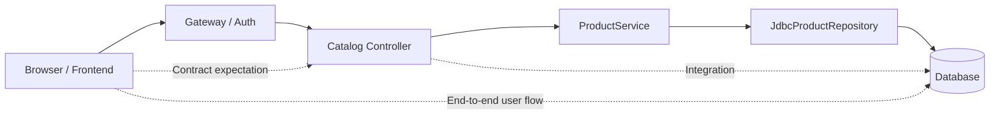
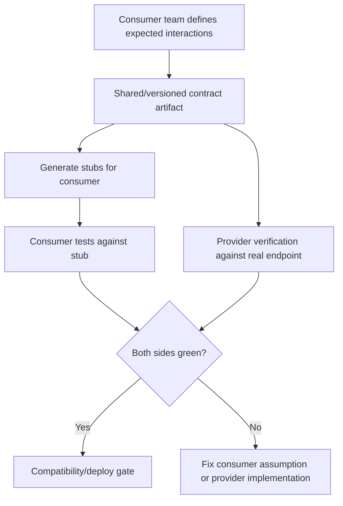
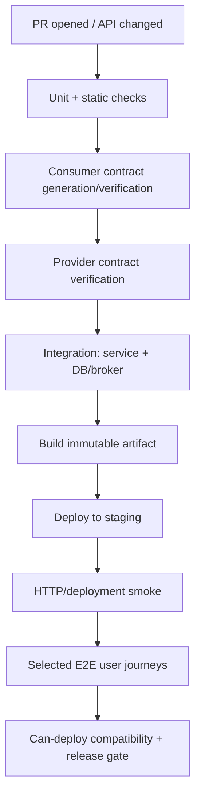

# Contracts and Resilience — Distinguishing Contract Tests from Integration and End-to-End Tests

## 1. One feature, three different questions

Suppose a retail application needs to display product information. The frontend calls the **Catalog Service** API:

```http
GET /api/products/SKU-100
Accept: application/json
```

The provider returns:

```json
{
  "sku": "SKU-100",
  "price": 49.90,
  "currency": "USD",
  "inStock": true
}
```

After a deployment, the backend changes `price` from a JSON number to a string, renames `inStock` to `available`, or turns a 404 error code into a 200 with `null`. Internal business logic still runs, yet the frontend can break because the **communication contract** changed. Conversely, a backend that returns JSON matching the sample while querying the database incorrectly is still a broken system. And even if both the API and DB are correct, users may fail to purchase because the gateway, authentication, payment, or frontend fails.

Three types of tests address different risks:

- **Contract test** asks: *Does the provider uphold what consumers are allowed to rely on at the communication boundary?*
- **Integration test** asks: *Do the real wired components exchange data and collaborate properly?*
- **End-to-end (E2E) test** asks: *Does a user business flow run through the deployed system, from entry point to final outcome, as expected?*

These test types **overlap somewhat** but do not replace one another. An HTTP test of a single service with H2 can be an **integration/smoke test**, not yet an E2E test spanning the frontend, gateway, and real backends.

### Learning objectives

After this lesson, learners will be able to:

1. Identify the **boundary** observed by a test.
2. Distinguish **provider contract**, **consumer-driven contract (CDC)**, schema/API conformance, integration, and E2E.
3. Explain why mocks/stubs are valid in contract tests yet can hide integration bugs.
4. Choose `@WebMvcTest`, `@RestClientTest`, `@SpringBootTest`, and `RANDOM_PORT` for the right goal.
5. Write tests that protect HTTP status, JSON fields/types, headers, and error contracts.
6. Test service, JDBC repository, and Spring MVC wiring with integration tests.
7. Test real HTTP on a random port without **calling it full-system E2E**.
8. Design a CDC workflow with Spring Cloud Contract/Pact and publish stubs.
9. Test backward compatibility, versioning, and consumer expectations.
10. Separate resilience/timeout/retry tests from schema compatibility tests and build a sensible CI test pyramid.

## 2. Comparison table of levels and scope

| Criterion | Contract test | Integration test | E2E test |
| --- | --- | --- | --- |
| Primary question | Does the API/message satisfy the consumer's contract? | Do multiple components collaborate properly? | Does the full-system user journey succeed? |
| Boundary | Consumer ↔ Provider | Controller ↔ Service ↔ DB, client ↔ HTTP stub/real dependency | Frontend ↔ gateway ↔ backend ↔ external dependencies |
| Test setup | Provider or consumer against contract/stub | Part of the real stack, mocks for out-of-scope parts | Representative deployed system, most paths real |
| Typical speed | Fast and deterministic | Medium | Slow, environment-sensitive |
| Stability | High if contracts/fixtures are stable | Depends on DB/network dependencies | More prone to flakiness with many systems |
| Good at catching | Breaking field name/type/status/header, schema drift | Mapping, SQL, bean wiring, transactions, real serialization | Routing, auth flow, deployment config, workflow |
| Easy to miss | Wrong DB/query, environment, out-of-contract behavior | Consumer expectations of other services, full user journey | Deep edge coverage, many data combinations |
| Environment dependency | Low to medium | Medium | High |
| How many to run? | Many important contracts | Core integration paths | Few critical flows, selective |
| Proof of completion | Consumer expectation verified on the provider | Cross-component behavior is correct | Final business outcome is correct |

**Important:** annotation names alone do not decide what kind of test it is. A `@SpringBootTest(RANDOM_PORT)` making internal HTTP calls to the same service may still be only an integration test. A `@WebMvcTest` using a **consumer contract fixture** to verify a provider API can be provider-side contract verification. Classify by **boundary, goal, and which dependencies are replaced by test doubles**, not merely by framework names.

## 3. Three layers over the same product flow



**Contract test:** The consumer requires `GET /api/products/{sku}` with `200`, `application/json`, `sku` as string, `price` as number, `currency` as string, and `inStock` as boolean. An independent provider test verifies the response meets these expectations. If the backend changes `price` to a string, the contract fails.

**Integration test:** Uses the real controller, service, JDBC repository, and H2: inserts a record, calls MockMvc, and receives a response. If the query selects the wrong column, row mapping fails, or the service injects the wrong repository, the test fails. However, without a real HTTP socket and gateway, it does not test TLS, gateway routing, or ingress.

**HTTP runtime test:** Starts the Spring Boot server on a random port and sends a real HTTP request from JDK HttpClient. It catches HTTP server/serialization/local-network binding issues that MockMvc might not cover. Still, it covers **only a single service**, so it is a server integration/smoke test.

**Full-system E2E test:** The browser logs in, searches for SKU-100, places an order, pays through a sandbox environment, and receives the order status and email/webhook per contract; traversing frontend, gateway, identity, catalog, order, payment, messaging, and DB. Only when all those real boundaries are exercised and the final business outcome is observed should it be called E2E for the retail system.

## 4. A contract is a promise between two sides, not just a JSON file

A **contract** describes the interactions that a consumer relies on:

- HTTP method and path: `GET /api/products/SKU-100`.
- Request headers and media type: `Accept: application/json`.
- Query/path parameters, formats, and constraints.
- Status codes: `200`, `404`, `400`, `409`, `429`…
- Response headers: `Content-Type`, caching/version headers if present.
- **Required** JSON fields, data types, enums, and nullability.
- Error response shape and stable error codes.
- Semantic constraints (e.g., ISO-4217 currency, money must be non-negative).
- When the consumer actually needs them: pagination/ordering, idempotency key, correlation header.
- For messaging: topic, key, headers, event schema, version, mandatory properties.

**Contract tests should not be written purely from the provider's viewpoint**: if the backend picks what data to return and writes a test matching only that data, the test can stay green while consumers suffer a breaking change. Consumers should **define/approve the required expectations** and provider CI should verify them.

### Provider-driven vs. consumer-driven

- **Provider-driven/API conformance:** The provider publishes an OpenAPI/JSON Schema/Protobuf spec and verifies the implementation conforms to the spec. Consumers rely on the published public contract.
- **Consumer-driven contract (CDC):** Consumers express the interactions they **actually use**, and the provider verifies those expectations against its implementation. These artifacts need ownership, versioning, and a CI handshake.
- **Schema compatibility:** Comparing schema versions by rules (e.g., Avro backward/forward) is valuable, but does not verify that an endpoint handler returns the right codes/statuses/business conditions.
- **One-sided contract test:** Checking response format against an internal fixture is not true CDC if the consumer does not participate in managing/operating the contract.

In the runnable project below, JSON fixtures play the role of **consumer expectations**. If the fixtures live only in the provider repo and are not owned/approved by the consumer, refer to the test as a **provider contract-conformance test**, rather than claiming a full CDC pipeline is implemented.

## 5. What does a contract test catch, and what does it miss?

| Change on the provider | Impact on the consumer | Which test fits? |
| --- | --- | --- |
| Change `price` from JSON number to string | Consumer parser/price calculation may break | Contract |
| Rename `inStock` to `available` | Consumer loses a required field | Contract |
| Remove required `currency` | UI does not know the currency | Contract |
| Change 404 `PRODUCT_NOT_FOUND` to 200 `null` | Consumer error handling breaks | Contract |
| Add optional `brand` field | Usually additive/backward-compatible if consumer is tolerant | Compatibility policy, do not fail by default |
| Database column `price` renamed, but service still returns valid JSON | Contract stays green | Integration |
| Query returns the wrong product price from the DB | Response may have the right shape but wrong value | Integration + domain test |
| Gateway loses route to Catalog | Service contract may still pass | Deployed E2E/smoke |
| Login token mapping broken between gateway and identity | Catalog contract does not see it | Auth integration + E2E |
| Network timeout to pricing dependency | Schema is still valid when a response arrives | Resilience integration/fault injection |
| Checkout fails after payment succeeds | An individual API is still valid | Full-system E2E + distributed transaction tests |

A good contract **does not assert every arbitrary business value**. When writing CDC, the contract should cover the fields and interactions the consumer relies on; complex provider business logic is verified by dedicated unit/integration tests.

### Backward compatibility depends on the consumer

For JSON:
- **Adding a response field** is usually compatible if consumers ignore unknown fields.
- **Removing/renaming a required field** is usually breaking.
- **Changing numeric → string**, enum values, or nullability can be breaking.
- **Adding a required request field** is usually breaking for old consumers.
- **Changing status/error body** can be breaking even if the success body stays unchanged.
- **Changing pagination defaults/ordering** can break consumers even when JSON still validates.
- **Increasing timeout/latency** is not necessarily schema-breaking, but is an SLO/resilience regression.

Do not apply a blanket rule that “adding a field is always safe”; a Jackson consumer might enable strict unknown-fields checking, a DTO enum might reject new values, or validation might depend on count/ordering. Tests should reflect real consumer behavior.

## 6. Contracts and mocks/stubs do not mean “fake it till it passes”

A **Mock** is typically a test double that records/stubs method calls, such as Mockito `@MockitoBean ProductService` in a provider HTTP boundary test. It isolates the controller from the DB.

A **Stub server** is a fake HTTP/messaging endpoint returning responses per the contract that the consumer can run against without starting the real provider. Spring Cloud Contract can generate WireMock stubs from contracts and use Stub Runner; Pact has a different broker/provider verification workflow.

A **Fake** typically has a simple working implementation (an in-memory repository), which may differ from real SQL consistency/performance.

A **Spy** wraps an object to record calls and is not proof of contract conformance.

Two rules to preserve:

1. **Producer/provider verification** must run against the real implementation **at the boundary defined by the contract**—never mock the controller or endpoint being verified.
2. **Consumer verification** can use a provider stub to verify the consumer sends the right method/path/body and parses the response properly; however, a passing stub **does not prove the production provider is compatible**. The provider must verify the exact same contract artifact.

If consumer and provider use **two separate sets of fixtures** independently edited by each side, both can stay green without agreeing at all. Use a shared artifact, published versions, provider verification, and compatibility gates.

## 7. Integration tests: verifying bean wiring, SQL, transactions, and data flow

In Spring Boot:

- `@WebMvcTest(ProductController.class)` creates an MVC slice, typically mocking the service with `@MockitoBean`; this is **not yet integration with the real repository**.
- `@RestClientTest(SomeClient.class)` creates a client slice and `MockRestServiceServer` to test outbound HTTP requests/responses, useful for **consumer-side contracts** or client protocol behavior.
- `@SpringBootTest` creates a broader ApplicationContext and can use `@AutoConfigureMockMvc` to exercise controller/service/repository in memory without opening a server socket.
- `@DataJpaTest` or `@JdbcTest` focuses on data access; transaction/test rollback behavior depends on the slice.
- `@SpringBootTest(webEnvironment = RANDOM_PORT)` starts a real web server on a random port.

Choose scope based on the bug you want to catch. Integration tests should keep **real collaborators** at the boundary being tested, and use mocks only for out-of-scope external services.

### @SpringBootTest does not automatically start an HTTP server

`@SpringBootTest` defaults to the `MOCK` web environment (when Spring MVC is present); no embedded server opens a socket. With `@AutoConfigureMockMvc`, MockMvc runs through Spring MVC dispatch, filters/serializers/controllers/services in the context, yet **does not test the network servlet container like a real HTTP request**. With `RANDOM_PORT`, JDK HttpClient communicates over a real server and can observe different headers/cookies/network behavior.

### Database: H2 does not replace production PostgreSQL

H2 is sufficient for simple data-flow examples, but it does not guarantee PostgreSQL-specific SQL, isolation, JSONB, locking, collation, or sequence behavior. For production-specific databases, use Testcontainers or a real DB for critical integration tests.

### Integration does not automatically know “what the consumer needs”

If the API returns `{"price":"49.90"}` and controller/service/repository are updated together so they still work, an integration test that only checks status can pass. A contract test pinning the JSON type to consumer expectations will fail. This is why contract tests cannot be dropped even when integration tests exist.

## 8. End-to-end tests: both “end”s must be defined

An E2E scenario should start from a **user behavior or business process**, not merely starting Tomcat:

```text
[Browser]
  → [Gateway + Authentication]
  → [Catalog Service]
  → [Order Service]
  → [Payment Sandbox]
  → [Database + Message Broker]
  → [Order Confirmed / Email or Status]
```

Criteria:

- A user performs actions from an entry point (UI or public API).
- Core dependencies are deployed and wired like the target environment.
- Representative identity/permissions/tokens are used, without arbitrarily bypassing security.
- Final outcomes are observed (DB, user-visible state, message/receipt), not just HTTP 202.
- Test data is cleaned up, avoiding real emails or real charges.
- Deadlines and retries are used **to wait for eventually consistent outcomes**, not arbitrary millisecond sleeps.
- Never let an E2E test hit live production/payment without approval; use sandbox/test accounts.

**Not all external services must be real**: E2E tests often use sandboxes or fakes at high-cost/high-risk boundaries, but what is replaced must be documented. If payment is stubbed, the scenario proves checkout orchestration up to the stub, not real bank processing.

### E2E suites should be small but high-value

Pick happy-path checkout, login/authorization, recovery from a major failure, and order status updates. Avoid thousands of detailed input combinations in browser E2E; push edge logic down to fast unit/contract/integration tests.

## 9. A three-tier strategy for a Catalog API

The example set uses a **contract fixture** with expected results for SKU-100, a real **JDBC repository**, and an **HTTP smoke test** on a random port:

| Test class | Level | Has mocks? | Has real DB? | Has HTTP socket? |
| --- | --- | --- | --- | --- |
| `ProductContractTest` | Provider contract conformance (MVC slice) | `ProductService` | No | No |
| `ProductIntegrationTest` | Service integration | No | Embedded H2 | No, MockMvc |
| `ProductHttpSmokeTest` | HTTP runtime integration/smoke | No | Embedded H2 | Yes, random port |
| Staging E2E playbook | Full business E2E | Sandbox for payment if needed | Deployed DB | Real frontend/gateway/API |

Do not confuse row three with row four. Testing HTTP on a single service catches local-network and startup issues, and **is not** a full-system E2E test of the purchasing business flow.

## 10. Runnable project — Java 17 / Spring Boot 3.5.0

The classes:

1. `CatalogApplication` boots Spring Boot.
2. `Product` is the catalog model.
3. `ProductResponse` and `ApiError` are the public JSON shapes.
4. `ProductRepository` is the abstraction.
5. `JdbcProductRepository` queries H2 using `JdbcTemplate`.
6. `ProductService` coordinates the repository and handles missing data.
7. `ProductNotFoundException` models the not-found branch.
8. `ProductController` exposes the HTTP GET endpoint.
9. `ProductErrorAdvice` maps errors to a stable 404 JSON response.
10. `ProductContractTest` uses consumer-defined fixtures with a Spring MVC slice.
11. `ProductIntegrationTest` verifies controller→service→repository→H2.
12. `ProductHttpSmokeTest` sends TCP/HTTP calls to the embedded server.
13. Two fixtures `get-product-200.json` and `get-product-404.json` represent expectations.

```text
catalog-contract-demo/
├── pom.xml
└── src/
    ├── main/
    │   ├── java/example/catalog/
    │   │   ├── CatalogApplication.java
    │   │   ├── Product.java
    │   │   ├── ProductResponse.java
    │   │   ├── ApiError.java
    │   │   ├── ProductRepository.java
    │   │   ├── JdbcProductRepository.java
    │   │   ├── ProductService.java
    │   │   ├── ProductNotFoundException.java
    │   │   ├── ProductController.java
    │   │   └── ProductErrorAdvice.java
    │   └── resources/
    │       ├── application.properties
    │       └── schema.sql
    └── test/
        ├── java/example/catalog/
        │   ├── ProductContractTest.java
        │   ├── ProductIntegrationTest.java
        │   └── ProductHttpSmokeTest.java
        └── resources/contracts/
            ├── get-product-200.json
            └── get-product-404.json
```

**Scope of the runnable project:** it does not include a Pact broker, Spring Cloud Contract plugin, or frontend because the goal is to compare test levels without requiring extra external infrastructure. Later sections guide upgrading from manual shared fixtures to automated CDC. Do not claim this sample alone is a full-system E2E suite.

## 11. pom.xml

```xml
<?xml version="1.0" encoding="UTF-8"?>
<project xmlns="http://maven.apache.org/POM/4.0.0"
         xmlns:xsi="http://www.w3.org/2001/XMLSchema-instance"
         xsi:schemaLocation="http://maven.apache.org/POM/4.0.0
             https://maven.apache.org/xsd/maven-4.0.0.xsd">
    <modelVersion>4.0.0</modelVersion>

    <parent>
        <groupId>org.springframework.boot</groupId>
        <artifactId>spring-boot-starter-parent</artifactId>
        <version>3.5.0</version>
        <relativePath/>
    </parent>

    <groupId>example</groupId>
    <artifactId>catalog-contract-demo</artifactId>
    <version>1.0-SNAPSHOT</version>

    <properties>
        <java.version>17</java.version>
    </properties>

    <dependencies>
        <dependency>
            <groupId>org.springframework.boot</groupId>
            <artifactId>spring-boot-starter-web</artifactId>
        </dependency>

        <dependency>
            <groupId>org.springframework.boot</groupId>
            <artifactId>spring-boot-starter-jdbc</artifactId>
        </dependency>

        <dependency>
            <groupId>com.h2database</groupId>
            <artifactId>h2</artifactId>
            <scope>runtime</scope>
        </dependency>

        <dependency>
            <groupId>org.springframework.boot</groupId>
            <artifactId>spring-boot-starter-test</artifactId>
            <scope>test</scope>
        </dependency>
    </dependencies>
</project>
```

**No `spring-security-starter` is needed** because the sample focuses on HTTP contracts and test boundaries rather than practicing authentication. In a real application, security statuses and auth scopes must be tested in the appropriate contract/integration/E2E tests. `spring-boot-starter-test` provides JUnit 5, MockMvc, Mockito, AssertJ, and Spring Test; Boot 3.5 uses `@MockitoBean` from Spring Framework rather than the deprecated `@MockBean` annotation.

## 12. CatalogApplication.java

`src/main/java/example/catalog/CatalogApplication.java`:

```java
package example.catalog;

import org.springframework.boot.SpringApplication;
import org.springframework.boot.autoconfigure.SpringBootApplication;

@SpringBootApplication
public class CatalogApplication {
    public static void main(String[] args) {
        SpringApplication.run(CatalogApplication.class, args);
    }
}
```

`@SpringBootApplication` component-scans package `example.catalog`, creating the MVC web app and DataSource from dependencies. Do not hardcode `server.port=8080` in tests; a random port will be assigned by the framework when using `RANDOM_PORT`.

## 13. DTOs and repository contract

### Product.java

`src/main/java/example/catalog/Product.java`:

```java
package example.catalog;

import java.math.BigDecimal;

public record Product(
        String sku,
        BigDecimal price,
        String currency,
        boolean inStock) {
}
```

`Product` is the data model returned by the repository, not yet the API contract. A simple record avoids ORM laziness or circular references in the demo; price data uses `BigDecimal` rather than `double` in the business layer.

### ProductResponse.java

`src/main/java/example/catalog/ProductResponse.java`:

```java
package example.catalog;

import java.math.BigDecimal;

public record ProductResponse(
        String sku,
        BigDecimal price,
        String currency,
        boolean inStock) {
}
```

JSON is serialized by Jackson with public fields `sku` (string), `price` (number), `currency` (string), `inStock` (boolean). JSON numeric representations like `49.9` and `49.90` may differ as text while having the same numeric value; the contract should check **type and numeric value**, not enforce scale formatting as a string unless the consumer requires it.

### ApiError.java

`src/main/java/example/catalog/ApiError.java`:

```java
package example.catalog;

public record ApiError(
        String code,
        String message) {
}
```

Stable error codes can be a more important part of the contract than human-readable text messages. The sample keeps both consistent.

### ProductRepository.java

`src/main/java/example/catalog/ProductRepository.java`:

```java
package example.catalog;

import java.util.Optional;

public interface ProductRepository {
    Optional<Product> findBySku(String sku);
}
```

This is an application repository interface, not a Spring Data JPA repository. It allows the provider contract slice to mock the service (above the repository), while the integration test uses the real JDBC implementation.

## 14. JdbcProductRepository.java

`src/main/java/example/catalog/JdbcProductRepository.java`:

```java
package example.catalog;

import java.util.List;
import java.util.Optional;

import org.springframework.jdbc.core.JdbcTemplate;
import org.springframework.stereotype.Repository;

@Repository
public class JdbcProductRepository implements ProductRepository {
    private final JdbcTemplate jdbc;

    public JdbcProductRepository(JdbcTemplate jdbc) {
        this.jdbc = jdbc;
    }

    @Override
    public Optional<Product> findBySku(String sku) {
        List<Product> products = jdbc.query(
                "SELECT sku, price, currency, in_stock " +
                "FROM catalog_product WHERE sku = ?",
                (rs, rowNum) -> new Product(
                        rs.getString("sku"),
                        rs.getBigDecimal("price"),
                        rs.getString("currency"),
                        rs.getBoolean("in_stock")),
                sku);

        return products.stream().findFirst();
    }
}
```

`jdbc.query` runs real SQL in the integration and HTTP tests. If the schema renames `in_stock` to `available` without updating the query, integration fails even though the provider contract test mocks the service and still passes. That is the **practical distinction** between the two tiers.

## 15. Service, controller, and error handler

### ProductNotFoundException.java

`src/main/java/example/catalog/ProductNotFoundException.java`:

```java
package example.catalog;

public class ProductNotFoundException
        extends RuntimeException {

    public ProductNotFoundException() {
        super("Product not found");
    }
}
```

### ProductService.java

`src/main/java/example/catalog/ProductService.java`:

```java
package example.catalog;

import org.springframework.stereotype.Service;

@Service
public class ProductService {
    private final ProductRepository repository;

    public ProductService(ProductRepository repository) {
        this.repository = repository;
    }

    public ProductResponse findBySku(String sku) {
        return repository.findBySku(sku)
                .map(p -> new ProductResponse(
                        p.sku(), p.price(),
                        p.currency(), p.inStock()))
                .orElseThrow(ProductNotFoundException::new);
    }
}
```

`ProductService` actually injects `ProductRepository`. The contract test mocks the **service** because it only needs to verify the HTTP boundary. Integration and HTTP tests **do not mock the service or repository**, thereby protecting wiring and data mapping.

### ProductController.java

`src/main/java/example/catalog/ProductController.java`:

```java
package example.catalog;

import org.springframework.web.bind.annotation.GetMapping;
import org.springframework.web.bind.annotation.PathVariable;
import org.springframework.web.bind.annotation.RequestMapping;
import org.springframework.web.bind.annotation.RestController;

@RestController
@RequestMapping("/api/products")
public class ProductController {
    private final ProductService service;

    public ProductController(ProductService service) {
        this.service = service;
    }

    @GetMapping("/{sku}")
    public ProductResponse find(@PathVariable String sku) {
        return service.findBySku(sku);
    }
}
```

### ProductErrorAdvice.java

`src/main/java/example/catalog/ProductErrorAdvice.java`:

```java
package example.catalog;

import org.springframework.http.HttpStatus;
import org.springframework.http.ResponseEntity;
import org.springframework.web.bind.annotation.ExceptionHandler;
import org.springframework.web.bind.annotation.RestControllerAdvice;

@RestControllerAdvice
public class ProductErrorAdvice {

    @ExceptionHandler(ProductNotFoundException.class)
    public ResponseEntity<ApiError> notFound(
            ProductNotFoundException exception) {
        return ResponseEntity.status(HttpStatus.NOT_FOUND)
                .body(new ApiError(
                        "PRODUCT_NOT_FOUND",
                        "Product not found"));
    }
}
```

Do not return stack traces, SQL errors, or internal class names in public responses. A stable `PRODUCT_NOT_FOUND` code is a contract the frontend can map to UI text. When bumping an API version, changing codes or statuses must be approved by consumers.

## 16. application.properties and schema.sql

`src/main/resources/application.properties`:

```properties
spring.main.banner-mode=off
spring.datasource.generate-unique-name=true
spring.sql.init.mode=always
```

`src/main/resources/schema.sql`:

```sql
CREATE TABLE IF NOT EXISTS catalog_product (
    sku VARCHAR(64) PRIMARY KEY,
    price DECIMAL(12, 2) NOT NULL,
    currency VARCHAR(3) NOT NULL,
    in_stock BOOLEAN NOT NULL
);
```

Boot auto-creates an embedded H2 DataSource when H2 is on the classpath and no other DataSource is configured. `spring.sql.init.mode=always` executes the schema when the context initializes. Tests using JDBC insert synthetic data per unique SKU. There are no production DB credentials.

## 17. Consumer-owned fixtures: two scenarios the API consumer relies on

### get-product-200.json

`src/test/resources/contracts/get-product-200.json`:

```json
{
  "request": {
    "method": "GET",
    "path": "/api/products/SKU-100",
    "accept": "application/json"
  },
  "response": {
    "status": 200,
    "body": {
      "sku": "SKU-100",
      "price": 49.90,
      "currency": "USD",
      "inStock": true
    }
  }
}
```

### get-product-404.json

`src/test/resources/contracts/get-product-404.json`:

```json
{
  "request": {
    "method": "GET",
    "path": "/api/products/MISSING",
    "accept": "application/json"
  },
  "response": {
    "status": 404,
    "body": {
      "code": "PRODUCT_NOT_FOUND",
      "message": "Product not found"
    }
  }
}
```

This is a **lesson-specific fixture format** chosen for readability and consumer review; do not claim it is a standard Spring Cloud Contract DSL or Pact file loaded automatically by a tool. The JUnit test below reads this fixture and runs assertions directly.

**A stable contract is what the consumer needs**, not necessarily exact equality across the entire JSON object. In the sample, the test asserts required fields, types, and values, allowing the backend to add response fields if the consumer is compatible.

### Contracts are not only the happy path

A consumer may rely on 404 or 409 errors to display a specific outcome. Therefore error contracts must also be verified. If the service rejects requests with 401/403/429 or supports pagination, those states also need fixtures and tests whenever consumers actually use them.

## 18. ProductContractTest.java — provider contract-conformance

`src/test/java/example/catalog/ProductContractTest.java`:

```java
package example.catalog;

import static org.assertj.core.api.Assertions.assertThat;
import static org.mockito.Mockito.verify;
import static org.mockito.Mockito.when;
import static org.springframework.test.web.servlet.request.MockMvcRequestBuilders.get;
import static org.springframework.test.web.servlet.result.MockMvcResultMatchers.content;
import static org.springframework.test.web.servlet.result.MockMvcResultMatchers.status;

import java.io.InputStream;
import java.math.BigDecimal;

import com.fasterxml.jackson.databind.JsonNode;
import com.fasterxml.jackson.databind.ObjectMapper;
import org.junit.jupiter.api.Test;
import org.springframework.beans.factory.annotation.Autowired;
import org.springframework.boot.test.autoconfigure.web.servlet.WebMvcTest;
import org.springframework.http.MediaType;
import org.springframework.core.io.ClassPathResource;
import org.springframework.test.context.bean.override.mockito.MockitoBean;
import org.springframework.test.web.servlet.MockMvc;
import org.springframework.test.web.servlet.MvcResult;

@WebMvcTest(ProductController.class)
class ProductContractTest {

    @Autowired MockMvc mvc;
    @Autowired ObjectMapper mapper;

    // Mock the collaborator below the HTTP boundary, not the controller.
    @MockitoBean ProductService service;

    private JsonNode contract(String filename) throws Exception {
        try (InputStream in = new ClassPathResource(
                "contracts/" + filename).getInputStream()) {
            return mapper.readTree(in);
        }
    }

    @Test
    void providerMatchesConsumerSuccessContract() throws Exception {
        JsonNode spec = contract("get-product-200.json");
        JsonNode expected = spec.path("response").path("body");

        when(service.findBySku("SKU-100"))
                .thenReturn(new ProductResponse(
                    "SKU-100",
                    new BigDecimal("49.90"),
                    "USD",
                    true));

        String path = spec.path("request").path("path").asText();

        MvcResult result = mvc.perform(
                get(path).accept(MediaType.APPLICATION_JSON))
            .andExpect(status().is(
                spec.path("response").path("status").asInt()))
            .andExpect(content().contentTypeCompatibleWith(
                MediaType.APPLICATION_JSON))
            .andReturn();

        JsonNode actual = mapper.readTree(
                result.getResponse().getContentAsString());

        assertThat(actual.path("sku").isTextual()).isTrue();
        assertThat(actual.path("price").isNumber()).isTrue();
        assertThat(actual.path("currency").isTextual()).isTrue();
        assertThat(actual.path("inStock").isBoolean()).isTrue();

        assertThat(actual.path("sku").asText())
                .isEqualTo(expected.path("sku").asText());
        assertThat(actual.path("price").decimalValue())
                .isEqualByComparingTo(
                    expected.path("price").decimalValue());
        assertThat(actual.path("currency").asText())
                .isEqualTo(expected.path("currency").asText());
        assertThat(actual.path("inStock").asBoolean())
                .isEqualTo(expected.path("inStock").asBoolean());

        verify(service).findBySku("SKU-100");
    }

    @Test
    void providerMatchesConsumerNotFoundContract() throws Exception {
        JsonNode spec = contract("get-product-404.json");
        JsonNode expected = spec.path("response").path("body");

        when(service.findBySku("MISSING"))
                .thenThrow(new ProductNotFoundException());

        MvcResult result = mvc.perform(
                get(spec.path("request").path("path").asText())
                    .accept(MediaType.APPLICATION_JSON))
            .andExpect(status().is(
                spec.path("response").path("status").asInt()))
            .andExpect(content().contentTypeCompatibleWith(
                MediaType.APPLICATION_JSON))
            .andReturn();

        JsonNode body = mapper.readTree(
                result.getResponse().getContentAsString());

        assertThat(body.path("code").isTextual()).isTrue();
        assertThat(body.path("message").isTextual()).isTrue();
        assertThat(body.path("code").asText())
                .isEqualTo(expected.path("code").asText());
        assertThat(body.path("message").asText())
                .isEqualTo(expected.path("message").asText());
        assertThat(body.has("stackTrace")).isFalse();

        verify(service).findBySku("MISSING");
    }
}
```

### Why is this a contract-oriented test?

- It reads requests/expected responses from **fixtures representing consumer requirements**.
- Calls the **real** `ProductController` through Spring MVC + Jackson.
- Verifies status, Content-Type, JSON field names, JSON types, values, and stable error codes.
- It **does not mock the HTTP boundary**; it only mocks `ProductService` to create fixture state.
- If the controller renames `inStock` to `available`, drops `currency`, or returns price as a string, the test fails.
- If the repository SQL changes, this test may stay green because the repository is **out of scope**.

**Important limitation:** Because the fixtures live locally in this demo, this is a provider conformance test. To become **true consumer-driven contract verification**, the consumer must own/publish interactions and the provider must verify **the same artifact/version**; the consumer must also run tests against stubs generated from that exact artifact.

### Why not assert exact equality of the entire JSON response?

If the contract allows the response to add a field such as `brand`, comparing `actual.equals(expected)` causes false breakage even when consumers ignore unknown fields. The sample asserts **required fields and types**. If a contract forbids extra fields, add a negative assertion intentionally rather than applying blanket strictness to every API.

### This test does not verify the database

`@MockitoBean ProductService` replaces the business service with a mock; SQL, repository wiring, and persistence do not run. Do not call this a controller→DB integration test. That is why we need the next class.

## 19. ProductIntegrationTest.java — real service, repository, database

`src/test/java/example/catalog/ProductIntegrationTest.java`:

```java
package example.catalog;

import static org.assertj.core.api.Assertions.assertThat;
import static org.springframework.test.web.servlet.request.MockMvcRequestBuilders.get;
import static org.springframework.test.web.servlet.result.MockMvcResultMatchers.status;

import java.math.BigDecimal;

import com.fasterxml.jackson.databind.JsonNode;
import com.fasterxml.jackson.databind.ObjectMapper;
import org.junit.jupiter.api.BeforeEach;
import org.junit.jupiter.api.Test;
import org.springframework.beans.factory.annotation.Autowired;
import org.springframework.boot.test.autoconfigure.web.servlet.AutoConfigureMockMvc;
import org.springframework.boot.test.context.SpringBootTest;
import org.springframework.jdbc.core.JdbcTemplate;
import org.springframework.test.web.servlet.MockMvc;
import org.springframework.test.web.servlet.MvcResult;

@SpringBootTest(
    webEnvironment = SpringBootTest.WebEnvironment.MOCK)
@AutoConfigureMockMvc
class ProductIntegrationTest {

    @Autowired MockMvc mvc;
    @Autowired JdbcTemplate jdbc;
    @Autowired ObjectMapper mapper;
    @Autowired ProductRepository repository;

    @BeforeEach
    void cleanTable() {
        jdbc.update("DELETE FROM catalog_product");
    }

    @Test
    void rowInDatabaseFlowsThroughRepositoryServiceAndMvc()
            throws Exception {

        jdbc.update(
            "INSERT INTO catalog_product " +
            "(sku, price, currency, in_stock) VALUES (?,?,?,?)",
            "SKU-200", new BigDecimal("19.90"), "USD", true);

        MvcResult result = mvc.perform(
                get("/api/products/SKU-200"))
            .andExpect(status().isOk())
            .andReturn();

        JsonNode response = mapper.readTree(
                result.getResponse().getContentAsString());

        assertThat(response.path("sku").asText())
                .isEqualTo("SKU-200");
        assertThat(response.path("price").decimalValue())
                .isEqualByComparingTo("19.90");
        assertThat(response.path("currency").asText())
                .isEqualTo("USD");
        assertThat(response.path("inStock").asBoolean())
                .isTrue();

        assertThat(repository.findBySku("SKU-200"))
                .isPresent();
    }

    @Test
    void missingJdbcRowBecomesExpectedHttp404()
            throws Exception {

        MvcResult result = mvc.perform(
                get("/api/products/ABSENT"))
            .andExpect(status().isNotFound())
            .andReturn();

        JsonNode error = mapper.readTree(
                result.getResponse().getContentAsString());

        assertThat(error.path("code").asText())
                .isEqualTo("PRODUCT_NOT_FOUND");

        assertThat(repository.findBySku("ABSENT"))
                .isEmpty();
    }

    @Test
    void databaseUpdateIsVisibleInSerializedResponse()
            throws Exception {

        jdbc.update(
            "INSERT INTO catalog_product " +
            "(sku, price, currency, in_stock) VALUES (?,?,?,?)",
            "SKU-201", new BigDecimal("10.00"), "USD", false);

        jdbc.update(
            "UPDATE catalog_product SET price = ?, in_stock = ? " +
            "WHERE sku = ?",
            new BigDecimal("11.50"), true, "SKU-201");

        MvcResult result = mvc.perform(
                get("/api/products/SKU-201"))
            .andExpect(status().isOk())
            .andReturn();

        JsonNode body = mapper.readTree(
                result.getResponse().getContentAsString());

        assertThat(body.path("price").decimalValue())
                .isEqualByComparingTo("11.50");
        assertThat(body.path("inStock").asBoolean())
                .isTrue();
    }
}
```

### What these integration tests can catch

- `JdbcProductRepository` is scanned and injected properly by Spring.
- H2 schema/SQL column names are correct.
- JDBC `BigDecimal` mapping preserves price precision.
- The service turns a missing `Optional` into the domain exception.
- `ProductErrorAdvice` maps the exception to HTTP 404/JSON.
- The controller and Jackson serialize the real model.
- Real database updates appear in the response.

**However:** MockMvc does not traverse a TCP socket or real servlet container, and H2 does not prove production database-specific semantics. Do not advertise this as “browser E2E”.

## 20. ProductHttpSmokeTest.java — real HTTP, not yet full-system E2E

`src/test/java/example/catalog/ProductHttpSmokeTest.java`:

```java
package example.catalog;

import static org.assertj.core.api.Assertions.assertThat;

import java.math.BigDecimal;
import java.net.URI;
import java.net.http.HttpClient;
import java.net.http.HttpRequest;
import java.net.http.HttpResponse;
import java.nio.charset.StandardCharsets;
import java.time.Duration;

import com.fasterxml.jackson.databind.JsonNode;
import com.fasterxml.jackson.databind.ObjectMapper;
import org.junit.jupiter.api.BeforeEach;
import org.junit.jupiter.api.Test;
import org.springframework.beans.factory.annotation.Autowired;
import org.springframework.boot.test.context.SpringBootTest;
import org.springframework.boot.test.web.server.LocalServerPort;
import org.springframework.jdbc.core.JdbcTemplate;

@SpringBootTest(
    webEnvironment = SpringBootTest.WebEnvironment.RANDOM_PORT)
class ProductHttpSmokeTest {

    @LocalServerPort int port;
    @Autowired JdbcTemplate jdbc;
    @Autowired ObjectMapper mapper;

    private final HttpClient client = HttpClient.newBuilder()
            .connectTimeout(Duration.ofSeconds(3))
            .build();

    @BeforeEach
    void resetDatabase() {
        jdbc.update("DELETE FROM catalog_product");
    }

    private HttpResponse<String> getProduct(String sku)
            throws Exception {

        HttpRequest request = HttpRequest.newBuilder(
                URI.create("http://127.0.0.1:" + port +
                    "/api/products/" + sku))
            .timeout(Duration.ofSeconds(5))
            .header("Accept", "application/json")
            .GET()
            .build();

        return client.send(
                request,
                HttpResponse.BodyHandlers.ofString(
                    StandardCharsets.UTF_8));
    }

    @Test
    void realHttpSocketReturnsCatalogResponse()
            throws Exception {

        jdbc.update(
            "INSERT INTO catalog_product " +
            "(sku, price, currency, in_stock) VALUES (?,?,?,?)",
            "SKU-300", new BigDecimal("29.75"), "USD", true);

        HttpResponse<String> response = getProduct("SKU-300");

        assertThat(response.statusCode()).isEqualTo(200);
        assertThat(response.headers()
                .firstValue("Content-Type").orElse(""))
                .contains("application/json");

        JsonNode body = mapper.readTree(response.body());

        assertThat(body.path("sku").asText())
                .isEqualTo("SKU-300");
        assertThat(body.path("price").decimalValue())
                .isEqualByComparingTo("29.75");
        assertThat(body.path("inStock").asBoolean())
                .isTrue();
    }

    @Test
    void realHttpSocketReturnsStableNotFoundError()
            throws Exception {

        HttpResponse<String> response = getProduct("MISSING");

        assertThat(response.statusCode()).isEqualTo(404);
        assertThat(response.headers()
                .firstValue("Content-Type").orElse(""))
                .contains("application/json");

        JsonNode body = mapper.readTree(response.body());
        assertThat(body.path("code").asText())
                .isEqualTo("PRODUCT_NOT_FOUND");
    }
}
```

**Actual scope of this class**:

- The Spring Boot web server starts on a random port.
- The JDK HTTP client uses a real socket to call localhost.
- Endpoint, controller, service, JDBC, H2, and JSON serialization all execute.
- The test verifies HTTP response headers, status, and body at the local-network layer.

**Does not verify:** gateway/ingress, public DNS, TLS certificates, browser, identity provider, payment, distributed tracing, inter-service network policies, or the production database cluster. Therefore the name `ProductHttpSmokeTest` is more accurate than `WholeBusinessEndToEndTest`.

### Why not use a fixed port?

`@LocalServerPort` lets the test read the port assigned by `RANDOM_PORT`. Do not hardcode 8080 (prone to collisions in parallel CI) and do not infer the server URL from an unresolved `server.port=0`.

### Transaction caveat with RANDOM_PORT

With `RANDOM_PORT`, the HTTP client and server handle requests on different threads. If a test method has `@Transactional` and rolls back at the end of the test, that transaction **does not roll back writes executed on the server thread**. The project does not annotate test methods with `@Transactional` and cleans data in `@BeforeEach`. In larger apps, use isolated DBs/schemas/fixtures and ownership-based cleanup to avoid test pollution.

## 21. Running Maven and reading the test count properly

Requires **JDK 17+**, Maven, and access to resolve dependencies via Maven Central. No Docker, Kafka, gateway, or payment service is required. Create the exact files shown above, then run inside `catalog-contract-demo`:

```bash
mvn test
```

Run a single layer:

```bash
mvn test -Dtest=ProductContractTest
mvn test -Dtest=ProductIntegrationTest
mvn test -Dtest=ProductHttpSmokeTest
```

| Class | `@Test` | Actual boundary |
| --- | ---: | --- |
| `ProductContractTest` | 2 | MVC provider boundary with consumer fixtures |
| `ProductIntegrationTest` | 3 | MVC → service → JDBC/H2 |
| `ProductHttpSmokeTest` | 2 | HTTP socket → server → JDBC/H2 |
| **Total** | **7** | 7 expected JUnit methods |

**Expected result:** 7 tests PASS, 0 failures/errors/skips if source and compatible Maven dependencies are copied accurately. This is only the **expected behavior of the sample**, not an observed Maven run log. Check `target/surefire-reports` and the actual test summary to confirm execution.

A contract test can pass while the repository is broken (because the service is mocked); an integration test can pass when the consumer has changed expectations (because it does not read consumer fixtures). Running **both**, followed by targeted HTTP smoke tests, yields independent signals.

## 22. Real CDC model: consumer ↔ shared contract ↔ provider

To adopt consumer-driven contract testing across microservices teams:



Workflow:

1. The consumer defines **the interactions it actually uses**, rather than arbitrarily contracting every field the provider exposes.
2. The contract is reviewed/agreed upon with an owner and version.
3. Consumer tests run against a stub describing contract responses, verifying the code builds the right requests and parses responses properly.
4. The provider verifies the **same contract** against its real implementation.
5. Verified stub artifacts/contract results are published for downstream use.
6. CI checks compatibility against deployed consumer versions (can-I-deploy semantics with an appropriate broker).
7. Before rollout, run service integration tests and selected E2E smoke workflows.
8. After deploy, monitor error rates, canaries, and compatibility events; never assume CI replaces production observability.

**Do not use “consumer stub is green” as proof that the provider kept its contract** if provider verification has not run or ran against a different version.

## 23. Spring Cloud Contract — upgrade map from the demo

According to official Spring documentation, **Spring Cloud 2025.0.x** is compatible with **Spring Boot 3.5.x**; the 2025.0.0 release train includes Spring Cloud Contract **4.3.0**. This is the aligned choice for a Boot 3.5 project; do not mix Spring Cloud Contract 5.x meant for newer stacks into Boot 3.5.

Spring Cloud Contract can:

- Define contracts via Groovy DSL, YAML, or Java DSL.
- **Generate provider verification tests** from contract descriptions.
- Produce WireMock stub mappings and stub artifacts.
- Let consumers use Stub Runner to fetch/run published stubs from the classpath or a Maven repository.
- Support HTTP and messaging contracts based on the corresponding modules.

### Illustrative Groovy DSL example (not part of the Maven demo above)

`src/test/resources/contracts/products/shouldGetProduct.groovy`:

```groovy
import org.springframework.cloud.contract.spec.Contract

Contract.make {
    description "Consumer reads a product with price and stock"
    request {
        method GET()
        url "/api/products/SKU-100"
        headers {
            accept(applicationJson())
        }
    }
    response {
        status OK()
        headers {
            contentType(applicationJson())
        }
        body(
            sku: "SKU-100",
            price: 49.90,
            currency: "USD",
            inStock: true
        )
    }
}
```

This is a **contract configuration snippet for a Spring Cloud Contract project that already has the verifier plugin, dependencies, and base test class**—it is not part of the runnable files in the basic Maven sample. To use it for real, you must:

- Import the BOM compatible with Boot 3.5 (Spring Cloud 2025.0 / Contract 4.3).
- Declare `spring-cloud-contract-maven-plugin` with the version matching the BOM/release.
- Configure `baseClassForTests` or package/base mappings and `MockMvc`/real HTTP mode.
- Declare `spring-cloud-starter-contract-verifier` (test scope) along with required dependencies.
- Generate and run the generated tests in producer CI.
- Publish generated stubs so consumer Stub Runner uses the matching version.
- Do not assume merely adding a standalone Groovy contract file gives you CDC verification.

**Version note:** online documentation may default to showing Spring Cloud Contract 5.x. When a project uses Boot 3.5, explicitly select the **4.3** docs (do not copy imports/versions from a newer major without cross-checking).

### Pact and contract brokers

Another option is **Pact**: the consumer generates Pact interactions, a broker stores contracts/verification states, and the provider verifies against active consumer versions. You do not need both Pact and Spring Cloud Contract in the same pipeline if one solution already covers ownership, sharing, and verification; choose based on your ecosystem and organization.

### Contract artifacts are shared assets

A contract should include:

- The provider owner and active consumers.
- Methods/paths/message topics + versions.
- Fields that consumers actually use.
- Optional/required/nullability rules.
- Error cases/headers.
- Consumer tags/branches/releases.
- Verification status and deployment compatibility gates.
- A sunset/deprecation strategy.

## 24. How OpenAPI, JSON Schema, Pact, and Spring Cloud Contract differ

| Tool/Artifact | Primary function | Avoid this assumption |
| --- | --- | --- |
| OpenAPI | Describes a broad HTTP API and generates clients/docs/validators | Having a spec does not guarantee the provider runtime conforms |
| JSON Schema | Validates JSON structure and types | Does not necessarily verify HTTP status/path/semantics |
| Spring Cloud Contract | Generates producer tests and stubs from HTTP/message contracts | Passing stubs do not prove the database/workflow works |
| Pact | Consumer interactions and provider verification with broker workflows | The consumer only specifies the interactions that are exercised |
| WireMock | HTTP stub server, simulated responses/requests | Stubs do not replace provider verification |
| Spring REST Docs | Docs/snippets generated from tests | Generated docs do not automatically cover all consumer expectations |
| MockMvc | Tests the HTTP MVC layer in-process | Does not send real network requests |
| Testcontainers | Runs real DB/broker containers for integration | Does not automatically become an end-to-end UI workflow |
| Playwright/Cypress | Browser journeys | A mocked-backend journey does not prove the backend end-to-end |

These tools can be combined, yet tool names do not determine the test level. **What decides is which boundaries are genuinely exercised and what assertions verify.**

## 25. When do contract tests and integration tests overlap?

A provider can verify a contract using `@SpringBootTest` with a real repository, or `@WebMvcTest` with a mocked service. Both can perform **contract verification**, differing in cost and scope. If the verified contract only requires HTTP shape, an MVC slice is fast. If schema/behavior depends on domain persistence, add integration tests.

A consumer can also test its outbound HTTP client with `@RestClientTest` + `MockRestServiceServer`/WireMock, verifying headers/path/JSON parsing. That is a **consumer-side contract test** if expectations come from a shared contract; if using an independently hand-crafted stub, it is a client integration/unit-level protocol test.

**There is no dogmatic rule that a contract test must use mocks or must never touch a DB.** Separate by *intent* and *evidence*:
- Contract: confirms shared consumer–provider promises.
- Integration: confirms collaborating components.
- E2E: confirms a deployed business journey.

## 26. Resilience: a valid contract can still fail under bad networks

The “Contracts and Resilience” group must distinguish **compatibility** from **resilience**:

| Failure mode | Protected by contract tests? | Tests to add |
| --- | --- | --- |
| Provider changes `price` number to string | Yes, if type is enforced | Provider/consumer contract verification |
| Provider returns 503 during deployment | Usually not, if only happy path | Client integration with 503 stub, retry/circuit breaker |
| 5-second timeout in pricing dependency | Not by schema | Timeout test with controlled delayed stub |
| Retry creates an order twice | Not by default | Idempotency integration, duplicate request |
| Circuit breaker opens and fallback is wrong | Not by default | Resilience4j integration with virtual clock/fake downstream |
| Request exceeds total workflow deadline | No | E2E/SLO load and latency tests |
| Consumer fails to parse ProblemDetail/error code | Yes if the error contract is specified | Error contract/provider verification |
| RabbitMQ/Kafka duplicate/reordered messages | Message schema contract is not enough | Consumer integration/replay/idempotency |
| New deployment route misses TLS/cert | No | Staging smoke/E2E |

**Retries** are not automatically safe: a POST request with side effects must consider idempotency keys, duplicate handling, and retry policy. A contract stating `POST /orders` returns 201 does not guarantee a network timeout + retry will not create two orders.

### A client fault-injection test example (snippet)

```java
// Conceptual only, not part of the runnable project.
// MockRestServiceServer/WireMock must be configured for the real client.
stub.respondWithStatus(503);
assertThatThrownBy(() -> client.fetchPrice("SKU-100"))
    .isInstanceOf(UpstreamUnavailableException.class);
```

This snippet requires defining your own `stub`, `client`, and exception; it is not standalone compilable code. In real tests, verify attempt counts, upper timeout bounds, fallback values, and request idempotency. Do not merely assert “saw 503” if the resilience contract requires retries.

### Timeouts are behavior, not just headers

If a contract includes an SLA, test deadlines with a controlled server/latch/virtual clock and upper bounds. For jitter/backoff, avoid fixed `Thread.sleep` in CI; use a fake clock/test scheduler when the framework supports it. Do not force browser E2E tests to measure microsecond latency.

## 27. Versioning and legacy consumer compatibility

Suppose the provider deploys v2:

```json
{
  "sku": "SKU-100",
  "price": 49.90,
  "currency": "USD",
  "inStock": true,
  "brand": "Example"
}
```

If consumer v1 ignores unknown fields, this is usually a compatible addition. However, a consumer v0 using strict Jackson `FAIL_ON_UNKNOWN_PROPERTIES=true` may fail. A CDC pipeline should check **consumer versions actually running in production**, not just the latest main branch.

Key rules:

- Do not remove or change the type of a required field while older consumers still rely on it.
- Use additive fields, deprecation windows, and migration paths whenever possible.
- For messaging, pay attention to schema registry compatibility (BACKWARD/FORWARD/FULL), field defaults, and optional/null rules.
- Version in URL/header/message schema when truly needed, but versioning does not replace contract verification.
- Check the consumer deployment matrix: new provider with old consumer; old provider with new consumer when rolled out independently.
- Do not ignore explicit 400/404/409/429 responses and error codes; consumers often depend on them.
- If an API returns monetary numbers, verify numeric type/precision expectations; do not switch arbitrarily to binary floating point.
- For enums, adding a value can break exhaustive switches on the consumer; test according to policy.

### Narrower consumer expectations are more resilient

If a consumer only needs `sku`, `price`, and `currency`, do not force exact equality against 25 unrelated provider fields. However, fields *actually used* must explicitly check type and nullability. In the sample, the fixture includes `inStock` because the frontend uses it to show availability.

## 28. Test data and environments: reducing flakiness, increasing confidence

**Contract tests:**
- Use deterministic values/fixtures.
- Do not depend on real networks or secrets.
- Include 200/404/error cases matching consumer usage.
- Pin and publish consumer versions/contracts.

**Integration tests:**
- Use isolated DBs/schemas/containers.
- Seed rows explicitly and clean up after tests.
- Do not share mutable global state across parallel tests.
- Keep real components in scope; mock out-of-scope external dependencies.
- Test transaction rollback/commit when required by business logic.

**E2E tests:**
- Use dedicated accounts/sandboxes; do not charge real money or send production emails.
- Provision/clean up resources scoped by run ID.
- Wait for eventual state using bounded polling instead of fixed sleeps.
- Separate flaky infrastructure symptoms from deterministic contract regressions.
- Capture screenshots/logs/traces/HTTP response artifacts on failure.
- Do not rely on random test order or shared state from prior tests.
- Keep scenarios focused on core flows so CI does not become excessively slow.

### Test quarantine and failure triage

Quarantining flaky E2E tests **does not mean dropping compatibility checks**. Keep contract/integration gates running on every PR, critical E2E smoke on release/staging, and resolve root causes of flakiness. A single passing E2E test does not prove all message orderings, timeouts, or error cases.

## 29. Suggested CI/CD pipeline



In practice, consumer and provider steps can run in independent repositories sharing artifacts via a registry/broker. What matters is that **a provider does not deploy a breaking change while active consumers are incompatible**.

### Putting tests in the right place

| Gate | Timing | Scope |
| --- | --- | --- |
| Unit tests | Every commit/PR | Fast, granular |
| Contract verification | Every PR changing API/messages | Fast–medium, blocks breaking changes |
| Integration tests | Every PR or nightly for heavy stacks | More realistic, catches wiring |
| HTTP smoke | After build/deploy | Cheap, checks server startup/routing |
| E2E critical flows | Staging before release | Fewer, high-value cases |
| Chaos/load/failover | Scheduled or pre-release | Advanced resilience/recovery |

If an API has no internal downstream consumers, OpenAPI conformance can still be useful. When multiple consumers deploy independently, CDC + deploy compatibility gates are especially valuable.

## 30. Common misconceptions

| Misconception | Correction |
| --- | --- |
| “`@SpringBootTest` is an E2E test” | It only creates a context; examine all boundaries exercised |
| “Using MockMvc makes it a unit test” | MockMvc can test contracts or integration depending on collaborators |
| “Contract tests only check JSON schema” | Also HTTP method/path, status, headers, errors, semantics |
| “Green consumer stub means the provider is right” | Must verify the provider against the same shared contract/version |
| “Green integration tests mean the API isn't breaking” | Integration tests usually do not know consumer expectations |
| “Green E2E tests are enough, skip contracts” | E2E does not catch every breaking field/version quickly and reliably |
| “HTTP `RANDOM_PORT` is already full E2E” | For a single service, it is HTTP integration/smoke |
| “If H2 passes, PostgreSQL will definitely pass” | SQL/isolation/locking differ; use a production-like DB when needed |
| “Adding a response field is always safe” | Strict consumers may fail |
| “Any response-shaped fixture is CDC” | CDC requires consumer ownership, shared artifacts, and provider verification |
| “Provider contract tests check all business logic” | They only verify the described interactions |
| “Having an OpenAPI file means the implementation conforms” | Requires executable verification |
| “`@Primary` or `@MockitoBean` fixes contract drift” | They do not verify provider/consumer agreement |
| “Retries guarantee resilience” | Side effects can duplicate; verify idempotency |
| “Every API needs 100 browser tests” | Use contract/integration for edge cases, E2E for journeys |
| “Exact equality is always best” | Pick strictness based on consumer contract and compatibility |
| “CI passing means production has no bugs” | Still need monitoring, canaries, and rollback |

## 31. Mutation exercises: verifying tests actually catch breaking changes

Perform on an experimental branch and do not merge mutations into a release:

1. Change `ProductResponse.price` from `BigDecimal` to `String`: the contract test must fail because the JSON type is no longer a number.
2. Rename `ProductResponse.inStock` to `available`: the contract fails because a required field is missing.
3. Change `ProductErrorAdvice` to return status 200 for a missing SKU: error contract fails.
4. Change `ProductErrorAdvice` code to `SKU_NOT_FOUND`: error contract fails.
5. Change SQL `SELECT ... in_stock` to a nonexistent `stock` column: integration fails, while the contract slice may stay green.
6. Have the repository return a hard-coded price: the integration fixture checking price will catch it.
7. Remove `@Repository` from `JdbcProductRepository`: the full Spring context fails to inject the dependency; the MVC contract may still pass.
8. Hardcode port 8080 and run tests in parallel: HTTP smoke can collide; restore `RANDOM_PORT`.
9. Add a `brand` field to the response: a contract designed to be tolerant can still pass; document the policy.
10. Create an old provider stub in the consumer repo without publishing the contract artifact: both sides can stay falsely green; fix the pipeline.
11. When a dependency returns 503 twice then 200, check retry count and latency; do not use browser E2E to test every backoff branch.
12. Send the same idempotency key twice on timeout: integration must guarantee only one order is created.
13. Change `Content-Type` from JSON to `text/plain`: contract fails if the consumer expects JSON.
14. Change a 403 permission error to an HTML login redirect: if the auth contract expects 403, the provider contract fails.
15. Deploy the API behind a gateway with the wrong route: local contract/integration may pass while E2E/staging smoke fails.

## 32. Selection and acceptance checklist

- [ ] Identified who is the **consumer** and who is the **provider** at the boundary?
- [ ] Is there a shared/versioned contract artifact if claiming CDC?
- [ ] Does the contract describe the interactions consumers actually use?
- [ ] Does the contract verify request method/path/query/headers/body and response status/headers/body/errors?
- [ ] Are fields/types/nullability asserted according to the compatibility policy?
- [ ] Does provider verification run against the real implementation at the HTTP/message boundary?
- [ ] Do consumer stub tests and provider verification use the **exact same contract version**?
- [ ] Are the controller or provider endpoint NOT mocked when claiming to verify the provider?
- [ ] Are there negative tests for breaking changes and 404/error codes?
- [ ] Do integration tests use the real service/repository/DB within the intended scope?
- [ ] Are mocked/stubbed external dependencies explicitly documented and not mistaken for real?
- [ ] Have differences between H2 and the production DB been evaluated?
- [ ] Do `RANDOM_PORT` tests use an HTTP socket without hardcoding 8080?
- [ ] Have you avoided labeling local single-service smoke tests as full-system E2E?
- [ ] Do E2E tests traverse the real frontend/gateway/auth/core services?
- [ ] Do E2E tests verify the **final business outcome**, not just HTTP 202 Accepted?
- [ ] Do they use sandbox/test identities and cleanup?
- [ ] Are there separate timeout/failure-injection/idempotency tests for resilience?
- [ ] Is there a consumer versions/deployment compatibility policy?
- [ ] Does CI organize the test pyramid by speed and scope?
- [ ] Are logs/traces/test artifacts captured to investigate E2E failures?
- [ ] Do JUnit/Surefire reports confirm tests actually executed and were not skipped?
- [ ] When upgrading Spring Boot/Spring Cloud majors, are compatible BOM/versions used?

## 33. Official references

1. [Spring Boot 3.5 — Testing Spring Boot Applications](https://docs.spring.io/spring-boot/3.5/reference/testing/spring-boot-applications.html): `@WebMvcTest`, `@RestClientTest`, `@SpringBootTest`, `@AutoConfigureMockMvc`, `RANDOM_PORT`, and transaction caveats.
2. [Spring Framework 6.2 — MockMvc](https://docs.spring.io/spring-framework/reference/6.2/testing/spring-mvc-test-framework.html): in-process HTTP MVC testing.
3. [Spring Framework 6.2 — @MockitoBean](https://docs.spring.io/spring-framework/reference/6.2/testing/annotations/integration-spring/annotation-mockitobean.html): overriding collaborator beans in the test context.
4. [Spring Boot 3.5 — SQL Databases](https://docs.spring.io/spring-boot/3.5/reference/data/sql.html): H2/JDBC auto-configuration.
5. [Spring Cloud — Release Train Compatibility](https://spring.io/projects/spring-cloud/): Spring Cloud 2025.0.x with Spring Boot 3.5.x.
6. [Spring Cloud 2025.0 Release Notes](https://github.com/spring-cloud/spring-cloud-release/wiki/Spring-Cloud-2025.0-Release-Notes): Spring Cloud Contract 4.3.0.
7. [Spring Cloud Contract 4.3 — HTTP Contracts](https://docs.spring.io/spring-cloud-contract/reference/4.3/project-features-contract/http.html): request/response DSL, status/header/body examples.
8. [Spring Cloud Contract 4.3 — Stub Runner Core](https://docs.spring.io/spring-cloud-contract/reference/4.3/project-features-stubrunner/stub-runner-core.html): consumer stubs and artifact fetching.
9. [Spring Cloud Contract — Maven Project](https://docs.spring.io/spring-cloud-contract/reference/maven-project.html): generated provider tests, base test class, stubs JAR.
10. [Pact Documentation](https://docs.pact.io/): consumer-driven contract testing, provider verification, and broker workflows.
11. [OpenAPI Specification](https://spec.openapis.org/oas/latest.html): HTTP API description contracts.
12. [Testcontainers Documentation](https://java.testcontainers.org/): production-like DB/broker integration testing.
13. [Playwright Documentation](https://playwright.dev/docs/intro): browser E2E automation.
14. [Martin Fowler — Consumer-Driven Contracts](https://martinfowler.com/articles/consumerDrivenContracts.html): responsibilities and limits of CDC.

### Version notes

The runnable project targets **Spring Boot 3.5.0 / Java 17**. The extended CDC section uses the compatible **Spring Cloud 2025.0.x / Spring Cloud Contract 4.3.x**. When upgrading to Spring Boot 4 / Spring Cloud Contract 5, check the BOM, imports, test starter modules, and API changes for the new versions; do not mix plugins/test dependencies across major versions.

**Conclusion:** **Contract tests** protect expectations between consumer and provider; **integration tests** verify collaborating real components; **E2E tests** verify user flows through the deployed system. They complement one another: contracts catch breaking API changes early, integration catches wiring/data bugs, and E2E catches deployment/workflow failures. Choose the right boundary, fixture ownership, and evidence so there are no “false-green” tests.
