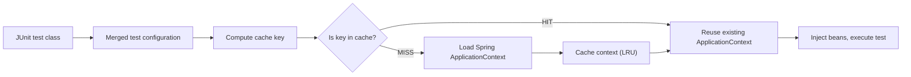

# Context Cache and Performance — Standardizing Test Configurations to Reduce Duplicate Contexts

## 1. The real-world problem

In a Spring Boot project, two test classes may target the same application, the same profile, and the same bean graph, yet declare slightly different configurations. Spring TestContext treats them as **two different context cache keys** and starts up an extra `ApplicationContext`. As the test count grows, repeated Spring startups, `DataSource` creation, auto-configuration evaluation, and thread pool allocation increase CI duration substantially.

Example:

```java
@SpringBootTest(properties = "demo.quote.prefix=TEST")
@ActiveProfiles("test")
class QuotePriceTest { }

@SpringBootTest(properties = "demo.quote.prefix=TEST")
@ActiveProfiles("test")
class QuoteValidationTest { }
```

If all other settings are equivalent, Spring can load the context **once** and reuse it for both. Yet merely adding a distinct `@MockitoBean` to the second class, a different `@Import`, or changing `@ActiveProfiles`, `@TestPropertySource`, or `@DynamicPropertySource` can alter the context cache key.

**The goal is not to force the entire test suite onto a single context.** The goal is: **tests that genuinely need the same configuration must declare the same configuration; tests that require behavioral or isolation differences must separate contexts deliberately**.

After this lesson, you will be able to:

1. Understand Spring TestContext's caching mechanism based on `MergedContextConfiguration`.
2. Know exactly which configurations affect the cache key.
3. Standardize `@SpringBootTest`, `@ActiveProfiles`, `@TestPropertySource`, `@TestConfiguration`, and `@MockitoBean`.
4. Handle `@DynamicPropertySource` and Testcontainers lifecycles without mistakenly reusing the wrong database.
5. Reduce unnecessary `@DirtiesContext` usage while preserving test isolation.
6. Read `org.springframework.test.context.cache=DEBUG`, hits/misses, capacity 32, and LRU eviction.
7. Write Java 17/Spring Boot 3.5 tests proving two classes share **the exact same ApplicationContext reference**.
8. Distinguish the benefits of context reuse from picking smaller test slices and ensuring correctness.

## 2. Caching mechanism: new context or existing context?



Spring Framework TestContext maintains a cache mapping **merged configurations** to initialized `ApplicationContext`/`WebApplicationContext` instances. Test classes with equivalent configurations can reuse singleton beans and framework infrastructure.

However, Spring **does not automatically restore business state on every singleton**. If class A writes to a bean's in-memory cache, class B sharing that context may read that data unless cleaned up. Databases, Redis, mutable singleton state, scheduled jobs, and mock stubbing still need their own isolation.

### Same test class ≠ same ApplicationContext

`@TestInstance(PER_CLASS)` only changes JUnit's test instance lifecycle. The Spring context cache is a separate mechanism; two **different test classes** can share a context, while the same class can be forced to reload via `@DirtiesContext`.

### Static cache per JVM

The cache is static **within a single JVM**. It does not carry across Maven Surefire forks, Gradle worker JVMs, CI shards, or two separate `mvn test` invocations. If each test class runs in a different process, standardized configuration cannot produce **cross-process** cache hits.

Before optimizing annotations, check `forkCount`, `reuseForks`, Gradle `forkEvery`, JUnit parallel configuration, and how many JVMs are actually running. Do not discard process isolation if the suite requires native/static state isolation just to shave startup time.

## 3. Components of the context cache key in Spring Framework 6.2

According to [Spring TestContext Context Caching](https://docs.spring.io/spring-framework/reference/6.2/testing/testcontext-framework/ctx-management/caching.html), the key evaluates the following factors:

| Key component | Configuration source | Example difference |
| --- | --- | --- |
| `locations` | `@ContextConfiguration` | Different XML/config resource files |
| `classes` | `@ContextConfiguration`, app config classes | Different root Configuration |
| `contextInitializerClasses` | Context initializer annotations | Custom per-test initializer |
| `contextCustomizers` | `@DynamicPropertySource`, `@MockitoBean`, `@MockitoSpyBean`, `@TestBean`, Boot customizers | Different mock or dynamic method |
| `contextLoader` | `@ContextConfiguration`/Boot loader | Different loader strategy |
| `parent` | `@ContextHierarchy` | Different parent context |
| `activeProfiles` | `@ActiveProfiles` | Profile `test` vs. `strict` |
| `propertySourceDescriptors` | `@TestPropertySource` locations | Different test properties files |
| `propertySourceProperties` | Inline test properties | Feature enabled vs. disabled |
| `resourceBasePath` | `@WebAppConfiguration` | Different web resource root |

Spring Boot also provides context customizers tied to test slices and `@SpringBootTest(properties=...)`. **Do not assume two classes share a cache key simply because both have `@SpringBootTest`.**

### Distinguishing metadata from runtime state

The cache key reflects **test configuration metadata**, not all runtime values. Calling `System.setProperty` midway through tests does not necessarily alter the key, and beans that bound properties during an earlier context load do not automatically refresh.

Conversely, two tests differing only in business inputs such as SKU, username, or amount can share the same context by seeding/cleaning data **at the method level** instead of altering class-level annotation properties.

## 4. Default max 32 contexts, LRU eviction

Spring Framework 6.2 caps the default cache at **32 entries**. When a new context must be stored and the cache is full, it uses a **least recently used (LRU)** policy to evict and close the least recently used context.

Configurable via a **test JVM** system property:

```text
spring.test.context.cache.maxSize=64
```

or via `SpringProperties`. **Do not raise `maxSize` blindly.** Each context can retain many singleton beans, DB pools, embedded servers, threads, and caches. Increasing from 32 to 64 sometimes reduces reloads at the cost of higher RAM/connection usage; if the root issue is 40 nearly identical mock configurations, **standardizing configs** is far better.

### Cache illustration

```text
Class A -> key X -> MISS, load context X
Class B -> key X -> HIT,  reuse context X
Class C -> key Y -> MISS, load context Y
...
Class Z -> key X -> HIT if X is still in LRU
Class Z -> key X -> MISS if X was evicted
```

This is an illustrative timeline, **not an actual log**. A single JUnit test method can trigger multiple cache lookups from `TestExecutionListener`s, so `hitCount` does not correspond 1:1 with test count.

## 5. Sources of configuration fragmentation and how to standardize

### 5.1. Profiles

```java
@ActiveProfiles("test")
class TestA { }

@ActiveProfiles({"test", "local"})
class TestB { }
```

Two profiles can activate different beans/properties, so differing keys make sense. If `local` is merely unnecessary copy-paste, unify on `test`. However, if you are testing a special policy or conditional bean, **keep a separate context** to verify real behavior.

### 5.2. @SpringBootTest properties or @TestPropertySource

```java
@SpringBootTest(properties = "demo.feature.enabled=true")
class TestA { }

@SpringBootTest(properties = "demo.feature.enabled=false")
class TestB { }
```

These represent two distinct behaviors and should not be merged just to cut cache count. Yet two classes both needing `demo.feature.enabled=true` should share a base/composed annotation, or move the setting to `application-test.properties` when appropriate.

Both `@TestPropertySource(locations=...)` and inline `properties=...` affect the key. Standardize values, files, and declaration styles across equivalent test groups. Keep Spring property source precedence in mind when moving between inline properties, test profile files, and dynamic suppliers; tests should verify behavior after refactoring.

### 5.3. Nested @TestConfiguration

```java
@SpringBootTest
class FirstTest {
    @TestConfiguration
    static class FixedClock {
        @Bean Clock clock() { /* ... */ return null; }
    }
}

@SpringBootTest
class SecondTest {
    @TestConfiguration
    static class FixedClock {
        @Bean Clock clock() { /* ... */ return null; }
    }
}
```

**Configuration-comparison snippet, not runnable**: methods only illustrate type/class identity. `FirstTest.FixedClock` and `SecondTest.FixedClock` are **two different classes**, so their contexts can differ.

If the group needs the same fixed clock, extract a **top-level `@TestConfiguration`** and `@Import` it consistently from a base or composed annotation. Do not confuse nested `@TestConfiguration` (augments app config) with nested `@Configuration` (which can alter primary Boot configuration detection).

### 5.4. Per-class mocks

If group A has 3 mocks and group B has 4 mocks, the bean overrides inherently differ, so separate contexts are justified. However, if the mocks are completely identical except for field names or qualifiers, unnecessary fragmentation occurs.

### 5.5. Overly broad @DirtiesContext

`@DirtiesContext` evicts the context from the cache according to its before/after mode. Applying it to every test class/method causes constant context recreation.

Only use it when a test **genuinely taints the bean graph/context state** in a way that cannot be cleanly restored; if only DB rows change, use rollback/cleanup, and if only Mockito stubs are set, rely on the mock reset provided by TestContext.

## 6. @MockitoBean and field names: an easily overlooked detail

Spring Framework 6.2 `@MockitoBean` can be declared on a field in the test class **or superclass**. Without an explicit `@Qualifier`, **the field name acts as the fallback qualifier**. Per the documentation, field names and qualifiers participate in determining whether separate contexts are created.

```java
// Test A
@MockitoBean
InventoryClient inventoryClient;

// Test B - different name
@MockitoBean
InventoryClient client;
```

Even with the same type, the override metadata differs and can produce a different cache key. For test groups mocking the same bean, use the **same field name**, or specify an explicit bean name:

```java
@MockitoBean(name = "inventoryClient")
InventoryClient inventoryClient;
```

When overriding multiple beans of the same type, `@Qualifier` or `name` is required to avoid ambiguity. Never remove a qualifier just to "get a cache hit" if it mocks the wrong target.

### Mock reset vs. context reset

Spring `@MockitoBean` has a reset mode, defaulting to `MockReset.AFTER`: mock stubbing/interactions are reset after each test per the TestContext lifecycle. Therefore, the same mock bean **can reuse the same context** while each test method stubs its own responses.

Do not set `reset=NONE` or keep global mock stubbing carelessly, as it easily leaks state. When running JUnit parallel tests sharing a mock bean, analyze concurrency separately; a mock reset after method A can interfere with method B running concurrently on the same context.

### Spring Boot 3.5 uses @MockitoBean

In Boot 3.5/Framework 6.2, use:

```java
import org.springframework.test.context.bean.override.mockito.MockitoBean;
```

Boot's legacy `@MockBean` is deprecated. Do not mix the two override styles within one group and assume cache keys remain equivalent; re-run the suite when migrating.

## 7. @DynamicPropertySource: increasing reuse incorrectly is also a bug

A static `@DynamicPropertySource` method registers runtime-supplied values:

```java
// Snippet: requires Testcontainers dependency, not part of the core demo.
abstract class SharedDatabaseTestSupport {
    static final PostgreSQLContainer<?> postgres =
            new PostgreSQLContainer<>("postgres:16");

    @DynamicPropertySource
    static void databaseProperties(DynamicPropertyRegistry registry) {
        registry.add("spring.datasource.url", postgres::getJdbcUrl);
        registry.add("spring.datasource.username", postgres::getUsername);
        registry.add("spring.datasource.password", postgres::getPassword);
    }
}
```

Dynamic property **method metadata** affects the cache customizer. If each class declares a different static method, reuse can be lost even when runtime endpoints match.

Conversely, Spring docs warn: if subclasses share **the same inherited `@DynamicPropertySource` method** while dynamic values vary between subclasses, the cached context can retain the old connection. In that case, `@DirtiesContext` on the base may be needed so each subclass gets the right context, or a shared stable container lifecycle should be used.

**Rule:** do not raise the hit rate by accidentally letting class B connect to class A's DB/container. Only share a container when its lifecycle outlives the cached context and test data is properly isolated. With `@ServiceConnection`, check how Boot builds connection details, scope, and container lifecycle.

Dynamic properties normally have higher precedence than `@TestPropertySource`; do not assume moving everything to `application-test.properties` yields the same result while a dynamic registry override remains active.

## 8. When should contexts NOT be shared?

| Two scenarios | Sensible decision | Why |
| --- | --- | --- |
| Two tests differ only in business input | Reuse | Same bean graph |
| Two tests share mocked gateway, different stubs | Reuse | Mockito resets per test |
| Profile `test` vs. `strict-security` | Separate | Different auth behavior |
| Real gateway vs. mock gateway | Separate | Different component graph |
| Feature on vs. off | Separate | Different conditional beans |
| `@SpringBootTest(NONE)` vs. `RANDOM_PORT` | Separate | Different web environment |
| `@WebMvcTest` controller A vs. controller B | Can separate | Different MVC slice selection |
| DB container endpoint changes per subclass | Separate or stable shared container | Avoid stale datasource |
| Test mutates bean definitions at runtime | May use `@DirtiesContext` | Context has been modified |
| Test only UPDATEs rows in DB | Reuse with proper cleanup | No need to refresh entire container |

There is no need to achieve "1 context for the entire repo"; aim for **a small number of contexts within each logical group** while ensuring behavior is verified accurately.

## 9. Sample project: Java 17 / Spring Boot 3.5

This runnable project uses a simple service to observe context reuse without Docker, a database, or HTTP. Two classes extend the same `SharedSpringTestBase` with one `@MockitoBean`; another class uses its own profile and the real gateway.

```text
spring-context-cache-demo/
├── pom.xml
└── src/
    ├── main/java/example/contextcache/
    │   ├── ContextCacheApplication.java
    │   ├── RateGateway.java
    │   ├── DefaultRateGateway.java
    │   └── QuoteService.java
    └── test/
        ├── java/example/contextcache/
        │   ├── SharedSpringTestBase.java
        │   ├── ContextReuseEvidence.java
        │   ├── QuotePriceTest.java
        │   ├── QuoteValidationTest.java
        │   └── AlternateProfileTest.java
        └── resources/application-test.properties
```

### Demonstration idea

- `QuotePriceTest` and `QuoteValidationTest` loaded in the same JVM have **identical merged configurations**.
- `ContextReuseEvidence` uses Java object **reference identity** to confirm both subclasses receive the **exact same ApplicationContext**.
- `@MockitoBean RateGateway` in the base class has a single consistent field name.
- Mockito stubbing varies between test methods, yet is not context metadata.
- `AlternateProfileTest` uses a different profile/property and **does not mock** `RateGateway`, so it legitimately requires a second context.
- Stats from Spring cache DEBUG logs serve as supplementary operational evidence; hit counts are not hardcoded in JUnit assertions.

## 10. pom.xml

```xml
<?xml version="1.0" encoding="UTF-8"?>
<project xmlns="http://maven.apache.org/POM/4.0.0"
         xmlns:xsi="http://www.w3.org/2001/XMLSchema-instance"
         xsi:schemaLocation="http://maven.apache.org/POM/4.0.0
           https://maven.apache.org/xsd/maven-4.0.0.xsd">
    <modelVersion>4.0.0</modelVersion>
    <parent>
        <groupId>org.springframework.boot</groupId>
        <artifactId>spring-boot-starter-parent</artifactId>
        <version>3.5.0</version>
        <relativePath/>
    </parent>
    <groupId>example</groupId>
    <artifactId>spring-context-cache-demo</artifactId>
    <version>1.0-SNAPSHOT</version>
    <properties>
        <java.version>17</java.version>
    </properties>
    <dependencies>
        <dependency>
            <groupId>org.springframework.boot</groupId>
            <artifactId>spring-boot-starter</artifactId>
        </dependency>
        <dependency>
            <groupId>org.springframework.boot</groupId>
            <artifactId>spring-boot-starter-test</artifactId>
            <scope>test</scope>
        </dependency>
    </dependencies>
</project>
```

Starter test provides JUnit 5, Mockito, and `spring-test` 6.2. No web/JPA starter is needed because the test target is just a service bean + mock gateway; fewer dependencies also lower context startup cost.

## 11. Sample application (four Java files)

### ContextCacheApplication.java

`src/main/java/example/contextcache/ContextCacheApplication.java`:

```java
package example.contextcache;

import org.springframework.boot.SpringApplication;
import org.springframework.boot.autoconfigure.SpringBootApplication;

@SpringBootApplication
public class ContextCacheApplication {
    public static void main(String[] args) {
        SpringApplication.run(ContextCacheApplication.class, args);
    }
}
```

### RateGateway.java

`src/main/java/example/contextcache/RateGateway.java`:

```java
package example.contextcache;

import java.math.BigDecimal;

public interface RateGateway {
    BigDecimal rate(String sku);
}
```

### DefaultRateGateway.java

`src/main/java/example/contextcache/DefaultRateGateway.java`:

```java
package example.contextcache;

import java.math.BigDecimal;

import org.springframework.stereotype.Component;

@Component
public class DefaultRateGateway implements RateGateway {
    @Override
    public BigDecimal rate(String sku) {
        return new BigDecimal("0.10");
    }
}
```

### QuoteService.java

`src/main/java/example/contextcache/QuoteService.java`:

```java
package example.contextcache;

import java.math.BigDecimal;
import java.util.Objects;

import org.springframework.beans.factory.annotation.Value;
import org.springframework.stereotype.Service;

@Service
public class QuoteService {
    private final RateGateway rateGateway;
    private final String prefix;

    public QuoteService(
            RateGateway rateGateway,
            @Value("${demo.quote.prefix:QUOTE}") String prefix) {
        this.rateGateway = rateGateway;
        this.prefix = prefix;
    }

    public String quote(String sku) {
        if (sku == null || sku.isBlank()) {
            throw new IllegalArgumentException(
                    "sku must not be blank");
        }
        BigDecimal rate = Objects.requireNonNull(
                rateGateway.rate(sku),
                "rate must not be null");
        return prefix + ":" + sku + ":" + rate.toPlainString();
    }
}
```

In the regular app context, `RateGateway` is implemented by `DefaultRateGateway`. In the shared tests, that bean is **overridden with a Mockito mock**, while `QuoteService` remains the real Spring bean.

## 12. SharedSpringTestBase.java: shared conventions

`src/test/java/example/contextcache/SharedSpringTestBase.java`:

```java
package example.contextcache;

import static org.mockito.Mockito.verifyNoInteractions;

import org.junit.jupiter.api.BeforeEach;
import org.springframework.beans.factory.annotation.Autowired;
import org.springframework.boot.test.context.SpringBootTest;
import org.springframework.context.ApplicationContext;
import org.springframework.test.context.ActiveProfiles;
import org.springframework.test.context.bean.override.mockito.MockitoBean;

@SpringBootTest(
    classes = ContextCacheApplication.class,
    webEnvironment = SpringBootTest.WebEnvironment.NONE,
    properties = "demo.quote.prefix=TEST")
@ActiveProfiles("test")
abstract class SharedSpringTestBase {
    @Autowired
    protected ApplicationContext context;

    @Autowired
    protected QuoteService quoteService;

    // Same type, field name, and override metadata for subclasses.
    @MockitoBean
    protected RateGateway rateGateway;

    @BeforeEach
    void confirmReuseAndCleanMock() {
        ContextReuseEvidence.assertSharedContext(context);
        verifyNoInteractions(rateGateway);
    }
}
```

Because `@SpringBootTest`/`@ActiveProfiles` are inherited alongside the field-level `@MockitoBean`, the two subclasses do not risk declaring duplicate properties with typos or mock fields with different names. `@BeforeEach` in the base runs before each test method and verifies the shared mock has no leftover interactions from the previous method.

**Note:** this is an intentional fixture, not a prescription to force all tests across a repo into 20 shared mocks. Tests needing the real gateway or another profile use their own context and do not extend this base.

## 13. ContextReuseEvidence.java: testing true identity

`src/test/java/example/contextcache/ContextReuseEvidence.java`:

```java
package example.contextcache;

import static org.junit.jupiter.api.Assertions.assertSame;

import java.util.concurrent.atomic.AtomicReference;

import org.springframework.context.ApplicationContext;

final class ContextReuseEvidence {
    private static final AtomicReference<ApplicationContext>
            FIRST = new AtomicReference<>();

    private ContextReuseEvidence() {
    }

    static void assertSharedContext(ApplicationContext now) {
        ApplicationContext recorded = FIRST.updateAndGet(
                old -> old == null ? now : old);

        assertSame(recorded, now,
                "SharedSpringTestBase subclasses should reuse context");
    }
}
```

`assertSame` compares **Java object references**, not just `ApplicationContext.getId()`; two different context objects can have identical IDs.

This static helper is **solely for learning to observe reuse**. In large test suites, avoid retaining a strong static reference to a context indefinitely as it can pin memory; use the framework's DEBUG cache stats/timings to benchmark. If Surefire runs the two classes in **two JVM forks**, each fork has its own registry so the helper cannot prove cross-process reuse. Always cross-check runner settings.

## 14. QuotePriceTest.java: three tests using shared config

`src/test/java/example/contextcache/QuotePriceTest.java`:

```java
package example.contextcache;

import static org.junit.jupiter.api.Assertions.assertEquals;
import static org.junit.jupiter.api.Assertions.assertThrows;
import static org.mockito.Mockito.verify;
import static org.mockito.Mockito.verifyNoInteractions;
import static org.mockito.Mockito.when;

import java.math.BigDecimal;

import org.junit.jupiter.api.Test;

class QuotePriceTest extends SharedSpringTestBase {

    @Test
    void createsQuoteWithFirstStub() {
        when(rateGateway.rate("SKU-A"))
                .thenReturn(new BigDecimal("0.15"));

        assertEquals("TEST:SKU-A:0.15",
                quoteService.quote("SKU-A"));
        verify(rateGateway).rate("SKU-A");
    }

    @Test
    void createsQuoteWithDifferentStub() {
        when(rateGateway.rate("SKU-B"))
                .thenReturn(new BigDecimal("0.20"));

        assertEquals("TEST:SKU-B:0.20",
                quoteService.quote("SKU-B"));
        verify(rateGateway).rate("SKU-B");
    }

    @Test
    void blankSkuIsRejectedBeforeGatewayCall() {
        IllegalArgumentException error = assertThrows(
                IllegalArgumentException.class,
                () -> quoteService.quote(" "));

        assertEquals("sku must not be blank",
                error.getMessage());
        verifyNoInteractions(rateGateway);
    }
}
```

**3 JUnit methods**. Each method sets up its own stubs without depending on method order. Spring test infrastructure resets `@MockitoBean` interactions/stubbing between methods.

## 15. QuoteValidationTest.java: three tests still sharing the same context

`src/test/java/example/contextcache/QuoteValidationTest.java`:

```java
package example.contextcache;

import static org.junit.jupiter.api.Assertions.assertEquals;
import static org.junit.jupiter.api.Assertions.assertSame;
import static org.junit.jupiter.api.Assertions.assertThrows;
import static org.mockito.Mockito.verify;
import static org.mockito.Mockito.when;

import java.math.BigDecimal;

import org.junit.jupiter.api.Test;

class QuoteValidationTest extends SharedSpringTestBase {

    @Test
    void anotherClassCanStubSameMockBean() {
        when(rateGateway.rate("SKU-C"))
                .thenReturn(new BigDecimal("0.25"));

        assertEquals("TEST:SKU-C:0.25",
                quoteService.quote("SKU-C"));
        verify(rateGateway).rate("SKU-C");
    }

    @Test
    void injectedGatewayIsExactMockInContext() {
        assertSame(rateGateway,
                context.getBean(RateGateway.class));
    }

    @Test
    void nullRateFailsFast() {
        when(rateGateway.rate("SKU-NULL"))
                .thenReturn(null);

        NullPointerException error = assertThrows(
                NullPointerException.class,
                () -> quoteService.quote("SKU-NULL"));

        assertEquals("rate must not be null",
                error.getMessage());
    }
}
```

**3 JUnit methods**. Thanks to `SharedSpringTestBase`, there is no need to repeat an annotation/mock field combination that might drift. `ContextReuseEvidence` runs before each method across both classes.

If this class accidentally adds another `@MockitoBean` or changes profile, the reference identity assertion detects that the context diverged (when classes run in the same JVM without deliberate cache eviction/dirtying).

## 16. AlternateProfileTest.java: a different context for a valid reason

`src/test/java/example/contextcache/AlternateProfileTest.java`:

```java
package example.contextcache;

import static org.junit.jupiter.api.Assertions.assertEquals;
import static org.junit.jupiter.api.Assertions.assertThrows;

import org.junit.jupiter.api.Test;
import org.springframework.beans.factory.annotation.Autowired;
import org.springframework.boot.test.context.SpringBootTest;
import org.springframework.test.context.ActiveProfiles;

@SpringBootTest(
    classes = ContextCacheApplication.class,
    webEnvironment = SpringBootTest.WebEnvironment.NONE,
    properties = "demo.quote.prefix=ALT")
@ActiveProfiles("alternate")
class AlternateProfileTest {

    @Autowired
    QuoteService quoteService;

    @Test
    void realGatewayWorksWithAlternatePrefix() {
        assertEquals("ALT:SKU-X:0.10",
                quoteService.quote("SKU-X"));
    }

    @Test
    void alternateContextAlsoRejectsBlankSku() {
        assertThrows(IllegalArgumentException.class,
                () -> quoteService.quote(""));
    }
}
```

**2 JUnit methods**. Because the profile/property differs and there is no `@MockitoBean`, getting a second context is **correct**. `ContextReuseEvidence` is not called for this class, since it does not belong to the shared group.

## 17. application-test.properties and reading cache statistics

`src/test/resources/application-test.properties`:

```properties
logging.level.org.springframework.test.context.cache=DEBUG
```

The goal is to display hits/misses/size of the TestContext cache. Depending on when Boot's logging system initializes, some early log lines might not appear; if you need to trace the entire startup, set DEBUG for this category in the JVM/build logging configuration.

An **illustrative** example, not actual `mvn test` output:

```text
Spring test ApplicationContext cache statistics:
size = 1, maxSize = 32, hitCount = 14, missCount = 1
...
size = 2, maxSize = 32, hitCount = 26, missCount = 2
```

Meaning:
- `size` is the number of contexts currently in the cache, **not the number of test classes**.
- `hitCount` counts successful cache lookups, potentially multiple times per method.
- `missCount` counts lookups with no cached key (including reloads).
- `maxSize` defaults to 32.
- Contexts evicted via `@DirtiesContext` or LRU may need to reload.

In this minimal project, if both shared classes run in the same JVM with unchanged metadata and no unexpected framework customizers, expect **one context for both**, plus **one context for the alternate profile**. Do not hard-assert `hitCount` as a business contract since `TestExecutionListener`s/versions can vary the number of lookups.

## 18. Running Maven and expected results

Requires JDK 17+, Maven, and dependency downloads. From `spring-context-cache-demo`:

```bash
mvn test
```

Run only the two shared classes:

```bash
mvn test -Dtest=QuotePriceTest,QuoteValidationTest
```

Run the alternate profile:

```bash
mvn test -Dtest=AlternateProfileTest
```

| Class | `@Test` count | Context behavior |
| --- | ---: | --- |
| `QuotePriceTest` | 3 | Shared context, mock gateway |
| `QuoteValidationTest` | 3 | Same ApplicationContext object if same JVM |
| `AlternateProfileTest` | 2 | Separate context, real gateway |
| **Total** | **8** | 8 expected test runs |

**Expected result: 8 PASS**, with zero failures/errors/skips in a compatible environment. This is an **expectation based on source inspection**, not a claim that Maven was executed. To confirm, inspect `target/surefire-reports` and cache DEBUG logs.

### Measuring before/after a change

Measure on the same CI runner/CPU/RAM/cache/dependency state:

| Metric | Before standardization | After standardization |
| --- | --- | --- |
| Number of unique context keys/misses | Taken from real baseline | Compare |
| Cache evictions | Baseline log | Compare |
| Context load time | Profiling/logs | Compare |
| Total test suite duration | CI report | Compare |
| Heap/threads/DB connections | Metrics | No abnormal increase |
| Tests pass/fail/skip | JUnit reports | No lost coverage |
| Flaky retries | CI history | No increase |

Do not invent percentages like "80% faster"; optimizations may only be claimed after measuring.

## 19. Why not use @DirtiesContext as the default?

Illustrative example:

```java
@SpringBootTest
@DirtiesContext(classMode = DirtiesContext.ClassMode.AFTER_CLASS)
class ChangesApplicationBeansTest {
    // Only use if the class genuinely taints the context.
}
```

`@DirtiesContext` instructs Spring to remove/close the context according to the mode. Use it when a test alters bean definitions, breaks context lifecycle, or has dynamic property values differing between subclasses that cannot be safely reused.

**Do not attach it to a shared base for all tests**, because every subclass will evict the cached context it just used. When only data is modified:
- JDBC/JPA tests can roll back or perform explicit cleanup.
- Mockito mocks are normally reset by Spring TestContext.
- Singleton caches can expose a test-only clear/reset API.
- Broker topics, Redis keys, and files need isolated test resources.

`@DirtiesContext` also **does not clear Java static state or external database data**; sometimes test contamination persists even after the context restarts.

## 20. Test slices: fewer contexts does not always mean least time

Spring Boot supports `@WebMvcTest`, `@DataJpaTest`, `@JdbcTest`, `@RestClientTest`, and many other slices. A `@WebMvcTest(Controller.class)` loads only MVC-related beans—usually a different context than full `@SpringBootTest`, yet lighter to load.

Example:

```java
@WebMvcTest(InvoiceController.class)
class InvoiceHttpContractTest {
    @MockitoBean
    InvoiceService invoiceService;
}
```

This is a snippet; `InvoiceController` and `InvoiceService` are not part of the runnable demo. When checking an HTTP contract, a slice can replace a full context. However, if you need to validate Controller → Service → DB integration, a slice with a mocked service is insufficient. Optimization must preserve the right test boundary.

`@SpringBootTest(webEnvironment=RANDOM_PORT)` starts a real HTTP server and a different context than `NONE`. If a test only calls a service method, use `NONE`; if a test needs an HTTP socket, keep `RANDOM_PORT`. Never hardcode ports; use `@LocalServerPort`.

### Do not build a giant shared context

A shared base with 20 mock beans, Kafka, Redis, an HTTP server, and a database makes every test heavy even on cache hits. Instead, organize **a few meaningful configuration groups**: business service, MVC contract, persistence, messaging, and full-system smoke. Reuse within each group.

## 21. Standardizing with a composed annotation or shared test config

An abstract base was chosen for the runnable project. In large repos, you can define a composed annotation:

```java
// Snippet requiring imports, placed in the application's test sources.
@Target(ElementType.TYPE)
@Retention(RetentionPolicy.RUNTIME)
@SpringBootTest(
    classes = ContextCacheApplication.class,
    webEnvironment = SpringBootTest.WebEnvironment.NONE,
    properties = "demo.quote.prefix=TEST")
@ActiveProfiles("test")
public @interface SharedQuoteTest {
}
```

Imports must include `java.lang.annotation.Target`/`ElementType`/`Retention`/`RetentionPolicy` along with the Spring test annotations. This annotation standardizes **metadata**, without automatically creating fields/methods for tests; if shared mocks are needed, Spring Framework 6.2 supports type-level/meta `@MockitoBean(types=...)`, though qualifiers and ownership must be clear.

When test-only beans are needed, use a **top-level `@TestConfiguration`** and `@Import` it from the shared base or composed annotation. Avoid copying a separate nested configuration class into every test class, which gives each a distinct class identity.

Do not add a broad `@ComponentScan` to tests to "reduce configs": it can load extra beans, negate slice benefits, and bloat the graph.

## 22. Edge cases that affect correctness

### 22.1. Mock beans and JUnit parallel execution

Two tests sharing a cached context can share the same mock instance. If parallel execution concurrently stubs/resets it, one test can wipe out another test's stubbing. Use `@Execution(SAME_THREAD)`, `@ResourceLock`, resource isolation, or split groups when needed. The runnable example assumes default sequential JUnit execution.

### 22.2. Testcontainers lifecycle

A shared context has a datasource holding connections to a container. If the container stops after one class while the context remains cached, the next test class will fail with connection errors. Choose a container lifecycle that outlives the context, or separate/dirty the context appropriately. With `@ServiceConnection`, check lifecycle and `ConnectionDetails` rather than guessing.

### 22.3. System properties and static state

`System.setProperty("feature.enabled","true")` between methods does not make Spring refresh beans that already bound their config. Do not mutate global JVM system properties in parallel tests. If you need to test startup feature toggles, declare explicit profiles/property sources and accept a separate context key.

### 22.4. Spring Boot Test configuration discovery

`@SpringBootTest` without explicit `classes` typically searches upward from the test package for `@SpringBootApplication`. Two tests in different packages might resolve different primary configs. In the demo, the base specifies `classes=ContextCacheApplication.class` to avoid ambiguity.

### 22.5. @ContextHierarchy and bean overrides

A `@MockitoBean` in a hierarchy can apply to multiple levels if `contextName` is omitted, causing unintended overrides. When using `@ContextHierarchy`, scope parent/child configs and overrides accurately; do not merge context keys based solely on test class names.

### 22.6. @Transactional rollback and HTTP tests

`@Transactional` test methods roll back at the end of the method, whereas `@SpringBootTest(RANDOM_PORT)` runs the HTTP server on a separate thread whose transaction does not join the test transaction for automatic rollback. Explicit DB cleanup is required. Context reuse does not merge transactions across threads into one.

## 23. Troubleshooting

| Symptom | Possible cause | What to check |
| --- | --- | --- |
| "Starting application" log repeats continuously | Many keys, forks, dirties, or eviction | DEBUG context cache, build runner |
| Two classes with same @SpringBootTest get different contexts | Different profiles/mocks/imports/properties | Compare merged config |
| Same mock type yet different keys | Field name fallback qualifier | Standardize field/qualifier |
| Misses rise after adding a @TestConfiguration | Different class/Import customizer | Shared top-level config |
| Context recreated after every method | Method-level @DirtiesContext | Remove when data reset suffices |
| Context reused yet DB connection dead | Container lifecycle shorter than cache | Shared stable container / separate context |
| Wrong datasource reused across subclasses | DynamicPropertySource values change | @DirtiesContext or distinct setup |
| Increased maxSize leads to OOM | Retaining too many heavy contexts | Reduce keys/slices, tune heap |
| HitCount doesn't match method count | Multiple framework lookups | Do not assert fixed hit counts |
| Mock stubbing leaks between tests | Reset mode NONE / parallel race | Default reset / isolation |
| Single suite fast locally, CI slow | More forks, no shared cache | Check Surefire/Gradle processes |
| Tests depend on execution order | Singleton/static state/stale DB data | Cleanup/test data isolation |
| @WebMvcTest still loads many beans | Extra imports/custom scans | Preserve strict MVC slice |
| Different profiles "merged" leading to wrong results | Forced reuse violating semantics | Keep contexts separate |
| DB rollback ineffective with RANDOM_PORT | HTTP handler runs on another thread | Explicit cleanup/isolation |

### Diagnostic steps for optimization

1. Enable `org.springframework.test.context.cache=DEBUG`.
2. Verify whether test classes run in the same JVM.
3. Count unique contexts and cache misses/evictions.
4. Compare primary classes/context loaders.
5. Compare active profiles and property sources.
6. Compare `@MockitoBean` types/names/qualifiers and differences in imports/configuration classes.
7. Compare `@DynamicPropertySource` methods and container lifecycles.
8. Inspect `@DirtiesContext` and shared mutable state.
9. Separate slices/full tests along true boundaries.
10. After refactoring, verify test results and CI duration; only then consider tuning `maxSize`.

## 24. Acceptance checklist

- [ ] Measured baseline context cache stats and suite duration?
- [ ] Know how JVM forks/CI shards are configured?
- [ ] Tests sharing behavior use a consistent set of profiles/properties?
- [ ] Primary configuration, `webEnvironment`, and imports are consistent?
- [ ] `@MockitoBean` fields share type/name/qualifier when reuse is desired?
- [ ] Not adding unnecessary mocks just to inherit a base test?
- [ ] Not duplicating nested `@TestConfiguration` logic across classes?
- [ ] Not arbitrarily varying `@DynamicPropertySource` in subclasses?
- [ ] Shared Testcontainers have sufficient lifetime and data isolation?
- [ ] `@DirtiesContext` used only when state truly cannot be restored?
- [ ] DB/singletons/static caches are cleaned or isolated properly?
- [ ] Mockito reset works between test methods?
- [ ] JUnit parallel execution does not race on shared mocks?
- [ ] Using slices when sufficient in scope instead of a heavy full `ApplicationContext`?
- [ ] Context keys differing due to security/feature flags are kept distinct?
- [ ] Have context identity/log evidence before claiming reuse?
- [ ] Not hard-asserting cache hit counts across versions?
- [ ] Not increasing `maxSize` in a way that spawns unnecessary DataSources/threads?
- [ ] Verified pass/fail/skip reports from Surefire on release?
- [ ] Not altering test semantics just for speed?

## 25. Advanced exercises

1. Run `mvn test` and inspect cache DEBUG logs and `target/surefire-reports`.
2. Declare a separate `@MockitoBean RateGateway gateway` in a subclass, observe the context key change, and explain the field-name fallback qualifier.
3. Add `@TestPropertySource(properties="demo.quote.prefix=OTHER")` to one class and verify the new context and value.
4. Add a nested `@TestConfiguration` to one class, then extract it into a shared top-level config and compare cache misses.
5. Try placing `@DirtiesContext` on the base class and measure how many times the context reloads.
6. Change `spring.test.context.cache.maxSize` only when eviction occurs, monitoring heap usage.
7. Run each class in its own JVM fork and check the limits of the static reference helper.
8. Enable parallel tests and investigate shared mock reset/stubbing races; fix with resource isolation.
9. Add a shared Postgres Testcontainer + `@DynamicPropertySource` and verify DB cleanup and container lifetime.
10. Intentionally have a subclass swap the datasource endpoint, detect the stale cache, and isolate the context safely.
11. Convert a controller test to `@WebMvcTest` and measure load time against `@SpringBootTest`.
12. Compare two CI configurations with the same suite, recording startup times, misses, evictions, and memory.

## 26. Official Documentation

1. [Spring Framework 6.2 — Context Caching](https://docs.spring.io/spring-framework/reference/6.2/testing/testcontext-framework/ctx-management/caching.html): cache keys, static scope, default 32 entries/LRU, DEBUG stats, and `@DirtiesContext`.
2. [Spring Framework 6.2 — @MockitoBean and @MockitoSpyBean](https://docs.spring.io/spring-framework/reference/6.2/testing/annotations/integration-spring/annotation-mockitobean.html): field-name fallback qualifiers, superclass overrides, and context cache.
3. [Spring Framework 6.2 — Dynamic Property Sources](https://docs.spring.io/spring-framework/reference/6.2/testing/testcontext-framework/ctx-management/dynamic-property-sources.html): `@DynamicPropertySource`, suppliers, inheritance caveats, and `@DirtiesContext`.
4. [Spring Framework 6.2 — @DirtiesContext](https://docs.spring.io/spring-framework/reference/6.2/testing/annotations/integration-spring/annotation-dirtiescontext.html): cache eviction modes.
5. [Spring Boot 3.5 — Testing Spring Boot Applications](https://docs.spring.io/spring-boot/3.5/reference/testing/spring-boot-applications.html): primary config detection, test slices, `@TestConfiguration`, caching, and `webEnvironment`.
6. [Spring Framework 6.2 — TestContext Overview](https://docs.spring.io/spring-framework/reference/6.2/testing/testcontext-framework.html): lifecycle and context management.
7. [JUnit Jupiter User Guide](https://junit.org/junit5/docs/current/user-guide/): test instance lifecycle, inheritance, parallel/resource locks.
8. [Maven Surefire Fork Options](https://maven.apache.org/surefire/maven-surefire-plugin/examples/fork-options-and-parallel-execution.html): `forkCount` and `reuseForks`.
9. [Spring Boot 3.5 — Testcontainers](https://docs.spring.io/spring-boot/3.5/reference/testing/testcontainers.html): `@ServiceConnection` and container lifecycle.
10. [Spring Framework 6.2 — @TestPropertySource](https://docs.spring.io/spring-framework/reference/6.2/testing/annotations/integration-spring/annotation-testpropertysource.html): property sources and precedence.

### Conclusion

**Standardizing test configurations to reduce duplicate contexts** means sharing the **same merged configuration** for tests that are genuinely equivalent, not erasing business differences that need verification. Use shared base/composed annotations, unify profiles/properties/mocks/test configurations, manage dynamic resources and state resets, and then measure cache hits/misses/evictions alongside CI duration. Accurate configuration and trustworthy tests always matter more than a high cache hit number.
