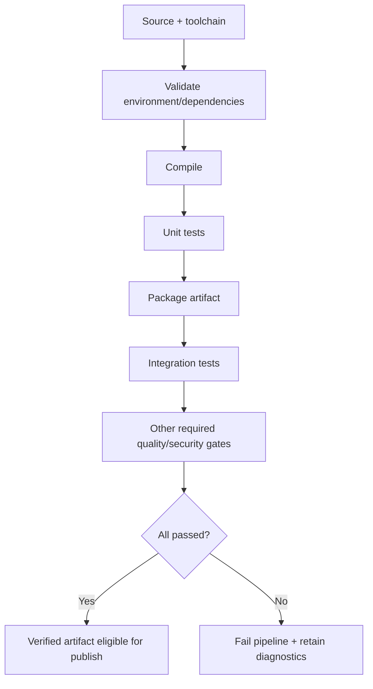

# Build and CI — Task Ordering, Dependencies, and Required Checks Before a Build Succeeds

## 1. What Truly Makes a Build Count as Successful?

In Spring Boot, a build is not a single compile command. It is a **chain of tasks**: validating tools, downloading dependencies, compiling, running unit tests, packaging, running integration tests, checking quality gates, and finally potentially publishing an artifact.

A common remark is: "CI produced `app.jar`, so the build passed." That is **not enough**. An artifact can be packaged while integration tests or security gates never ran, or while a task was skipped. Specifically:

- `mvn compile`: compiles production code, runs no tests.
- `mvn test`: runs tests recognized by Surefire in the `test` phase, but does not by default run integration tests bound to later phases.
- `mvn package`: can build the JAR **before** Failsafe integration tests execute.
- `mvn verify`: walks Maven phases up to `verify`, executing **bound goals**, not automatically running every static analysis tool.
- `./gradlew bootJar`: builds the executable JAR, **without guaranteeing** custom verification tasks ran.
- `./gradlew build`: the Java plugin requires `assemble` and `check`, yet a custom `integrationTest` only runs if wired into the task graph.
- Gradle `mustRunAfter` only constrains order **when both tasks are already in the graph**; it never pulls a missing task in.

**Core question:** Before CI returns "SUCCESS", which mandatory checks **were actually scheduled, executed, and passed**?

### Learning Outcomes

1. Distinguish Maven lifecycles/phases/plugin goals from Gradle tasks/dependencies/ordering.
2. Explain the order `validate → compile → test → package → integration-test → verify` and the separate role of `clean`.
3. Configure Maven Enforcer, Surefire, Failsafe, and Spring Boot repackaging in the right phases.
4. Distinguish Gradle's `dependsOn`, `mustRunAfter`, `shouldRunAfter`, and `finalizedBy`.
5. Wire integration tests into Gradle `check`, avoiding "false green builds".
6. Write Spring Boot 3.5 / Java 17 JUnit unit tests and HTTP integration tests.
7. Verify test discovery, reports, exit codes, and artifact provenance.
8. Establish CI gates and avoid flags that skip tests or mask failures.

## 2. Build Graph, Artifact, and Quality Gate Are Three Distinct Concepts

| Term | Meaning | Example |
| --- | --- | --- |
| **Artifact** | Releasable build output | JAR/WAR/container image |
| **Build task** | A unit of work with inputs/outputs and run conditions | Gradle `compileJava` or Maven compiler goal |
| **Dependency** | Task A requires B's outcome before A proceeds | Gradle `A.dependsOn(B)` |
| **Ordering constraint** | If both A and B are selected, determines order | `A.mustRunAfter(B)` |
| **Quality gate** | Inspection rule that fails the pipeline on violation | JUnit failures, coverage threshold, vulnerability scan |
| **Verified artifact** | Artifact tied to a revision/config that passed gates | JAR from commit X paired with commit X test reports |
| **Release approval** | Governance/deployment condition after build | Environment approval, deploy window, canary |

A library dependency `spring-boot-starter-web` **differs** from a task dependency `integrationTest.dependsOn(startDatabase)`. Both are called "dependency", yet one belongs to **dependency resolution** and the other to the **execution graph**.



The diagram depicts a **recommended CI policy**; each tool must be configured so the corresponding edges exist. Maven/Gradle do not automatically run vulnerability scanners or browser E2E just because you invoke a command named `verify` or `build`.

## 3. Maven: Lifecycle → Phase → Goal

Maven has three built-in lifecycles: `default`, `clean`, and `site`. The `default` lifecycle contains ordered phases. Choosing a target phase executes all preceding phases in the same lifecycle along with their **bound plugin goals**.

```text
validate
  ↓
initialize
  ↓
generate-sources / process-sources
  ↓
process-resources
  ↓
compile
  ↓
process-test-resources / test-compile
  ↓
test
  ↓
prepare-package / package
  ↓
pre-integration-test
  ↓
integration-test
  ↓
post-integration-test
  ↓
verify
  ↓
install
  ↓
deploy
```

This diagram shows **representative milestones**, not every intermediate Maven phase. `clean` sits in its own lifecycle: `mvn clean verify` runs clean first, then the default lifecycle through verify.

| Maven Command | Milestone Reached | Cannot Yet Be Inferred |
| --- | --- | --- |
| `mvn validate` | validate | Source compilation, test pass |
| `mvn compile` | compile | Test source compilation/execution |
| `mvn test` | test | Failsafe IT in later phases |
| `mvn package` | package | `post-integration-test`, `failsafe:verify` |
| `mvn verify` | verify | SAST/coverage if goals are unbound |
| `mvn install` | installed to local Maven repository | Deployed to remote artifact repository |
| `mvn deploy` | deployed to configured repository | Production deployment approval |
| `mvn clean verify` | clean then verify | Out-of-build-tool gates if unconfigured |

### A Phase Is Not Automatically Work

A phase can have zero goals bound to it. Running `mvn verify` does not automatically invoke SonarQube, OWASP Dependency-Check, JaCoCo, or SpotBugs unless the POM/CI registers them. The name `verify` is a lifecycle milestone, **not a guarantee of every kind of quality check**.

### Goal Bindings and Packaging Types

For `jar` packaging, Maven provides built-in bindings for resources/compile/test/JAR. For a `pom` aggregator, behavior differs. POM plugins and executions (or parent/`pluginManagement`) can change which goals fire at each phase. When investigating a build, run `mvn help:effective-pom` instead of guessing from a snippet of plugin XML.

## 4. Surefire vs. Failsafe: Not the Same

Per Apache Maven:

| Plugin | Job | Typical Phases | Default Naming |
| --- | --- | --- | --- |
| **maven-surefire-plugin** | Runs unit/fast tests | `test` | `Test*`, `*Test`, `*Tests`, `*TestCase` |
| **maven-failsafe-plugin** | Runs integration tests | `integration-test` and `verify` | `IT*`, `*IT`, `*ITCase` |

Naming a file `QuoteEndpointIT.java` does not architecturally turn a test into an "integration" test; the test body must actually exercise real components together. However, naming matters for **test discovery**: a class named `QuoteEndpointIntegration.java` may be missed by both plugins unless `includes` are customized.

### Why Does Failsafe Need Both integration-test and verify?

```text
pre-integration-test   → setup dependencies/test environment
integration-test       → execute integration tests
post-integration-test  → teardown test environment
verify                 → evaluate Failsafe results and fail build
```

Failsafe is designed not to halt the build immediately during `integration-test` on a normal test failure, giving `post-integration-test` a chance to clean up. The `failsafe:verify` goal checks the summary and fails the build if integration tests failed.

**Never invoke `mvn integration-test` standalone as a release gate.** In Maven 3, doing so can skip cleanup and `verify` phases—especially dangerous when tests start Docker, web servers, or databases. Always use `mvn verify`.

### Watch Out for Tests run: 0

If a filename is wrong or a suite is missing, a plugin may run nothing. On modules that must have unit/IT tests, consider `failIfNoTests=true` and inspect reports and test counts. For multi-module root POMs or modules intentionally lacking ITs, set explicit exception policies instead of blindly enabling fail-if-no-tests on every module.

## 5. Gradle: Task Graph Instead of Fixed Lifecycle Phases

The Gradle Java plugin defines lifecycle tasks:

```text
build
├── assemble
│   └── archive/package tasks
└── check
    └── test
```

The Spring Boot plugin adds `bootJar`, `bootRun`, and other tasks. **A custom `integrationTest` task does not attach itself to `check`** just because its name contains "Test".

Key points:

- `dependsOn` creates an **execution dependency**: when A runs, B is included in the graph.
- `mustRunAfter` enforces **strict ordering when both run**, without adding B to the graph.
- `shouldRunAfter` is a soft ordering hint that can be ignored to break cycles or under parallel execution.
- `finalizedBy` schedules a finalizer (cleanup/reporting), even under certain failures of the main task.
- `onlyIf`, `enabled=false`, and `-x test` can cause tasks to skip: "SKIPPED" is not "test PASS".

```kotlin
val integrationTest = tasks.register<Test>("integrationTest") {
    useJUnitPlatform()
    mustRunAfter(tasks.named("test"))
}

tasks.named("check") {
    dependsOn(integrationTest)
}
```

This is a **graph snippet**; a real JUnit task also needs `integrationTest`'s source set/`classpath`. `mustRunAfter` sets ordering; **`check.dependsOn(integrationTest)` is what brings the task into `build`**.

### A Dangerous Anti-Pattern

```kotlin
tasks.register("integrationTest") {
    mustRunAfter("test")
    doLast {
        println("All integration tests passed")
    }
}
```

This task only prints a message—it runs no JUnit tests. Even if CI executes it, it **checks zero integration behavior**. Never fabricate "false green" tests with print tasks or name a no-op step `check`.

## 6. Hands-on Maven Project: Spring Boot 3.5 + Java 17

The example uses a quote-calculation HTTP API. It includes:

- Maven Enforcer at `validate` blocking mismatched JDK/Maven versions.
- `QuoteCalculatorTest` with **3 pure-Java unit tests**, run by Surefire at `test`.
- Spring Boot executable JAR built at `package`.
- `QuoteEndpointIT` with **2 integration tests**: embedded HTTP server on a random port + real Java `HttpClient`.
- Failsafe at `integration-test` and `verify` failing the pipeline if API behavior breaks.
- GitHub Actions running `mvn clean verify` and retaining reports even when tests fail.

```text
build-ci-demo/
├── pom.xml
├── src/
│   ├── main/java/example/buildci/
│   │   ├── BuildCiApplication.java
│   │   ├── QuoteCalculator.java
│   │   └── QuoteController.java
│   └── test/java/example/buildci/
│       ├── QuoteCalculatorTest.java
│       └── QuoteEndpointIT.java
└── .github/workflows/verify.yml
```

No Docker, PostgreSQL, Kafka, or external services are required. JDK 17+ and Maven 3.9+ suffice once dependencies resolve.

## 7. pom.xml: Explicitly Bound Goals

`pom.xml`:

```xml
<?xml version="1.0" encoding="UTF-8"?>
<project xmlns="http://maven.apache.org/POM/4.0.0"
         xmlns:xsi="http://www.w3.org/2001/XMLSchema-instance"
         xsi:schemaLocation="http://maven.apache.org/POM/4.0.0
           https://maven.apache.org/xsd/maven-4.0.0.xsd">
    <modelVersion>4.0.0</modelVersion>

    <parent>
        <groupId>org.springframework.boot</groupId>
        <artifactId>spring-boot-starter-parent</artifactId>
        <version>3.5.0</version>
        <relativePath/>
    </parent>

    <groupId>example</groupId>
    <artifactId>build-ci-demo</artifactId>
    <version>1.0.0</version>

    <properties>
        <java.version>17</java.version>
        <maven.compiler.release>17</maven.compiler.release>
    </properties>

    <dependencies>
        <dependency>
            <groupId>org.springframework.boot</groupId>
            <artifactId>spring-boot-starter-web</artifactId>
        </dependency>
        <dependency>
            <groupId>org.springframework.boot</groupId>
            <artifactId>spring-boot-starter-test</artifactId>
            <scope>test</scope>
        </dependency>
    </dependencies>

    <build>
        <plugins>
            <plugin>
                <groupId>org.apache.maven.plugins</groupId>
                <artifactId>maven-enforcer-plugin</artifactId>
                <version>3.5.0</version>
                <executions>
                    <execution>
                        <id>enforce-toolchain</id>
                        <phase>validate</phase>
                        <goals>
                            <goal>enforce</goal>
                        </goals>
                        <configuration>
                            <rules>
                                <requireJavaVersion>
                                    <version>[17,)</version>
                                </requireJavaVersion>
                                <requireMavenVersion>
                                    <version>[3.9.0,)</version>
                                </requireMavenVersion>
                            </rules>
                        </configuration>
                    </execution>
                </executions>
            </plugin>

            <plugin>
                <groupId>org.apache.maven.plugins</groupId>
                <artifactId>maven-surefire-plugin</artifactId>
                <version>3.5.2</version>
                <configuration>
                    <failIfNoTests>true</failIfNoTests>
                </configuration>
            </plugin>

            <plugin>
                <groupId>org.apache.maven.plugins</groupId>
                <artifactId>maven-failsafe-plugin</artifactId>
                <version>3.5.2</version>
                <executions>
                    <execution>
                        <id>verify-integration</id>
                        <goals>
                            <goal>integration-test</goal>
                            <goal>verify</goal>
                        </goals>
                    </execution>
                </executions>
                <configuration>
                    <failIfNoTests>true</failIfNoTests>
                </configuration>
            </plugin>

            <plugin>
                <groupId>org.springframework.boot</groupId>
                <artifactId>spring-boot-maven-plugin</artifactId>
            </plugin>
        </plugins>
    </build>
</project>
```

### Plugin-by-Plugin Analysis

**Enforcer:** the `enforce` goal is explicitly bound to `validate`. `requireJavaVersion [17,)` and `requireMavenVersion [3.9.0,)` fail early if the toolchain does not comply.

**Surefire:** `jar` packaging provides a lifecycle binding for `surefire:test` at `test`. `failIfNoTests=true` protects the sample from 0 unit tests silently passing.

**Failsafe:** declares both goals `integration-test` and `verify`. Failsafe binds each goal to its default phase. `failIfNoTests=true` catches missing `*IT` files or wrong naming.

**Spring Boot Maven Plugin:** with `spring-boot-starter-parent`, declaring the plugin activates the parent-configured `repackage` execution at the `package` phase. The executable JAR may appear on disk before Failsafe fails at `verify`. Never use the mere presence of the JAR to decide whether to publish.

**Missing in terms of "enterprise gates":** This POM **does not yet bind JaCoCo, Checkstyle, SpotBugs, a vulnerability scanner, or SBOM generation**. Later sections explain how to decide on adding them; never claim the sample checks anything it has not configured.

## 8. BuildCiApplication.java

`src/main/java/example/buildci/BuildCiApplication.java`:

```java
package example.buildci;

import org.springframework.boot.SpringApplication;
import org.springframework.boot.autoconfigure.SpringBootApplication;

@SpringBootApplication
public class BuildCiApplication {
    public static void main(String[] args) {
        SpringApplication.run(BuildCiApplication.class, args);
    }
}
```

The application starts an HTTP server when integration tests use `@SpringBootTest(RANDOM_PORT)`. Having no external dependencies keeps tests free of network, DB schema, or credential flakiness.

## 9. QuoteCalculator.java: Pure Business Logic

`src/main/java/example/buildci/QuoteCalculator.java`:

```java
package example.buildci;

import java.math.BigDecimal;

import org.springframework.stereotype.Service;

@Service
public class QuoteCalculator {
    private static final BigDecimal UNIT_PRICE =
            new BigDecimal("12.50");

    public BigDecimal total(int quantity) {
        if (quantity <= 0) {
            throw new IllegalArgumentException(
                    "quantity must be positive");
        }

        return UNIT_PRICE.multiply(
                BigDecimal.valueOf(quantity));
    }
}
```

Prices use `BigDecimal` to avoid floating-point money precision errors. `total(2)` returns `25.00`; `total(1)` returns `12.50`. Non-positive quantities throw `IllegalArgumentException`.

Even though the class has `@Service`, unit tests can simply call `new QuoteCalculator()` without booting a Spring context.

## 10. QuoteController.java: Endpoint for Integration Tests

`src/main/java/example/buildci/QuoteController.java`:

```java
package example.buildci;

import java.math.BigDecimal;

import org.springframework.http.HttpStatus;
import org.springframework.web.bind.annotation.GetMapping;
import org.springframework.web.bind.annotation.PathVariable;
import org.springframework.web.bind.annotation.RequestMapping;
import org.springframework.web.bind.annotation.RestController;
import org.springframework.web.server.ResponseStatusException;

@RestController
@RequestMapping("/api/quotes")
public class QuoteController {
    private final QuoteCalculator calculator;

    public QuoteController(QuoteCalculator calculator) {
        this.calculator = calculator;
    }

    @GetMapping("/{quantity}")
    public QuoteResponse quote(@PathVariable int quantity) {
        if (quantity <= 0) {
            throw new ResponseStatusException(
                    HttpStatus.BAD_REQUEST,
                    "quantity must be positive");
        }

        return new QuoteResponse(
                quantity,
                calculator.total(quantity));
    }

    public record QuoteResponse(int quantity, BigDecimal total) {
    }
}
```

An illustrative successful request looks like:

```http
GET /api/quotes/2

HTTP/1.1 200 OK
Content-Type: application/json

{"quantity":2,"total":25.00}
```

This is an **illustrative response**: header order, whitespace, and numeric scale may vary at runtime. The integration test parses numeric values rather than comparing raw JSON strings. `GET /api/quotes/0` maps to 400 Bad Request. Spring Boot's error JSON body can vary by config; the sample only asserts the HTTP status.

## 11. QuoteCalculatorTest.java: Surefire Runs 3 JUnit Methods

`src/test/java/example/buildci/QuoteCalculatorTest.java`:

```java
package example.buildci;

import static org.junit.jupiter.api.Assertions.assertAll;
import static org.junit.jupiter.api.Assertions.assertEquals;
import static org.junit.jupiter.api.Assertions.assertThrows;

import java.math.BigDecimal;
import org.junit.jupiter.api.Test;

class QuoteCalculatorTest {
    private final QuoteCalculator calculator =
            new QuoteCalculator();

    @Test
    void totalForTwoIsTwentyFive() {
        assertEquals(
                new BigDecimal("25.00"),
                calculator.total(2));
    }

    @Test
    void totalForOnePreservesScale() {
        assertEquals(
                new BigDecimal("12.50"),
                calculator.total(1));
    }

    @Test
    void nonPositiveQuantitiesAreRejected() {
        assertAll(
            () -> assertThrows(IllegalArgumentException.class,
                () -> calculator.total(0)),
            () -> assertThrows(IllegalArgumentException.class,
                () -> calculator.total(-1))
        );
    }
}
```

**3 JUnit methods**, not 4; `assertAll` groups two scenarios inside **one** test method. Surefire discovers `*Test` classes by default. If the price changes to `12.00`, both positive tests fail **at the `test` phase**, before release artifacts are verified.

## 12. QuoteEndpointIT.java: Failsafe Runs 2 Integration Tests

`src/test/java/example/buildci/QuoteEndpointIT.java`:

```java
package example.buildci;

import static org.junit.jupiter.api.Assertions.assertEquals;
import static org.junit.jupiter.api.Assertions.assertTrue;

import java.math.BigDecimal;
import java.net.URI;
import java.net.http.HttpClient;
import java.net.http.HttpRequest;
import java.net.http.HttpResponse;
import java.time.Duration;

import com.fasterxml.jackson.databind.JsonNode;
import com.fasterxml.jackson.databind.ObjectMapper;
import org.junit.jupiter.api.Test;
import org.springframework.beans.factory.annotation.Autowired;
import org.springframework.boot.test.context.SpringBootTest;
import org.springframework.boot.test.web.server.LocalServerPort;

@SpringBootTest(
    webEnvironment = SpringBootTest.WebEnvironment.RANDOM_PORT)
class QuoteEndpointIT {
    @LocalServerPort
    int port;

    @Autowired
    ObjectMapper mapper;

    private final HttpClient client = HttpClient.newBuilder()
            .connectTimeout(Duration.ofSeconds(3))
            .build();

    private HttpResponse<String> sendGet(int quantity)
            throws Exception {

        HttpRequest request = HttpRequest.newBuilder(
                URI.create("http://127.0.0.1:" + port +
                    "/api/quotes/" + quantity))
            .timeout(Duration.ofSeconds(5))
            .header("Accept", "application/json")
            .GET()
            .build();

        return client.send(
                request,
                HttpResponse.BodyHandlers.ofString());
    }

    @Test
    void realHttpEndpointReturnsCorrectQuote()
            throws Exception {

        HttpResponse<String> response = sendGet(2);

        assertEquals(200, response.statusCode());
        assertTrue(response.headers()
                .firstValue("Content-Type").orElse("")
                .contains("application/json"));

        JsonNode body = mapper.readTree(response.body());

        assertEquals(2, body.path("quantity").asInt());
        assertTrue(body.path("total").isNumber());
        assertEquals(
                0,
                new BigDecimal("25.00").compareTo(
                    body.path("total").decimalValue()));
    }

    @Test
    void invalidQuantityReturnsBadRequest()
            throws Exception {

        HttpResponse<String> response = sendGet(0);
        assertEquals(400, response.statusCode());
    }
}
```

**2 JUnit methods.** Failsafe picks up `*IT.java` classes by convention, runs them at `integration-test`, and evaluates failures at `verify`.

Differences from unit tests:
- A real Spring Boot `ApplicationContext` starts.
- The embedded HTTP server binds a random port, injected via `@LocalServerPort`.
- Java 17 `HttpClient` sends a real request over TCP/HTTP.
- Controller + dependency injection + Jackson serialization work together.
- Timeouts are bounded so tests cannot hang CI.

**Do not call this full-system E2E.** It is an integration test of one Spring Boot service and does not traverse a frontend, gateway, or external payment system.

## 13. Maven Commands and Expected Outcomes

Run inside `build-ci-demo` with JDK 17+ and Maven 3.9+:

```bash
java -version
mvn -version
mvn clean verify
```

Run each stage to observe progression:

```bash
mvn clean compile
mvn test
mvn package
mvn verify
```

| Command | Surefire Unit | Failsafe Integration | Boot JAR |
| --- | ---: | ---: | --- |
| `mvn compile` | 0 | 0 | Not yet |
| `mvn test` | 3 | 0 | Not yet |
| `mvn package` | 3 | 0 | Yes if passing |
| `mvn verify` | 3 | 2 | Yes after package |
| `mvn clean verify` | 3 | 2 | Yes after package |

**Expected: 5 JUnit methods PASS** (3 unit + 2 integration) in a compatible environment. This is the **expected result based on the code**, not evidence that we actually executed Maven. Inspect logs and reports:

```text
target/surefire-reports/
target/failsafe-reports/
target/build-ci-demo-1.0.0.jar
```

Report filenames may include `TEST-example.buildci.QuoteCalculatorTest.xml` and `TEST-example.buildci.QuoteEndpointIT.xml`; Failsafe also writes a summary. **The JAR exists even if `verify` fails after `package`**, so allow publishing only in a CI step/job running **after** `mvn verify` returns exit code 0.

## 14. Intentional Gate-Failure Experiments

### Case A: Unit Test Fails Before Package

Change:

```java
private static final BigDecimal UNIT_PRICE =
        new BigDecimal("12.00"); // Intentionally wrong
```

`mvn clean verify` fails at `test` because `QuoteCalculatorTest` expects 12.50/25.00. The build fails to qualify for release.

### Case B: Unit Passes, Integration Fails

Restore the calculator and change the controller mapping to:

```java
@GetMapping("/value/{quantity}") // Intentionally breaking path
```

`mvn test` still passes because it only exercises the calculator. `mvn package` still produces the JAR. However, `QuoteEndpointIT` calls `/api/quotes/2` and gets 404 instead of 200. `mvn verify` must fail at `failsafe:verify`, acting as the required release gate.

### Case C: Incompatible Environment

Run Maven older than 3.9.0 or JDK 16 (in an environment able to start Maven). Enforcer blocks the build at `validate` before compilation. Spring Boot 3.5 also requires Java 17+.

### Case D: No Integration Tests Discovered

Rename `QuoteEndpointIT` to `QuoteEndpointIntegration` without updating Failsafe include patterns. With `failIfNoTests=true`, `verify` fails because zero ITs ran. If a larger project has other ITs, maintain a test coverage/count matrix rather than assuming any single test proves full coverage.

These mutations are **practice exercises on a test branch only**; restore original code before merging.

## 15. Gradle Kotlin DSL: Example Wiring Integration into check

To port the same Java sources to Gradle, reorganize into:

```text
build-ci-demo-gradle/
├── settings.gradle.kts
├── build.gradle.kts
└── src/
    ├── main/java/example/buildci/
    │   ├── BuildCiApplication.java
    │   ├── QuoteCalculator.java
    │   └── QuoteController.java
    ├── test/java/example/buildci/
    │   └── QuoteCalculatorTest.java
    └── integrationTest/java/example/buildci/
        └── QuoteEndpointIT.java
```

Keep the exact Java contents of the 5 files from sections 8–12; **move** the IT class into `src/integrationTest/java`. This is a **standalone variant project** of the Maven example.

`settings.gradle.kts`:

```kotlin
rootProject.name = "build-ci-demo-gradle"
```

`build.gradle.kts`:

```kotlin
plugins {
    java
    id("org.springframework.boot") version "3.5.0"
    id("io.spring.dependency-management") version "1.1.7"
}

group = "example"
version = "1.0.0"

java {
    toolchain {
        languageVersion = JavaLanguageVersion.of(17)
    }
}

repositories {
    mavenCentral()
}

dependencies {
    implementation("org.springframework.boot:spring-boot-starter-web")
    testImplementation("org.springframework.boot:spring-boot-starter-test")
}

tasks.named<Test>("test") {
    useJUnitPlatform()
}

val integrationSourceSet = sourceSets.create("integrationTest") {
    java.srcDir("src/integrationTest/java")
    resources.srcDir("src/integrationTest/resources")
    compileClasspath += sourceSets.main.get().output +
        configurations.testRuntimeClasspath.get()
    runtimeClasspath += output + compileClasspath
}

configurations["integrationTestImplementation"]
    .extendsFrom(configurations.testImplementation.get())
configurations["integrationTestRuntimeOnly"]
    .extendsFrom(configurations.testRuntimeOnly.get())

val integrationTest = tasks.register<Test>("integrationTest") {
    group = "verification"
    description = "Runs the HTTP integration suite"
    testClassesDirs = integrationSourceSet.output.classesDirs
    classpath = integrationSourceSet.runtimeClasspath
    useJUnitPlatform()
    mustRunAfter(tasks.named("test"))
}

tasks.named("check") {
    dependsOn(integrationTest)
}
```

### Why Does This Configuration Achieve the Goal?

- `sourceSets.create("integrationTest")` defines where Java integration test classes and their classpath live.
- `integrationTestImplementation` inherits test dependencies, making JUnit/Spring Boot test APIs available.
- `tasks.register<Test>` creates a **real Gradle Test task**, not a print task.
- `mustRunAfter(test)` forces integration tests to run after unit tests when both are scheduled.
- `check.dependsOn(integrationTest)` puts ITs into the graph **every time `check`/`build` runs**.
- The Java plugin's `build` depends on `check` and `assemble`; the Spring Boot plugin adds `bootJar` to create the executable artifact.
- Running `./gradlew bootJar` alone **does not guarantee** `check`/ITs ran.

With the Spring Boot 3.5 plugin, use a compatible Gradle 8.x version (check the official Gradle plugin docs and pin the wrapper version). If the repo uses newer Gradle 9.x, verify compatibility for your exact Boot/plugin version rather than assuming support.

### Commands to Compare Execution Graphs

```bash
./gradlew tasks --all
./gradlew build --dry-run
./gradlew clean build
./gradlew test
./gradlew integrationTest
./gradlew bootJar
```

- `--dry-run` shows only the **task scheduling plan**, without running tests.
- `test` runs unit tests and does not invoke the custom IT task.
- `integrationTest` alone executes only the integration task and its prerequisites; `mustRunAfter(test)` **does not add `test`** to the graph.
- `check` and `build` require both unit and integration because `dependsOn` is properly wired.
- On Windows, use `gradlew.bat`.
- Expected counts for the Gradle variant are 3 unit + 2 integration tests, **not executed during authoring of this article**.

## 16. dependsOn, mustRunAfter, shouldRunAfter, and finalizedBy

| Gradle API | Forces Other Task into Graph? | Controls Ordering? | Use Case |
| --- | --- | --- | --- |
| `dependsOn` | Yes, when main task is requested | Dependency runs before | Compile generated code, run IT before verify |
| `mustRunAfter` | No | Strict if both present | Unit before IT when run together |
| `shouldRunAfter` | No | Soft; can be skipped | Prefer fast feedback |
| `finalizedBy` | Schedules finalizer when main task runs | Finalizer runs after main task | Stop test DB, upload reports |
| `onlyIf` | Creates no dependency | Predicate can skip | Conditional task execution |
| `enabled=false` | No | Disables task | Temporarily disable task per policy |

Gradle docs note that `shouldRunAfter` can be ignored if it would introduce a dependency cycle or under certain parallel schedules. `mustRunAfter` likewise **does not force the prior task to run**.

### Finalizer vs. Gate

```kotlin
val startDb = tasks.register("startDb") {
    doLast { println("Start test database") }
}
val stopDb = tasks.register("stopDb") {
    doLast { println("Stop test database") }
}
tasks.named("integrationTest") {
    dependsOn(startDb)
    finalizedBy(stopDb)
}
```

This is a **graph-illustration snippet**: the two tasks only print logs and do not start/stop real Docker containers. `dependsOn(startDb)` sets a setup dependency; `finalizedBy(stopDb)` requests cleanup after integration under Gradle's supported conditions. If a CI runner is killed abruptly, a finalizer is no absolute guarantee of infrastructure cleanup; use TTLs/out-of-JVM teardown for costly resources.

### Having a `build` Task Does Not Prevent Publishing Failures

Gradle's `build` depends on `check` and `assemble`, which does not guarantee **all checks run before the archive is built**. An artifact may be written before a check fails. The release pipeline remains safe only if **publishing waits for the full `build` step to pass**, rather than checking for a file in `build/libs`.

## 17. CI Workflow: Preserve Failure Reports and Never Publish Broken Packages

`.github/workflows/verify.yml` for the Maven project:

```yaml
name: verify-build

on:
  pull_request:
  push:
    branches: [main]

jobs:
  verify:
    runs-on: ubuntu-latest
    permissions:
      contents: read

    steps:
      - name: Checkout source
        uses: actions/checkout@v4

      - name: Configure Java
        uses: actions/setup-java@v4
        with:
          distribution: temurin
          java-version: '17'
          cache: maven

      - name: Run Maven quality gate
        run: mvn -B --no-transfer-progress clean verify

      - name: Preserve test reports
        if: always()
        uses: actions/upload-artifact@v4
        with:
          name: build-test-reports
          path: |
            target/surefire-reports/**
            target/failsafe-reports/**
          if-no-files-found: warn
```

This workflow **verifies only** and does not publish/deploy. A non-zero return from `mvn ... verify` fails the job; `if: always()` uploads reports on error rather than letting releases proceed despite failure. When adding a release job, it must declare `needs: verify` (or equivalent dependency) and use the artifact from the exact verified commit/version.

### CI Warnings

- Do not attach `continue-on-error: true` to required tests unless explicitly intended as advisory.
- Do not wrap `mvn verify || true` and report "SUCCESS".
- If piping Maven output through `tee`, set `set -o pipefail` in Bash to preserve the original exit code.
- Never allow deploy jobs to run concurrently with or independently of `verify` if release policy requires verification first.
- GitHub Actions major tags like `@v4` are not immutable commit pins; supply-chain-sensitive projects can pin commit SHAs.
- Protect deployment secrets; never print credentials or raw environment variables.
- Branch protection must **require** the exact CI check; a workflow that exists without being required still allows merging red code.
- `if: always()` fits preserving logs/screenshots, never unconditional production image publishing.

## 18. Build Dependencies: Two Distinct Kinds

**Library dependencies**: Maven/Gradle resolve Spring/Jackson/JUnit/JDBC artifacts and internal modules per repositories, version constraints, and BOMs.

**Task dependencies**: Task A requires Task B, such as Gradle `check.dependsOn(integrationTest)` or a Maven plugin goal bound to the right lifecycle phase.

You cannot use `mvn dependency:tree` to confirm Failsafe ran: that command only inspects the artifact dependency graph. Conversely, `integrationTest` passing does not prove dependencies are free of CVEs.

Useful commands:

```bash
mvn help:effective-pom
mvn help:active-profiles
mvn dependency:tree
./gradlew dependencies
./gradlew dependencyInsight --dependency jackson-databind --configuration runtimeClasspath
```

Check that:

- Versions are managed by the BOM (`spring-boot-dependencies`), without arbitrary overrides.
- Dependency resolution is reproducible and repositories have proper provenance.
- Plugin versions and JDK/toolchains have clear policies.
- Uncontrolled dynamic/SNAPSHOT versions are not shipped in releases.
- License, SBOM, and vulnerability policies are met if required.
- Test-only dependencies do not leak into runtime dependencies.
- Maven reactor / Gradle project dependencies are declared properly in multi-module builds.
- Test classpaths / resolved versions match what the app actually runs.

**Diagnostic commands are not CI gates by themselves.** To block CVEs or license violations, scanners must have severity thresholds, failing exit codes, and mandatory CI steps.

## 19. Quality Gates: What to Add and Where?

| Gate | Maven | Gradle | Risk Detected |
| --- | --- | --- | --- |
| Java/Maven/Gradle version | Enforcer/toolchain/CI | Wrapper/Java toolchain | Incompatible environment |
| Main/test compilation | Compiler | `compileJava`/`compileTestJava` | Compile/type errors |
| Unit tests | Surefire at `test` | `test` under `check` | Business unit regressions |
| Integration tests | Failsafe `integration-test` + `verify` | Custom `Test` + `check.dependsOn` | Broken HTTP/DB/broker wiring |
| Static analysis | Checkstyle/SpotBugs/PMD goals/CI | Checkstyle/SpotBugs tasks wired to `check` | Style, code smells |
| Coverage | JaCoCo check/report at `verify` or CI | JaCoCo coverage verification + `check` | Coverage below threshold |
| Security vulnerabilities | OWASP Dependency-Check/Trivy/Snyk/CI | Plugin/CI job | Known CVEs per policy |
| SBOM/provenance | CycloneDX/CI tool | Plugin/CI tool | Software supply-chain audit |
| Container image scan | After package/image build | After `bootBuildImage`/image build | Base image vulnerabilities |
| Staging smoke/E2E | Release stage | Release stage | Deployed config/flow |
| Publish approval | CI environment/job dependency | CI environment/job dependency | Shipping unverified artifacts |

**It is only a gate if failures propagate into a build/job failure.** A plugin that generates a report without a check/threshold is observation, not enforcement.

### Reducing Duration Without Removing Gates

- Run unit/quick static checks first; DB integration tests after.
- Use deterministic test data and random HTTP ports.
- Use Testcontainers only where real integration is needed.
- Reuse cached dependencies/build outputs in a controlled manner.
- Avoid running thousands of browser E2E scenarios on every PR; keep critical flows on staging and unit/contract/IT on PRs.
- Split independent CI jobs to run in parallel, while making the publish job depend on all gates completing.
- Never bypass coverage with `-DskipTests` or `-x test` without an approved exception policy.

## 20. Test-Skip Traps and How to Verify

| Signal | Exact Meaning |
| --- | --- |
| Maven `-DskipTests` | Usually skips running tests while still compiling test sources |
| Maven `-Dmaven.test.skip=true` | Skips both test compilation and execution in supporting plugins |
| Maven `-DskipITs=true` | Can skip Failsafe integration tests |
| Gradle `-x test` | Excludes the `test` task from the graph |
| Gradle `UP-TO-DATE` | Gradle considers task outputs current based on inputs/outputs |
| Gradle `FROM-CACHE` | Outputs restored from cache by task key |
| Gradle `SKIPPED` | Task may be disabled/`onlyIf`/no source/excluded |
| Gradle `--dry-run` | Simulates task graph only; executes no checks |
| JUnit `@Disabled` | Test did not run |
| Surefire/Failsafe "Tests run: 0" | Zero tests actually executed |
| CI `continue-on-error` | Failures do not necessarily fail the job |

Therefore, beyond process exit status, verify **test reports contain real suites** and whether gate policy permits skipped tests. With Gradle caching, `UP-TO-DATE` is not the same as "deliberately skipping tests", though release policy may require re-running certain steps: use `--rerun-tasks` where appropriate without blindly disabling caching on every build.

### Build Exit Codes When Piping Logs

Bash:

```bash
set -o pipefail
mvn -B clean verify | tee maven-verify.log
```

Without `pipefail`, many shells return the exit status of `tee`, hiding a Maven failure. In PowerShell, check `$LASTEXITCODE` after invoking a native executable; do not mistake the absence of a PowerShell exception for a passing build.

## 21. Maven Multi-Module Builds and Dependency Order

Given a repository:

```text
root/pom.xml                packaging=pom
├── common-model/pom.xml    jar
├── pricing-core/pom.xml    depends on common-model
├── catalog-api/pom.xml     depends on pricing-core
└── order-service/pom.xml   depends on catalog-api
```

The Maven reactor orders modules according to the dependency graph, never simply alphabetically by module name. To build one service and its dependencies:

```bash
mvn -B -pl :order-service -am verify
```

- `-pl` selects the target module.
- `-am` includes reactor modules required by its dependencies.
- `verify` triggers bound goals on the selected modules per packaging/config.
- If the root POM uses `packaging=pom` and has no tests, a global `failIfNoTests=true` needs an exception configuration for the aggregator.

Maven `-T 1C verify` enables parallel module builds, though tests sharing a DB/port/file can race. Gradle multi-project builds likewise use `implementation(project(":common-model"))` to wire project dependencies; custom verification tasks in other modules run only if the graph includes those edges.

**Maven module dependencies do not automatically add vulnerability scanners or E2E gates.** Plugin executions and CI jobs must still be wired explicitly.

## 22. Gradle Execution Order May Differ from Visual Order

Gradle uses task configuration avoidance, up-to-date checks, build cache, and parallel execution. The Java plugin's `build` depends on `check` and `assemble`, which does not guarantee all unit/integration tests run **before the archive is created**. An artifact may be written before a check fails. Release gating remains safe if **publishing runs only after the entire `build` completes successfully**.

- `dependsOn` creates a hard edge in the execution graph.
- `mustRunAfter` enforces ordering when both tasks are scheduled.
- `shouldRunAfter` is a soft preference that can be dropped under parallelism/cycles.
- `finalizedBy` schedules a finalizer after the main task, useful for cleanup.
- `--continue` lets Gradle keep running independent tasks after a failure, while the overall build still fails; never treat generated outputs as success.
- `onlyIf` or disabled tasks can omit verification unless detected by policy.

Debug commands:

```bash
./gradlew build --dry-run
./gradlew build --info
./gradlew test --rerun-tasks
```

`--dry-run` only confirms **a task is in the graph**. You must still run the build for real and read reports. If custom `integrationTest` is absent from `build --dry-run`, wire `check.dependsOn` or the appropriate dependency.

## 23. Failsafe Cleanup and Setup Dependencies

An integration test may require a database or broker. Proper lifecycle:

```text
pre-integration-test:  start test services / prepare fixtures
integration-test:      exercise real integration
post-integration-test: stop services / collect logs
verify:                fail if IT results are unsuccessful
```

Maven Failsafe is designed so IT failures do not skip cleanup in `post-integration-test`. Invoking `mvn integration-test` alone as a CI gate risks skipping teardown/verification. Conversely, if a process is hard-killed, you still need resource TTLs or CI cleanup jobs; build lifecycles cannot survive `SIGKILL` or power loss.

In Gradle, you can write:

```kotlin
val startTestServices = tasks.register("startTestServices") {
    doLast { println("Set up integration environment") }
}
val stopTestServices = tasks.register("stopTestServices") {
    doLast { println("Tear down integration environment") }
}

tasks.named("integrationTest") {
    dependsOn(startTestServices)
    finalizedBy(stopTestServices)
}
```

**Graph-illustration snippet:** those two `println` actions do not actually start Docker or services. With Testcontainers, the library typically manages container lifecycles inside the test JVM; verify container scope and cleanup rather than mistaking log-printing tasks for real setup.

### Do Not Enforce Ordering with Sleep

`Thread.sleep(5000)` is not a dependency readiness guarantee. Use health endpoints/port checks with bounded retries or Testcontainers readiness wait strategies to ensure a stable environment before ITs begin. In parallel jobs, isolate DB/schema/port/resource identifiers.

## 24. CI Acceptance Checklist

- [ ] Clearly defined which gates constitute a passing build?
- [ ] Verified actual Maven phases and bound goals via effective POM/logs?
- [ ] Unit tests discovered and executed by Surefire?
- [ ] Failsafe runs both `integration-test` and `verify`?
- [ ] CI invokes `mvn clean verify` rather than `package` alone when ITs are required?
- [ ] Enforcer validates JDK and build tool versions?
- [ ] `failIfNoTests` or test-discovery policy applied properly across modules?
- [ ] Gradle custom `integrationTest` uses a real `Test` task?
- [ ] Gradle `check.dependsOn(integrationTest)` ensures ITs are in the build graph?
- [ ] `mustRunAfter` is never used in place of `dependsOn`?
- [ ] `bootJar` or `--dry-run` is never treated as verification proof?
- [ ] Quality checks have severity/threshold policies and exit codes?
- [ ] Dependencies/BOM/plugins have managed versions and provenance?
- [ ] No skip flags are enabled on required gates?
- [ ] Test reports and test counts are retained on failure?
- [ ] Pipeline never masks failures with `|| true` / `continue-on-error`?
- [ ] Artifacts are published only from the exact verified revision?
- [ ] Integration tests use resource isolation, readiness checks, and teardown?
- [ ] Required security, license, SBOM, and E2E gates are placed at appropriate stages?
- [ ] Release approval is defined separately from build success?

## 25. Exercises

1. Run `mvn compile`, `test`, `package`, and `verify`, and record the reports/goals each executes.
2. Change `UNIT_PRICE` to `12.00` and verify the unit gate fails before packaging.
3. Restore the calculator, change `@GetMapping` to a wrong path, and verify `mvn test` passes while `mvn verify` fails.
4. Rename `QuoteEndpointIT` to break convention and observe `failIfNoTests`.
5. Run `mvn help:effective-pom` to inspect Enforcer/Failsafe/Boot executions.
6. In Gradle, remove `check.dependsOn(integrationTest)` and run `build --dry-run`: watch the IT task disappear from the graph.
7. Keep only `mustRunAfter(test)` and invoke `integrationTest`: explain why unit tests did not run.
8. Add `finalizedBy` for cleanup and simulate an IT failure.
9. Add a JaCoCo `check` threshold so a coverage drop fails `verify`/`check`.
10. Add a dependency CVE scanner and a fail-on-severity policy.
11. Move `build` into a CI job, link a release job with `needs`, and verify nothing publishes on failure.
12. Experiment with a multi-module reactor / Gradle project dependencies; verify order is not alphabetical.
13. Test parallel modules/jobs with a shared port, then fix with random ports and isolated fixtures.
14. Contrast an artifact already sitting in `target`/`build/libs` with a verified pipeline.
15. Write a before/after optimization report: test count, duration, retries, cache hits, and failure signal.

## 26. Quick Troubleshooting

| Symptom | Likely Cause | Resolution |
| --- | --- | --- |
| `mvn package` succeeds yet endpoint is broken | Failsafe did not run | Run `mvn verify` with ITs |
| `mvn integration-test` did not report errors | `failsafe:verify` did not run | Do not use that phase as a release gate |
| JAR exists when pipeline fails | Artifact built at `package` before `verify` | Publish only after all gates pass |
| Failsafe report missing | Goals unbound or class does not match `*IT` | Check POM, includes, `failIfNoTests` |
| Unit tests do not run | Surefire naming/exclusions/engine | Check JUnit reports |
| Enforcer does not run | Plugin only under `pluginManagement` | Bind execution to `validate` |
| Gradle `build` misses `integrationTest` | Only `mustRunAfter`, missing `dependsOn` | `check.dependsOn` |
| Gradle `bootJar` passes yet `check` fails | `bootJar` is not a verification gate | Run full `build` |
| Gradle task `SKIPPED` | `onlyIf`/disabled/`-x test`/no source | Audit policy |
| `--dry-run` produces no reports | Task plan only | Run actual build |
| CI failures masked | `|| true`, `continue-on-error`, pipe without `pipefail` | Preserve process exit code |
| Maven dependency conflict | BOM override / transitive version | `dependency:tree` |
| Unexpected Gradle dependency versions | Dynamic versions / conflict resolution | `dependencyInsight`, locking |
| Scanner reports CVEs yet CI stays green | Report-only, non-failing | Enforce severity threshold + fail |
| Integration setup breaks mid-test | Missing readiness/cleanup | Health checks, Testcontainers waits |
| Tests flake in parallel | Shared DB/ports/global state | Isolate resources |
| Release runs while `verify` is red | Wrong job dependency / branch protection | Explicit `needs` / release gating |

## 27. Official References

1. [Apache Maven — Build Lifecycle](https://maven.apache.org/guides/introduction/introduction-to-the-lifecycle.html): default/clean/site, phases, and why `verify` is the right milestone.
2. [Apache Maven Failsafe Plugin](https://maven.apache.org/surefire/maven-failsafe-plugin/): `integration-test` and `verify`, cleanup-safe failures.
3. [Maven Surefire Test Inclusion](https://maven.apache.org/surefire/maven-surefire-plugin/examples/inclusion-exclusion.html): `*Test` conventions.
4. [Maven Enforcer Rules](https://maven.apache.org/enforcer/enforcer-rules/index.html): Java/Maven/toolchain/dependency policies.
5. [Spring Boot 3.5 — Maven Packaging](https://docs.spring.io/spring-boot/3.5/maven-plugin/packaging.html): `spring-boot:repackage` and parent bindings.
6. [Spring Boot 3.5 — Testing Applications](https://docs.spring.io/spring-boot/3.5/reference/testing/spring-boot-applications.html): `@SpringBootTest`, `RANDOM_PORT`.
7. [Gradle — Controlling Task Execution](https://docs.gradle.org/current/userguide/controlling_task_execution.html): `dependsOn`/`mustRunAfter`/`shouldRunAfter`/`finalizedBy`.
8. [Gradle — Java Plugin](https://docs.gradle.org/current/userguide/java_plugin.html): `build`, `assemble`, and `check`.
9. [Gradle — Testing in Java Projects](https://docs.gradle.org/current/userguide/java_testing.html): custom source sets, `Test` tasks, and integration testing.
10. [Gradle — Task Configuration Avoidance](https://docs.gradle.org/current/userguide/task_configuration_avoidance.html): lazy task registration and graph.
11. [Spring Boot 3.5 — Gradle Plugin](https://docs.spring.io/spring-boot/3.5/gradle-plugin/): compatible Gradle versions and `bootJar`.
12. [GitHub Actions — Workflow syntax](https://docs.github.com/en/actions/reference/workflows-and-actions/workflow-syntax): checks, job dependencies, and conditions.
13. [JaCoCo Maven Plugin](https://www.jacoco.org/jacoco/trunk/doc/maven.html): coverage check/report goals.
14. [OWASP Dependency-Check](https://jeremylong.github.io/DependencyCheck/): software dependency vulnerability analysis.

### Conclusion

**Correct order does not automatically mean checks actually ran.** Maven needs plugin goals bound to the right lifecycle phases and `mvn clean verify` when Failsafe integration tests are required. Gradle needs `dependsOn` to bring verification into `check`/`build`; `mustRunAfter` only constrains order. Finally, CI must convert failures into non-zero exit codes / job failures, retain reports, and publish **only artifacts from builds that passed every required gate**.
