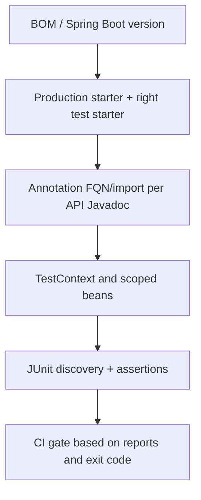
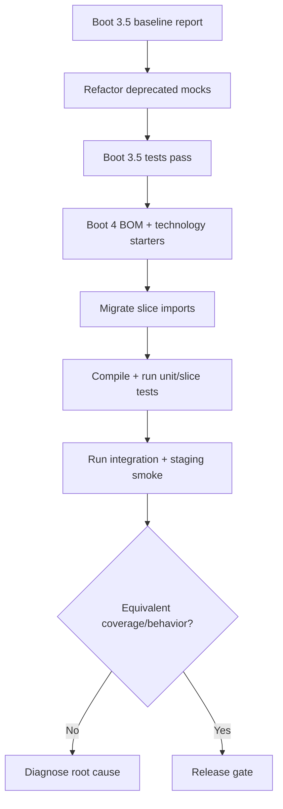

# Versions and Migration — Module, Starter, and Test Annotation Package Changes Across Spring Boot Lines

## 1. The Problem: Why Do Tests Break After Upgrading Versions?

A Spring Boot project may run fine on 3.5 with code like:

```java
import org.springframework.boot.test.autoconfigure.web.servlet.WebMvcTest;
import org.springframework.boot.test.autoconfigure.web.servlet.AutoConfigureMockMvc;
import org.springframework.boot.test.autoconfigure.orm.jpa.DataJpaTest;
import org.springframework.boot.test.mock.mockito.MockBean;
```

Switch the parent POM to Spring Boot 4, and the compiler reports `package ... does not exist` or `cannot find symbol: class MockBean`. After fixing imports, runtime may report a missing `MockMvc` bean, `TestRestTemplate`, or a missing service in a test slice. Several independent causes are at play:

1. **Module and starter dependencies changed**: Boot 4 splits test support by technology.
2. **FQNs/packages of many test annotations changed**: `@WebMvcTest` is no longer in the Boot 3 package.
3. **Bean overrides and test auto-configuration changed**: Boot `@MockBean` was removed in favor of Spring Framework `@MockitoBean`; some test HTTP clients require explicit configuration.
4. **Dependency ecosystem upgraded**: Framework 7, JUnit 6, Jakarta EE 11, and Jackson 3 affect the classpath, serialization, and runtime test behavior.

The fix is **not deleting tests or disabling checks**. Distinguish: **compiles** ≠ **TestContext starts** ≠ **JUnit actually runs** ≠ **behavior remains correct**.

### Learning Objectives

After this lesson, learners can:
- State the major testing changes across Spring Boot **3.3 → 3.4/3.5 → 4.0/4.1**.
- Distinguish production starters, test starters, test modules, and Java annotation packages.
- Correctly update `@WebMvcTest`, `@AutoConfigureMockMvc`, `@DataJpaTest`, `@JdbcTest`, `@RestClientTest`, `@WebFluxTest`, `@WebClientTest`, and `@GraphQlTest`.
- Recognize imports that **stay unchanged**, such as `@SpringBootTest`, `@TestConfiguration`, `@JsonTest`, and `@LocalServerPort`.
- Migrate `@MockBean`/`@SpyBean` to `@MockitoBean`/`@MockitoSpyBean` with the right semantics.
- Write the same JUnit test suite for **Boot 3.5 and Boot 4.1** using matching Maven/Gradle builds.
- Diagnose compile/runtime/classpath errors and verify test counts/reports after migration.

## 2. Version Milestones

| Spring Boot | Framework / Test Ecosystem | Impact |
| --- | --- | --- |
| **3.3** | Framework 6.1, JUnit 5 | Boot `@MockBean`/`@SpyBean`; test slices mostly in `spring-boot-test-autoconfigure` |
| **3.4** | Framework 6.2 | Spring Test adds `@MockitoBean`/`@MockitoSpyBean`; Boot mock annotations deprecated |
| **3.5** | Framework 6.2 | Can migrate mocks early, while `@WebMvcTest` remains in the Boot 3 package |
| **4.0** | Framework 7, JUnit 6, Jackson 3, Jakarta EE 11 | Major modularization, specialized test modules/starters, package moves, Boot mock annotations removed |
| **4.1** | Same modular Boot 4 model | Use 4.1.x Javadoc/BOM; avoid mixing Boot 3 imports or snapshots from other lines |

**Java 17 remains the baseline** for Boot 4; Java 21 is not required merely for the major upgrade. Spring Boot 4.0.0 was released on **November 20, 2025**. Examples in this lesson use **3.5.0** and **4.1.2** to illustrate both lines with officially documented releases; these are **learning milestones**, not a claim of the latest patch in every environment.

Important: Boot 3.3 uses Framework 6.1 and therefore **does not have Spring Framework 6.2's `@MockitoBean`**. If you copy Boot 3.5 code using `@MockitoBean` down to 3.3, you must switch the annotation or upgrade Boot.

## 3. What Pieces Does a Test Slice Require?



Take `@WebMvcTest` as an example. Boot 4 needs `spring-boot-webmvc-test` on **`testClasspath`**, normally via `spring-boot-starter-webmvc-test`, along with the Java import `org.springframework.boot.webmvc.test.autoconfigure.WebMvcTest`. At context startup, the test needs the real controller, `MockMvc`, and appropriately mocked/imported collaborators. Adding only the starter without updating the import fails compilation; updating only the import without the starter also fails compilation.

Distinguish clearly:
- **Library/module dependency**: artifact containing annotation/configuration classes.
- **Java FQN**: package + class name imported by the compiler.
- **Test slice behavior**: which components Spring scans/auto-configures.
- **Test discovery**: JUnit/Surefire/Gradle actually finding and running the method.

## 4. Spring Boot 3.x: Centralized Test Support

A Spring Boot 3.5 MVC application typically has:

```xml
<dependency>
    <groupId>org.springframework.boot</groupId>
    <artifactId>spring-boot-starter-web</artifactId>
</dependency>
<dependency>
    <groupId>org.springframework.boot</groupId>
    <artifactId>spring-boot-starter-test</artifactId>
    <scope>test</scope>
</dependency>
```

`spring-boot-starter-test` provides JUnit Jupiter, AssertJ, Mockito, Spring TestContext, and Boot test support; `spring-boot-test-autoconfigure` centralizes many test slices. For example:
- `org.springframework.boot.test.autoconfigure.web.servlet.WebMvcTest`.
- `org.springframework.boot.test.autoconfigure.orm.jpa.DataJpaTest`.
- `org.springframework.boot.test.autoconfigure.web.client.RestClientTest`.
- `org.springframework.boot.test.autoconfigure.json.JsonTest`.

Broad as `starter-test` is, **it does not mean every technology runtime is bundled**. JPA tests need a database driver, Spring Security needs `spring-security-test` for security helpers, Kafka integration needs broker/test support, and GraphQL uses dedicated test libraries. Saying "Boot 3 only needs one test dependency for everything" is incorrect.

## 5. Spring Boot 4.x: Technology-Based Modularization

The Spring Boot 4.0 migration guide follows this convention:

```text
spring-boot-<technology>              Production module
spring-boot-<technology>-test         Test module
spring-boot-starter-<technology>       Production starter
spring-boot-starter-<technology>-test  Test starter

org.springframework.boot.<technology>...
org.springframework.boot.<technology>.test...
```

Spring MVC example:
- Production module: `spring-boot-webmvc`.
- Production starter: `spring-boot-starter-webmvc`.
- Test module: `spring-boot-webmvc-test`.
- Test starter: `spring-boot-starter-webmvc-test`.
- Test annotation: `org.springframework.boot.webmvc.test.autoconfigure.WebMvcTest`.

Per the migration guide, **technology test starters pull in the general `spring-boot-starter-test` transitively**. Thus, in Boot 4, `spring-boot-starter-webmvc-test` suffices as the test starter for the MVC demo; **adding the general `starter-test` again is not strictly necessary**.

`spring-boot-starter-test` **still exists** in Boot 4 but no longer bundles all technology-specific annotations automatically. `spring-boot-starter-test-classic` is a **temporary migration bridge** with a broader classpath, not a permanent replacement for specialized test starters.

Sources: [Spring Boot 4.0 Migration Guide](https://github.com/spring-projects/spring-boot/wiki/Spring-Boot-4.0-Migration-Guide) and [Build Systems](https://docs.spring.io/spring-boot/reference/using/build-systems.html).

## 6. Production/Test Starter Table by Technology

| Technology | Boot 3.5 Production | Common Boot 3.5 Test | Boot 4 Production | Boot 4 Test Starter |
| --- | --- | --- | --- | --- |
| Spring MVC | `spring-boot-starter-web` | `spring-boot-starter-test` | `spring-boot-starter-webmvc` | `spring-boot-starter-webmvc-test` |
| Spring WebFlux | `spring-boot-starter-webflux` | `spring-boot-starter-test` | `spring-boot-starter-webflux` | `spring-boot-starter-webflux-test` |
| JPA | `spring-boot-starter-data-jpa` | `spring-boot-starter-test` + DB | `spring-boot-starter-data-jpa` | `spring-boot-starter-data-jpa-test` |
| JDBC | `spring-boot-starter-jdbc` | `spring-boot-starter-test` | `spring-boot-starter-jdbc` | `spring-boot-starter-jdbc-test` |
| Spring Data JDBC | `spring-boot-starter-data-jdbc` | `spring-boot-starter-test` | `spring-boot-starter-data-jdbc` | `spring-boot-starter-data-jdbc-test` |
| Blocking HTTP client | Web/RestClient deps | `spring-boot-starter-test` | `spring-boot-starter-restclient` | `spring-boot-starter-restclient-test` |
| WebClient client | WebFlux/reactor deps | `spring-boot-starter-test` | `spring-boot-starter-webclient` | `spring-boot-starter-webclient-test` |
| GraphQL | `spring-boot-starter-graphql` | Boot test + `spring-graphql-test` | `spring-boot-starter-graphql` | `spring-boot-starter-graphql-test` |
| MongoDB | `spring-boot-starter-data-mongodb` | `spring-boot-starter-test` | `spring-boot-starter-data-mongodb` | `spring-boot-starter-data-mongodb-test` |
| Redis | `spring-boot-starter-data-redis` | `spring-boot-starter-test` | `spring-boot-starter-data-redis` | `spring-boot-starter-data-redis-test` |
| Security | `spring-boot-starter-security` | `spring-security-test` + Boot test | `spring-boot-starter-security` | `spring-boot-starter-security-test` |
| WebServices/SOAP | `spring-boot-starter-web-services` | `spring-ws-test` + Boot test | `spring-boot-starter-webservices` | `spring-boot-starter-webservices-test` |
| Validation | `spring-boot-starter-validation` | `spring-boot-starter-test` | `spring-boot-starter-validation` | `spring-boot-starter-validation-test` |
| Kafka | Spring Kafka deps | `spring-kafka-test` + Boot test | `spring-boot-starter-kafka` | `spring-boot-starter-kafka-test` |

Boot 4's `spring-boot-starter-web` and `spring-boot-starter-web-services` have replacements `webmvc`/`webservices`, with the old names deprecated. They may not be removed immediately in every 4.x patch, yet new code should use the updated names. Consult the official migration guide before guessing test starters for third-party technologies outside Spring Boot.

## 7. Relocated Annotation Packages Table

| Annotation | Spring Boot 3.x Package | Spring Boot 4.x Package |
| --- | --- | --- |
| `@WebMvcTest` | `org.springframework.boot.test.autoconfigure.web.servlet.WebMvcTest` | `org.springframework.boot.webmvc.test.autoconfigure.WebMvcTest` |
| `@AutoConfigureMockMvc` | `org.springframework.boot.test.autoconfigure.web.servlet.AutoConfigureMockMvc` | `org.springframework.boot.webmvc.test.autoconfigure.AutoConfigureMockMvc` |
| `@WebFluxTest` | `org.springframework.boot.test.autoconfigure.web.reactive.WebFluxTest` | `org.springframework.boot.webflux.test.autoconfigure.WebFluxTest` |
| `@AutoConfigureWebTestClient` | `org.springframework.boot.test.autoconfigure.web.reactive.AutoConfigureWebTestClient` | `org.springframework.boot.webflux.test.autoconfigure.AutoConfigureWebTestClient` |
| `@WebClientTest` | `org.springframework.boot.test.autoconfigure.web.reactive.WebClientTest` | `org.springframework.boot.webclient.test.autoconfigure.WebClientTest` |
| `@RestClientTest` | `org.springframework.boot.test.autoconfigure.web.client.RestClientTest` | `org.springframework.boot.restclient.test.autoconfigure.RestClientTest` |
| `@DataJpaTest` | `org.springframework.boot.test.autoconfigure.orm.jpa.DataJpaTest` | `org.springframework.boot.data.jpa.test.autoconfigure.DataJpaTest` |
| `@JdbcTest` | `org.springframework.boot.test.autoconfigure.jdbc.JdbcTest` | `org.springframework.boot.jdbc.test.autoconfigure.JdbcTest` |
| `@DataJdbcTest` | `org.springframework.boot.test.autoconfigure.data.jdbc.DataJdbcTest` | `org.springframework.boot.data.jdbc.test.autoconfigure.DataJdbcTest` |
| `@AutoConfigureTestDatabase` | `org.springframework.boot.test.autoconfigure.jdbc.AutoConfigureTestDatabase` | `org.springframework.boot.jdbc.test.autoconfigure.AutoConfigureTestDatabase` |
| `@GraphQlTest` | `org.springframework.boot.test.autoconfigure.graphql.GraphQlTest` | `org.springframework.boot.graphql.test.autoconfigure.GraphQlTest` |
| `@DataMongoTest` | `org.springframework.boot.test.autoconfigure.data.mongo.DataMongoTest` | `org.springframework.boot.data.mongodb.test.autoconfigure.DataMongoTest` |
| `@WebServiceServerTest` | `org.springframework.boot.test.autoconfigure.webservices.server.WebServiceServerTest` | `org.springframework.boot.webservices.test.autoconfigure.server.WebServiceServerTest` |
| `@WebServiceClientTest` | `org.springframework.boot.test.autoconfigure.webservices.client.WebServiceClientTest` | `org.springframework.boot.webservices.test.autoconfigure.client.WebServiceClientTest` |

These FQNs are verified against API docs. **Remember both steps:** the right Java import **and** the right test artifact. Fixing only one still leaves the compiler reporting missing classes.

Do not confuse:
- `@WebFluxTest` tests **server WebFlux controllers**.
- `@WebClientTest` tests reactive **`WebClient` clients**.
- `@RestClientTest` tests blocking outbound `RestClient`/`RestTemplate`.
- `@WebMvcTest` tests Spring MVC controllers.
- `@JdbcTest` differs from `@DataJdbcTest` (Spring Data JDBC repositories).

Source: [Boot 4 Test Slices](https://docs.spring.io/spring-boot/appendix/test-auto-configuration/slices.html).

## 8. Imports That Do Not Change Packages

| Test Annotation/API | FQN Still Used in Both Boot 3.5 and Boot 4 |
| --- | --- |
| `@SpringBootTest` | `org.springframework.boot.test.context.SpringBootTest` |
| `@TestConfiguration` | `org.springframework.boot.test.context.TestConfiguration` |
| `@JsonTest` | `org.springframework.boot.test.autoconfigure.json.JsonTest` |
| `@LocalServerPort` | `org.springframework.boot.test.web.server.LocalServerPort` |
| `@MockitoBean` | `org.springframework.test.context.bean.override.mockito.MockitoBean` |
| `@MockitoSpyBean` | `org.springframework.test.context.bean.override.mockito.MockitoSpyBean` |
| `@DynamicPropertySource` | `org.springframework.test.context.DynamicPropertySource` |
| `@ActiveProfiles` | `org.springframework.test.context.ActiveProfiles` |
| `@Sql` | `org.springframework.test.context.jdbc.Sql` |
| `@WithMockUser` | `org.springframework.security.test.context.support.WithMockUser` |
| `MockMvc` | `org.springframework.test.web.servlet.MockMvc` |
| `MockRestServiceServer` | `org.springframework.test.web.client.MockRestServiceServer` |
| JUnit `@Test` | `org.junit.jupiter.api.Test` |

`@MockitoBean` and `@MockitoSpyBean` start in Framework **6.2** (Boot 3.4/3.5) and **cannot** be used as-is in Boot 3.3 with Framework 6.1. Unchanged imports do not imply dependencies are automatically included: Boot 4 `@JsonTest` keeps its old package yet requires checking JSON mapper modules; `@WithMockUser` keeps its package yet has a specialized `security-test` starter.

**Never run blind find-and-replace on `org.springframework.boot.test...`**. That breaks `@SpringBootTest`/`@JsonTest`, which are already correct.

## 9. Mockito Migration: Boot 3.3 → 3.4/3.5 → 4.x

Boot 3.3:
```java
import org.springframework.boot.test.mock.mockito.MockBean;
import org.springframework.boot.test.mock.mockito.SpyBean;
```

Boot 3.4/3.5: legacy annotations deprecated; Framework 6.2 provides:

```java
import org.springframework.test.context.bean.override.mockito.MockitoBean;
import org.springframework.test.context.bean.override.mockito.MockitoSpyBean;
```

Boot 4: Boot `@MockBean`/`@SpyBean` are **removed**; migrate to the new Framework annotations. Do not switch to Mockito `@Mock` when the intent is overriding a **Spring bean**: plain `@Mock` does not register a bean in the `ApplicationContext`.

### Important Semantics

`@MockitoBean` uses **`REPLACE_OR_CREATE`** by default. If no target bean is found, it can **create a new mock bean**; the test starts, while the service in production or another path might still rely on a real bean. When the target must already exist, use:

```java
@MockitoBean(
    name = "paymentGateway",
    enforceOverride = true)
PaymentGateway paymentGateway;
```

When multiple beans share the same type, use an explicit bean `name`/qualifier. Spring Framework `@MockitoSpyBean` uses **`WRAP`** on an existing bean. For spies with side effects, `doReturn(...).when(spy).method(...)` is safer than `when(spy.method(...)).thenReturn(...)` because the latter can invoke the real method during stubbing.

### `@Configuration` Is Not Equivalent to a Test Class

Legacy pattern:

```java
@TestConfiguration
class SharedMockConfig {
    @MockBean
    PaymentClient paymentClient;
}
```

Do not mechanically turn this into a `@MockitoBean` field inside `@Configuration`: Spring Framework bean override annotations are declared on **test class fields/types**, superclasses, or composed annotations.

Example of type-level shared declarations:

```java
@SpringBootTest
@MockitoBean(types = {PaymentClient.class, InventoryClient.class})
class OrderFlowTest {
}
```

This is a **snippet depending on application classes**, not a runnable demo file. Across multiple test classes, define a composed annotation `@SharedMocks` to keep qualifiers/names consistent and prevent context cache fragmentation. Consult [Spring Framework MockitoBean Docs](https://docs.spring.io/spring-framework/reference/testing/annotations/integration-spring/annotation-mockitobean.html).

## 10. Boot 4: `@SpringBootTest` and `MockMvc`

`@SpringBootTest` keeps its import:

```java
import org.springframework.boot.test.context.SpringBootTest;
```

A full application context using `MockMvc` should explicitly declare `@AutoConfigureMockMvc`:

Boot 3.5:

```java
import org.springframework.boot.test.autoconfigure.web.servlet.AutoConfigureMockMvc;
import org.springframework.boot.test.context.SpringBootTest;

@SpringBootTest
@AutoConfigureMockMvc
class FullMvcCheck {
}
```

Boot 4:

```java
import org.springframework.boot.webmvc.test.autoconfigure.AutoConfigureMockMvc;
import org.springframework.boot.test.context.SpringBootTest;

@SpringBootTest
@AutoConfigureMockMvc
class FullMvcCheck {
}
```

These are **annotation-only snippets**. Boot 4 needs `spring-boot-starter-webmvc-test` to supply the MVC testing module. `@SpringBootTest` alone does not supply all test clients by default; the migration guide emphasizes explicit configuration.

Distinguish:
- `@WebMvcTest`: tests the **MVC slice**, mocking/importing business collaborators.
- `@SpringBootTest + @AutoConfigureMockMvc`: full app context, **in-process** `MockMvc` requests, no HTTP socket opened.
- `@SpringBootTest(RANDOM_PORT)`: embedded server, real HTTP socket; not automatically a full-system E2E test.

## 11. `TestRestTemplate` and `RestTestClient` Across Versions

Boot 3.5 typically uses:

```java
import org.springframework.boot.test.web.client.TestRestTemplate;
```

Boot 4 changes to:

```java
import org.springframework.boot.resttestclient.TestRestTemplate;
import org.springframework.boot.resttestclient.autoconfigure.AutoConfigureTestRestTemplate;
```

Per the Boot 4 migration guide, `@SpringBootTest` **no longer automatically provides** `TestRestTemplate`/`WebClient` test beans as older tests may expect; you need `@AutoConfigureTestRestTemplate` and the appropriate test/runtime modules (including `spring-boot-resttestclient` and `spring-boot-restclient`). Alternatively, switch to the new `RestTestClient` with `@AutoConfigureRestTestClient`.

In the runnable project below, this lesson uses **Java 17 `HttpClient`** instead of a convenience client so one HTTP integration test source works across both Boot 3.5 and 4.1. Do not only fix the `TestRestTemplate` package while forgetting bean auto-configuration.

## 12. `@JsonTest` Keeps Its Package While Jackson Changes Majors

Both Boot 3.5 and Boot 4 use:

```java
import org.springframework.boot.test.autoconfigure.json.JsonTest;
```

However, Boot 4 defaults to **Jackson 3** with `tools.jackson...` APIs, whereas Boot 3 uses Jackson 2 `com.fasterxml.jackson...` APIs. Consequently, a compiling `@JsonTest` can still fail if tests depend on `ObjectMapper`/module/`JacksonTester` behavior.

Inspect:
- Mapper bean type (Boot 4 auto-configures `JsonMapper` for JSON).
- Custom serializers/deserializers and Java Time/Kotlin modules.
- Nullability, enums, unknown properties, precision, and field naming.
- `@JacksonComponent`/`@JsonComponent` matching the active library.
- Test client JSON assertions and error response shapes.

Boot 4 offers the deprecated `spring-boot-jackson2` module as a temporary bridge. Do not take `@JsonTest` still compiling as proof that Jackson 2 tests need no updates.

## 13. DataJpa/Jdbc Testing: Update Both Imports and Modules

Boot 3:

```java
import org.springframework.boot.test.autoconfigure.orm.jpa.DataJpaTest;
import org.springframework.boot.test.autoconfigure.jdbc.AutoConfigureTestDatabase;
import org.springframework.boot.test.autoconfigure.jdbc.JdbcTest;
```

Boot 4:

```java
import org.springframework.boot.data.jpa.test.autoconfigure.DataJpaTest;
import org.springframework.boot.jdbc.test.autoconfigure.AutoConfigureTestDatabase;
import org.springframework.boot.jdbc.test.autoconfigure.JdbcTest;
```

For Boot 4 JPA, add `spring-boot-starter-data-jpa-test`; for JDBC, use `spring-boot-starter-jdbc-test`. If test DBs use H2, include the embedded driver; if the application relies on PostgreSQL-specific SQL, locking, or schemas, keep Testcontainers or real-DB tests.

`@DataJpaTest` remains focused on entities/repositories with transactional rollback by default per Javadoc; relocating the package does not solve Hibernate 7/Jakarta JPA/DDL migrations automatically. In Boot 4, `@DataJdbcTest` moves to `org.springframework.boot.data.jdbc.test.autoconfigure`; it differs from `@JdbcTest`.

## 14. Other Test Slices

### REST Client

Boot 3 `@RestClientTest`: `org.springframework.boot.test.autoconfigure.web.client.RestClientTest`.

Boot 4 `@RestClientTest`: `org.springframework.boot.restclient.test.autoconfigure.RestClientTest`, with `spring-boot-starter-restclient-test`.

`MockRestServiceServer` remains in Spring Test `org.springframework.test.web.client`. This test slice tests outbound blocking HTTP clients rather than an MVC server.

### WebFlux Server and WebClient

Boot 4 `@WebFluxTest`: `org.springframework.boot.webflux.test.autoconfigure.WebFluxTest`, using `spring-boot-starter-webflux-test`.

Boot 4 `@WebClientTest`: `org.springframework.boot.webclient.test.autoconfigure.WebClientTest`, using `spring-boot-starter-webclient-test`.

Do not confuse `WebFluxTest` (server) with `WebClientTest` (reactive client). When an app has both MVC and WebFlux on the classpath, Spring Boot may choose an MVC context; full WebFlux tests may need `spring.main.web-application-type=reactive`.

### GraphQL and SOAP

Boot 4 `@GraphQlTest`: `org.springframework.boot.graphql.test.autoconfigure.GraphQlTest`, using `spring-boot-starter-graphql-test`.

Boot 4 `@WebServiceServerTest`/`@WebServiceClientTest`: packages `org.springframework.boot.webservices.test.autoconfigure.server`/`client`, using `spring-boot-starter-webservices-test`.

These are slices and do not auto-load all business services, brokers, or DB dependencies. Depending on the test goal, `@MockitoBean` collaborators or `@Import` targeted test configuration.

## 15. Shared Sample Project: Spring Boot 3.5 vs. 4.1

Both variants share the same application:
- `MigrationApplication` boots Spring Boot.
- `GreetingService` formats names.
- `GreetingController` is an MVC HTTP endpoint returning `text/plain`.
- `GreetingServiceTest`: plain JUnit unit test, no Boot context.
- `GreetingMvcSliceTest`: `@WebMvcTest` + `@MockitoBean`.
- `GreetingFullContextTest`: `@SpringBootTest + @AutoConfigureMockMvc`.
- `GreetingSocketTest`: `RANDOM_PORT` + JDK `HttpClient`.

```text
boot-testing-migration/
├── pom.xml                  # choose Boot 3 OR Boot 4
└── src/
    ├── main/java/demo/migration/
    │   ├── MigrationApplication.java
    │   ├── GreetingService.java
    │   └── GreetingController.java
    └── test/java/demo/migration/
        ├── GreetingServiceTest.java
        ├── GreetingMvcSliceTest.java
        ├── GreetingFullContextTest.java
        └── GreetingSocketTest.java
```

**How to use:** copy the Java files and pick one POM; on Boot 4, update the imports in the two MVC test classes as instructed. Never put both parent versions or both import lines in the same project. Use two Git branches, worktrees, or build directories to run both side by side. No Docker, DB, or Jackson-specific test APIs are needed.

## 16. pom.xml for Boot 3.5.0

```xml
<?xml version="1.0" encoding="UTF-8"?>
<project xmlns="http://maven.apache.org/POM/4.0.0"
         xmlns:xsi="http://www.w3.org/2001/XMLSchema-instance"
         xsi:schemaLocation="http://maven.apache.org/POM/4.0.0
           https://maven.apache.org/xsd/maven-4.0.0.xsd">
    <modelVersion>4.0.0</modelVersion>

    <parent>
        <groupId>org.springframework.boot</groupId>
        <artifactId>spring-boot-starter-parent</artifactId>
        <version>3.5.0</version>
        <relativePath/>
    </parent>

    <groupId>demo</groupId>
    <artifactId>boot-testing-migration</artifactId>
    <version>1.0.0</version>

    <properties>
        <java.version>17</java.version>
    </properties>

    <dependencies>
        <dependency>
            <groupId>org.springframework.boot</groupId>
            <artifactId>spring-boot-starter-web</artifactId>
        </dependency>
        <dependency>
            <groupId>org.springframework.boot</groupId>
            <artifactId>spring-boot-starter-test</artifactId>
            <scope>test</scope>
        </dependency>
    </dependencies>
</project>
```

`spring-boot-starter-test` pulls in Spring Framework 6.2 test support, so `@MockitoBean` works on Boot 3.5. Spring MVC slice annotations still reside in the Boot 3 package.

## 17. pom.xml for Boot 4.1.2

Replace **the entire POM** from Section 16 with:

```xml
<?xml version="1.0" encoding="UTF-8"?>
<project xmlns="http://maven.apache.org/POM/4.0.0"
         xmlns:xsi="http://www.w3.org/2001/XMLSchema-instance"
         xsi:schemaLocation="http://maven.apache.org/POM/4.0.0
           https://maven.apache.org/xsd/maven-4.0.0.xsd">
    <modelVersion>4.0.0</modelVersion>

    <parent>
        <groupId>org.springframework.boot</groupId>
        <artifactId>spring-boot-starter-parent</artifactId>
        <version>4.1.2</version>
        <relativePath/>
    </parent>

    <groupId>demo</groupId>
    <artifactId>boot-testing-migration</artifactId>
    <version>1.0.0</version>

    <properties>
        <java.version>17</java.version>
    </properties>

    <dependencies>
        <dependency>
            <groupId>org.springframework.boot</groupId>
            <artifactId>spring-boot-starter-webmvc</artifactId>
        </dependency>
        <dependency>
            <groupId>org.springframework.boot</groupId>
            <artifactId>spring-boot-starter-webmvc-test</artifactId>
            <scope>test</scope>
        </dependency>
    </dependencies>
</project>
```

This uses a **technology-specific test starter**: Boot 4's MVC test starter pulls in general Boot testing libraries transitively. No duplicate `spring-boot-starter-test` is needed. Do not manually pin Framework 6.2/JUnit 5 with the Boot 4.1 BOM. Java stays at 17; Framework 7/JUnit 6 are managed by Boot 4.

## 18. MigrationApplication.java — Shared

`src/main/java/demo/migration/MigrationApplication.java`:

```java
package demo.migration;

import org.springframework.boot.SpringApplication;
import org.springframework.boot.autoconfigure.SpringBootApplication;

@SpringBootApplication
public class MigrationApplication {
    public static void main(String[] args) {
        SpringApplication.run(MigrationApplication.class, args);
    }
}
```

The application scans `demo.migration` and finds both the service and controller. Do not add nested `@Configuration` classes in tests that interfere with primary configuration discovery.

## 19. GreetingService.java — Shared

`src/main/java/demo/migration/GreetingService.java`:

```java
package demo.migration;

import org.springframework.stereotype.Service;

@Service
public class GreetingService {
    public String greet(String input) {
        if (input == null || input.isBlank()) {
            throw new IllegalArgumentException(
                    "name must not be blank");
        }
        return "Hello, " + input.strip() + "!";
    }
}
```

No dependencies on Jackson/JPA/HTTP test packages. Java 17's `strip()` behaves consistently across Boot versions.

## 20. GreetingController.java — Shared

`src/main/java/demo/migration/GreetingController.java`:

```java
package demo.migration;

import org.springframework.http.MediaType;
import org.springframework.web.bind.annotation.GetMapping;
import org.springframework.web.bind.annotation.PathVariable;
import org.springframework.web.bind.annotation.RestController;

@RestController
public class GreetingController {
    private final GreetingService service;

    public GreetingController(GreetingService service) {
        this.service = service;
    }

    @GetMapping(
        value = "/greet/{name}",
        produces = MediaType.TEXT_PLAIN_VALUE)
    public String greet(@PathVariable String name) {
        return service.greet(name);
    }
}
```

`GET /greet/Mai` returns status 200, `text/plain`, body:

```text
Hello, Mai!
```

`text/plain` is chosen so Jackson 2/3 behavior does not confound the comparison of test annotations and starters. When adding JSON APIs, write separate contract/serialization tests.

## 21. GreetingServiceTest.java — Three Unit Tests

`src/test/java/demo/migration/GreetingServiceTest.java`:

```java
package demo.migration;

import static org.junit.jupiter.api.Assertions.assertEquals;
import static org.junit.jupiter.api.Assertions.assertThrows;

import org.junit.jupiter.api.Test;

class GreetingServiceTest {
    private final GreetingService service =
            new GreetingService();

    @Test
    void createsGreeting() {
        assertEquals("Hello, Mai!",
                service.greet("Mai"));
    }

    @Test
    void stripsWhitespace() {
        assertEquals("Hello, Mai!",
                service.greet("  Mai  "));
    }

    @Test
    void rejectsBlankName() {
        IllegalArgumentException ex = assertThrows(
                IllegalArgumentException.class,
                () -> service.greet("   "));

        assertEquals("name must not be blank",
                ex.getMessage());
    }
}
```

**3 JUnit methods.** JUnit Jupiter `org.junit.jupiter.api.Test` keeps the same package even though Boot 4 uses JUnit 6. This class does not start a Spring context; if it fails after migration, check JDK/JUnit test dependencies and business code first before blaming the MVC test starter.

## 22. GreetingMvcSliceTest.java — Complete Boot 3.5 Version

`src/test/java/demo/migration/GreetingMvcSliceTest.java`:

```java
package demo.migration;

import static org.mockito.Mockito.verify;
import static org.mockito.Mockito.verifyNoInteractions;
import static org.mockito.Mockito.when;
import static org.springframework.test.web.servlet.request.MockMvcRequestBuilders.get;
import static org.springframework.test.web.servlet.result.MockMvcResultMatchers.content;
import static org.springframework.test.web.servlet.result.MockMvcResultMatchers.status;

import org.junit.jupiter.api.Test;
import org.springframework.beans.factory.annotation.Autowired;
import org.springframework.boot.test.autoconfigure.web.servlet.WebMvcTest;
import org.springframework.http.MediaType;
import org.springframework.test.context.bean.override.mockito.MockitoBean;
import org.springframework.test.web.servlet.MockMvc;

@WebMvcTest(GreetingController.class)
class GreetingMvcSliceTest {
    @Autowired
    MockMvc mvc;

    @MockitoBean
    GreetingService greetingService;

    @Test
    void servesMockedGreeting() throws Exception {
        when(greetingService.greet("Mai"))
            .thenReturn("Stub response");

        mvc.perform(get("/greet/Mai")
                .accept(MediaType.TEXT_PLAIN))
            .andExpect(status().isOk())
            .andExpect(content().string("Stub response"));

        verify(greetingService).greet("Mai");
    }

    @Test
    void unknownPathDoesNotInvokeService() throws Exception {
        mvc.perform(get("/unknown-path"))
            .andExpect(status().isNotFound());

        verifyNoInteractions(greetingService);
    }
}
```

**2 JUnit methods**. The MVC slice loads the real controller and mocks the collaborator. `@MockitoBean` is already in the Spring Framework package, even though `@WebMvcTest` is still in the Boot 3 package. Do not assume `@WebMvcTest` loads all `@Service` beans; it intentionally restricts to the MVC slice.

### How to Migrate This File to Boot 4.1

Change only one import line (do not create two classes):

```java
// Remove Boot 3.5 line:
import org.springframework.boot.test.autoconfigure.web.servlet.WebMvcTest;

// Use Boot 4.1 line:
import org.springframework.boot.webmvc.test.autoconfigure.WebMvcTest;
```

Keep the test body, `MockMvc`, and `@MockitoBean` untouched. The Boot 4 POM needs `spring-boot-starter-webmvc-test`. **Do not leave both import lines in a runnable file.**

## 23. GreetingFullContextTest.java — Full-App MockMvc

`src/test/java/demo/migration/GreetingFullContextTest.java` for Boot 3.5:

```java
package demo.migration;

import static org.springframework.test.web.servlet.request.MockMvcRequestBuilders.get;
import static org.springframework.test.web.servlet.result.MockMvcResultMatchers.content;
import static org.springframework.test.web.servlet.result.MockMvcResultMatchers.status;

import org.junit.jupiter.api.Test;
import org.springframework.beans.factory.annotation.Autowired;
import org.springframework.boot.test.autoconfigure.web.servlet.AutoConfigureMockMvc;
import org.springframework.boot.test.context.SpringBootTest;
import org.springframework.test.web.servlet.MockMvc;

@SpringBootTest
@AutoConfigureMockMvc
class GreetingFullContextTest {
    @Autowired
    MockMvc mvc;

    @Test
    void usesRealServiceInFullContext() throws Exception {
        mvc.perform(get("/greet/Hoa"))
            .andExpect(status().isOk())
            .andExpect(content().string("Hello, Hoa!"));
    }
}
```

**1 JUnit method.** `GreetingService` is a real Spring bean, not mocked; `MockMvc` runs in-process without an HTTP socket.

Boot 4.1: update the `AutoConfigureMockMvc` import to:

```java
import org.springframework.boot.webmvc.test.autoconfigure.AutoConfigureMockMvc;
```

Keep `org.springframework.boot.test.context.SpringBootTest` and `org.springframework.test.web.servlet.MockMvc` unchanged. Do not rely on `@SpringBootTest` alone assuming a `MockMvc` bean exists automatically: declare explicit auto-configuration and the right MVC test module.

## 24. GreetingSocketTest.java — Real HTTP, Unchanged Imports

`src/test/java/demo/migration/GreetingSocketTest.java`:

```java
package demo.migration;

import static org.junit.jupiter.api.Assertions.assertEquals;
import static org.junit.jupiter.api.Assertions.assertTrue;

import java.net.URI;
import java.net.http.HttpClient;
import java.net.http.HttpRequest;
import java.net.http.HttpResponse;
import java.time.Duration;

import org.junit.jupiter.api.Test;
import org.springframework.boot.test.context.SpringBootTest;
import org.springframework.boot.test.web.server.LocalServerPort;

@SpringBootTest(
    webEnvironment = SpringBootTest.WebEnvironment.RANDOM_PORT)
class GreetingSocketTest {
    @LocalServerPort
    int port;

    @Test
    void usesRealHttpSocket() throws Exception {
        HttpClient client = HttpClient.newBuilder()
            .connectTimeout(Duration.ofSeconds(3))
            .build();

        HttpRequest req = HttpRequest.newBuilder(
                URI.create("http://127.0.0.1:" + port +
                    "/greet/Lan"))
            .timeout(Duration.ofSeconds(5))
            .GET()
            .build();

        HttpResponse<String> result = client.send(
                req, HttpResponse.BodyHandlers.ofString());

        assertEquals(200, result.statusCode());
        assertEquals("Hello, Lan!", result.body());
        assertTrue(result.headers()
                .firstValue("Content-Type").orElse("")
                .startsWith("text/plain"));
    }
}
```

**1 JUnit method.** `@LocalServerPort` and `@SpringBootTest` imports remain unchanged from Boot 3.5 → 4.1. `RANDOM_PORT` avoids port collisions in CI. This is a **single-service HTTP integration test**, not a full-system E2E test.

For DB transaction tests, remember that the `RANDOM_PORT` server thread does not share test transaction rollback; explicit cleanup is needed for writes. Using JDK `HttpClient` avoids coupling to Boot 4's `TestRestTemplate` changes.

## 25. JUnit Method Counts and Running Maven

| Class | `@Test` Count | Purpose |
| --- | ---: | --- |
| `GreetingServiceTest` | 3 | Plain Java unit tests |
| `GreetingMvcSliceTest` | 2 | Controller slice + mocked service |
| `GreetingFullContextTest` | 1 | Full context + MockMvc |
| `GreetingSocketTest` | 1 | Real HTTP on random port |
| **Total per variant** | **7** | 7 expected JUnit methods |

Select **one** POM and matching MVC imports, then run:

```bash
java -version
mvn -version
mvn clean test
mvn -Dtest=GreetingMvcSliceTest test
mvn -Dtest=GreetingFullContextTest test
mvn -Dtest=GreetingSocketTest test
```

**Expected behavior:** 7 tests PASS, 0 errors/failures/skips when the environment and dependencies match. This is **not an observed Maven run from this lesson**. Inspect `target/surefire-reports/` and the actual command exit status before claiming test execution succeeded.

If you see `Tests run: 0`, check test engines/naming/filters; a build that produces a JAR without discovering tests **fails the quality gate**.

## 26. Gradle Kotlin DSL: Dependency Delta

Boot 3.5:

```kotlin
plugins {
    java
    id("org.springframework.boot") version "3.5.0"
    id("io.spring.dependency-management") version "1.1.7"
}

java {
    toolchain {
        languageVersion = JavaLanguageVersion.of(17)
    }
}

repositories { mavenCentral() }

dependencies {
    implementation("org.springframework.boot:spring-boot-starter-web")
    testImplementation("org.springframework.boot:spring-boot-starter-test")
}

tasks.test { useJUnitPlatform() }
```

Boot 4.1:

```kotlin
plugins {
    java
    id("org.springframework.boot") version "4.1.2"
    id("io.spring.dependency-management") version "1.1.7"
}

java {
    toolchain {
        languageVersion = JavaLanguageVersion.of(17)
    }
}

repositories { mavenCentral() }

dependencies {
    implementation("org.springframework.boot:spring-boot-starter-webmvc")
    testImplementation("org.springframework.boot:spring-boot-starter-webmvc-test")
}

tasks.test { useJUnitPlatform() }
```

These are **two build alternatives**; never combine both plugin versions together. The Boot 4 Gradle plugin requires a compatible wrapper version (per Boot 4 docs: Gradle 8.14+ in the 8.x line or 9.x). Do not use an old Gradle 8.0 wrapper and blame Java imports.

Inspect classpath:

```bash
./gradlew dependencies --configuration testCompileClasspath
./gradlew dependencies --configuration testRuntimeClasspath
./gradlew dependencyInsight --dependency spring-boot-webmvc-test --configuration testRuntimeClasspath
./gradlew clean test
```

Maven equivalents:

```bash
mvn dependency:tree
mvn help:effective-pom
mvn clean test
```

## 27. Classic Starters: Use Only as a Bridge

Spring Boot 4 provides `spring-boot-starter-classic` and `spring-boot-starter-test-classic`. They provide a classpath closer to the Boot 3 generation to reduce migration effort in phases.

However, **classic does not restore the removed `@MockBean`, does not guarantee old test slice FQNs exist**, and should not be a permanent target. A sensible workflow is: use classic temporarily to fix removed APIs/compilation → swap to specialized technology starters → re-run the entire suite.

Technology starters make required dependencies explicit and trim unrelated modules. Do not pile on arbitrary test starters just to make a context boot; that masks missing beans or wrong source packages and slows down the suite.

## 28. `@WithMockUser` and the Security Test Starter

Spring Security's `@WithMockUser` keeps its import:

```java
import org.springframework.security.test.context.support.WithMockUser;
```

However, the Boot 4 migration guide recommends `spring-boot-starter-security-test` for security test support, rather than relying on `spring-security-test` plus the general Boot starter as in 3.x.

Merely compiling the annotation does not prove security coverage. MVC tests can auto-load filters depending on the classpath; verify 401/403/200 responses, CSRF, and authority/role handling on real controller paths. Never disable security filters unconditionally just to push an upgrade through.

## 29. Mockito `@Mock`/`@Captor` After Boot 4

Boot 4 removes Spring Boot's legacy `MockitoTestExecutionListener`. For plain Mockito tests using `@Mock` or `@Captor`, declare the Mockito Jupiter extension explicitly:

```java
import org.junit.jupiter.api.extension.ExtendWith;
import org.mockito.Mock;
import org.mockito.junit.jupiter.MockitoExtension;

@ExtendWith(MockitoExtension.class)
class PlainMockitoExample {
    @Mock
    SomeDependency dependency;
}
```

This is a **snippet depending on application classes**, not part of the core demo. `@Mock` does not replace a Spring bean collaborator. Do not confuse `@Mock` with Spring Test's `@MockitoBean`.

## 30. Categorizing Migration Errors

| Error | Most Likely Cause | Proper Fix |
| --- | --- | --- |
| `package org.springframework.boot.test.autoconfigure.web.servlet does not exist` | Old Boot 3 FQN | Boot 4 import + `webmvc-test` starter |
| `cannot find symbol: WebMvcTest` despite updating import | Missing Boot 4 technology test module | Add `starter-webmvc-test` in test scope |
| `cannot find symbol: MockBean` on Boot 4 | Removed API | Framework `@MockitoBean` |
| `cannot find symbol: MockitoBean` on Boot 3.3 | Unsupported on Framework 6.1 | Legacy `@MockBean` or upgrade to Boot 3.4+ |
| `ClassNotFoundException`/`NoClassDefFoundError` | Missing module on runtime classpath | Check dependency tree, scope, and versions |
| `NoSuchMethodError` | Mixing Boot 3/4, Framework 6/7, or Jackson 2/3 | Align BOM; clean rebuild |
| `NoSuchBeanDefinitionException: MockMvc` | Missing MVC test auto-config | `@AutoConfigureMockMvc` + starter |
| `NoSuchBeanDefinitionException: TestRestTemplate` | Boot 4 requires explicit config | `@AutoConfigureTestRestTemplate`/modules |
| `NoSuchBeanDefinitionException: service` in MVC slice | Slice does not scan `@Service` | `@MockitoBean` or `@Import` the collaborator |
| `NoUniqueBeanDefinitionException` after mock migration | Ambiguous same-type bean overrides | Named `@MockitoBean`/qualifier |
| Mockito `Wanted but not invoked` | Stubbed/verified wrong mock, ghost bean | `enforceOverride=true` + bean identity check |
| Wrong `ObjectMapper` bean | Jackson 3 mapper migration | `JsonMapper` + library alignment |
| `@WithMockUser` compiles yet behavior fails | Security test context/deps | `security-test` starter + filter tests |
| `@DataJpaTest` context fails | DB driver/scan/schema/Hibernate | Test DB, Testcontainers, datasource config |
| `@WebFluxTest` does not run reactive app | MVC takes precedence when both on classpath | `spring.main.web-application-type=reactive` |
| `Tests run: 0` | JUnit engine/test discovery issue | Check reports + build tool includes/versions |
| Tests compile yet assertions differ | Actual behavior changed, not just imports | Regression/contract reviews |

**Diagnostic order:** identify Boot major → verify BOM/test starter → verify FQNs → compile → inspect `TestContext` root cause → check test counts → assert behavior. Do not edit all sources and dependencies at once when steps can be isolated.

## 31. Controlled Migration Strategy

### Phase A — Standardize on Boot 3.5 First

1. Upgrade to an organization-supported Boot 3.5 maintenance patch.
2. Run baseline `mvn clean verify` and save JUnit XML/Surefire/Failsafe reports, test counts, and skip counts.
3. Migrate `@MockBean`/`@SpyBean` to Framework `@MockitoBean`/`@MockitoSpyBean`.
4. Use explicit `name`/`enforceOverride` when multiple beans share a type.
5. Move shared mock fields out of the old `@Configuration` pattern into test-class types/composed annotations.
6. Re-run tests on Boot 3.5 before changing majors.

### Phase B — Boot 4 Module/Package Upgrade

1. Update Boot parent/BOM/plugin within the same major version.
2. Verify Java 17+, Framework 7, Jakarta/Servlet/JUnit 6/Jackson 3 compatibility.
3. Replace renamed production starters and add specialized test starters.
4. Update relocated imports per the moved-package table while keeping stable imports intact.
5. Add explicit `@AutoConfigureMockMvc`/`TestRestTemplate` configurations where needed.
6. Audit JSON mappers/Jackson APIs, Security test starters, and GraphQL/WebFlux clients/servers.
7. Compile tests, run slices individually, then run full context/HTTP/DB integration tests.
8. If using classic starters temporarily, phase them out once specialized modules are in place.

### Phase C — CI and Behavioral QA

- JUnit tests actually execute, not just compile.
- No new tests are `@Disabled` or skipped without justification.
- Per-layer test counts and contract assertions have not dropped unexpectedly.
- DB/transaction/schema tests run on an appropriate driver.
- MVC, GraphQL, SOAP, REST client, and security behaviors pass.
- No Boot 3/Framework 6 artifacts remain mixed into the Boot 4 runtime.
- Testcontainers/real dependencies remain verified.
- Staging smoke/E2E tests run after deploying the verified build artifact.
- Never publish a JAR solely because `mvn package` passes when verification gates are missing.



## 32. Multi-Module Maven/Gradle: Avoiding Version Drift

Suppose a repo has `catalog-web`, `billing-data`, `auth-service`, and `shipping-client`:
- The MVC module uses `spring-boot-starter-webmvc-test`.
- The JPA module uses `spring-boot-starter-data-jpa-test`.
- The Security module uses `spring-boot-starter-security-test`, plus `webmvc-test` if testing MVC.
- The REST client module uses `spring-boot-starter-restclient-test`.

Do not place every technology test starter in a global parent dependency block, which forces every child module to pull unnecessary libraries. The parent/BOM manages versions; child modules declare only the technology dependencies they actually use.

`mvn -pl :module -am verify` builds reactor dependencies yet does not prove other independent modules were verified. The CI matrix must cover the full scope. During a Boot major upgrade, avoid letting one module pin Framework 6.2 while another uses Framework 7; linkage failures may not surface until runtime.

## 33. Test Discovery and Quality Gates

In Maven, `mvn test` normally uses Surefire; besides test methods, a JUnit engine and compatible plugin are required. In Gradle, configure `useJUnitPlatform()` where required by plugins/tasks.

Inspect real reports:
- Maven: `target/surefire-reports/`, plus `target/failsafe-reports/` if Failsafe ITs exist.
- Gradle: `build/test-results/test/` and `build/reports/tests/test/`.

If JUnit 5/6 test methods still import `org.junit.jupiter.api.Test` yet `Tests run: 0`, that is a **discovery/runtime test engine issue**, not proof the tests are unnecessary. Fix the build tool or test starter rather than disabling tests to merge.

Save CI build commands, dependency graphs, and before/after test counts. A green pipeline that silently dropped MVC/JPA tests due to naming or filters is a false green. Configure fail-on-no-tests on modules that must contain tests, while carving out exceptions for test-free aggregator modules.

## 34. Hands-On Exercises

1. Run the Boot 3.5 demo, verify the expected test count = 7 from source, and confirm in Surefire reports.
2. Update the POM and two MVC imports for Boot 4.1, and re-run all 7 tests.
3. Keep the old `@WebMvcTest` import on Boot 4 to inspect the compiler error; fix both artifact and FQN.
4. Remove `spring-boot-starter-webmvc-test` and keep only `spring-boot-starter-test` on Boot 4 to observe the missing MVC slice module.
5. Try Boot 3.3 + `@MockitoBean`; explain why Framework 6.1 lacks it.
6. Try Boot 4 + old `@MockBean`; fix with `@MockitoBean`.
7. Create two same-type beans and verify named mock `enforceOverride` behavior.
8. Update `@DataJpaTest` Boot 3/4 imports and add `data-jpa-test`.
9. Verify `@JsonTest` keeps its FQN while Jackson 3 mapping still requires QA.
10. Test the new `@RestClientTest` while confirming `MockRestServiceServer` keeps its Spring Test package.
11. Compare `@WebFluxTest`/`@WebClientTest` and their matching test starters.
12. Add `@WithMockUser` and `security-test` starter, and verify authorization behavior.
13. Try the new `TestRestTemplate` package with `@AutoConfigureTestRestTemplate`, or switch to JDK `HttpClient`.
14. Run `dependency:tree` to spot mixed Boot 3/4 major artifacts.
15. Try the classic starter, then replace it with specialized starters and compare the test classpath.
16. Intentionally trigger `Tests run: 0` and configure a gate to prevent a false green build.
17. Evaluate Jackson 2/3 serialization semantics with DTO JSON tests.
18. Run the HTTP socket test on a random port rather than hardcoding 8080.

## 35. Anti-Patterns to Avoid

- Replacing all `org.springframework.boot.test...` imports instead of mapping per annotation.
- Using Mockito `@Mock` instead of `@MockitoBean` when a Spring bean override is needed.
- Mixing a Boot 4 parent with a Boot 3 test JAR just to keep old FQNs.
- Adding only `spring-boot-starter-test` on Boot 4 while omitting specialized starters.
- Dropping `@AutoConfigureMockMvc` and expecting a full context to supply `MockMvc` automatically.
- Confusing `@WebFluxTest` (server) with `@WebClientTest` (client).
- Seeing `@JsonTest` keep its package and skipping Jackson 3 migration checks.
- Omitting `spring-boot-starter-security-test` while expecting security test helpers/filters to work properly.
- Enabling global bean overriding to hide a misnamed `@MockitoBean`/qualifier.
- Skipping a clean build after a major upgrade and leaving stale compiled test classes behind.
- Running only unit mocks while dropping integration/real DB tests.
- Hardcoding test HTTP ports in CI.
- Keeping classic starters indefinitely without auditing dependency needs.
- Leaving `Tests run: 0` or skipped critical tests in a verified release.
- Calling "compile successful" the same as "behavior verified".

## 36. QA Checklist Before Signing Off on Migration

- [ ] Are exact Boot parent/BOM and Java/Framework versions known?
- [ ] Is Boot 3.3 distinguished from 3.4/3.5 regarding `@MockitoBean`?
- [ ] Have all legacy `@MockBean`/`@SpyBean` imports been removed for Boot 4?
- [ ] Are matching production and specialized test starters added per technology?
- [ ] Have MVC `@WebMvcTest`/`@AutoConfigureMockMvc` packages been relocated?
- [ ] Have JPA `@DataJpaTest` and `@AutoConfigureTestDatabase` been relocated properly?
- [ ] Do WebFlux/REST client/GraphQL/SOAP test annotations use the right FQNs?
- [ ] Are stable imports (`@SpringBootTest`/`@TestConfiguration`/`@JsonTest`) kept unchanged?
- [ ] Do `@LocalServerPort`/`@DynamicPropertySource`/`@MockitoBean` use the right packages?
- [ ] Do mock overrides select the right bean without creating ghost beans?
- [ ] Are shared mocks free from the legacy `@Configuration` field pattern?
- [ ] Does `TestRestTemplate` have the new module + auto-config if used?
- [ ] Were Jackson 3/JSON testers reviewed separately?
- [ ] Are `security-test` starter and auth filters/roles verified?
- [ ] Are Maven/Gradle test compile and runtime classpaths aligned?
- [ ] Are Boot 3/Boot 4 and Framework 6/Framework 7 artifacts free from mixing?
- [ ] Are JUnit tests actually discovered (not `Tests run: 0`)?
- [ ] Were unit/slice/integration test counts and behaviors compared to baseline?
- [ ] Do database/Testcontainers/HTTP integration tests pass?
- [ ] Is there a plan to remove any temporary classic starters?
- [ ] Do CI reports and release gates rely on test execution rather than packaging alone?

## 37. Official References

1. [Spring Boot 4.0 Migration Guide](https://github.com/spring-projects/spring-boot/wiki/Spring-Boot-4.0-Migration-Guide): modularization, production/test starters, package moves, classic starters, `MockBean` removal, `TestRestTemplate`/`MockMvc` changes.
2. [Spring Boot Build Systems](https://docs.spring.io/spring-boot/reference/using/build-systems.html): current starter catalog.
3. [Spring Boot Test Slices](https://docs.spring.io/spring-boot/appendix/test-auto-configuration/slices.html): slice/module mapping.
4. [Spring Boot 3.5 Testing](https://docs.spring.io/spring-boot/3.5/reference/testing/spring-boot-applications.html): 3.5 test annotation packages.
5. [Spring Boot 4 Testing](https://docs.spring.io/spring-boot/reference/testing/spring-boot-applications.html): 4.x test modules and runtime setup.
6. [Boot 3.5 WebMvcTest API](https://docs.spring.io/spring-boot/3.5/api/java/org/springframework/boot/test/autoconfigure/web/servlet/WebMvcTest.html): legacy import.
7. [Boot 4 WebMvcTest API](https://docs.spring.io/spring-boot/api/java/org/springframework/boot/webmvc/test/autoconfigure/WebMvcTest.html): new import.
8. [Boot 3.5 DataJpaTest API](https://docs.spring.io/spring-boot/3.5/api/java/org/springframework/boot/test/autoconfigure/orm/jpa/DataJpaTest.html).
9. [Boot 4 DataJpaTest API](https://docs.spring.io/spring-boot/api/java/org/springframework/boot/data/jpa/test/autoconfigure/DataJpaTest.html).
10. [Boot 4 AutoConfigureMockMvc API](https://docs.spring.io/spring-boot/api/java/org/springframework/boot/webmvc/test/autoconfigure/AutoConfigureMockMvc.html).
11. [Boot 4 RestClientTest API](https://docs.spring.io/spring-boot/api/java/org/springframework/boot/restclient/test/autoconfigure/RestClientTest.html).
12. [Boot 4 GraphQlTest API](https://docs.spring.io/spring-boot/api/java/org/springframework/boot/graphql/test/autoconfigure/GraphQlTest.html).
13. [Spring Framework MockitoBean](https://docs.spring.io/spring-framework/reference/testing/annotations/integration-spring/annotation-mockitobean.html).
14. [Boot 4 System Requirements](https://docs.spring.io/spring-boot/4.0/system-requirements.html).
15. [Boot 3.3 Testing](https://docs.spring.io/spring-boot/3.3/reference/testing/spring-boot-applications.html).

### Conclusion

**Upgrading Spring Boot tests requires aligning three axes together: module/starter dependencies, test annotation Java FQNs, and runtime test behavior.** Starting in Boot 3.4/3.5, migrate Boot `@MockBean`/`@SpyBean` to Spring Framework `@MockitoBean`/`@MockitoSpyBean` before the major upgrade. On Boot 4, adopt technology-specific test starters, update relocated imports, and keep unchanged imports intact. Final verification is not "IDE shows zero errors" but **test methods actually executing, behavior matching contracts, and CI gates genuinely passing**.
