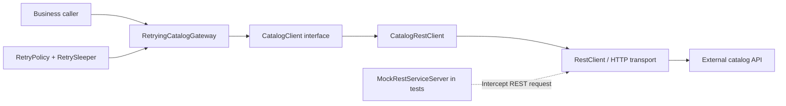

# Integration Practice — Simulating External Services with Timeouts, Errors, and Bounded Retries

## 1. Context: our service cannot assume external services are always available

A Spring Boot application frequently calls out-of-process HTTP APIs: inventory, pricing, shipping, payment gateways, or partner systems. Even when your own business code is bug-free, an outbound call can:

- Return **200 OK** with valid JSON.
- Return **404 Not Found** because a product SKU does not exist.
- Return **400/401/403** because the request, token, or permission is invalid.
- Return **429 Too Many Requests** when the partner rate-limits traffic.
- Return **500/502/503/504** when the remote server or gateway hits a temporary outage.
- Take too long to connect or respond and trigger a **timeout**.
- Encounter DNS, TLS, or JSON deserialization errors — which should not be blindly retried like transient failures.

A naive “retry on any error until it succeeds” implementation can turn a minor blip into a **retry storm**. Conversely, retrying zero transient failures leaves the system fragile against a brief 503.

This lab builds **an outbound HTTP client** and a retry policy layer, then uses **Spring `MockRestServiceServer`** to simulate success, HTTP errors, and `SocketTimeoutException` in a **fast, deterministic way without Internet access**.

### Outcomes that must be observable

1. 200 on first attempt ⇒ one request, zero delay, right data returned.
2. 503 then 200 ⇒ two requests, **one** backoff wait.
3. Timeout then 200 ⇒ retries only when the root cause is an allowed timeout.
4. 429 then 200 ⇒ bounded retry; note `Retry-After` policy in production.
5. 404/400/401/403 ⇒ **never retried** because these errors need different handling.
6. Repeated 503 ⇒ stops at exact `maxAttempts`, preserving the last error as `cause`.
7. DNS/TLS/JSON decode errors ⇒ never mistaken for a timeout merely for living under the REST client's exception hierarchy.
8. Backoff grows with failure count while capped at `maxDelay`, without using `Thread.sleep` in tests.
9. When the thread is interrupted while waiting ⇒ restores the interrupt flag and aborts retries immediately.
10. Distinguish **simulating exceptions in the client** from **testing real transport/deadlines**.

## 2. Three layers to separate for proper testing



**Separation of concerns:**

- `CatalogRestClient` owns **URI, method, headers, JSON mapping, and HTTP/IO exceptions**.
- `RetryingCatalogGateway` decides **which errors to retry**, total attempts, wait durations, and when to stop.
- `RetryPolicy` holds explicit limits and validates configuration upfront.
- `RetrySleeper` is an abstraction letting tests **record wait durations without actually sleeping**.
- `MockRestServiceServer` intercepts requests at `ClientHttpRequestFactory` and returns scripted responses. It **opens no sockets** and does not measure real network timeouts.

This separation lets you test retry logic without spinning up a server while still testing the Spring REST client's HTTP contract and exception mapping.

## 3. Defining bounded retries

Avoid vague phrases like “3 retries”. This lab defines:

> `maxAttempts = 3` is the **total number of HTTP calls, including the initial call**; thus at most **2 retries** and at most **2 wait intervals**.

Example:

| Attempt | Response | Action |
| --- | --- | --- |
| 1 | 503 | Wait 40 ms |
| 2 | Timeout | Wait 80 ms |
| 3 | 200 | Return data |
| 4 | — | Never called |

If attempt 3 still returns 503, the gateway throws an exception with `attempts=3` and the final 503 as cause; **never sleep after the final attempt**.

### Error classification in this lab's policy

| Outcome / error | Retry? | Reason |
| --- | --- | --- |
| HTTP 200/2xx + valid JSON | No | Complete |
| 400 | No | Bad request; resending verbatim won't help |
| 401/403 | No | Needs auth/permission fix, not retrying the same token |
| 404 | No | Missing data; handle in business logic |
| 409 | Not by default | Retry only if a specific contract documents transient conflicts |
| 408 | Not in sample policy | Requires contract/idempotency decision |
| 429 | Bounded | Rate limit; production must inspect `Retry-After` |
| 500/502/503/504 | Bounded | Potentially transient server/gateway errors |
| 501/505 | No | Usually unrecoverable via retries |
| `SocketTimeoutException` | Bounded | Network timeout |
| `HttpTimeoutException` | Bounded | Java HTTP client timeout |
| `UnknownHostException` | Not in sample policy | Do not treat general DNS errors as timeouts |
| `SSLHandshakeException` | No | Often a certificate/TLS policy error |
| JSON parse/convert failure | No | Data/contract mismatch |
| Caller thread interrupted | No | Stop and preserve the interrupt signal |

**No single retry policy fits every service.** Some systems retry 408/409 or certain I/O errors after verifying the contract. This lab uses an explicit whitelist for clarity and testability. Never retry every `RestClientException` or every `5xx` out of habit.

## 4. Using Spring Boot 3.5 / Spring Framework 6.2 / Java 17

The example runs with:
- Java 17+.
- Maven 3.9+.
- Spring Boot parent `3.5.0` (a stable illustrative baseline; real projects should track supported maintenance patches).
- Spring Framework 6.2 via the Boot BOM.
- `spring-boot-starter-web` providing blocking `RestClient` and JSON message converters.
- `spring-boot-starter-test` providing JUnit Jupiter, Mockito, Spring Test, and `MockRestServiceServer`.

No Docker, database, WireMock server, or live service is needed to run the test suite below.

```text
catalog-retry-demo/
├── pom.xml
└── src/
    ├── main/
    │   ├── java/example/catalog/
    │   │   ├── CatalogApplication.java
    │   │   ├── PriceQuote.java
    │   │   ├── CatalogClient.java
    │   │   ├── CatalogRestClient.java
    │   │   ├── RetrySleeper.java
    │   │   ├── RetryPolicy.java
    │   │   ├── RetryingCatalogGateway.java
    │   │   └── CatalogConfiguration.java
    │   └── resources/
    │       └── application.properties
    └── test/java/example/catalog/
        ├── CatalogRestClientSliceTest.java
        ├── RetryingCatalogGatewaySliceTest.java
        ├── RetryingCatalogGatewayUnitTest.java
        └── RetryPolicyTest.java
```

## 5. `pom.xml` — dependencies without mixing versions

`pom.xml`:

```xml
<?xml version="1.0" encoding="UTF-8"?>
<project xmlns="http://maven.apache.org/POM/4.0.0"
         xmlns:xsi="http://www.w3.org/2001/XMLSchema-instance"
         xsi:schemaLocation="http://maven.apache.org/POM/4.0.0
           https://maven.apache.org/xsd/maven-4.0.0.xsd">
    <modelVersion>4.0.0</modelVersion>

    <parent>
        <groupId>org.springframework.boot</groupId>
        <artifactId>spring-boot-starter-parent</artifactId>
        <version>3.5.0</version>
        <relativePath/>
    </parent>

    <groupId>example</groupId>
    <artifactId>catalog-retry-demo</artifactId>
    <version>1.0.0</version>

    <properties>
        <java.version>17</java.version>
    </properties>

    <dependencies>
        <dependency>
            <groupId>org.springframework.boot</groupId>
            <artifactId>spring-boot-starter-web</artifactId>
        </dependency>

        <dependency>
            <groupId>org.springframework.boot</groupId>
            <artifactId>spring-boot-starter-test</artifactId>
            <scope>test</scope>
        </dependency>
    </dependencies>
</project>
```

We omit `spring-retry`/`resilience4j` in this sample so the loop, exception classification, and bounded backoff stay visible. Production code can adopt dedicated resilience libraries to cut boilerplate, while still configuring **retry counts, status whitelists, idempotency, jitter, time budgets, and observability**.

### Spring Boot 4 uses a different test package

When upgrading to Boot 4.x, `@RestClientTest` moves from:

```java
// Spring Boot 3.5
import org.springframework.boot.test.autoconfigure.web.client.RestClientTest;

// Spring Boot 4.x
import org.springframework.boot.restclient.test.autoconfigure.RestClientTest;
```

Boot 4 also uses a specialized `spring-boot-starter-restclient-test` and updated production starters per the migration guide. **The complete code and POM below target Boot 3.5**; do not mix Boot 4 imports into the project and claim it compiles.

## 6. `CatalogApplication.java` — Spring Boot entry point

`src/main/java/example/catalog/CatalogApplication.java`:

```java
package example.catalog;

import org.springframework.boot.SpringApplication;
import org.springframework.boot.autoconfigure.SpringBootApplication;

@SpringBootApplication
public class CatalogApplication {
    public static void main(String[] args) {
        SpringApplication.run(CatalogApplication.class, args);
    }
}
```

The class sits in root package `example.catalog` so Spring component scanning picks up the client, gateway, and configuration. When running `mvn test`, `@RestClientTest` creates a **narrow** slice context instead of booting the entire app and sends zero requests to the Internet.

## 7. `PriceQuote.java` — explicit JSON contract

`src/main/java/example/catalog/PriceQuote.java`:

```java
package example.catalog;

public record PriceQuote(String sku, long amountCents) {
}
```

A valid HTTP response:

```http
HTTP/1.1 200 OK
Content-Type: application/json

{"sku":"A-1","amountCents":1250}
```

Jackson in Boot 3.5's `starter-web` deserializes JSON directly into the Java record. Prices use **integer cents** to eliminate floating-point drift while demonstrating retries. If a provider returns a different schema, tests must match the real contract rather than inventing a fake shape.

## 8. `CatalogClient.java` — network boundary

`src/main/java/example/catalog/CatalogClient.java`:

```java
package example.catalog;

public interface CatalogClient {
    PriceQuote fetch(String sku);
}
```

This is the port for the gateway. Unit tests can substitute a Mockito mock or fake. Production uses `CatalogRestClient` for HTTP. Keep retry loops out of the HTTP client class itself so retry policy can be tested independently.

## 9. `CatalogRestClient.java` — HTTP GET and mapping

`src/main/java/example/catalog/CatalogRestClient.java`:

```java
package example.catalog;

import java.util.Objects;

import org.springframework.beans.factory.annotation.Value;
import org.springframework.http.MediaType;
import org.springframework.stereotype.Component;
import org.springframework.web.client.RestClient;

@Component
public class CatalogRestClient implements CatalogClient {
    private final RestClient client;

    public CatalogRestClient(
            RestClient.Builder builder,
            @Value("${catalog.base-url}") String baseUrl) {

        this.client = builder.baseUrl(baseUrl).build();
    }

    @Override
    public PriceQuote fetch(String sku) {
        if (sku == null || sku.isBlank()) {
            throw new IllegalArgumentException(
                    "sku must not be blank");
        }

        PriceQuote result = client.get()
                .uri("/v1/prices/{sku}", sku)
                .accept(MediaType.APPLICATION_JSON)
                .retrieve()
                .body(PriceQuote.class);

        return Objects.requireNonNull(
                result, "external catalog returned an empty body");
    }
}
```

**Mechanics:**
- `RestClient.Builder` is auto-configured by Spring Boot, then customized with the external service's `baseUrl`.
- `GET /v1/prices/{sku}` uses a URI template variable rather than raw string concatenation.
- `retrieve()` throws a subclass of `RestClientException` on 4xx/5xx HTTP responses by default; the sample leaves the default error handler intact.
- `body(PriceQuote.class)` delegates JSON parsing to HTTP message converters.
- An empty body is treated as a contract violation (`NullPointerException` with a clear message) and is **not retried** under the policy.
- Blank input is a caller/validation error, also not retried.

**Note:** if using `exchange()` instead of `retrieve()`, status handlers do not run automatically like in `retrieve()`; you must handle 4xx/5xx inside the exchange callback or retry tests will not see expected exceptions.

## 10. `application.properties` — illustrative endpoint

`src/main/resources/application.properties`:

```properties
# Illustrative host only, not a real partner.
catalog.base-url=https://catalog.example.test
```

The `example.test` domain is a placeholder that need not exist in DNS. **Do not attempt live production HTTP calls against this domain.** In `@RestClientTest`, the mock request factory intercepts requests before any network I/O. In real deployments, replace with the real URL and protect credentials in a secret manager; never commit API keys to the repository.

## 11. `RetrySleeper.java` — testing backoff without real waiting

`src/main/java/example/catalog/RetrySleeper.java`:

```java
package example.catalog;

import java.time.Duration;

@FunctionalInterface
public interface RetrySleeper {
    void pause(Duration delay) throws InterruptedException;
}
```

Production can supply `delay -> Thread.sleep(delay.toMillis())`. In JUnit, passing `delays::add` records each `Duration`: **test speed no longer depends on real sleep timers**. A test that calls `Thread.sleep(2000)` to “prove backoff” is both slow and flaky.

`InterruptedException` must never be swallowed: the retry loop must restore `Thread.currentThread().interrupt()` and exit rather than continuing to call the remote service.

## 12. `RetryPolicy.java` — `maxAttempts` and capped exponential backoff

`src/main/java/example/catalog/RetryPolicy.java`:

```java
package example.catalog;

import java.time.Duration;
import java.util.Objects;

public record RetryPolicy(
        int maxAttempts,
        Duration initialDelay,
        Duration maxDelay) {

    public RetryPolicy {
        if (maxAttempts < 1 || maxAttempts > 8) {
            throw new IllegalArgumentException(
                    "maxAttempts must be between 1 and 8");
        }

        Objects.requireNonNull(initialDelay, "initialDelay");
        Objects.requireNonNull(maxDelay, "maxDelay");

        long initialMillis = initialDelay.toMillis();
        long maximumMillis = maxDelay.toMillis();

        if (initialMillis < 1 ||
                maximumMillis < initialMillis) {
            throw new IllegalArgumentException(
                    "delays must be positive and ordered");
        }
    }

    public Duration delayAfterFailure(int failedAttempt) {
        if (failedAttempt < 1 ||
                failedAttempt >= maxAttempts) {
            throw new IllegalArgumentException(
                    "no retry is available for this attempt");
        }

        long delay = initialDelay.toMillis();
        long cap = maxDelay.toMillis();

        for (int n = 1; n < failedAttempt; n++) {
            // Saturating double, no long overflow.
            delay = delay >= cap - delay
                    ? cap
                    : delay * 2;
        }

        return Duration.ofMillis(delay);
    }
}
```

### Counting schedule

With `new RetryPolicy(5, Duration.ofMillis(40), Duration.ofMillis(100))`:

| Failed attempt | Wait before next attempt | Duration |
| --- | --- | --- |
| 1 | Before attempt 2 | 40 ms |
| 2 | Before attempt 3 | 80 ms |
| 3 | Before attempt 4 | 100 ms |
| 4 | Before attempt 5 | 100 ms |
| 5 | No retry left | `delayAfterFailure` not called |

The `1..8` limit is an **illustrative guardrail**, not a Spring rule. In production, tie limits to SLOs, upstream quotas, traffic volume, and retry budgets.

**Arithmetic note:** `delay >= cap - delay` doubles safely without `long` overflow. `Duration.toMillis()` itself can still overflow for absurdly huge durations; enforce bounded configs and fail fast instead of permitting multi-century `maxDelay` values.

### Capped exponential backoff without jitter yet

The sample **omits jitter** so tests can compare exact durations. In production, many concurrent clients retrying at 40, 80, 100 ms can synchronize into request bursts; add **randomized jitter**, verify it stays within the cap, and inject the random source so tests stay deterministic.

## 13. `RetryingCatalogGateway.java` — the core component

`src/main/java/example/catalog/RetryingCatalogGateway.java`:

```java
package example.catalog;

import java.net.SocketTimeoutException;
import java.net.http.HttpTimeoutException;
import java.time.Duration;

import org.springframework.stereotype.Service;
import org.springframework.web.client.ResourceAccessException;
import org.springframework.web.client.RestClientException;
import org.springframework.web.client.RestClientResponseException;

@Service
public class RetryingCatalogGateway {
    private final CatalogClient catalog;
    private final RetryPolicy policy;
    private final RetrySleeper sleeper;

    public RetryingCatalogGateway(
            CatalogClient catalog,
            RetryPolicy policy,
            RetrySleeper sleeper) {
        this.catalog = catalog;
        this.policy = policy;
        this.sleeper = sleeper;
    }

    public PriceQuote fetch(String sku) {
        for (int attempt = 1;
                attempt <= policy.maxAttempts();
                attempt++) {
            try {
                return catalog.fetch(sku);
            }
            catch (RestClientException error) {
                if (!isRetryable(error)) {
                    throw error;
                }
                if (attempt == policy.maxAttempts()) {
                    throw new AttemptsExhaustedException(
                            attempt, error);
                }

                Duration delay =
                        policy.delayAfterFailure(attempt);
                try {
                    sleeper.pause(delay);
                }
                catch (InterruptedException interrupted) {
                    Thread.currentThread().interrupt();
                    throw new RetryInterruptedException(
                            interrupted);
                }
            }
        }

        throw new IllegalStateException(
                "retry loop did not return or throw");
    }

    static boolean isRetryable(RestClientException error) {
        if (error instanceof RestClientResponseException response) {
            int status = response.getStatusCode().value();
            return status == 429 ||
                    status == 500 ||
                    status == 502 ||
                    status == 503 ||
                    status == 504;
        }

        if (error instanceof ResourceAccessException) {
            Throwable current = error;
            while (current != null) {
                if (current instanceof SocketTimeoutException ||
                        current instanceof HttpTimeoutException) {
                    return true;
                }
                current = current.getCause();
            }
        }

        return false;
    }

    public static final class AttemptsExhaustedException
            extends RuntimeException {

        private final int attempts;

        public AttemptsExhaustedException(
                int attempts, RestClientException cause) {
            super("catalog unavailable after " +
                    attempts + " attempts", cause);
            this.attempts = attempts;
        }

        public int attempts() {
            return attempts;
        }
    }

    public static final class RetryInterruptedException
            extends RuntimeException {

        public RetryInterruptedException(
                InterruptedException cause) {
            super("catalog retry interrupted", cause);
        }
    }
}
```

### Branch-by-branch breakdown

- The `for` loop counts from **1** to `maxAttempts`, avoiding `while(true)`.
- Success returns immediately, **with zero extra retries**.
- Catching only `RestClientException` avoids accidentally retrying input `IllegalArgumentException`, missing-body `NullPointerException`, or programming bugs.
- Whitelisted HTTP statuses or timeout causes in the chain ⇒ retryable.
- Exhausting attempts ⇒ throws `AttemptsExhaustedException` carrying **attempt count** and **original cause**.
- Before the next attempt, calls `policy.delayAfterFailure(attempt)`; never sleeps after the final attempt.
- When `pause` is interrupted ⇒ restores the interrupt flag, throws `RetryInterruptedException`, and makes no further HTTP calls.
- Never log raw requests/responses that might contain credentials or user data.
- This sample applies only to HTTP **GET** treated as safe/idempotent by contract; never copy-paste this retry policy onto a payment-creating POST.

### Why retry only selected `ResourceAccessException` causes?

`ResourceAccessException` can wrap timeouts, DNS failures, SSL errors, connection refused, or other I/O errors. Retrying every `ResourceAccessException` means **a bad TLS certificate could be retried 8 times** pointlessly. Whitelisting `SocketTimeoutException`/`HttpTimeoutException` keeps the example crisp. Production may allow `ConnectException` where appropriate, subject to cause inspection and budgets.

### Why does status 429 also need care?

`429` often includes a `Retry-After` header in seconds or HTTP-date format. The sample uses fixed capped backoff to keep focus on **retry/test mechanics**; production must **parse, bound, and honor `Retry-After`** rather than retrying before the service permits. If `Retry-After` exceeds the deadline/budget, fail or queue instead of blocking threads indefinitely.

## 14. `CatalogConfiguration.java` — production wiring and timeouts

`src/main/java/example/catalog/CatalogConfiguration.java`:

```java
package example.catalog;

import java.net.http.HttpClient;
import java.time.Duration;

import org.springframework.boot.web.client.RestClientCustomizer;
import org.springframework.context.annotation.Bean;
import org.springframework.context.annotation.Configuration;
import org.springframework.http.client.JdkClientHttpRequestFactory;

@Configuration(proxyBeanMethods = false)
public class CatalogConfiguration {

    @Bean
    RetryPolicy catalogRetryPolicy() {
        return new RetryPolicy(
                3,
                Duration.ofMillis(40),
                Duration.ofMillis(100));
    }

    @Bean
    RetrySleeper catalogRetrySleeper() {
        return delay -> Thread.sleep(delay.toMillis());
    }

    @Bean
    RestClientCustomizer catalogHttpTimeouts() {
        HttpClient httpClient = HttpClient.newBuilder()
                .connectTimeout(Duration.ofSeconds(2))
                .build();

        JdkClientHttpRequestFactory requestFactory =
                new JdkClientHttpRequestFactory(httpClient);

        requestFactory.setReadTimeout(Duration.ofSeconds(3));

        return builder -> builder.requestFactory(requestFactory);
    }
}
```

**Production behavior:**
- `connectTimeout` caps TCP connection establishment time (JDK `HttpClient`).
- `setReadTimeout` caps response wait time on Spring's JDK request factory per the underlying API/implementation.
- `RetryPolicy` allows up to 3 attempts, delaying 40 ms then 80 ms.
- Production `RetrySleeper` uses `Thread.sleep`, whereas tests inject a recorder and never sleep.
- Boot 3.5's `RestClientCustomizer` applies to **Boot-managed `RestClient.Builder`**. The example app has a single outbound client; if an app talks to multiple clients with different SLAs, avoid accidentally sharing one global timeout — build dedicated clients/builders or configure per-client.

**Crucial note about mocking:** `MockRestServiceServer` also replaces `ClientHttpRequestFactory` to intercept requests. In `@RestClientTest`, never call `builder.requestFactory(realFactory)` **after** the mock server has bound; doing so sends traffic over the real network. `@RestClientTest(CatalogRestClient.class)` does not component-scan general production `@Configuration` classes, so the slice uses the builder auto-configured with Boot's mock. Timeout settings here are a production integration concern; `withException` only proves how the code reacts when a timeout exception occurs.

### Per-attempt timeout is not an overall deadline

With up to 3 attempts, a 3-second read timeout per attempt, plus 40+80 ms backoff, end-to-end latency can exceed 3 seconds multiple times, alongside separate connect/queue/DNS semantics. **An overall deadline or time budget is needed** if upstream requests carry a 4-second SLA. This sample intentionally omits a global deadline; production must weigh server timeouts, caller cancellation, circuit breakers, and remaining budget before each attempt.

Do not set `readTimeout=Duration.ZERO` expecting “infinite” without verifying your HTTP client/version behavior; pick positive, finite timeouts per policy.

## 15. How `MockRestServiceServer` works and its limits

Spring introduced `MockRestServiceServer.bindTo(RestClient.Builder)` in Framework 6.1. Binding installs a **mock `ClientHttpRequestFactory`** into the builder; requests flow through the client with real URI/method/headers, while responses come from `expect(...).andRespond(...)`.

```java
RestClient.Builder builder =
        RestClient.builder().baseUrl("https://catalog.example.test");
MockRestServiceServer server =
        MockRestServiceServer.bindTo(builder).build();
RestClient client = builder.build();
```

**Ordering matters:** build the mock server from the builder **before** calling `builder.build()`. Creating `RestClient` first and binding an unused builder afterward leaves the client unintercepted.

In Spring Boot 3.5, `@RestClientTest(CatalogRestClient.class)` auto-configures the builder and `MockRestServiceServer` for the target REST client. **No manual binding is needed** when using the slice annotation as in the test suite below.

### What can be mocked?

```java
server.expect(requestTo(
        "https://catalog.example.test/v1/prices/A-1"))
    .andExpect(method(HttpMethod.GET))
    .andRespond(withSuccess(
        "{\"sku\":\"A-1\",\"amountCents\":1250}",
        MediaType.APPLICATION_JSON));
```

You can return `withResourceNotFound()`, `withTooManyRequests()`, `withServiceUnavailable()`, `withStatus(HttpStatus.BAD_GATEWAY)`, or:

```java
.andRespond(
    withException(
        new SocketTimeoutException("simulated timeout")));
```

Spring Framework officially supports `MockRestResponseCreators.withException(IOException)` to simulate `IOException`s such as `SocketTimeoutException`.

### URI expectations: `RestClient` vs `RestTemplate`

With `RestClient.Builder.baseUrl("https://catalog.example.test")`, `requestTo(...)` expects the **full URI** like `https://catalog.example.test/v1/prices/A-1` per the Spring Boot 3.5 reference. By contrast, some tests using `RestTemplateBuilder.rootUri(...)` match relative paths; do not mix expectation patterns across the two APIs.

### Mock factory does not measure real network timeouts

`withException(new SocketTimeoutException(...))` throws immediately. It **does not wait 3 seconds**, and does not prove:
- Whether TCP connect timeout is enforced by JDK `HttpClient`.
- Whether socket read timeout triggers at the expected duration.
- Whether connection pooling/reuse/TLS handshakes work for production.
- Whether the client releases sockets/resources after timeouts.

When transport behavior must be proved, run a **loopback `MockWebServer`/WireMock with real delays**, a real `JdkClientHttpRequestFactory`, and bounded test timeouts in a separate suite. The Spring Framework testing reference recommends mock web servers for real network conditions and `MockRestServiceServer` for isolated client logic tests.

## 16. `CatalogRestClientSliceTest.java` — HTTP contract without retries

`src/test/java/example/catalog/CatalogRestClientSliceTest.java`:

```java
package example.catalog;

import static org.junit.jupiter.api.Assertions.assertEquals;
import static org.junit.jupiter.api.Assertions.assertThrows;
import static org.springframework.test.web.client.match.MockRestRequestMatchers.method;
import static org.springframework.test.web.client.match.MockRestRequestMatchers.requestTo;
import static org.springframework.test.web.client.response.MockRestResponseCreators.withResourceNotFound;
import static org.springframework.test.web.client.response.MockRestResponseCreators.withSuccess;

import org.junit.jupiter.api.BeforeEach;
import org.junit.jupiter.api.Test;
import org.springframework.beans.factory.annotation.Autowired;
import org.springframework.boot.test.autoconfigure.web.client.RestClientTest;
import org.springframework.http.HttpMethod;
import org.springframework.http.MediaType;
import org.springframework.test.context.TestPropertySource;
import org.springframework.test.web.client.MockRestServiceServer;
import org.springframework.web.client.RestClientResponseException;

@RestClientTest(CatalogRestClient.class)
@TestPropertySource(
    properties = "catalog.base-url=https://catalog.example.test")
class CatalogRestClientSliceTest {

    @Autowired
    CatalogRestClient client;

    @Autowired
    MockRestServiceServer server;

    @BeforeEach
    void resetServer() {
        server.reset();
    }

    @Test
    void mapsSuccessfulJsonResponse() {
        server.expect(requestTo(
                "https://catalog.example.test/v1/prices/A-1"))
            .andExpect(method(HttpMethod.GET))
            .andRespond(withSuccess(
                "{\"sku\":\"A-1\",\"amountCents\":1250}",
                MediaType.APPLICATION_JSON));

        PriceQuote price = client.fetch("A-1");

        assertEquals("A-1", price.sku());
        assertEquals(1250L, price.amountCents());
        server.verify();
    }

    @Test
    void a404BecomesHttpException() {
        server.expect(requestTo(
                "https://catalog.example.test/v1/prices/A-1"))
            .andRespond(withResourceNotFound());

        RestClientResponseException error = assertThrows(
                RestClientResponseException.class,
                () -> client.fetch("A-1"));

        assertEquals(404, error.getStatusCode().value());
        server.verify();
    }

    @Test
    void invalidSkuNeverIssuesHttpRequest() {
        assertThrows(IllegalArgumentException.class,
                () -> client.fetch("   "));
        server.verify();
    }
}
```

**3 JUnit test methods**. `server.verify()` verifies expectations were satisfied, and unexpected requests cause the mock server to fail. The third test registers no expectation because the client rejects blank input **before making an HTTP call** — a non-retryable failure.

Never mix `@SpringBootTest` with `@RestClientTest`: the slice intentionally loads only REST-client-related beans. App beans `RetryingCatalogGateway` and `CatalogConfiguration` are **not needed** in this slice.

## 17. `RetryingCatalogGatewaySliceTest.java` — the main test class

This test uses the **real `RestClient`**, **`MockRestServiceServer` simulating HTTP**, the **real `RetryingCatalogGateway`**, and a `RetrySleeper` that records delays without sleeping.

`src/test/java/example/catalog/RetryingCatalogGatewaySliceTest.java`:

```java
package example.catalog;

import static org.junit.jupiter.api.Assertions.assertEquals;
import static org.junit.jupiter.api.Assertions.assertInstanceOf;
import static org.junit.jupiter.api.Assertions.assertThrows;
import static org.junit.jupiter.api.Assertions.assertTrue;
import static org.springframework.test.web.client.match.MockRestRequestMatchers.method;
import static org.springframework.test.web.client.match.MockRestRequestMatchers.requestTo;
import static org.springframework.test.web.client.response.MockRestResponseCreators.withBadRequest;
import static org.springframework.test.web.client.response.MockRestResponseCreators.withException;
import static org.springframework.test.web.client.response.MockRestResponseCreators.withResourceNotFound;
import static org.springframework.test.web.client.response.MockRestResponseCreators.withServerError;
import static org.springframework.test.web.client.response.MockRestResponseCreators.withServiceUnavailable;
import static org.springframework.test.web.client.response.MockRestResponseCreators.withStatus;
import static org.springframework.test.web.client.response.MockRestResponseCreators.withSuccess;
import static org.springframework.test.web.client.response.MockRestResponseCreators.withTooManyRequests;
import static org.springframework.test.web.client.response.MockRestResponseCreators.withUnauthorizedRequest;

import java.net.SocketTimeoutException;
import java.net.UnknownHostException;
import java.time.Duration;
import java.util.ArrayList;
import java.util.List;

import org.junit.jupiter.api.BeforeEach;
import org.junit.jupiter.api.Test;
import org.springframework.beans.factory.annotation.Autowired;
import org.springframework.boot.test.autoconfigure.web.client.RestClientTest;
import org.springframework.http.HttpMethod;
import org.springframework.http.HttpStatus;
import org.springframework.http.MediaType;
import org.springframework.test.context.TestPropertySource;
import org.springframework.test.web.client.MockRestServiceServer;
import org.springframework.test.web.client.ResponseCreator;
import org.springframework.web.client.ResourceAccessException;
import org.springframework.web.client.RestClientException;
import org.springframework.web.client.RestClientResponseException;

@RestClientTest(CatalogRestClient.class)
@TestPropertySource(
    properties = "catalog.base-url=https://catalog.example.test")
class RetryingCatalogGatewaySliceTest {

    private static final String URL =
            "https://catalog.example.test/v1/prices/A-1";

    @Autowired
    CatalogRestClient client;

    @Autowired
    MockRestServiceServer server;

    private List<Duration> delays;
    private RetryingCatalogGateway gateway;

    @BeforeEach
    void setUp() {
        server.reset();
        delays = new ArrayList<>();

        gateway = new RetryingCatalogGateway(
                client,
                new RetryPolicy(
                        3,
                        Duration.ofMillis(40),
                        Duration.ofMillis(100)),
                delays::add);
    }

    private void expect(ResponseCreator response) {
        server.expect(requestTo(URL))
            .andExpect(method(HttpMethod.GET))
            .andRespond(response);
    }

    private static ResponseCreator success() {
        return withSuccess(
                "{\"sku\":\"A-1\",\"amountCents\":1250}",
                MediaType.APPLICATION_JSON);
    }

    @Test
    void successOnFirstAttemptNeverSleeps() {
        expect(success());

        PriceQuote quote = gateway.fetch("A-1");

        assertEquals(1250, quote.amountCents());
        assertEquals(List.of(), delays);
        server.verify();
    }

    @Test
    void serviceUnavailableThenSuccessRetriesOnce() {
        expect(withServiceUnavailable());
        expect(success());

        PriceQuote quote = gateway.fetch("A-1");

        assertEquals(1250, quote.amountCents());
        assertEquals(
                List.of(Duration.ofMillis(40)), delays);
        server.verify();
    }

    @Test
    void simulatedSocketTimeoutThenSuccessRetries() {
        expect(withException(
                new SocketTimeoutException("simulated timeout")));
        expect(success());

        PriceQuote quote = gateway.fetch("A-1");

        assertEquals("A-1", quote.sku());
        assertEquals(
                List.of(Duration.ofMillis(40)), delays);
        server.verify();
    }

    @Test
    void tooManyRequestsThenSuccessRetriesOnce() {
        expect(withTooManyRequests());
        expect(success());

        PriceQuote quote = gateway.fetch("A-1");

        assertEquals(1250, quote.amountCents());
        assertEquals(
                List.of(Duration.ofMillis(40)), delays);
        server.verify();
    }

    @Test
    void repeated503StopsAfterThreeTotalAttempts() {
        expect(withServiceUnavailable());
        expect(withServiceUnavailable());
        expect(withServiceUnavailable());

        RetryingCatalogGateway.AttemptsExhaustedException ex =
                assertThrows(
                    RetryingCatalogGateway.AttemptsExhaustedException.class,
                    () -> gateway.fetch("A-1"));

        assertEquals(3, ex.attempts());
        RestClientResponseException last =
                assertInstanceOf(RestClientResponseException.class,
                        ex.getCause());
        assertEquals(503, last.getStatusCode().value());

        assertEquals(
                List.of(
                    Duration.ofMillis(40),
                    Duration.ofMillis(80)),
                delays);
        server.verify();
    }

    @Test
    void 404DoesNotRetry() {
        expect(withResourceNotFound());

        RestClientResponseException ex = assertThrows(
                RestClientResponseException.class,
                () -> gateway.fetch("A-1"));

        assertEquals(404, ex.getStatusCode().value());
        assertTrue(delays.isEmpty());
        server.verify();
    }

    @Test
    void 400DoesNotRetry() {
        expect(withBadRequest());

        RestClientResponseException ex = assertThrows(
                RestClientResponseException.class,
                () -> gateway.fetch("A-1"));

        assertEquals(400, ex.getStatusCode().value());
        assertTrue(delays.isEmpty());
        server.verify();
    }

    @Test
    void 401DoesNotRetry() {
        expect(withUnauthorizedRequest());

        RestClientResponseException ex = assertThrows(
                RestClientResponseException.class,
                () -> gateway.fetch("A-1"));

        assertEquals(401, ex.getStatusCode().value());
        assertTrue(delays.isEmpty());
        server.verify();
    }

    @Test
    void 500And502ThenSuccessUseTwoBackoffs() {
        expect(withServerError());
        expect(withStatus(HttpStatus.BAD_GATEWAY));
        expect(success());

        PriceQuote quote = gateway.fetch("A-1");

        assertEquals(1250, quote.amountCents());
        assertEquals(
                List.of(
                    Duration.ofMillis(40),
                    Duration.ofMillis(80)),
                delays);
        server.verify();
    }

    @Test
    void 504ThenSuccessIsTransientInThisPolicy() {
        expect(withStatus(HttpStatus.GATEWAY_TIMEOUT));
        expect(success());

        PriceQuote quote = gateway.fetch("A-1");

        assertEquals(1250, quote.amountCents());
        assertEquals(
                List.of(Duration.ofMillis(40)), delays);
        server.verify();
    }

    @Test
    void dnsErrorIsNotMistakenForTimeout() {
        expect(withException(
                new UnknownHostException("simulated dns failure")));

        ResourceAccessException error = assertThrows(
                ResourceAccessException.class,
                () -> gateway.fetch("A-1"));

        assertTrue(error.getMessage().contains("dns"));
        assertTrue(delays.isEmpty());
        server.verify();
    }

    @Test
    void invalidJsonDoesNotGetRetried() {
        expect(withSuccess(
                "{invalid-json",
                MediaType.APPLICATION_JSON));

        assertThrows(RestClientException.class,
                () -> gateway.fetch("A-1"));

        assertTrue(delays.isEmpty());
        server.verify();
    }
}
```

**12 JUnit methods.** Each case registers the exact expected number of HTTP requests; `server.verify()` verifies all requests were consumed. Because `@BeforeEach` calls `server.reset()`, expectations do not leak across test methods even though TestContext caches the same application context.

**Crucial reminder:** `withException(SocketTimeoutException)` happens instantaneously, and the gateway catches `ResourceAccessException` with a timeout cause and retries. Zero real seconds are measured; this test proves **classification and attempt limits**, not JDK transport `readTimeout`.

### Why assert HTTP errors via `RestClientResponseException`?

`RestClient.retrieve()` throws exceptions for 4xx/5xx by default. Tests need not assume every status throws the same concrete subclass (e.g., `HttpClientErrorException.NotFound`), checking the stable `RestClientResponseException.getStatusCode()` API instead. If a project customizes `onStatus` or `defaultStatusHandler`, update policy/test classification to match the new exception contract.

### Why is there no third delay when attempts are exhausted?

The loop only calls `pause` when **at least one more attempt remains**. Three 503 responses produce delays `[40ms, 80ms]`, never `160ms`. That is an important assertion because sleeping after the final attempt slows responses while serving no subsequent call.

## 18. `RetryingCatalogGatewayUnitTest.java` — errors needing no HTTP

Some policy cases are easier to test directly with a Mockito mock of `CatalogClient` instead of the mock server. In unit tests, the gateway is a POJO with no Spring context.

`src/test/java/example/catalog/RetryingCatalogGatewayUnitTest.java`:

```java
package example.catalog;

import static org.junit.jupiter.api.Assertions.assertEquals;
import static org.junit.jupiter.api.Assertions.assertSame;
import static org.junit.jupiter.api.Assertions.assertThrows;
import static org.junit.jupiter.api.Assertions.assertTrue;
import static org.mockito.Mockito.mock;
import static org.mockito.Mockito.times;
import static org.mockito.Mockito.verify;
import static org.mockito.Mockito.when;

import java.net.SocketTimeoutException;
import java.time.Duration;
import java.util.ArrayList;
import java.util.List;

import javax.net.ssl.SSLHandshakeException;

import org.junit.jupiter.api.Test;
import org.springframework.http.HttpStatus;
import org.springframework.web.client.HttpServerErrorException;
import org.springframework.web.client.ResourceAccessException;

class RetryingCatalogGatewayUnitTest {

    @Test
    void oneAttemptMeansNoRetryAndNoSleep() {
        CatalogClient client = mock(CatalogClient.class);
        when(client.fetch("A-1")).thenThrow(
                new HttpServerErrorException(
                    HttpStatus.SERVICE_UNAVAILABLE));

        List<Duration> sleeps = new ArrayList<>();
        RetryingCatalogGateway gateway =
                new RetryingCatalogGateway(
                    client,
                    new RetryPolicy(
                        1,
                        Duration.ofMillis(40),
                        Duration.ofMillis(100)),
                    sleeps::add);

        RetryingCatalogGateway.AttemptsExhaustedException ex =
                assertThrows(
                    RetryingCatalogGateway.AttemptsExhaustedException.class,
                    () -> gateway.fetch("A-1"));

        assertEquals(1, ex.attempts());
        assertTrue(sleeps.isEmpty());
        verify(client, times(1)).fetch("A-1");
    }

    @Test
    void sslHandshakeFailureNeverRetries() {
        CatalogClient client = mock(CatalogClient.class);
        ResourceAccessException error =
                new ResourceAccessException(
                    "ssl failed",
                    new SSLHandshakeException("bad certificate"));

        when(client.fetch("A-1")).thenThrow(error);

        List<Duration> sleeps = new ArrayList<>();
        RetryingCatalogGateway gateway =
                new RetryingCatalogGateway(
                    client,
                    new RetryPolicy(
                        3,
                        Duration.ofMillis(40),
                        Duration.ofMillis(100)),
                    sleeps::add);

        assertSame(error,
            assertThrows(ResourceAccessException.class,
                () -> gateway.fetch("A-1")));

        assertTrue(sleeps.isEmpty());
        verify(client, times(1)).fetch("A-1");
    }

    @Test
    void interruptionRestoresFlagAndStops() {
        CatalogClient client = mock(CatalogClient.class);
        when(client.fetch("A-1")).thenThrow(
                new ResourceAccessException(
                    "timeout",
                    new SocketTimeoutException("fake timeout")));

        RetryingCatalogGateway gateway =
                new RetryingCatalogGateway(
                    client,
                    new RetryPolicy(
                        3,
                        Duration.ofMillis(40),
                        Duration.ofMillis(100)),
                    delay -> {
                        throw new InterruptedException(
                            "caller cancelled");
                    });

        try {
            assertThrows(
                RetryingCatalogGateway.RetryInterruptedException.class,
                () -> gateway.fetch("A-1"));

            assertTrue(Thread.currentThread().isInterrupted());
            verify(client, times(1)).fetch("A-1");
        }
        finally {
            // Clear interrupt flag after asserting it for JUnit.
            Thread.interrupted();
        }
    }

    @Test
    void invalidArgumentIsNotWrappedAsRetryable() {
        CatalogClient client = mock(CatalogClient.class);
        IllegalArgumentException error =
                new IllegalArgumentException("bad sku");
        when(client.fetch("")).thenThrow(error);

        List<Duration> sleeps = new ArrayList<>();
        RetryingCatalogGateway gateway =
                new RetryingCatalogGateway(
                    client,
                    new RetryPolicy(
                        3,
                        Duration.ofMillis(40),
                        Duration.ofMillis(100)),
                    sleeps::add);

        assertSame(error,
            assertThrows(IllegalArgumentException.class,
                () -> gateway.fetch("")));

        assertTrue(sleeps.isEmpty());
        verify(client, times(1)).fetch("");
    }
}
```

**4 JUnit methods.** The third unit test deliberately raises `InterruptedException` from the fake sleeper, verifies the gateway **restores the flag** and aborts, then calls `Thread.interrupted()` in `finally` so it does not taint the JUnit test thread for subsequent methods.

Mockito mocks the `CatalogClient` interface without needing Spring `@MockitoBean`. If using `@Mock` fields, add `@ExtendWith(MockitoExtension.class)`; here `Mockito.mock(...)` is called directly.

## 19. `RetryPolicyTest.java` — testing limits and arithmetic

`src/test/java/example/catalog/RetryPolicyTest.java`:

```java
package example.catalog;

import static org.junit.jupiter.api.Assertions.assertEquals;
import static org.junit.jupiter.api.Assertions.assertThrows;

import java.time.Duration;

import org.junit.jupiter.api.Test;

class RetryPolicyTest {

    @Test
    void rejectsUnboundedOrInvalidSettings() {
        assertThrows(IllegalArgumentException.class,
                () -> new RetryPolicy(
                    0, Duration.ofMillis(40),
                    Duration.ofMillis(100)));

        assertThrows(IllegalArgumentException.class,
                () -> new RetryPolicy(
                    9, Duration.ofMillis(40),
                    Duration.ofMillis(100)));

        assertThrows(IllegalArgumentException.class,
                () -> new RetryPolicy(
                    3, Duration.ZERO,
                    Duration.ofMillis(100)));

        assertThrows(IllegalArgumentException.class,
                () -> new RetryPolicy(
                    3, Duration.ofMillis(200),
                    Duration.ofMillis(100)));
    }

    @Test
    void exponentialBackoffStopsAtTheCap() {
        RetryPolicy policy = new RetryPolicy(
                5,
                Duration.ofMillis(40),
                Duration.ofMillis(100));

        assertEquals(Duration.ofMillis(40),
                policy.delayAfterFailure(1));
        assertEquals(Duration.ofMillis(80),
                policy.delayAfterFailure(2));
        assertEquals(Duration.ofMillis(100),
                policy.delayAfterFailure(3));
        assertEquals(Duration.ofMillis(100),
                policy.delayAfterFailure(4));
    }

    @Test
    void cannotSleepBeforeAttemptOneOrAfterLast() {
        RetryPolicy policy = new RetryPolicy(
                3,
                Duration.ofMillis(40),
                Duration.ofMillis(100));

        assertThrows(IllegalArgumentException.class,
                () -> policy.delayAfterFailure(0));
        assertThrows(IllegalArgumentException.class,
                () -> policy.delayAfterFailure(3));
    }
}
```

**3 JUnit methods**. Because `RetryPolicy` has no Spring or HTTP dependencies, these run fast. Validating `maxAttempts` in the constructor catches invalid configurations **before any network traffic occurs**.

## 20. Running and reading results accurately

In `catalog-retry-demo`:

```bash
java -version
mvn -version
mvn clean test
```

Run each group separately:

```bash
mvn -Dtest=CatalogRestClientSliceTest test
mvn -Dtest=RetryingCatalogGatewaySliceTest test
mvn -Dtest=RetryingCatalogGatewayUnitTest test
mvn -Dtest=RetryPolicyTest test
```

| Class | Test methods | Focus |
| --- | ---: | --- |
| `CatalogRestClientSliceTest` | 3 | HTTP 200/404, input validation |
| `RetryingCatalogGatewaySliceTest` | 12 | 429/500/502/503/504, timeout, no-retry, max attempts |
| `RetryingCatalogGatewayUnitTest` | 4 | `maxAttempts=1`, SSL, interrupt, invalid argument |
| `RetryPolicyTest` | 3 | config validation, capped exponential backoff |
| **Total** | **22** | **22 expected JUnit methods** |

**These are expected results from source, not Maven logs from an actual run.** Read `target/surefire-reports/` and Maven's exit code before claiming PASS. The requests, statuses, and JSON in code are **simulated**, not responses from a live Internet service.

If Maven fails:
- `cannot find symbol RestClient`: wrong Boot/Spring version or classpath.
- `NoSuchBeanDefinitionException RestClient.Builder`: missing auto-config or wrong test slice loaded.
- `NoSuchBeanDefinitionException CatalogRestClient` in `@RestClientTest`: missing target class or misconfigured test setup.
- `Expected 1 request(s) to execute`: client did not use the mock-bound builder or URI matcher failed.
- `Unexpected request`: retried past limit or expectation order mismatch.
- `Tests run: 0`: Surefire/JUnit discovery or method naming problem.
- `Connection refused`/`UnknownHost` to `catalog.example.test`: mock request factory **is no longer bound** and traffic is hitting the real network.
- `NoClassDefFoundError`: mixed Spring jars from incompatible versions.

## 21. Why is `verify()` even more important than asserting the final result?

Suppose you script a stub:

```java
server.expect(requestTo(
        "https://catalog.example.test/v1/prices/A-1"))
    .andRespond(withServiceUnavailable());

server.expect(requestTo(
        "https://catalog.example.test/v1/prices/A-1"))
    .andRespond(withSuccess(
        "{\"sku\":\"A-1\",\"amountCents\":1250}",
        MediaType.APPLICATION_JSON));
```

Yet the test omits `server.verify()`. Buggy retry logic might make only one call and return a fallback — you would never notice the second request never fired if business assertions were weak. `server.verify()` guarantees **every expected request executed**.

Conversely, register 3 expectations returning 503 and let the gateway try a 4th time: the mock server fails with **unexpected request**, proving the retry bound was breached. Combine:
1. Assert output/exception;
2. Assert recorded delays list;
3. `server.verify()`;
4. Confirm from reports/logs that the test method actually ran.

### `ExpectedCount` and ordering

Spring `MockRestServiceServer` supports `ExpectedCount.times(n)`, `once()`, `min/max/between`, and `ignoreExpectOrder(true)`. These retry scenarios require **sequentially different responses** (503 then 200), so declare **separate expectations with individual responses** instead of `times(2)` with one response.

`ignoreExpectOrder(true)` fits independent concurrent requests where ordering does not matter. For retries targeting the same URL with a failure→success sequence, keep default ordering to verify the exact sequence.

## 22. Timeout classification: three layers that must never be mixed

| Concept | What does it limit? | Appropriate way to test |
| --- | --- | --- |
| **Connect timeout** | Time to establish TCP connection | Real HTTP client + mock/loopback transport simulating connect failure |
| **Response/read timeout** | Time waiting for data/response in HTTP client | Real client + local server with deliberate delay |
| **End-to-end deadline** | Total remaining business request time across retries/backoffs | Clock/deadline abstraction, bounded integration test |
| **Simulated timeout exception** | Exception-handling code path | `MockRestServiceServer` `withException` |
| **Retry backoff** | Wait duration between attempts | Inject `RetrySleeper` and assert `Duration` without real sleeping |
| **JUnit test timeout** | How long a test method may run | `@Timeout` to prevent hangs, never a substitute for network timeouts |

Putting `@Timeout(5)` on a test **does not configure production HTTP connect/read timeouts**. Returning an immediate exception from `MockRestServiceServer` keeps tests fast without proving the real client times out after 3 seconds.

### Testing real HTTP transport

An extra suite can use WireMock or OkHttp `MockWebServer`:
1. Start a mock HTTP server on `127.0.0.1` on a dynamic port.
2. Use the **exact same request factory setup as production**.
3. Have `/slow` intentionally delay longer than the read timeout.
4. Assert timeout occurs so the client never waits forever.
5. Assert the retry policy stops at the right attempt count.
6. Bound the test with an appropriate `@Timeout`, avoiding overly tight flaky thresholds.
7. Stop the server in `@AfterEach` or `try-with-resources`.

The Spring Framework documentation explicitly notes that mock web servers are better for testing transport/network conditions, whereas `MockRestServiceServer` excels at isolated HTTP client logic.

## 23. Distinguishing HTTP 429, `Retry-After`, and server overload

`429 Too Many Requests` often carries a `Retry-After` header. A 40 ms backoff can be **far too early** if the provider asks to wait 2 seconds. Production policies should:

- Parse numeric seconds or HTTP-date `Retry-After`.
- Cap wait times against request deadlines and queue policies.
- Respect global client rate limiters and provider quotas.
- Prevent every instance in a cluster from retrying in lockstep when throttled.
- If waiting exceeds the deadline, return an appropriate status or enqueue a background job instead of blocking request threads indefinitely.
- Add jitter and metrics to tune under real load.

The sample `withTooManyRequests()` test **has no `Retry-After` header**, so the `[40ms]` backoff is intentional for the exercise. Do not mistake this sample for a complete rate-limiting library.

## 24. Avoid accidentally retrying non-idempotent operations

`GET` reads are normally safe/idempotent by semantics, making them safer to retry than `POST` order creation or card charges.

An HTTP timeout can occur **after the server has already succeeded** while the client simply missed the response. Retrying a payment `POST` without an idempotency key can create **two charges**.

Checklist for mutating operations:
- Does the API contract confirm idempotency semantics?
- Is a stable `Idempotency-Key` sent for **the same logical operation**?
- Does the server enforce a unique constraint/deduplication?
- Is it understood that a timeout means “outcome unknown”, not “server didn't process it”?
- Is there a lookup endpoint to check the outcome before retrying?
- Are attempt caps, deadlines, and sanitized audit logs (no sensitive data) in place?

**Never copy this lesson's GET retry gateway straight onto payment POSTs** merely because both use `RestClient`.

## 25. Never retry permanent failures automatically

A policy like:

```java
catch (RestClientException ex) {
    // WRONG: retries every exception without classifying it.
}
```

will needlessly retry:
- 400 invalid request (with unchanged payload).
- 401 bad/expired token (needs proper credential refresh).
- 403 missing permissions (retrying won't help).
- 404 missing product (never turn 404 into a fake 503).
- 501 Not Implemented.
- Malformed JSON caused by an upstream contract change.
- Invalid TLS certificates or failed hostname verification.

Whether an error should be **propagated to the caller** or handled by a fallback is a business decision. A 404 might map to `Optional.empty()` or a domain `NotFound` exception; tests must state the contract. Never turn every exception into `null` and lose the meaning of the failure.

## 26. Preventing retry storms: backoff, jitter, budgets, and circuit breakers

If one instance has 100 threads and each retries 3 attempts, a struggling server receives nearly **300 requests**. Across 20 instances, request amplification multiplies fast.

Safeguards:
- Bounded `maxAttempts` (including the initial attempt).
- Capped exponential backoff.
- **Jitter** so instances do not retry in sync.
- Retry budgets/rate limits capping extra load.
- Circuit breakers stopping calls temporarily during sustained outages.
- Bulkheads/concurrency limits protecting thread pools.
- Overall deadlines so total timeout × attempts never exceeds the SLO.
- Honoring `Retry-After` on 429 and upstream overload signals.
- Distinguishing provider outages from non-transient JSON/schema errors.

**A circuit breaker does not replace retry limits**; they address two distinct risks. Some endpoints should fail fast rather than retry at all if upstream is overloaded.

## 27. Multi-layer retries can multiply attempts

If the HTTP client retries 3 times, the gateway retries 3 times, and the infrastructure API gateway retries 2 times, the worst case becomes **3 × 3 × 2 = 18 outbound calls**, not 3.

Before configuring retries:
1. Check whether the SDK/HTTP transport already retries automatically.
2. Check whether annotations like `@Retryable` or Spring Cloud/Resilience4j are also active.
3. Check service mesh/reverse proxy/API gateway retry policies.
4. Designate **one layer as the owner** of retries per use case.
5. Set an end-to-end request budget and downstream metrics.

Tests should verify the **actual request count at the boundary**, not merely Java method call counts on a wrapper.

## 28. Thread interrupts, cancellation, and wait times

Java's `InterruptedException` is a meaningful cancellation signal. When `RetrySleeper.pause` is interrupted, the gateway:

```java
catch (InterruptedException ex) {
    Thread.currentThread().interrupt();
    throw new RetryInterruptedException(ex);
}
```

must **restore the interrupt flag** and abort. Swallowing the exception and retrying keeps web server threads busy needlessly after the caller already canceled the request.

The unit test uses a fake sleeper throwing `InterruptedException`, asserts the flag was restored, then clears the test thread's flag in `finally`. Never use real `Thread.sleep(3000)` in CI.

Note that Java's `Thread.sleep(Duration)` overload is not part of Java 17's API used here; the production bean uses `Thread.sleep(delay.toMillis())` compatible with Java 17.

## 29. Observability without leaking secrets

A production gateway should record:
- Request/attempt counts distinguishing initial vs retry attempts.
- Status code families 2xx/4xx/5xx.
- Error classifications (timeout/read/connect/TLS/DNS/invalid JSON).
- Per-attempt latency and total elapsed time.
- Retry delays, exhaustion counts, and interrupt counts.
- Upstream dependency name/operation, omitting full URLs containing tokens or query PII.
- Trace/span correlation linking 3 network attempts to one business request.

Choose sensible log levels: `DEBUG` for retry details, `WARN` for important exhaustions, without spamming `WARN` on every transient retry under heavy load. Protect customer info and credentials; never log raw bodies or `Authorization` headers.

Never test retry policies by asserting log strings; assert outputs, exceptions, mock server requests, and recorded durations.

## 30. `@SpringBootTest` vs `@RestClientTest` variants

| Criterion | `@RestClientTest` (this sample) | `@SpringBootTest` |
| --- | --- | --- |
| Context | REST client slice only | Full app context |
| `MockRestServiceServer` | Auto-configured on builder in Boot 3.5 | Needs setup/integration matching goal |
| Network | No live calls when mock bound properly | May hit live network unless transport replaced |
| Speed | Usually faster | Slower due to loading all beans |
| Purpose | HTTP contract + client exception/retry logic | Full wiring, transactions, end-to-end service flow |
| Missing service beans | Normal since slice excludes other beans | Tests real component scan/DI |
| Transport timeouts | Not measured for real | Must use real client + delaying mock server |

Choose `@RestClientTest` when testing outbound requests and status handling precisely. When you need to prove Spring Boot wires `RetryPolicy`, `RetrySleeper`, security/interceptors, metrics, and client timeouts in the full app, add a separate `@SpringBootTest` integration test backed by a **real mock web server**; avoid turning every client test into a full-context test.

## 31. Common test mistakes and how to fix them

| Symptom | Possible cause | Fix |
| --- | --- | --- |
| Test hits real external domain | Mock server not bound to the right `RestClient.Builder` | Bind before `build()`; do not override `requestFactory` afterward |
| `Unexpected request` during retry | Registered fewer expectations than attempts | Declare one expectation/status per attempt per policy |
| `Expected requests not executed` | Retry stopped early, wrong branch, or missing verify | Assert output + delays + `server.verify()` |
| `requestTo("/v1/prices/A-1")` mismatches | `RestClient.Builder` `baseUrl` expects full URI | Use `requestTo("https://catalog.example.test/v1/prices/A-1")` |
| `NoSuchBeanDefinitionException RestClient.Builder` | Missing Boot auto-config/slice | Use `@RestClientTest` + `starter-web`/`starter-test` |
| 503 throws no exception | Using `exchange()`/custom handler swallowing errors | Check `retrieve()` status handling |
| Fake timeout fails to retry | Didn't walk cause chain or caught wrong type | `ResourceAccessException` → `SocketTimeoutException` |
| Timeout test hangs too long | Hit real server or used real `sleep` | `withException` for logic; separate mock web server for transport |
| 404 retried repeatedly | Catching all `RestClientException` | Enforce status whitelist |
| DNS errors retried | Treating all `ResourceAccessException` as timeouts | Classify root causes |
| Still sleeps after final attempt | Sleep placed before exhaustion guard | Check `attempt == max` before sleeping |
| Configured 3 retries, expected 4 calls | Confusing retries vs attempts | Define `maxAttempts` as including the first call |
| 429 retried too soon | Ignoring `Retry-After` | Add rate limiter and `Retry-After`/deadline policy |
| `InterruptedException` swallowed | Forgot to restore interrupt status | Restore interrupt flag and stop retrying |
| Time-flaky tests | Real `Thread.sleep`, tight timeouts | Fake sleeper, controlled clock |
| 200 JSON response returns null | Empty body / mapper mismatch | Treat as contract error, test mapping |
| 0 tests run yet build green | Broken JUnit/Surefire discovery | Check reports and enable fail-if-no-tests |
| Upstream overload worsens during retries | Retry storm, multi-layer retries | Budgets, jitter, circuit breaker |
| CI aborts tests for slowness | Real sleeps inside every test | Inject sleeper with zero real wait |
| Boot 4 cannot find `@RestClientTest` | Moved test package/starter | `restclient.test.autoconfigure` + `restclient-test` starter |
| Test state leaks into next method | Mock server expectations not reset | Call `server.reset()` in `@BeforeEach` |
| 500 produces false green via fallback | App swallowed exception, weak assertions | Assert error/attempt counts and HTTP contracts |

## 32. Extension exercises

1. Add a `500` → `503` → `200` case, asserting two delays and 3 requests.
2. Add a `502` → `504` → `200` case, asserting no fourth attempt occurs.
3. Add a `429 Retry-After: 2` case with an RFC-compatible parser and deadline test.
4. Add backoff jitter with an injectable random source and assert delays stay within min/max bounds.
5. Add an overall remaining end-to-end deadline and test refusing a retry when delay exceeds budget.
6. Use WireMock/`MockWebServer` with real delays and the real request factory to test the 3s read timeout.
7. Test `UnknownHostException`, `SSLHandshakeException`, and `ConnectException` against the intended policy.
8. Try a `POST` without an idempotency key and explain why retrying after a timeout is unsafe.
9. Add an HTTP correlation ID header; assert it on the mock server without logging credentials.
10. Check total attempts when `@Retryable`/Resilience4j is also enabled to prevent retry multiplication.
11. Add a circuit breaker to stop calling during prolonged upstream outages.
12. Verify the entire suite reports 22 tests, 0 disabled/skipped, with zero real sleeps.
13. Configure per-client `RestClientCustomizer` beans instead of global settings when supporting multiple providers.
14. Move transport-timeout tests to a dedicated CI job with bounded timeouts immune to runner jitter.
15. Add a cached-quote fallback while distinguishing stale data from provider success so outages are never masked.

## 33. Pre-completion checklist

- [ ] Is there an HTTP client making real outbound GET calls from application code?
- [ ] Do tests use `MockRestServiceServer` with the right builder, full URI, and HTTP method?
- [ ] Are JSON 200 mapping and content type tested?
- [ ] Are 400/401/404 verified not to retry?
- [ ] Are 429 and 500/502/503/504 retried per whitelist?
- [ ] Are `withException(SocketTimeoutException)` and cause-chain classification tested?
- [ ] Are DNS/TLS/invalid JSON treated as non-retryable per the sample policy?
- [ ] Does `maxAttempts` include the initial attempt, never exceeding the limit?
- [ ] Is there zero sleep after the final attempt, and does the exception retain the last cause?
- [ ] Does exponential backoff have a cap and fail-fast constructor validation?
- [ ] Do tests record durations via a fake sleeper instead of actually waiting?
- [ ] Is the interrupt flag restored and execution halted on interruption?
- [ ] Is `server.verify()` called at the end of each test with scoped expectation resets?
- [ ] Is timeout simulation clearly distinguished from real network transport testing?
- [ ] Are connect/read timeouts positive and finite in production config?
- [ ] Is there a global deadline/retry budget when products have strict SLOs?
- [ ] Are idempotency keys enforced if retrying writes?
- [ ] Are `Retry-After`/rate-limiting and jitter handled when retrying 429s?
- [ ] Are multiple layers prevented from multiplying retries silently?
- [ ] Are URLs/headers with credentials or PII kept out of logs?
- [ ] Did unit/slice tests actually execute without `Tests run: 0`?
- [ ] Were Maven reports inspected before claiming tests PASSED?

## 34. Official references

1. [Spring Framework 6.2 — Testing Client Applications](https://docs.spring.io/spring-framework/reference/6.2/testing/spring-mvc-test-client.html): `MockRestServiceServer`, expectations, response stubs, transport limitations, mock web server comparison.
2. [Spring Framework 6.2 — MockRestServiceServer Javadoc](https://docs.spring.io/spring-framework/docs/6.2.12/javadoc-api/org/springframework/test/web/client/MockRestServiceServer.html): `bindTo(RestClient.Builder)`, `expect`, `verify`, `reset`.
3. [Spring Framework 6.2 — MockRestResponseCreators Javadoc](https://docs.spring.io/spring-framework/docs/6.2.11/javadoc-api/org/springframework/test/web/client/response/MockRestResponseCreators.html): `withException(IOException)`, `withTooManyRequests`, `withServiceUnavailable`, `withStatus`.
4. [Spring Boot 3.5 — Testing Auto-configured REST Clients](https://docs.spring.io/spring-boot/3.5/reference/testing/spring-boot-applications.html): `@RestClientTest`, auto-configured `MockRestServiceServer`, `RestClient` full URI matching.
5. [Spring Framework — REST Clients](https://docs.spring.io/spring-framework/reference/6.2/integration/rest-clients.html): `RestClient.retrieve()` 4xx/5xx error semantics, `exchange()` bypassing status handlers.
6. [Spring Framework 6.2 — JdkClientHttpRequestFactory Javadoc](https://docs.spring.io/spring-framework/docs/6.2.7/javadoc-api/org/springframework/http/client/JdkClientHttpRequestFactory.html): `setReadTimeout(Duration)` and JDK `HttpClient` request factory.
7. [Spring Boot 3.5 — RestClientCustomizer API](https://docs.spring.io/spring-boot/3.5/api/java/org/springframework/boot/web/client/RestClientCustomizer.html): customizing `RestClient.Builder` in Boot 3.5.
8. [Spring Boot 4 — REST Client Test Slice](https://docs.spring.io/spring-boot/api/java/org/springframework/boot/restclient/test/autoconfigure/RestClientTest.html): new package/module for the annotation when upgrading to Boot 4.
9. [RFC 9110 — HTTP Semantics](https://www.rfc-editor.org/rfc/rfc9110): idempotency, HTTP methods, status codes.
10. [RFC 6585 — Additional HTTP Status Codes](https://www.rfc-editor.org/rfc/rfc6585): `429 Too Many Requests` and `Retry-After`.

### Conclusion

**Simulating external services must verify both the final outcome and the attempt count.** With Spring Boot 3.5, use `@RestClientTest` and `MockRestServiceServer` to return 200, 404, 429, 503, or `SocketTimeoutException` per scenario; isolate retries into a gateway with an **error whitelist**, `maxAttempts` (including the initial attempt), **capped backoff**, a fake sleeper, and interrupt handling. Before production readiness, add real mock web server tests for connect/read timeouts, global deadlines, `Retry-After`, jitter/idempotency, and retry budgets. Never treat simulated timeouts as proof that transport timeouts were measured.
