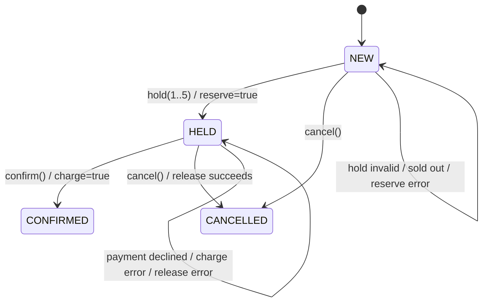

# Boundary Testing, State Transitions, and Error-Path Testing in Business Unit Tests

## 1. Goal: Test Around Business Rules, Not Just Methods

Business unit tests verify **rules**, **state transitions**, and **failure responses** of an object or service. A method that returns expected values on ordinary inputs can still be wrong at boundaries, allow illegal transitions, or trigger side effects when a dependency throws an error.

Three complementary perspectives:

- **Boundary value analysis:** which conditions hold at min/max, immediately below, and immediately above thresholds, including null/empty/type-edge inputs if the business layer accepts them?
- **State transition testing:** from a given current state, which events are valid, what is the next state, and on invalid events, do the object and dependencies remain unchanged?
- **Error-path/exception-path testing:** for bad input, business rejections, timeouts, connection errors, or write failures, which response/exception must occur and which invariants must remain protected?

Quality cannot be inferred from **100% code coverage** alone: an executed line may lack meaningful assertions; 100% line coverage does not guarantee compound branch conditions, transition sequences, or side-effect checks are covered.

### Three layers of evidence for a strong test

1. **Direct outcome:** return value or exception of the exact expected type, with contract-matching message/code.
2. **Post-operation state:** the object ends in the right state, and amounts/inventory/orders are not wrongly mutated.
3. **Dependency interactions:** dependencies are called the expected number of times and with expected arguments, or **not called at all** on validation failures and illegal transitions.

For example: with a requirement to hold **1 to 5 seats**, testing `hold(0)` must not stop at `assertThrows(IllegalArgumentException.class, ...)`; it must also verify the state remains `NEW` and no seat-reservation call reached the external system.

## 2. Define a Sample Contract Before Writing Tests

We will model a **BookingWorkflow** in Java 17 with no Spring context dependency. The object interacts with two boundaries: `Inventory` (reserve/release seats) and `PaymentGateway` (charge money). In a real Spring Boot project, these boundaries can be Spring beans injected into a service.

### States

| State | Meaning |
| --- | --- |
| `NEW` | Neither seats reserved nor payment charged |
| `HELD` | Seat reservation confirmed by dependency |
| `CONFIRMED` | Payment charge confirmed |
| `CANCELLED` | Booking cancelled |

Business events:

- `hold(seats)` is permitted only from `NEW`; `seats` must be an **integer from 1 to 5**, inclusive.
- `Inventory.reserve(seats)` returns `true`: transition `NEW → HELD`, store `seats`. Returns `false`: throw `SoldOutException`, remain `NEW`. Throws a technical exception: propagate error, remain `NEW` in memory.
- `confirm()` is permitted only from `HELD`; calls `PaymentGateway.charge(seats * 1_000)`. Returns `true`: transition `HELD → CONFIRMED`. Returns `false`: throw `PaymentDeclinedException` and remain `HELD`. Technical error: propagate exception, remain `HELD` in memory.
- `cancel()` from `NEW`: transition `NEW → CANCELLED`, no external calls. From `HELD`: call `Inventory.release(seats)`, if normal then `HELD → CANCELLED`, if it throws then remain `HELD` in memory.
- `cancel()` from `CONFIRMED` or `CANCELLED`: rejected with `IllegalStateException`. Refunds are outside this sample contract.
- Every event disallowed in the current state is blocked **before calling any dependency**. For `hold`, check state before checking `seats`; if both state and seat count are invalid at once, the state error takes precedence.

**This is a hypothetical contract for learning purposes.** Real products may support post-payment cancellation with refunds, idempotent repeated cancellations, a `PENDING` state, or split reservations and charges into a saga. When business rules differ, **change the state machine and expected outcomes**, never bend tests just to make them pass.

### State transition diagram



Self-loops back to `NEW`/`HELD` indicate **unchanged internal state**, not a guarantee that the remote system rolled back. Especially on timeouts, the remote service might have processed the request even though the client saw an error.

## 3. Designing Boundary Tests from the Input Domain

For the integer variable `seats ∈ [1,5]`, first build **equivalence classes**:

| Data class | Examples | Contract |
| --- | --- | --- |
| Below min | `-1`, `0` | Reject |
| Exact min | `1` | Accept if inventory has seats |
| Inside range | `3` | Accept if inventory has seats |
| Exact max | `5` | Accept if inventory has seats |
| Above max | `6`, `Integer.MAX_VALUE` | Reject |
| Negative extreme | `Integer.MIN_VALUE` | Reject |

The **minimal boundary set** around the edges is `0, 1, 5, 6`. Add `3` to represent the valid interior class and extremes `Integer.MIN_VALUE`/`MAX_VALUE` when catching overflow or broken comparison checks. For integers, `min-1`/`max+1` suffice within type bounds; at numeric extremes, never perform arithmetic that overflows when constructing test data.

A comparison bug caught by boundary tests:

```java
// Wrong: rejects min=1 and max=5 as well.
if (seats <= 1 || seats >= 5) {
    throw new IllegalArgumentException();
}

// Right for contract [1, 5].
if (seats < 1 || seats > 5) {
    throw new IllegalArgumentException();
}
```

### Input test matrix

| ID | Given | When | Then and invariants |
| --- | --- | --- | --- |
| B01 | `NEW`, inventory allows hold | `hold(1)` | `HELD`; `reserve(1)` once |
| B02 | `NEW`, inventory allows hold | `hold(3)` | `HELD`; `reserve(3)` once |
| B03 | `NEW`, inventory allows hold | `hold(5)` | `HELD`; `reserve(5)` once |
| B04 | `NEW` | `hold(0)` | `IllegalArgumentException`; `NEW`; no inventory/payments calls |
| B05 | `NEW` | `hold(6)` | `IllegalArgumentException`; `NEW`; no inventory/payments calls |
| B06 | `NEW` | `hold(-1)` | `IllegalArgumentException`; no side effects |
| B07 | `NEW` | `hold(Integer.MIN_VALUE)` | `IllegalArgumentException`; no side effects |
| B08 | `NEW` | `hold(Integer.MAX_VALUE)` | `IllegalArgumentException`; no side effects |

**Check every part of Then.** If code calls inventory before validating, a test checking only the exception may pass while executing an illegal side effect. With mocks, `verifyNoInteractions(inventory, payments)` catches this ordering bug.

### Non-numeric boundaries

- Strings: `null`, `""`, whitespace-only strings, exact min/max lengths, multi-codepoint/UTF-16 Unicode, leading/trailing whitespace.
- Dates/times: before/at/after deadlines, date rollovers, timezones, DST, `Instant` vs `LocalDateTime`; requires an injected clock for deterministic tests.
- Money: `BigDecimal`, scale, rounding, min/max, negative/zero, currency; never use `double` for exact monetary representation.
- Collections: `0, 1, max, max+1` elements; duplicates, ordering, `null` items if allowed by contract.
- Retry counts: `0, 1, maxAttempts, maxAttempts+1` calls (where an extra attempt must be blocked).

For JSON inputs missing fields, having wrong types, or violating `@Valid`, parsing/Bean Validation lives in the MVC/HTTP layer; unit tests on `BookingWorkflow` alone do not prove HTTP `400`. When API contracts matter too, add `@WebMvcTest`/MockMvc tests at the appropriate layer.

## 4. State Transition Testing: Valid, Illegal, and Event Sequences

Testing isolated methods is not enough. Stateful logic depends on **event history**, because the same `confirm()` is valid in `HELD` yet illegal in `NEW` or `CANCELLED`.

### Transition table for the sample contract

| Prior state | Event | Condition/dependency | Next state | Error if unsatisfied |
| --- | --- | --- | --- | --- |
| `NEW` | `hold(n)` | `1≤n≤5`, reserve=true | `HELD` | None |
| `NEW` | `hold(n)` | `n` out of range | `NEW` | `IllegalArgumentException` |
| `NEW` | `hold(n)` | reserve=false | `NEW` | `SoldOutException` |
| `NEW` | `hold(n)` | reserve throws error | `NEW` | Technical exception |
| `NEW` | `confirm()` | No hold exists | `NEW` | `IllegalStateException` |
| `NEW` | `cancel()` | No dependency needed | `CANCELLED` | None |
| `HELD` | `confirm()` | charge=true | `CONFIRMED` | None |
| `HELD` | `confirm()` | charge=false | `HELD` | `PaymentDeclinedException` |
| `HELD` | `confirm()` | charge throws error | `HELD` | Technical exception |
| `HELD` | `cancel()` | release succeeds | `CANCELLED` | None |
| `HELD` | `cancel()` | release throws error | `HELD` | Technical exception |
| `HELD` | `hold(n)` | Whether `n` is valid or not | `HELD` | `IllegalStateException` |
| `CONFIRMED` | `hold(n)`, `confirm()`, `cancel()` | Unsupported by contract | `CONFIRMED` | `IllegalStateException` |
| `CANCELLED` | `hold(n)`, `confirm()`, `cancel()` | Unsupported by contract | `CANCELLED` | `IllegalStateException` |

Coverage levels can be broken down as:

- **State coverage:** every state appears in at least one test.
- **Transition coverage:** every valid transition is exercised at least once.
- **Invalid-transition coverage:** forbidden events in each state are attempted, verifying unchanged state and zero unexpected dependency calls.
- **Transition-pair coverage:** when rules depend on two consecutive events, test pairs (e.g., `hold → confirm`, `hold → cancel`, `cancel → cancel`). Not every system needs every pair; prioritize by risk.

For each transition, ask “is there a **side effect**?”: `hold` reserves seats, `confirm` charges money, `cancel` from `HELD` releases seats. Reaching the right state while charging **twice** is still a bug.

### Key sequences to test

1. `NEW → hold(1) → HELD → confirm() → CONFIRMED`: full happy path, exact reserve/charge call counts.
2. `NEW → hold(5) → HELD → cancel() → CANCELLED`: cancel must release the exact seat count; payment never called.
3. `NEW → cancel() → CANCELLED → hold(1)`: hold after cancel must be rejected.
4. `NEW → hold(2) → HELD → confirm() (declined) → HELD`: does not move to CONFIRMED when charge=false.
5. `NEW → hold(2) → HELD → cancel() (release fails) → HELD`: does not mark CANCELLED when release has not been confirmed.
6. `NEW → confirm()`: invalid transition from the start; no reserve/charge.
7. `NEW → hold(2) → HELD → confirm() (success) → CONFIRMED → cancel()`: does not call release because cancelling paid bookings is outside the sample contract.
8. `NEW → cancel() → CANCELLED → cancel()`: second cancel is rejected under the example's **non-idempotent** contract.

## 5. Error-Path Matrix: Separating “Input Error”, “Cannot Execute”, and “Technical Error”

| ID | Error source | Expected service exception/response | Resulting state | Calls to verify |
| --- | --- | --- | --- | --- |
| E01 | `hold(0)` in NEW | `IllegalArgumentException` | NEW | No reserve/charge |
| E02 | `reserve` returns `false` | `SoldOutException` | NEW | Reserve once, no charge |
| E03 | `reserve` throws `RemoteUnavailableException` | Technical error propagated | NEW | Reserve once, no charge |
| E04 | `confirm()` from NEW | `IllegalStateException` | NEW | No external calls |
| E05 | `charge` returns `false` | `PaymentDeclinedException` | HELD | Charge once for exact total |
| E06 | `charge` throws `RemoteUnavailableException` | Technical error propagated | HELD | Charge once; no auto-retry |
| E07 | `release` throws `RemoteUnavailableException` | Technical error propagated | HELD | Release once; not marked cancelled |
| E08 | `cancel()` from CONFIRMED | `IllegalStateException` | CONFIRMED | No release |
| E09 | `hold/confirm/cancel` from CANCELLED | `IllegalStateException` | CANCELLED | No reserve/charge/release |
| E10 | `hold(n)` in HELD | `IllegalStateException` | HELD | No second reserve |

**Domain errors** (sold out, payment declined) are expected business states/branches. **Technical errors** (timeouts, broken connections, DB errors) indicate the dependency could not provide a trustworthy answer. These two categories may require completely different retry/alert/HTTP mapping policies; unit tests must reflect the agreed contract.

When testing error paths, do not stop at `assertThrows`. Verify the exact exception type, unchanged/correct state, and **no subsequent side effects**. When exceptions carry messages, you may assert stable application-defined messages; avoid coupling to stack traces or non-contract runtime messages.

### Critical limit of unit tests with external dependencies

Suppose `PaymentGateway.charge` throws a timeout. Unit tests can prove **the service did not move to `CONFIRMED` in memory**, but **cannot prove the bank did not debit the card**. The remote side effect may have succeeded before the response was lost. Likewise, `reserve`/`release` may already have updated remote stock before reporting an error. In production, use idempotency keys, reconciliation workflows, intermediate states, or compensation as required by the business.

Do not assume “mock throwing an exception” equals a real transaction rollback. For DB-backed systems, `@Transactional` rollbacks, committed rows, Spring proxy retries, and external consistency require dedicated integration tests.

## 6. Choosing Assertions and Interactions That Make Tests Meaningful

| Action | Assert result | Assert state | Assert dependency |
| --- | --- | --- | --- |
| Valid `hold(1)` | No exception | HELD, seats=1 | `reserve(1)` once; charge never called |
| `hold(0)` | `IllegalArgumentException` | NEW, seats=0 | `verifyNoInteractions(...)` |
| Sold out | `SoldOutException` | NEW | Reserve once, no charge |
| Successful `confirm()` | No exception | CONFIRMED | Charge exact `seats * 1_000`, once |
| Charge declined | `PaymentDeclinedException` | HELD | Charge once, no release |
| `cancel()` from HELD | No exception | CANCELLED | Release exact seats, once |
| Release error | Technical exception | HELD | Release once, no state change |
| Illegal transition | `IllegalStateException` | Unchanged | No further dependency calls |

Useful Mockito APIs:

```java
// Illustrative snippet; requires mock inventory/payment and workflow object.
verify(inventory, times(1)).reserve(2);
verify(payments, never()).charge(anyInt());
verify(inventory, never()).release(anyInt());
verifyNoInteractions(inventory, payments); // Only in tests with no calls yet.
```

Specifically, `verifyNoInteractions(inventory, payments)` **cannot be used after reserve has already been called**. When verifying no new call occurred, use `verify(..., never()).release(...)` or `verifyNoMoreInteractions(...)` after verifying valid interactions. Avoid locking down call counts that are not part of the contract, as that makes tests brittle during refactoring.

## 7. Runnable Java 17 Lab: State + Boundaries + Error Paths

The complete example below runs with JUnit Jupiter and Mockito, compatible with Spring Boot 3.5 and Java 17. It uses `spring-boot-starter-test` in `test` scope; no database, web server, or `@SpringBootTest` is needed since we are testing plain Java logic.

### 7.1. Project structure

```text
booking-workflow-demo/
├── pom.xml
└── src/
    └── test/
        └── java/
            └── example/
                └── BookingWorkflowTest.java
```

### 7.2. Complete pom.xml

```xml
<?xml version="1.0" encoding="UTF-8"?>
<project xmlns="http://maven.apache.org/POM/4.0.0"
         xmlns:xsi="http://www.w3.org/2001/XMLSchema-instance"
         xsi:schemaLocation="http://maven.apache.org/POM/4.0.0
         https://maven.apache.org/xsd/maven-4.0.0.xsd">
    <modelVersion>4.0.0</modelVersion>
    <parent>
        <groupId>org.springframework.boot</groupId>
        <artifactId>spring-boot-starter-parent</artifactId>
        <version>3.5.0</version>
        <relativePath/>
    </parent>
    <groupId>example</groupId>
    <artifactId>booking-workflow-demo</artifactId>
    <version>1.0-SNAPSHOT</version>
    <properties>
        <java.version>17</java.version>
    </properties>
    <dependencies>
        <dependency>
            <groupId>org.springframework.boot</groupId>
            <artifactId>spring-boot-starter-test</artifactId>
            <scope>test</scope>
        </dependency>
    </dependencies>
</project>
```

The example packages domain fixtures and tests together in one test source so learners only need two files. In real applications, `BookingWorkflow`, `Inventory`, and `PaymentGateway` should reside in `src/main/java` and tests in `src/test/java`. Do not treat placing production types inside test sources as production architecture.

### 7.3. Complete BookingWorkflowTest.java

```java
package example;

import static org.junit.jupiter.api.Assertions.assertEquals;
import static org.junit.jupiter.api.Assertions.assertThrows;
import static org.mockito.ArgumentMatchers.anyInt;
import static org.mockito.Mockito.doThrow;
import static org.mockito.Mockito.mock;
import static org.mockito.Mockito.never;
import static org.mockito.Mockito.times;
import static org.mockito.Mockito.verify;
import static org.mockito.Mockito.verifyNoInteractions;
import static org.mockito.Mockito.verifyNoMoreInteractions;
import static org.mockito.Mockito.when;

import org.junit.jupiter.api.Test;
import org.junit.jupiter.params.ParameterizedTest;
import org.junit.jupiter.params.provider.ValueSource;

class BookingWorkflowTest {

    enum State { NEW, HELD, CONFIRMED, CANCELLED }

    interface Inventory {
        boolean reserve(int seats);
        void release(int seats);
    }

    interface PaymentGateway {
        boolean charge(int amountCents);
    }

    static class SoldOutException extends RuntimeException {}

    static class PaymentDeclinedException extends RuntimeException {}

    static class RemoteUnavailableException extends RuntimeException {
        RemoteUnavailableException(String message) {
            super(message);
        }
    }

    static final class BookingWorkflow {
        private final Inventory inventory;
        private final PaymentGateway payments;
        private State state = State.NEW;
        private int seats;

        BookingWorkflow(Inventory inventory, PaymentGateway payments) {
            this.inventory = inventory;
            this.payments = payments;
        }

        State state() {
            return state;
        }

        int seats() {
            return seats;
        }

        void hold(int requestedSeats) {
            requireState(State.NEW);

            if (requestedSeats < 1 || requestedSeats > 5) {
                throw new IllegalArgumentException("seats must be 1..5");
            }
            if (!inventory.reserve(requestedSeats)) {
                throw new SoldOutException();
            }

            seats = requestedSeats;
            state = State.HELD;
        }

        void confirm() {
            requireState(State.HELD);
            if (!payments.charge(seats * 1_000)) {
                throw new PaymentDeclinedException();
            }
            state = State.CONFIRMED;
        }

        void cancel() {
            switch (state) {
                case NEW -> state = State.CANCELLED;
                case HELD -> {
                    inventory.release(seats);
                    state = State.CANCELLED;
                }
                case CONFIRMED, CANCELLED ->
                        throw new IllegalStateException(
                                "Cannot cancel from " + state);
            }
        }

        private void requireState(State expected) {
            if (state != expected) {
                throw new IllegalStateException(
                        "Expected " + expected + ", was " + state);
            }
        }
    }

    @ParameterizedTest
    @ValueSource(ints = {Integer.MIN_VALUE, -1, 0, 6, Integer.MAX_VALUE})
    void invalidSeatCountsAreRejectedBeforeReserve(int value) {
        Inventory inventory = mock(Inventory.class);
        PaymentGateway payments = mock(PaymentGateway.class);
        BookingWorkflow booking = new BookingWorkflow(inventory, payments);

        IllegalArgumentException ex = assertThrows(
                IllegalArgumentException.class,
                () -> booking.hold(value));

        assertEquals("seats must be 1..5", ex.getMessage());
        assertEquals(State.NEW, booking.state());
        assertEquals(0, booking.seats());
        verifyNoInteractions(inventory, payments);
    }

    @ParameterizedTest
    @ValueSource(ints = {1, 3, 5})
    void validSeatCountsCanBeHeld(int value) {
        Inventory inventory = mock(Inventory.class);
        PaymentGateway payments = mock(PaymentGateway.class);
        when(inventory.reserve(value)).thenReturn(true);
        BookingWorkflow booking = new BookingWorkflow(inventory, payments);

        booking.hold(value);

        assertEquals(State.HELD, booking.state());
        assertEquals(value, booking.seats());
        verify(inventory, times(1)).reserve(value);
        verifyNoMoreInteractions(inventory);
        verifyNoInteractions(payments);
    }

    @Test
    void soldOutDoesNotMoveFromNew() {
        Inventory inventory = mock(Inventory.class);
        PaymentGateway payments = mock(PaymentGateway.class);
        when(inventory.reserve(2)).thenReturn(false);
        BookingWorkflow booking = new BookingWorkflow(inventory, payments);

        assertThrows(SoldOutException.class, () -> booking.hold(2));

        assertEquals(State.NEW, booking.state());
        assertEquals(0, booking.seats());
        verify(inventory).reserve(2);
        verifyNoInteractions(payments);
    }

    @Test
    void inventoryTechnicalErrorDoesNotMoveFromNew() {
        Inventory inventory = mock(Inventory.class);
        PaymentGateway payments = mock(PaymentGateway.class);
        when(inventory.reserve(2))
                .thenThrow(new RemoteUnavailableException("inventory timeout"));
        BookingWorkflow booking = new BookingWorkflow(inventory, payments);

        RemoteUnavailableException ex = assertThrows(
                RemoteUnavailableException.class, () -> booking.hold(2));

        assertEquals("inventory timeout", ex.getMessage());
        assertEquals(State.NEW, booking.state());
        verify(inventory).reserve(2);
        verifyNoInteractions(payments);
    }

    @Test
    void confirmingNewBookingIsIllegal() {
        Inventory inventory = mock(Inventory.class);
        PaymentGateway payments = mock(PaymentGateway.class);
        BookingWorkflow booking = new BookingWorkflow(inventory, payments);

        assertThrows(IllegalStateException.class, booking::confirm);

        assertEquals(State.NEW, booking.state());
        verifyNoInteractions(inventory, payments);
    }

    @Test
    void holdThenConfirmChangesToConfirmed() {
        Inventory inventory = mock(Inventory.class);
        PaymentGateway payments = mock(PaymentGateway.class);
        when(inventory.reserve(2)).thenReturn(true);
        when(payments.charge(2_000)).thenReturn(true);
        BookingWorkflow booking = new BookingWorkflow(inventory, payments);

        booking.hold(2);
        assertEquals(State.HELD, booking.state());

        booking.confirm();

        assertEquals(State.CONFIRMED, booking.state());
        verify(inventory, times(1)).reserve(2);
        verify(payments, times(1)).charge(2_000);
        verify(inventory, never()).release(anyInt());
    }

    @Test
    void rejectedPaymentKeepsHeldState() {
        Inventory inventory = mock(Inventory.class);
        PaymentGateway payments = mock(PaymentGateway.class);
        when(inventory.reserve(3)).thenReturn(true);
        when(payments.charge(3_000)).thenReturn(false);
        BookingWorkflow booking = new BookingWorkflow(inventory, payments);
        booking.hold(3);

        assertThrows(PaymentDeclinedException.class, booking::confirm);

        assertEquals(State.HELD, booking.state());
        verify(payments, times(1)).charge(3_000);
        verify(inventory, never()).release(anyInt());
    }

    @Test
    void paymentCanSucceedOnSecondExplicitConfirmation() {
        Inventory inventory = mock(Inventory.class);
        PaymentGateway payments = mock(PaymentGateway.class);
        when(inventory.reserve(1)).thenReturn(true);
        when(payments.charge(1_000)).thenReturn(false, true);
        BookingWorkflow booking = new BookingWorkflow(inventory, payments);
        booking.hold(1);

        assertThrows(PaymentDeclinedException.class, booking::confirm);
        assertEquals(State.HELD, booking.state());

        booking.confirm();

        assertEquals(State.CONFIRMED, booking.state());
        verify(payments, times(2)).charge(1_000);
        verify(inventory, times(1)).reserve(1);
    }

    @Test
    void paymentTechnicalErrorKeepsLocalStateHeld() {
        Inventory inventory = mock(Inventory.class);
        PaymentGateway payments = mock(PaymentGateway.class);
        when(inventory.reserve(2)).thenReturn(true);
        when(payments.charge(2_000))
                .thenThrow(new RemoteUnavailableException("payment timeout"));
        BookingWorkflow booking = new BookingWorkflow(inventory, payments);
        booking.hold(2);

        assertThrows(RemoteUnavailableException.class, booking::confirm);

        assertEquals(State.HELD, booking.state());
        verify(payments, times(1)).charge(2_000);
        verify(inventory, never()).release(anyInt());
    }

    @Test
    void newBookingCancelsWithoutExternalCalls() {
        Inventory inventory = mock(Inventory.class);
        PaymentGateway payments = mock(PaymentGateway.class);
        BookingWorkflow booking = new BookingWorkflow(inventory, payments);

        booking.cancel();

        assertEquals(State.CANCELLED, booking.state());
        verifyNoInteractions(inventory, payments);
    }

    @Test
    void heldBookingReleasesTheReservedSeatsOnCancel() {
        Inventory inventory = mock(Inventory.class);
        PaymentGateway payments = mock(PaymentGateway.class);
        when(inventory.reserve(5)).thenReturn(true);
        BookingWorkflow booking = new BookingWorkflow(inventory, payments);
        booking.hold(5);

        booking.cancel();

        assertEquals(State.CANCELLED, booking.state());
        verify(inventory).reserve(5);
        verify(inventory, times(1)).release(5);
        verifyNoInteractions(payments);
    }

    @Test
    void releaseErrorLeavesHeldLocally() {
        Inventory inventory = mock(Inventory.class);
        PaymentGateway payments = mock(PaymentGateway.class);
        when(inventory.reserve(2)).thenReturn(true);
        doThrow(new RemoteUnavailableException("release timeout"))
                .when(inventory).release(2);
        BookingWorkflow booking = new BookingWorkflow(inventory, payments);
        booking.hold(2);

        assertThrows(RemoteUnavailableException.class, booking::cancel);

        assertEquals(State.HELD, booking.state());
        verify(inventory).reserve(2);
        verify(inventory, times(1)).release(2);
        verifyNoInteractions(payments);
    }

    @Test
    void confirmedBookingCannotBeCancelled() {
        Inventory inventory = mock(Inventory.class);
        PaymentGateway payments = mock(PaymentGateway.class);
        when(inventory.reserve(1)).thenReturn(true);
        when(payments.charge(1_000)).thenReturn(true);
        BookingWorkflow booking = new BookingWorkflow(inventory, payments);
        booking.hold(1);
        booking.confirm();

        assertThrows(IllegalStateException.class, booking::cancel);

        assertEquals(State.CONFIRMED, booking.state());
        verify(inventory, never()).release(anyInt());
        verify(payments, times(1)).charge(1_000);
    }

    @Test
    void cancellingTwiceIsIllegalInThisContract() {
        Inventory inventory = mock(Inventory.class);
        PaymentGateway payments = mock(PaymentGateway.class);
        BookingWorkflow booking = new BookingWorkflow(inventory, payments);
        booking.cancel();

        assertThrows(IllegalStateException.class, booking::cancel);

        assertEquals(State.CANCELLED, booking.state());
        verifyNoInteractions(inventory, payments);
    }

    @Test
    void holdAfterCancelIsRejectedBeforeReserve() {
        Inventory inventory = mock(Inventory.class);
        PaymentGateway payments = mock(PaymentGateway.class);
        BookingWorkflow booking = new BookingWorkflow(inventory, payments);
        booking.cancel();

        assertThrows(IllegalStateException.class, () -> booking.hold(1));

        assertEquals(State.CANCELLED, booking.state());
        verifyNoInteractions(inventory, payments);
    }

    @Test
    void confirmAfterCancelIsRejectedBeforeCharge() {
        Inventory inventory = mock(Inventory.class);
        PaymentGateway payments = mock(PaymentGateway.class);
        BookingWorkflow booking = new BookingWorkflow(inventory, payments);
        booking.cancel();

        assertThrows(IllegalStateException.class, booking::confirm);

        assertEquals(State.CANCELLED, booking.state());
        verifyNoInteractions(inventory, payments);
    }
}
```

### 7.4. Run command and expected result

From the directory containing `pom.xml`, run:

```bash
mvn test -Dtest=BookingWorkflowTest
```

Or use Maven Wrapper if the project includes one: `./mvnw test -Dtest=BookingWorkflowTest` on Linux/macOS; `mvnw.cmd test -Dtest=BookingWorkflowTest` in Windows CMD.

**Expected result:** all test cases PASS without a database or Spring context; the class prints nothing via `System.out.println`, so there is no fixed program stdout. JUnit executes **16 test methods** (2 parameterized methods producing 5 + 3 invocations, plus 14 `@Test` methods, totaling **22 test invocations**); exact reported counts may vary by runner. If any test fails, open Surefire reports in `target/surefire-reports` to inspect which assertion or verify failed.

**Demo limitations:** data/state resides in memory with no persistence, transactions, HTTP, or message broker. You cannot use these tests to conclude DB rollback, locking, or remote idempotency work properly. Real state machines need a design for ambiguous timeout outcomes; this guide covers unit-level testing.

### 7.5. What each test proves

| Test name | Scenario / coverage | Result & side effects |
| --- | --- | --- |
| `invalidSeatCountsAreRejectedBeforeReserve` | Min-1/max+1, negative/extremes | Input exception; NEW; no interactions |
| `validSeatCountsCanBeHeld` | Valid min/mid/max | HELD; reserve with exact input |
| `soldOutDoesNotMoveFromNew` | Business-rejection branch | SoldOut; NEW; no charge |
| `inventoryTechnicalErrorDoesNotMoveFromNew` | Reserve technical-error branch | RemoteUnavailable; NEW |
| `confirmingNewBookingIsIllegal` | Illegal transition NEW→confirm | Exception; no side effects |
| `holdThenConfirmChangesToConfirmed` | NEW→HELD→CONFIRMED | Charge once for exact total |
| `rejectedPaymentKeepsHeldState` | HELD with charge=false | Declined; state HELD |
| `paymentCanSucceedOnSecondExplicitConfirmation` | Declined→success sequence | 2 explicit charges, CONFIRMED |
| `paymentTechnicalErrorKeepsLocalStateHeld` | Payment technical error | HELD in memory, no release |
| `newBookingCancelsWithoutExternalCalls` | NEW→CANCELLED | No interactions |
| `heldBookingReleasesTheReservedSeatsOnCancel` | HELD→CANCELLED | Release exact seat count |
| `releaseErrorLeavesHeldLocally` | Release error branch | HELD in memory |
| `confirmedBookingCannotBeCancelled` | Cancel forbidden after CONFIRMED | State unchanged, no release |
| `cancellingTwiceIsIllegalInThisContract` | Repeated transition forbidden | CANCELLED, no interactions |
| `holdAfterCancelIsRejectedBeforeReserve` | No hold after CANCELLED | Exception, no reserve |
| `confirmAfterCancelIsRejectedBeforeCharge` | No charge after CANCELLED | Exception, no charge |

A few transitions such as calling `hold` a second time while `HELD` or `confirm` again while `CONFIRMED` do not yet have dedicated test methods in this fixture; those are direct extensions from the transition table. When a real product demands full invalid-transition coverage, add the missing cases before considering the matrix complete.

## 8. Scaling Coverage with Real Complexity

### 8.1. Branch coverage vs condition coverage

```java
if (isVip && amount >= threshold) {
    applyDiscount();
}
```

Two tests—“VIP meeting threshold” and “non-VIP below threshold”—can execute both `true` and `false` branches without proving how each individual condition affects the decision. Consider:

| isVip | amount≥threshold | Expected branch |
| --- | --- | --- |
| true | true | Apply |
| true | false | Do not apply |
| false | true | Do not apply |
| false | false | Do not apply |

For highly sensitive logic, **MC/DC** can prove each condition independently affects the outcome, or use decision tables for combined rules. In ordinary systems, prioritize high-risk business combinations and boundaries before expanding test counts unchecked.

### 8.2. Property-based tests help expand boundary inputs

For an invariant like “values outside `[1,5]` must be rejected before calling inventory”, instead of a few hardcoded inputs you can generate many negative/large values to expose bugs. Property-based tools like jqwik can complement JUnit, though they are **not included automatically by Spring Boot's test starter** unless declared explicitly. When using generators, keep reproducible seeds and save the minimal counterexample for debugging.

An invariant stronger than single cases is: “`CONFIRMED` state can never be reached without a successful charge”. Unit tests can generate valid and invalid event sequences and compare outcomes against a reference state machine. However, the reference model must be independent and simple; copying production logic verbatim into the reference model risks repeating the same bug on both sides.

### 8.3. Mutation testing exposes weak assertions

Line coverage can be high even with broken code. Mutation testing alters operators (`<` to `<=`, `true` to `false`, dropping calls, etc.) and checks whether tests fail properly. For instance, changing `requestedSeats > 5` to `>= 5` must be caught by `hold(5)`. Dropping `state = CONFIRMED` must be caught by transition tests. Tools like PIT work for Java, though they are not installed by default via starter-test and require separate setup.

**Do not force mutation testing across every module at any cost**; prioritize complex stateful logic, money, authorization, threshold conditions, and subtle error paths.

### 8.4. Time data, immutable state, and concurrency

- Inject `Clock` instead of calling `LocalDateTime.now()` directly in testable logic; pass `Clock.fixed(...)` in unit tests to exercise just before/at/after deadlines.
- Prefer immutable value objects or state copies where appropriate; never let tests mutate private fields directly just to manufacture states unreachable via the real API.
- Concurrent modification/race-condition tests require multi-threaded runners, synchronization, or targeted integration tests; single-threaded unit tests do not prove thread safety.
- For asynchronous events, define eventual consistency, timeout budgets, and retry policies; avoid long `Thread.sleep` calls as state assertions.
- For persistence, verify optimistic locking, uniqueness, duplicate requests, and rollback/compensation in integration tests rather than relying solely on mock repositories.

## 9. Structuring Tests with Arrange–Act–Assert

Follow an easily scannable structure:

```java
@Test
void invalidSeatCountDoesNotCallInventory() {
    Inventory inventory = mock(Inventory.class);
    PaymentGateway payments = mock(PaymentGateway.class);
    BookingWorkflow booking = new BookingWorkflow(inventory, payments);

    // Act + Assert: contract exception.
    assertThrows(IllegalArgumentException.class, () -> booking.hold(0));

    // Assert: state and side effects.
    assertEquals(State.NEW, booking.state());
    verifyNoInteractions(inventory, payments);
}
```

This is an **excerpt** using types defined in section 7's fixture class. The complete standalone equivalent is named `invalidSeatCountsAreRejectedBeforeReserve`; do not copy this snippet into a project without those types and imports.

Practical guidelines:

1. **Each test should have one primary reason to fail**: test name and Given/When/Then align. You may assert multiple facets of that single behavior.
2. **Construct fresh fixtures per test** or via `@BeforeEach` for clean instances; tests must not depend on execution order.
3. **Avoid unused stubs.** When testing validation that forbids calling inventory, do not stub `when(inventory.reserve(...))`; that can mask bugs and trigger “unnecessary stubbing” warnings.
4. **Vary one factor at a time** when testing boundaries; for interacting rules, use deliberate decision tables or pairwise combinations.
5. **Call dependencies through interfaces** injected via constructor to mock cleanly at boundaries, avoiding mocking private methods or hard-to-control static global state.
6. **Assert state before and after** multi-step events, especially error paths. Return values alone cannot prove the system remains consistent.
7. **Do not over-verify.** Verify only call counts/orders required by the contract, avoiding brittle assertions on internal methods that may be legitimately refactored.

## 10. Distinguishing Business Unit Tests from API Boundary and Infrastructure Tests

| Risk | Suitable for business unit test? | Complementary tests needed |
| --- | --- | --- |
| Wrong formula/range `[1,5]` | Yes | MVC tests if Bean Validation/JSON also applies |
| Wrong state after event sequence | Yes | Integration tests if state is DB-persisted |
| Invalid transition not blocked | Yes | API tests if HTTP mapping is needed |
| Reserve/charge called too many times | Yes (verify) | Contract/integration tests for true idempotency |
| Gateway throws exception, local state mutated wrongly | Yes | Client adapter tests for timeouts/upstream 5xx |
| DB transaction rollback after failure | Insufficient if DB is mocked | `@SpringBootTest`/Testcontainers/transaction integration |
| Two concurrent requests holding the same seat | Insufficient if single-threaded | Integration/concurrency tests |
| JSON `quantity=null`, bad type, missing field | Outside `hold(int)` scope | `@WebMvcTest` + `MockMvc`, validation tests |
| HTTP status mapping `400/409/503` | Not defined by unit service alone | Controller/exception-handler tests |
| Publishing to right topic, retry, dead-letter | Mock only proves publisher call | Broker integration tests |

Spring Boot provides `spring-boot-starter-test` for JUnit Jupiter/Mockito and core test utilities. In pure Java unit tests, **do not use `@SpringBootTest`**, because booting a full Spring context slows execution and blurs failure causes. When testing Spring beans, use `@SpringBootTest`, test slices (e.g., `@WebMvcTest`/`@DataJpaTest`), and `@MockitoBean` matching your Spring Framework/Spring Boot version. In Boot 4 where test starters are modularized by technology, add the corresponding starter if needed; the layered testing mindset stays the same.

## 11. Common Test Design Mistakes

| Mistake | Why it is dangerous | Fix |
| --- | --- | --- |
| Testing only `hold(3)` | Off-by-one bugs at `1` and `5` slip through | Add `0,1,5,6` and meaningful extremes |
| Only calling `assertThrows` | Wrong state or side effect can still PASS | Assert state + `verifyNoInteractions`/`verify(...)` |
| Not testing forbidden transitions | Might charge before holding or cancel twice | Build a transition table across all states/events |
| Making every exception `RuntimeException` and testing one case | Conflates business vs technical failures | Use contract exception types; test each branch |
| Treating timeout as proof remote side did nothing | Can double-charge/double-reserve on retry | Idempotency, reconciliation, and integration tests |
| Relying on mock returning `false` without stubbing | Test may pass solely via Mockito defaults | Explicitly stub behavior when it is the test's Given |
| Marking CANCELLED even when release fails | Local state claims cancelled without confirmation | Transition state only after successful response |
| Using `@SpringBootTest` for simple arithmetic | Increases runtime and config coupling | Pure JUnit tests with Mockito boundaries |
| Omitting state assertions after exceptions | “Partial update” bugs go undetected | Assert unchanged state/rollback within unit scope |
| Cramming every event sequence into one giant test | Hard to isolate which step broke | Split tests around key transitions with clear names |
| Sharing stateful fixtures across test methods | Results depend on execution order | Fresh fixture per test, no mutable statics |
| Asserting fixed order for every internal call | Breaks easily on valid refactoring | Assert ordering only when it is a business invariant |
| Skipping state matrix because line coverage is high | Illegal transitions may be untested | Cross-check transition table + branch tests |
| Mocking DB to claim transaction rollback | Mocks have no transactional behavior | Integration tests with an appropriate DB |

## 12. Design and Acceptance Checklist

For every business requirement, verify:

- [ ] Input domains, min/max, and equivalence classes are defined, including null/blank if applicable?
- [ ] Tests exist just below, at, and just above every critical boundary?
- [ ] A clear state machine/transition table exists, including forbidden events?
- [ ] All valid transitions and high-risk illegal transitions are covered?
- [ ] Input errors, business rejections, and technical errors are each distinguished?
- [ ] Exact exception types, post-error states, and zero extra side effects are verified?
- [ ] External side-effect calls are verified for exact arguments and counts?
- [ ] Ordering of validation before dependency calls and state updates after success is checked?
- [ ] Tests are independent and deterministic, avoiding wall clock/network/real DB when unnecessary?
- [ ] When retrying after timeout, is there an idempotency contract and verifying integration test?
- [ ] Complex conditional branches are verified with decision tables or appropriate condition coverage?
- [ ] Line/branch coverage is used as a signal, not a substitute for business assertions?
- [ ] MVC, DB, and concurrency tests complement what unit tests cannot prove?
- [ ] Maven/Gradle actually ran the tests; reports were not unintentionally filtered or skipped?

### Matrix template for other business domains

| Test ID | Requirement | Prior state | Input/event | Dependency outcome | Expected state/exception | Side-effect assertion |
| --- | --- | --- | --- | --- | --- | --- |
| TC-001 | Valid boundary | NEW | min | success | HELD | Call with exact min once |
| TC-002 | Just below min | NEW | min−1 | Not called | IllegalArgumentException; NEW | No interactions |
| TC-003 | Just above max | NEW | max+1 | Not called | IllegalArgumentException; NEW | No interactions |
| TC-004 | Valid transition | HELD | confirm | success | CONFIRMED | Charge once |
| TC-005 | Illegal transition | NEW | confirm | Not called | IllegalStateException; NEW | No charge |
| TC-006 | Business rejection | HELD | confirm | decline | PaymentDeclinedException; HELD | Charge once |
| TC-007 | Infrastructure error | HELD | cancel | timeout | RemoteUnavailableException; local HELD | Release once; verify remote state separately |

Adapt states and exceptions to your real domain; never assume local state after a timeout reflects remote state.

## 13. Official References

1. [JUnit User Guide — Parameterized Tests](https://docs.junit.org/5.13.1/user-guide/index.html#writing-tests-parameterized-tests): `@ParameterizedTest`, `@ValueSource`, `@CsvSource`, and test data sources.
2. [JUnit User Guide — Assertions](https://docs.junit.org/5.13.1/user-guide/index.html#writing-tests-assertions): `assertEquals`, `assertThrows`, and outcome checks.
3. [Mockito API](https://javadoc.io/doc/org.mockito/mockito-core/latest/org.mockito/org/mockito/Mockito.html): `when`, `verify`, `verifyNoInteractions`, `times`, and stubbing exceptions.
4. [Spring Boot 3.5 — Testing](https://docs.spring.io/spring-boot/3.5/reference/testing/index.html) and [Testing Spring Boot Applications](https://docs.spring.io/spring-boot/3.5/reference/testing/spring-boot-applications.html): test starter, context, and test slices.
5. [Spring Boot Reference — Testing](https://docs.spring.io/spring-boot/reference/testing/): reference technology-specific test modules if using Spring Boot 4.x.

**Core principle:** boundary tests answer “are the thresholds right”; state transition tests answer “is moving forward valid”; error-path tests answer “when things fail, does the system preserve its invariants”. A trustworthy business unit test verifies **outcome, state, and dependency interactions** together.