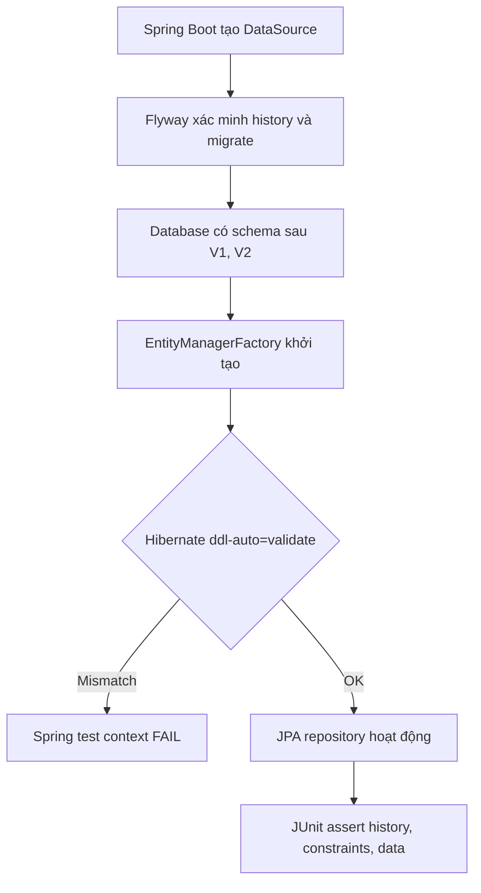

# Spring Data JPA — Kiểm chứng migration và schema thay vì chỉ dựa vào tự tạo bảng

## 1. Vấn đề thực tế

Một bài kiểm thử `Spring Data JPA` có thể thành công chỉ vì Hibernate tự tạo bảng khi test bắt đầu. Nhưng môi trường production có schema từ nhiều lần triển khai, dữ liệu cần bảo toàn, unique constraint, check constraint, index, khóa ngoại và các ứng dụng chạy đồng thời. Khi đó `spring.jpa.hibernate.ddl-auto=create-drop` **không chứng minh** script nâng cấp database chạy đúng.

Bài học này hướng dẫn xác minh **migrations + schema + dữ liệu** với Spring Boot 3.5, Java 17, Hibernate, Flyway và JUnit. Ta sẽ chứng minh:

1. Các script `V1`, `V2` được áp dụng bởi Flyway vào database mới.
2. Hibernate có thể dùng schema đó ở chế độ `validate` mà **không phát DDL**.
3. Bảng, cột, nullability và index thật sự có mặt trong database.
4. `UNIQUE`, `NOT NULL` và `CHECK` được chính database thực thi.
5. Một record được tạo khi schema còn ở `V1` vẫn nguyên dữ liệu sau khi nâng lên `V2`.
6. Chạy lại migration không nhân bản rows hoặc ghi thêm một phiên bản sai.
7. Flyway từ chối một `V1` đã áp dụng nhưng bị chỉnh sửa checksum.
8. Phân biệt kết luận hợp lý từ H2 với những trường hợp cần PostgreSQL/Testcontainers thực.

### Vì sao đây là nhiệm vụ quan trọng?

| Một test có thể PASS vì… | Nhưng thực tế vẫn có thể sai… |
| --- | --- |
| Hibernate tạo bảng từ entity bằng `create-drop` | File `V2__add_status.sql` có cú pháp không chạy được |
| Repository `save()` trả entity | Dữ liệu chưa được flush và DB constraint chưa được kiểm tra |
| `contextLoads` thành công | Index, check constraint hay foreign key bị thiếu |
| H2 hiểu được câu SQL | PostgreSQL không chấp nhận cú pháp/index/transaction DDL đó |
| Database trống migrate thành công | Dữ liệu cũ khiến `NOT NULL`/`UNIQUE` ở V2 thất bại |
| Flyway history vẫn có `success=true` | DBA đã sửa tay table hoặc xóa index ngoài Flyway |
| `ddl-auto=validate` không báo lỗi | Triggers, constraints, privileges và plans khác yêu cầu |
| Test sử dụng một phiên bản mới nhất | App phiên bản cũ không còn chạy được trong rolling deploy |

**Nguyên tắc:** để kiểm thử migration, **Flyway/Liquibase phải sở hữu DDL**, còn Hibernate chỉ validate; cần test thêm cấu trúc, constraints và quá trình nâng cấp có dữ liệu thật.

## 2. Hibernate ddl-auto: chọn đúng mức

`spring.jpa.hibernate.ddl-auto` có các giá trị thường dùng:

| Giá trị | Hành động | Có phù hợp test migration? |
| --- | --- | --- |
| `none` | Hibernate không tạo hoặc xác minh schema | Có thể, nhưng không phát hiện sớm mismatch entity–table |
| `validate` | Hibernate đối chiếu schema với một phần metadata của entity, **không sửa DB** | **Nên dùng** |
| `update` | Hibernate có thể thêm/sửa schema từ mapping | **Không**; có thể che migration lỗi |
| `create` | Tạo schema mới từ mapping | **Không**; bỏ qua đường nâng cấp |
| `create-drop` | Tạo rồi xóa schema trong vòng đời context | **Không**; gây test xanh giả |

Nếu chỉ muốn minh họa JPA nhanh, `create-drop` đôi khi chấp nhận được. Nhưng khi mục tiêu là **kiểm chứng migration**, dùng nó sẽ làm sai đối tượng kiểm thử.

Cấu hình được khuyến nghị trong project bài học:

```properties
spring.jpa.hibernate.ddl-auto=validate
spring.flyway.enabled=true
spring.sql.init.mode=never
```

`spring.sql.init.mode=never` tránh để `schema.sql` hoặc `data.sql` tạo/sửa bảng ngoài cơ chế Flyway. Không khuyến nghị cùng lúc bật Hibernate auto-DDL, Boot SQL initializer và Flyway quản lý **cùng schema**.

### Điều Hibernate validate làm và không làm

`validate` có thể phát hiện những table/column quan trọng bị thiếu hoặc type không phù hợp theo mapping và dialect. Nó **không phải công cụ schema diff toàn diện**; không kết luận UNIQUE/CHECK/FK/index đúng chỉ vì context khởi động. Cần JDBC metadata và thử những DML lẽ ra phải bị DB từ chối.

## 3. Flyway trong Spring Boot

Flyway quản lý schema bằng script bất biến có phiên bản:

```text
src/main/resources/db/migration/
    V1__create_books.sql
    V2__add_status_and_index.sql
```

- Prefix `V`: versioned migration, mỗi version thường chỉ áp dụng một lần.
- `__`: đúng hai dấu underscore ngăn version với description.
- `classpath:db/migration`: vị trí mặc định; có thể chỉ định qua `spring.flyway.locations`.
- `flyway_schema_history`: bảng theo dõi version/script/checksum/success và thứ tự migration.
- `migrate()`: áp dụng migrations chưa chạy theo cấu hình.
- `validate()`: so sánh các migrations đã áp dụng với resources hiện có để phát hiện đổi checksum, rename, version mất…
- `info()`: xem trạng thái current/pending/applied.
- `repair()`: điều chỉnh history theo tình huống quản trị đã được kiểm soát, **không phải** lệnh chữa tự động khi CI fail.
- `clean()`: xóa schema objects Flyway quản lý, **không chạy trên shared/production DB**.

Với Spring Boot 3.5, thêm `org.flywaydb:flyway-core` đủ để Boot tích hợp Flyway cho H2. Với PostgreSQL hiện đại, cần `flyway-database-postgresql` và PostgreSQL JDBC driver tương thích.

### Thứ tự khởi tạo quan trọng



Spring Boot phối hợp initialization dependencies để Flyway thực hiện migration trước khi JPA sử dụng schema. Khi migration fail, context sẽ fail, thay vì Hibernate tự tạo một table để hợp thức hóa việc thiếu DDL.

### Flyway validate không phải schema validator toàn diện

Nếu `V1__create_books.sql` đã áp dụng, sau đó file bị chỉnh, `validate()` có thể bắt checksum mismatch. Nhưng khi ai đó đăng nhập DB rồi xóa tay một CHECK constraint mà không sửa file migration, checksum có thể **vẫn khớp**. Vì vậy test phải đồng thời đọc schema metadata/thi hành các insert vi phạm constraint.

## 4. Chọn lớp kiểm thử phù hợp

| Mục tiêu | Công cụ | Bằng chứng |
| --- | --- | --- |
| Migration chạy được trên DB trống | Flyway + disposable DB | V1→V2 áp dụng, history success |
| Scripts đã áp dụng không bị chỉnh | `Flyway.validate()` | Checksum và version consistency |
| JPA entity tương thích schema mới | `@SpringBootTest` + Hibernate `validate` | Context khởi động, repository hoạt động |
| Cột, index, nullability tồn tại | `DatabaseMetaData` hoặc database catalog | Cấu trúc vật lý |
| Unique/check/not-null thực thi | JDBC INSERT input không hợp lệ | DB ném constraint violation |
| Nâng cấp có dữ liệu | Chạy Flyway tới V1 → insert → nâng V2 | Dữ liệu cũ còn đúng |
| Migration chạy lại an toàn | Gọi `migrate()` lần nữa trên DB mới nhất | Không chạy lại V1/V2, không nhân bản row |
| PostgreSQL-specific syntax/type | Testcontainers PostgreSQL | Kiểm thử vendor thực |
| Performance và locks | PostgreSQL + dữ liệu lớn + `EXPLAIN ANALYZE` | Query/DDL cost gần thực tế |

Không cố dùng một `contextLoads() {}` rỗng để chứng minh mọi mục trên. Nó chỉ cho biết context của test này được tạo; những gì schema tool đã làm vẫn cần được xác nhận.

## 5. Thiết kế V1 → V2 và bài toán dữ liệu cũ

Dự án mẫu có bảng `books`. Ở V1, books gồm `id`, `isbn`, `title`, `published_year`. Sang V2:

- Thêm `status VARCHAR(16) NOT NULL DEFAULT 'AVAILABLE'`.
- Thêm check constraint `status IN ('AVAILABLE', 'ARCHIVED')`.
- Thêm index `ix_books_status` phục vụ truy vấn theo status.

Việc có default là quan trọng: nếu bảng đã có dữ liệu từ V1, thêm một cột `NOT NULL` mà không backfill có thể fail. Trong bài, database set `AVAILABLE` cho row cũ.

### Tình huống lỗi thường gặp

```sql
-- Dễ thất bại trên bảng ĐÃ CÓ ROWS.
ALTER TABLE books ADD COLUMN status VARCHAR(16) NOT NULL;
```

Nếu production table lớn, không mặc định một lần `ALTER TABLE ... DEFAULT ... NOT NULL` luôn rẻ. Cần đánh giá locking, rewrite, kích thước bảng và chiến lược **expand → backfill → contract** trên engine/version đang dùng.

### Constraints phải nằm ở database

| Constraint | Mục đích | Vì sao test JDBC? |
| --- | --- | --- |
| `UNIQUE(isbn)` | Không trùng ISBN | Không thể thay bằng một lần Java `existsByIsbn` (race condition) |
| `NOT NULL` | Bắt buộc field | Không phụ thuộc ai ghi: JPA, JDBC, ETL |
| `CHECK(published_year BETWEEN 1450 AND 2100)` | Chặn năm không hợp lệ | Hibernate validate không chứng minh CHECK |
| `CHECK(status IN (...))` | Chặn status ngoài tập hợp | Java String không tự thực thi DB check |
| `ix_books_status` | Tối ưu truy vấn dự kiến theo status | Metadata cho biết có index; planner usage phải test riêng |

## 6. Project Maven/Java 17 đầy đủ

Project tập trung vào migration/JPA nên **không có controller HTTP, Docker hoặc database ngoài**. Có 7 core test methods; phần Testcontainers sau đó là mở rộng tùy chọn.

### 6.1. Cây tệp

```text
migration-verification-demo/
├── pom.xml
└── src/
    ├── main/
    │   ├── java/example/migrationdemo/
    │   │   ├── MigrationDemoApplication.java
    │   │   ├── Book.java
    │   │   └── BookRepository.java
    │   └── resources/
    │       ├── application.properties
    │       └── db/migration/
    │           ├── V1__create_books.sql
    │           └── V2__add_status_and_index.sql
    └── test/
        ├── java/example/migrationdemo/
        │   ├── SchemaMigrationIntegrationTest.java
        │   └── MigrationUpgradeAndIntegrityTest.java
        └── resources/
            ├── application-test.properties
            └── db/tampered/
                └── V1__create_books.sql
```

Thư mục `db/tampered` chỉ phục vụ **negative checksum test** và được chỉ định location riêng. Nó không nằm trong folder migrations production.

### 6.2. pom.xml

```xml
<?xml version="1.0" encoding="UTF-8"?>
<project xmlns="http://maven.apache.org/POM/4.0.0"
         xmlns:xsi="http://www.w3.org/2001/XMLSchema-instance"
         xsi:schemaLocation="http://maven.apache.org/POM/4.0.0
           https://maven.apache.org/xsd/maven-4.0.0.xsd">
    <modelVersion>4.0.0</modelVersion>

    <parent>
        <groupId>org.springframework.boot</groupId>
        <artifactId>spring-boot-starter-parent</artifactId>
        <version>3.5.0</version>
        <relativePath/>
    </parent>

    <groupId>example</groupId>
    <artifactId>migration-verification-demo</artifactId>
    <version>1.0-SNAPSHOT</version>

    <properties>
        <java.version>17</java.version>
    </properties>

    <dependencies>
        <dependency>
            <groupId>org.springframework.boot</groupId>
            <artifactId>spring-boot-starter-data-jpa</artifactId>
        </dependency>
        <dependency>
            <groupId>org.flywaydb</groupId>
            <artifactId>flyway-core</artifactId>
        </dependency>
        <dependency>
            <groupId>com.h2database</groupId>
            <artifactId>h2</artifactId>
            <scope>runtime</scope>
        </dependency>
        <dependency>
            <groupId>org.springframework.boot</groupId>
            <artifactId>spring-boot-starter-test</artifactId>
            <scope>test</scope>
        </dependency>
    </dependencies>
</project>
```

Spring Boot parent quản lý Flyway/H2/Hibernate/JUnit versions. Tránh tự thêm một Hibernate hoặc Flyway major không tương thích với Spring Boot BOM. `h2` runtime scope cho phép JDBC driver ở runtime/test; không cần database chạy riêng.

### 6.3. application.properties

`src/main/resources/application.properties`:

```properties
spring.flyway.enabled=true
spring.flyway.locations=classpath:db/migration

spring.jpa.hibernate.ddl-auto=validate
spring.jpa.open-in-view=false

spring.sql.init.mode=never
spring.main.banner-mode=off
```

`validate` không sinh DDL. Khi bỏ file migration quan trọng và dùng database sạch, test phải fail lúc context startup, không được tự xây một schema thay thế.

### 6.4. application-test.properties

`src/test/resources/application-test.properties`:

```properties
spring.datasource.generate-unique-name=true
spring.jpa.hibernate.ddl-auto=validate
spring.sql.init.mode=never
```

Khi test dùng `@ActiveProfiles("test")`, Boot tạo H2 in-memory datasource với tên riêng cho context. Không hard-code JDBC URL trỏ tới production hay cơ sở dữ liệu được nhiều jobs CI chia sẻ.

### 6.5. V1__create_books.sql

`src/main/resources/db/migration/V1__create_books.sql`:

```sql
CREATE TABLE books (
    id BIGINT GENERATED BY DEFAULT AS IDENTITY PRIMARY KEY,
    isbn VARCHAR(20) NOT NULL,
    title VARCHAR(200) NOT NULL,
    published_year INTEGER NOT NULL,

    CONSTRAINT uq_books_isbn UNIQUE (isbn),
    CONSTRAINT ck_books_year
        CHECK (published_year BETWEEN 1450 AND 2100)
);
```

V1 **không chứa status**. Điều này là chủ đích để có thể thử upgrade từ dữ liệu cũ. `GENERATED BY DEFAULT AS IDENTITY` được H2 hiện đại và PostgreSQL hỗ trợ; database khác có cú pháp identity/sequence riêng.

### 6.6. V2__add_status_and_index.sql

`src/main/resources/db/migration/V2__add_status_and_index.sql`:

```sql
ALTER TABLE books
    ADD COLUMN status VARCHAR(16)
        DEFAULT 'AVAILABLE' NOT NULL;

ALTER TABLE books
    ADD CONSTRAINT ck_books_status
        CHECK (status IN ('AVAILABLE', 'ARCHIVED'));

CREATE INDEX ix_books_status ON books (status);
```

Trong một database V1 có rows cũ, migration đưa status về `AVAILABLE` để đáp ứng `NOT NULL`. SQL còn thiết lập ràng buộc status và index.

Với production lớn, không nên sao chép nguyên chiến lược một ALTER tức thì mà không đo lock/scan/DDL runtime; xem phần rollout.

### 6.7. MigrationDemoApplication.java

`src/main/java/example/migrationdemo/MigrationDemoApplication.java`:

```java
package example.migrationdemo;

import org.springframework.boot.SpringApplication;
import org.springframework.boot.autoconfigure.SpringBootApplication;

@SpringBootApplication
public class MigrationDemoApplication {
    public static void main(String[] args) {
        SpringApplication.run(MigrationDemoApplication.class, args);
    }
}
```

### 6.8. Book.java

`src/main/java/example/migrationdemo/Book.java`:

```java
package example.migrationdemo;

import jakarta.persistence.Column;
import jakarta.persistence.Entity;
import jakarta.persistence.GeneratedValue;
import jakarta.persistence.GenerationType;
import jakarta.persistence.Id;
import jakarta.persistence.Table;

@Entity
@Table(name = "books")
public class Book {

    @Id
    @GeneratedValue(strategy = GenerationType.IDENTITY)
    private Long id;

    @Column(name = "isbn", nullable = false, length = 20)
    private String isbn;

    @Column(name = "title", nullable = false, length = 200)
    private String title;

    @Column(name = "published_year", nullable = false)
    private Integer publishedYear;

    @Column(name = "status", nullable = false, length = 16)
    private String status;

    protected Book() {
    }

    public Book(String isbn, String title,
                int publishedYear, String status) {
        this.isbn = isbn;
        this.title = title;
        this.publishedYear = publishedYear;
        this.status = status;
    }

    public Long getId() {
        return id;
    }

    public String getIsbn() {
        return isbn;
    }

    public String getTitle() {
        return title;
    }

    public Integer getPublishedYear() {
        return publishedYear;
    }

    public String getStatus() {
        return status;
    }
}
```

Entity tương ứng **schema sau V2**. `status` là `String` để bài không phụ thuộc vào native enum mapping của từng Hibernate dialect. DB `ck_books_status` vẫn chặn giá trị ngoài danh sách. Nếu dùng Java enum trong dự án thật, chọn `@Enumerated(EnumType.STRING)` hoặc converter phù hợp, đồng thời kiểm tra type và enum handling trên DB thật.

Đừng coi `@Column(nullable=false)` là đã thêm NOT NULL vào DB ở test: khi `ddl-auto=validate`, Hibernate không làm vậy.

### 6.9. BookRepository.java

`src/main/java/example/migrationdemo/BookRepository.java`:

```java
package example.migrationdemo;

import java.util.Optional;
import org.springframework.data.jpa.repository.JpaRepository;

public interface BookRepository extends JpaRepository<Book, Long> {
    Optional<Book> findByIsbn(String isbn);
}
```

Repository chỉ chạy sau khi Flyway đã tạo schema và Hibernate đã validate. Trong tests, `saveAndFlush` buộc Hibernate thực hiện SQL chứ không chỉ giữ entity trong persistence context.

## 7. SchemaMigrationIntegrationTest.java — schema thật thay vì auto-create

`src/test/java/example/migrationdemo/SchemaMigrationIntegrationTest.java`:

```java
package example.migrationdemo;

import static org.junit.jupiter.api.Assertions.assertDoesNotThrow;
import static org.junit.jupiter.api.Assertions.assertEquals;
import static org.junit.jupiter.api.Assertions.assertNotNull;
import static org.junit.jupiter.api.Assertions.assertThrows;
import static org.junit.jupiter.api.Assertions.assertTrue;

import java.sql.Connection;
import java.sql.DatabaseMetaData;
import java.sql.ResultSet;
import java.sql.SQLException;
import java.util.List;
import javax.sql.DataSource;
import jakarta.persistence.EntityManagerFactory;

import org.flywaydb.core.Flyway;
import org.junit.jupiter.api.Test;
import org.springframework.beans.factory.annotation.Autowired;
import org.springframework.boot.test.context.SpringBootTest;
import org.springframework.dao.DataIntegrityViolationException;
import org.springframework.jdbc.core.JdbcTemplate;
import org.springframework.test.context.ActiveProfiles;
import org.springframework.transaction.annotation.Transactional;

@SpringBootTest
@ActiveProfiles("test")
class SchemaMigrationIntegrationTest {

    @Autowired
    DataSource dataSource;

    @Autowired
    JdbcTemplate jdbc;

    @Autowired
    Flyway flyway;

    @Autowired
    EntityManagerFactory entityManagerFactory;

    @Autowired
    BookRepository repository;

    @Test
    void flywayHistoryContainsBothSuccessfulVersions() {
        List<String> versions = jdbc.queryForList(
                """
                SELECT version
                FROM flyway_schema_history
                WHERE success = TRUE AND version IS NOT NULL
                ORDER BY installed_rank
                """,
                String.class);

        assertEquals(List.of("1", "2"), versions);
        assertDoesNotThrow(() -> flyway.validate());
        assertNotNull(entityManagerFactory);
    }

    @Test
    void expectedColumnPropertiesAndIndexExist()
            throws SQLException {
        try (Connection connection = dataSource.getConnection()) {
            DatabaseMetaData metadata = connection.getMetaData();

            // H2 lưu tên unquoted identifier ở chữ HOA.
            try (ResultSet columns = metadata.getColumns(
                    null, null, "BOOKS", "STATUS")) {
                assertTrue(columns.next(),
                        "V2 must add BOOKS.STATUS");
                assertEquals(16, columns.getInt("COLUMN_SIZE"));
                assertEquals(
                        DatabaseMetaData.columnNoNulls,
                        columns.getInt("NULLABLE"));
            }

            boolean found = false;
            try (ResultSet indexes = metadata.getIndexInfo(
                    null, null, "BOOKS", false, false)) {
                while (indexes.next()) {
                    if ("IX_BOOKS_STATUS".equalsIgnoreCase(
                            indexes.getString("INDEX_NAME"))) {
                        found = true;
                    }
                }
            }

            assertTrue(found, "V2 must create ix_books_status");
        }
    }

    @Test
    @Transactional
    void repositoryCanPersistWithMigratedColumns() {
        Book saved = repository.saveAndFlush(
                new Book(
                        "ISBN-REPO-001",
                        "Database Migration",
                        2025,
                        "AVAILABLE"));

        assertNotNull(saved.getId());

        Book read = repository.findByIsbn("ISBN-REPO-001")
                .orElseThrow();

        assertEquals("Database Migration", read.getTitle());
        assertEquals(2025, read.getPublishedYear());
        assertEquals("AVAILABLE", read.getStatus());

        // Test transaction rollback sau method.
    }

    @Test
    void databaseRejectsDuplicateIsbn() {
        String isbn = "ISBN-UNIQUE-001";

        try {
            jdbc.update(
                    """
                    INSERT INTO books
                        (isbn, title, published_year, status)
                    VALUES (?, ?, ?, ?)
                    """,
                    isbn, "First", 2020, "AVAILABLE");

            assertThrows(DataIntegrityViolationException.class,
                    () -> jdbc.update(
                            """
                            INSERT INTO books
                                (isbn, title, published_year, status)
                            VALUES (?, ?, ?, ?)
                            """,
                            isbn, "Second", 2021, "AVAILABLE"));
        } finally {
            jdbc.update("DELETE FROM books WHERE isbn = ?", isbn);
        }
    }

    @Test
    void databaseRejectsInvalidYearAndStatus() {
        assertThrows(DataIntegrityViolationException.class,
                () -> jdbc.update(
                        """
                        INSERT INTO books
                            (isbn, title, published_year, status)
                        VALUES (?, ?, ?, ?)
                        """,
                        "ISBN-BAD-YEAR",
                        "Too Early",
                        1200,
                        "AVAILABLE"));

        assertThrows(DataIntegrityViolationException.class,
                () -> jdbc.update(
                        """
                        INSERT INTO books
                            (isbn, title, published_year, status)
                        VALUES (?, ?, ?, ?)
                        """,
                        "ISBN-BAD-STATUS",
                        "Unsupported",
                        2025,
                        "UNKNOWN"));

        assertThrows(DataIntegrityViolationException.class,
                () -> jdbc.update(
                        """
                        INSERT INTO books
                            (isbn, title, published_year, status)
                        VALUES (?, ?, ?, ?)
                        """,
                        null,
                        "Missing ISBN",
                        2025,
                        "AVAILABLE"));
    }
}
```

**Có 5 phương thức `@Test`**, gồm:

| Test | Bằng chứng | Không tự chứng minh |
| --- | --- | --- |
| `flywayHistoryContainsBothSuccessfulVersions` | History có V1/V2 success; checksum validate | Toàn bộ schema vật lý chưa bị sửa tay |
| `expectedColumnPropertiesAndIndexExist` | STATUS có size/nullability và index tồn tại | DB query planner chắc chắn sử dụng index |
| `repositoryCanPersistWithMigratedColumns` | Entity mapping và query JPA hoạt động | Upgrade từ V1 đã giữ dữ liệu |
| `databaseRejectsDuplicateIsbn` | DB enforce UNIQUE thật | Mọi race condition đã giải quyết |
| `databaseRejectsInvalidYearAndStatus` | DB enforce CHECK và NOT NULL thật | Mọi domain invariant đã có trong database |

### Vì sao bắt buộc saveAndFlush?

`repository.save(...)` có thể chỉ thêm entity vào persistence context tùy strategy/transaction, và assertion trên object Java không chứng minh SQL đã được thực thi. `saveAndFlush(...)` buộc ORM flush các thay đổi vào DB. Mỗi test cần so sánh dữ liệu bằng query hoặc quan sát lỗi constraint thực.

### Transaction và cleanup

Phương thức repository có `@Transactional` nên Spring test transaction thường rollback sau method. Test dùng JdbcTemplate trực tiếp không có test transaction, nên có `finally` xóa row có ISBN do test tạo. Không dùng `DELETE FROM books` hoặc `repository.deleteAll()` ở teardown nếu test khác cùng context có thể đang chạy.

Với PostgreSQL, unique/check violation trong một explicit transaction có thể làm transaction thành aborted; cần rollback trước khi thực hiện SQL tiếp theo. Ví dụ H2 dùng JDBC autocommit ngoài test transaction để các assertions độc lập.

### Metadata casing

Ví dụ `DatabaseMetaData.getColumns(..., "BOOKS", "STATUS")` phù hợp H2 với identifiers không được quote. PostgreSQL thông thường lưu unquoted identifiers lowercase; không copy nguyên uppercase assumptions sang PostgreSQL rồi kết luận column bị thiếu.

## 8. MigrationUpgradeAndIntegrityTest.java — nâng cấp từ V1 có dữ liệu

Fresh install thành công chưa chứng minh migration chạy trên database có dữ liệu cũ. Test thứ hai dùng Flyway Java API với **database H2 hoàn toàn mới**, chỉ áp dụng V1, insert legacy row, rồi chạy V2.

`src/test/java/example/migrationdemo/MigrationUpgradeAndIntegrityTest.java`:

```java
package example.migrationdemo;

import static org.junit.jupiter.api.Assertions.assertEquals;
import static org.junit.jupiter.api.Assertions.assertThrows;
import static org.junit.jupiter.api.Assertions.assertTrue;

import java.sql.Connection;
import java.sql.DriverManager;
import java.sql.PreparedStatement;
import java.sql.ResultSet;
import java.sql.Statement;
import java.util.UUID;

import org.flywaydb.core.Flyway;
import org.flywaydb.core.api.exception.FlywayValidateException;
import org.junit.jupiter.api.Test;

class MigrationUpgradeAndIntegrityTest {

    private static String newH2Url(String prefix) {
        return "jdbc:h2:mem:" + prefix
                + UUID.randomUUID().toString().replace("-", "")
                + ";DB_CLOSE_DELAY=-1";
    }

    private static Flyway configured(
            String url, String location) {
        return Flyway.configure()
                .dataSource(url, "sa", "")
                .locations(location)
                .load();
    }

    @Test
    void upgradingFromV1PreservesRowsAndBackfillsStatus()
            throws Exception {
        String url = newH2Url("upgrade_");

        Flyway versionOne = Flyway.configure()
                .dataSource(url, "sa", "")
                .locations("classpath:db/migration")
                .target("1")
                .load();

        versionOne.migrate();

        // Row cũ được tạo trước khi column status tồn tại.
        try (Connection connection =
                     DriverManager.getConnection(url, "sa", "");
             PreparedStatement insert =
                     connection.prepareStatement(
                         """
                         INSERT INTO books
                             (isbn, title, published_year)
                         VALUES (?, ?, ?)
                         """)) {
            insert.setString(1, "ISBN-LEGACY-001");
            insert.setString(2, "Legacy Book");
            insert.setInt(3, 2001);
            assertEquals(1, insert.executeUpdate());
        }

        // Nâng từ V1 lên mọi migration hiện hành (V2).
        Flyway latest = configured(url, "classpath:db/migration");
        latest.migrate();
        latest.validate();

        try (Connection connection =
                     DriverManager.getConnection(url, "sa", "");
             PreparedStatement query =
                     connection.prepareStatement(
                         """
                         SELECT title, published_year, status
                         FROM books WHERE isbn = ?
                         """)) {
            query.setString(1, "ISBN-LEGACY-001");
            try (ResultSet rows = query.executeQuery()) {
                assertTrue(rows.next());
                assertEquals("Legacy Book", rows.getString("title"));
                assertEquals(2001, rows.getInt("published_year"));
                assertEquals("AVAILABLE", rows.getString("status"));
            }
        }

        // Idempotency: migrate lần nữa không nhân bản dữ liệu.
        latest.migrate();

        try (Connection connection =
                     DriverManager.getConnection(url, "sa", "");
             Statement statement = connection.createStatement()) {

            try (ResultSet history = statement.executeQuery(
                    """
                    SELECT COUNT(*) AS total
                    FROM flyway_schema_history
                    WHERE success = TRUE AND version IS NOT NULL
                    """)) {
                assertTrue(history.next());
                assertEquals(2, history.getInt("total"));
            }

            try (ResultSet rows = statement.executeQuery(
                    """
                    SELECT COUNT(*) AS total FROM books
                    WHERE isbn = 'ISBN-LEGACY-001'
                    """)) {
                assertTrue(rows.next());
                assertEquals(1, rows.getInt("total"));
            }
        }
    }

    @Test
    void changingPreviouslyAppliedV1FailsFlywayValidation() {
        String url = newH2Url("checksum_");

        Flyway originalV1 = Flyway.configure()
                .dataSource(url, "sa", "")
                .locations("classpath:db/migration")
                .target("1")
                .load();

        originalV1.migrate();

        // Location chỉ trong test resources, không dùng cho production.
        Flyway tampered = configured(
                url, "classpath:db/tampered");

        assertThrows(FlywayValidateException.class,
                () -> tampered.validate());
    }
}
```

**Có 2 phương thức `@Test`** ở lớp này.

### Vì sao dùng target("1")?

`target("1")` giới hạn việc áp dụng migration tới V1 trên **database mới**, chứ không phải rollback database đã ở V2. Nếu muốn thử upgrade từ một trạng thái cũ, phải **tái tạo trạng thái cũ trước** rồi mới áp dụng migration mới.

`DB_CLOSE_DELAY=-1` giữ H2 database sống giữa các connection dùng bởi Flyway và JDBC. Tên DB được gắn UUID giúp tests không can thiệp nhau. Cấu hình này chỉ tạo test database disposable trong JVM; không dùng JDBC URL production.

### Idempotency khác rollback

Sau V2, gọi `latest.migrate()` lần nữa không nên thực thi lại hai versioned migrations. Test đếm 2 success versions và 1 legacy row. Điều này **không chứng minh rollback migration** hoặc undo khả thi: rollback/roll-forward phải có thiết kế riêng tùy thao tác DDL và dữ liệu.

## 9. Test phát hiện migration checksum bị sửa

Fixture chỉ để thử lỗi ở `src/test/resources/db/tampered/V1__create_books.sql`:

```sql
-- Test-only fixture: cùng version nhưng SQL cố tình khác.
-- KHÔNG dùng file này làm migration sản xuất.
CREATE TABLE books (
    id BIGINT PRIMARY KEY
);
```

Test `changingPreviouslyAppliedV1FailsFlywayValidation` thực hiện:

1. Dùng **V1 thật** từ `classpath:db/migration` trên DB mới và lưu checksum vào history.
2. Tạo instance Flyway khác đọc **V1 giả** từ `classpath:db/tampered`.
3. Gọi `tampered.validate()` và yêu cầu `FlywayValidateException`.
4. Không gọi `tampered.migrate()`, không dùng `repair()`.

Một `@Test` **PASS khi assertThrows bắt đúng exception**. Việc “hệ thống từ chối script bị sửa” là behavior mong muốn.

### Điều gì xảy ra nếu DBA sửa tay schema?

Flyway `validate` đối chiếu migration resources với history, không nhất thiết kiểm tra mọi physical object. Nếu script V1 không thay đổi nhưng index bị xóa trực tiếp, checksum có thể vẫn đúng. Đó là lý do ngoài test checksum phải có test `DatabaseMetaData.getIndexInfo`, constraints và DML behavior.

## 10. Chạy các ví dụ

Từ thư mục `migration-verification-demo` có JDK 17+ và Maven:

```bash
mvn test
```

Hoặc chạy riêng:

```bash
mvn test -Dtest=SchemaMigrationIntegrationTest
mvn test -Dtest=MigrationUpgradeAndIntegrityTest
```

| Class | Số method | Mục tiêu |
| --- | ---: | --- |
| `SchemaMigrationIntegrationTest` | 5 | Fresh migration/history, mapping, metadata, constraints |
| `MigrationUpgradeAndIntegrityTest` | 2 | Nâng cấp data V1→V2, phát hiện checksum drift |
| **Tổng** | **7** | Không cần Docker, network ngoài hoặc server HTTP |

**Dự kiến:** 7 tests pass, 0 failed, 0 skipped trong môi trường tương thích. Đây là kết quả dự kiến dựa trên mã ví dụ, **không phải output đã được chạy**. Không ghi cứng số thời gian startup, DB name hoặc log lines vì Spring/Flyway/H2 có thể in khác nhau. Đọc `target/surefire-reports` để xác nhận số test methods thực sự được thực thi.

### Diễn giải kết quả

| Kết quả | Ý nghĩa |
| --- | --- |
| V1/V2 success trong history | Flyway đã chạy scripts trên DB test |
| `Flyway.validate()` PASS | Resources khớp history của DB test |
| Context JPA với `ddl-auto=validate` PASS | Mapping/physical schema tương thích theo Hibernate validator |
| Cột STATUS và index được metadata nhìn thấy | V2 đã thay đổi cấu trúc đúng |
| JDBC duplicate ISBN/invalid status bị từ chối | DB constraints thực sự bảo vệ dữ liệu |
| Legacy row vẫn còn với status AVAILABLE | V2 giữ/backfill dữ liệu cũ |
| Tampered checksum bị từ chối | Migration đã áp dụng không được đổi nội dung âm thầm |

Không báo “test migration PASS” nếu chỉ thấy `mvn test` thành công nhưng các test bị filter, disabled hoặc không được Surefire/JUnit phát hiện.

## 11. H2 phù hợp điều gì và không phù hợp điều gì?

H2 chạy in-memory rất nhanh, giúp kiểm thử SQL ở mức cơ bản và giữ pipeline PR nhẹ. Tuy nhiên H2 và PostgreSQL/MySQL khác nhau về:

- SQL dialect, identity/sequence, `JSONB`, native enums, arrays.
- Index expression/partial index, collation và default expression.
- Foreign key/transaction semantics, isolation levels và locks.
- DDL transactional behavior và concurrency.
- Time zone, timestamp precision, casting và function implementations.
- Planner, query performance và optimizer statistics.
- Vendor-specific migrations, stored procedures, extensions.

`MODE=PostgreSQL` của H2 không biến nó thành PostgreSQL thật. Nếu production dùng PostgreSQL, cần Testcontainers PostgreSQL cho các migrations có rủi ro cao.

### Khi nào nhất định dùng database production-like?

| Thay đổi | H2 smoke test đủ? | Cần PostgreSQL/Testcontainers? |
| --- | --- | --- |
| Thêm cột VARCHAR đơn giản | H2 hữu ích | Nên có ít nhất integration gate trên DB thật nếu release quan trọng |
| Tạo partial index | Không | **Có** |
| Thêm JSONB/GIN index | Không | **Có** |
| Thêm FK trên bảng dữ liệu lớn | Không chứng minh lock/performance | **Có** |
| Backfill nhiều triệu records | Không | **Có**, staging dataset đại diện |
| Sử dụng `CREATE INDEX CONCURRENTLY` | Không | **Có**, cần transaction handling đúng |
| Đổi SQL type hoặc enum | Rủi ro dialect | **Có** |
| Thay quyền DDL/runtime DB user | Không | **Có**, kiểm môi trường/staging |

## 12. PostgreSQL Testcontainers mở rộng

Nếu có Docker hoặc container runtime tương thích và CI job riêng, thêm dependencies cho Spring Boot 3.5:

```xml
<!-- Driver và Flyway PostgreSQL hỗ trợ database cụ thể. -->
<dependency>
    <groupId>org.postgresql</groupId>
    <artifactId>postgresql</artifactId>
    <scope>runtime</scope>
</dependency>
<dependency>
    <groupId>org.flywaydb</groupId>
    <artifactId>flyway-database-postgresql</artifactId>
</dependency>

<!-- Chỉ thêm trong module/job test container. -->
<dependency>
    <groupId>org.springframework.boot</groupId>
    <artifactId>spring-boot-testcontainers</artifactId>
    <scope>test</scope>
</dependency>
<dependency>
    <groupId>org.testcontainers</groupId>
    <artifactId>postgresql</artifactId>
    <scope>test</scope>
</dependency>
```

Thí dụ cấu hình (file tùy chọn, **không thuộc project core H2**):

```java
package example.migrationdemo;

import org.springframework.boot.test.context.TestConfiguration;
import org.springframework.boot.testcontainers.service.connection.ServiceConnection;
import org.springframework.context.annotation.Bean;
import org.testcontainers.containers.PostgreSQLContainer;

@TestConfiguration(proxyBeanMethods = false)
public class PostgresContainerConfiguration {

    @Bean
    @ServiceConnection
    PostgreSQLContainer<?> postgresContainer() {
        return new PostgreSQLContainer<>("postgres:16-alpine");
    }
}
```

Test cùng server DB mới:

```java
package example.migrationdemo;

import static org.junit.jupiter.api.Assertions.assertTrue;

import org.junit.jupiter.api.Test;
import org.springframework.beans.factory.annotation.Autowired;
import org.springframework.boot.test.context.SpringBootTest;
import org.springframework.context.annotation.Import;
import org.springframework.jdbc.core.JdbcTemplate;
import org.springframework.test.context.ActiveProfiles;

@SpringBootTest
@ActiveProfiles("test")
@Import(PostgresContainerConfiguration.class)
class PostgresMigrationTest {

    @Autowired
    JdbcTemplate jdbc;

    @Test
    void flywayCreatedSchemaOnRealPostgres() {
        Integer count = jdbc.queryForObject(
                """
                SELECT COUNT(*) FROM flyway_schema_history
                WHERE success = TRUE AND version IS NOT NULL
                """,
                Integer.class);

        assertTrue(count != null && count >= 2);
    }
}
```

**Đây là test tùy chọn thứ 8**, không tính vào 7 test H2 chính. Chỉ thêm vào project/module khi Docker job có thể chạy; nếu đặt trực tiếp trong `src/test`, lệnh `mvn test` sẽ cần container runtime.

`@ServiceConnection` cung cấp JDBC connection details của container để Boot auto-configure datasource; Flyway và JPA dùng datasource đó. Spring Boot quản lý lifecycle của container `@Bean` theo application context, hỗ trợ test context caching. Đừng tạo container mới mỗi method nếu không cần, hoặc giữ container dừng trước khi cached context còn đang sử dụng.

Để kiểm chứng thật sự **schema trên PostgreSQL**, mở rộng test đọc `information_schema`/`pg_catalog`, thực hiện insert vi phạm constraints, truy vấn index và thử nâng cấp data từ version cũ. Test chỉ query history như trên là smoke test chứ không đủ bao phủ production fidelity.

### Một lưu ý quan trọng về index

`CREATE INDEX CONCURRENTLY` trên PostgreSQL không được chạy trong transaction block thông thường. Nếu dùng Flyway với loại DDL này, phải tìm hiểu Flyway migration transaction configuration theo đúng phiên bản và tách migrations khi cần. Không dựa trên kết quả H2 hoặc migration default để đoán chắc.

## 13. @DataJpaTest và nguy cơ database bị thay bằng H2

`@DataJpaTest` là slice phù hợp test repository, nhưng khi embedded database có trên classpath, test auto-configuration có thể thay datasource bằng H2. Nếu đang cố kiểm tra migration PostgreSQL mà datasource bị thay, test vẫn xanh nhưng chứng minh sai engine.

Với Spring Boot 3.5, khi cần giữ datasource từ Testcontainers:

```java
@DataJpaTest
@AutoConfigureTestDatabase(
    replace = AutoConfigureTestDatabase.Replace.NONE)
class PostgresRepositoryTest {
    // Kết hợp cấu hình container và assertions.
}
```

Đoạn này cần imports/cấu hình container/test phù hợp, **không runnable độc lập**. `@DataJpaTest` Boot 3.5 nằm ở `org.springframework.boot.test.autoconfigure.orm.jpa.DataJpaTest` và `@AutoConfigureTestDatabase` ở `org.springframework.boot.test.autoconfigure.jdbc`. Boot 4 modularize test packages, không tự dùng import 3.5.

Không gắn `@DataJpaTest` và `@SpringBootTest` cùng class để “tăng mức bao phủ”: chúng chọn bootstrap khác nhau. Chọn một test class theo mục tiêu rồi cấu hình datasource rõ.

## 14. @Transactional và dữ liệu thử nghiệm

Spring TestContext thường rollback DML của test method có `@Transactional`, nhưng:

- Flyway migrations chạy khi khởi tạo context, **trước** transaction của test method.
- `@Transactional` không rollback V1/V2 sau test.
- DB engine khác nhau về khả năng rollback DDL.
- `RANDOM_PORT` HTTP server xử lý transaction riêng; rollback ở client test không xóa row đã commit từ server.
- Các side effects ở broker/filesystem/service ngoài không được rollback theo DB transaction.

Vì vậy:

1. Dùng **disposable database/schema** riêng cho migration/upgrade tests.
2. Với repository behavior, có thể dùng `@Transactional` rollback.
3. Với JDBC autocommit insert fixtures, cleanup đúng row test sở hữu (ví dụ ISBN riêng).
4. Nếu test exception làm PostgreSQL transaction aborted, rollback trước khi dùng connection tiếp.
5. Không gọi `Flyway.clean()` trên một datasource có thể trỏ sang production/shared DB.
6. Không viết teardown `DELETE FROM books` không điều kiện khi CI có tests song song.

## 15. Test Hibernate validate thất bại khi schema sai

Một kiểm thử nâng cao có thể khởi tạo một Spring context **chỉ có V1** nhưng entity đã có field `status` (yêu cầu V2). Khi Hibernate dùng `ddl-auto=validate`, context phải FAIL vì chưa có cột `status`.

Để thử kịch bản này trên database disposable:

1. Tạo H2/PG database mới, migrate chỉ tới V1.
2. **Tắt auto-migrate V2** trong context bị kiểm tra; nếu Boot auto-run V2, sẽ không còn mismatch.
3. Khởi tạo context JPA có entity Book đã yêu cầu STATUS và `ddl-auto=validate`.
4. Assert startup thất bại với root cause `SchemaManagementException` hoặc lỗi Hibernate/Spring tương đương.
5. Hủy context/DB riêng, không dùng instance chung của tests khác.

Đây là **bài tập nâng cao**, không đưa vào 7 tests runnable vì việc thử lỗi ApplicationContext cần cấu hình test bootstrap cô lập (ví dụ context runner) để không làm cả test suite fail ở phase setup. Không dùng nó làm lý do bật `ddl-auto=update` trong pipeline.

## 16. Từ schema auto-create sang Flyway ở dự án cũ

Nếu trước đây dùng Hibernate `create/update` và DB đã có sẵn:

1. Kiểm kê schema và constraints/indexes thực tế trên mọi môi trường.
2. Chuẩn hóa một initial migration cho fresh install có schema tương ứng.
3. Chọn baseline version hợp lệ cho **database cũ đã xác minh**.
4. Thực hiện baseline theo runbook, không bật `spring.flyway.baseline-on-migrate=true` cho mọi DB một cách máy móc.
5. Tạo migrations mới từ version tiếp theo, và thêm upgrade tests với dữ liệu đại diện.
6. Chuyển Hibernate thành `ddl-auto=validate`, tắt schema.sql/data.sql cạnh tranh.
7. CI kiểm tra fresh install, legacy upgrade, checksum consistency và business data.
8. Nếu có multiple environments, theo dõi history/version trước mỗi deploy.

`baselineOnMigrate` hữu ích trong migration strategy đã lên kế hoạch, nhưng bật sai có thể làm một DB “lạ” được coi là schema chuẩn và bỏ qua DDL cần thiết. Không chữa checksum drift bằng `repair()` mà không điều tra lịch sử và quy trình thay đổi.

## 17. Expand → backfill → contract cho rollout an toàn

Khi schema có app phiên bản N và N+1 hoạt động đồng thời, việc rename/drop column ngay lập tức có thể phá app N. Ví dụ đổi `full_name` thành `display_name`:

- **Expand:** thêm `display_name` nhưng giữ `full_name`.
- **Dual-read/dual-write:** trong thời gian chuyển tiếp, app N+1 có thể đọc cũ nếu mới chưa có, đồng bộ writes theo chính sách.
- **Backfill:** copy dữ liệu cũ sang cột mới theo batches với checkpoints.
- **Check:** xác minh row counts, các giá trị null/duplicate/outliers và monitor trong staging.
- **Switch:** deploy phiên bản chỉ đọc field mới sau khi đủ dữ liệu.
- **Contract:** ở migration sau, thêm ràng buộc cuối, drop field cũ khi chắc không còn app N.

Cần test compatibility app N và N+1 trên schema chuyển tiếp khi hệ thống yêu cầu zero downtime. Không kết luận “V2 fresh migrate PASS” tương đương “rolling deploy an toàn”.

### Rollback và roll-forward

Nhiều DDL/destructive changes không thể đảo ngược khi dữ liệu đã mất. Với production:

- Có backup/snapshot và diễn tập restore phù hợp.
- Ưu tiên migrations tương thích ngược và khả năng roll-forward bằng Vn+1.
- Trì hoãn `DROP COLUMN`/`DROP TABLE` đến khi code cũ đã ngừng sử dụng.
- Test lock timeouts, batch backfill, retry và idempotency ở tầng thao tác dữ liệu.
- Không giả định Flyway tự có undo migration an toàn cho mọi thay đổi.

## 18. Liquibase: lựa chọn khác Flyway

Spring Boot còn hỗ trợ Liquibase với changesets/YAML/XML/SQL, bảng `DATABASECHANGELOG` và checksum. Nếu team chọn Liquibase, các nguyên tắc kiểm thử vẫn tương đương:

- Một database sạch apply changelog đầy đủ.
- Hibernate `ddl-auto=validate`.
- Kiểm chứng physical schema, constraints, indexes và JPA behavior.
- Nâng cấp từ DB cũ có dữ liệu rồi verify backfill.
- Kiểm tra history/checksums và thay đổi đã được phê duyệt.
- Chạy vendor database thật khi có SQL đặc thù.
- Test rollback chỉ khi changeset đã thiết kế rollback an toàn.

**Không bật Flyway và Liquibase cùng quản lý một schema** mà không có phân quyền/schema ownership rõ ràng. Cũng không trộn `schema.sql` và Hibernate auto-creation để tình cờ tạo ba nguồn chân lý.

## 19. CI/CD gates nên có

| Giai đoạn | Các kiểm tra | Khi nào FAIL |
| --- | --- | --- |
| PR static review | Filename Vn, không sửa version cũ, SQL review | Trùng version, DDL destructive chưa đánh giá |
| Fast integration H2 | Fresh migrate, Hibernate validate, constraint tests | Migrations thiếu/lỗi, DB constraints sai |
| Upgrade tests | V1 data → V2 schema | Dữ liệu mất, backfill sai, upgrade fail |
| Flyway integrity | `validate()`/checksum test | File đã áp dụng bị chỉnh |
| PostgreSQL Testcontainers | Vendor SQL, type/index/lock behavior | SQL/DDL không chạy trên DB thật |
| Staging rehearsal | Dữ liệu lớn đã ẩn danh, thời gian migrate | Lock time/latency vượt ngân sách |
| Production rollout | Backup, lịch sử version, permission và metrics | Chênh lệch DB version, migration lỗi |
| Post-deploy | Health, error rate, query plans, data consistency | Contract/observability không đạt |

Mục tiêu release quan trọng phải có test thực thi, không chỉ “skipped” vì CI thiếu Docker. Nếu cần, tách job H2 và job PostgreSQL với điều kiện bắt buộc rõ ràng thay vì dùng assumptions làm pipeline xanh giả.

## 20. Troubleshooting

| Triệu chứng | Nguyên nhân | Hướng xử lý |
| --- | --- | --- |
| Repository test PASS dù xóa SQL migrations | Hibernate đang `create-drop`/`update` | Chuyển sang `validate`, kiểm history |
| `Schema-validation: missing table` | Flyway chưa chạy, sai folder, sai datasource | Kiểm config `spring.flyway.locations` và logs |
| `Schema-validation: missing column` | Entity mới hơn migration | Tạo Vn tiếp theo; không dùng update chữa |
| Wrong column type | SQL và JPA type/dialect khác | Kiểm vendor type, mapping, dialect |
| Non-empty schema without history | DB trước đây không dùng Flyway | Thiết kế baseline, không tự baseline toàn bộ |
| Flyway checksum mismatch | Vn đã deploy bị sửa | Khôi phục Vn, thêm migration mới |
| Migration applied but file missing | Xóa/đổi tên resource hoặc classpath sai | Khôi phục file đúng release history |
| Flyway không nhận PostgreSQL | Thiếu `flyway-database-postgresql` | Thêm module và JDBC driver |
| H2 PASS, PostgreSQL FAIL | SQL dialect/transaction/enum/index khác | Testcontainers đúng engine |
| CHECK không có dù @Column đúng | Hibernate validate không kiểm hết constraints | Assert insert invalid |
| UNIQUE không enforce | Migration thiếu constraint | JDBC duplicate insert test |
| Migration fail với dữ liệu cũ | Backfill/NOT NULL/UNIQUE/CAST chưa tính | Upgrade test với legacy rows |
| Test bị aborted transaction sau insert lỗi | PostgreSQL transaction cần rollback | Rollback/isolated transaction |
| Tests chạy cùng suite bị lẫn rows | Shared H2 URL/test data | Unique DB, cleanup đúng ISBN |
| Schema validator PASS nhưng index bị xóa | Validator không bao phủ index | DatabaseMetaData + performance test |
| `schema.sql` che lỗi Flyway | Có nhiều cơ chế init | Chọn một schema owner |
| `repair()` được chạy để “giải quyết” mismatch | History bị chỉnh không được audit | Điều tra, khôi phục SQL hoặc version mới |
| Migration lock lâu ở production | DDL/index/backfill trên bảng lớn | Rehearsal với dữ liệu đại diện |
| Boot 4 lỗi dependencies | Test/Flyway starter tái tổ chức | Dùng module đúng Boot major |
| Build SUCCESS nhưng không chạy test migration | Surefire filter, class naming, disabled | Kiểm report test count |

Một trình tự debug tốt: đọc **root `Caused by`**, xác minh datasource thật đang sử dụng, kiểm Flyway history và pending migrations, kiểm `ddl-auto`, rồi thử SQL riêng trên DB đúng engine. Không tắt Flyway hoặc đổi về create-drop chỉ để làm pipeline xanh.

## 21. Checklist cuối bài

- [ ] Flyway/Liquibase là schema owner duy nhất?
- [ ] Hibernate `ddl-auto=validate` thay vì create/create-drop/update trong migration tests?
- [ ] Test profile không trỏ production và `spring.sql.init.mode=never` đã kiểm soát?
- [ ] Fresh database áp dụng tất cả versioned migrations thành công?
- [ ] `flyway_schema_history` cho thấy versions và success đúng?
- [ ] `Flyway.validate()` chạy trong CI để phát hiện checksum drift?
- [ ] JPA entity/repository chạy được trên schema do migration tạo?
- [ ] Column type, length, nullability, index được kiểm ở metadata?
- [ ] UNIQUE, NOT NULL, CHECK/FK được xác minh bằng DML invalid?
- [ ] Có test nâng cấp từ schema cũ **với dữ liệu đã tồn tại**?
- [ ] Dữ liệu legacy không mất, status/default/backfill đúng?
- [ ] Chạy migration lần hai không duplicate rows hay versions?
- [ ] File Vn đã deploy là bất biến; không dùng repair bừa?
- [ ] Database test isolation/transactions/cleanup được kiểm soát?
- [ ] H2 không được quảng bá là PostgreSQL production fidelity?
- [ ] PostgreSQL Testcontainers chạy khi có vendor-specific DDL?
- [ ] Có kế hoạch expand/backfill/contract cho rolling deploy?
- [ ] Có bảo vệ destructive migrations bằng backup/restore/rehearsal?
- [ ] CI thực thi số tests bắt buộc, không coi skipped là success?
- [ ] Khi nâng Boot major, đã kiểm tra Flyway modules và test imports?

## 22. Tài liệu chính thức

1. [Spring Boot 3.5 — Database Initialization](https://docs.spring.io/spring-boot/3.5/how-to/data-initialization.html): `ddl-auto`, Flyway, initialization ordering và lưu ý một schema manager.
2. [Spring Boot 3.5 — Testing Spring Boot Applications](https://docs.spring.io/spring-boot/3.5/reference/testing/spring-boot-applications.html): `@SpringBootTest`, test context, `@DataJpaTest`.
3. [Spring Boot 3.5 — Testcontainers](https://docs.spring.io/spring-boot/3.5/reference/testing/testcontainers.html): `@ServiceConnection` và container lifecycle.
4. [Flyway — Java API](https://documentation.red-gate.com/flyway/reference/usage/api-java): `Flyway.configure`, migrate, validate.
5. [Flyway — Target Setting](https://documentation.red-gate.com/fd/flyway-target-setting-277579044.html): target version để dựng V1 rồi nâng lên V2.
6. [Flyway — Validate](https://documentation.red-gate.com/flyway/reference/commands/validate): checksums và version history.
7. [Hibernate ORM 6.6 User Guide](https://docs.hibernate.org/orm/6.6/userguide/html_single/): entity mapping/schema validation.
8. [H2 Database Migration to 2.0](https://h2database.github.io/html/migration-to-v2.html): identity SQL và metadata trong H2.
9. [PostgreSQL CREATE TABLE](https://www.postgresql.org/docs/current/sql-createtable.html): constraints, generated identity.
10. [Testcontainers PostgreSQL](https://java.testcontainers.org/modules/databases/postgres/): PostgreSQL container integration.
11. [Spring Boot Reference — Database Initialization](https://docs.spring.io/spring-boot/how-to/data-initialization.html): cập nhật cho Spring Boot 4.

### Lưu ý Spring Boot 4

Project chạy đầy đủ phía trên nhắm **Boot 3.5.0/Java 17** và dùng `org.flywaydb:flyway-core`. Spring Boot 4 có cách tổ chức starters/test modules mới (chẳng hạn `spring-boot-starter-flyway` cho database embedded); package `@DataJpaTest` thay đổi. Khi nâng major, kiểm tra Boot BOM, vendor module và test auto-config theo tài liệu tương ứng; không chỉ đổi POM version rồi giữ nguyên tất cả imports.

**Ghi nhớ:** một bài test “repository lưu được” chỉ là một phần nhỏ. Bằng chứng đáng tin phải kết hợp **Flyway tạo/nâng schema → Hibernate chỉ validate → kiểm history/checksum → kiểm constraint/index thật → đảm bảo dữ liệu V1 còn nguyên sau V2 → test DB đúng vendor khi cần**.
