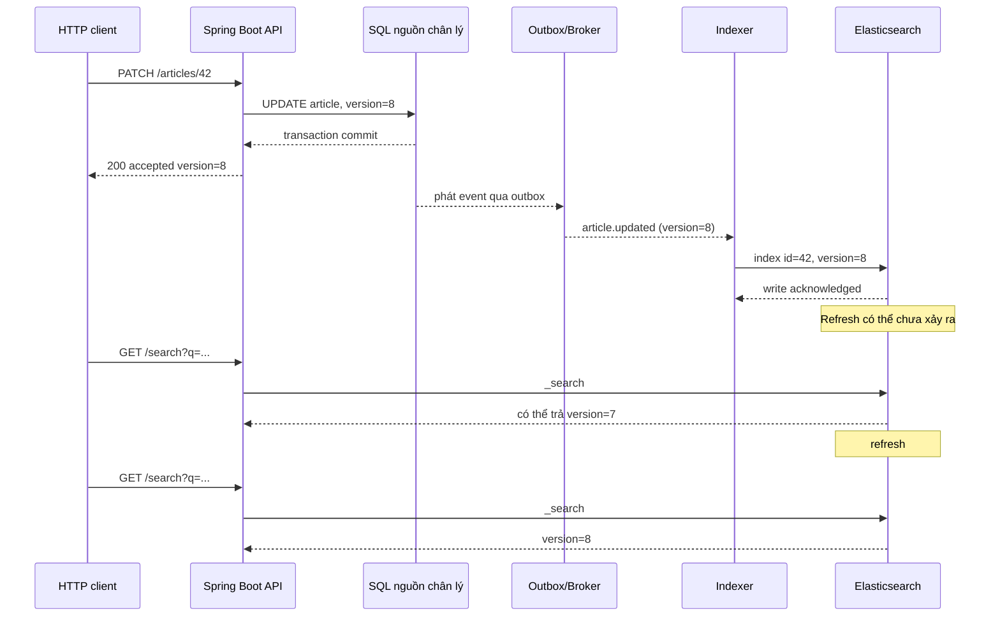
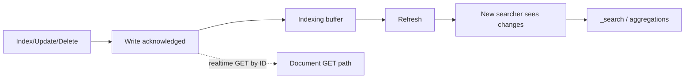
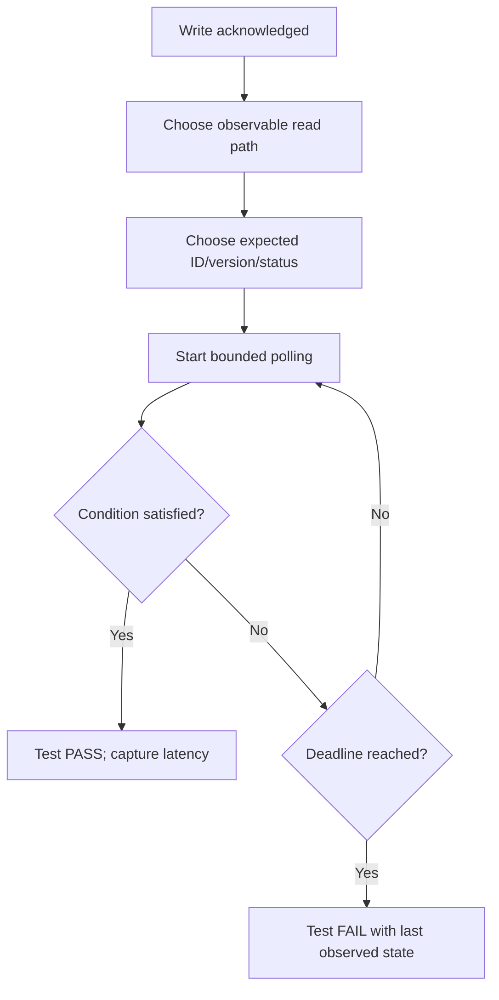

# Kiểm thử eventual consistency, refresh index và chờ điều kiện quan sát được

## 1. Tại sao ghi dữ liệu thành công nhưng tìm kiếm chưa thấy?

Trong hệ thống dùng **dữ liệu ngoài SQL**, việc một thao tác ghi đã trả thành công không phải lúc nào cũng đồng nghĩa mọi đường đọc đã quan sát được thay đổi. Một trường hợp phổ biến là **Spring Boot + Spring Data Elasticsearch/OpenSearch**:

1. Ứng dụng gửi một tài liệu tới search index.
2. Elasticsearch xác nhận thao tác index/update/delete.
3. Dữ liệu có thể được đọc bằng **GET theo document ID**, nhưng **search query** vẫn đang nhìn thấy trạng thái cũ.
4. Sau khi **refresh** tạo/mở search segments, truy vấn mới nhìn thấy document mới hoặc không còn nhìn thấy document đã xóa.

Đây là đặc điểm **near-real-time search (NRT)**, không tự động là bug. Thao tác **refresh** khác với **flush**, **commit** hoặc đồng bộ nghiệp vụ; mỗi thao tác giải quyết một vấn đề khác nhau.

Bài học tập trung vào chủ đề **“Eventual consistency, refresh index và chờ điều kiện quan sát được”**, theo các mục tiêu:

- Phân biệt **write acknowledged**, **GET theo ID**, **search visibility** và **projection đã theo kịp event**.
- Giải thích cơ chế Elasticsearch refresh và các chế độ `refresh=false`, `refresh=true`, `refresh=wait_for`.
- Hiểu Spring Data Elasticsearch `RefreshPolicy.NONE`, `IMMEDIATE` và `WAIT_UNTIL`; tránh giả định sai từ default của repository.
- Dùng `IndexOperations.refresh()` trong test cần checkpoint xác định, nhưng không lạm dụng trong hệ thống thật.
- Viết **eventually assertions** với Awaitility: polling đến khi một điều kiện **quan sát được** đạt, có timeout và thông báo lỗi rõ ràng.
- Kiểm tra create, update, delete, trạng thái mới nhất, không chỉ sự tồn tại của document.
- Xây dựng bộ integration test **Java 17 / Spring Boot 3.5 / Spring Data Elasticsearch 5.5 / JUnit 5 / Testcontainers Elasticsearch 8.x** có phân biệt test deterministic và test eventual.
- Mở rộng cách tư duy sang asynchronous projections, Redis replicas, MongoDB read preference, Cassandra và event-driven systems mà không trộn lẫn consistency models.

## 2. Nhận diện đúng thứ đang chờ

Hãy xét một ứng dụng quản lý bài viết. SQL database lưu nguồn chân lý; Elasticsearch lưu **read model** cho tìm kiếm. Khi người dùng cập nhật tiêu đề:



Có **ít nhất ba độ trễ độc lập**:

| Độ trễ | Từ đâu đến đâu? | Làm gì để test? |
| --- | --- | --- |
| Commit nguồn → event được xử lý | SQL/Outbox/Broker → Consumer | Chờ projection offset/version hoặc record xuất hiện |
| Indexing request → Elasticsearch ACK | Indexer → Elasticsearch | Kiểm tra response/error của write |
| ACK → search nhìn thấy | Search buffer → refresh → searcher | Chờ `_search` có đúng document/version hoặc refresh có chủ đích |

Nếu test chỉ gọi `GET /articles/{id}` trên SQL rồi kết luận “search index đã đồng bộ”, test đã quan sát **sai hệ thống**. Ngược lại, nếu test chỉ gọi Elasticsearch `GET /index/_doc/id` thì vẫn chưa chứng minh `_search` thấy document đó.

### Tính nhất quán mong đợi phải được mô tả rõ

Ví dụ hợp đồng:

- **API ghi:** sau khi trả 201, document được nhận vào hệ thống, chưa hứa tìm thấy ngay.
- **Search API:** nội dung mới xuất hiện trong vòng ngân sách quan sát được, ví dụ 10 giây khi hạ tầng khỏe mạnh.
- **Read-your-writes UX:** người dùng được chuyển tới màn hình chi tiết đọc nguồn truth, hoặc request ghi dùng cơ chế wait-for-visibility.
- **Projection update:** đối với event version N, kết quả search phải có version **ít nhất N**; chỉ “ID có tồn tại” không đủ.
- **Deletion:** document bị xóa cuối cùng biến mất khỏi search; trước refresh có thể thấy bản cũ.

**Không tự áp một SLA 1 giây cho tất cả hệ thống.** Một số Elasticsearch deployments refresh mỗi giây, nhưng refresh interval có thể tùy chỉnh, có điều kiện trên idle shards, hoặc bị tắt. Hàng đợi/broker/backfill có thể thêm độ trễ không liên quan refresh.

## 3. Near-real-time search trong Elasticsearch hoạt động thế nào?

Elasticsearch dùng Lucene inverted index. Một thao tác index tạo hoặc cập nhật document, nhưng search không nhất thiết lập tức mở được những segments mới. **Refresh** tạo/mở các search segments để các thay đổi gần đây trở thành searchable.



Ba thuật ngữ dễ nhầm:

| Thuật ngữ | Ý nghĩa chủ yếu | Không có nghĩa |
| --- | --- | --- |
| **Index ACK** | Operation đã được Elasticsearch xử lý/chấp nhận theo thông số request | Không hứa `_search` lập tức thấy |
| **Refresh** | Mở những thay đổi gần đây cho search (NRT visibility) | Không đồng nghĩa fsync/flush hoặc giao dịch SQL |
| **Flush** | Liên quan tiến trình translog/Lucene commit và durability/recovery | Không phải API để bảo đảm một document mới searchable ngay |
| **Force merge** | Hợp nhất segments phục vụ tối ưu lưu trữ/query theo trường hợp | Không nên dùng như cách chờ index hay fix flaky test |
| **GET theo ID** | Thông thường có realtime semantics | Không giống query `_search` qua inverted index |
| **Search visibility** | Truy vấn mới thấy trạng thái đã refresh | Không bảo đảm consumer đã xử lý mọi event nghiệp vụ |

Vì vậy **`save(...)` thành công** và **`_search` trả 0 hits ngay sau đó** có thể cùng đúng. Test viết theo thời gian cứng (save → search → assert 1) dễ lúc xanh lúc đỏ.

Elasticsearch thường có index refresh interval mặc định khoảng 1 giây, nhưng hành vi thực tế còn phụ thuộc index settings, hoạt động tìm kiếm và loại deployment. **Không dùng 1 giây như một hằng số bất biến của API.**

## 4. Các chế độ refresh và chi phí của chúng

Index/Update/Delete/Bulk APIs của Elasticsearch hỗ trợ refresh policy:

| REST parameter | Spring Data Elasticsearch 5.5 | Khi request hoàn tất | Trade-off |
| --- | --- | --- | --- |
| `refresh=false` (mặc định ở Elasticsearch REST) | `RefreshPolicy.NONE` | Không yêu cầu refresh riêng; search sẽ thấy sau refresh phù hợp | Throughput tốt, đọc có độ trễ |
| `refresh=true` | `RefreshPolicy.IMMEDIATE` | Buộc refresh các shards liên quan để thay đổi searchable khi call hoàn tất | Đắt khi lặp nhiều lần; tạo segments nhỏ |
| `refresh=wait_for` | `RefreshPolicy.WAIT_UNTIL` | Đợi refresh làm thay đổi searchable trước khi trả response | Không buộc refresh ngay trong tình huống bình thường; tăng response latency |

### Cảnh báo Spring Data repository mặc định

Trong một số đường code Spring Data Elasticsearch, **repository implementations có thể explicit refresh khi refresh policy của template là `null`**, trong khi `ElasticsearchOperations` khi không có policy cụ thể có thể để cluster dùng defaults. Vì vậy hai ví dụ dưới đây **không được giả định tương đương**:

```java
repository.save(article);  // Repository có thể auto-refresh theo defaults của phiên bản.

operations.withRefreshPolicy(RefreshPolicy.NONE)
          .save(article);  // Chủ động yêu cầu không refresh vì write này.
```

Muốn test **độ trễ search visibility**, phải biết API đang gọi, phiên bản Spring Data, mapping và refresh policy thực tế. Trong dự án mẫu, luôn chỉ định `RefreshPolicy.NONE`/`IMMEDIATE` để behavior không phụ thuộc may rủi từ repository defaults.

### IMMEDIATE không phải lựa chọn mặc định production

Mỗi lần write lại `refresh=true` có thể tạo nhiều segments nhỏ, khiến indexing/search/merge tốn tài nguyên. Chỉ dùng khi yêu cầu synchronous search visibility thực sự được phê duyệt và hệ thống có benchmark.

### WAIT_UNTIL không đồng nghĩa “ép refresh”

`refresh=wait_for` đợi một refresh phù hợp và thường tiết kiệm hơn việc force refresh ngay. Nếu index setting `index.refresh_interval=-1` (tắt refresh định kỳ), request `wait_for` **có thể đợi vô hạn** cho đến khi một tác nhân khác thực hiện refresh; hệ thống còn có giới hạn refresh listeners. Do đó **không** gọi `WAIT_UNTIL` trên index cố ý tắt auto-refresh trong bài mẫu mà thiếu một refresh khác và timeout vận hành.

### Refresh API trực tiếp

```http
POST /articles_nrt/_refresh
```

Refresh API có tính đồng bộ và giúp các thao tác đã index trở thành searchable khi trả về. Khi không cần force refresh, nên ưu tiên auto refresh hoặc `wait_for`. Trong **test cần thiết lập một checkpoint rõ ràng** trước assertion, force refresh có thể hợp lý; nhưng một test luôn force refresh sẽ **không còn kiểm chứng eventual behavior** của production.

## 5. Ba kiểu test và bằng chứng khác nhau

| Mục tiêu | Cách viết test | Bằng chứng đáng tin |
| --- | --- | --- |
| Kiểm chứng document field mapping hoặc query builder | Unit test/mock operations | Java logic đúng; không chứng minh ES refresh |
| Chứng minh write không searchable trước refresh | Index có `refresh_interval=-1` + write `NONE` + `_search`, rồi explicit refresh | Khác biệt giữa ACK/GET/search rõ ràng và xác định |
| Chứng minh update/delete cần refresh | Search sau write `NONE`, sau đó index refresh | Inverted index chuyển từ version trước sang version sau |
| Chứng minh consumer đồng bộ cuối cùng | Poll search **đúng version/status** bằng Awaitility | Hợp đồng eventual được quan sát |
| Chứng minh `WAIT_UNTIL` có hiệu lực | Test trên index có auto-refresh và deadline client thích hợp | Write chỉ trả sau khi searchable |
| Chứng minh network/production config | Testcontainers Elasticsearch/OpenSearch/cluster thực | Docker container/client/mapping/search |
| Chứng minh user-facing search API | `@SpringBootTest(RANDOM_PORT)` gọi HTTP search endpoint | Controller + security + ES wiring + JSON |
| Chứng minh nhiều replicas/tính sẵn sàng | Cluster test nhiều nodes/shards | Những điều single-node Testcontainers không bao phủ |

Bài mẫu dùng **Elasticsearch Testcontainers 1 node** để có tín hiệu thật, **không giả lập search bằng Map** và không dựa trên timing mặc định của refresh.

## 6. Điều kiện quan sát được: chờ đúng cái gì?

Test thiếu chặt chẽ:

```java
service.save(article);
Thread.sleep(2000);
assertEquals(1, service.searchByTag("news").size());
```

Vấn đề:

- Hai giây có thể **dài hơn cần thiết** nếu dữ liệu đã sẵn sàng sau 100 ms.
- Hai giây vẫn có thể **không đủ** khi CI tải cao hoặc refresh interval dài.
- Khi timeout, không có thông tin cần chờ document nào/version nào.
- Nếu search từng thấy dữ liệu cũ có cùng ID/tag, test có thể PASS sai.

Test theo điều kiện:

```java
await()
    .atMost(Duration.ofSeconds(10))
    .pollInterval(Duration.ofMillis(100))
    .untilAsserted(() -> {
        List<ArticleDocument> hits = service.findByTag("run-123");
        assertEquals(1, hits.size());
        assertEquals(9L, hits.get(0).getVersion());
        assertEquals("PUBLISHED", hits.get(0).getStatus());
    });
```

Đây là **trích đoạn**, cần import Awaitility, JUnit, Duration và service; file runnable đầy đủ ở phần 11.

- Điều kiện **có thể quan sát**: chính API/query mà người dùng phụ thuộc.
- Điều kiện **đúng phiên bản**: có version ≥ N hoặc chính xác N tùy semantics.
- **Giới hạn tối đa**: test FAIL rõ ràng nếu projection không theo kịp.
- **Poll interval**: tránh spam backend; 50–200 ms có thể hợp lý trong test container nhỏ, production cần xác định bằng traffic.
- **Assertion message**: khi FAIL, lưu expected version, actual version, index, document ID, last known status.
- **Không bọc mọi exception thành “chưa sẵn sàng”**: connection refused, authentication fail, wrong index mapping thường là lỗi cấu hình thực sự.

## 7. Project Java 17 + Spring Boot 3.5 + Testcontainers Elasticsearch

Project gồm:

- Một entity `ArticleDocument` được map vào index `visibility_articles_test`.
- Service `ArticleSearchService` thao tác qua `ElasticsearchOperations` và **đặt refresh policy tường minh**.
- Test class `VisibilityIntegrationTest` dùng Elasticsearch thật trong Testcontainers và `@ServiceConnection`.
- Test class `AwaitilityContractTest` thử các tính chất poll/timeout trên state đơn giản, chạy không cần Docker.

**Điểm thiết kế quan trọng:** index của integration test có `refresh_interval=-1`, nghĩa là không tự refresh. Điều này cho phép kiểm chứng một cách xác định rằng **document GET khác _search**, và rằng explicit refresh thật sự thay đổi search visibility. Khi cần test auto-refresh/`wait_for` ở production, dùng một index khác có refresh interval bình thường (xem phần 14).

### 7.1. Cây tệp

```text
nrt-visibility-demo/
├── pom.xml
└── src/
    ├── main/
    │   ├── java/example/visibility/
    │   │   ├── VisibilityApplication.java
    │   │   ├── ArticleDocument.java
    │   │   └── ArticleSearchService.java
    │   └── resources/application.properties
    └── test/
        └── java/example/visibility/
            ├── VisibilityIntegrationTest.java
            └── AwaitilityContractTest.java
```

### 7.2. pom.xml

```xml
<?xml version="1.0" encoding="UTF-8"?>
<project xmlns="http://maven.apache.org/POM/4.0.0"
         xmlns:xsi="http://www.w3.org/2001/XMLSchema-instance"
         xsi:schemaLocation="http://maven.apache.org/POM/4.0.0
             https://maven.apache.org/xsd/maven-4.0.0.xsd">
    <modelVersion>4.0.0</modelVersion>

    <parent>
        <groupId>org.springframework.boot</groupId>
        <artifactId>spring-boot-starter-parent</artifactId>
        <version>3.5.0</version>
        <relativePath/>
    </parent>

    <groupId>example</groupId>
    <artifactId>nrt-visibility-demo</artifactId>
    <version>1.0-SNAPSHOT</version>

    <properties>
        <java.version>17</java.version>
    </properties>

    <dependencies>
        <dependency>
            <groupId>org.springframework.boot</groupId>
            <artifactId>spring-boot-starter-data-elasticsearch</artifactId>
        </dependency>

        <dependency>
            <groupId>org.springframework.boot</groupId>
            <artifactId>spring-boot-starter-test</artifactId>
            <scope>test</scope>
        </dependency>

        <dependency>
            <groupId>org.springframework.boot</groupId>
            <artifactId>spring-boot-testcontainers</artifactId>
            <scope>test</scope>
        </dependency>

        <dependency>
            <groupId>org.testcontainers</groupId>
            <artifactId>elasticsearch</artifactId>
            <scope>test</scope>
        </dependency>

        <dependency>
            <groupId>org.testcontainers</groupId>
            <artifactId>junit-jupiter</artifactId>
            <scope>test</scope>
        </dependency>

        <dependency>
            <groupId>org.awaitility</groupId>
            <artifactId>awaitility</artifactId>
            <scope>test</scope>
        </dependency>
    </dependencies>
</project>
```

Spring Boot parent quản lý phiên bản Spring Data, Testcontainers, JUnit và Awaitility. Image Elasticsearch ở test được chọn khớp nhóm Elasticsearch 8.x mà Spring Data Elasticsearch 5.5/Boot 3.5 hỗ trợ; khi nâng Boot, nên kiểm tra compatibility matrix và container image phiên bản được chứng nhận.

### 7.3. application.properties

`src/main/resources/application.properties`:

```properties
spring.main.banner-mode=off
spring.data.elasticsearch.repositories.enabled=false
```

Không có URL Elasticsearch hard-code vì integration test nhận connection details từ Testcontainers. Thuộc tính tắt repository auto-scanning không ngăn `ElasticsearchOperations` hoạt động; project cố ý dùng operations để kiểm soát refresh policy thay vì dựa trên repository defaults.

**Không khởi động main application ngoài test** với file properties này rồi mong kết nối ES tự có: khi chạy production/dev độc lập, phải cấu hình `spring.elasticsearch.uris` và security phù hợp. Project là sample kiểm thử và Testcontainers cung cấp URL ở test scope.

### 7.4. VisibilityApplication.java

`src/main/java/example/visibility/VisibilityApplication.java`:

```java
package example.visibility;

import org.springframework.boot.SpringApplication;
import org.springframework.boot.autoconfigure.SpringBootApplication;

@SpringBootApplication
public class VisibilityApplication {
    public static void main(String[] args) {
        SpringApplication.run(VisibilityApplication.class, args);
    }
}
```

### 7.5. ArticleDocument.java

`src/main/java/example/visibility/ArticleDocument.java`:

```java
package example.visibility;

import org.springframework.data.annotation.Id;
import org.springframework.data.elasticsearch.annotations.Document;
import org.springframework.data.elasticsearch.annotations.Field;
import org.springframework.data.elasticsearch.annotations.FieldType;
import org.springframework.data.elasticsearch.annotations.Setting;

@Document(indexName = "visibility_articles_test", createIndex = false)
@Setting(shards = 1, replicas = 0, refreshInterval = "-1")
public class ArticleDocument {

    @Id
    private String id;

    @Field(type = FieldType.Keyword)
    private String tag;

    @Field(type = FieldType.Keyword)
    private String status;

    @Field(type = FieldType.Long)
    private long version;

    public ArticleDocument() {
    }

    public ArticleDocument(
            String id, String tag, String status, long version) {
        this.id = id;
        this.tag = tag;
        this.status = status;
        this.version = version;
    }

    public String getId() {
        return id;
    }

    public String getTag() {
        return tag;
    }

    public String getStatus() {
        return status;
    }

    public long getVersion() {
        return version;
    }
}
```

- `@Document(createIndex=false)` ngăn cơ chế auto-create index từ repository vô tình thay đổi test setup.
- `@Setting(refreshInterval="-1")` khai báo refresh định kỳ **tắt** khi index được tạo với mapping/settings từ entity. Chỉ dùng trong test cần tình huống xác định.
- `@Field(type=Keyword)` giúp truy vấn `tag/status` theo exact string, không chịu tokenization của text analyzer.
- `version` là **business event version**, không phải Elasticsearch internal `_version` hoặc `_seq_no`.
- Không dùng một index cố định này chung nhiều test suites chạy song song trên **cùng ES cluster**. Trong demo, một container riêng do test class quản lý; nếu chia sẻ container giữa nhiều classes, tạo index name riêng per class/run.

**Vì sao không dùng `@Document(createIndex=true)`?** Spring Data repository có cơ chế tự tạo index khi startup theo mapping annotation. Trong bài chúng ta muốn **test chính xác lúc index được tạo và lúc refresh**, nên dùng `operations.indexOps(ArticleDocument.class).createWithMapping()` tường minh.

### 7.6. ArticleSearchService.java

`src/main/java/example/visibility/ArticleSearchService.java`:

```java
package example.visibility;

import java.util.List;

import org.springframework.data.elasticsearch.core.ElasticsearchOperations;
import org.springframework.data.elasticsearch.core.RefreshPolicy;
import org.springframework.data.elasticsearch.core.SearchHit;
import org.springframework.data.elasticsearch.core.SearchHits;
import org.springframework.data.elasticsearch.core.query.Criteria;
import org.springframework.data.elasticsearch.core.query.CriteriaQuery;
import org.springframework.stereotype.Service;

@Service
public class ArticleSearchService {

    private final ElasticsearchOperations operations;

    public ArticleSearchService(ElasticsearchOperations operations) {
        this.operations = operations;
    }

    public ArticleDocument writeWithoutRefresh(ArticleDocument doc) {
        return operations.withRefreshPolicy(RefreshPolicy.NONE)
                .save(doc);
    }

    public ArticleDocument writeAndRefresh(ArticleDocument doc) {
        return operations.withRefreshPolicy(RefreshPolicy.IMMEDIATE)
                .save(doc);
    }

    public ArticleDocument getById(String id) {
        return operations.get(id, ArticleDocument.class);
    }

    public void deleteWithoutRefresh(String id) {
        operations.withRefreshPolicy(RefreshPolicy.NONE)
                .delete(id, ArticleDocument.class);
    }

    public void refreshIndex() {
        operations.indexOps(ArticleDocument.class).refresh();
    }

    public List<ArticleDocument> findByTag(String tag) {
        CriteriaQuery query = new CriteriaQuery(
                new Criteria("tag").is(tag));

        SearchHits<ArticleDocument> found =
                operations.search(query, ArticleDocument.class);

        return found.getSearchHits().stream()
                .map(SearchHit::getContent)
                .toList();
    }
}
```

**Chú ý thiết kế:**

- `operations.withRefreshPolicy(...)` trả một operations instance có policy mới, không cần sửa global mutable policy của bean dùng chung.
- `NONE` chỉ nói “không yêu cầu refresh ngay cho write này”; index refresh thông thường vẫn có thể xảy ra nếu index được cấu hình để tự refresh. Trong demo, `refreshInterval=-1` chặn biến số đó.
- `IMMEDIATE` buộc refresh và phù hợp với phép thử contract cần search visibility sau write. Không dùng mặc định cho lượng writes lớn nếu chưa benchmark.
- `getById` dùng GET theo ID; `findByTag` đi qua `_search`. Khác biệt giữa chúng là nội dung trung tâm của bài.
- `deleteWithoutRefresh` loại khỏi realtime GET path; search có thể vẫn thấy dữ liệu cũ cho tới refresh.

## 8. Integration test với Elasticsearch thật: lập index riêng

`src/test/java/example/visibility/VisibilityIntegrationTest.java`:

```java
package example.visibility;

import static org.awaitility.Awaitility.await;
import static org.junit.jupiter.api.Assertions.assertEquals;
import static org.junit.jupiter.api.Assertions.assertFalse;
import static org.junit.jupiter.api.Assertions.assertNotNull;
import static org.junit.jupiter.api.Assertions.assertNull;
import static org.junit.jupiter.api.Assertions.assertTrue;

import java.time.Duration;
import java.util.List;
import java.util.concurrent.Executors;
import java.util.concurrent.ScheduledExecutorService;
import java.util.concurrent.ScheduledFuture;
import java.util.concurrent.TimeUnit;

import org.junit.jupiter.api.AfterEach;
import org.junit.jupiter.api.BeforeEach;
import org.junit.jupiter.api.Test;
import org.springframework.beans.factory.annotation.Autowired;
import org.springframework.boot.test.context.SpringBootTest;
import org.springframework.boot.testcontainers.service.connection.ServiceConnection;
import org.springframework.data.elasticsearch.core.ElasticsearchOperations;
import org.springframework.data.elasticsearch.core.IndexOperations;
import org.testcontainers.elasticsearch.ElasticsearchContainer;
import org.testcontainers.junit.jupiter.Container;
import org.testcontainers.junit.jupiter.Testcontainers;

@SpringBootTest
@Testcontainers
class VisibilityIntegrationTest {

    @Container
    @ServiceConnection
    static ElasticsearchContainer elasticsearch =
            new ElasticsearchContainer(
                    "docker.elastic.co/elasticsearch/elasticsearch:8.17.4")
                    .withEnv("xpack.security.enabled", "false");

    @Autowired
    ElasticsearchOperations operations;

    @Autowired
    ArticleSearchService service;

    @BeforeEach
    void recreateIndexWithRefreshDisabled() {
        IndexOperations index = operations.indexOps(
                ArticleDocument.class);

        if (index.exists()) {
            index.delete();
        }

        assertTrue(index.createWithMapping(),
                "must create isolated test index");
    }

    @AfterEach
    void deleteTestIndex() {
        IndexOperations index = operations.indexOps(
                ArticleDocument.class);

        if (index.exists()) {
            index.delete();
        }
    }

    @Test
    void writeAckCanPrecedeSearchVisibility() {
        ArticleDocument saved = service.writeWithoutRefresh(
                new ArticleDocument(
                        "doc-1", "tag-create", "DRAFT", 1));

        assertEquals("doc-1", saved.getId());
        assertNotNull(service.getById("doc-1"),
                "realtime GET can see indexed document");
        assertTrue(service.findByTag("tag-create").isEmpty(),
                "search must not see it before refresh");

        service.refreshIndex();

        List<ArticleDocument> hits =
                service.findByTag("tag-create");

        assertEquals(1, hits.size());
        assertEquals("doc-1", hits.get(0).getId());
        assertEquals(1L, hits.get(0).getVersion());
    }

    @Test
    void immediatePolicyMakesWriteSearchableWhenItReturns() {
        service.writeAndRefresh(new ArticleDocument(
                "doc-2", "tag-immediate", "PUBLISHED", 1));

        List<ArticleDocument> hits =
                service.findByTag("tag-immediate");

        assertEquals(1, hits.size());
        assertEquals("PUBLISHED", hits.get(0).getStatus());
    }

    @Test
    void updateIsVisibleToGetBeforeSearchRefresh() {
        service.writeAndRefresh(new ArticleDocument(
                "doc-3", "tag-update", "DRAFT", 1));

        assertEquals("DRAFT",
                service.findByTag("tag-update").get(0).getStatus());

        service.writeWithoutRefresh(new ArticleDocument(
                "doc-3", "tag-update", "PUBLISHED", 2));

        assertEquals(2L, service.getById("doc-3").getVersion());
        assertEquals("DRAFT",
                service.findByTag("tag-update").get(0).getStatus(),
                "search can still show older version");

        service.refreshIndex();

        ArticleDocument refreshed =
                service.findByTag("tag-update").get(0);
        assertEquals("PUBLISHED", refreshed.getStatus());
        assertEquals(2L, refreshed.getVersion());
    }

    @Test
    void deleteRequiresRefreshForSearchToStopReturningDocument() {
        service.writeAndRefresh(new ArticleDocument(
                "doc-4", "tag-delete", "PUBLISHED", 1));

        assertFalse(service.findByTag("tag-delete").isEmpty());

        service.deleteWithoutRefresh("doc-4");

        assertNull(service.getById("doc-4"),
                "realtime GET sees deletion");
        assertFalse(service.findByTag("tag-delete").isEmpty(),
                "search can still see stale segment");

        service.refreshIndex();

        assertTrue(service.findByTag("tag-delete").isEmpty());
    }

    @Test
    void awaitilityWaitsForObservableSearchResult() throws Exception {
        service.writeWithoutRefresh(new ArticleDocument(
                "doc-5", "tag-eventual", "PUBLISHED", 1));

        // Mô phỏng một refresh riêng tới sau write.
        ScheduledExecutorService scheduler =
                Executors.newSingleThreadScheduledExecutor();

        try {
            ScheduledFuture<?> refresh = scheduler.schedule(
                    service::refreshIndex,
                    250,
                    TimeUnit.MILLISECONDS);

            await()
                .atMost(Duration.ofSeconds(8))
                .pollInterval(Duration.ofMillis(100))
                .untilAsserted(() -> {
                    List<ArticleDocument> hits =
                            service.findByTag("tag-eventual");
                    assertEquals(1, hits.size());
                    assertEquals("PUBLISHED", hits.get(0).getStatus());
                });

            // Nếu background refresh ném lỗi, không bỏ qua nó.
            refresh.get(2, TimeUnit.SECONDS);
        } finally {
            scheduler.shutdownNow();
        }
    }

    @Test
    void projectionWaitsForExpectedBusinessVersion() throws Exception {
        service.writeAndRefresh(new ArticleDocument(
                "doc-6", "tag-version", "DRAFT", 7));

        // Version 7 đã searchable; assert merely exists would pass too soon.
        service.writeWithoutRefresh(new ArticleDocument(
                "doc-6", "tag-version", "PUBLISHED", 8));

        ScheduledExecutorService scheduler =
                Executors.newSingleThreadScheduledExecutor();

        try {
            ScheduledFuture<?> refresh = scheduler.schedule(
                    service::refreshIndex,
                    250,
                    TimeUnit.MILLISECONDS);

            await()
                .atMost(Duration.ofSeconds(8))
                .pollInterval(Duration.ofMillis(100))
                .untilAsserted(() -> {
                    List<ArticleDocument> hits =
                            service.findByTag("tag-version");

                    assertEquals(1, hits.size());
                    assertEquals(8L, hits.get(0).getVersion(),
                            "waiting for projection version=8");
                    assertEquals("PUBLISHED",
                            hits.get(0).getStatus());
                });

            refresh.get(2, TimeUnit.SECONDS);
        } finally {
            scheduler.shutdownNow();
        }
    }
}
```

**Có 6 JUnit test methods** trong class này. Test dùng một Elasticsearch container thật và Spring Data operations thật, không mock search result.

### 8.1. Vì sao tắt auto-refresh?

Nếu index để `refresh_interval=1s`, đoạn “ngay trước refresh chưa tìm thấy” là một **race**: cluster có thể refresh giữa lúc save và search, khiến assertion `isEmpty()` đôi khi FAIL dù Elasticsearch hoạt động đúng.

Trong demo, `@Setting(refreshInterval="-1")` chỉ được áp dụng khi `index.createWithMapping()` tạo index mới. Test setup xóa index cũ trước rồi tạo lại có settings/mapping mong muốn; **do đó chưa có refresh định kỳ**. Assertion tiền-refresh trở nên có ý nghĩa kiểm chứng thay vì dựa vào timing.

Trong production **không nên mặc định tắt refresh** chỉ để giữ kết quả dễ dự đoán. Đây là fixture phục vụ chứng minh NRT mechanism.

### 8.2. Tại sao không dùng ElasticsearchRepository.save()?

Tùy Spring Data Elasticsearch version/config, repository có thể chủ động refresh nếu refresh policy là null. Nếu dùng nó, test “trước refresh chưa searchable” có thể bị phá bởi chính repository layer. Service bài này dùng explicit `ElasticsearchOperations.withRefreshPolicy(RefreshPolicy.NONE)`.

### 8.3. Tại sao không dùng @Transactional để rollback search index?

Elasticsearch writes/refresh không tự tham gia JDBC transaction của ứng dụng. `@Transactional` ở JPA test không hoàn tác document đã index. Test có `@AfterEach` xóa index fixture, và test container chỉ tồn tại trong test environment.

**Không** dùng `index.delete()` trên production index hay shared cluster. Project mẫu chỉ chạy với Testcontainers; khi thiết kế test trên môi trường chung, dùng unique index name theo run hoặc một collection/namespace cách ly được quản lý rõ.

### 8.4. Polling ở đây có thật sự cần?

Hai test Awaitility dùng scheduler kích hoạt một refresh sau 250 ms. Điều này **mô phỏng tín hiệu refresh đến từ bên ngoài** một cách xác định, rồi chứng minh code test chờ điều kiện ở `_search`. Vì index có refresh định kỳ bị tắt, nếu bỏ scheduler, test phải FAIL ở timeout thay vì xanh một cách tình cờ.

Nó **không đo độ trễ refresh mặc định của Elasticsearch production**, không mô phỏng Kafka consumer và không chứng minh mọi hạ tầng cuối cùng sẽ converged. Muốn test auto refresh production, tạo index có interval phù hợp và không tự schedule refresh, sau đó chờ search state với một ngân sách hữu hạn.

### 8.5. SearchHits được dùng đúng thế nào?

`ArticleSearchService.findByTag` dùng `CriteriaQuery(new Criteria("tag").is(tag))`, gọi `operations.search(...)` và lấy `SearchHit::getContent`. Chúng ta kiểm tra **query thực**, không phải `getById`, vì chính search API mới chịu NRT visibility semantics. Tags unique theo từng test để tránh false positives từ document khác.

### 8.6. Kịch bản cập nhật và xóa

- **Update:** realtime GET đã có version 2, nhưng `_search` còn thấy version 1 cho tới refresh.
- **Delete:** realtime GET có thể không còn document, nhưng `_search` vẫn thấy segment cũ cho tới refresh.
- Sau refresh, assert lại đúng state mới.
- Trong production, xóa/đổi routing, alias hoặc external concurrent writes có thể làm những câu chuyện phức tạp hơn; không suy luận từ một shard single-node test rằng mọi hệ phân tán đều cho exact-once hay ordering.

## 9. Test Awaitility không cần Docker

`src/test/java/example/visibility/AwaitilityContractTest.java`:

```java
package example.visibility;

import static org.awaitility.Awaitility.await;
import static org.junit.jupiter.api.Assertions.assertThrows;
import static org.junit.jupiter.api.Assertions.assertTrue;

import java.time.Duration;
import java.util.concurrent.CompletableFuture;
import java.util.concurrent.TimeUnit;
import java.util.concurrent.atomic.AtomicBoolean;

import org.awaitility.core.ConditionTimeoutException;
import org.junit.jupiter.api.Test;

class AwaitilityContractTest {

    @Test
    void eventuallyPassesWhenObservableFlagChanges() {
        AtomicBoolean ready = new AtomicBoolean(false);

        CompletableFuture.delayedExecutor(
                150, TimeUnit.MILLISECONDS)
            .execute(() -> ready.set(true));

        await()
            .atMost(Duration.ofSeconds(3))
            .pollInterval(Duration.ofMillis(25))
            .untilTrue(ready);

        assertTrue(ready.get());
    }

    @Test
    void neverSatisfiedConditionFailsWithinBudget() {
        assertThrows(ConditionTimeoutException.class, () ->
                await()
                    .atMost(Duration.ofMillis(350))
                    .pollInterval(Duration.ofMillis(25))
                    .until(() -> false));
    }
}
```

**Có 2 JUnit methods** chạy không cần Spring context hay Docker. Chúng chỉ kiểm tra quy tắc polling/timeout của test harness, **không chứng minh Elasticsearch consistency**.

Phân biệt:

- `eventuallyPassesWhenObservableFlagChanges`: nếu trạng thái đổi trước deadline, test PASS mà không đợi trọn 3 giây.
- `neverSatisfiedConditionFailsWithinBudget`: nếu điều kiện không bao giờ đúng, Awaitility phát `ConditionTimeoutException`, tránh treo vô hạn.
- Không thay các test container thật bằng fake atomic boolean rồi tuyên bố “đã kiểm thử Elasticsearch refresh”.

## 10. Chạy dự án và cách đọc kết quả

Yêu cầu **JDK 17+, Maven, Docker/Podman tương thích Testcontainers** và khả năng kéo Elasticsearch image khi chạy integration tests.

Chỉ chạy test Awaitility không cần Docker:

```bash
mvn -Dtest=AwaitilityContractTest test
```

Chạy integration tests có Elasticsearch container:

```bash
mvn -Dtest=VisibilityIntegrationTest test
```

Chạy toàn bộ:

```bash
mvn test
```

| Test class | Số test methods | Docker? | Phạm vi |
| --- | ---: | --- | --- |
| `VisibilityIntegrationTest` | 6 | **Có** | Elasticsearch real write, search, refresh, update/delete, eventual version |
| `AwaitilityContractTest` | 2 | Không | Polling bounded/timeout harness |
| **Tổng** | **8** | Docker cần khi chạy toàn bộ | Phân biệt system-under-test với test utility |

**Kết quả kỳ vọng:** 8 lượt test PASS trong môi trường tương thích; không có stdout ứng dụng cố định. Đây là expected behavior từ mã ví dụ; bài học **không khẳng định đã chạy Maven trong môi trường này**. Khi kiểm chứng dự án, xem `target/surefire-reports` để xác nhận số phương thức thực sự đã chạy và không có skipped/aborted tests.

### Những điều kiện trước khi đánh giá failure

- Docker daemon có truy cập được không? Image ES đã pull được chưa?
- Testcontainers có tài nguyên RAM/CPU cần thiết để ES start không?
- Port/service connection được Spring Boot nhận từ `@ServiceConnection` thay vì URL hard-code?
- Index được `createWithMapping` tạo với `refresh_interval=-1` hay đang dùng index cũ?
- Test có dùng `RefreshPolicy.NONE` thay vì repository auto-refresh?
- Search đúng field `Keyword` và đúng tag của test?
- Test timeout có đủ margin cho CI không, và không dùng `Thread.sleep` cố định?

Không biến job integration bắt buộc thành `@Disabled` chỉ để build xanh trên máy không có Docker; hãy chạy nó ở CI runner có container support và nêu rõ phạm vi test nào chưa chạy.

## 11. Ví dụ kiểm tra NRT bằng Elasticsearch REST thuần

Khi debug không qua Spring Data, có thể gọi REST API; đây là ví dụ tương đương trong một **index disposable**, không phải script áp dụng production.

```http
PUT /articles_nrt_demo
Content-Type: application/json

{
  "settings": {
    "number_of_shards": 1,
    "number_of_replicas": 0,
    "index.refresh_interval": "-1"
  },
  "mappings": {
    "properties": {
      "tag": {"type": "keyword"},
      "status": {"type": "keyword"},
      "version": {"type": "long"}
    }
  }
}
```

Ghi nhưng không yêu cầu refresh:

```http
PUT /articles_nrt_demo/_doc/doc-1?refresh=false
Content-Type: application/json

{"tag":"demo","status":"DRAFT","version":1}
```

Kiểm tra realtime GET theo ID:

```http
GET /articles_nrt_demo/_doc/doc-1
```

Kiểm tra search query:

```http
GET /articles_nrt_demo/_search
Content-Type: application/json

{
  "query": {"term": {"tag": "demo"}}
}
```

Trước refresh, `_search` có thể trả 0 hit; với index cố tình tắt auto-refresh ở đây, nó sẽ không tự chuyển sang thấy document nếu không có tác nhân refresh khác. Sau đó:

```http
POST /articles_nrt_demo/_refresh
```

Chạy lại `_search` sẽ thấy document.

Đây là kịch bản chẩn đoán: response từ Elasticsearch chứa nhiều field như `_index`, `_seq_no`, `_shards` và `took`, các giá trị cụ thể không cố định theo cluster nên **không ghi cứng output**. Test nên assert `hits.hits[]._source`/ID/version theo ý nghĩa.

### Refresh vs flush ở REST

- `POST /index/_refresh`: làm dữ liệu gần đây tìm kiếm được.
- `POST /index/_flush`: hoạt động khác liên quan translog và commit/khả năng khôi phục, **không dùng thay refresh** cho test search.
- `POST /index/_forcemerge`: không phải công cụ test eventual consistency.
- Bulk indexing có thể dùng `refresh=wait_for` cho **cả batch**, tránh nhiều refresh nhỏ lẻ.

## 12. WAIT_UNTIL trong Spring Data Elasticsearch

Khi ứng dụng cần “ghi xong là ngay lần search tiếp theo thấy document”, có thể dùng:

```java
// Chỉ dùng trên index có refresh phù hợp và giới hạn timeout vận hành.
ArticleDocument saved = operations
        .withRefreshPolicy(RefreshPolicy.WAIT_UNTIL)
        .save(article);

// Nếu call thành công đúng contract, tài liệu vừa ghi
// đã đi qua một refresh và có thể được search.
```

**Đây là trích đoạn**: `operations` và `article` phải được định nghĩa như trong project. Không thêm nó vào test index `refresh_interval=-1` của bài nếu không bố trí một explicit refresh khác: call có thể chờ rất lâu, nhất là khi cluster không tự refresh.

Một chiến lược chọn policy:

| Nhu cầu | Policy thường phù hợp | Điều cần test |
| --- | --- | --- |
| Ingest logs/telemetry high throughput | NONE | Dữ liệu eventually searchable trong SLA, không force refresh mỗi log |
| Ghi đơn lẻ, UI search cần thấy ngay | WAIT_UNTIL có giới hạn timeout | Search thấy document/version trước khi trả HTTP success |
| Admin/test fixture cần checkpoint ngay | IMMEDIATE hoặc explicit refresh | Chỉ dùng khi lý do được công bố; theo dõi cost |
| Bulk cập nhật nhiều documents | Bulk + WAIT_UNTIL | Cả batch searchable và không quá nhiều refresh calls |
| Event-driven read model | NONE + consumer offset + Awaitility observation | Đúng version/status và time budget; không chỉ ACK |

Không chọn policy chỉ để test hết flaky mà không hiểu user-facing consistency contract. Việc ép refresh trong code production có thể làm performance xấu đi mà vẫn không sửa được độ trễ từ broker/consumer.

## 13. Chờ “một tài liệu tồn tại” chưa đủ cho projections

Giả sử article đã searchable ở version 7, consumer đang xử lý event version 8. Test:

```java
await().until(() ->
        !service.findByTag("tag-version").isEmpty());
```

sẽ PASS **ngay lập tức** vì document ở version 7 đã tồn tại, dù sự kiện mới chưa được áp dụng.

Thay bằng:

```java
await()
    .atMost(Duration.ofSeconds(10))
    .pollInterval(Duration.ofMillis(100))
    .untilAsserted(() -> {
        ArticleDocument found =
                service.findByTag("tag-version").stream()
                        .findFirst()
                        .orElseThrow();
        assertEquals(8L, found.getVersion());
        assertEquals("PUBLISHED", found.getStatus());
    });
```

Điều kiện chính xác phụ thuộc contract:

- Nếu event versions có thể đến không theo thứ tự và indexer bỏ qua events cũ, dùng `version >= expectedVersion` là một **watermark** hợp lý.
- Nếu test đang xác minh đúng một event/transition, có thể assert `version == expectedVersion`, đồng thời bảo đảm không có concurrent writer ngoài test.
- Với delete, có thể chờ document biến mất **và** một tombstone/projection offset ≥ version delete, nếu hệ thống phải bảo đảm không “hồi sinh” document từ event cũ.
- Nếu business query dựa trên analyzer hoặc multi-field mapping, đợi đúng **user-facing query**, không chỉ `getById`.
- Nếu event consumer retry/idempotency, test cần điều kiện không có duplicate side effect và có offset checkpoint.

### Tại sao eventual không đồng nghĩa exactly-once?

Broker có thể giao lại event, consumer có thể retry và index có thể nhận bản cập nhật trùng. Dùng idempotency key, external version, optimistic concurrency control hoặc ordered projection logic khi cần. Chỉ vì search cuối cùng trả một bản đúng không chứng minh mọi event đã được xử lý đúng một lần.

### SQL outbox và search index không chung transaction

Nếu ứng dụng commit SQL rồi phát event để cập nhật search:

1. SQL commit là một atomic transaction của **SQL**.
2. Event publish và index write có thể đến sau, lỗi hoặc retry.
3. Elasticsearch refresh tiếp tục thêm một bước trước khi search thấy.
4. Không thể giải quyết cả ba bằng `@Transactional` Spring JPA trên một method đơn thuần.

Dùng outbox pattern, consumer retry/dead-letter, idempotency và observability khi cần consistency ở quy mô production.

## 14. Test auto-refresh thật và không tạo race

Với production-like refresh interval, **không assert rằng search phải rỗng ngay sau save**. Vì refresh có thể xảy ra giữa hai câu lệnh, đó là một negative assertion racy.

Cách test đúng:

1. Tạo **index disposable riêng** với `index.refresh_interval=1s` hoặc giá trị đã xác định.
2. Ghi tài liệu với `RefreshPolicy.NONE`.
3. Dùng Awaitility `untilAsserted` để chờ `_search` trả đúng document/version, ví dụ trong 10 giây.
4. **Không force refresh** trong test này, nếu mục tiêu là đo readiness của refresh định kỳ.
5. Ghi nhận thời gian từ ACK đến observable, chạy lặp với tải CI thực.
6. Nếu index idle/no refresh policy, xác nhận hành vi theo cluster/version thay vì xem timeout 10 giây là mặc nhiên đủ.
7. Dùng một index khác cho test `WAIT_UNTIL`, không lấy index đã đặt refresh_interval=-1.

Ví dụ **minh họa**, không thuộc 8 tests runnable của project:

```java
// Giả sử operations đang kết nối tới index có periodic refresh.
// Bỏ tất cả forced refresh trong đường test này.
service.writeWithoutRefresh(
        new ArticleDocument("fresh", "tag-auto", "PUBLISHED", 3));

await().atMost(Duration.ofSeconds(10))
       .pollInterval(Duration.ofMillis(100))
       .untilAsserted(() -> {
           ArticleDocument hit = service.findByTag("tag-auto")
                   .stream().findFirst().orElseThrow();
           assertEquals(3L, hit.getVersion());
       });
```

Lưu ý snippet chỉ dùng được khi index của service được thiết lập cho periodic refresh; **không chạy nguyên trạng với setting -1 của bài mẫu** và mong PASS. Kịch bản deterministic kiểm tra cơ chế và kịch bản auto-refresh kiểm tra vận hành là **hai mục tiêu khác nhau**.

## 15. Thiết kế Awaitility không che bug thật

Awaitility mạnh khi có tín hiệu eventually, nhưng dùng sai vẫn làm test đáng ngờ.

### 15.1. Always bounded

```java
await().atMost(Duration.ofSeconds(8))
       .pollInterval(Duration.ofMillis(100))
       .untilAsserted(() -> assertEquals(
               1, service.findByTag("tag-eventual").size()));
```

Không dùng `await().forever()` trong CI. Kể cả business flow có thể dài, test vẫn cần một deadline/cancel/failure report.

### 15.2. Không bỏ qua tất cả exceptions

**Sai:**

```java
await().ignoreExceptions()
       .untilAsserted(() -> someSearchAssertion());
```

Nếu search mapping sai, auth 401/403, alias không tồn tại hoặc cluster dead, mã này có thể biến lỗi cấu hình thành một loạt retries rồi báo timeout khó hiểu.

Nếu một exception thực sự là transient theo hợp đồng, chỉ ignore **loại lỗi đó**:

```java
await()
    .ignoreException(TemporaryProjectionNotReadyException.class)
    .atMost(Duration.ofSeconds(8))
    .untilAsserted(() -> assertSearchState());
```

Đoạn này là **mã minh họa**, hai tên class/method `TemporaryProjectionNotReadyException` và `assertSearchState` phải được định nghĩa ở ứng dụng. Không tự tạo giả exception chỉ để che connection refused.

### 15.3. Polling không được gây side effect

Điều kiện chờ chỉ nên **đọc**, không nên thực hiện `save`/`refresh` mỗi vòng:

```java
// Sai: mỗi vòng polling tự thay đổi hệ thống.
await().until(() -> {
    service.writeAndRefresh(document);
    return !service.findByTag("tag").isEmpty();
});
```

Làm như vậy test “tự chữa” thiếu refresh và không còn kiểm tra sự kiện phía ngoài. Tránh các lần gọi idempotent nhưng tạo side effects audit/broker hoặc tiêu tốn tài nguyên.

### 15.4. Mô tả last observed state

Ví dụ:

```java
AtomicReference<String> lastState =
        new AtomicReference<>("not observed");

await().atMost(Duration.ofSeconds(10))
       .pollInterval(Duration.ofMillis(100))
       .untilAsserted(() -> {
           var hits = service.findByTag("tag-version");
           lastState.set(hits.isEmpty()
                   ? "missing"
                   : "version=" + hits.get(0).getVersion());
           assertEquals(8L, hits.get(0).getVersion());
       });
```

**Đoạn trên cần thêm xử lý nếu hits rỗng**: `hits.get(0)` sẽ ném `IndexOutOfBoundsException`. Trong code production test, hãy assert `hits.size() == 1` trước khi gọi get, hoặc dùng `orElseThrow` và ghi thông tin quan sát được. Truy vết debug nên cho biết index, docId, expectedVersion, lastActualVersion và tổng thời gian, nhưng không in payload nhạy cảm.

## 16. Các tầng eventual consistency khác Elasticsearch

“Eventual consistency” không chỉ có trong search index. Tuy nhiên **refresh index** là từ ngữ rất đặc trưng của Elasticsearch/OpenSearch, không áp dụng giống hệt cho mọi NoSQL.

| Hệ thống | Nguyên nhân nhìn thấy chậm | Test điều kiện quan sát |
| --- | --- | --- |
| Elasticsearch/OpenSearch | Lucene segment refresh, asynchronous indexing pipeline | `_search` đúng document/version sau refresh |
| MongoDB replica set | Replication lag, read preference/concern | Đọc qua replica được chỉ định đạt checkpoint phù hợp; tôn trọng read/write concern |
| Cassandra/Scylla | Quorum/consistency level, replication và repair | Đọc ở consistency level contract, kiểm tra hội tụ trên replicas |
| Redis primary/replica | Asynchronous replication lag | Read trên replica đạt value/version được mong đợi |
| DynamoDB eventual read | Read API không yêu cầu strongly consistent read | Poll read theo cùng key/policy đến đúng version |
| Kafka→search projection | Event delivery/consumer lag + search refresh | Index version/offset đạt yêu cầu và searchable |
| CQRS materialized view | Projection cập nhật bất đồng bộ | Read model chứa data/version mới |

Không suy luận “Elasticsearch refresh 1s” là “Mongo/Cassandra/Redis cũng sẽ nhất quán sau 1s”. Mỗi backend có **consistency contract** riêng, cần xác định các read/write modes và topology.

### Một mẫu tư duy có thể tái sử dụng



Điều phải thay theo công nghệ là **read path, consistency level, time budget, error classes và cleanup**, không phải “ngủ thêm 2 giây”.

## 17. Test isolation và chống flakiness trong CI

### 17.1. Không dùng shared index

Nếu hai test đều ghi `tag=test` vào một index chung, tìm kiếm có thể trả 2 hits và fail dù code production đúng. Dùng test-specific index/alias hoặc unique tag/correlation ID. Trong demo, một container và index được recreate per method; JUnit parallel execution không được bật cho class này.

Nếu team bật JUnit parallel ở project level, phải bảo vệ fixture dùng index cố định bằng `@Execution(SAME_THREAD)`/resource lock hoặc chuyển sang unique index name mỗi test. **RANDOM_PORT của Spring Boot không tự cô lập Elasticsearch index**.

### 17.2. Dọn dữ liệu đúng lifecycle

Không xóa index production chỉ vì một test cleanup được chạy nhầm datasource. Chỉ test trên Testcontainers/isolated namespace và xác minh nguồn connection credentials ở profile test. Khi assertion FAIL, `@AfterEach` vẫn chạy, nhưng nên giữ log/metrics cần thiết để chẩn đoán.

### 17.3. Tách startup timeout và eventual timeout

- **Container startup:** cần chờ Elasticsearch cluster sẵn sàng theo Testcontainers; có thể mất lâu khi pull image.
- **Write request:** client request timeout/transport retries.
- **Refresh/eventual observation:** `await.atMost(...)` là ngân sách nhìn thấy business state.
- **Whole build/test:** Maven/CI job timeout để ngăn cả suite treo.

Không lấy test count/timeouts ở từng lớp làm một; test “chờ kết quả search trong 8 giây” không đồng nghĩa ES container phải startup trong 8 giây.

### 17.4. Không dựa trên time.Sleep để sửa flaky

`Thread.sleep(1000)` có thể không đủ trên CI và luôn làm test chậm trên máy nhanh. Dùng condition-based polling, refresh policy rõ ràng, deadline và diagnostic last state.

### 17.5. Các câu hỏi khi test FAIL

1. Write có thực sự thành công và dùng đúng ID/index không?
2. Có vô tình query vào alias của index khác hoặc sai tenant/routing không?
3. `@Field(Keyword)` hay `Text`? Query `term/match` có đúng analyzer không?
4. Refresh interval đang là `-1`, `1s` hay giá trị riêng?
5. Spring Data repository/operations đang dùng refresh policy nào?
6. Search đang thấy version cũ hay không có hits?
7. Consumer event có xử lý chưa, hay chỉ có SQL commit?
8. Có exception auth/network/mapping bị `ignoreExceptions()` che không?
9. Có concurrency writer khác ghi lại version cũ?
10. Deadline có phản ánh SLA đã xác định hay chỉ là số tùy ý?
11. Test cleanup/index creation có va chạm job khác không?
12. Có metrics cho search visibility lag, consumer lag và refresh cost không?

## 18. Troubleshooting: triệu chứng và cách xử lý

| Triệu chứng | Nguyên nhân phổ biến | Cách xử lý |
| --- | --- | --- |
| `save` thành công, search trả 0 | Chưa refresh hoặc wrong index/query | Xác nhận get-by-ID, index mapping, refresh policy |
| GET theo ID thấy document, _search không thấy | NRT search visibility | Chờ refresh hoặc refresh có chủ đích |
| Test đôi lúc thấy trước refresh | Auto-refresh xảy ra ngẫu nhiên | Với negative test, dùng `refresh_interval=-1` |
| `refresh=wait_for` treo | Refresh interval bị tắt hoặc chưa có refresh | Bật refresh/explicit refresh, đặt timeout |
| Search sau update vẫn là version cũ | Searcher cũ chưa refresh hoặc projection lag | Poll expected business version |
| Search sau delete vẫn trả document | Delete chưa được refresh | Chờ search hết match, refresh nếu test checkpoint |
| Test dùng repository nhưng không tái tạo được delay | Repository có thể explicit refresh | Dùng operations với `RefreshPolicy.NONE` |
| Test giả xanh khi chỉ check ID có tồn tại | Version cũ vẫn tồn tại | Assert version/status/offset |
| `Thread.sleep` khiến CI lúc xanh lúc đỏ | Timing của cluster không cố định | Awaitility bounded polling |
| Awaitility timeout sau auth 401 | Ignored tất cả exceptions | Fail fast với lỗi không transient |
| Search trả tài liệu khác | Shared index/tag không unique | Isolate index và correlation ID |
| Client gọi đúng ES nhưng mapping sai | Keyword/Text analyzer khác expectation | Kiểm tra mapping và query DSL |
| Docker không có | Testcontainers không khởi động | Chạy ở CI runner container-enabled |
| Test pass với mock nhưng fail với cluster thật | Mock không mô phỏng refresh | Thêm real Elasticsearch integration test |
| Force refresh mọi write làm chậm index | `IMMEDIATE` quá thường xuyên | Chọn `NONE`/`WAIT_UNTIL` theo contract |
| Index refresh định kỳ vẫn không xảy ra như tưởng | Idle shard/index settings/cluster load | Quan sát settings và refresh telemetry |
| Bản cũ ghi đè bản mới | Consumer event out-of-order | Version fence, external version/OCC, idempotency |
| “Không còn doc” nhưng một event cũ hồi sinh | Delete không có tombstone/version handling | Test delete event ordering và tombstone |
| Test có no hits nhưng vẫn được coi thành công | Query mismatch, wrong tenant/index | Assert index identity, expected cardinality và version |
| Build xanh nhưng integration skipped | Maven filter/CI profile | Kiểm tra Surefire reports và job bắt buộc |
| Spring Boot 4 import không giống Boot 3.5 | Package/module thay đổi | Dùng docs/test starter của major mới |

## 19. Observability và SLO cho eventual consistency

Một hệ thống production nên biết “eventual” nhanh đến mức nào thay vì chỉ nói “cuối cùng sẽ có”:

- `projection_lag_seconds`: thời gian từ source commit/event time đến khi indexer ack và/hoặc search thấy.
- `index_refresh_total` và `index_refresh_time`: ảnh hưởng refresh operations; tìm trong metrics phù hợp version.
- Consumer backlog/partition lag, retry count và dead-letter queue size.
- P50/P95/P99 thời gian first-search-visible sau write đối với luồng quan trọng.
- Timeout rate của search visibility contract, phân chia theo index, tenant và cluster.
- Số events bị skip/duplicate/stale và số lần OCC conflict.
- Index alias, refresh interval, shards/replicas, resource pressure.
- Correlation ID từ write đến indexer và search để truy vết; **không log raw payload PII**.

Một điều khoản ví dụ có thể là: “99% thao tác cập nhật đã ACK sẽ được search thấy trong 10 giây trong điều kiện hệ thống khỏe mạnh.” Đó chỉ là **ví dụ SLO**, không phải mức bảo đảm mặc định của Elasticsearch. Test contract/synthetic monitoring phải có tiêu chí theo môi trường, không dựa vào một con số không được thống nhất.

### Deadline chờ phải thất bại có ích

Khi test eventual FAIL, thông báo nên nêu:

```text
Expected: index=visibility_articles_test, id=doc-6,
version=8, status=PUBLISHED within 8s
Last observed: version=7, status=DRAFT
Likely causes: consumer lag, no refresh, wrong index, stale projection
```

Đây là **mẫu thông báo chẩn đoán**, không phải stdout cố định của code demo. Trong test chính, JUnit/Awaitility sẽ nêu assertion mismatch; có thể nâng cấp bằng custom failure message và metrics để chẩn đoán nhanh hơn.

## 20. Bài tập nâng cao

1. **Periodic refresh integration:** tạo index với interval 1s, ghi NONE và Awaitility chờ search mà không tự refresh.
2. **WAIT_UNTIL contract:** write với `RefreshPolicy.WAIT_UNTIL` vào index có auto refresh, kiểm tra search khi call trả về; đặt request deadline đủ.
3. **Bulk visibility:** index 100 documents trong bulk, dùng một refresh hoặc bulk `wait_for`; so sánh thời gian với force refresh từng document.
4. **Alias migration:** tạo index V1/V2, đổi alias và test search contract không nhầm alias.
5. **Out-of-order updates:** phát version 9 rồi 8, bảo đảm index giữ version 9 theo chiến lược OCC.
6. **Delete tombstone:** delete version 10 rồi nhận event update 9, bảo đảm không hồi sinh.
7. **Wrong analyzer:** cố tình dùng `Text` và `term` không phù hợp, sửa mapping/query rồi quan sát khác biệt.
8. **Retry policy:** cho consumer ném transient exception rồi retry; test chỉ chờ lỗi thực sự transient, không ignore auth/mapping.
9. **Producer vs consumer lag:** đo riêng event delivery delay và Elasticsearch refresh delay.
10. **NoSQL khác:** triển khai cùng pattern với Redis replica hoặc MongoDB read preference nhưng chọn observable read path/consistency level đúng backend.

## 21. Checklist nghiệm thu

- [ ] Đã xác định hệ thống nào giữ source of truth và hệ nào giữ search/read projection?
- [ ] Phân biệt write ACK, realtime GET và search query visibility?
- [ ] Không dùng `Thread.sleep` cố định để “đảm bảo index”?
- [ ] Hiểu refresh khác flush/force merge và không đồng nghĩa DB commit?
- [ ] Chọn đúng `refresh=false/true/wait_for` theo API contract?
- [ ] Với Spring Data, đã xác định refresh policy ở operations/repository cụ thể?
- [ ] Test pre-refresh dùng index có refresh interval tắt để tránh race?
- [ ] Test eventual thực tế **không** force refresh nếu mục tiêu là auto refresh/consumer lag?
- [ ] Awaitility có `atMost`, `pollInterval` và điều kiện đọc không tạo side effect?
- [ ] Điều kiện chờ assert đúng ID, tag, status, version/offset, không chỉ hit count?
- [ ] Test create/update/delete đều có expected search visibility sau refresh?
- [ ] Đối với deletion, cân nhắc tombstone/version khi có out-of-order events?
- [ ] Test search đúng index/alias/tenant và đúng `Keyword/Text` mapping?
- [ ] Không ignore tất cả exceptions làm che config/network/auth bugs?
- [ ] Testcontainers thực sự chạy đúng Elasticsearch version/cluster?
- [ ] Index/test data được cô lập khỏi các suites và production?
- [ ] Không bật JUnit parallel với cùng index cố định mà thiếu lock/isolation?
- [ ] Timeout budgets tách container startup, write, search observation và CI?
- [ ] Có logs/metrics cho refresh cost, consumer lag và search-visible lag?
- [ ] CI thực thi đủ integration tests, không silently skip Docker job?
- [ ] Khi nâng Spring Boot major, đã kiểm tra Spring Data/Elastic client/test starter compatibility?

## 22. Tài liệu tham khảo chính thức

1. [Elasticsearch — Near real-time search](https://www.elastic.co/docs/manage-data/data-store/near-real-time-search): segment refresh và visibility trước/sau refresh.
2. [Elasticsearch — The refresh parameter](https://www.elastic.co/docs/reference/elasticsearch/rest-apis/refresh-parameter): `false`, `true`, `wait_for` và chi phí.
3. [Elasticsearch — Refresh an index API](https://www.elastic.co/docs/api/doc/elasticsearch/v8/operation/operation-indices-refresh): synchronous refresh request và caveats.
4. [Spring Data Elasticsearch 5.5 — RefreshPolicy API](https://docs.spring.io/spring-data/elasticsearch/docs/5.5.x/api/org/springframework/data/elasticsearch/core/RefreshPolicy.html): `NONE`, `IMMEDIATE`, `WAIT_UNTIL`.
5. [Spring Data Elasticsearch 5.5 — ElasticsearchOperations API](https://docs.spring.io/spring-data/elasticsearch/reference/5.5/api/java/org/springframework/data/elasticsearch/core/ElasticsearchOperations.html): `withRefreshPolicy` và IndexOperations.
6. [Spring Data Elasticsearch — Elasticsearch Operations](https://docs.spring.io/spring-data/elasticsearch/reference/elasticsearch/template.html): `save`, `get`, `search`, `CriteriaQuery` và result types.
7. [Spring Data Elasticsearch — Index settings](https://docs.spring.io/spring-data/elasticsearch/reference/5.5/elasticsearch/misc.html): `@Setting`, refresh interval và index creation.
8. [Spring Data Elasticsearch — Migration Guide 4.1 to 4.2](https://docs.spring.io/spring-data/elasticsearch/reference/migration-guides/migration-guide-4.1-4.2.html): refresh behavior của repositories và operations.
9. [Spring Boot 3.5 — Testcontainers](https://docs.spring.io/spring-boot/3.5/reference/testing/testcontainers.html): `@ServiceConnection` và container lifecycle.
10. [Awaitility — User Guide](https://github.com/awaitility/awaitility/wiki/Usage): `untilAsserted`, time budget, polling, condition timeout.
11. [OpenSearch — Index document refresh](https://docs.opensearch.org/latest/api-reference/document-apis/index-document/): khái niệm refresh tương tự ở OpenSearch, cần kiểm version/API riêng.

### Lưu ý khi dùng Spring Boot 4

Ví dụ Maven nhắm **Spring Boot 3.5.0/Java 17** và Spring Data Elasticsearch 5.5. Khi nâng lên Boot 4/Spring Data major mới, kiểm tra version Elasticsearch client, annotation/method packages và focused test starters theo BOM phù hợp. Không giả định một cluster Elasticsearch 8.x luôn tương thích mọi client Elasticsearch 9.x, hoặc client Spring Data Elasticsearch dùng cùng default refresh như trước.

**Tóm tắt:** khi kiểm thử một index ngoài SQL, điều quan trọng không phải “sleep đủ lâu” mà là **xác định đúng điều phải quan sát được**. Với Elasticsearch, write ACK có thể trước search visibility; refresh quyết định mốc tìm thấy. Hãy đặt refresh policy có chủ đích, dùng refresh checkpoint khi cần deterministic test, và dùng Awaitility có deadline để chờ **đúng version/status qua chính search API**. 
