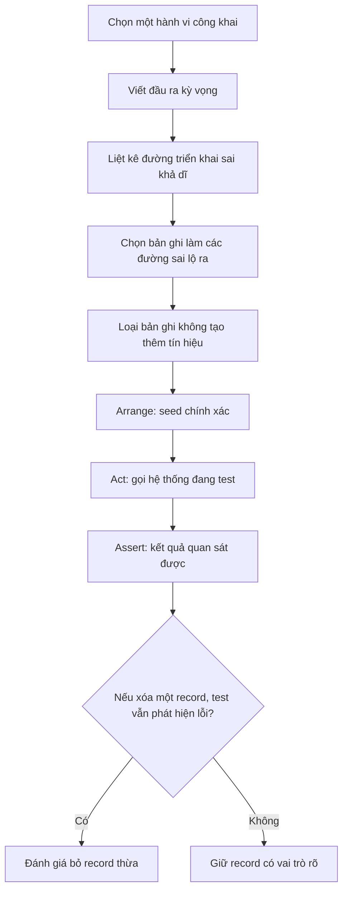

# Dữ liệu kiểm thử — Tạo dữ liệu tối thiểu để quan sát một hành vi

## 1. Mục tiêu: ít dữ liệu nhưng đủ sức phát hiện sai

Một bài test tốt không cần chứa thật nhiều bản ghi, người dùng, đơn hàng hay sản phẩm. Nó cần **đúng lượng dữ liệu để hành vi đang kiểm tra có thể quan sát được**, đồng thời làm cho một cách triển khai sai hợp lý tạo ra kết quả khác với cách triển khai đúng.

Ví dụ: API trả về các sản phẩm **đang hoạt động** và thuộc danh mục `books`. Nếu test chỉ tạo một sản phẩm `books, active=true`, cả ba chương trình sau đều có thể PASS:

1. Trả mọi sản phẩm, không lọc gì.
2. Chỉ lọc `category=books`, quên điều kiện active.
3. Lọc đúng cả category và active.

Một bản ghi dương đã chứng minh rằng *hệ thống có thể trả về một kết quả phù hợp*, nhưng **chưa chứng minh nó loại trừ kết quả không phù hợp**. Để phân biệt ba cách triển khai, thêm đúng hai bản ghi đối chứng:

| Sản phẩm | category | active | Vai trò |
| --- | --- | --- | --- |
| `BOOK-OK` | `books` | `true` | Đối chứng dương: **phải xuất hiện** |
| `BOOK-OFF` | `books` | `false` | Đối chứng âm cho điều kiện active: **không được xuất hiện** |
| `GAME-OK` | `games` | `true` | Đối chứng âm cho điều kiện category: **không được xuất hiện** |

Expected result: `["BOOK-OK"]`. Nếu bỏ điều kiện active, `BOOK-OFF` sẽ lọt vào; nếu bỏ điều kiện category, `GAME-OK` sẽ lọt vào. Ba bản ghi này là một **minimal distinguishing fixture** cho hành vi lọc theo hai điều kiện độc lập trong ví dụ.

**“Tối thiểu” không đồng nghĩa “càng ít càng tốt bất chấp chất lượng”.** Một dữ liệu tối thiểu đúng là *không có bản ghi thừa, nhưng đủ trường hợp đối chứng để test có khả năng phát hiện sai*. Mức tối thiểu thay đổi tùy hành vi; với phép thử “database rỗng trả danh sách rỗng”, số bản ghi cần tạo là **0**.

### Sau bài học, bạn có thể

- Nêu một hành vi và điều kiện quan sát được trước khi tạo fixture.
- Phân biệt đối chứng dương, đối chứng âm, giá trị biên và dữ liệu nền bắt buộc.
- Chọn đúng lượng dữ liệu cho một predicate, tổ hợp predicate, thứ tự, phân trang và lỗi.
- Viết tests theo **Arrange–Act–Assert** với dữ liệu test được tạo ngay tại nơi cần.
- Thiết kế fixture độc lập, lặp lại được và dễ đọc, không lệ thuộc thứ tự chạy hoặc ID tự sinh.
- Biết lúc nào dùng literal values, fixture helper, factory/builder, Mockito stub, `@Sql` hoặc Testcontainers.
- Kiểm thử phần dữ liệu thật bằng `@DataJpaTest` và riêng web contract bằng `@WebMvcTest`.
- Không nhầm việc mock repository với bằng chứng rằng SQL/JPA query lọc đúng.
- Tránh dữ liệu ngẫu nhiên khó tái hiện, shared test data, seed quá rộng, và assertions quá yếu.

## 2. Bắt đầu từ hành vi, không bắt đầu từ bộ dữ liệu

Một quy trình thiết kế test hiệu quả:



Đặt câu hỏi theo thứ tự:

1. **Hành vi nào?** Ví dụ “chỉ trả active books, theo SKU tăng dần”.
2. **Quan sát qua đâu?** Giá trị trả về của service, JSON HTTP, hay query repository?
3. **Expected outcome nào?** Ví dụ `["BOOK-OK"]`.
4. **Nếu lập trình viên quên một điều kiện, test có fail không?**
5. **Mỗi bản ghi phục vụ assertion nào?**
6. **Có thể bỏ bớt bản ghi mà test vẫn giữ ý nghĩa không?**

Hãy làm rõ hợp đồng trước khi viết fixture. Nếu test mơ hồ “trả sản phẩm đúng”, rất dễ thêm 20 sản phẩm nhưng không biết tại sao cần 20.

### Arrange–Act–Assert

```java
// Arrange: một dữ liệu phù hợp và hai dữ liệu đối chứng.
save("BOOK-OK",  "books", true);
save("BOOK-OFF", "books", false);
save("GAME-OK", "games", true);

// Act: gọi chức năng thực sự được kiểm tra.
List<String> visible = service.visibleSkus("books");

// Assert: kết quả chính xác; không có dữ liệu lọt vào.
assertEquals(List.of("BOOK-OK"), visible);
```

Đây là **đoạn minh họa** chưa khai báo `save`/`service`. Dự án đầy đủ ở mục 8–13 có imports, entities, repository và tests runnable.

Không nên thêm nhiều bước unrelated trong cùng test, ví dụ tạo người dùng, xác thực bằng HTTP, tạo giỏ hàng, xuất hóa đơn, gửi email rồi mới kiểm tra mỗi phép lọc. Nếu lớp cần test chỉ là repository query, những bước kia là nhiễu.

## 3. Tối thiểu theo hành vi: 0, 1, 2, 3 và nhiều hơn

| Hành vi muốn quan sát | Số dữ liệu gợi ý | Vì sao |
| --- | ---: | --- |
| Truy vấn khi chưa có record | **0** | Không seed chính là điều kiện cần thử |
| Một sản phẩm hợp lệ được trả về | **1** | Chứng minh happy path/serialization |
| Một sản phẩm bị loại vì active=false | **1** | Test một negative predicate riêng |
| Sắp xếp hai giá trị khác nhau | **2** | Một phần tử không chứng minh thứ tự |
| Kiểm tra loại bỏ duplicate | **2** có cùng khóa nghiệp vụ | Nếu chỉ một, không thể quan sát duplicate |
| Lọc theo category **AND** active | **3** | Một match + một near-miss cho mỗi điều kiện |
| Phân trang size=2 và còn trang sau | **3** records theo thứ tự xác định | Cần một record vượt trang đầu |
| Kiểm tra giới hạn số lượng tối đa N | Ít nhất giá trị/collection tại N và N+1 | Cần cặp biên phân biệt hợp lệ/bất hợp lệ |
| Atomic transfer | Ít nhất **2** accounts | Có bên ghi nợ và bên ghi có |
| Cạnh tranh cùng một tài nguyên | Ít nhất 2 tác nhân/request | Cần phát sinh sự tương tác gây race |
| Event ordering/version stale | Ít nhất 2 events khác version | Cần phân biệt mới/cũ |

Đây là số lượng gợi ý cho **từng hành vi cụ thể**, không phải định luật “mọi test AND luôn cần đúng ba bản ghi”. Khi còn tenant, owner, visibility window, soft delete hoặc role permission, số đối chứng tăng theo những cách triển khai sai mà bạn muốn phát hiện. Một record có thể phục vụ nhiều assertion nhưng không nên chọn fixture ngẫu nhiên vô tình vi phạm nhiều điều kiện, khiến không xác định điều kiện nào gây lọc.

### Phép thử “không dữ liệu” thường mạnh hơn một seed lớn

```java
@Test
void noProductsReturnsEmptyList() {
    // Không tạo bất kỳ record nào.
    assertEquals(List.of(), service.visibleSkus("books"));
}
```

Nếu test này bắt đầu với `@BeforeEach` tạo 30 bản ghi chung, chúng ta đã tự làm mất điều kiện empty. Một fixture global “cho tiện” có thể khiến bài test cần dữ liệu rỗng không bao giờ chạy trên database rỗng thực sự.

## 4. Đối chứng dương và đối chứng âm

Đối chứng dương (positive witness) thỏa mọi predicate và phải có trong kết quả. Đối chứng âm (negative witness) vi phạm có chủ đích một predicate và phải không có trong kết quả.

Đối với `category == books && active == true`:

```text
Category:      books      books      games
Active:        true       false      true
Expected:      KEEP       DROP       DROP
Role:          positive   neg(active) neg(category)
```

**Tại sao mỗi đối chứng âm chỉ vi phạm một điều kiện?** Nếu tạo `games,active=false` làm đối chứng duy nhất, record này sẽ bị loại dù code **quên category** hoặc **quên active**. Test vẫn xanh khi một trong hai predicate bị xóa. “Near miss” chỉ sai một điều kiện giúp nhận diện mutation rõ hơn.

Một nguyên tắc thực dụng cho biểu thức AND gồm N điều kiện độc lập là tạo **một trường hợp thỏa tất cả và một trường hợp sai từng điều kiện riêng** nếu mục tiêu là bắt lỗi bỏ sót từng điều kiện. Mức N+1 này là một chiến lược dễ hiểu, không phải mức tối thiểu toán học cho mọi hệ thống hoặc mọi tập mutants.

### Biến thể mutation testing

Giả sử repository có:

```java
List<Product> findByCategoryAndActiveTrueOrderBySkuAsc(
        String category);
```

Những lỗi phổ biến cần test phát hiện:

| Mutation | Kết quả trên ba records | Test đúng phải |
| --- | --- | --- |
| Không lọc active | BOOK-OK, BOOK-OFF | FAIL |
| Không lọc category | BOOK-OK, GAME-OK | FAIL |
| Không lọc gì | Cả ba records | FAIL |
| Chỉ dùng điều kiện đúng | BOOK-OK | PASS |
| Đổi sorting từ ASC thành DESC | Với một match vẫn ra BOOK-OK | **Không phát hiện**; cần test 2 matches riêng |
| Đổi tên field JSON trong controller | Repository vẫn đúng | Cần web-layer test riêng |

Vì thế **một test nhiều negative witnesses không thay được test sắp xếp**. Mỗi hành vi có điều kiện quan sát khác nhau.

## 5. Một hành vi mỗi test ≠ một dòng assert mỗi test

Nguyên tắc “test một hành vi” không cấm nhiều assertions. Nếu hành vi là “trả đúng active books”, test có thể assert đồng thời:

- Kết quả chứa đúng một SKU `BOOK-OK`.
- Không có `BOOK-OFF`, `GAME-OK`.
- Thứ tự theo contract, nếu đây là một phần cùng hành vi.

Tuy nhiên assert `count == 1` **không đủ**: nếu code vô tình trả `BOOK-OFF` thay cho `BOOK-OK`, số lượng vẫn bằng một. So sánh exact values hoặc set có chủ đích mạnh hơn.

**Không nên** nhét vào cùng test nhiều hành vi không liên quan, ví dụ “lọc đúng, cập nhật tồn kho, gửi notification và tính cước” chỉ để giảm số test methods. Khi fail, rất khó biết loại dữ liệu nào gây vấn đề.

### Đọc một test như một đặc tả

Tên rõ:

```java
void threeRowsDistinguishCategoryAndActiveFilters()
```

Tên mơ hồ:

```java
void testData1()
```

Dữ liệu thử nghiệm nên thể hiện được **tại sao** nó tồn tại; dùng SKU có nghĩa (`BOOK-OK`, `BOOK-OFF`, `GAME-OK`), không dùng `a1`, `a2`, `a3` hoặc UUID vô nghĩa khi chúng là thành phần quan trọng của expected output.

## 6. Các đặc tính bắt buộc của dữ liệu tối thiểu

### 6.1. Đủ hợp lệ để đi tới hành vi đích

Để kiểm tra lọc category, các fields khác phải thỏa contract cần thiết. Nếu entity bắt buộc `sku` khác rỗng và category hợp lệ, đừng tạo record thiếu SKU rồi để DB từ chối trước khi query lọc chạy. Một fixture “ngắn” nhưng **không hợp lệ để tới logic cần test** không hữu ích.

### 6.2. Có khả năng phân biệt kết quả đúng/sai

Một đối chứng âm cần tạo phản ví dụ cho một mutation dự kiến. Hai bản ghi có cùng category/active và giống nhau về quan sát chỉ làm dataset lớn hơn, trừ khi hành vi liên quan duplicate, cardinality, pagination hoặc ordering.

### 6.3. Độc lập và xác định

Dùng giá trị tường minh, clock cố định khi logic phụ thuộc thời gian, random seed cố định nếu thật sự cần random. Tránh test phụ thuộc dữ liệu có sẵn từ máy developer, ID tự tăng có giá trị cụ thể hoặc thứ tự trả về không được query quy định.

### 6.4. Cô lập giữa test methods

`@DataJpaTest` thường chạy trong test transaction và rollback sau từng test method. Không dựa vào test A chạy trước test B để tạo dữ liệu. Với HTTP thật, server có transaction riêng nên rollback ở test thread không tự xóa dữ liệu do request tạo.

### 6.5. Dễ quan sát và chẩn đoán

Khi test fail, từ tên sản phẩm và expected values phải nhận ra record nào lọt vào sai. Nếu toàn bộ dataset là `Product("x", "x", true)`, failure message khó hữu ích.

### 6.6. Không có dữ liệu thật nhạy cảm

Không sao chép email, số điện thoại, token, mật khẩu, tài khoản hoặc khách hàng production vào fixture. Với test API bảo mật, dùng giả lập không thể dùng ngoài test, hoặc dữ liệu đã được ẩn danh theo quy trình được phê duyệt.

## 7. Chọn mức test trước khi chọn cách seed

| Mức kiểm thử | Dữ liệu tối thiểu nên dùng | Không thể kết luận |
| --- | --- | --- |
| Unit một hàm | Literals, records, vài values | Không chứng minh Spring/JPA/wiring |
| Unit một service với Mockito | Một stub return cho interaction đang thử | Không chứng minh JPA query lọc đúng |
| `@WebMvcTest` | HTTP request và response service mock | Không chứng minh repository/SQL thực |
| `@DataJpaTest` | Một vài persisted entities có vai trò rõ | Không chứng minh HTTP serializer/security |
| `@SpringBootTest` | Dataset đủ chứng minh wiring integration | Không tự kiểm tra mọi external service |
| HTTP real server / Testcontainers | External resources có namespace riêng | Chi phí setup/cô lập cao hơn |
| Contract/consumer test | Một message/request đáp ứng hợp đồng | Không chứng minh nghiệp vụ đầy đủ |

**Nguyên tắc:** chọn tầng nhỏ nhất còn quan sát được hành vi cần test. Nếu test công thức cước vận chuyển, không cần khởi động Tomcat và H2. Nếu test derived JPA query, Mockito repository trả danh sách giả sẽ không bắt lỗi tên phương thức query.

Spring Boot 3.5 có `@DataJpaTest` ở `org.springframework.boot.test.autoconfigure.orm.jpa.DataJpaTest`, `@WebMvcTest` ở `org.springframework.boot.test.autoconfigure.web.servlet.WebMvcTest`, và `@MockitoBean` của Spring Framework 6.2 trong `org.springframework.test.context.bean.override.mockito.MockitoBean`.

## 8. Dự án chạy được: Spring Boot 3.5, Java 17, Maven

Dự án có một API catalog và một chính sách cước đơn giản:

- `Product` là JPA entity gồm SKU, category và active.
- `ProductRepository` tìm active products trong category, sắp xếp tăng theo SKU.
- `CatalogService` chuyển kết quả entity thành `List<String>` SKU.
- `CatalogController` trả JSON array qua `GET /api/catalog/visible?category=books`.
- `ShippingPolicy` là Java class thuần tính phí vận chuyển khi tổng tiền đạt ngưỡng.
- Các test được chia theo hành vi để thấy lúc nào cần **0, 1, 2 hoặc 3 records**.

Không có Kafka, Docker, security, payment gateway, cron job hay file fixture lớn. **H2 và Hibernate tạo schema chỉ dùng để thử dữ liệu/query** trong bài này; điều đó **không phải** bằng chứng kiểm thử migration SQL. Khi cần schema migration, phải có bài test Flyway/Liquibase riêng dùng `ddl-auto=validate`.

### 8.1. Cây thư mục

```text
minimal-test-data-demo/
├── pom.xml
└── src/
    ├── main/
    │   └── java/example/testdata/
    │       ├── TestDataApplication.java
    │       ├── Product.java
    │       ├── ProductRepository.java
    │       ├── CatalogService.java
    │       ├── CatalogController.java
    │       └── ShippingPolicy.java
    └── test/
        └── java/example/testdata/
            ├── CatalogRepositoryTest.java
            ├── CatalogServiceTest.java
            ├── CatalogControllerTest.java
            └── ShippingPolicyTest.java
```

### 8.2. pom.xml

```xml
<?xml version="1.0" encoding="UTF-8"?>
<project xmlns="http://maven.apache.org/POM/4.0.0"
         xmlns:xsi="http://www.w3.org/2001/XMLSchema-instance"
         xsi:schemaLocation="http://maven.apache.org/POM/4.0.0
           https://maven.apache.org/xsd/maven-4.0.0.xsd">
    <modelVersion>4.0.0</modelVersion>

    <parent>
        <groupId>org.springframework.boot</groupId>
        <artifactId>spring-boot-starter-parent</artifactId>
        <version>3.5.0</version>
        <relativePath/>
    </parent>

    <groupId>example</groupId>
    <artifactId>minimal-test-data-demo</artifactId>
    <version>1.0-SNAPSHOT</version>

    <properties>
        <java.version>17</java.version>
    </properties>

    <dependencies>
        <dependency>
            <groupId>org.springframework.boot</groupId>
            <artifactId>spring-boot-starter-web</artifactId>
        </dependency>
        <dependency>
            <groupId>org.springframework.boot</groupId>
            <artifactId>spring-boot-starter-data-jpa</artifactId>
        </dependency>
        <dependency>
            <groupId>com.h2database</groupId>
            <artifactId>h2</artifactId>
            <scope>runtime</scope>
        </dependency>
        <dependency>
            <groupId>org.springframework.boot</groupId>
            <artifactId>spring-boot-starter-test</artifactId>
            <scope>test</scope>
        </dependency>
    </dependencies>
</project>
```

Spring Boot parent/BOM quản lý JUnit Jupiter, Mockito, Hibernate, Spring Test và H2. Không trộn dependencies Boot 4 vào project 3.5; một số test module/import có thay đổi giữa major versions.

### 8.3. TestDataApplication.java

`src/main/java/example/testdata/TestDataApplication.java`:

```java
package example.testdata;

import org.springframework.boot.SpringApplication;
import org.springframework.boot.autoconfigure.SpringBootApplication;

@SpringBootApplication
public class TestDataApplication {
    public static void main(String[] args) {
        SpringApplication.run(TestDataApplication.class, args);
    }
}
```

Các classes ở cùng package giúp Boot component scan nhận controller/service/repository/entities theo mặc định.

### 8.4. Product.java

`src/main/java/example/testdata/Product.java`:

```java
package example.testdata;

import jakarta.persistence.Column;
import jakarta.persistence.Entity;
import jakarta.persistence.GeneratedValue;
import jakarta.persistence.GenerationType;
import jakarta.persistence.Id;
import jakarta.persistence.Table;

@Entity
@Table(name = "catalog_products")
public class Product {

    @Id
    @GeneratedValue(strategy = GenerationType.IDENTITY)
    private Long id;

    @Column(nullable = false, length = 40)
    private String sku;

    @Column(nullable = false, length = 40)
    private String category;

    @Column(nullable = false)
    private boolean active;

    protected Product() {
    }

    public Product(String sku, String category, boolean active) {
        this.sku = sku;
        this.category = category;
        this.active = active;
    }

    public Long getId() {
        return id;
    }

    public String getSku() {
        return sku;
    }

    public String getCategory() {
        return category;
    }

    public boolean isActive() {
        return active;
    }
}
```

Entity chỉ có ba thuộc tính nghiệp vụ để làm rõ việc chọn dữ liệu; `id` là khóa DB tự sinh. Không kiểm tra ID phải bằng 1/2/3 vì sequence/identity có thể tăng dù transaction rollback. Dùng SKU như stable test identifier.

### 8.5. ProductRepository.java

`src/main/java/example/testdata/ProductRepository.java`:

```java
package example.testdata;

import java.util.List;
import org.springframework.data.jpa.repository.JpaRepository;

public interface ProductRepository
        extends JpaRepository<Product, Long> {

    List<Product> findByCategoryAndActiveTrueOrderBySkuAsc(
            String category);
}
```

Đây là Spring Data derived query:

- `Category` = truyền `category`.
- `AndActiveTrue` = chỉ lấy `active = true`.
- `OrderBySkuAsc` = sắp xếp theo SKU tăng dần.

Tên method là **hợp đồng query** đang được kiểm tra bởi JPA tests. Nếu viết nhầm `findByCategoryOrderBySkuAsc`, không dùng điều kiện active, bộ fixture ba bản ghi phải phát hiện.

### 8.6. CatalogService.java

`src/main/java/example/testdata/CatalogService.java`:

```java
package example.testdata;

import java.util.List;
import org.springframework.stereotype.Service;

@Service
public class CatalogService {

    private final ProductRepository repository;

    public CatalogService(ProductRepository repository) {
        this.repository = repository;
    }

    public List<String> visibleSkus(String category) {
        return repository
                .findByCategoryAndActiveTrueOrderBySkuAsc(category)
                .stream()
                .map(Product::getSku)
                .toList();
    }
}
```

Service không đụng tới cache, clock hoặc external systems. Trong JPA slice test, service thật được thêm vào context bằng `@Import(CatalogService.class)`; trong unit test có thể tạo service bằng constructor với mocked repository.

### 8.7. CatalogController.java

`src/main/java/example/testdata/CatalogController.java`:

```java
package example.testdata;

import java.util.List;
import org.springframework.web.bind.annotation.GetMapping;
import org.springframework.web.bind.annotation.RequestMapping;
import org.springframework.web.bind.annotation.RequestParam;
import org.springframework.web.bind.annotation.RestController;

@RestController
@RequestMapping("/api/catalog")
public class CatalogController {

    private final CatalogService service;

    public CatalogController(CatalogService service) {
        this.service = service;
    }

    @GetMapping("/visible")
    public List<String> visible(
            @RequestParam String category) {
        return service.visibleSkus(category);
    }
}
```

Spring MVC/Jackson sẽ serialize `List<String>` thành JSON array. Tầng web không có lý do tự tạo ba `Product` records; test web có thể chỉ mock một service response để kiểm chứng đúng binding và JSON.

### 8.8. ShippingPolicy.java

`src/main/java/example/testdata/ShippingPolicy.java`:

```java
package example.testdata;

public class ShippingPolicy {

    private static final int FREE_FROM_VND = 500_000;
    private static final int STANDARD_FEE_VND = 30_000;

    public int feeFor(int orderTotalVnd) {
        if (orderTotalVnd < 0) {
            throw new IllegalArgumentException(
                    "orderTotalVnd must be non-negative");
        }

        return orderTotalVnd >= FREE_FROM_VND
                ? 0
                : STANDARD_FEE_VND;
    }
}
```

Không cần dữ liệu khách hàng, đơn hàng hay JPA khi hành vi chỉ là “phí vận chuyển bằng 0 nếu tổng tiền ≥500.000 VND”. Một số literal inputs đủ để kiểm biên. Dùng `int` cho số VND nguyên trong ví dụ; với tiền tệ có phần thập phân trong ứng dụng thật, dùng kiểu decimal/currency phù hợp thay vì floating point thiếu kiểm soát.

## 9. JPA slice test: kiểm chứng dữ liệu có vai trò riêng

`src/test/java/example/testdata/CatalogRepositoryTest.java`:

```java
package example.testdata;

import static org.junit.jupiter.api.Assertions.assertEquals;

import java.util.Arrays;
import java.util.List;
import jakarta.persistence.EntityManager;
import jakarta.persistence.PersistenceContext;
import org.junit.jupiter.api.Test;
import org.springframework.beans.factory.annotation.Autowired;
import org.springframework.boot.test.autoconfigure.orm.jpa.DataJpaTest;
import org.springframework.context.annotation.Import;

@DataJpaTest
@Import(CatalogService.class)
class CatalogRepositoryTest {

    @Autowired
    ProductRepository repository;

    @Autowired
    CatalogService service;

    @PersistenceContext
    EntityManager entityManager;

    private void seed(Product... products) {
        repository.saveAll(Arrays.asList(products));
        repository.flush();
        entityManager.clear();
    }

    @Test
    void threeRowsDistinguishBothFilters() {
        seed(
            new Product("BOOK-OK",  "books", true),
            new Product("BOOK-OFF", "books", false),
            new Product("GAME-OK",  "games", true));

        List<String> result = service.visibleSkus("books");

        assertEquals(List.of("BOOK-OK"), result);
    }

    @Test
    void noSeedMeansNoMatch() {
        // Không @BeforeEach seed, để thật sự kiểm tra DB rỗng.
        assertEquals(List.of(), service.visibleSkus("books"));
    }

    @Test
    void onePositiveRowProvesExistenceOnly() {
        seed(new Product("BOOK-ONE", "books", true));

        assertEquals(
                List.of("BOOK-ONE"),
                service.visibleSkus("books"));
    }

    @Test
    void twoRowsProveSortingContract() {
        // Insert cố ý ngược thứ tự SKU để test sorting rõ ràng.
        seed(
            new Product("BOOK-Z", "books", true),
            new Product("BOOK-A", "books", true));

        assertEquals(
                List.of("BOOK-A", "BOOK-Z"),
                service.visibleSkus("books"));
    }

    @Test
    void oneInactiveRowIsExcluded() {
        seed(new Product("BOOK-OFF", "books", false));

        assertEquals(List.of(), service.visibleSkus("books"));
    }
}
```

**Có 5 JUnit methods**. Từng test có dataset được chọn cho một hành vi cụ thể, không có một global 20-row fixture.

### 9.1. Tại sao ba bản ghi là vừa đủ cho phép lọc kết hợp?

`threeRowsDistinguishBothFilters` muốn loại hai lỗi:

- Nếu repository bỏ `ActiveTrue` thì `BOOK-OFF` xuất hiện ⇒ assertion fail.
- Nếu repository bỏ `Category` thì `GAME-OK` xuất hiện ⇒ assertion fail.
- Nếu code trả mọi hàng thì cả hai lọt vào ⇒ fail.
- Nếu đúng cả hai, chỉ có `BOOK-OK` ⇒ pass.

Không cần 200 sản phẩm và 5 categories để làm lộ hai lỗi này. Thêm record chỉ khi có hành vi mới (pagination, multiple tenants, duplicate SKU…) đòi hỏi.

### 9.2. Tại sao một bản ghi không đủ cho sorting?

`onePositiveRowProvesExistenceOnly` là một happy path. Nếu đổi `OrderBySkuAsc` thành DESC, kết quả vẫn có một phần tử. `twoRowsProveSortingContract` tạo hai SKU **khác nhau** và insert theo thứ tự Z rồi A; expected output theo contract là A rồi Z.

Đừng dựa vào thứ tự insert/ID trong query không có `ORDER BY`; database **không cam kết** thứ tự tự nhiên. Test này dựa vào `OrderBySkuAsc` có khai báo rõ.

### 9.3. Tại sao flush rồi clear?

`repository.flush()` buộc các thay đổi JPA được phát xuống database trước khi query. `entityManager.clear()` bỏ các managed entities trong first-level persistence context để kết quả không dựa trên đối tượng vừa seed. Đây là một cách làm rõ SQL behavior ở repository test; với nhiều derived queries, framework cũng có cơ chế flush khi cần, nhưng **explicit flush/clear giúp bài test dễ lý giải**.

### 9.4. @DataJpaTest và rollback

Spring Boot 3.5 `@DataJpaTest` mặc định cấu hình JPA repositories, embedded H2 nếu driver có mặt, và test transaction **rollback sau từng method**. Vì vậy test không được phụ thuộc vào một test khác đã chạy, và `noSeedMeansNoMatch` có cơ sở kiểm tra DB rỗng.

Không tự thêm `@Order(1)`/`@Order(2)` để dùng output test trước. Nếu chuyển sang `@SpringBootTest(RANDOM_PORT)` rồi gửi HTTP POST qua server thread, transaction của test client không tự rollback các writes do server commit; phải có cleanup riêng.

### 9.5. Dự án này không test migration

Vì mục tiêu chỉ là thiết kế **dữ liệu test**, Hibernate có thể tạo tables trong embedded H2 của test slice. Điều đó không chứng minh Flyway/Liquibase migrations đúng. Nếu mục tiêu sau này là schema migration, phải dùng datasource do migrations quản lý và Hibernate `ddl-auto=validate`; không trộn hai mục tiêu rồi kết luận sai.

## 10. Unit test CatalogService: không cần database

`src/test/java/example/testdata/CatalogServiceTest.java`:

```java
package example.testdata;

import static org.junit.jupiter.api.Assertions.assertEquals;
import static org.mockito.Mockito.verify;
import static org.mockito.Mockito.verifyNoMoreInteractions;
import static org.mockito.Mockito.when;

import java.util.List;
import org.junit.jupiter.api.Test;
import org.junit.jupiter.api.extension.ExtendWith;
import org.mockito.InjectMocks;
import org.mockito.Mock;
import org.mockito.junit.jupiter.MockitoExtension;

@ExtendWith(MockitoExtension.class)
class CatalogServiceTest {

    @Mock
    ProductRepository repository;

    @InjectMocks
    CatalogService service;

    @Test
    void mapsRepositoryResultWithoutDatabase() {
        Product only = new Product(
                "BOOK-ONE", "books", true);

        when(repository
                .findByCategoryAndActiveTrueOrderBySkuAsc("books"))
                .thenReturn(List.of(only));

        List<String> actual = service.visibleSkus("books");

        assertEquals(List.of("BOOK-ONE"), actual);
        verify(repository)
                .findByCategoryAndActiveTrueOrderBySkuAsc("books");
        verifyNoMoreInteractions(repository);
    }

    @Test
    void emptyRepositoryResultHasNoEntities() {
        when(repository
                .findByCategoryAndActiveTrueOrderBySkuAsc("books"))
                .thenReturn(List.of());

        assertEquals(List.of(), service.visibleSkus("books"));

        verify(repository)
                .findByCategoryAndActiveTrueOrderBySkuAsc("books");
        verifyNoMoreInteractions(repository);
    }
}
```

**Có 2 unit tests**. Chúng chứng minh:

- Service gọi đúng dependency/method với category được truyền.
- Service map entity thành SKU đúng.
- Khi repository trả rỗng, service trả rỗng.
- Không cần H2 và Spring ApplicationContext.

**Không chứng minh** `findByCategoryAndActiveTrueOrderBySkuAsc` thực sự chạy SQL với đủ điều kiện. Mockito trả kết quả do test đã định nghĩa trước. Đó là lý do `CatalogRepositoryTest` phải có ba persisted records riêng.

### Dữ liệu mock tối thiểu

Một mock method stub cần **chỉ những return values được thực sự dùng**. Không mock 12 repository methods, 5 services và 3 HTTP clients nếu code test chỉ gọi một query. Stub unused sẽ làm test khó đọc, và Mockito strict stubbing có thể cảnh báo unused stubs.

## 11. Web MVC slice: chỉ cần một service response

`src/test/java/example/testdata/CatalogControllerTest.java`:

```java
package example.testdata;

import static org.mockito.Mockito.verify;
import static org.mockito.Mockito.verifyNoInteractions;
import static org.mockito.Mockito.when;
import static org.springframework.test.web.servlet.request.MockMvcRequestBuilders.get;
import static org.springframework.test.web.servlet.result.MockMvcResultMatchers.content;
import static org.springframework.test.web.servlet.result.MockMvcResultMatchers.status;

import java.util.List;
import org.junit.jupiter.api.Test;
import org.springframework.beans.factory.annotation.Autowired;
import org.springframework.boot.test.autoconfigure.web.servlet.WebMvcTest;
import org.springframework.test.context.bean.override.mockito.MockitoBean;
import org.springframework.test.web.servlet.MockMvc;

@WebMvcTest(CatalogController.class)
class CatalogControllerTest {

    @Autowired
    MockMvc mvc;

    @MockitoBean
    CatalogService service;

    @Test
    void oneServiceResultIsEnoughToCheckJsonSerialization()
            throws Exception {
        when(service.visibleSkus("books"))
                .thenReturn(List.of("BOOK-ONE"));

        mvc.perform(get("/api/catalog/visible")
                    .param("category", "books"))
                .andExpect(status().isOk())
                .andExpect(content().json("[\"BOOK-ONE\"]"));

        verify(service).visibleSkus("books");
    }

    @Test
    void emptyServiceResultProducesEmptyArray()
            throws Exception {
        when(service.visibleSkus("books"))
                .thenReturn(List.of());

        mvc.perform(get("/api/catalog/visible")
                    .param("category", "books"))
                .andExpect(status().isOk())
                .andExpect(content().json("[]"));

        verify(service).visibleSkus("books");
    }

    @Test
    void missingRequiredParameterFailsBeforeService()
            throws Exception {
        // Không dựng bất kỳ Product hay Mockito stub nào.
        mvc.perform(get("/api/catalog/visible"))
                .andExpect(status().isBadRequest());

        verifyNoInteractions(service);
    }
}
```

**Có 3 MVC tests**. Đây là ví dụ tiêu biểu của “đủ dữ liệu cho hành vi đang test”:

- Test serialize JSON chỉ cần **một** service result.
- Test empty JSON cần **một empty list**, không cần Product.
- Test thiếu required request parameter không cần dữ liệu hoặc stub nào; assert HTTP 400 và service không bị gọi.

`@WebMvcTest` dùng MVC argument resolution/response converter trong test context nhưng không mở HTTP socket. `@MockitoBean` của Spring Framework 6.2 tạo bean mock cho dependency của controller. Nếu muốn kiểm thử HTTP socket thật, security filter chain đầy đủ hay application wiring, dùng level integration phù hợp; **không** thêm database vào bài MVC test chỉ để cho fixture trông “giống thực tế”.

## 12. Boundary test: số liệu tối thiểu thay vì một database giả

`src/test/java/example/testdata/ShippingPolicyTest.java`:

```java
package example.testdata;

import static org.junit.jupiter.api.Assertions.assertEquals;
import static org.junit.jupiter.api.Assertions.assertThrows;

import org.junit.jupiter.api.Test;
import org.junit.jupiter.params.ParameterizedTest;
import org.junit.jupiter.params.provider.CsvSource;

class ShippingPolicyTest {

    private final ShippingPolicy policy = new ShippingPolicy();

    @ParameterizedTest
    @CsvSource({
        "0, 30000",
        "499999, 30000",
        "500000, 0",
        "500001, 0"
    })
    void boundaryIsTestedWithNumbersNotEntities(
            int amountVnd, int expectedFeeVnd) {
        assertEquals(expectedFeeVnd,
                policy.feeFor(amountVnd));
    }

    @Test
    void negativeTotalRejected() {
        assertThrows(IllegalArgumentException.class,
                () -> policy.feeFor(-1));
    }
}
```

**Có 2 method declarations nhưng 5 lượt thực thi** (4 từ `@CsvSource` và 1 `@Test`).

Các dữ liệu đã chọn có chức năng cụ thể:

| Giá trị | Kỳ vọng | Vì sao cần |
| ---: | ---: | --- |
| `0` | 30.000 | Kiểm tra giá trị thấp hợp lệ |
| `499999` | 30.000 | Ngay dưới ngưỡng, phát hiện `>` sai |
| `500000` | 0 | Đúng tại ngưỡng, phát hiện `>` thay vì `>=` |
| `500001` | 0 | Ngay trên ngưỡng |
| `-1` | Exception | Từ chối đầu vào bất hợp lệ |

Không cần tạo Order entity, khách hàng, địa chỉ, payment hoặc Spring context để kiểm một hàm Java thuần. `@ParameterizedTest` giúp test dữ liệu biên rõ ràng mà không lặp lại code.

## 13. Chạy project và kết quả mong đợi

Yêu cầu JDK 17+, Maven và khả năng tải dependencies lúc chạy lần đầu. Từ thư mục `minimal-test-data-demo`:

```bash
mvn test
```

Chạy từng mức:

```bash
mvn test -Dtest=CatalogRepositoryTest
mvn test -Dtest=CatalogServiceTest
mvn test -Dtest=CatalogControllerTest
mvn test -Dtest=ShippingPolicyTest
```

| Test class | Methods được khai báo | Lượt thực thi dự kiến | Dữ liệu tiêu biểu |
| --- | ---: | ---: | --- |
| `CatalogRepositoryTest` | 5 | 5 | 0, 1, 2 hoặc 3 persisted entities |
| `CatalogServiceTest` | 2 | 2 | 0 hoặc 1 mock return entity |
| `CatalogControllerTest` | 3 | 3 | 0 hoặc 1 mocked service response |
| `ShippingPolicyTest` | 2 | 5 | Biên 499999/500000/500001, input âm |
| **Tổng** | **12** | **15** | Không cần Docker, external API hay dữ liệu production |

**Kết quả kỳ vọng:** 15 test invocations PASS, 0 failures/errors/skips trong môi trường tương thích. Đây là kết quả **dự kiến** theo mã ví dụ, không phải stdout đã chạy. Java code không in ra console nên Maven/Spring có thể ghi log khác nhau; đọc `target/surefire-reports` để xác nhận test discovery và số lượt thực thi thật.

Đừng tuyên bố “suite pass” nếu `mvn test` bị filter khiến các test quan trọng không được chạy. Và đừng tăng fixture size chỉ vì test count tăng: mỗi test được phép chọn dataset nhỏ riêng.

### Tại sao một test có thể chạy chậm dù ít data?

Số bản ghi không phải yếu tố duy nhất. `@WebMvcTest` và `@DataJpaTest` vẫn khởi tạo Spring test context; `@SpringBootTest` còn nặng hơn. Giữ dữ liệu tối thiểu giúp đọc/cleanup nhanh, nhưng tối ưu lớn hơn thường đến từ **chọn đúng test slice và tái sử dụng context hợp lý**, không phải ép mọi test xuống một record.

## 14. Khi nào tạo test data builder hoặc factory?

Nếu nhiều test cùng cần một entity hợp lệ với 10 required fields, viết lại tất cả constructor arguments có thể dài và dễ sai. Lúc đó builder/helper giúp **giảm nhiễu** nhưng phải giữ những fields đang ảnh hưởng đến behavior **hiện rõ**.

Ví dụ một factory:

```java
// Snippet minh họa; phần này không nằm trong project runnable bên trên.
static Product activeBook(String sku) {
    return new Product(sku, "books", true);
}
```

Hợp lý khi test không thay category/active. Nhưng trong `threeRowsDistinguishBothFilters`, việc viết rõ `new Product("BOOK-OFF","books",false)` lại có giá trị hơn vì **active=false chính là lý do bản ghi tồn tại**.

### Tránh builder che mất ý nghĩa

Ví dụ không tốt:

```java
// Chứa nhiều defaults ngầm: khó thấy vì sao item được giữ/loại.
var product = TestDataFactory.anyProduct();
```

Tốt hơn:

```java
// Diễn đạt predicate liên quan ngay tại nơi test.
var product = new Product("BOOK-OFF", "books", false);
```

Nếu domain có nhiều fields không liên quan, có thể dùng builder:

```java
// Snippet minh họa, builder phải được định nghĩa ở dự án thực.
var product = aValidProduct()
        .withSku("BOOK-OFF")
        .inCategory("books")
        .inactive()
        .build();
```

Builder giúp giảm noise của field không liên quan, nhưng không nên làm giả default `active=true` khi test đang kiểm tra active logic.

### Object Mother, Test Data Builder, Fixture Factory

| Pattern | Phù hợp khi | Rủi ro |
| --- | --- | --- |
| Inline literals/new object | Ít fields, một hành vi rõ | Dễ lặp lại khi model phức tạp |
| Helper `product(sku,category,active)` | Nhiều tests cùng cách tạo hợp lệ | Nếu quá generic, mất ý nghĩa từng case |
| Object Mother `aValidOrder()` | Domain object phức tạp với default hợp lệ | Defaults vô hình làm test phụ thuộc ngầm |
| Fluent test builder | Nhiều variations có chủ đích | Builder quá phức tạp trở thành một mini-framework |
| `@Sql` script | Fixture relational nhiều bảng/references | SQL global dễ khó cleanup và sai transaction |
| Factory + Testcontainers | Cần system integration, DB engine thật | Setup chậm, cần isolation resource |
| Snapshot production lớn | Migration/performance/load tests | PII, kích thước lớn, khó xác định case |

Lựa chọn tốt là pattern **đơn giản nhất** mà người đọc hiểu ngay mỗi giá trị cần để làm gì.

## 15. Dữ liệu tối thiểu với quan hệ JPA phức tạp

Một test truy vấn Order thuộc Customer có thể cần tạo cả một Customer và một Order vì foreign key là điều kiện để lưu đúng. Không phải mọi record liên quan đều là “dữ liệu thừa”.

Ví dụ hành vi “không hiển thị order của người dùng khác” thường cần:

- Một user đang truy vấn.
- Một order thuộc user đó (**positive witness**).
- Một order thuộc user khác (**negative witness**).
- Các bản ghi liên quan tối thiểu để thỏa FK/NOT NULL.

Không cần 50 customers và 300 orders nếu hai orders có thể phát hiện lỗi authorization filtering. Tuy nhiên **test security không nên chỉ dùng mocked repository** nếu bug có thể nằm trong WHERE clause/JPA tenant filter. Chọn tầng có thể quan sát thực sự.

### Tạo từng object để phục vụ một role

```text
owner = alice
order_A.owner = alice    -> expected visible
order_B.owner = bob      -> expected hidden
query: visibleOrders(alice)
expected: [order_A]
```

Đây là mô tả fixture, không phải class runnable. Khi code cần tenant, bổ sung tenant field và một near-miss cho từng predicate. Không giả định rằng test dùng user A/B ở memory đã kiểm chứng transaction-level row security thật của DB.

## 16. Dữ liệu không cần SQL: @Sql, @BeforeEach và fixtures

### @Sql có phải luôn cần không?

Với dữ liệu rất nhỏ, repository `saveAll` trực tiếp trong test thường giúp người đọc thấy dữ liệu gắn với assertion. Nhưng với schema phức tạp hoặc stored procedures, SQL fixture có thể dễ quản lý hơn:

```sql
-- Trích đoạn minh họa, không thuộc project runnable.
INSERT INTO catalog_products (sku, category, active)
VALUES
    ('BOOK-OK', 'books', TRUE),
    ('BOOK-OFF', 'books', FALSE),
    ('GAME-OK', 'games', TRUE);
```

Đây là **SQL minh họa**, vì entity project dùng identity ID nên tùy schema H2 có thể chấp nhận insert bỏ ID. Với SQL fixtures thật, đặt script trong `src/test/resources` rồi dùng `@Sql` theo đúng annotation/test execution order và transaction semantics; không cần tạo file SQL chỉ cho ba rows nếu test code đang rõ hơn.

### Có nên dùng @BeforeEach để seed chung?

Chỉ nên nếu **mọi test trong lớp đều thật sự cần** cùng fixture. Trong project mẫu:

- `noSeedMeansNoMatch` yêu cầu database rỗng.
- `onePositiveRowProvesExistenceOnly` cần 1 row.
- `twoRowsProveSortingContract` cần 2 rows.
- `threeRowsDistinguishBothFilters` cần 3 rows.

Nếu `@BeforeEach` luôn insert 3 rows, cả bốn test đều bị nhiễm dữ liệu; phải cleanup hoặc logic kỳ vọng phức tạp hơn. Vì vậy helper `seed(...)` được **gọi cục bộ** trong mỗi test, không tự seed mọi lúc.

### @Sql và rollback

Spring `@Sql` có thể chạy trước/ sau method và tham gia hoặc không tham gia test transaction tùy `SqlConfig.TransactionMode` và config. Script cleanup cũng có thể chạy sau test, nhưng cần hiểu thứ tự và transaction: nếu dữ liệu được commit vào DB chung, một test khác có thể nhìn thấy.

Không dùng `TRUNCATE`/`DELETE FROM` toàn bộ database chung chỉ để reset fixture của một test. Với integration tests qua HTTP thật, transaction của test client không tự rollback data server đã commit.

## 17. Dữ liệu phụ thuộc thời gian, randomness và ID

### Clock cố định

Khi hành vi là “coupon còn hiệu lực đến 23:59”, tạo dữ liệu bằng `LocalDate.now()` có thể fail khi CI qua nửa đêm, timezone đổi hoặc chạy lâu. Hãy inject `Clock`:

```java
Clock clock = Clock.fixed(
        Instant.parse("2026-01-01T10:00:00Z"),
        ZoneOffset.UTC);
Instant now = Instant.now(clock);
```

Đoạn Java chuẩn này cần imports `java.time.Clock`, `Instant` và `ZoneOffset`. Trong code production, service nhận Clock qua constructor; test định nghĩa thời gian tường minh. Không gọi `Thread.sleep` để chờ coupon hết hạn nếu chỉ cần cố định/di chuyển clock.

### Random có seed cố định

Với property-based testing hoặc dữ liệu số lượng lớn, randomness hữu ích để tìm input bất ngờ. Nhưng một regression test thông thường nên có **giá trị cố định dễ giải thích**. Nếu dùng generator, lưu random seed để reproduce failure. Không gọi `UUID.randomUUID()` cho expected business identifiers khi UUID đó không liên quan hành vi cần test.

### ID tự sinh

`@GeneratedValue` không bảo đảm ID bắt đầu bằng 1 ở mọi lần chạy hoặc rollback. Assert `id != null` khi cần chứng minh persist, hoặc dùng SKU/identifier nghiệp vụ cố định để truy vấn. Không trộn DB-generated IDs từ run trước vào assertions.

### Tránh dữ liệu timezone/locale không kiểm soát

Với text có dấu, so sánh chữ hoa/chữ thường, collation hoặc datetime, dữ liệu tối thiểu phải gồm **đúng các giá trị phân biệt behavior**. Ví dụ test sorting Unicode nên có hai string mà thứ tự theo collation trong contract đã được xác định, không tự giả định mọi DB sắp xếp tiếng Việt giống nhau.

## 18. Thiết kế dữ liệu cho biên và nhánh lỗi

Một bài test chỉ cần một input hợp lệ để chạy một happy path, nhưng thường cần thêm test cho các partition quan trọng:

| Loại điều kiện | Fixture tối thiểu | Assertion điển hình |
| --- | --- | --- |
| Missing request body | Không có body | HTTP 400 |
| Null argument | Một null (nếu method cho phép gọi) | Exception hoặc behavior định nghĩa |
| Empty collection | `List.of()` | Kết quả rỗng |
| Một phần tử | `List.of(item)` | Hành vi đơn |
| Không đủ điều kiện | Một item chỉ sai một predicate | Không được trả |
| Ngưỡng số | `T−1`, `T`, `T+1` | Bắt lỗi `>`/`>=` |
| Duplicate key | Hai items trùng khóa | Unique/reject/dedup đúng |
| Pagination | Page size N + một item bổ sung | `hasNext`/offset đúng |
| Ordering | Hai items có keys khác nhau | Tăng/giảm đúng |
| Authorization | Một tài nguyên sở hữu, một không sở hữu | Không rò dữ liệu |
| Status transition | Một object ở trạng thái đầu và event chuyển trạng thái | Đúng state mới |
| Retry/idempotency | Cùng request ID gửi hai lần | Một tác động nghiệp vụ |
| Concurrent write | Hai requests có khả năng tranh chấp | Constraint/OCC bảo vệ |
| Soft delete | Một active, một deleted trong cùng scope | Deleted không xuất hiện |

Tạo **một test riêng** cho từng nhánh có ý nghĩa. Không làm một test chứa tất cả duplicate, pagination, status, timezone, permissions và retry rồi gọi đó là “minimal” chỉ vì một lần setup.

### Boundary values nên tương ứng chính xác với rule

Với ngưỡng 500.000, dùng 499999, 500000, 500001, không chỉ dùng 100 và 1.000.000. Hai giá trị rất xa ngưỡng có thể PASS ngay cả khi lập trình viên lỡ dùng `>` thay `>=`.

## 19. Chứng minh phép thử có sức phân biệt: mutation suy nghĩ

Không nhất thiết cài một mutation-testing framework ngay từ đầu. Có thể đặt câu hỏi “nếu thay đổi code theo cách sai này, test nào sẽ FAIL?”.

Ví dụ `CatalogRepository`:

- Xóa `ActiveTrue` → `threeRowsDistinguishBothFilters` FAIL vì BOOK-OFF xuất hiện.
- Xóa category predicate → cùng test FAIL vì GAME-OK xuất hiện.
- Đổi Asc thành Desc → `twoRowsProveSortingContract` FAIL vì BOOK-Z đứng trước BOOK-A.
- Luôn trả rỗng → `onePositiveRowProvesExistenceOnly` FAIL.
- Trả một row bất kỳ → `threeRowsDistinguishBothFilters` có thể FAIL khi khác BOOK-OK; test assert exact SKU.
- Web controller bỏ query param forwarding → `CatalogControllerTest` verify(service).visibleSkus("books") FAIL.
- Service map ra category thay SKU → `CatalogServiceTest` FAIL với expected BOOK-ONE.
- Cước dùng `> 500000` thay vì `>=500000` → `ShippingPolicyTest` FAIL đúng tại ngưỡng.

Một record có vai trò thường tương ứng với **một mutant mà nếu thiếu record đó test dễ bỏ sót**. Nếu không nêu được mutant/nhánh mà record phục vụ, cân nhắc loại nó khỏi fixture.

### Mutation testing thật

Các công cụ như PIT có thể đo mutation score trên Java code. Nhưng một điểm phần trăm mutation score cũng không tự bảo đảm coverage đầy đủ business behavior. Ưu tiên lập luận về **nhánh sai quan trọng**, ranh giới bảo mật và kết quả quan sát hơn là tối ưu một metric đơn lẻ.

## 20. Những anti-pattern phổ biến

### 20.1. Seed toàn bộ production sample database

Một file `big-test-data.sql` 10.000 rows cho mọi test khiến kết quả khó đọc, fixture khó cập nhật theo schema và thậm chí mask bug vì query có dữ liệu trùng.

**Sửa:** dùng những records có role cụ thể; chỉ cần data lớn ở performance/load/migration tests, không phải mọi unit/repository test.

### 20.2. Snapshot assertions không giải thích vì sao data tồn tại

So sánh snapshot JSON lớn có thể phát hiện chênh lệch nhưng người đọc không biết field nào là behavior trọng tâm. Thêm assertions rõ: exact values, filtered-out cases, status, count hoặc business version.

### 20.3. Test có 100 records nhưng expected count chỉ là 1

Nhiều dữ liệu hơn không làm `assertEquals(1, result.size())` mạnh hơn nếu một record sai cũng tạo count=1. Nếu điều quan trọng là identity, assert exact IDs/SKUs.

### 20.4. Sử dụng dữ liệu chung giữa test methods

Một method giả định method khác đã tạo user trước đó. JUnit có thể đổi thứ tự hoặc chạy song song; cache context không phải transaction cleanup. Mỗi test phải tự chuẩn bị preconditions của mình.

### 20.5. Dùng Mockito để kiểm thử SQL query

Mock tự trả `List.of(product)` dù query SQL không có `WHERE`. **Không thể** dùng kết quả mock để chứng minh repository filtering. Hãy dùng `@DataJpaTest` với đối chứng âm/dương.

### 20.6. Force random dữ liệu để “giống thực tế”

Random IDs, time, names làm failure khó reproduce và đôi khi tạo duplicates. Chọn literals rõ; với fuzz/property-based tests, giữ seed tái chạy được.

### 20.7. Giấu mọi thứ trong test fixtures

`ProductFixture.defaultProduct()` có thể có `active=false` do một thay đổi ở shared helper, làm hàng chục tests fail cùng lúc. Với predicate đang được test, ghi fields đó trực tiếp trong test.

### 20.8. Test repository nhưng assertion dựa vào first-level cache

Một lần `save` rồi đọc chính entity object cũ không chứng minh JPA query đã lấy từ DB. Trong repository integration, flush/clear hoặc sử dụng query/JDBC phù hợp.

### 20.9. Tạo dữ liệu không hợp lệ ở bước Arrange

Nếu test định kiểm tra business rule nhưng insert fail vì NOT NULL/foreign key, target behavior chưa hề chạy. Đảm bảo các preconditions không liên quan đều hợp lệ; dùng negative input có chủ đích khi test chính constraint.

### 20.10. Dùng dữ liệu thật của người dùng

PII, tài khoản thật, token hoặc dữ liệu production không được copy vào fixture để tăng độ “thật”. Chọn synthetic fixtures đã được kiểm soát.

## 21. Khi nào dữ liệu lớn thực sự là bắt buộc?

Không cực đoan hóa nguyên tắc tối thiểu. Một vài mục tiêu **cần nhiều dữ liệu**:

- Kiểm tra pagination page N và total count: đủ records để lấp đầy/tràn trang.
- Query performance: cần dữ liệu đại diện về cardinality, skew, indexes và distribution.
- Migration/backfill: cần dữ liệu cũ ở nhiều trạng thái, null/duplicate/outliers để phát hiện lỗi nâng cấp.
- Load/concurrency: cần traffic/users/requests đủ tạo áp lực và race.
- Search relevance: cần corpus đủ phân biệt tokenizer, ranking, stemming, synonyms.
- Batch processing: cần vượt chunk size và thử partial failure.
- Property-based testing: nhiều input được sinh để phát hiện counterexamples.

Nhưng ngay cả trong các test lớn, **mỗi nhóm dữ liệu vẫn phải có lý do**: dataset benchmark đo một đặc tính khác dataset unit. Đừng dùng corpus lớn cho phép thử boolean filter chỉ vì có sẵn.

### Quy tắc quyết định

1. Có thể chứng minh behavior bằng 0–3 records? Chọn chúng.
2. Cần kiểm tra boundary/cardinality? Tạo đúng N−1, N hoặc N+1.
3. Cần interoperability/schema hay concurrency? Chọn đúng integration level và data topology.
4. Cần performance? Dùng dataset phân bố có chủ đích và tách khỏi suite thường ngày.
5. Một data item không thay đổi khả năng phát hiện sai? Có thể loại.

## 22. Test data trong CI và làm việc song song

### Tên riêng và isolation

Nếu CI chạy song song và nhiều classes cùng dùng DB ngoài, những SKU như `BOOK-OK` có thể bị trùng giữa jobs. Giải pháp phụ thuộc test level:

- `@DataJpaTest` H2 embedded với rollback per method: như project này, các SKU cố định giúp assertions dễ đọc.
- PostgreSQL/Testcontainers: tạo database/schema riêng cho mỗi suite hoặc context; có thể dùng test-specific namespace.
- HTTP integration ghi vào database thật trong container: cleanup theo ID mà test tạo, không xóa dữ liệu khác.
- Kafka/RabbitMQ/Redis/Elasticsearch: dùng topic/key/index prefix riêng cho test, tránh đọc event hoặc document của suite khác.

**Không** dựa vào `Thread.sleep` hoặc thứ tự JUnit để tránh va chạm. Isolation phải là đặc tính của setup và resource ownership.

### Chỉ dùng @DirtiesContext khi thật sự phải

`@DirtiesContext` buộc Spring TestContext bỏ cached context, tăng thời gian chạy. Nó không tự xóa external resources như database bên ngoài hoặc message broker. Với JPA slice có rollback, thông thường **không cần** dirty context sau mỗi test.

### Data cleanup và failure

Nếu test FAIL giữa chừng, cleanup vẫn cần chạy. Dùng rollback per method, `try/finally`, `@AfterEach` hoặc container lifecycle phù hợp. Không để một assertion failure khiến những test sau dựa vào state bẩn.

## 23. Cách áp dụng với @WebMvcTest, @DataJpaTest và full context

Ba kiểu kiểm thử cho cùng một use case:

| Câu hỏi | Test hợp lý | Dữ liệu cần |
| --- | --- | --- |
| Controller nhận `category=books` và trả JSON array? | `@WebMvcTest` + `@MockitoBean` | Một mocked response |
| Service map đúng entity thành SKU? | Mockito unit test | Một Product object |
| Repository thực sự lọc category/active? | `@DataJpaTest` với 3 records | One positive + two near misses |
| Service chạy với real repository, query + mapping? | `@DataJpaTest @Import(CatalogService.class)` | Cùng ba persisted records |
| REST endpoint tới database thật qua HTTP socket? | `@SpringBootTest(RANDOM_PORT)` + test HTTP client | Một số records/requests, phải cleanup |
| Schema Flyway có được áp dụng? | DB migration test + `ddl-auto=validate` | Schema versions và dữ liệu nâng cấp |
| Phân quyền tenant có được enforce qua query? | Integration với security/tenant filters | One owner + one other owner, thêm negative scope |
| External event eventually xuất hiện? | Testcontainers + bounded polling | Một event/document với ID/version rõ |

Không phải test nào cũng cần `@SpringBootTest`. Một full context test 30 giây với 50 entities không đem lại thêm tín hiệu nếu một pure Java method có thể được kiểm chứng bằng bốn số.

## 24. Checklist thực hành

- [ ] Đã viết rõ một hành vi cần quan sát trước khi tạo fixture?
- [ ] Có expected output cụ thể, không chỉ `notNull` hoặc `size>0`?
- [ ] Mỗi record có role: positive, negative, boundary hoặc data dependency?
- [ ] Có thể bỏ bớt record nào mà test vẫn đủ phát hiện mutation?
- [ ] Nếu lọc nhiều điều kiện, có near-miss riêng cho từng điều kiện?
- [ ] Với sorting, có ít nhất hai giá trị phân biệt và query có order contract?
- [ ] Với pagination, dữ liệu đủ chạm/tràn page boundary?
- [ ] Với empty scenario, test không bị global `@BeforeEach` seed?
- [ ] Test chỉ tạo entity hợp lệ về những fields không liên quan?
- [ ] Dữ liệu test dễ đọc, có tên phản ánh expected behavior?
- [ ] Không phụ thuộc autogenerated ID, system time, random không seed?
- [ ] Dùng `@DataJpaTest` khi cần kiểm chứng query thật?
- [ ] Không coi Mockito stub là bằng chứng SQL filtering?
- [ ] Dùng `@WebMvcTest` khi chỉ cần request/response contract?
- [ ] Chỉ mock những collaborators cần thiết và có verify interaction phù hợp?
- [ ] Assert exact returned values thay vì chỉ count khi identity quan trọng?
- [ ] Unit logic biên được kiểm tra bằng giá trị T−1, T, T+1?
- [ ] Flush/clear trong repository tests khi cần đảm bảo DB path?
- [ ] Test state được reset bằng rollback/cleanup đúng scope?
- [ ] Không dùng production PII/credentials trong fixtures?
- [ ] CI chạy đủ tests và không dùng shared dataset giữa parallel jobs?
- [ ] Data lớn chỉ xuất hiện khi performance/migration/concurrency thực sự cần?

## 25. Bài tập tự luyện

1. **Lọc tenant:** thêm field `tenantId`, query theo category/active/tenant. Tạo một match và một near-miss cho từng predicate; nêu lý do từng row.
2. **Soft delete:** thêm field `deleted`; thiết kế test phát hiện code quên `deleted=false` mà không thêm dữ liệu thừa.
3. **Pagination:** thêm `Pageable` với page size 2; tạo ba records đúng sorting và assert page đầu, `hasNext` và page kế.
4. **Sorting:** dùng hai SKU cùng category/active, insert ngược thứ tự; kiểm tra ascending bất kể DB identity ordering.
5. **Validation:** tạo một request DTO có `@NotBlank` và `@Min`; test một trường sai mỗi case để biết lỗi đến từ constraint nào.
6. **Clock:** viết chính sách coupon có expiresAt; dùng `Clock.fixed` để test ngay trước/đúng tại thời điểm hết hạn.
7. **Idempotency:** gửi hai yêu cầu cùng `idempotencyKey`; test chỉ có một business side effect.
8. **Mutation challenge:** tạm bỏ `ActiveTrue` khỏi derived query; xác định test nào fail và record nào là bằng chứng.
9. **Refactor fixture:** từ 10 records global, tách thành dataset cục bộ cho từng test; so sánh độ rõ ràng và thời gian setup.
10. **Layer selection:** cùng behavior, viết unit, MVC và JPA test; giải thích bằng chứng mỗi tầng **không thể** cung cấp.

## 26. Tài liệu tham khảo chính thức

1. [Spring Boot 3.5 — Testing Spring Boot Applications](https://docs.spring.io/spring-boot/3.5/reference/testing/spring-boot-applications.html): test slices, `@DataJpaTest`, `@WebMvcTest`, rollback và `@MockitoBean`.
2. [Spring Boot 3.5 — Testing How-to](https://docs.spring.io/spring-boot/3.5/how-to/testing.html): MockMvc, test contexts và slice cấu hình.
3. [Spring Framework 6.2 — @MockitoBean](https://docs.spring.io/spring-framework/reference/6.2/testing/annotations/integration-spring/annotation-mockitobean.html): override bean trong tests.
4. [Spring Framework 6.2 — MockMvc](https://docs.spring.io/spring-framework/reference/6.2/testing/spring-mvc-test-framework.html): request/response assertions không cần HTTP server.
5. [Spring Data JPA — Repository Query Methods](https://docs.spring.io/spring-data/jpa/reference/jpa/query-methods.html): query derived từ method name.
6. [Spring Data — Query Keywords Reference](https://docs.spring.io/spring-data/jpa/reference/repositories/query-keywords-reference.html): `True`, `And`, `OrderBy…Asc` và các keyword.
7. [JUnit Jupiter User Guide](https://docs.junit.org/5.13.4/writing-tests/): `@Test`, `@ParameterizedTest`, `@CsvSource`, test lifecycle.
8. [Mockito — Verify](https://site.mockito.org/): stubbing, argument verification và interaction-based assertions.
9. [Spring Framework — TestContext Transaction Management](https://docs.spring.io/spring-framework/reference/6.2/testing/testcontext-framework/tx.html): test-managed transactions, rollback và caveats.
10. [PIT Mutation Testing](https://pitest.org/): đo năng lực test phát hiện những thay đổi nhỏ sai logic.

### Lưu ý phiên bản

Project hoàn chỉnh này nhắm **Spring Boot 3.5.0 / Java 17 / Spring Framework 6.2**. Boot 4 tổ chức lại một số test starters/packages, nên khi nâng major hãy tra cứu API đúng version; không thay package theo cảm tính. Các nguyên tắc minimal distinguishing fixtures, setup cô lập, negative witnesses và assertion theo behavior vẫn áp dụng độc lập phiên bản.

**Ghi nhớ:** dữ liệu kiểm thử tốt không phải tập dữ liệu lớn nhất, cũng không phải một bản ghi bất kể hành vi. Nó là **tập dữ liệu nhỏ nhất có thể giải thích được tại sao kết quả đúng và phát hiện được một cách triển khai sai quan trọng**. Bắt đầu từ behavior → chọn dữ liệu đối chứng có vai trò → kiểm tra đúng tầng → assert kết quả quan sát được.
