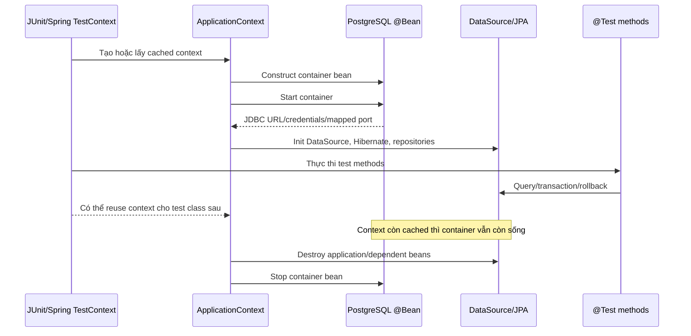

# Testcontainers — Container do Spring quản lý qua @Bean trong cấu hình test

## 1. Vấn đề cần giải quyết

Một Spring Boot integration test thường phụ thuộc vào dịch vụ thật như PostgreSQL, Redis, Kafka, RabbitMQ hay Elasticsearch. Testcontainers tạo những dịch vụ này trong các Docker containers dùng một lần, tránh buộc developer hoặc CI duy trì server dùng chung.

Có hai câu hỏi độc lập:

1. **Ai quản lý vòng đời container?** JUnit/Testcontainers extension, một static initializer do người viết điều khiển, hay chính **Spring ApplicationContext**?
2. **Spring Boot nhận địa chỉ kết nối bằng cách nào?** Properties tĩnh, `@DynamicPropertySource`/`DynamicPropertyRegistrar`, hoặc `@ServiceConnection`?

Đề bài này tập trung vào cách **khai báo container là Spring bean**:

```java
@TestConfiguration(proxyBeanMethods = false)
class PostgresTestConfiguration {

    @Bean
    @ServiceConnection
    PostgreSQLContainer<?> postgresContainer() {
        return new PostgreSQLContainer<>("postgres:16-alpine");
    }
}
```

Đây là đoạn cốt lõi; project đầy đủ ở phần 9 có tất cả imports, dependencies, entity, repository, cấu hình và JUnit tests.

Với Spring Boot 3.5, `@Bean` có kiểu trả về là Testcontainers `Container` khiến Spring Boot tham gia **quản lý startup/shutdown đúng thứ tự**. `@ServiceConnection` tạo `ConnectionDetails` để các auto-configurations như JDBC DataSource biết JDBC URL, user và password thực tế. Cặp annotation này rất phù hợp khi Spring TestContext **cache/reuse** ApplicationContext qua nhiều test classes.

### Mục tiêu sau bài

- Hiểu vai trò riêng của `@TestConfiguration`, `@Bean`, `@Import` và `@ServiceConnection`.
- So sánh bean-managed containers với `@Testcontainers + @Container` của JUnit extension.
- Giải thích container start **trước application beans** và stop **sau khi các beans phụ thuộc được hủy**.
- Hiểu Spring TestContext cache có thể giữ container sống qua nhiều test classes, không mặc định restart mỗi test.
- Dùng `PostgreSQLContainer<?>` và `JdbcConnectionDetails` đúng phiên bản Spring Boot.
- Viết Maven/Java 17 project chạy được với PostgreSQL container thật và Spring Data JPA.
- Dùng `@DataJpaTest` với `@AutoConfigureTestDatabase(replace = NONE)` khi muốn test repository trên PostgreSQL.
- Tránh `@DirtiesContext`, manual `start()/stop()` và static lifecycle trùng lặp khi không cần.
- Biết lúc nào dùng `@ServiceConnection(name="redis")` với `GenericContainer<?>`.
- Biết cách dùng `DynamicPropertyRegistrar` khi không có service-connection factory.
- Phân biệt Docker container, application test context, database state và transaction cleanup.
- Chẩn đoán container startup/readiness/connection errors và chạy CI ổn định.

## 2. Ba tầng vòng đời không phải một

### Tầng 1: Testcontainers container

Một `PostgreSQLContainer<?>` đại diện cho PostgreSQL server trong Docker. Container có state như image, mapped port, database name, username/password, status `isRunning()`, log và networking.

### Tầng 2: Spring ApplicationContext

Spring Boot quản lý `DataSource`, connection pool, `EntityManagerFactory`, repositories, services và test configuration beans. Các beans này phụ thuộc vào Postgres có thể cần database **đã start** để init và vẫn cần database **còn chạy** trong shutdown callbacks.

### Tầng 3: JUnit test classes/methods

JUnit tạo test instances và chạy lifecycle callbacks. Spring TestContext có cache context, nên **số lần tạo ApplicationContext không nhất thiết bằng số test classes**, và hoàn toàn không bằng số test methods.



**Điểm quan trọng theo Spring Boot 3.5:** container beans được tạo và start trước các beans khác, sau đó dừng **sau** khi các beans khác đã bị hủy. Trật tự này hữu ích vì Hikari pool/ORM/client có thể cần giao tiếp với backend trong quá trình đóng. Nếu JUnit extension dừng container trước khi cached Spring context bị hủy, ứng dụng có thể cố đóng resources trên một backend đã chết.

### Vòng đời thực tế không cố định theo method

- Không có cam kết “container start một lần cho toàn bộ Maven build”.
- Một **Spring ApplicationContext** có thể có một instance container do nó quản lý.
- Nếu Spring cache **cùng** context cho nhiều test classes, các classes đó có thể dùng chung container.
- Nếu test annotations/profiles/properties/imports khác nhau làm tạo contexts khác nhau, có thể có **nhiều containers**.
- Nếu context bị loại khỏi cache do `@DirtiesContext`, cache eviction, test fork hoặc khi framework đóng context, container của context đó dừng.
- Có thể có một container khác được tạo khi context tương đương được xây lại.
- Container sống cùng context **không có nghĩa dữ liệu được reset sau mỗi test method**.

## 3. So sánh các chiến lược quản lý container

| Cách khai báo | Ai start/stop? | Phạm vi thường gặp | Tương tác với Spring context cache |
| --- | --- | --- | --- |
| `@Testcontainers` + static `@Container` | Testcontainers JUnit 5 extension | Trong vòng đời test class | Có thể stop khi context Spring vẫn cached |
| `@Testcontainers` + instance `@Container` | JUnit extension | Mỗi test method | Tốn startup, context có thể giữ connection cũ |
| Static initializer `container.start()` | Code tự quản lý | Đến khi code/test process quyết định | Phải bảo đảm cleanup/order thủ công |
| `@TestConfiguration` + `@Bean` | **Spring Boot/Spring context** | Mỗi ApplicationContext | Đồng bộ container với context cache/shutdown |
| `@ImportTestcontainers` | Spring Boot tích hợp declarations | Theo cấu hình được import | Hữu ích khi đã có static container declarations |
| Dev launcher `SpringApplication.from(...).with(...)` | Spring context của test-classpath dev app | Khi dev launcher chạy | Phù hợp local development; không phải container production |

**Không gắn `@Container` lên `@Bean` method** và không đặt `@Testcontainers` vào test chỉ để “bật” container bean. Hai cơ chế có mục đích riêng. Với bean-managed lifecycle, Spring Boot tự start/stop container được khai báo; JUnit extension **không cần** được kích hoạt.

### Ví dụ JUnit extension truyền thống

```java
// Ví dụ so sánh, không trộn với @Bean của project chính.
@Testcontainers
@SpringBootTest
class OldStyleIntegrationTest {
    @Container
    @ServiceConnection
    static PostgreSQLContainer<?> postgres =
            new PostgreSQLContainer<>("postgres:16-alpine");
}
```

Code này có thể hoạt động cho **một** test class. Tuy nhiên với context cache across classes, extension có thể stop container sau class A, còn context/hikari/repositories được reuse bởi class B. B có thể gặp “Connection refused” hoặc “Failed to obtain JDBC Connection” dù test đầu tiên xanh. Với Spring bean-managed container, lifecycle gắn với cached context nên tránh nhóm lỗi này theo thiết kế.

**Không suy luận rằng mọi use of static `@Container` đều sai:** đó là phương án hợp lệ khi phạm vi test class rõ ràng và không tái sử dụng context/client beans sau khi container dừng. Bài học chỉ hướng dẫn chọn strategy có lifecycle khớp với Spring.

## 4. @TestConfiguration, @Bean, @Import và @ServiceConnection làm gì?

### @TestConfiguration

`org.springframework.boot.test.context.TestConfiguration` là biến thể `@Configuration` dành cho test. Đặt file dưới `src/test/java` giúp không đóng gói container dev/test vào production artifact khi build theo convention Maven.

```java
@TestConfiguration(proxyBeanMethods = false)
public class PostgresTestConfiguration {
    // test-only beans
}
```

- `proxyBeanMethods=false` tránh overhead proxy các `@Bean` methods khi không có inter-bean method calls cần intercept.
- Test configuration ở test source giúp phân tách runtime production với hạ tầng integration tests.
- **Explicit `@Import(PostgresTestConfiguration.class)`** cho biết test nào dùng container; đừng tin rằng `@SpringBootApplication` component scan tự chọn mọi `@TestConfiguration`.
- Một test có thể import nhiều configs, nhưng chỉ import containers mà test thực sự cần.

### @Bean

`@Bean` đăng ký container trong Spring context:

```java
@Bean
PostgreSQLContainer<?> postgresContainer() {
    return new PostgreSQLContainer<>("postgres:16-alpine");
}
```

Đừng tự gọi `postgresContainer().start()` ở một nơi khác rồi mong đó là **cùng một bean**, nhất là khi `proxyBeanMethods=false`: direct Java method call tạo object mới nếu bạn gọi thủ công. Spring sẽ quản lý bean được tạo qua container factory. Không cần `@PostConstruct`/`@PreDestroy` hoặc `initMethod="start"`/`destroyMethod="stop"` cho pattern đã được Spring Boot Testcontainers hỗ trợ.

**Ghi nhớ:** khai báo một `@Bean` của Testcontainers **khác** với thêm một Docker image trong Docker Compose; Spring Boot có container bean lifecycle tích hợp, và Docker daemon vẫn cần hoạt động để thực sự chạy image.

### @ServiceConnection

`org.springframework.boot.testcontainers.service.connection.ServiceConnection` cho phép Spring Boot tạo auto-configured `ConnectionDetails` từ container.

```java
@Bean
@ServiceConnection
PostgreSQLContainer<?> postgresContainer() {
    return new PostgreSQLContainer<>("postgres:16-alpine");
}
```

Với PostgreSQL typed container, Spring Boot có thể tạo `JdbcConnectionDetails` (và các loại connection details khác phù hợp khi dependency tương ứng có mặt). `DataSourceAutoConfiguration` tiêu thụ JDBC details thay vì cần bạn tự ghép mapped port thành `spring.datasource.url`.

Những việc nó **không** làm:

- Không biến một HTTP service tùy ý thành bean client nếu không có integration factory.
- Không tự tạo tables, chạy migrations hoặc seed dữ liệu nghiệp vụ.
- Không làm JUnit tự rollback transaction.
- Không thay thế database driver hoặc Testcontainers module.
- Không bảo đảm hostname/port cố định (mapped host ports thường động).
- Không tự xác nhận mọi feature về SSL, authentication, TLS hoặc DB privileges giống production.

### ServiceConnection precedence

Khi có `ConnectionDetails` cho một service, Spring Boot auto-configuration có thể ưu tiên nó hơn các connection-related properties tương ứng. Ví dụ source application có `spring.datasource.url` cho local dev nhưng test đã import PostgreSQL container `@ServiceConnection` thì `DataSource` có thể sử dụng container details của test thay vì URL tĩnh.

Không viết test cố tình chứa production secrets rồi dựa vào override để an toàn: cấu hình test phải tách riêng, tránh đưa production credentials vào test environment.

### @Import

`@Import(PostgresTestConfiguration.class)` nối test config vào context của một test:

```java
@SpringBootTest
@Import(PostgresTestConfiguration.class)
class CustomerIntegrationTest {
}
```

Không cần gắn `@Import` vào mọi service/controller class. Test class nào có hạ tầng thực thì import, test thuần Mockito không cần Docker.

## 5. Vì sao @Bean method nên trả type cụ thể?

Spring Boot xử lý `@ServiceConnection` trên bean method **trước khi thật sự tạo container instance**. Để tránh eager init, nó dùng **return type của @Bean method** để chọn connection-details factory.

**Tốt:**

```java
@Bean
@ServiceConnection
PostgreSQLContainer<?> database() {
    return new PostgreSQLContainer<>("postgres:16-alpine");
}
```

**Dễ sai khi cần suy ra service:**

```java
@Bean
@ServiceConnection
GenericContainer<?> database() {
    return new GenericContainer<>("postgres:16-alpine");
}
```

Kiểu `GenericContainer<?>` không nói đây là PostgreSQL hay Redis. Spring Boot không gọi `database()` sớm chỉ để đọc Docker image name. Vì thế connection details có thể không được tạo như bạn nghĩ.

Với Redis generic container:

```java
@Bean
@ServiceConnection(name = "redis")
GenericContainer<?> redisContainer() {
    return new GenericContainer<>("redis:7-alpine")
            .withExposedPorts(6379);
}
```

`name="redis"` cho Spring Boot một service hint để chọn `RedisConnectionDetails` nếu có factory phù hợp và dependency Redis của Spring trên classpath. **Đây là trích đoạn**, chưa phải một dự án Redis runnable; phải thêm Redis starter, Testcontainers dependencies và khai báo bean trong một test configuration thực.

Với private/mirrored images, đôi khi cần `@ServiceConnection(name="postgres")` hoặc tên service tương ứng, vì image repository name có thể không còn giống tên mặc định. Typed container thường đã đủ để suy luận factory theo return type.

## 6. TestContext cache và shutdown ordering

Spring TestContext có application-context cache. Nếu hai test classes có cấu hình, active profiles, test properties, import context và các yếu tố trong cache key giống nhau, Spring có thể reuse cùng cached context.

```text
CustomerRepositoryIntegrationTest ---\
                                   > Spring Context A ----> Postgres bean A
CustomerServiceIntegrationTest ----/
OtherTests (different profile) --------> Spring Context B -> Postgres bean B
```

Đây là **sơ đồ khái niệm**, không khẳng định hai classes trong mọi project luôn dùng đúng một context. Cache có thể bị ảnh hưởng bởi customizers, mocks, dynamic properties, profile và thứ tự test process.

### Lợi ích

- Không nhất thiết khởi động PostgreSQL mới cho từng method/class.
- Startup tốn tài nguyên được amortized qua tests dùng cùng context.
- DataSource/JPA clients sống trong cùng lifecycle với service.
- Khi context đóng, các application beans được hủy trước container.

### Cái giá

- **State của database có thể được chia sẻ** giữa các tests dùng cùng context.
- Test A có thể để lại customer nếu INSERT commit không được rollback.
- Một test gọi container.stop() sẽ làm **toàn bộ context** bị mất connection.
- `@DirtiesContext` làm context bị đóng và có thể khiến container mới phải khởi động, mất lợi ích cache.
- Context khác key ⇒ có thể tạo PostgreSQL container khác, dù class import cùng file config.

### Cleanup đúng cách

Cho repository/JPA tests, dùng test-level `@Transactional` hoặc rollback mặc định của `@DataJpaTest` khi phù hợp. Với HTTP `RANDOM_PORT`, request server chạy transaction khác; rollback của test thread **không tự thu hồi** các rows mà server đã commit.

Khi cần test commit hoặc asynchronous consumer, dùng test-specific IDs, `@AfterEach` cleanup đúng dữ liệu sở hữu hoặc reset disposable schema theo chính sách, không gọi `postgres.stop()` sau mỗi method.

### @DirtiesContext không phải @Rollback

`@DirtiesContext` nói với Spring rằng context không nên được tái sử dụng. Nó **không** xóa database ngoài, topic Kafka, Redis keys hay Elasticsearch index một cách tự động (trừ khi những resources đó được sở hữu bởi context/container bị hủy). Dùng nó cho context bị thay đổi configuration hoặc bean state không thể reset, không dùng chỉ vì có thêm một row database.

## 7. Chọn các dependencies chính xác cho Spring Boot 3.5

Project chính dùng:

- Spring Boot **3.5.0** parent và **Java 17**.
- `spring-boot-starter-data-jpa` cho JPA/Hibernate/DataSource.
- `org.postgresql:postgresql` cho JDBC driver.
- `spring-boot-starter-test` cho JUnit Jupiter/Spring Test/Assert/Mockito.
- `spring-boot-testcontainers` để tích hợp `@ServiceConnection` và container beans.
- `org.testcontainers:postgresql` cho `PostgreSQLContainer<?>`.

**Không bắt buộc `org.testcontainers:junit-jupiter`** nếu chỉ dùng `@Bean` container và không dùng JUnit `@Testcontainers/@Container`. Nếu project khác cũng có JUnit extension tests thì có thể khai báo module đó riêng.

Các versions được Spring Boot dependency management/BOM điều phối, không tự trộn Testcontainers 2.x API imports với Boot 3.5/Testcontainers 1.x. Khi nâng Boot major, xác minh thư viện/import mới, đặc biệt loại PostgreSQL container đã đổi package trong Testcontainers 2.x.

## 8. Architecture của project mẫu

Ứng dụng có bảng `customers`:

- `Customer` entity gồm email duy nhất, status `ACTIVE` và generated ID.
- `CustomerRepository` dùng Spring Data JPA thật.
- `CustomerService.register(email)` chuẩn hóa email và ghi vào repository.
- `PostgresTestConfiguration` cung cấp PostgreSQL container là Spring bean.
- Ba JUnit classes kiểm tra kết nối, repository/constraint và service, gồm một JPA test slice.
- Tất cả test uses **PostgreSQL thật trong Docker**, không phải H2.
- Database tables được Hibernate `create-drop` dựng **chỉ để demo lifecycle/JPA**. Đây không phải bài test Flyway migration; production nên dùng Flyway/Liquibase và `ddl-auto=validate`.

Không có web controller để không kéo HTTP network vào một bài test tập trung vào Spring-managed Testcontainers.

### Cây thư mục

```text
spring-managed-container-demo/
├── pom.xml
└── src/
    ├── main/
    │   └── java/example/managedcontainer/
    │       ├── ManagedContainerApplication.java
    │       ├── Customer.java
    │       ├── CustomerRepository.java
    │       └── CustomerService.java
    └── test/
        ├── resources/
        │   └── application-test.properties
        └── java/example/managedcontainer/
            ├── PostgresTestConfiguration.java
            ├── ContainerLifecycleIntegrationTest.java
            ├── CustomerServiceIntegrationTest.java
            └── CustomerJpaSliceTest.java
```

## 9. Mã runnable đầy đủ — Java 17 / Spring Boot 3.5 / PostgreSQL

### 9.1. pom.xml

```xml
<?xml version="1.0" encoding="UTF-8"?>
<project xmlns="http://maven.apache.org/POM/4.0.0"
         xmlns:xsi="http://www.w3.org/2001/XMLSchema-instance"
         xsi:schemaLocation="http://maven.apache.org/POM/4.0.0
             https://maven.apache.org/xsd/maven-4.0.0.xsd">
    <modelVersion>4.0.0</modelVersion>

    <parent>
        <groupId>org.springframework.boot</groupId>
        <artifactId>spring-boot-starter-parent</artifactId>
        <version>3.5.0</version>
        <relativePath/>
    </parent>

    <groupId>example</groupId>
    <artifactId>spring-managed-container-demo</artifactId>
    <version>1.0-SNAPSHOT</version>

    <properties>
        <java.version>17</java.version>
    </properties>

    <dependencies>
        <dependency>
            <groupId>org.springframework.boot</groupId>
            <artifactId>spring-boot-starter-data-jpa</artifactId>
        </dependency>

        <dependency>
            <groupId>org.postgresql</groupId>
            <artifactId>postgresql</artifactId>
            <scope>runtime</scope>
        </dependency>

        <dependency>
            <groupId>org.springframework.boot</groupId>
            <artifactId>spring-boot-starter-test</artifactId>
            <scope>test</scope>
        </dependency>

        <dependency>
            <groupId>org.springframework.boot</groupId>
            <artifactId>spring-boot-testcontainers</artifactId>
            <scope>test</scope>
        </dependency>

        <dependency>
            <groupId>org.testcontainers</groupId>
            <artifactId>postgresql</artifactId>
            <scope>test</scope>
        </dependency>
    </dependencies>
</project>
```

**Giải thích:**

- `spring-boot-starter-data-jpa` tích hợp Hibernate, Spring Data JPA và JDBC datasource.
- `postgresql` runtime driver để app/test mở JDBC connection.
- `spring-boot-testcontainers` thêm Boot integration cho service connections và lifecycle bean.
- `org.testcontainers:postgresql` chứa typed PostgreSQL container.
- `spring-boot-starter-test` hỗ trợ JUnit/Spring testing.
- Không có `org.testcontainers:junit-jupiter` vì project không sử dụng JUnit Testcontainers extension.

**Runtime requirement:** Docker/Podman tương thích Testcontainers phải sẵn sàng; lần đầu có thể phải pull `postgres:16-alpine`. Lệnh `mvn test` sẽ thực sự cần container runtime. Nếu test bị skip vì Docker không có, không coi đó là bài đã kiểm chứng.

### 9.2. ManagedContainerApplication.java

`src/main/java/example/managedcontainer/ManagedContainerApplication.java`:

```java
package example.managedcontainer;

import org.springframework.boot.SpringApplication;
import org.springframework.boot.autoconfigure.SpringBootApplication;

@SpringBootApplication
public class ManagedContainerApplication {

    public static void main(String[] args) {
        SpringApplication.run(ManagedContainerApplication.class, args);
    }
}
```

Main application được đặt trong `src/main`; test-only container config nằm riêng trong `src/test`. Component scan tự tìm JPA entities/services/repositories dưới package chính.

### 9.3. Customer.java

`src/main/java/example/managedcontainer/Customer.java`:

```java
package example.managedcontainer;

import jakarta.persistence.Column;
import jakarta.persistence.Entity;
import jakarta.persistence.GeneratedValue;
import jakarta.persistence.GenerationType;
import jakarta.persistence.Id;
import jakarta.persistence.Table;
import jakarta.persistence.UniqueConstraint;

@Entity
@Table(
    name = "customers",
    uniqueConstraints = @UniqueConstraint(
        name = "uk_customers_email",
        columnNames = "email"
    )
)
public class Customer {

    @Id
    @GeneratedValue(strategy = GenerationType.IDENTITY)
    private Long id;

    @Column(nullable = false, length = 160)
    private String email;

    @Column(nullable = false, length = 24)
    private String status;

    protected Customer() {
        // JPA required constructor.
    }

    public Customer(String email, String status) {
        this.email = email;
        this.status = status;
    }

    public Long getId() {
        return id;
    }

    public String getEmail() {
        return email;
    }

    public String getStatus() {
        return status;
    }
}
```

- `@Entity` và `@Table` ánh xạ tới bảng customers.
- Unique constraint trên email giúp test một đặc tính **database thật**.
- `@GeneratedValue(IDENTITY)` phù hợp PostgreSQL identity handling do Hibernate quản lý ở demo.
- `protected` no-arg constructor cho JPA.
- Email là giá trị giả trong `example.test`, không dùng địa chỉ production.

### 9.4. CustomerRepository.java

`src/main/java/example/managedcontainer/CustomerRepository.java`:

```java
package example.managedcontainer;

import java.util.Optional;
import org.springframework.data.jpa.repository.JpaRepository;

public interface CustomerRepository
        extends JpaRepository<Customer, Long> {

    Optional<Customer> findByEmail(String email);
}
```

Repo này **không bị mock** trong integration tests, nên SQL thực sự đi tới PostgreSQL container.

### 9.5. CustomerService.java

`src/main/java/example/managedcontainer/CustomerService.java`:

```java
package example.managedcontainer;

import java.util.Locale;
import org.springframework.stereotype.Service;
import org.springframework.transaction.annotation.Transactional;

@Service
public class CustomerService {

    private final CustomerRepository repository;

    public CustomerService(CustomerRepository repository) {
        this.repository = repository;
    }

    @Transactional
    public Long register(String rawEmail) {
        if (rawEmail == null || rawEmail.isBlank()) {
            throw new IllegalArgumentException(
                "email must not be blank");
        }

        String normalized =
                rawEmail.strip().toLowerCase(Locale.ROOT);

        Customer saved = repository.saveAndFlush(
                new Customer(normalized, "ACTIVE"));

        return saved.getId();
    }
}
```

`saveAndFlush` buộc Hibernate thực hiện SQL trong transaction. Dùng Java 17 `strip()` và `Locale.ROOT` để kết quả normalize xác định khi không có locale business phức tạp. Trong production, email normalization cần quy tắc domain rõ ràng thay vì mặc định “lowercase tất cả phần local”; mẫu chỉ để kiểm tra service + database thật.

### 9.6. application-test.properties

`src/test/resources/application-test.properties`:

```properties
# Chỉ cho bài demo: Hibernate tạo schema bên trong PostgreSQL disposable.
spring.jpa.hibernate.ddl-auto=create-drop
spring.jpa.open-in-view=false

# Không chạy schema.sql/data.sql cạnh tranh với Hibernate.
spring.sql.init.mode=never

# Container beans mặc định start tuần tự.
spring.testcontainers.beans.startup=sequential
spring.main.banner-mode=off
```

Chúng ta **không khai `spring.datasource.url` hay cố định port 5432**. `@ServiceConnection` mang JDBC connection details từ container đã start đến Boot auto-config. Nếu có nhiều containers, property `spring.testcontainers.beans.startup=parallel` có thể chạy startup song song khi chúng độc lập, nhưng không nên bật khi startup phụ thuộc theo thứ tự (ví dụ network/broker/sidecar bắt buộc sẵn sàng trước).

Với ứng dụng production, nên quản lý schema bằng Flyway/Liquibase và dùng `ddl-auto=validate` thay vì dựa trên create-drop. Bài này cố ý tách kỹ thuật container bean lifecycle ra khỏi kỹ thuật migration.

### 9.7. PostgresTestConfiguration.java — trọng tâm

`src/test/java/example/managedcontainer/PostgresTestConfiguration.java`:

```java
package example.managedcontainer;

import org.springframework.boot.test.context.TestConfiguration;
import org.springframework.boot.testcontainers.service.connection.ServiceConnection;
import org.springframework.context.annotation.Bean;
import org.testcontainers.containers.PostgreSQLContainer;

@TestConfiguration(proxyBeanMethods = false)
public class PostgresTestConfiguration {

    @Bean
    @ServiceConnection
    PostgreSQLContainer<?> postgresContainer() {
        return new PostgreSQLContainer<>("postgres:16-alpine")
                .withDatabaseName("integration_db")
                .withUsername("test_user")
                .withPassword("test_pass");
    }
}
```

**Phân tích từng dòng:**

- File ở `src/test/java` nên không đóng gói container test cùng main production code.
- `@TestConfiguration(proxyBeanMethods=false)` cho phép import config trong Spring tests.
- `@Bean` đăng ký instance `PostgreSQLContainer<?>` trong context.
- Return type cụ thể `PostgreSQLContainer<?>` cho Boot suy luận connection-details factory.
- `@ServiceConnection` giúp tạo `JdbcConnectionDetails`.
- Image `postgres:16-alpine` pin major version thay vì dùng `postgres:latest` (tag vẫn có thể cập nhật patch theo thời gian; production fidelity cần pin phiên bản/image digest khi thích hợp).
- `withDatabaseName`, `withUsername` và `withPassword` đặt giá trị của **test database disposable**, không phải account production.
- Không cần `postgres.start()`, `postgres.stop()`, `@Testcontainers` hoặc `@Container`: vòng đời thuộc Spring Boot container-bean support.
- Không cần `@DynamicPropertySource` cho JDBC ở pattern này.
- Không bật `withReuse(true)` vì muốn deterministic isolation của test environment.

### Vì sao không thêm initMethod/destroyMethod?

Spring Boot Testcontainers hỗ trợ container beans bằng lifecycle riêng: tạo/start trước các beans phụ thuộc và stop sau khi các beans khác hủy. Nếu tự thêm lifecycle callbacks hoặc gọi start/stop ở JUnit callbacks, có nguy cơ khiến lifecycle bị quản lý từ hai nơi, sai thứ tự hoặc container còn sống trong context nhưng đã chết ở Docker.

### Kết nối có thể đổi port giữa runs

Docker thường map internal PostgreSQL 5432 sang một **host port động**. Ví dụ không biết trước là port bao nhiêu; service connection lấy từ container. Không dùng `localhost:5432` hoặc `localhost:randomKnownPort` hard-code trong tests.

## 10. Integration test 1 — container sống khi DataSource/JPA đã sẵn

`src/test/java/example/managedcontainer/ContainerLifecycleIntegrationTest.java`:

```java
package example.managedcontainer;

import static org.junit.jupiter.api.Assertions.assertEquals;
import static org.junit.jupiter.api.Assertions.assertNotNull;
import static org.junit.jupiter.api.Assertions.assertThrows;
import static org.junit.jupiter.api.Assertions.assertTrue;

import java.sql.Connection;
import java.sql.SQLException;

import javax.sql.DataSource;
import jakarta.persistence.EntityManager;
import jakarta.persistence.PersistenceContext;

import org.junit.jupiter.api.Test;
import org.springframework.beans.factory.annotation.Autowired;
import org.springframework.boot.autoconfigure.jdbc.JdbcConnectionDetails;
import org.springframework.boot.test.context.SpringBootTest;
import org.springframework.context.annotation.Import;
import org.springframework.dao.DataIntegrityViolationException;
import org.springframework.jdbc.core.JdbcTemplate;
import org.springframework.test.context.ActiveProfiles;
import org.springframework.transaction.annotation.Transactional;
import org.testcontainers.containers.PostgreSQLContainer;

@SpringBootTest
@ActiveProfiles("test")
@Import(PostgresTestConfiguration.class)
class ContainerLifecycleIntegrationTest {

    @Autowired
    PostgreSQLContainer<?> postgres;

    @Autowired
    JdbcConnectionDetails connectionDetails;

    @Autowired
    DataSource dataSource;

    @Autowired
    JdbcTemplate jdbc;

    @Autowired
    CustomerRepository repository;

    @PersistenceContext
    EntityManager entityManager;

    @Test
    void springStartsBeanContainerBeforeDataSourceIsUsed()
            throws SQLException {
        assertTrue(postgres.isRunning());

        // Service connection phải dựa trên PostgreSQLContainer thật.
        assertTrue(connectionDetails.getJdbcUrl()
                .startsWith("jdbc:postgresql:"));

        assertEquals(postgres.getDatabaseName(),
                jdbc.queryForObject(
                    "SELECT current_database()", String.class));

        try (Connection connection = dataSource.getConnection()) {
            assertTrue(connection.isValid(2));
            assertEquals("PostgreSQL",
                    connection.getMetaData()
                              .getDatabaseProductName());
        }
    }

    @Test
    @Transactional
    void repositoryPersistsIntoRealPostgres() {
        Customer saved = repository.saveAndFlush(
                new Customer("repo@example.test", "ACTIVE"));

        assertNotNull(saved.getId());

        // Xóa first-level cache, buộc query đọc từ DB.
        entityManager.clear();

        Customer loaded = repository
                .findByEmail("repo@example.test")
                .orElseThrow();

        assertEquals("ACTIVE", loaded.getStatus());
        assertEquals("repo@example.test", loaded.getEmail());
        // Spring test transaction rollback sau method.
    }

    @Test
    @Transactional
    void databaseUniqueConstraintRejectsDuplicateEmail() {
        repository.saveAndFlush(
                new Customer("duplicate@example.test", "ACTIVE"));

        assertThrows(DataIntegrityViolationException.class,
                () -> repository.saveAndFlush(
                    new Customer("duplicate@example.test", "ACTIVE")));

        // Sau lỗi constraint trên PostgreSQL, transaction hiện tại
        // có thể ở trạng thái aborted. Không chạy SQL khác trong method.
        // Test-managed rollback dọn transaction khi kết thúc.
    }
}
```

**Ba JUnit methods** chứng minh:

1. Container `@Bean` đã start trước khi Spring DataSource được dùng, vì DataSource/query thật hoạt động.
2. `@ServiceConnection` đưa JDBC URL PostgreSQL và target DB name đúng.
3. Repository làm việc với PostgreSQL thật, không phải H2.
4. Entity đã flush có thể được đọc sau `entityManager.clear()`.
5. Unique constraint được database thực thi.

Một điểm thực hành: khi PostgreSQL trả constraint violation trong explicit transaction, transaction có thể bị đánh dấu aborted; những truy vấn tiếp theo trong cùng transaction sẽ fail tới khi rollback. Vì vậy test duplicate chỉ dùng `assertThrows` rồi để Spring rollback. Không chạy thêm SELECT sau expected failure.

**Không khẳng định test đã quan sát trực tiếp thứ tự destroy callbacks.** Test chứng minh database còn chạy khi các clients được tạo và sử dụng; shutdown-order behavior của Spring Boot được mô tả trong tài liệu framework và cần instrumentation riêng nếu thực sự muốn assert thứ tự shutdown.

## 11. Integration test 2 — Service thật và context có thể reuse

`src/test/java/example/managedcontainer/CustomerServiceIntegrationTest.java`:

```java
package example.managedcontainer;

import static org.junit.jupiter.api.Assertions.assertEquals;
import static org.junit.jupiter.api.Assertions.assertNotNull;
import static org.junit.jupiter.api.Assertions.assertThrows;
import static org.junit.jupiter.api.Assertions.assertTrue;

import org.junit.jupiter.api.Test;
import org.springframework.beans.factory.annotation.Autowired;
import org.springframework.boot.test.context.SpringBootTest;
import org.springframework.context.annotation.Import;
import org.springframework.test.context.ActiveProfiles;
import org.springframework.transaction.annotation.Transactional;
import org.testcontainers.containers.PostgreSQLContainer;

@SpringBootTest
@ActiveProfiles("test")
@Import(PostgresTestConfiguration.class)
class CustomerServiceIntegrationTest {

    @Autowired
    PostgreSQLContainer<?> postgres;

    @Autowired
    CustomerService service;

    @Autowired
    CustomerRepository repository;

    @Test
    @Transactional
    void serviceRegistersCustomerUsingRealDatabase() {
        assertTrue(postgres.isRunning());

        Long id = service.register("  USER@EXAMPLE.TEST ");
        assertNotNull(id);

        Customer saved = repository
                .findByEmail("user@example.test")
                .orElseThrow();

        assertEquals(id, saved.getId());
        assertEquals("ACTIVE", saved.getStatus());
    }

    @Test
    void blankInputIsRejectedBeforeDatabaseWrite() {
        assertThrows(IllegalArgumentException.class,
                () -> service.register("   "));
    }
}
```

**Hai JUnit methods** kiểm tra service logic và wiring:

- `service.register` thật chuẩn hóa email và ghi qua repository thật.
- `postgres.isRunning()` xác nhận backend đang hoạt động trong method của class thứ hai.
- `@Transactional` trên test method tạo transaction ngoài service transaction `REQUIRED` (mặc định) và rollback lúc kết thúc.
- Trường hợp invalid input fail trước `saveAndFlush`; không cần seed dữ liệu khi hành vi là input validation.
- Hai classes này có cấu hình context tương thích, **có thể** cùng dùng cached context và một container bean qua Spring TestContext. Test **không assert số lần container được tạo**, vì framework có thể không reuse nếu cache key khác, cache eviction hoặc CI fork khác.

### Cách thực sự kiểm chứng context reuse khi cần

Nếu mục tiêu kiểm tra cache infrastructure (khác với nghiệp vụ):

1. Bật logging test context cache ở mức DEBUG.
2. Quan sát cache hits/misses và bean factory/container identity trong **cùng JVM**.
3. Bảo đảm hai test classes có cùng `@SpringBootTest` config, `@Import`, active profiles, properties và mocks.
4. Không dùng `@DirtiesContext` khi không cần.
5. Không dựa trên “hai test classes được chạy liên tiếp” như một test assertion vì JUnit ordering không hứa điều đó.
6. Đừng đưa container.getMappedPort(...) làm cache key tùy tiện qua dynamic properties ở mỗi class.

## 12. JPA slice test — @DataJpaTest cũng có thể import @Bean container

`@DataJpaTest` nạp JPA slice thay vì toàn application context. Khi muốn dùng PostgreSQL thật thay vì H2, thêm `@AutoConfigureTestDatabase(replace = NONE)` và import container bean config.

`src/test/java/example/managedcontainer/CustomerJpaSliceTest.java`:

```java
package example.managedcontainer;

import static org.junit.jupiter.api.Assertions.assertEquals;
import static org.junit.jupiter.api.Assertions.assertTrue;

import org.junit.jupiter.api.Test;
import org.springframework.beans.factory.annotation.Autowired;
import org.springframework.boot.test.autoconfigure.jdbc.AutoConfigureTestDatabase;
import org.springframework.boot.test.autoconfigure.orm.jpa.DataJpaTest;
import org.springframework.context.annotation.Import;
import org.springframework.test.context.ActiveProfiles;
import org.testcontainers.containers.PostgreSQLContainer;

@DataJpaTest
@AutoConfigureTestDatabase(
        replace = AutoConfigureTestDatabase.Replace.NONE)
@ActiveProfiles("test")
@Import(PostgresTestConfiguration.class)
class CustomerJpaSliceTest {

    @Autowired
    PostgreSQLContainer<?> postgres;

    @Autowired
    CustomerRepository repository;

    @Test
    void jpaSliceUsesPostgreSqlContainer() {
        assertTrue(postgres.isRunning());

        repository.saveAndFlush(
                new Customer("slice@example.test", "ACTIVE"));

        Customer customer = repository
                .findByEmail("slice@example.test")
                .orElseThrow();

        assertEquals("ACTIVE", customer.getStatus());
    }
}
```

**Một JUnit method**. `@DataJpaTest` mặc định quản lý test transaction và rollback sau method. Với `Replace.NONE`, Boot không thay `DataSource` đã được container service connection cung cấp bằng một embedded H2 datasource.

Slice test **không chắc dùng cùng context** với hai `@SpringBootTest` classes vì bootstrap/test-slice auto-config khác; có thể khởi động **PostgreSQL container thứ hai**. Đây là trade-off đúng: slice nạp ít application beans nhưng vẫn cần database thật.

### Vì sao dùng PostgreSQLContainer typed bean trong slice?

- Có thể dùng cùng config class trong nhiều test styles.
- Return type được Boot nhận dạng cho service-connection factories.
- Test repository chạy SQL thật trên PostgreSQL thay vì dựa vào H2 compatibility mode.
- Không thêm `@Testcontainers`/`@Container` chỉ vì một test class là slice.

## 13. Chạy build và expected outcomes

Yêu cầu:

- JDK 17+, Maven, đủ CPU/RAM.
- Docker/Podman container runtime tương thích với Testcontainers.
- Quyền pull image `postgres:16-alpine` trong lần đầu; có thể pin digest nếu cần.
- Project files đúng đường dẫn trong cây thư mục.
- Không có JDBC URL production/local hard-coded trong test profile.

Lệnh:

```bash
mvn test
```

Chạy từng class:

```bash
mvn test -Dtest=ContainerLifecycleIntegrationTest
mvn test -Dtest=CustomerServiceIntegrationTest
mvn test -Dtest=CustomerJpaSliceTest
```

Số test:

| Class | Số methods | Bằng chứng |
| --- | ---: | --- |
| `ContainerLifecycleIntegrationTest` | 3 | Bean container running, PostgreSQL connection, JPA persistence, UNIQUE |
| `CustomerServiceIntegrationTest` | 2 | Real service normalization, input reject |
| `CustomerJpaSliceTest` | 1 | Slice test dùng PostgreSQL container, rollback |
| **Tổng** | **6** | 6 expected JUnit invocations |

**Kỳ vọng: 6 tests PASS, 0 failures/errors/skips** trong môi trường tương thích, nhưng đây **không phải kết quả đã chạy** trong bài. Docker image download và context startup có thể làm first run lâu hơn những lần sau. Kiểm tra `target/surefire-reports` để biết số lượt chạy, skips, root causes, và kiểm tra cả hai kiểu context thật sự được khởi tạo.

### Không có stdout cố định

Ví dụ không gọi `System.out.println`, nên không cung cấp một stdout giả. Maven, Hikari, Hibernate, Docker/Testcontainers sẽ có log tùy môi trường; test assertions là đầu ra có ý nghĩa. Không hard-code mapped port, container ID hay startup duration.

### Điều gì chứng minh container do Spring quản lý?

- `@Bean` method tồn tại trong `@TestConfiguration` được `@Import` vào test.
- Test không dùng `@Testcontainers`/`@Container` hoặc manual `start()`.
- Spring context tạo container bean và JDBC client hoạt động khi test chạy.
- Container không bị stop giữa các test methods khi context còn sử dụng.
- Theo contract của Spring Boot 3.5, container bean được stop khi ApplicationContext của nó được hủy.

Cần lưu ý: **một test chỉ assert `isRunning()` không chứng minh shutdown order**. Hãy kết hợp kiến thức tài liệu và behavior wiring; nếu muốn xác minh exact shutdown sequence, tạo instrumentation/lifecycle listener riêng trong test infrastructure, không giả mạo một assertion ở cuối method là đã chứng minh.

## 14. Nếu không có @ServiceConnection factory: dùng DynamicPropertyRegistrar

Không phải backend tùy ý đều có `ConnectionDetails` support. Với một `GenericContainer<?>` chạy một mock HTTP service hoặc custom image, có thể đăng ký properties từ **bean container đã được Spring quản lý**.

Spring Framework 6.2 cung cấp `org.springframework.test.context.DynamicPropertyRegistrar`. Tài liệu Spring Boot 3.5 hướng dẫn tạo một bean registrar nhận container trong constructor/method argument để bảo đảm container sẵn sàng khi lấy host/mapped port.

Ví dụ trích đoạn **không thuộc POM PostgreSQL runnable chính**:

```java
import org.springframework.boot.test.context.TestConfiguration;
import org.springframework.context.annotation.Bean;
import org.springframework.test.context.DynamicPropertyRegistrar;
import org.testcontainers.containers.GenericContainer;

@TestConfiguration(proxyBeanMethods = false)
class CustomHttpContainerConfiguration {

    @Bean
    GenericContainer<?> stubServer() {
        return new GenericContainer<>("wiremock/wiremock:3.9.2")
                .withExposedPorts(8080);
    }

    @Bean
    DynamicPropertyRegistrar stubServerProperties(
            GenericContainer<?> stubServer) {
        return registry ->
                registry.add(
                    "external.service.base-url",
                    () -> "http://" + stubServer.getHost() + ":"
                            + stubServer.getMappedPort(8080));
    }
}
```

- `DynamicPropertyRegistrar` là Spring bean, nhận `GenericContainer<?>` qua dependency injection.
- Supplier được đăng ký bằng `registry.add`, lấy host và mapped port của container.
- Property `external.service.base-url` là **tên ví dụ của ứng dụng**, không phải property mặc định của Spring Boot; client bean của bạn phải đọc và sử dụng nó.
- Với generic container, phải khai báo exposed port và readiness đúng ứng dụng.
- Thêm container image/custom client dependencies phù hợp nếu muốn chạy đoạn này.
- Không cần vừa dùng `@ServiceConnection` vừa map lại **cùng** JDBC datasource properties, trừ khi có lý do ưu tiên rất rõ và test được precedence.
- `DynamicPropertyRegistrar` phù hợp bean-managed lifecycle; `@DynamicPropertySource` dạng static thường tiện hơn cho container được khai báo dạng static field.

### Khi nào dùng @DynamicPropertySource?

```java
// Trích đoạn cho static-field pattern, không dùng với @Bean chính.
@DynamicPropertySource
static void dbProperties(DynamicPropertyRegistry registry) {
    registry.add("spring.datasource.url", postgres::getJdbcUrl);
    registry.add("spring.datasource.username", postgres::getUsername);
    registry.add("spring.datasource.password", postgres::getPassword);
}
```

Để code này chạy cần class test có field `postgres` phù hợp và lifecycle start đã được giải quyết. **Không copy snippet static field vào test dùng instance @Bean** mà giả định có thể tham chiếu non-static bean lúc bootstrap.

Ưu tiên `@ServiceConnection` khi technology được hỗ trợ; dùng dynamic properties khi cần endpoint/config riêng mà connection-details factories không đáp ứng.

## 15. Nhiều containers @Bean và startup parallel

Một application có thể cần PostgreSQL + Redis + Kafka:

```java
@TestConfiguration(proxyBeanMethods = false)
class MultiContainerConfiguration {

    @Bean
    @ServiceConnection
    PostgreSQLContainer<?> postgres() {
        return new PostgreSQLContainer<>("postgres:16-alpine");
    }

    @Bean
    @ServiceConnection(name = "redis")
    GenericContainer<?> redis() {
        return new GenericContainer<>("redis:7-alpine")
                .withExposedPorts(6379);
    }
}
```

Đây là **trích đoạn**, muốn runnable phải thêm imports, Redis starter và test dependencies tương ứng. `PostgreSQLContainer<?>` là typed container; `GenericContainer<?>` cần `name="redis"`. Boot có thể tự cung cấp JDBC/Redis connection details khi auto-configurations tương ứng hiện diện.

Spring Boot 3.5 mặc định startup container beans **sequential** và có thuộc tính:

```properties
spring.testcontainers.beans.startup=parallel
```

Chỉ dùng `parallel` khi containers độc lập và đủ tài nguyên. Nếu dịch vụ A cần B (ví dụ app bootstrap phụ thuộc broker schema setup), parallel startup có thể tạo race. Kể cả khi container đang “running”, ứng dụng bên trong cũng cần **ready**: typed Testcontainers có readiness strategy riêng, còn custom `GenericContainer` có thể cần `waitingFor(Wait.forHttp(...))` hoặc log/healthcheck.

### Chọn đúng số container cho từng test

- `@DataJpaTest`: thường chỉ cần PostgreSQL.
- REST controller `@WebMvcTest` với mocked service: **không cần** PostgreSQL/Redis/Kafka.
- Full workflow test: có thể cần tất cả services.
- Kafka consumer test: Kafka container và DB nếu xử lý/commit dữ liệu.
- Search projection test: Elasticsearch + nguồn events, nếu đang kiểm end-to-end.

Đừng tạo mọi container theo một “GlobalTestConfiguration” cho tất cả test slices chỉ vì tiện; thời gian startup, memory và độ phức tạp sẽ tăng.

## 16. Tác động của @DirtiesContext và parallel JUnit

### @DirtiesContext

`@DirtiesContext` có thể khiến Spring context đóng sau method/class, container beans bị stop, và một context/container mới sẽ được tạo khi test tương đương chạy sau đó. Điều này **đúng lifecycle**, nhưng rất tốn thời gian khi được dùng như “DB cleanup” thường quy.

Ưu tiên transaction rollback, test-specific IDs, schema cleanup hoặc disposable containers. Chỉ dirty context nếu test sửa bean definitions, environment hay singleton state đến mức không thể reset an toàn.

### Parallel tests

Khi chạy JUnit parallel với nhiều test classes dùng chung context/database:

- Test-level `@Transactional` rollback giúp cô lập nhiều DML, nhưng test concurrent vẫn có thể cạnh tranh trên constraints/locks.
- Dữ liệu commit ở test A có thể bị test B thấy; cần tenant/schema/key namespace riêng hoặc isolation policy.
- Test dùng cùng unique email sẽ conflict ngay cả khi mỗi method có rollback nếu transactions chạy cùng lúc.
- Nếu test thay đổi global database settings, indexes hay schema, nên serialize hoặc dùng container/schema riêng.
- Với shared container, test không được gọi `stop()`/`close()` thủ công.

**Container reuse != test data reuse theo ý đồ**. Dù context cached, mỗi test tự tạo preconditions của mình.

### Forked test processes

Nếu Maven Surefire/Failsafe chạy nhiều JVM forks, mỗi fork có Spring context cache riêng. Không giả định container bean có thể chia sẻ xuyên JVM, trừ khi áp dụng chính sách reusable containers riêng có quản trị. `withReuse(true)` không phải cách mặc định để tối ưu CI; nó có thể làm test phụ thuộc data cũ và cần explicit opt-in.

## 17. Chạy local development với Testcontainers @Bean

Spring Boot 3.5 cho phép dùng containers lúc phát triển bằng test classpath, không cần copy container configuration vào production main artifact.

Một launcher ở `src/test/java` có thể viết:

```java
package example.managedcontainer;

import org.springframework.boot.SpringApplication;

public class LocalDevApplication {

    public static void main(String[] args) {
        SpringApplication
                .from(ManagedContainerApplication::main)
                .with(PostgresTestConfiguration.class)
                .run(args);
    }
}
```

Đây là launcher **tùy chọn**, không nằm trong cây tệp project core nếu bạn chỉ chạy `mvn test`. Khi thêm file, Spring Boot Maven plugin hỗ trợ goal:

```bash
mvn spring-boot:test-run
```

Hoặc chạy `LocalDevApplication.main` với **test classpath** trong IDE. Cấu hình container bean được gắn vào application dev context, Boot start PostgreSQL trước khi application JPA beans hoạt động và stop theo context.

Không coi lệnh dev launcher như deployment production. Nó phục vụ local dev, nên image credentials, Docker, init data phải được quản lý như test/dev resources.

### @RestartScope khi có DevTools

Nếu dùng `spring-boot-devtools`, có thể gắn `@RestartScope` để container bean không bị tạo lại sau mỗi devtools restart. Đây là tình huống **development-time**, không phải cải thiện JUnit test lifecycle mặc định. Phải có dependency/package DevTools đúng version; không thêm `@RestartScope` vào project core khi không dùng DevTools.

## 18. Các lỗi thường gặp và nguyên nhân

| Triệu chứng | Nguyên nhân | Hướng xử lý |
| --- | --- | --- |
| `No qualifying bean of type PostgreSQLContainer` | Quên `@Import` test config, bean chưa vào context | Import đúng `PostgresTestConfiguration` |
| `Connection refused` ngay lúc JPA init | Container không start, wrong URL hoặc service connection không active | Kiểm Docker, module `spring-boot-testcontainers`, `@ServiceConnection` |
| `Failed to obtain JDBC Connection` ở test class thứ hai | JUnit extension stop container nhưng cached context còn sống | Chuyển container thành Spring `@Bean` |
| `Failed to find a Docker environment` | Docker daemon/socket/runtime không truy cập | Chạy runner có Docker, kiểm permission |
| `Could not find a valid Docker environment` trong CI | Docker-in-Docker/remote daemon config sai | Cấp test runner Docker API thích hợp |
| `Port 5432 already in use` | Hard-code fixed host port | Dùng dynamic mapped port mặc định |
| `No JDBC URL specified` | `@ServiceConnection` không tạo connection details; wrong return type | Dùng typed `PostgreSQLContainer<?>` và Boot integration |
| `GenericContainer<?>` không kết nối Redis | Boot không biết image/service khi phân tích method return type | `@ServiceConnection(name="redis")` và Redis starter |
| Bean được tạo nhưng chưa ready | Custom wait strategy thiếu | Dùng container readiness/wait strategies phù hợp |
| Database có dữ liệu test trước | Cached context/container reused, DML chưa rollback | Test transaction rollback/cleanup |
| Container restart nhiều lần | Cache key thay đổi hoặc `@DirtiesContext` | Đồng bộ configs, tránh dirties không cần |
| Tests xanh ở H2 nhưng sai ở PostgreSQL | Embedded test-database replacement | `Replace.NONE` và query xác minh DB product |
| `@DataJpaTest` fail tìm CustomerService | Slice không nạp service thông thường | Không inject service trong repository slice, hoặc `@Import` nếu cần |
| App đứng khi shutdown | Bean destroy phụ thuộc dịch vụ đã chết từ lifecycle khác | Dùng Spring-managed container đúng ordering |
| `@ServiceConnection` import không tồn tại | Boot quá cũ hoặc thiếu module testcontainers | Dùng Boot 3.1+ và dependency đúng version |
| Version Boot 4 compile fail với org.testcontainers.containers.PostgreSQLContainer | Testcontainers 2.x đổi package | Kiểm dependency tree và imports của BOM mới |
| Test với @Bean vẫn dùng JUnit @Container | Hai lifecycle managers trùng mục đích | Bỏ JUnit extension annotations ở bean pattern |
| Custom external service thiếu config | Không có ServiceConnection factory | Dùng `DynamicPropertyRegistrar` |
| `spring.datasource.url` trong test vẫn trỏ localhost | Connection details bean không được tạo hoặc config overriding sai | Inject `JdbcConnectionDetails` và xác minh URL |
| Spring context tự “chết” sớm | `@DirtiesContext`/cache eviction/test fork | Xem TestContext cache debug log |
| CI báo BUILD SUCCESS nhưng thực tế tests bị skip | Test filter/skip flags/surefire issues | Kiểm `target/surefire-reports` |
| Tests fail khi chạy song song | Dữ liệu chung, constraint collision, schema mutation | Parallel isolation hoặc chạy tuần tự |
| Hết Docker disk/RAM | Nhiều containers images/volumes | Dọn resources test theo ownership, tối ưu suite |

### Quy trình debug có thứ tự

1. Xác nhận Boot parent/BOM và Testcontainers version tương thích.
2. Xác nhận Docker/Podman runtime đáp ứng test job.
3. Kiểm `PostgresTestConfiguration` trong `src/test/java` và `@Import` trên test class.
4. Kiểm `@Bean` method có return type `PostgreSQLContainer<?>` và `@ServiceConnection`.
5. Quan sát Testcontainers logs nếu image pull/start/readiness fail.
6. Inject `JdbcConnectionDetails` hoặc kiểm DataSource metadata để biết kết nối thật.
7. Nếu chỉ class thứ hai fail, kiểm static `@Container` và Spring context cache.
8. Xem `@DirtiesContext`, test slices/profiles và parallel/fork settings.
9. Kiểm transaction rollback/cleanup trước khi coi shared data là container bug.
10. Chạy đúng test class/method rồi toàn suite, xem Surefire reports.

## 19. Bảo mật và reproducibility trong test containers

### Credentials và images

- Credentials trong demo `test_user/test_pass` chỉ dành cho database disposable.
- Không đưa production secrets vào test configs hoặc logs.
- Pin image major/minor/digest phù hợp để kết quả reproducible hơn.
- Tránh `postgres:latest` khi test cần behavior nhất quán.
- Không mở host ports cố định nếu không có lý do rõ ràng.
- Không bật container reuse cho CI mặc định.
- Không mount thư mục production hoặc Docker socket vào test containers khi không thật cần thiết.
- Nếu network cần proxy/private image registry, thiết lập credential qua CI secret store, không hard-code.

### Tài nguyên

Container là process/resource thật: mỗi Spring context có thể kéo theo DB process, memory, file handles và image/volume lifecycle. Với nhiều test classes, tái sử dụng context hợp lý và tránh contexts khác nhau không cần thiết. Nhưng việc tiết kiệm vài lần startup không được đánh đổi bằng test data không cô lập hoặc khiến các cases phụ thuộc nhau.

### Mapped port

Testcontainers không hứa host mapped port được giữ giữa các runs. Không in log port rồi dùng nó như config dài hạn; app lấy connection details của instance container ngay lúc test chạy.

## 20. Khi nào chọn Bean-managed container, khi nào không?

| Tình huống | Lựa chọn | Lý do |
| --- | --- | --- |
| Nhiều Spring Boot integration tests dùng same dependencies | `@TestConfiguration + @Bean @ServiceConnection` | Lifecycle gắn context, cache-friendly |
| Cần DataSource/JPA và proper shutdown | Spring-managed bean | Client beans được destroy trước container |
| JUnit test thuần không dùng Spring | `@Testcontainers + @Container` | Không cần Spring context overhead |
| Dự án đã có static container declarations | `@ImportTestcontainers` | Tái dùng declaration theo Spring Boot integration |
| Chỉ test JSON/controller với mock service | `@WebMvcTest`/MockMvc, không tạo DB container | Ít resources hơn |
| Cần một DB cho cả class nhưng không cache Spring context | JUnit extension có thể đủ | Vòng đời class rõ ràng |
| Cần custom service không có connection details | `@Bean` + `DynamicPropertyRegistrar` | Host/mapped port vào app properties |
| Local development cần DB tự động | Test-classpath launcher + bean container | Không cài Postgres riêng trên máy |
| Có dependency startup nhiều containers | Bean configs và readiness/order rõ | Tăng reliability |
| Cần tuyệt đối một container mới cho từng test | Phân biệt isolated context/container vs DB reset | Bean approach per-context có thể chưa phù hợp |

Đừng chọn bean-managed chỉ vì nó mới hơn JUnit extension. Chọn nó khi **lifecycle Spring client beans và container cần đồng bộ**, hoặc context cache tạo nguy cơ JUnit extension stop quá sớm.

## 21. Checklist thực hành

- [ ] Đã xác định application test cần external service nào thật sự?
- [ ] Container test được khai báo trong `src/test/java`, không package cùng production artifact?
- [ ] `@TestConfiguration(proxyBeanMethods=false)` được import rõ vào các tests cần dùng?
- [ ] Container được khai báo qua `@Bean` có type cụ thể?
- [ ] Dùng `@ServiceConnection` khi có factory phù hợp?
- [ ] Với `GenericContainer<?>`, có `name` phù hợp như `redis`?
- [ ] Không dùng `@Container`/`@Testcontainers` cùng cơ chế bean-managed cho cùng instance?
- [ ] Không gọi `start()`/`stop()` thủ công ở JUnit hooks khi Spring quản lý?
- [ ] `spring-boot-testcontainers` và Testcontainers module đúng version?
- [ ] Có JDBC driver/client dependency thực sự?
- [ ] `@SpringBootTest`/`@DataJpaTest` có đúng import và configuration?
- [ ] Với slice dùng external DB, đã tắt embedded DB replacement?
- [ ] JDBC/DataSource thực sự trỏ PostgreSQL container, không phải H2/local database?
- [ ] Test có rollback/cleanup đúng, không tin context cache reset DB state?
- [ ] Không hard-code host ports hoặc credentials thật?
- [ ] Có test negative constraint/real query chứ không chỉ `isRunning()`?
- [ ] Tránh `@DirtiesContext` chỉ để dọn một row?
- [ ] Với parallel tests, đã cô lập schema/dữ liệu và constraints?
- [ ] Khi dùng container custom, có readiness wait strategy?
- [ ] Local dev launcher dùng test classpath, không đưa containers vào production?
- [ ] CI thực sự có Docker và Surefire reports ghi đủ tests?
- [ ] Khi đổi Boot/Testcontainers major, đã cập nhật dependencies và package imports?
- [ ] Không tuyên bố JUnit test đã kiểm shutdown order nếu chưa instrumentation riêng?

## 22. Câu hỏi tự kiểm tra

**Câu 1.** Khi Spring context được reuse giữa hai test classes, container bean thường làm gì?

> Vẫn sống cùng cached ApplicationContext và có thể phục vụ cả hai classes; không tự stop/restart sau từng class, trừ khi context bị đóng hoặc cấu hình cache khác.

**Câu 2.** Vì sao `@ServiceConnection` trên `@Bean GenericContainer<?>` có thể không được nhận diện?

> Spring Boot xác định connection-details factory từ kiểu trả về bean method trước khi tạo container; `GenericContainer<?>` không cung cấp service-specific type, nên cần `name` hoặc cơ chế khác.

**Câu 3.** Có cần `@Testcontainers` khi container là `@Bean` không?

> Không. `@Testcontainers` kích hoạt JUnit extension; bean-managed container dùng Spring lifecycle.

**Câu 4.** Test `assertTrue(postgres.isRunning())` có đủ để chứng minh JPA hoạt động không?

> Không. Cần thao tác DataSource/repository thật và query qua JDBC/JPA, hoặc assertions nghiệp vụ.

**Câu 5.** Nếu `@DataJpaTest` thay PostgreSQL bằng H2 thì bằng chứng còn gì?

> Chỉ còn bằng chứng cho H2/JPA slice đó; không có bằng chứng về dialect, constraints hoặc behavior PostgreSQL thực. Dùng `Replace.NONE`.

**Câu 6.** Tại sao một test fail unique constraint lại tránh query thêm trong cùng transaction PostgreSQL?

> PostgreSQL thường đưa transaction vào trạng thái aborted sau statement error; cần rollback trước khi chạy SQL khác.

**Câu 7.** Khi nào nên dùng `DynamicPropertyRegistrar` thay `@ServiceConnection`?

> Khi backend hoặc custom client không có service-connection factory phù hợp, nhưng vẫn cần lấy host/mapped port từ container bean sau startup.

## 23. Tài liệu tham khảo chính thức và phiên bản

1. [Spring Boot 3.5 — Testcontainers](https://docs.spring.io/spring-boot/3.5/reference/testing/testcontainers.html): `@Bean` containers, `@ServiceConnection`, startup/shutdown ordering, cache lifecycle và `GenericContainer` naming.
2. [Spring Boot 3.5 — Development-time Services](https://docs.spring.io/spring-boot/3.5/reference/features/dev-services.html): Testcontainers dev launcher, `DynamicPropertyRegistrar`, container bean startup policy và DevTools `@RestartScope`.
3. [Spring Boot 3.5 — Testing Spring Boot Applications](https://docs.spring.io/spring-boot/3.5/reference/testing/spring-boot-applications.html): `@SpringBootTest`, `@DataJpaTest` và test slices.
4. [Spring Boot 3.5 — ServiceConnection annotation API](https://docs.spring.io/spring-boot/3.5/api/java/org/springframework/boot/testcontainers/service/connection/ServiceConnection.html): `type`, `name` và connection-details logic.
5. [Testcontainers Java — PostgreSQL module](https://java.testcontainers.org/modules/databases/postgres/): typed Postgres container, JDBC URL, Docker prerequisites.
6. [Testcontainers Java — JUnit Jupiter](https://java.testcontainers.org/test_framework_integration/junit_5/): `@Testcontainers` và `@Container` lifecycle.
7. [Spring Framework 6.2 — TestContext caching](https://docs.spring.io/spring-framework/reference/6.2/testing/testcontext-framework/ctx-management/caching.html): Spring cached contexts, dirty, eviction và reuse.
8. [Spring Framework 6.2 — Transaction Management in Tests](https://docs.spring.io/spring-framework/reference/6.2/testing/testcontext-framework/tx.html): rollback và thread/HTTP caveats.
9. [Spring Framework 6.2 — DynamicPropertyRegistrar](https://docs.spring.io/spring-framework/reference/6.2/testing/testcontext-framework/ctx-management/dynamic-property-sources.html): động cấu hình services qua bean registrar.
10. [Spring Boot Current — Testcontainers](https://docs.spring.io/spring-boot/reference/testing/testcontainers.html): đối chiếu phiên bản mới khi nâng Boot/Testcontainers.

### Về Spring Boot 4 / Testcontainers 2

Mã project đầy đủ phía trên nhắm **Spring Boot 3.5.0 / Spring Framework 6.2 / Testcontainers 1.x** với `org.testcontainers.containers.PostgreSQLContainer`. Ở nhánh Spring Boot 4, test modules/starter và Testcontainers major mới có thể thay đổi package, chẳng hạn PostgreSQLContainer ở `org.testcontainers.postgresql.PostgreSQLContainer` trong Testcontainers 2.x. Không copy nguyên imports của project 3.5 sang BOM 4.x rồi kết luận `@Bean` lifecycle không còn hỗ trợ; trước hết kiểm tra starter, dependency coordinates, version compatibility và Javadoc đúng major.

**Kết luận:** container khai báo bằng `@Bean` trong `@TestConfiguration` sẽ sống theo **Spring ApplicationContext**, không theo từng JUnit method. Dùng `@ServiceConnection` để nối đúng database/service, `@Import` để giới hạn phạm vi, test isolation để kiểm soát dữ liệu và không trộn lifecycle với `@Container` khi không cần. Đây là cách kiểm thử integration bền vững khi Spring context cache và client beans phải tiếp tục hoạt động sau nhiều test classes.
