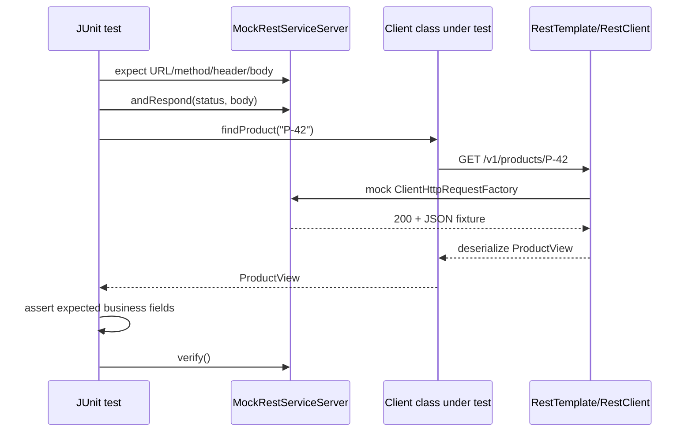

# HTTP client và giả lập: MockRestServiceServer với RestTemplate hoặc RestClient theo phiên bản

## 1. Bài toán: kiểm thử ứng dụng *gọi ra ngoài* mà không gọi HTTP thật

Một ứng dụng Spring Boot thường gọi HTTP API của hệ thống khác: tra cứu sản phẩm, thanh toán, thông tin vận chuyển, địa chỉ hoặc dịch vụ đối tác. Khi viết test cho một class **HTTP client outbound**, ta cần chứng minh:

- Client gửi đúng **HTTP method**, URL, query parameters và headers.
- Body JSON/XML được serialize theo hợp đồng.
- Response body được deserialize thành object đúng.
- Phản hồi lỗi 4xx/5xx được xử lý như chính sách của ứng dụng.
- Số lần gọi và, khi cần, thứ tự gọi đúng.
- Không có request bất ngờ mà test không kiểm soát.

Không nên biến mọi test thành request thật tới môi trường staging của đối tác: dịch vụ có thể chậm, offline, rate-limit, thay dữ liệu, yêu cầu secrets hoặc gây side effects.

Spring Framework cung cấp **`MockRestServiceServer`**, một mock **client-side HTTP server**. Nó không mở HTTP port; thay vào đó nó gắn một `ClientHttpRequestFactory` giả lập vào `RestTemplate` hoặc `RestClient.Builder`. Client code chạy bình thường nhưng request được so với kỳ vọng trong memory và nhận một response giả được chỉ định.

Ví dụ ý tưởng:

```java
server.expect(requestTo("https://catalog.example.test/v1/products/P-42"))
      .andExpect(method(HttpMethod.GET))
      .andRespond(withSuccess(
          "{\"sku\":\"P-42\",\"stock\":8}",
          MediaType.APPLICATION_JSON));

ProductView result = client.findProduct("P-42");

assertEquals("P-42", result.sku());
assertEquals(8, result.stock());
server.verify();
```

Đây là **trích đoạn**: cần khai báo `server`, `client`, `ProductView` và imports. Project Spring Boot 3.5/Java 17 hoàn chỉnh ở mục 10–15 có các thành phần ấy.

### Mục tiêu học tập

1. Phân biệt outbound client test với `MockMvc`, `WebTestClient` và HTTP server thật.
2. Chọn `RestTemplate` hoặc `RestClient` theo phiên bản Spring Boot/Spring Framework.
3. Dùng `@RestClientTest` cho test slice tự cấu hình builder và mock server.
4. Dùng `MockRestServiceServer.bindTo(restTemplate)` hoặc `bindTo(restClientBuilder)` khi không dùng Spring context.
5. Giải thích sự khác biệt **rootUri + URL path** của RestTemplateBuilder với **baseUrl + full URL** của RestClient.Builder.
6. Kiểm chứng GET/POST, JSON body, headers, response mapping, HTTP 404/503 và request counts.
7. Hiểu `expect(...)`, `andExpect(...)`, `andRespond(...)`, `verify()`, `reset()`, `ExpectedCount` và `ignoreExpectOrder(true)`.
8. Tránh những lỗi “test xanh giả” do không gọi `verify()`, dùng sai builder instance, sai URL hoặc mock nhầm client.
9. Biết giới hạn về TLS, socket, timeout, redirect, connection pool và khi nào cần WireMock/MockWebServer.
10. Chuyển imports/test starter đúng khi nâng lên Spring Boot 4.

## 2. Phân biệt công cụ theo *hướng* request

| Thành phần đang kiểm thử | Công cụ phù hợp | Request chạy qua đâu? |
| --- | --- | --- |
| Ứng dụng **gọi REST API ngoài** bằng RestTemplate | `MockRestServiceServer` + `RestTemplate` | Client request factory giả lập |
| Ứng dụng **gọi REST API ngoài** bằng RestClient | `MockRestServiceServer` + `RestClient.Builder` | Builder gắn request factory giả lập |
| Ứng dụng **cung cấp** REST endpoint Spring MVC | `@WebMvcTest` + `MockMvc` | DispatcherServlet giả lập trong server context |
| Ứng dụng cung cấp WebFlux endpoint | `@WebFluxTest`, `WebTestClient` | Spring reactive server handler chain |
| Ứng dụng **gọi API reactive** bằng WebClient | MockWebServer/WireMock hoặc test ExchangeFunction riêng | `MockRestServiceServer` **không** thay thế WebClient |
| Ứng dụng gọi SOAP qua WebServiceTemplate | `@WebServiceClientTest` + `MockWebServiceServer` | SOAP message-level |
| Gọi HTTP thực, kiểm tra transport | WireMock/OkHttp MockWebServer/HTTP test server | TCP socket, HTTP stack thật |
| Kiểm tra toàn ứng dụng + outbound stub | `@SpringBootTest` với mock server được gắn vào **đúng** HTTP client bean | Full Spring context + outbound mock |
| Kiểm tra TLS, certificate, network proxy | Test với HTTPS server/proxy phù hợp | Hạ tầng mạng thật hoặc có mô phỏng sát thực |

Các tên rất giống nhau nhưng không thể thay tùy tiện:

- **`MockRestServiceServer`**: mock bên nhận request **đối với RestTemplate/RestClient**.
- **`MockMvc`**: mock bên gửi request **tới REST server của ứng dụng**.
- **`MockWebServiceServer`**: mock SOAP server cho `WebServiceTemplate`.
- **`WireMock`/`MockWebServer`**: HTTP server giả có thể thực sự bind một port.

Nếu user story là “ứng dụng của ta gọi API đối tác và nhận phản hồi”, `MockRestServiceServer` là công cụ trọng tâm bài này, không phải `MockMvc`.

## 3. Cơ chế hoạt động



Các bước chính:

1. Test có `MockRestServiceServer` **đã gắn với đúng client đang được gọi**.
2. Test đăng ký `expect(...)` **trước** khi client gửi request.
3. Client tạo request bằng code thật, ví dụ `getForObject(...)` hoặc `restClient.get().retrieve()`.
4. Mock request factory ghi request và kiểm tra các request matchers.
5. Response creator trả status/headers/body đã khai báo.
6. Client xử lý response bằng HTTP message converters và JSON mapper thật trong test context.
7. Test assert object, exception hoặc kết quả nghiệp vụ.
8. `server.verify()` xác nhận các kỳ vọng đã được đáp ứng.

Không có HTTP call tới `catalog.example.test` trong test nếu mock được nối đúng. Domain `.example.test` chỉ là một URI giả phục vụ contract, không yêu cầu DNS hay secrets.

### verify() kiểm cái gì?

- Những expectations đã khai báo có được gọi đủ số lần không.
- Request nào không match có thể ném `AssertionError` ngay khi request được xử lý.
- `verify()` rất quan trọng trong test chỉ muốn kiểm tra interaction; nếu chỉ tạo expectation nhưng không gọi method client, test có thể xanh nếu không verify.
- `verify()` không tự đảm bảo mọi field response được kiểm tra; assert object được deserialize vẫn cần thiết.
- Đối với async call, `verify(Duration)` có thể đợi cho đến khi các expected requests được thực hiện. Đây không phải replacement cho assertions về business state ngoài HTTP client.

## 4. Phiên bản hỗ trợ: Spring Boot 2.x, 3.x và 4.x

### 4.1. RestTemplate lâu đời hơn RestClient

- `RestTemplate` đã có từ các bản Spring Framework cũ, dùng API imperative như `getForObject`, `postForObject`, `exchange`.
- `MockRestServiceServer` hỗ trợ `RestTemplate` từ Spring Framework 3.x, API `bindTo(RestTemplate)` có từ Spring Framework 4.3.
- `RestClient` là HTTP client synchronous fluent được giới thiệu trong **Spring Framework 6.1**, được tích hợp vào **Spring Boot 3.2+**.
- `MockRestServiceServer.bindTo(RestClient.Builder)` có từ **Spring Framework 6.1**.
- Đừng thêm import `RestClient` vào Spring Boot 3.0/3.1 hoặc Spring Framework 6.0 rồi mong compile: API này chưa tồn tại ở đó.
- `RestTemplate` vẫn được hỗ trợ trong các ứng dụng đang dùng nó; không bắt buộc chuyển hết code cũ chỉ để dùng mock server.

### 4.2. Bảng nhanh

| Nền tảng | RestTemplate | RestClient | Auto test |
| --- | --- | --- | --- |
| Spring Boot 2.x, Spring 5.x | Có | Chưa có | `@RestClientTest` tập trung RestTemplate |
| Spring Boot 3.0–3.1, Spring 6.0 | Có | Chưa có | `@RestClientTest` với RestTemplateBuilder |
| Spring Boot 3.2–3.3, Spring 6.1 | Có | Có | `@RestClientTest` hỗ trợ cả hai builder |
| Spring Boot 3.4–3.5, Spring 6.2 | Có | Có | `@RestClientTest` + `MockRestServiceServer` |
| Spring Boot 4.x, Spring Framework 7 | Có theo compatibility của version | Có | Test starter/package **đổi sang module RestClient** |

### 4.3. Imports với Boot 3.5

```java
import org.springframework.boot.test.autoconfigure.web.client.RestClientTest;
import org.springframework.boot.web.client.RestTemplateBuilder;
import org.springframework.test.web.client.MockRestServiceServer;
import org.springframework.web.client.RestClient;
import org.springframework.web.client.RestTemplate;
```

Trong Boot 3.5, `@RestClientTest` tự cấu hình Spring HTTP clients test slice, JSON converters, `RestTemplateBuilder`, `RestClient.Builder` và `MockRestServiceServer`. Code ví dụ dùng parent `spring-boot-starter-parent:3.5.0`, Java 17 và `spring-boot-starter-test`.

### 4.4. Imports và starters với Boot 4

Khi nâng lên Boot 4, cấu trúc test đã modular hóa theo công nghệ. Import:

```java
import org.springframework.boot.restclient.test.autoconfigure.RestClientTest;
```

Dùng focused starters đúng major:

```xml
<!-- Đoạn Boot 4 định hướng, KHÔNG trộn với POM Boot 3.5. -->
<dependency>
    <groupId>org.springframework.boot</groupId>
    <artifactId>spring-boot-starter-restclient</artifactId>
</dependency>
<dependency>
    <groupId>org.springframework.boot</groupId>
    <artifactId>spring-boot-starter-restclient-test</artifactId>
    <scope>test</scope>
</dependency>
```

- Tên Spring Boot test class chuyển từ `org.springframework.boot.test.autoconfigure.web.client` sang `org.springframework.boot.restclient.test.autoconfigure`.
- `MockRestServiceServer`/`MockRestRequestMatchers` vẫn thuộc Spring Framework `org.springframework.test.web.client` trong hệ API được nêu.
- `RestClient` vẫn thuộc `org.springframework.web.client`.
- Không copy starter Boot 4 vào parent 3.5 hoặc dùng import Boot 3.5 với test modules Boot 4.
- Ở Boot 4, kiểm tra những thay đổi khác của Spring Framework 7/client APIs theo BOM trước khi port code.

## 5. Chọn test slice @RestClientTest

Spring Boot có annotation chuyên dụng:

```java
@RestClientTest(MyExternalClient.class)
class MyExternalClientTest {
    @Autowired MyExternalClient client;
    @Autowired MockRestServiceServer server;
}
```

`@RestClientTest(MyExternalClient.class)` chỉ định client component cần kiểm thử, auto-configure các client builders và mock server cần thiết. Đây **không phải** `@SpringBootTest`, vì nó hạn chế những beans được scan.

Lợi ích:

- Không cần start Tomcat/HTTP server để test outbound request.
- Không cần database, Kafka, Redis hoặc toàn bộ ApplicationContext nếu client chỉ phụ thuộc builder/properties/JSON.
- Mock server được gắn vào client builder theo Boot test auto-configuration.
- JSON (Jackson hoặc cơ chế serializing khác nếu configured) vẫn được sử dụng.
- Các kỳ vọng viết gần code thử nghiệm, dễ nhận ra contract bị sai.

**Lưu ý:** `@RestClientTest` **không tự scan mọi `@Component`/`@ConfigurationProperties`**. Nếu client phụ thuộc vào auth/token service, bean khác hoặc properties class, test phải cung cấp bean cần thiết bằng `@MockitoBean`, `@Import`, `@EnableConfigurationProperties` hoặc cấu hình đơn giản đúng phạm vi. Đừng nhập toàn bộ production configuration chỉ để tránh lỗi thiếu bean.

### @RestClientTest không cần @ExtendWith

JUnit 5 + Boot test slices đã tích hợp SpringExtension. Không cần gắn thêm `@ExtendWith(SpringExtension.class)` trong project mẫu. Lớp này không có embedded web server.

### Khi nào dùng @SpringBootTest?

Khi cần kiểm tra full Spring wiring — interceptor, auth beans, retries, cache, một business service gọi client — có thể dùng `@SpringBootTest` và gắn `MockRestServiceServer` vào **chính client instance được ứng dụng sử dụng**. Tùy cấu hình, thêm `@AutoConfigureMockRestServiceServer` và đúng client builder, hoặc tự bind thủ công.

Đừng giả định một `MockRestServiceServer` bất kỳ đã intercept mọi `RestClient.create()`/`new RestTemplate()` trong ứng dụng: mock chỉ gắn với những instances/builders được cấu hình.

## 6. RestTemplateBuilder.rootUri khác RestClient.Builder.baseUrl

Đây là điểm dễ nhất gây `AssertionError: Unexpected request` trong test đúng logic.

### 6.1. RestTemplateBuilder.rootUri

Client tạo bởi:

```java
RestTemplate restTemplate = builder
        .rootUri("https://catalog.example.test")
        .build();

ProductView result = restTemplate.getForObject(
        "/v1/products/{sku}", ProductView.class, "P-42");
```

Khi test slice có `@RestClientTest`, Spring Boot docs chỉ rõ: nếu RestTemplate dùng `RestTemplateBuilder.rootUri(...)`, **expectation nên bỏ root URI**:

```java
server.expect(requestTo("/v1/products/P-42"))
      .andRespond(withSuccess(
          "{\"sku\":\"P-42\",\"stock\":8}",
          MediaType.APPLICATION_JSON));
```

Tại sao? Cơ chế `RootUriTemplateHandler` và mock customizer của Boot liên quan cách request URL được đưa tới mock request factory. Với test Boot dùng builder đúng cách, expectation sẽ là path như ví dụ chính thức.

**Phạm vi:** Điều này đặc biệt nói về **Boot `@RestClientTest` và RestTemplateBuilder.rootUri**. Nếu bạn tự tạo `new RestTemplate()` rồi `MockRestServiceServer.bindTo(...)` thủ công, request thường là URL đầy đủ, không tự có rootUri.

### 6.2. RestClient.Builder.baseUrl

Client tạo bởi:

```java
RestClient restClient = builder
        .baseUrl("https://catalog.example.test")
        .build();

ProductView result = restClient.get()
        .uri("/v1/products/{sku}", "P-42")
        .retrieve()
        .body(ProductView.class);
```

Với `RestClient.Builder` trong Boot `@RestClientTest`, docs yêu cầu matcher dùng **URL đầy đủ**:

```java
server.expect(requestTo(
      "https://catalog.example.test/v1/products/P-42"))
      .andRespond(withSuccess(
          "{\"sku\":\"P-42\",\"stock\":8}",
          MediaType.APPLICATION_JSON));
```

### 6.3. Bảng phòng lỗi

| Client được cấu hình | Request code | MockRestServiceServer expectation trong Boot slice |
| --- | --- | --- |
| `RestTemplateBuilder.rootUri("https://catalog.example.test")` | `getForObject("/v1/products/{sku}", …)` | `/v1/products/P-42` |
| `RestTemplateBuilder` **không có** rootUri, dùng absolute URL | `getForObject("https://catalog.example.test/...", …)` | `https://catalog.example.test/v1/products/P-42` |
| `RestClient.Builder.baseUrl("https://catalog.example.test")` | `get().uri("/v1/products/{sku}", …)` | `https://catalog.example.test/v1/products/P-42` |
| Manual `MockRestServiceServer.bindTo(new RestTemplate())` | `getForObject("https://catalog.example.test/...", …)` | Full URL |
| Manual `MockRestServiceServer.bindTo(restClientBuilder)` | Builder có `baseUrl`, dùng relative `uri` | Full URL |

Nếu test fail, **đừng bỏ `requestTo`** để làm test xanh. Hãy so actual URI trong failure, xem builder nào được sử dụng, rootUri/baseUrl là gì, và sửa expectation theo đúng hướng dẫn framework.

## 7. Request matchers và Response creators

### Request matchers

Import:

```java
import static org.springframework.test.web.client.match.MockRestRequestMatchers.requestTo;
import static org.springframework.test.web.client.match.MockRestRequestMatchers.method;
import static org.springframework.test.web.client.match.MockRestRequestMatchers.header;
import static org.springframework.test.web.client.match.MockRestRequestMatchers.content;
```

Ví dụ:

```java
server.expect(requestTo("https://catalog.example.test/v1/orders"))
      .andExpect(method(HttpMethod.POST))
      .andExpect(content().contentType(MediaType.APPLICATION_JSON))
      .andExpect(content().json(
          "{\"sku\":\"P-42\",\"quantity\":2}"))
      .andRespond(withSuccess(
          "{\"orderId\":\"O-7\",\"state\":\"CREATED\"}",
          MediaType.APPLICATION_JSON));
```

- `requestTo(...)`: URL chính xác theo từng test environment.
- `method(HttpMethod.POST)`: phương thức HTTP.
- `header(HttpHeaders.AUTHORIZATION, ...)`: headers quan trọng (authorization/correlation/content negotiation).
- `content().contentType(...)`: Content-Type của request.
- `content().json(...)`: so sánh JSON body theo cấu trúc, thường không phụ thuộc whitespace hoặc thứ tự các JSON object properties.
- `jsonPath("$.sku").value("P-42")`: kiểm chứng một field trong JSON request nếu cần.
- `queryParam(...)`: có các API request matchers cho query parameters trong các phiên bản tương ứng; tra Javadoc khi dùng để tránh nhầm thứ tự/encoding của raw URL.

**Không chỉ assert URL** nếu behavior yêu cầu body, header hoặc idempotency key. Một client có thể gọi đúng đường dẫn nhưng sai quantity hoặc thiếu authentication header.

### Response creators

Import:

```java
import static org.springframework.test.web.client.response.MockRestResponseCreators.withSuccess;
import static org.springframework.test.web.client.response.MockRestResponseCreators.withStatus;
import static org.springframework.test.web.client.response.MockRestResponseCreators.withException;
```

Các trường hợp:

```java
// JSON success
withSuccess("{\"sku\":\"P-42\",\"stock\":8}",
        MediaType.APPLICATION_JSON);

// HTTP 404 với body (cần HTTP method/URL expectation tương ứng).
withStatus(HttpStatus.NOT_FOUND)
        .contentType(MediaType.APPLICATION_JSON)
        .body("{\"error\":\"not-found\"}");

// HTTP 503: server không sẵn sàng.
withStatus(HttpStatus.SERVICE_UNAVAILABLE)
        .contentType(MediaType.TEXT_PLAIN)
        .body("temporarily unavailable");

// IOException giả lập (không phải TCP socket thật).
withException(new java.net.SocketTimeoutException("simulated timeout"));
```

`withException` mô phỏng một lỗi I/O ở request factory. Nó hữu ích cho nhánh xử lý lỗi client nhưng **không chứng minh** cấu hình connect/read timeout trên socket thật. Với transport behavior, dùng mock HTTP server có port thật.

## 8. ExpectedCount, thứ tự request và verify()

### 8.1. Một request đúng một lần

```java
server.expect(requestTo("https://catalog.example.test/v1/ping"))
      .andRespond(withSuccess("pong", MediaType.TEXT_PLAIN));

client.ping();
server.verify();
```

Mặc định một expectation ứng với một request. Nên kiểm method/body phù hợp với contract.

### 8.2. Hai requests giống nhau

```java
server.expect(ExpectedCount.times(2),
              requestTo("https://catalog.example.test/v1/ping"))
      .andExpect(method(HttpMethod.GET))
      .andRespond(withSuccess("pong", MediaType.TEXT_PLAIN));

client.ping();
client.ping();
server.verify();
```

Có thể dùng `ExpectedCount.once()`, `times(n)`, `min(n)`, `max(n)`, `between(min,max)` hoặc `manyTimes()` theo version. Không dùng `manyTimes` chỉ để tránh phải biết số lần gọi; retry behavior quan trọng cần assert count rõ và giới hạn.

### 8.3. Thứ tự mặc định

Các expectations thường được match theo thứ tự khai báo. Nếu client dự kiến gọi token endpoint trước data endpoint, thứ tự có thể là một phần contract. Với các requests độc lập không có thứ tự nghiệp vụ, có thể cấu hình:

```java
MockRestServiceServer server =
    MockRestServiceServer.bindTo(restTemplate)
        .ignoreExpectOrder(true)
        .build();
```

`ignoreExpectOrder(true)` cho phép match không theo thứ tự. Không bật bừa nếu thứ tự là logic cần kiểm; thứ tự sai ở auth token refresh, idempotency hoặc workflow có thể là bug.

Với `ExpectedCount.times(2)`, chỉ lần đầu của expectation có count >1 phải giữ vị trí đầu theo ordering rules; các lần sau có thể xen kẽ, theo Spring Framework API. Không viết assertion dựa vào một thứ tự mạnh hơn framework hứa.

### 8.4. verify(Duration)

```java
server.verify(Duration.ofSeconds(3));
```

Biến thể này cho phép **đợi** tất cả expectations được thực hiện trong khoảng thời gian hữu hạn, dùng cho code dispatch request bất đồng bộ. Nó không đảm bảo response-side business state được xử lý; điều đó cần assertion riêng. RestTemplate và RestClient bản thân là synchronous, nên project mẫu dùng `verify()` tức thì sau method return.

### 8.5. reset()

`server.reset()` xóa recorded requests và expectations hiện tại nhưng không tạo HTTP client mới. Thường dùng ở `@BeforeEach` hoặc tạo mock server per test để tránh leaked state. Không reset giữa một request đang chạy, hoặc reset sau lỗi rồi tuyên bố đã kiểm chứng được failed expectation.

## 9. Lựa chọn kiến trúc project mẫu

Project ví dụ có một upstream API `catalog.example.test`:

- `GET /v1/products/{sku}` trả `ProductView(sku, stock)`.
- `POST /v1/orders` nhận `OrderRequest(sku, quantity)`, trả `OrderReceipt(orderId, state)`.
- `InventoryRestTemplateClient` dùng `RestTemplateBuilder.rootUri`.
- `InventoryRestClientClient` dùng `RestClient.Builder.baseUrl`.
- Hai lớp `@RestClientTest` riêng, mỗi lớp inject đúng client và `MockRestServiceServer`.
- Một lớp test manual binding chứng minh không cần Spring context.
- Không có HTTP server, datasource, Kafka, credentials thật, Testcontainers hoặc external network.

**Các bản ghi/JSON cố tình rất nhỏ** để request contract dễ quan sát; không cần seeded database để test một outbound HTTP client.

### Project files

```text
mock-rest-client-demo/
├── pom.xml
└── src/
    ├── main/
    │   ├── java/example/outbound/
    │   │   ├── OutboundApplication.java
    │   │   ├── ProductView.java
    │   │   ├── OrderRequest.java
    │   │   ├── OrderReceipt.java
    │   │   ├── InventoryRestTemplateClient.java
    │   │   └── InventoryRestClientClient.java
    │   └── resources/
    │       └── application.properties
    └── test/
        └── java/example/outbound/
            ├── InventoryRestTemplateClientTest.java
            ├── InventoryRestClientClientTest.java
            └── ManualMockRestServiceServerTest.java
```

## 10. pom.xml — Spring Boot 3.5.0 + Java 17

```xml
<?xml version="1.0" encoding="UTF-8"?>
<project xmlns="http://maven.apache.org/POM/4.0.0"
         xmlns:xsi="http://www.w3.org/2001/XMLSchema-instance"
         xsi:schemaLocation="http://maven.apache.org/POM/4.0.0
             https://maven.apache.org/xsd/maven-4.0.0.xsd">
    <modelVersion>4.0.0</modelVersion>

    <parent>
        <groupId>org.springframework.boot</groupId>
        <artifactId>spring-boot-starter-parent</artifactId>
        <version>3.5.0</version>
        <relativePath/>
    </parent>

    <groupId>example</groupId>
    <artifactId>mock-rest-client-demo</artifactId>
    <version>1.0-SNAPSHOT</version>

    <properties>
        <java.version>17</java.version>
    </properties>

    <dependencies>
        <!-- Spring Web: RestTemplate, RestClient, Jackson converters. -->
        <dependency>
            <groupId>org.springframework.boot</groupId>
            <artifactId>spring-boot-starter-web</artifactId>
        </dependency>

        <!-- JUnit Jupiter, Spring Test, MockRestServiceServer, JSONassert. -->
        <dependency>
            <groupId>org.springframework.boot</groupId>
            <artifactId>spring-boot-starter-test</artifactId>
            <scope>test</scope>
        </dependency>
    </dependencies>
</project>
```

`spring-boot-starter-web` có server-related dependencies, nhưng `@RestClientTest` **không tự chạy embedded server**. Nếu ứng dụng hoàn toàn client-only, có thể tối ưu dependencies theo module thực sự cần; ở demo dùng starter-web để mã dễ biên dịch/chạy trên Boot 3.5, không cần tự ghép Jackson và Spring Web.

## 11. Main code: application, DTO và RestTemplate client

### 11.1. OutboundApplication.java

`src/main/java/example/outbound/OutboundApplication.java`:

```java
package example.outbound;

import org.springframework.boot.SpringApplication;
import org.springframework.boot.autoconfigure.SpringBootApplication;

@SpringBootApplication
public class OutboundApplication {
    public static void main(String[] args) {
        SpringApplication.run(OutboundApplication.class, args);
    }
}
```

Không cần public HTTP controller vì project kiểm tra **outbound calls**, không kiểm incoming requests.

### 11.2. ProductView.java

`src/main/java/example/outbound/ProductView.java`:

```java
package example.outbound;

public record ProductView(String sku, int stock) {
}
```

### 11.3. OrderRequest.java

`src/main/java/example/outbound/OrderRequest.java`:

```java
package example.outbound;

public record OrderRequest(String sku, int quantity) {
}
```

### 11.4. OrderReceipt.java

`src/main/java/example/outbound/OrderReceipt.java`:

```java
package example.outbound;

public record OrderReceipt(String orderId, String state) {
}
```

Java records từ Java 17 tương thích với Jackson được Spring Boot quản lý cho ví dụ serialization/deserialization đơn giản. Nếu dùng DTO có annotations polymorphic, nested collections hoặc custom serializers, bổ sung test dữ liệu tương ứng.

### 11.5. application.properties

`src/main/resources/application.properties`:

```properties
partner.catalog.base-url=https://catalog.example.test
spring.main.banner-mode=off
```

URI trên là **địa chỉ placeholder không được dùng để gọi mạng**. Trong test, mock request factory intercept requests; không dùng URI này như production endpoint. Production cần cấu hình thật qua environment/secret manager và chính sách bảo mật phù hợp.

### 11.6. InventoryRestTemplateClient.java

`src/main/java/example/outbound/InventoryRestTemplateClient.java`:

```java
package example.outbound;

import org.springframework.beans.factory.annotation.Value;
import org.springframework.boot.web.client.RestTemplateBuilder;
import org.springframework.stereotype.Service;
import org.springframework.web.client.RestTemplate;

@Service
public class InventoryRestTemplateClient {

    private final RestTemplate template;

    public InventoryRestTemplateClient(
            RestTemplateBuilder builder,
            @Value("${partner.catalog.base-url}") String baseUrl) {

        this.template = builder
                .rootUri(baseUrl)
                .build();
    }

    public ProductView findProduct(String sku) {
        return template.getForObject(
                "/v1/products/{sku}",
                ProductView.class,
                sku);
    }

    public OrderReceipt placeOrder(OrderRequest request) {
        return template.postForObject(
                "/v1/orders",
                request,
                OrderReceipt.class);
    }
}
```

**Vì sao dùng RestTemplateBuilder thay new RestTemplate()?**

- Builder từ Boot mang customizers, message converters, request factory config và mock server khi test slice cấu hình.
- `rootUri(baseUrl)` được áp dụng cho lời gọi dùng URI template chuỗi bắt đầu bằng dấu `/`.
- Nếu code viết `new RestTemplate()` ngay trong constructor, `@RestClientTest` không tự biết để gắn server vào instance đó, trừ khi test bind thủ công chính instance ấy.
- Không tạo `RestTemplate` mới trong mỗi request nếu muốn test và production client giữ cấu hình chung.

`RestTemplate.getForObject/postForObject` dùng message converters để đọc/ghi JSON. Khi status là 4xx/5xx, `DefaultResponseErrorHandler` thường tạo ngoại lệ `HttpClientErrorException`/`HttpServerErrorException`. Ví dụ test kiểm nhánh mặc định ấy; nếu ứng dụng dùng custom error handler, contract ngoại lệ có thể khác.

## 12. RestClient client — fluent API mới hơn

`src/main/java/example/outbound/InventoryRestClientClient.java`:

```java
package example.outbound;

import org.springframework.beans.factory.annotation.Value;
import org.springframework.http.MediaType;
import org.springframework.stereotype.Service;
import org.springframework.web.client.RestClient;

@Service
public class InventoryRestClientClient {

    private final RestClient restClient;

    public InventoryRestClientClient(
            RestClient.Builder builder,
            @Value("${partner.catalog.base-url}") String baseUrl) {

        this.restClient = builder
                .baseUrl(baseUrl)
                .build();
    }

    public ProductView findProduct(String sku) {
        return restClient.get()
                .uri("/v1/products/{sku}", sku)
                .accept(MediaType.APPLICATION_JSON)
                .retrieve()
                .body(ProductView.class);
    }

    public OrderReceipt placeOrder(OrderRequest request) {
        return restClient.post()
                .uri("/v1/orders")
                .contentType(MediaType.APPLICATION_JSON)
                .body(request)
                .retrieve()
                .body(OrderReceipt.class);
    }
}
```

- `RestClient.Builder` là bean được Boot auto-configure trong Boot 3.2+.
- `baseUrl(...)` áp dụng với relative URI ở `.uri(...)`.
- `retrieve().body(ProductView.class)` dùng configured message converters.
- `.accept(MediaType.APPLICATION_JSON)` tạo Accept header tường minh.
- `.contentType(MediaType.APPLICATION_JSON)` đặt Content-Type cho request POST.
- Với 4xx/5xx, default `RestClient` status handlers thường ném `RestClientResponseException` cùng các subtype như `HttpClientErrorException.NotFound`/`HttpServerErrorException.ServiceUnavailable`.
- `RestClient` là **synchronous** fluent client. Đừng nhầm với reactive `WebClient`.

**Quan trọng:** test phải bind mock **trước khi builder.build()**. Boot `@RestClientTest` cung cấp builder đã được customizer gắn mock, rồi constructor client gọi `build()`. Trong manual test, trật tự này phải được thực hiện bằng tay.

## 13. @RestClientTest cho RestTemplate: 4 JUnit tests

`src/test/java/example/outbound/InventoryRestTemplateClientTest.java`:

```java
package example.outbound;

import static org.junit.jupiter.api.Assertions.assertEquals;
import static org.junit.jupiter.api.Assertions.assertThrows;
import static org.junit.jupiter.api.Assertions.assertNotNull;
import static org.springframework.test.web.client.match.MockRestRequestMatchers.content;
import static org.springframework.test.web.client.match.MockRestRequestMatchers.method;
import static org.springframework.test.web.client.match.MockRestRequestMatchers.requestTo;
import static org.springframework.test.web.client.response.MockRestResponseCreators.withStatus;
import static org.springframework.test.web.client.response.MockRestResponseCreators.withSuccess;

import org.junit.jupiter.api.BeforeEach;
import org.junit.jupiter.api.Test;
import org.springframework.beans.factory.annotation.Autowired;
import org.springframework.boot.test.autoconfigure.web.client.RestClientTest;
import org.springframework.http.HttpMethod;
import org.springframework.http.HttpStatus;
import org.springframework.http.MediaType;
import org.springframework.test.web.client.MockRestServiceServer;
import org.springframework.web.client.HttpClientErrorException;
import org.springframework.web.client.HttpServerErrorException;

@RestClientTest(
    value = InventoryRestTemplateClient.class,
    properties = "partner.catalog.base-url=https://catalog.example.test")
class InventoryRestTemplateClientTest {

    @Autowired
    InventoryRestTemplateClient client;

    @Autowired
    MockRestServiceServer server;

    @BeforeEach
    void resetExpectations() {
        server.reset();
    }

    @Test
    void getProductUsesRelativeExpectationWithRootUri() {
        server.expect(requestTo("/v1/products/P-42"))
              .andExpect(method(HttpMethod.GET))
              .andRespond(withSuccess(
                  """
                  {"sku":"P-42","stock":8}
                  """,
                  MediaType.APPLICATION_JSON));

        ProductView result = client.findProduct("P-42");

        assertNotNull(result);
        assertEquals("P-42", result.sku());
        assertEquals(8, result.stock());
        server.verify();
    }

    @Test
    void postRequestContainsCorrectJsonBody() {
        server.expect(requestTo("/v1/orders"))
              .andExpect(method(HttpMethod.POST))
              .andExpect(content().contentType(
                  MediaType.APPLICATION_JSON))
              .andExpect(content().json(
                  """
                  {"sku":"P-42","quantity":2}
                  """))
              .andRespond(withSuccess(
                  """
                  {"orderId":"O-7","state":"CREATED"}
                  """,
                  MediaType.APPLICATION_JSON));

        OrderReceipt result = client.placeOrder(
                new OrderRequest("P-42", 2));

        assertNotNull(result);
        assertEquals("O-7", result.orderId());
        assertEquals("CREATED", result.state());
        server.verify();
    }

    @Test
    void notFoundIsExposedAsClientError() {
        server.expect(requestTo("/v1/products/UNKNOWN"))
              .andExpect(method(HttpMethod.GET))
              .andRespond(withStatus(HttpStatus.NOT_FOUND)
                  .contentType(MediaType.APPLICATION_JSON)
                  .body("{\"error\":\"product-not-found\"}"));

        HttpClientErrorException.NotFound error =
                assertThrows(
                    HttpClientErrorException.NotFound.class,
                    () -> client.findProduct("UNKNOWN"));

        assertEquals(HttpStatus.NOT_FOUND,
                error.getStatusCode());
        server.verify();
    }

    @Test
    void unavailableIsExposedAsServerError() {
        server.expect(requestTo("/v1/products/P-503"))
              .andExpect(method(HttpMethod.GET))
              .andRespond(withStatus(
                      HttpStatus.SERVICE_UNAVAILABLE)
                  .contentType(MediaType.TEXT_PLAIN)
                  .body("temporarily unavailable"));

        HttpServerErrorException.ServiceUnavailable error =
                assertThrows(
                    HttpServerErrorException.ServiceUnavailable.class,
                    () -> client.findProduct("P-503"));

        assertEquals(HttpStatus.SERVICE_UNAVAILABLE,
                error.getStatusCode());
        server.verify();
    }
}
```

**Có 4 `@Test`**.

### Giải thích những điều test thực sự chứng minh

1. **GET success:** builder `rootUri` được dùng, method GET đúng, response JSON được Jackson parse thành `ProductView`.
2. **POST JSON:** đúng path, HTTP method và chính xác business fields trong request body; Jackson deserialize response.
3. **404:** xử lý status theo default RestTemplate error handler. Test không cần HTTP server thật.
4. **503:** mặc định ném lỗi 5xx, không tự retry. Nếu ứng dụng có retry policy, phải test riêng số lần gọi/khoảng thời gian với config thực.

**Chú ý URL matcher:** các expectations dùng `/v1/...` chứ **không** dùng full `https://catalog.example.test/...` vì test slice sử dụng `RestTemplateBuilder.rootUri(...)`. Điều này đúng theo hướng dẫn Spring Boot 3.5.

### Vì sao đặt reset ở @BeforeEach?

`server.reset()` loại expectations và recorded requests khỏi test trước, phòng test dùng lại mock server state của method trước khi Spring context được cache. Nó không thay đổi client builder hoặc làm mất binding; test tiếp tục đăng ký kỳ vọng mới và gọi cùng client. Với các test độc lập, không được dùng những expectations đã khai báo ở một method để làm điều kiện cho method sau.

### Có cần assert response header không?

Nếu client logic phụ thuộc ETag, pagination links, Retry-After hoặc Content-Language, nên thêm assertions cho parsed headers và mock response headers tương ứng. Project này chỉ trả body DTO nên không bịa thêm headers không liên quan.

## 14. @RestClientTest cho RestClient: 5 JUnit tests

`src/test/java/example/outbound/InventoryRestClientClientTest.java`:

```java
package example.outbound;

import static org.junit.jupiter.api.Assertions.assertEquals;
import static org.junit.jupiter.api.Assertions.assertThrows;
import static org.junit.jupiter.api.Assertions.assertNotNull;
import static org.springframework.test.web.client.match.MockRestRequestMatchers.content;
import static org.springframework.test.web.client.match.MockRestRequestMatchers.header;
import static org.springframework.test.web.client.match.MockRestRequestMatchers.method;
import static org.springframework.test.web.client.match.MockRestRequestMatchers.requestTo;
import static org.springframework.test.web.client.response.MockRestResponseCreators.withStatus;
import static org.springframework.test.web.client.response.MockRestResponseCreators.withSuccess;

import org.junit.jupiter.api.BeforeEach;
import org.junit.jupiter.api.Test;
import org.springframework.beans.factory.annotation.Autowired;
import org.springframework.boot.test.autoconfigure.web.client.RestClientTest;
import org.springframework.http.HttpHeaders;
import org.springframework.http.HttpMethod;
import org.springframework.http.HttpStatus;
import org.springframework.http.MediaType;
import org.springframework.test.web.client.ExpectedCount;
import org.springframework.test.web.client.MockRestServiceServer;
import org.springframework.web.client.HttpClientErrorException;
import org.springframework.web.client.HttpServerErrorException;

@RestClientTest(
    value = InventoryRestClientClient.class,
    properties = "partner.catalog.base-url=https://catalog.example.test")
class InventoryRestClientClientTest {

    private static final String BASE =
            "https://catalog.example.test";

    @Autowired
    InventoryRestClientClient client;

    @Autowired
    MockRestServiceServer server;

    @BeforeEach
    void resetExpectations() {
        server.reset();
    }

    @Test
    void getUsesFullUriAndAcceptHeader() {
        server.expect(requestTo(BASE + "/v1/products/P-42"))
              .andExpect(method(HttpMethod.GET))
              .andExpect(header(
                      HttpHeaders.ACCEPT,
                      MediaType.APPLICATION_JSON_VALUE))
              .andRespond(withSuccess(
                  """
                  {"sku":"P-42","stock":8}
                  """,
                  MediaType.APPLICATION_JSON));

        ProductView result = client.findProduct("P-42");

        assertNotNull(result);
        assertEquals("P-42", result.sku());
        assertEquals(8, result.stock());
        server.verify();
    }

    @Test
    void postSendsJsonAndMapsOrderReceipt() {
        server.expect(requestTo(BASE + "/v1/orders"))
              .andExpect(method(HttpMethod.POST))
              .andExpect(content().contentType(
                  MediaType.APPLICATION_JSON))
              .andExpect(content().json(
                  """
                  {"sku":"P-42","quantity":2}
                  """))
              .andRespond(withSuccess(
                  """
                  {"orderId":"O-8","state":"CREATED"}
                  """,
                  MediaType.APPLICATION_JSON));

        OrderReceipt receipt = client.placeOrder(
                new OrderRequest("P-42", 2));

        assertNotNull(receipt);
        assertEquals("O-8", receipt.orderId());
        assertEquals("CREATED", receipt.state());
        server.verify();
    }

    @Test
    void notFoundThrowsTypedClientError() {
        server.expect(requestTo(BASE + "/v1/products/UNKNOWN"))
              .andExpect(method(HttpMethod.GET))
              .andRespond(withStatus(HttpStatus.NOT_FOUND));

        HttpClientErrorException.NotFound error =
                assertThrows(
                    HttpClientErrorException.NotFound.class,
                    () -> client.findProduct("UNKNOWN"));

        assertEquals(HttpStatus.NOT_FOUND,
                error.getStatusCode());
        server.verify();
    }

    @Test
    void serviceUnavailableThrowsTypedServerError() {
        server.expect(requestTo(BASE + "/v1/products/P-503"))
              .andExpect(method(HttpMethod.GET))
              .andRespond(withStatus(
                  HttpStatus.SERVICE_UNAVAILABLE));

        HttpServerErrorException.ServiceUnavailable error =
                assertThrows(
                    HttpServerErrorException.ServiceUnavailable.class,
                    () -> client.findProduct("P-503"));

        assertEquals(HttpStatus.SERVICE_UNAVAILABLE,
                error.getStatusCode());
        server.verify();
    }

    @Test
    void expectedCountConfirmsTwoOutboundCalls() {
        server.expect(
                  ExpectedCount.times(2),
                  requestTo(BASE + "/v1/products/P-9"))
              .andExpect(method(HttpMethod.GET))
              .andRespond(withSuccess(
                  """
                  {"sku":"P-9","stock":9}
                  """,
                  MediaType.APPLICATION_JSON));

        ProductView first = client.findProduct("P-9");
        ProductView second = client.findProduct("P-9");

        assertNotNull(first);
        assertNotNull(second);
        assertEquals("P-9", first.sku());
        assertEquals(9, second.stock());
        server.verify();
    }
}
```

**Có 5 `@Test`**. Khác với RestTemplate test ở mục 13, các expectations `requestTo` **có đầy đủ base URL** do client dùng `RestClient.Builder.baseUrl(...)`.

### Không đẩy mock server vào production code

`InventoryRestClientClient` không import `MockRestServiceServer` hoặc `MockRestRequestMatchers`. Mọi mock code nằm trong `src/test/java`. Production class chỉ nhận RestClient.Builder; đó là dependency injection giúp test có thể thay transport bằng mock mà không thêm test branches vào logic ứng dụng.

### Why full URL?

Spring Boot docs 3.5 phân biệt rõ: `RestClient.Builder` và `RestTemplateBuilder` không dùng rootUri đều có expectation URL đầy đủ. Đặt `requestTo("/v1/products/P-42")` trong RestClient test có thể làm mock báo mismatch dù base URL/resolver của client đúng.

### Test ExpectedCount không phải “retry policy”

Test `expectedCountConfirmsTwoOutboundCalls` cố ý gọi method hai lần rồi xác nhận đúng hai requests. Nó **không** chứng minh retry tự động. Nếu client có Resilience4j/Spring Retry, phải cấu hình retry layer thật, đăng ký các responses lỗi rồi thành công và xác nhận call count, backoff/timeout hợp lý. Không gọi cùng method hai lần từ test và gọi đó là retry test.

## 15. Manual binding không cần Spring Boot test context: 2 JUnit tests

Đôi khi muốn test một class Java thuần, code migration cũ tự tạo RestTemplate, hoặc muốn gắn mock vào một RestClient.Builder đặc biệt. Không bắt buộc dùng `@RestClientTest`.

`src/test/java/example/outbound/ManualMockRestServiceServerTest.java`:

```java
package example.outbound;

import static org.junit.jupiter.api.Assertions.assertEquals;
import static org.springframework.test.web.client.match.MockRestRequestMatchers.method;
import static org.springframework.test.web.client.match.MockRestRequestMatchers.requestTo;
import static org.springframework.test.web.client.response.MockRestResponseCreators.withSuccess;

import org.junit.jupiter.api.Test;
import org.springframework.http.HttpMethod;
import org.springframework.http.MediaType;
import org.springframework.test.web.client.MockRestServiceServer;
import org.springframework.web.client.RestClient;
import org.springframework.web.client.RestTemplate;

class ManualMockRestServiceServerTest {

    private static final String BASE =
            "https://catalog.example.test";

    @Test
    void manuallyBindsToRestTemplateInstance() {
        RestTemplate template = new RestTemplate();

        MockRestServiceServer server =
                MockRestServiceServer.bindTo(template).build();

        server.expect(requestTo(BASE + "/v1/ping"))
              .andExpect(method(HttpMethod.GET))
              .andRespond(withSuccess(
                  "pong", MediaType.TEXT_PLAIN));

        String response = template.getForObject(
                BASE + "/v1/ping", String.class);

        assertEquals("pong", response);
        server.verify();
    }

    @Test
    void manuallyBindsToRestClientBuilderBeforeBuild() {
        RestClient.Builder builder = RestClient.builder()
                .baseUrl(BASE);

        // Thứ tự quan trọng: bindTo(builder) TRƯỚC builder.build().
        MockRestServiceServer server =
                MockRestServiceServer.bindTo(builder).build();

        RestClient client = builder.build();

        server.expect(requestTo(BASE + "/v1/ping"))
              .andExpect(method(HttpMethod.GET))
              .andRespond(withSuccess(
                  "pong", MediaType.TEXT_PLAIN));

        String response = client.get()
                .uri("/v1/ping")
                .retrieve()
                .body(String.class);

        assertEquals("pong", response);
        server.verify();
    }
}
```

**Có 2 `@Test`** và không có `@SpringBootTest`, `@RestClientTest`, `@Autowired` hoặc Spring ApplicationContext.

### Tại sao bindTo(RestClient.Builder) trước build()?

`RestClient` là object được tạo từ builder. Nếu bạn:

```java
RestClient client = RestClient.builder().build();
// ... một MockRestServiceServer.bindTo(builderKhac) ...
```

thì client đã tạo không tự nhận request factory của một builder khác. Test có thể vô tình gọi mạng hoặc không có request nào được mock server ghi lại. Cần chắc chắn **builder được bind là builder dùng để build client đang được test**.

### Vì sao manual RestTemplate expectation là full URL?

`new RestTemplate()` không có `RestTemplateBuilder.rootUri(...)`. Test gọi `template.getForObject(BASE + "/v1/ping",...)`, nên matcher nhận full URL. Không máy móc áp dụng quy tắc path-only của Boot rootUri slice sang manual binding.

### Có thể dùng createServer(RestTemplate) không?

Có:

```java
MockRestServiceServer server =
        MockRestServiceServer.createServer(template);
```

`createServer(template)` là shortcut của `bindTo(template).build()`. Với `RestClient.Builder`, dùng `bindTo(builder).build()`, không tự giả định có overload `createServer(RestClient)` tương ứng.

## 16. Chạy Maven và kết quả mong đợi

Yêu cầu **JDK 17+**, Maven và dependency download lần đầu. Không cần Docker, wiremock server, DNS đối tác hoặc network HTTP ngoài Maven artifact fetching.

Từ thư mục `mock-rest-client-demo`:

```bash
mvn test
```

Chạy một nhóm:

```bash
mvn test -Dtest=InventoryRestTemplateClientTest
mvn test -Dtest=InventoryRestClientClientTest
mvn test -Dtest=ManualMockRestServiceServerTest
```

| Test class | `@Test` methods | Phạm vi |
| --- | ---: | --- |
| `InventoryRestTemplateClientTest` | 4 | Boot RestTemplateBuilder rootUri, GET/POST, 404/503 |
| `InventoryRestClientClientTest` | 5 | Boot RestClient.Builder baseUrl, JSON/header, errors/count |
| `ManualMockRestServiceServerTest` | 2 | Manual bindTo RestTemplate và RestClient.Builder |
| **Tổng** | **11** | 11 expected JUnit invocations |

**Kỳ vọng:** 11 tests PASS, 0 failed/error/skipped nếu project được tạo chính xác và phiên bản dependencies phù hợp. Đây là kết quả **dự kiến** theo mã mẫu, không phải kết quả thực thi đã được xác minh trong tài liệu này. Xem `target/surefire-reports` để xác nhận số test thực chạy và root cause nếu có lỗi.

### Kết quả expected theo từng hành vi

- GET `P-42` trả `ProductView("P-42", 8)`.
- POST `OrderRequest("P-42", 2)` phải có JSON chứa SKU/quantity và trả `OrderReceipt` theo fixture.
- 404 ném `HttpClientErrorException.NotFound` theo default handlers.
- 503 ném `HttpServerErrorException.ServiceUnavailable` theo default handlers.
- Hai calls tới `P-9` làm expectation `ExpectedCount.times(2)` được thỏa mãn.
- Manual RestTemplate/RestClient GET `/v1/ping` trả string `pong`.

Test không in `System.out.println`, nên không có stdout ứng dụng cố định. Logs từ Maven/Spring có thể khác phiên bản và môi trường; không tự bịa output cụ thể.

## 17. Những giới hạn phải hiểu rõ

### MockRestServiceServer không kiểm thử transport qua socket

Mock sử dụng request factory giả lập. Nó có thể kiểm:

- Application code chọn URI, method, headers và body gì.
- Message converters serialize/deserialize theo cấu hình có trong test.
- Code phản ứng ra sao với stub status/body.
- HTTP interactions có đúng count/sequence không.

Nhưng nó **không chứng minh trực tiếp**:

- Kết nối DNS/TCP thực có thành công.
- TLS handshake, certificate validation/mTLS và SNI.
- HTTP proxy, keep-alive, connection pooling, redirect policy thật.
- Real socket connect/read timeout, chunked transfer, streaming và server behavior thật.
- Wire-level compression, protocol negotiation, HTTP/2 và network fault timing.
- OAuth token endpoint/security infrastructure thật, trừ khi có test riêng.
- Hợp đồng API của đối tác production vẫn không đổi.

Spring Framework documentation khuyến nghị **mock HTTP servers có port thật** như WireMock/MockWebServer khi cần kiểm thử transport layer/nhiều tình huống network sát thực tế. `MockRestServiceServer` vẫn rất hữu ích cho fast client-contract tests.

### Khi nào chọn WireMock hoặc OkHttp MockWebServer?

Chọn nếu cần:

- Xác nhận URL encoding và TCP request line thật.
- Simulate delayed responses, abrupt disconnect hoặc chunking.
- Kiểm tra redirects, TLS, proxy behavior hoặc connection pooling.
- Kiểm tra client timeout/retry do underlying HTTP library.
- Gọi từ client không hỗ trợ `MockRestServiceServer`.
- Một API server giả dùng chung cho cả reactive WebClient và synchronous clients.

Đừng coi mọi test đều phải mở HTTP server: phần lớn unit/slice tests cần kiểm contract client có thể dùng mock request factory nhanh, tách biệt và deterministic.

## 18. Lỗi thường gặp về client instance và builder

### 18.1. Tạo client trực tiếp bỏ qua Boot builder

```java
@Service
class FragileClient {
    private final RestTemplate template = new RestTemplate();
}
```

Class tạo instance riêng, nên mock được tự động gắn vào một `RestTemplateBuilder` trong `@RestClientTest` sẽ **không** tác động instance `template` này. Sửa bằng cách inject `RestTemplateBuilder` để build client, hoặc bind `MockRestServiceServer` thủ công vào chính instance nếu có quyền truy cập hợp lý.

Với `RestClient` cũng tương tự: `RestClient.create()` ngay trong method có thể tạo một client khác với builder đã được mock.

### 18.2. Bind sau khi RestClient đã build

Sai mục tiêu:

```java
RestClient.Builder original = RestClient.builder();
RestClient client = original.build();
MockRestServiceServer mock =
        MockRestServiceServer.bindTo(original).build();
```

Builder có thể đã bị dùng để tạo client trước khi request factory được thay bằng mock. Đúng hơn là bind **trước** `build()`, như project mẫu.

### 18.3. Hai RestClient.Builder và một expectation mơ hồ

Nếu class sản xuất đồng thời API client A và B từ hai builders, một mock server được auto-configure không mặc nhiên bắt tất cả requests theo ý đồ. Nên tách client configs/tests hoặc bind mock server cho **đúng builders**. Cẩn thận nếu cùng builder được mutate, clone hoặc dùng đồng thời cho nhiều client.

### 18.4. Full URL vs path-only

- Boot RestTemplateBuilder có `rootUri`: theo docs expect path-only.
- Boot RestClient.Builder có `baseUrl`: expect full URI.
- Manual RestTemplate absolute URL: expect full URI.

Không bỏ requestTo assertion chỉ để qua lỗi `Unexpected request`.

### 18.5. Register expectations sau khi client đã gọi

`MockRestServiceServer.expect(...)` phải được thiết lập **trước** khi request chạy. Đừng để client constructor gửi HTTP request trong khi test mới inject server rồi khai báo expectation ở method body — startup có thể gọi ra ngoài, thất bại hoặc chưa được mock. Thiết kế client constructors không có network side effects; chỉ gọi khi method được thực thi hoặc cấu hình bootstrap được test có chủ đích.

### 18.6. Quên verify()

`server.expect(...)` rồi cuối test không `verify()` có thể bỏ sót expectation không bao giờ được dùng. Nên gọi `verify()` sau các business assertions, kể cả khi test dự kiến exception 4xx/5xx.

### 18.7. Content-Type thiếu hoặc sai

JSON response fixture:

```java
withSuccess("{\"sku\":\"P-42\",\"stock\":8}",
            MediaType.APPLICATION_JSON)
```

Nếu không đặt JSON Content-Type, message converter có thể không chọn được cách deserialize thành DTO. Với POST JSON, kiểm `content().json(...)` và `content().contentType(...)` để phát hiện serialization sai.

### 18.8. Query parameter order/encoding

Client có thể encode dấu cách thành `%20`, ký tự `+` hoặc `/` theo URI building strategy. Nếu query params nhiều, raw `requestTo(fullUrl)` sẽ nhạy thứ tự; cân nhắc request matcher chuyên kiểm param khi ordering không thuộc contract. Nhưng vẫn kiểm path, key và giá trị cần thiết, không dùng `anything()` cho tất cả requests.

### 18.9. Mock body không đúng hợp đồng

Nếu fixture trả JSON sai kiểu dữ liệu, test có thể fail ở Jackson parse trước khi business logic chạy. Đây có thể là test hợp lệ cho malformed response; nhưng với happy path hãy dùng JSON đại diện hợp đồng để người đọc biết chính xác expected mapping.

### 18.10. Assert chỉ count, không assert fields

Một test chỉ `assertNotNull(product)` có thể PASS khi SKU/stock sai. Nên assert exact observable data và request body. Với domain logic phức tạp hơn, kiểm business behavior thay vì chỉ DTO presence.

## 19. HTTP errors, retry và timeouts: test đúng thứ đang kiểm

### 404 vs 500

Một ứng dụng có thể quy định:

- 404 sản phẩm không tồn tại ⇒ `Optional.empty()`.
- 503 upstream unavailable ⇒ retry giới hạn, fallback hoặc trả lỗi tường minh.
- 400 invalid request ⇒ không retry.
- 429 rate limit ⇒ có thể đọc Retry-After rồi retry có giới hạn.

Project mẫu **không thực hiện những chính sách này**: nó kiểm default exceptions của RestTemplate/RestClient. Nếu production code wrap exceptions thành domain errors, cần test những wrappers và business outputs tương ứng; không sao chép expected exception mặc định khi custom handler đã thay đổi contract.

### Test retry với ExpectedCount

Để test retry thực tế:

1. Cấu hình retry layer của ứng dụng (Spring Retry, Resilience4j hoặc cơ chế riêng).
2. Cho mock server trả lỗi transient ở những lần đầu.
3. Cho mock server trả success ở lần sau, theo count/order có chủ đích.
4. Gọi **một lần** method client/business service (không tự gọi ba lần từ test).
5. Assert output đúng và verify số requests thực sự được thực hiện.
6. Dùng fake clock/backoff policy/test scheduler phù hợp nếu kiểm delay, tránh `Thread.sleep` không xác định.

Không khẳng định `MockRestServiceServer` tự hỗ trợ retry: nó chỉ ghi kỳ vọng và trả responses; retry thuộc code under test.

### Simulate IOException

`withException(new SocketTimeoutException("simulated timeout"))` có thể tạo nhánh test `ResourceAccessException`/client I/O failure theo configured request factory. Tuy nhiên không đo thật connectTimeout/readTimeout hay DNS behavior. Nếu timeout policy là tính năng chính, dùng mock HTTP server thực có delay/connection reset rồi đo deadline và cancellation.

### 204 và null body

REST API có thể trả `204 No Content`. `retrieve().body(MyDto.class)` hoặc `getForObject` có thể trả null khi không có body, tùy API. Không gọi `result.field()` ngay nếu response contract cho phép 204; test riêng nhánh thiếu content và xử lý null/Optional theo chính sách. Một fixture `withSuccess(...)` không mô phỏng được 204; dùng response creator đúng status.

## 20. @RestClientTest, JSON converters và properties

### 20.1. @RestClientTest không scan @ConfigurationProperties tùy ý

Client dùng:

```java
@ConfigurationProperties(prefix = "partner.catalog")
public record CatalogProperties(String baseUrl, String apiKey) {}
```

Đây là trích đoạn nếu app chọn config record binding. Với test slice cần `@EnableConfigurationProperties(CatalogProperties.class)` hoặc import config phù hợp. Không mặc định mọi configuration properties class được quét khi `@RestClientTest` chỉ nạp một client component.

Project chính dùng `@Value("${partner.catalog.base-url}")` để giảm số bean phụ thuộc và giữ ví dụ đầy đủ.

### 20.2. Authentication headers

Nếu client phải gửi `Authorization: Bearer ...`, test nên assert:

```java
server.expect(requestTo(
      "https://catalog.example.test/v1/private"))
      .andExpect(header(
          HttpHeaders.AUTHORIZATION,
          "Bearer fake-test-token"))
      .andRespond(withSuccess(
          "{\"status\":\"ok\"}",
          MediaType.APPLICATION_JSON));
```

Đây là trích đoạn, không nằm trong project runnable. Chỉ dùng **fake token**, không nhúng secrets thật. Nếu token được cấp bởi OAuth client bean, test cần mock dependency hoặc kiểm OAuth flow ở integration layer riêng. Một fixed header assertion không chứng minh token refresh/security protocol đang chạy đúng.

### 20.3. Custom ObjectMapper và modules

Nếu DTO dùng Java Time, polymorphic deserialization hoặc domain-specific serializers, test slice thường nạp Jackson support liên quan nhưng chỉ những custom components được slice scan/import mới có tác dụng. Khi response mapping khác production, xem ObjectMapper bean, `Module`, naming strategy và message converters ở test/prod. Dùng exact JSON body fixture; đừng làm mock return DTO trực tiếp rồi tuyên bố JSON mapping đã được kiểm.

### 20.4. Custom RestTemplateBuilder/RestClient.Builder

Nếu custom request factory, logging interceptors, retry handler hoặc authentication config được khai báo ở application ngoài slice, test có thể không nạp tự động. Có thể import cấu hình hẹp cần kiểm hoặc chuyển một test sang full context. Nhưng không nhập toàn bộ application config vào mọi `@RestClientTest` chỉ vì một builder customizer.

## 21. Khi nào test còn cần HTTP server thật?

| Mục tiêu | MockRestServiceServer có đủ? | Thay bằng/đi kèm |
| --- | --- | --- |
| GET method, URL, header, JSON decode | **Đủ** với request expectations | Không cần real port |
| POST body và JSON serialize | **Đủ** | Dùng `content().json` |
| Default status 404/503 mapping | **Đủ** | `withStatus` |
| Business fallback theo stub response | **Có thể đủ** nếu fallback được import | Full context nếu phụ thuộc nhiều beans |
| Retry count | **Có thể đủ** nếu retry logic thật có mặt | ExpectedCount và sequence |
| Request timeout/socket connection | **Không đủ để chứng minh transport** | MockWebServer/WireMock có delay/reset |
| HTTPS/mTLS/proxy | **Không** | HTTPS mock/test server và client config thật |
| HTTP/2/chunked/redirect specifics | Không toàn diện | WireMock/MockWebServer/real HTTP |
| API hợp đồng đang deploy của đối tác | **Không** | Contract tests và integration staging có kiểm soát |
| Reactive WebClient | **Không áp dụng trực tiếp** | Reactive client testing/mocked ExchangeFunction/HTTP server |
| SOAP WebServiceTemplate | Không áp dụng | `MockWebServiceServer` |

Không bỏ hết client slice tests chỉ vì vẫn cần integration tests. Hai loại cung cấp bằng chứng khác nhau và bổ sung nhau.

## 22. Bảo mật, test isolation và CI

- Mỗi test nên có kỳ vọng độc lập, không dựa vào test trước đã gọi upstream.
- `server.reset()` trước mỗi method hoặc tạo server mới để tránh “recorded requests” bị nhiễm.
- Dùng URI giả có chủ đích; không test tới domain production vì mock không được nối đúng sẽ gây request thật.
- Không để test initializer gọi network trước khi MockRestServiceServer binding hoàn tất.
- Đừng đặt access tokens, API keys, cookies hay real customer data trong fixture/logs.
- Nếu có nhiều outbound clients, tách names/config và matchers cụ thể, tránh `anything()` quá rộng.
- Không bật `ignoreExpectOrder(true)` khi request ordering là business requirement.
- Tránh `ExpectedCount.manyTimes()` nếu code cần bounded retry.
- Nếu một test bị flaky, kiểm lifecycle/mock binding; đừng thêm `Thread.sleep` cố định.
- Không cần Docker/MockWebServer cho suite chính; nếu thêm transport tests, quản lý runtime riêng.
- Trong CI, xem `target/surefire-reports` để xác nhận **đúng 11 tests** chạy thay vì các lớp bị filter hoặc skipped.
- Khi nâng Boot 4, đổi focused test starter/import đồng bộ với parent BOM, không trộn package cũ/mới.

## 23. Troubleshooting có hệ thống

| Triệu chứng | Nguyên nhân phổ biến | Hướng xử lý |
| --- | --- | --- |
| `package ...RestClientTest does not exist` | Boot major sai import/module | Dùng package Boot 3.5 hoặc Boot 4 đúng version |
| `RestClient cannot be resolved` | Spring Framework ≤6.0 / Boot ≤3.1 | Dùng RestTemplate hoặc nâng Boot phù hợp |
| `MockRestServiceServer.bindTo(RestClient.Builder)` không compile | Spring Framework trước 6.1 | Nâng theo BOM, không thêm jar test lẻ |
| `No qualifying bean RestTemplateBuilder` | Không dùng Boot auto-config đúng | `@RestClientTest`/`@SpringBootTest` + builder support |
| `No qualifying bean MockRestServiceServer` | Không có test slice/auto-config | `@RestClientTest` hoặc manual `bindTo` |
| `NoSuchBeanDefinitionException` cho client phụ thuộc | Slice không scan service/property beans khác | `@MockitoBean`, `@Import`, `@EnableConfigurationProperties` |
| `Unexpected request: /v1/...` | RestTemplate rootUri matcher dùng full URL | Với Boot rootUri expect path-only |
| `Unexpected request: https://...` | RestClient baseUrl matcher dùng path-only | Expect full URL |
| Request tới mạng thật trong test | Dùng new client hoặc builder khác | Inject Boot builder, bind đúng instance trước build |
| Test pass dù client không gọi request | Thiếu `verify()` | Verify tất cả expectations |
| `No further requests expected` | Client gọi extra request/retry | Kiểm expected count và code under test |
| `Request content expected JSON but was ...` | Serializer/body/Content-Type sai | Inspect JSON converter và `content().json` |
| `No suitable HttpMessageConverter` | Body/Content-Type hoặc Jackson modules không khớp | Dùng `MediaType.APPLICATION_JSON`, check DTO |
| 404 test lại nhận null | Client custom error handler/`onStatus` thay behavior | Test contract thực của custom handler |
| 503 test chạy 3 lần | Retry/interceptor được nạp | Assert intended retry count thay vì bỏ matcher |
| Test kéo DB/Kafka không cần thiết | Dùng `@SpringBootTest` quá rộng | Dùng `@RestClientTest` slice |
| `@RestClientTest` thiếu bearer token bean | Bean auth config ngoài slice | Provide test bean/mock collaborator |
| Test HTTP timeout xanh nhưng production timeout lỗi | Mock request factory không có socket | Dùng real HTTP mock server test |
| Multiple clients cùng mock gây mismatch | Mock gắn sai builder/instance | Tách client test hoặc manual bind per builder |
| Mockito HTTP client mock thay đổi default semantics | Mock cao hơn tầng HTTP | Chọn MockRestServiceServer để test serialization |
| Boot 4 starter-test cũ không mang client test support | Modularization | Thêm `spring-boot-starter-restclient-test` |
| `server.verify()` fail ở cuối | Kỳ vọng chưa gọi đủ hoặc sai count | Trace method path, count, assertion |
| Build xanh nhưng không chạy test class | Test naming/fork/filter | Xem Surefire report count |

### Trình tự debug

1. Kiểm BOM/Boot/Framework versions trước khi sửa imports.
2. Xác nhận client là RestTemplate hay RestClient, không nhầm reactive WebClient.
3. Xác nhận **chính builder hoặc instance đang được production code dùng** đã bị mock request factory thay thế.
4. Đọc actual request URL trong lỗi; so với rootUri/baseUrl rule.
5. Kiểm method, headers, query/body serialization.
6. Kiểm response Content-Type và JSON fields.
7. Kiểm custom error handlers/retry interceptors có được load trong test context hay không.
8. Gọi `server.verify()` và xem request counts.
9. Nếu cần network behavior, chuyển sang HTTP mock server port thật.
10. Chạy whole test suite và kiểm reports thay vì chỉ chạy một method.

## 24. Checklist nghiệm thu

- [ ] Đã xác định đây là **outbound** HTTP client, không phải server controller?
- [ ] Spring Boot/Framework có phiên bản hỗ trợ `RestClient` nếu dùng?
- [ ] `@RestClientTest` import đúng cho Boot 3.5 hay Boot 4?
- [ ] Test starter/dependency cùng major với parent/BOM?
- [ ] Client dùng injected `RestTemplateBuilder` hoặc `RestClient.Builder`?
- [ ] Không vô tình tạo `new RestTemplate()`/`RestClient.create()` ngoài mock binding?
- [ ] Mock server gắn **đúng instance/builder**, trước RestClient.build() nếu manual?
- [ ] Test `RestTemplateBuilder.rootUri` expect path-only?
- [ ] Test `RestClient.Builder.baseUrl` expect full URL?
- [ ] Expectations đăng ký trước khi client gửi request?
- [ ] Assert HTTP method, URL, critical headers/body/query params?
- [ ] JSON fixtures có Content-Type đúng và DTO parse thành công?
- [ ] Có cases cho success, 404, 503 hoặc lỗi theo business contract?
- [ ] Dùng `ExpectedCount` khi số requests/retry quan trọng?
- [ ] Chỉ bật `ignoreExpectOrder` khi order không thuộc contract?
- [ ] Gọi `verify()` sau các business assertions?
- [ ] Test được reset/isolate giữa methods?
- [ ] Không bịa khả năng kiểm TCP/TLS/HTTP transport của mock request factory?
- [ ] Nếu cần WebClient/reactive, dùng công cụ thích hợp khác?
- [ ] Không chứa real tokens/PII hoặc URI production trong fixtures?
- [ ] Maven Surefire xác nhận đúng test count, không có hidden skips?
- [ ] Khi nâng Boot major, đã cập nhật test packages và focused starters?

## 25. Bài tập mở rộng

1. **Query params:** bổ sung `findProducts(category, page)`; verify cả query params và URL encoding.
2. **Header auth:** thêm `X-Api-Key` từ config test và dùng `header(...)` assert đúng giả token.
3. **204 No Content:** gọi delete và kiểm client trả `void`/Optional đúng, không dereference null.
4. **400 invalid payload:** cho server trả body lỗi, kiểm mapping thành domain exception.
5. **Retry 503→200:** tạo policy retry thực và kiểm `ExpectedCount` theo call từ một business method.
6. **Rate limit 429:** mô phỏng `Retry-After`, kiểm client có tuân thủ policy theo clock/scheduler test không.
7. **RestClient defaultStatusHandler:** thêm handler convert 404 thành domain error; kiểm expected exception khác default.
8. **RestTemplate ClientHttpRequestInterceptor:** thêm correlation ID header, verify header trong client slice.
9. **Multiple client isolation:** tạo hai REST clients khác baseUrl, gắn mock server riêng đúng builder.
10. **Transport fidelity:** viết một test MockWebServer có delay, kiểm timeout thật và so sánh bằng chứng với mock request factory.
11. **Spring Boot 4 migration:** chuyển parent/BOM, starter client/test, import mới và chạy các tests tương đương.
12. **Mutation testing:** cố ý đổi GET thành POST hoặc bỏ `quantity`; xác nhận matcher khiến test fail.

## 26. Tài liệu chính thức đã đối chiếu

1. [Spring Boot 3.5 — Testing Spring Boot Applications](https://docs.spring.io/spring-boot/3.5/reference/testing/spring-boot-applications.html): mục **Auto-configured REST Clients**; `@RestClientTest`, cả hai builders, mock server, và quy tắc path-only/full URL.
2. [Spring Framework 6.2 — Testing Client Applications](https://docs.spring.io/spring-framework/reference/6.2/testing/spring-mvc-test-client.html): mock request factory, `expect`, `verify`, `ExpectedCount`, `ignoreExpectOrder` và HTTP mock server.
3. [Spring Framework 6.2 — MockRestServiceServer API](https://docs.spring.io/spring-framework/docs/6.2.11/javadoc-api/org/springframework/test/web/client/MockRestServiceServer.html): `bindTo(RestTemplate)`, `bindTo(RestClient.Builder)`, `verify(Duration)`, `reset`.
4. [Spring Framework 6.2 — MockRestRequestMatchers API](https://docs.spring.io/spring-framework/docs/6.2.11/javadoc-api/org/springframework/test/web/client/match/MockRestRequestMatchers.html): `requestTo`, `method`, `header`, `content`, `jsonPath`.
5. [Spring Framework 6.2 — MockRestResponseCreators API](https://docs.spring.io/spring-framework/docs/6.2.11/javadoc-api/org/springframework/test/web/client/response/MockRestResponseCreators.html): `withSuccess`, `withStatus`, `withException`.
6. [Spring Framework 6.2 — REST Clients](https://docs.spring.io/spring-framework/reference/6.2/integration/rest-clients.html): RestClient fluent API, RestTemplate, HTTP message conversion và status handlers.
7. [Spring Boot 3.5 — RestClientTest Javadoc](https://docs.spring.io/spring-boot/3.5/api/java/org/springframework/boot/test/autoconfigure/web/client/RestClientTest.html): slice scope, fields và auto-configured mock server.
8. [Spring Boot 4 — RestClientTest Javadoc](https://docs.spring.io/spring-boot/api/java/org/springframework/boot/restclient/test/autoconfigure/RestClientTest.html): package mới cho client test.
9. [Spring Boot 4.0 Migration Guide](https://github.com/spring-projects/spring-boot/wiki/Spring-Boot-4.0-Migration-Guide): test modules/starter `spring-boot-starter-restclient-test`.
10. [Spring Framework — MockMvc](https://docs.spring.io/spring-framework/reference/6.2/testing/spring-mvc-test-framework.html): so sánh inbound server-side tests.
11. [Spring Web Services Client Testing](https://docs.spring.io/spring-ws/reference/testing.html): `MockWebServiceServer` dành cho SOAP, không nhầm với `MockRestServiceServer`.
12. [JUnit Jupiter User Guide](https://docs.junit.org/5.13.4/writing-tests/): test methods, lifecycle và assertions.

### Kết luận

**`MockRestServiceServer` là công cụ thử outbound synchronous HTTP clients trong memory**, dùng với cả `RestTemplate` và `RestClient` nhưng điểm gắn mock và cú pháp matcher URL có khác biệt. Với Spring Boot 3.5:

- `@RestClientTest` tự chuẩn bị builders và mock server.
- `RestTemplateBuilder.rootUri` ⇒ thường match **path-only** trong Boot test slice.
- `RestClient.Builder.baseUrl` ⇒ match **full URL**.
- Khi manual, `bindTo(RestClient.Builder)` phải thực hiện **trước `build()`**.
- Luôn assert method, body, status/error và gọi `verify()`; chuyển sang HTTP mock server thật nếu cần kiểm network/TLS/timeout.

Nắm đúng **API theo phiên bản + builder instance + expectation URI** sẽ giúp test HTTP outbound nhanh, xác định và tránh kết luận vượt phạm vi.
