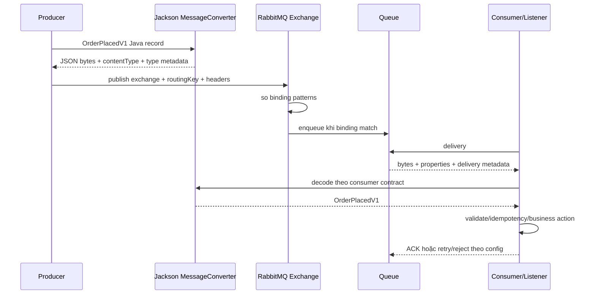
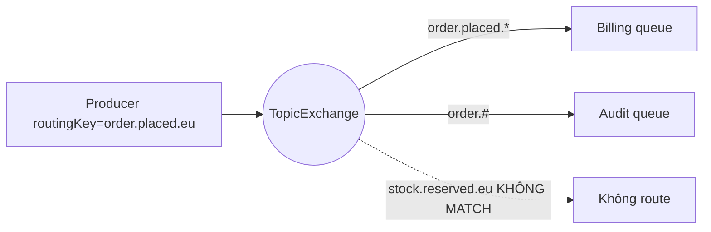

# Messaging — Kiểm thử serialization, header, routing key và schema thông điệp

## 1. Bài toán và mục tiêu

Trong ứng dụng Spring Boot dùng **Messaging**, một producer có thể gọi `convertAndSend(...)` thành công nhưng consumer vẫn không xử lý được vì **body không đúng định dạng**, **header không đủ thông tin**, **routing key sai**, hoặc **schema giữa hai phiên bản không tương thích**. Kiểm tra duy nhất “publisher method không ném exception” gần như không cung cấp bằng chứng về hợp đồng message.

Một message có ít nhất bốn phần cần quan sát riêng:

1. **Body/payload:** bytes truyền trên wire; JSON/Avro/Protobuf/byte array được encode thế nào.
2. **Properties và headers:** `contentType`, `messageId`, `correlationId`, `eventType`, `schemaVersion`, trace/correlation metadata.
3. **Địa chỉ và định tuyến:** exchange + routing key + bindings trong RabbitMQ; hoặc topic, key và partition trong Kafka.
4. **Schema/hợp đồng dữ liệu:** các field bắt buộc/tùy chọn, kiểu dữ liệu, quy tắc thêm/sửa/xóa, khả năng đọc giữa producer/consumer ở nhiều phiên bản.

Bài dùng **Spring Boot 3.5, Java 17, Spring AMQP 3.2, RabbitMQ Testcontainers, Jackson và JUnit 5** để minh họa kỹ cách kiểm chứng từng lớp. RabbitMQ là ví dụ chính vì **routing key** là một thành phần định tuyến rõ ràng của AMQP 0-9-1. Cuối bài so sánh với Kafka, nơi **record key không đồng nghĩa routing key của RabbitMQ**.

### Mục tiêu sau bài

- Phân biệt serialize object Java thành bytes với việc broker chọn queue.
- Hiểu Spring AMQP `RabbitTemplate.convertAndSend` và `Jackson2JsonMessageConverter`.
- Kiểm tra wire-format JSON thay vì chỉ kiểm object Java trong memory.
- Kiểm tra standard message properties và custom headers với đúng kiểu dữ liệu.
- Hiểu `direct`, `topic`, `fanout`, `headers` exchanges; `*` và `#` trong topic binding.
- Viết tests phát hiện sai exchange, sai routing key, thiếu header và schema version mismatch.
- Viết contract tests tương thích ngược/thuận cho JSON; biết giới hạn của `@JsonIgnoreProperties(ignoreUnknown=true)`.
- Phân biệt test producer, consumer, broker routing và end-to-end event processing.
- Dùng disposable RabbitMQ qua Testcontainers, không gửi message tới broker dùng chung.
- Giải thích publisher confirm/return, ACK, retry, dead-letter, idempotency và quan sát không đồng bộ.
- Không nhầm behavior của Spring AMQP 3.x/Jackson 2 với Spring AMQP 4.x/Jackson 3.

## 2. Một message đi qua những bước nào?



**Bốn nhóm lỗi khác nhau:**

| Chỗ sai | Dấu hiệu | Kiểm thử cần có |
| --- | --- | --- |
| Serialization | Body là Java-serialized bytes hoặc JSON field sai | JSON `JsonNode`, content type, round-trip/contract |
| Header | Thiếu eventType/schemaVersion/correlationId | `MessageProperties` hoặc `@Header` assertions |
| Routing | Đúng payload nhưng queue đích không nhận | Broker thật, exchange/binding/routing key |
| Schema | Consumer cũ không đọc được message mới | Contract fixture V1/V2 và negative cases |

Một test mock `RabbitTemplate` và chỉ `verify(convertAndSend(...))` có thể chứng minh producer **gọi đúng tham số**, nhưng không thể chứng minh RabbitMQ broker thật đã áp dụng bindings, JSON converter thực sự tạo đúng wire message hay consumer deserialize thành công.

### Định nghĩa đường đi phải rõ

Trong RabbitMQ, producer **publish tới exchange** với một routing key; exchange dùng bindings để quyết định queue nhận. Producer thường **không trực tiếp chọn queue** khi dùng custom exchange. Với default exchange tên rỗng `""`, RabbitMQ tự bind mỗi queue bằng queue name — đây là trường hợp đặc biệt, không nên nhầm với custom direct/topic exchange.

## 3. Serialization: Java object không phải wire contract

Giả sử event có payload:

```json
{
  "eventId": "evt-101",
  "orderId": "ord-101",
  "totalCents": 1250,
  "currency": "USD"
}
```

Wire contract nên mô tả rõ:

- `eventId`: ID duy nhất của event, dùng cho idempotency.
- `orderId`: mã đơn hàng.
- `totalCents`: số nguyên đơn vị nhỏ của tiền, tránh floating-point sai lệch.
- `currency`: mã tiền tệ.
- JSON field names và numeric types được cố định theo hợp đồng.
- Không dựa vào tên Java package/class làm **public contract** giữa hai team.

Một Java record như `OrderPlacedV1` có thể được Jackson encode sang JSON nhưng việc code Java chứa field không tự chứng minh message trên broker có Content-Type JSON. Muốn test wire contract, kiểm tra **bytes thực tế và properties**.

### 3.1. Converter mặc định và Jackson converter

Spring AMQP `RabbitTemplate` có `MessageConverter`. Converter mặc định `SimpleMessageConverter` xử lý Strings, byte arrays và một số dạng Java serialization. **Java native serialization không phù hợp làm hợp đồng liên ngôn ngữ, gây coupling và có rủi ro deserialization**.

Với Spring AMQP 3.2, dùng:

```java
@Bean
Jackson2JsonMessageConverter jsonMessageConverter() {
    return new Jackson2JsonMessageConverter("example.messaging");
}
```

- `Jackson2JsonMessageConverter` dùng Jackson 2.x để chuyển object ↔ bytes.
- `contentType` được đặt là JSON khi serialize.
- Spring AMQP có thể thêm type metadata như `__TypeId__`. Đây là metadata của framework, **không thay cho schemaVersion/eventType do nghiệp vụ định nghĩa**.
- Chỉ trust packages cần thiết để giảm rủi ro từ inbound type metadata; **không dùng `"*"` một cách tùy tiện**.
- Khi `@RabbitListener` có payload type cụ thể, Spring AMQP thường suy ra target type từ method parameter và có thể ưu tiên inferred type so với `__TypeId__`; behavior cụ thể phụ thuộc listener signature và cấu hình type mapper.
- Với messages từ hệ thống ngoài Spring, cần định nghĩa contract rõ về contentType, encoding và mapping type headers, thay vì đòi producer ngoài Java tạo Java class name.

### 3.2. Content type và encoding

| Thuộc tính | Ví dụ | Tại sao quan trọng |
| --- | --- | --- |
| `contentType` | `application/json` | Consumer chọn decoder phù hợp |
| `contentEncoding` | `UTF-8` nếu được đặt | Cách diễn giải bytes → text |
| `__TypeId__` | `example.messaging.OrderPlacedV1` | Spring-specific type information |
| Body | `{"eventId":"evt-101",...}` | Payload thực tế trên wire |

`contentType` thuộc message properties; một producer gửi bytes JSON nhưng đặt `text/plain` vẫn có thể làm converter phía consumer xử lý sai. Spring AMQP hiện đại có một số fallback cho missing/default content type, nhưng **không dựa vào fallback khi hợp đồng cần chắc chắn**. Test nên assert Content-Type dự kiến.

### 3.3. Byte[] và JSON structure

Nên test JSON như một **tree**:

```java
JsonNode json = mapper.readTree(message.getBody());
assertEquals("evt-101", json.get("eventId").asText());
assertEquals(1250, json.get("totalCents").asInt());
```

Không so raw JSON string bằng một thứ tự field duy nhất, trừ khi thứ tự field thực sự nằm trong hợp đồng (thường không). Object properties JSON không có semantic ordering; whitespace có thể khác mà vẫn là cùng thông điệp.

## 4. Headers: envelope business metadata

Headers không phải mọi metadata. Trong RabbitMQ, nhiều fields thường được ánh xạ thành **AMQP BasicProperties**, trong khi custom headers nằm trong headers table. Tách ba nhóm:

| Nhóm | Ví dụ | Cách kiểm |
| --- | --- | --- |
| AMQP standard properties | `contentType`, `messageId`, `correlationId`, `deliveryMode` | `message.getMessageProperties().get...()` |
| Custom application headers | `eventType`, `schemaVersion`, `tenantId` (nếu được phép), `traceId` | `getHeader("...")` |
| Broker/received metadata | `receivedExchange`, `receivedRoutingKey`, `consumerQueue` | Properties được framework điền **sau delivery** |

### 4.1. Header và message property không luôn là một

`messageId` và `correlationId` thường là standard properties chứ không nhất thiết nằm trong `getHeaders()`. Khi producer gọi:

```java
message.getMessageProperties().setMessageId("evt-101");
message.getMessageProperties().setCorrelationId("corr-abc");
message.getMessageProperties().setHeader("schemaVersion", 1);
```

Consumer nên đọc ba thuộc tính ở vị trí đúng. Tránh viết test chỉ assert `getHeader("correlationId")` trong khi code sản xuất đã dùng standard `correlationId` property.

### 4.2. Những headers nên có

- `eventType`: kiểu nghiệp vụ ổn định như `order.placed`.
- `schemaVersion`: version hợp đồng payload, ví dụ integer `1`.
- `correlationId`: liên kết event với request/workflow/trace liên quan.
- `messageId` hoặc `eventId`: hỗ trợ idempotency và debug.
- `contentType`: application/json, Avro hoặc Protobuf media type tương ứng.
- Tracing headers (W3C `traceparent`/`tracestate`) khi đã chọn cách truyền trace.
- `tenantId`/`sourceSystem` chỉ khi có policy về dữ liệu cá nhân và authorization; không gửi secrets qua headers.

**Không** ghi authentication tokens, mật khẩu hoặc PII vào headers để “dễ debug”. Headers thường xuất hiện trong broker inspection, retry queues và logs.

### 4.3. Kiểm tra kiểu dữ liệu

AMQP headers table hỗ trợ các kiểu dữ liệu như String, integer, long, Boolean và byte arrays. Một `schemaVersion` đôi khi được consumer đọc dưới dạng `Integer` hoặc kiểu `Number` khác tùy producer/client/framework. Test nên assert theo **contract đã được chuẩn hóa**, hoặc kiểm:

```java
Object raw = message.getMessageProperties().getHeader("schemaVersion");
assertEquals(1, ((Number) raw).intValue());
```

Ví dụ này giả định contract xác định là numeric; nếu nhiều producer dùng `"1"` dạng String thì phải thống nhất lại schema hoặc có adapter hỗ trợ rõ ràng, đừng lặng lẽ parse tất cả.

### 4.4. Routing key không phải custom header

Trong AMQP, `routingKey` được truyền **trong `basic.publish`**, không phải một key trong custom headers table. Sau khi broker giao message, Spring AMQP thường đặt nó vào `receivedRoutingKey`. Kiểm chứng:

```java
assertEquals(
    "order.placed.eu",
    message.getMessageProperties().getReceivedRoutingKey());
```

Thêm `setHeader("routingKey","order.placed.eu")` mà truyền `convertAndSend(exchange, "wrong.key", ...)` sẽ **không** khiến RabbitMQ topic exchange định tuyến theo header giả đó.

## 5. Routing trong RabbitMQ

### 5.1. Exchange và binding



| Exchange type | Matching rule | Ví dụ |
| --- | --- | --- |
| `direct` | Routing key **bằng chính xác** binding key | `order.placed.eu` chỉ match cùng chuỗi |
| `topic` | Các đoạn phân cách bởi dấu chấm; `*` đúng một đoạn, `#` 0 hoặc nhiều đoạn | `order.placed.*` match `order.placed.eu` nhưng không match `order.placed` |
| `fanout` | Gửi bản sao tới tất cả queue đã bind; **bỏ qua routing key** | Broadcast notification |
| `headers` | Định tuyến theo điều kiện trên headers, thay vì routing key thông thường | Nhiều điều kiện metadata |
| Default exchange `""` | Direct exchange đặc biệt, queue auto-bind bằng queue name | Gửi tới queue qua key là queue name |

### 5.2. Topic binding rất dễ nhầm

| Binding pattern | Routing key | Match? | Lý do |
| --- | --- | --- | --- |
| `order.placed.*` | `order.placed.eu` | Có | `*` đúng một đoạn |
| `order.placed.*` | `order.placed.eu.vip` | Không | Hai đoạn thay vì một |
| `order.placed.*` | `order.placed` | Không | Không có đoạn cuối |
| `order.#` | `order.placed.eu` | Có | `#` match nhiều đoạn |
| `order.#` | `order` | Có | `#` có thể match 0 đoạn |
| `order.#` | `stock.reserved.eu` | Không | Không bắt đầu bằng `order` |
| `order.placed.eu` (direct) | `order.placed.us` | Không | Không bằng chính xác |

Một queue có thể có **nhiều bindings**; một publish có thể được **copy tới nhiều queues**. Đây là publish-subscribe qua topic exchange, không phải broker “di chuyển cùng một message duy nhất tới đúng một queue”.

### 5.3. Publish không route được

Nếu routing key không match bất kỳ binding nào, message có thể không được đưa vào queue. **Lời gọi `RabbitTemplate.convertAndSend` trả về không chứng minh đã có queue nhận**. Muốn biết unroutable messages, cần cấu hình `mandatory` publisher returns và callback, cùng policy xử lý; muốn chứng minh broker accept publish, cần publisher confirms tương ứng. Các khái niệm này khác consumer ACK.

Một integration test có thể kiểm bằng cách publish vào **exchange/queues disposable** và quan sát cả queue dương và queue âm. Một unit test mock template không chứng minh binding broker thật.

## 6. Thiết kế schema message và tương thích phiên bản

### 6.1. Schema là hợp đồng giữa các triển khai

Schema không chỉ là Java record:

- Tên field JSON / tag Avro / số field Protobuf.
- Kiểu: String, integer, boolean, enum, decimal, array.
- Bắt buộc hay tùy chọn và default values.
- Ý nghĩa nghiệp vụ và đơn vị (cents hay dollars).
- Trường định danh, timestamp/timezone và version.
- Quy tắc tương thích và chiến lược rollout.

Ví dụ contract V1:

```json
{
  "eventId": "evt-101",
  "orderId": "ord-101",
  "totalCents": 1250,
  "currency": "USD"
}
```

V2 muốn thêm `campaignCode` tùy chọn:

```json
{
  "eventId": "evt-101",
  "orderId": "ord-101",
  "totalCents": 1250,
  "currency": "USD",
  "campaignCode": "WELCOME"
}
```

Nếu consumer V1 **bỏ qua field không biết**, nó có thể đọc V2 mà không bị lỗi. Nhưng nếu consumer V1 dùng strict schema với `additionalProperties=false` hoặc mapper từ chối unknown fields, thay đổi này sẽ không tương thích. Phải test theo **consumer thật**, không chỉ nói “JSON linh hoạt”.

### 6.2. Backward, forward, full compatibility

| Hướng | Câu hỏi | Ví dụ |
| --- | --- | --- |
| **Backward** | Consumer mới đọc được message **cũ** không? | Consumer V2 có default cho campaignCode khi nhận V1 |
| **Forward** | Consumer cũ đọc được message **mới** không? | Consumer V1 ignore thêm campaignCode |
| **Full** | Cả hai hướng đều an toàn không? | Thêm field tùy chọn + rules tương ứng |
| **Breaking change** | Có phiên bản nào không còn đọc/hiểu đúng? | Đổi `totalCents` thành `totalDollars`/String, xóa `orderId` |

**Thêm trường tùy chọn chưa chắc tương thích** nếu business logic thay đổi ngữ nghĩa field cũ hoặc producer bắt đầu gửi một enum value chưa được consumer cũ hỗ trợ.

### 6.3. Header schemaVersion và payload field

Producer có thể đặt `schemaVersion=1` trong header để consumer chọn decoder. Nhưng giá trị header phải nhất quán với body; không chỉ test “header tồn tại” rồi bỏ kiểm schema. Header cũng có thể bị bỏ trong dead-letter/replay/migration qua platform khác nếu không thiết kế bridge đúng.

Một chiến lược dễ bảo trì:

- `eventType` là tên event ổn định.
- `schemaVersion` xác định breaking contract version.
- `messageId/eventId` hỗ trợ deduplication.
- Body có semantic fields rõ ràng, không phụ thuộc Java FQCN.
- Consumer có schema registry hoặc validation layer nếu hợp đồng đa ngôn ngữ/phức tạp.
- Contract tests lưu fixtures V1/V2 và kiểm cả producer lẫn consumer.

### 6.4. JSON Schema, Avro và Protobuf

| Format | Điểm mạnh | Lưu ý kiểm thử |
| --- | --- | --- |
| JSON | Dễ đọc, nhiều ecosystem | Cần explicit JSON Schema/validation vì JSON tự nó không enforce required fields |
| Avro | Binary compact, schema evolution/resolution | Test writer schema vs reader schema, defaults, unions; kiểm schema registry subject compatibility |
| Protobuf | Tagged fields, cross-language, compact | Không reuse field numbers đã xóa; test unknown fields, reserved tags và backward/forward compatibility |
| Java serialization | Dễ nếu hai bên cùng Java | Coupling/rủi ro bảo mật; **không khuyến nghị** làm integration contract |

Nếu dùng Schema Registry, CI nên kiểm compatibility rules bằng API/CLI phù hợp và fixtures thực, không chỉ unit test parse JSON. Với RabbitMQ/JSON sample bài này, schema được kiểm bằng record validation và Jackson contract tests; **không có Schema Registry** trong project runnable.

## 7. Kiểm thử ở tầng nào?

| Mục tiêu | Unit test | Integration test RabbitMQ thật | End-to-end consumer |
| --- | --- | --- | --- |
| Producer chọn exchange/key | Mockito verify arguments | Quan sát received routing key | Quan sát handler của queue đích |
| Converter tạo JSON đúng | Test trực tiếp converter/ObjectMapper | Kiểm body bytes sau broker | Kiểm listener deserialization |
| Header đúng type/value | Test MessagePostProcessor | Kiểm `MessageProperties` khi receive | `@Header` binding |
| Topic routing `*`/`#` | Test mapping string helper | **Bắt buộc broker thật** để chứng minh binding | Có thể quan sát consumer |
| Schema V1↔V2 | Fixture-based contract tests | Có thể gửi/nhận bytes | Consumer mới/cũ test cùng fixture |
| Consumer ACK/retry/DLQ | Mock handler logic | Cần broker/container config | Cần listener/error handling thực |
| Tracing/correlation xuyên service | Kiểm header propagation | Kiểm broker delivery headers | Integration telemetry |
| Performance, durability, quorum | Không | Cần topology/config sát production | Tải/chaos/recovery tests |

**Không trộn các lớp bằng chứng:** unit test converter không chứng minh RabbitMQ routing; một integration test nhận message vào queue không chứng minh handler nghiệp vụ đã commit database, có ACK đúng hoặc chống duplicate.

## 8. Một schema và topology đủ nhỏ để học

Ứng dụng phát `OrderPlacedV1` qua `TopicExchange` tên `learning.events.topic`.

- Billing queue: `learning.billing.order-placed`, binding `order.placed.*`.
- Audit queue: `learning.audit.events`, binding `order.#`.
- Publisher key: `order.placed.eu` hoặc `order.placed.us`.
- Header: `eventType=order.placed`, `schemaVersion=1`.
- Standard properties: `messageId=eventId`, `correlationId` được truyền vào.
- Body: JSON có `eventId`, `orderId`, `totalCents`, `currency`.
- Publisher validate region trước khi dựng routing key để giảm lỗi định tuyến không mong muốn.

Nhờ hai queues, một publish `order.placed.eu` phải xuất hiện ở **cả billing và audit**; một publish `order.cancelled.eu` phải chỉ vào audit; `stock.reserved.eu` không vào queue nào. Không có một `@RabbitListener` tự động chạy trong project core, để test chủ động `receive` không tranh chấp message với listener.

### Cây thư mục hoàn chỉnh

```text
messaging-contract-demo/
├── pom.xml
└── src/
    ├── main/
    │   ├── java/example/messaging/
    │   │   ├── MessagingApplication.java
    │   │   ├── OrderPlacedV1.java
    │   │   ├── EventTopology.java
    │   │   └── OrderEventPublisher.java
    │   └── resources/
    │       └── application.properties
    └── test/
        ├── java/example/messaging/
        │   ├── EventSchemaContractTest.java
        │   └── RabbitRoutingIntegrationTest.java
        └── resources/
            └── application-test.properties
```

## 9. pom.xml — Spring Boot 3.5 / Java 17

```xml
<?xml version="1.0" encoding="UTF-8"?>
<project xmlns="http://maven.apache.org/POM/4.0.0"
         xmlns:xsi="http://www.w3.org/2001/XMLSchema-instance"
         xsi:schemaLocation="http://maven.apache.org/POM/4.0.0
             https://maven.apache.org/xsd/maven-4.0.0.xsd">
    <modelVersion>4.0.0</modelVersion>

    <parent>
        <groupId>org.springframework.boot</groupId>
        <artifactId>spring-boot-starter-parent</artifactId>
        <version>3.5.0</version>
        <relativePath/>
    </parent>

    <groupId>example</groupId>
    <artifactId>messaging-contract-demo</artifactId>
    <version>1.0-SNAPSHOT</version>

    <properties>
        <java.version>17</java.version>
    </properties>

    <dependencies>
        <dependency>
            <groupId>org.springframework.boot</groupId>
            <artifactId>spring-boot-starter-amqp</artifactId>
        </dependency>

        <!-- Đảm bảo Jackson 2/ObjectMapper có sẵn trong sample AMQP. -->
        <dependency>
            <groupId>org.springframework.boot</groupId>
            <artifactId>spring-boot-starter-json</artifactId>
        </dependency>

        <dependency>
            <groupId>org.springframework.boot</groupId>
            <artifactId>spring-boot-starter-test</artifactId>
            <scope>test</scope>
        </dependency>

        <dependency>
            <groupId>org.springframework.boot</groupId>
            <artifactId>spring-boot-testcontainers</artifactId>
            <scope>test</scope>
        </dependency>

        <dependency>
            <groupId>org.testcontainers</groupId>
            <artifactId>rabbitmq</artifactId>
            <scope>test</scope>
        </dependency>

        <dependency>
            <groupId>org.testcontainers</groupId>
            <artifactId>junit-jupiter</artifactId>
            <scope>test</scope>
        </dependency>
    </dependencies>
</project>
```

**Lý do chọn dependencies:**

- `spring-boot-starter-amqp` cung cấp Spring AMQP, RabbitTemplate, AMQP auto-configuration và listener support.
- `spring-boot-starter-json` cung cấp Jackson để JSON message converter và ObjectMapper dùng trong tests.
- `spring-boot-starter-test` cung cấp JUnit Jupiter, Spring Test và Assert support.
- `spring-boot-testcontainers` cung cấp `@ServiceConnection` với RabbitMQ.
- `testcontainers:rabbitmq` cung cấp RabbitMQContainer.
- `testcontainers:junit-jupiter` cung cấp `@Testcontainers`/`@Container` lifecycle.
- Parent/BOM Boot 3.5 quản lý các phiên bản tương thích. **Không** dùng Testcontainers 2.x class imports hoặc Spring AMQP 4.x Jackson 3 converter trong project Boot 3.5 này.

Yêu cầu: **JDK 17+, Maven, Docker/Podman tương thích Testcontainers**. Unit tests của schema không cần Docker; RabbitMQ integration tests cần container runtime.

## 10. Mã nguồn production — entity event và topology

### 10.1. MessagingApplication.java

`src/main/java/example/messaging/MessagingApplication.java`:

```java
package example.messaging;

import org.springframework.boot.SpringApplication;
import org.springframework.boot.autoconfigure.SpringBootApplication;

@SpringBootApplication
public class MessagingApplication {

    public static void main(String[] args) {
        SpringApplication.run(MessagingApplication.class, args);
    }
}
```

Không có web server/controller: mục tiêu của demo là messaging. Khi main app chạy độc lập ngoài test, phải cấu hình RabbitMQ broker thực hoặc local/dev container. `@ServiceConnection` chỉ nằm trong test class.

### 10.2. OrderPlacedV1.java — wire contract rõ ràng

`src/main/java/example/messaging/OrderPlacedV1.java`:

```java
package example.messaging;

import com.fasterxml.jackson.annotation.JsonIgnoreProperties;

@JsonIgnoreProperties(ignoreUnknown = true)
public record OrderPlacedV1(
        String eventId,
        String orderId,
        int totalCents,
        String currency) {

    public OrderPlacedV1 {
        if (eventId == null || eventId.isBlank()) {
            throw new IllegalArgumentException(
                    "eventId must not be blank");
        }
        if (orderId == null || orderId.isBlank()) {
            throw new IllegalArgumentException(
                    "orderId must not be blank");
        }
        if (totalCents < 0) {
            throw new IllegalArgumentException(
                    "totalCents must be non-negative");
        }
        if (currency == null || currency.isBlank()) {
            throw new IllegalArgumentException(
                    "currency must not be blank");
        }
    }
}
```

Đây là Java 17 record và đồng thời là **DTO message V1**:

- Giữ tên field cụ thể và kiểu dữ liệu, không expose JPA entity.
- Constructor kiểm dữ liệu nghiệp vụ căn bản; nếu field `orderId` thiếu, Jackson gọi constructor với null và lỗi sẽ phát sinh.
- `@JsonIgnoreProperties(ignoreUnknown=true)` minh họa khả năng **old reader bỏ qua field mới**. Điều này không tự bảo đảm mọi schema evolution an toàn.
- Khi thay đổi field theo kiểu breaking, tạo DTO/schema V2 rõ ràng hoặc có compatibility adapter, không sửa ngầm ý nghĩa `totalCents` thành tiền đơn vị khác.

### 10.3. EventTopology.java — topic exchange, queues, bindings, converter

`src/main/java/example/messaging/EventTopology.java`:

```java
package example.messaging;

import org.springframework.amqp.core.Binding;
import org.springframework.amqp.core.BindingBuilder;
import org.springframework.amqp.core.Queue;
import org.springframework.amqp.core.QueueBuilder;
import org.springframework.amqp.core.TopicExchange;
import org.springframework.amqp.support.converter.Jackson2JsonMessageConverter;
import org.springframework.context.annotation.Bean;
import org.springframework.context.annotation.Configuration;
import org.springframework.beans.factory.annotation.Qualifier;

@Configuration(proxyBeanMethods = false)
public class EventTopology {

    public static final String EXCHANGE =
            "learning.events.topic";

    public static final String BILLING_QUEUE =
            "learning.billing.order-placed";

    public static final String AUDIT_QUEUE =
            "learning.audit.events";

    @Bean
    TopicExchange eventExchange() {
        return new TopicExchange(EXCHANGE, true, false);
    }

    @Bean
    Queue billingQueue() {
        return QueueBuilder.durable(BILLING_QUEUE).build();
    }

    @Bean
    Queue auditQueue() {
        return QueueBuilder.durable(AUDIT_QUEUE).build();
    }

    @Bean
    Binding billingBinding(
            @Qualifier("billingQueue") Queue queue,
            @Qualifier("eventExchange") TopicExchange exchange) {

        return BindingBuilder.bind(queue)
                .to(exchange)
                .with("order.placed.*");
    }

    @Bean
    Binding auditBinding(
            @Qualifier("auditQueue") Queue queue,
            @Qualifier("eventExchange") TopicExchange exchange) {

        return BindingBuilder.bind(queue)
                .to(exchange)
                .with("order.#");
    }

    @Bean
    Jackson2JsonMessageConverter jsonMessageConverter() {
        return new Jackson2JsonMessageConverter(
                "example.messaging");
    }
}
```

**Điểm thiết kế:**

- `TopicExchange` là **durable**, không auto-delete; queues cũng durable. Test chạy trong broker disposable; **durable không có nghĩa** mọi message tự persist nếu delivery mode không đúng hoặc queue/broker chưa được cấu hình chuẩn.
- `billingBinding` dùng `order.placed.*`, nhận sự kiện đặt hàng theo region có đúng một đoạn.
- `auditBinding` dùng `order.#`, nhận các loại order events.
- @Qualifier giúp chọn đúng queue khi có nhiều `Queue` beans.
- `Jackson2JsonMessageConverter` được Boot tích hợp vào RabbitTemplate qua auto-configuration khi là converter bean phù hợp.
- `RabbitAdmin`/broker declaration khi kết nối sẽ tạo exchanges/queues/bindings từ Spring declarable beans theo cấu hình Boot mặc định.
- Trong production có nhiều services cùng khai topology, phải kiểm ownership, permissions, xung đột thuộc tính queue và quy trình deploy; không coi auto declaration là schema migration cho mọi broker.

### 10.4. OrderEventPublisher.java — headers sau serialization

`src/main/java/example/messaging/OrderEventPublisher.java`:

```java
package example.messaging;

import java.util.Set;

import org.springframework.amqp.core.MessageDeliveryMode;
import org.springframework.amqp.rabbit.core.RabbitTemplate;
import org.springframework.stereotype.Service;

@Service
public class OrderEventPublisher {

    private static final Set<String> REGIONS =
            Set.of("eu", "us");

    private final RabbitTemplate template;

    public OrderEventPublisher(RabbitTemplate template) {
        this.template = template;
    }

    public void publish(
            OrderPlacedV1 event,
            String region,
            String correlationId) {

        if (!REGIONS.contains(region)) {
            throw new IllegalArgumentException(
                    "unsupported region: " + region);
        }

        if (correlationId == null || correlationId.isBlank()) {
            throw new IllegalArgumentException(
                    "correlationId must not be blank");
        }

        String routingKey = "order.placed." + region;

        template.convertAndSend(
                EventTopology.EXCHANGE,
                routingKey,
                event,
                message -> {
                    var properties = message.getMessageProperties();

                    properties.setHeader(
                            "eventType", "order.placed");
                    properties.setHeader(
                            "schemaVersion", 1);

                    properties.setMessageId(event.eventId());
                    properties.setCorrelationId(correlationId);
                    properties.setDeliveryMode(
                            MessageDeliveryMode.PERSISTENT);

                    return message;
                });
    }
}
```

**Giải thích:**

- `convertAndSend(exchange, routingKey, object, postProcessor)` chuyển DTO thành message rồi cho phép chỉnh properties/headers.
- Chỉ dùng region whitelist `eu/us`; tránh nối routing key trực tiếp từ input bất kỳ.
- `messageId` dùng `eventId` để người nhận có thể dedup.
- `correlationId` liên kết log/trace workflow.
- `schemaVersion` và `eventType` là custom headers, không phụ thuộc tên Java class.
- `deliveryMode=PERSISTENT` là một thành phần durability, **chưa đủ** để bảo đảm end-to-end delivery: còn publisher confirms, queue durability/type, broker crash/replication, consumer ACK và retry policy.
- Phương thức hiện trả `void`; `convertAndSend` hoàn tất **không phải** consumer ACK. Muốn contract publish được broker chấp nhận, cấu hình publisher confirms/returns riêng và test callback.

### 10.5. application.properties

`src/main/resources/application.properties`:

```properties
spring.main.banner-mode=off

# Broker credentials/hostname production phải đến từ config môi trường.
# Không hard-code localhost hoặc tài khoản thật ở đây.

# Cho phép declarable Queue/Exchange/Binding beans được RabbitAdmin khai báo.
spring.rabbitmq.dynamic=true
```

Không viết `spring.rabbitmq.host=localhost` chỉ để demo Testcontainers. Container integration test cấp connection details qua `@ServiceConnection`. Khi chạy main app ngoài test, cần broker local/dev/prod được cấu hình hợp lệ và secrets đúng policy.

### 10.6. application-test.properties

`src/test/resources/application-test.properties`:

```properties
spring.main.banner-mode=off
spring.rabbitmq.dynamic=true

# Không có @RabbitListener tự động trong project core.
# Test chủ động receive() để không tranh chấp cùng queue.
```

Từng test class sẽ chạy ở `@ActiveProfiles("test")`, dùng RabbitMQContainer riêng. Không cần Kafka/Redis/SQL hay broker dùng chung.

## 11. Unit test: schema và converter không cần broker

`src/test/java/example/messaging/EventSchemaContractTest.java`:

```java
package example.messaging;

import static org.junit.jupiter.api.Assertions.assertEquals;
import static org.junit.jupiter.api.Assertions.assertFalse;
import static org.junit.jupiter.api.Assertions.assertThrows;
import static org.junit.jupiter.api.Assertions.assertTrue;

import java.nio.charset.StandardCharsets;

import com.fasterxml.jackson.databind.JsonMappingException;
import com.fasterxml.jackson.databind.JsonNode;
import com.fasterxml.jackson.databind.ObjectMapper;

import org.junit.jupiter.api.Test;
import org.springframework.amqp.core.Message;
import org.springframework.amqp.core.MessageProperties;
import org.springframework.amqp.support.converter.Jackson2JsonMessageConverter;

class EventSchemaContractTest {

    private final ObjectMapper mapper = new ObjectMapper();

    private static OrderPlacedV1 example() {
        return new OrderPlacedV1(
                "evt-101", "ord-101", 1250, "USD");
    }

    @Test
    void v1WireFormatContainsStableFieldsAndNumericAmount()
            throws Exception {

        String json = mapper.writeValueAsString(example());
        JsonNode tree = mapper.readTree(json);

        assertEquals("evt-101",
                tree.get("eventId").asText());
        assertEquals("ord-101",
                tree.get("orderId").asText());
        assertEquals(1250,
                tree.get("totalCents").asInt());
        assertEquals("USD",
                tree.get("currency").asText());
        assertTrue(tree.get("totalCents").isNumber());

        // Không có field thừa ngoài contract V1.
        assertEquals(4, tree.size());
    }

    @Test
    void futureOptionalFieldCanBeIgnoredByOldReader()
            throws Exception {

        String v2 = """
            {
              "eventId":"evt-101",
              "orderId":"ord-101",
              "totalCents":1250,
              "currency":"USD",
              "campaignCode":"WELCOME"
            }
            """;

        OrderPlacedV1 oldConsumer =
                mapper.readValue(v2, OrderPlacedV1.class);

        assertEquals(example(), oldConsumer);
    }

    @Test
    void missingRequiredBusinessFieldIsRejected() {
        String invalid = """
            {
              "eventId":"evt-101",
              "totalCents":1250,
              "currency":"USD"
            }
            """;

        assertThrows(JsonMappingException.class,
                () -> mapper.readValue(
                        invalid, OrderPlacedV1.class));
    }

    @Test
    void invalidNumberDoesNotSilentlyBecomeAmount() {
        String invalid = """
            {
              "eventId":"evt-101",
              "orderId":"ord-101",
              "totalCents":"not-an-integer",
              "currency":"USD"
            }
            """;

        assertThrows(JsonMappingException.class,
                () -> mapper.readValue(
                        invalid, OrderPlacedV1.class));
    }

    @Test
    void amqpConverterWritesJsonAndPreservesHeaders()
            throws Exception {

        Jackson2JsonMessageConverter converter =
                new Jackson2JsonMessageConverter(
                        "example.messaging");

        MessageProperties properties = new MessageProperties();
        properties.setHeader("eventType", "order.placed");
        properties.setHeader("schemaVersion", 1);
        properties.setMessageId("evt-101");
        properties.setCorrelationId("corr-101");

        Message message = converter.toMessage(
                example(), properties);

        assertEquals(MessageProperties.CONTENT_TYPE_JSON,
                message.getMessageProperties().getContentType());

        String raw = new String(
                message.getBody(), StandardCharsets.UTF_8);
        assertTrue(raw.contains("ord-101"));
        assertFalse(raw.contains(
                "java.io.ObjectOutputStream"));

        assertEquals("order.placed",
                message.getMessageProperties()
                        .getHeader("eventType"));
        assertEquals(1,
                ((Number) message.getMessageProperties()
                        .getHeader("schemaVersion"))
                        .intValue());
        assertEquals("corr-101",
                message.getMessageProperties()
                        .getCorrelationId());

        JsonNode actual = mapper.readTree(message.getBody());
        assertEquals(1250,
                actual.get("totalCents").asInt());

        Object restored = converter.fromMessage(message);
        assertEquals(example(), restored);
    }
}
```

**Có 5 phương thức `@Test`** và không cần Spring context, Docker hoặc RabbitMQ.

### Ý nghĩa từng unit test

| Test | Chứng minh | Không chứng minh |
| --- | --- | --- |
| `v1WireFormatContainsStableFieldsAndNumericAmount` | Tên trường và kiểu JSON V1 đúng | Broker queue nào nhận |
| `futureOptionalFieldCanBeIgnoredByOldReader` | Consumer V1 bỏ qua field tùy chọn mới | Mọi kiểu thay đổi V2 đều an toàn |
| `missingRequiredBusinessFieldIsRejected` | Missing orderId bị constructor validation từ chối | JSON Schema Registry đang enforce |
| `invalidNumberDoesNotSilentlyBecomeAmount` | Chuỗi sai kiểu không map thành amount | Producer nào cũng gửi đúng contract |
| `amqpConverterWritesJsonAndPreservesHeaders` | Converter tạo JSON và giữ properties | Binding/broker delivery/ACK |

**Lưu ý:** Java record primitive `int` có thể nhận 0 khi field JSON thiếu, tùy cấu hình Jackson. Vì vậy muốn bắt buộc `totalCents` phải **hiện diện**, ngoài điều kiện `>=0` trong constructor còn cần validation/deserialization policy hoặc schema validator kiểm required fields. Test này chỉ chứng minh chuỗi `"not-an-integer"` bị từ chối, không tuyên bố đã enforce mọi required property. Đây là một giới hạn rất quan trọng của “Java DTO là schema”.

### Tại sao không so JSON raw string?

Object properties trong JSON không có thứ tự ngữ nghĩa. `ObjectMapper` có thể ghi các fields theo thứ tự record nhưng hệ thống khác có thể đổi thứ tự mà vẫn tương đương. Dùng `JsonNode` và asserts field cụ thể cho hợp đồng; nếu cần snapshot/golden file, normalize trước khi so sánh.

## 12. Integration test: RabbitMQ thật trong Testcontainers

`src/test/java/example/messaging/RabbitRoutingIntegrationTest.java`:

```java
package example.messaging;

import static org.junit.jupiter.api.Assertions.assertArrayEquals;
import static org.junit.jupiter.api.Assertions.assertEquals;
import static org.junit.jupiter.api.Assertions.assertNotNull;
import static org.junit.jupiter.api.Assertions.assertNull;
import static org.junit.jupiter.api.Assertions.assertTrue;

import java.nio.charset.StandardCharsets;

import com.fasterxml.jackson.databind.JsonNode;
import com.fasterxml.jackson.databind.ObjectMapper;

import org.junit.jupiter.api.BeforeEach;
import org.junit.jupiter.api.Test;
import org.springframework.amqp.core.Message;
import org.springframework.amqp.core.MessageProperties;
import org.springframework.amqp.rabbit.core.RabbitAdmin;
import org.springframework.amqp.rabbit.core.RabbitTemplate;
import org.springframework.beans.factory.annotation.Autowired;
import org.springframework.boot.test.context.SpringBootTest;
import org.springframework.boot.testcontainers.service.connection.ServiceConnection;
import org.springframework.test.context.ActiveProfiles;
import org.testcontainers.containers.RabbitMQContainer;
import org.testcontainers.junit.jupiter.Container;
import org.testcontainers.junit.jupiter.Testcontainers;

@SpringBootTest
@ActiveProfiles("test")
@Testcontainers
class RabbitRoutingIntegrationTest {

    @Container
    @ServiceConnection
    static RabbitMQContainer rabbit =
            new RabbitMQContainer("rabbitmq:3.13-alpine");

    @Autowired
    RabbitTemplate template;

    @Autowired
    RabbitAdmin admin;

    @Autowired
    OrderEventPublisher publisher;

    @Autowired
    ObjectMapper mapper;

    private static OrderPlacedV1 event(String id) {
        return new OrderPlacedV1(
                id, "ord-101", 1250, "USD");
    }

    @BeforeEach
    void purgeBothQueuesSynchronously() {
        // noWait=false: đợi broker hoàn tất purge.
        // Chỉ an toàn trên test broker disposable.
        admin.purgeQueue(EventTopology.BILLING_QUEUE, false);
        admin.purgeQueue(EventTopology.AUDIT_QUEUE, false);
    }

    @Test
    void wireBodyAndHeadersSurviveBrokerDelivery()
            throws Exception {

        publisher.publish(
                event("evt-201"), "eu", "corr-201");

        Message message = template.receive(
                EventTopology.BILLING_QUEUE, 5000);

        assertNotNull(message);

        MessageProperties props =
                message.getMessageProperties();

        assertEquals(MessageProperties.CONTENT_TYPE_JSON,
                props.getContentType());
        assertEquals("evt-201", props.getMessageId());
        assertEquals("corr-201", props.getCorrelationId());
        assertEquals("order.placed",
                props.getHeader("eventType"));
        assertEquals(1,
                ((Number) props.getHeader("schemaVersion"))
                        .intValue());

        assertEquals(EventTopology.EXCHANGE,
                props.getReceivedExchange());
        assertEquals("order.placed.eu",
                props.getReceivedRoutingKey());

        JsonNode json = mapper.readTree(message.getBody());
        assertEquals("evt-201",
                json.get("eventId").asText());
        assertEquals("ord-101",
                json.get("orderId").asText());
        assertEquals(1250,
                json.get("totalCents").asInt());
        assertEquals("USD",
                json.get("currency").asText());
    }

    @Test
    void topicExchangeCopiesMatchingEventToTwoQueues() {
        publisher.publish(
                event("evt-202"), "us", "corr-202");

        Message billing = template.receive(
                EventTopology.BILLING_QUEUE, 5000);
        Message audit = template.receive(
                EventTopology.AUDIT_QUEUE, 5000);

        assertNotNull(billing);
        assertNotNull(audit);

        assertArrayEquals(billing.getBody(), audit.getBody());
        assertEquals("order.placed.us",
                billing.getMessageProperties()
                        .getReceivedRoutingKey());
        assertEquals("order.placed.us",
                audit.getMessageProperties()
                        .getReceivedRoutingKey());
    }

    @Test
    void cancelledOrderMatchesAuditButNotBilling() {
        MessageProperties properties = new MessageProperties();
        properties.setContentType(
                MessageProperties.CONTENT_TYPE_JSON);

        Message message = new Message(
                "{}".getBytes(StandardCharsets.UTF_8),
                properties);

        template.send(
                EventTopology.EXCHANGE,
                "order.cancelled.eu",
                message);

        Message audit = template.receive(
                EventTopology.AUDIT_QUEUE, 5000);
        Message billing = template.receive(
                EventTopology.BILLING_QUEUE, 300);

        assertNotNull(audit);
        assertNull(billing);
        assertEquals("order.cancelled.eu",
                audit.getMessageProperties()
                        .getReceivedRoutingKey());
    }

    @Test
    void springJsonConverterCanDecodeMessageFromBroker() {
        OrderPlacedV1 expected = event("evt-203");

        publisher.publish(
                expected, "eu", "corr-203");

        Message raw = template.receive(
                EventTopology.BILLING_QUEUE, 5000);

        assertNotNull(raw);

        Object decoded = template.getMessageConverter()
                .fromMessage(raw);

        assertTrue(decoded instanceof OrderPlacedV1);
        assertEquals(expected, decoded);
    }

    @Test
    void unrelatedRoutingKeyDoesNotEnterEitherQueue() {
        MessageProperties properties = new MessageProperties();
        properties.setContentType(
                MessageProperties.CONTENT_TYPE_JSON);

        template.send(
                EventTopology.EXCHANGE,
                "stock.reserved.eu",
                new Message(
                    "{}".getBytes(StandardCharsets.UTF_8),
                    properties));

        assertNull(template.receive(
                EventTopology.BILLING_QUEUE, 300));
        assertNull(template.receive(
                EventTopology.AUDIT_QUEUE, 300));
    }
}
```

**Có 5 phương thức `@Test`**, dùng **RabbitMQ broker thật** và client/binding thực, không mock RabbitTemplate.

### 12.1. Tại sao cần @ServiceConnection?

`@ServiceConnection` từ `spring-boot-testcontainers` tạo `RabbitConnectionDetails` dựa trên `RabbitMQContainer`. Spring Boot tự cấp host, port và credentials do Testcontainers cấu hình, không cần hard-code localhost:5672.

`@Testcontainers` + static `@Container` ở đây dùng JUnit extension để start/stop container trong test class. Nếu nhiều Spring test classes dùng cached ApplicationContext, nên cân nhắc **Spring-managed container `@Bean`** để lifecycle gắn context và tránh container dừng trước context; xem tài liệu Spring Boot Testcontainers. Trong project này chỉ có một SpringBootTest integration class, còn schema tests thuần Java, nên static class-scoped container phù hợp.

### 12.2. Vì sao purge trước mỗi test?

Bài demo có hai **queue names cố định** và một broker disposable. Nếu một publish trước đó để lại event trong audit queue, test sau có thể nhặt event cũ và sai. `RabbitAdmin.purgeQueue(queue, false)` đợi purge hoàn tất để bắt đầu với queue rỗng.

- Không purge queues của staging/production!
- Không dùng `purgeQueue(..., true)` khi test cần bảo đảm purge xong trước publish: `noWait=true` có thể làm race.
- Không bật JUnit parallel cho lớp có queues dùng chung nếu không có resource lock hoặc namespace riêng.
- Trong hệ thống lớn, tạo queue/exchange theo test run hoặc correlation ID và cleanup theo resource ownership.

### 12.3. Tại sao không có @RabbitListener trong project runnable?

Nếu vừa có `@RabbitListener(queues=BILLING_QUEUE)` chạy tự động vừa dùng `RabbitTemplate.receive(BILLING_QUEUE)` trong cùng test, cả hai là **consumers cạnh tranh trên một queue**. Listener có thể nhận message trước, khiến test `receive` trả null và CI flaky. Bài tránh race bằng cách để test chủ động đọc trực tiếp.

Phần 14 sẽ trình bày consumer thực tế và cách test riêng bằng một queue độc lập.

### 12.4. Broker test chứng minh gì?

- `wireBodyAndHeadersSurviveBrokerDelivery`: body JSON và business/AMQP properties sống qua broker; đúng exchange/routing key được nhận.
- `topicExchangeCopiesMatchingEventToTwoQueues`: một message match cả billing/audit bindings và được copy tới cả hai queues.
- `cancelledOrderMatchesAuditButNotBilling`: pattern `order.#` match nhưng `order.placed.*` không match.
- `springJsonConverterCanDecodeMessageFromBroker`: converter đọc lại event DTO đã được publish và broker giao.
- `unrelatedRoutingKeyDoesNotEnterEitherQueue`: key không match không có message trong hai queues. Điều này **không** chứng minh publisher nhận thông báo unroutable qua confirms/returns.

### 12.5. Không suy ra at-least-once/ordering từ bài này

RabbitMQ có thể deliver lại message khi consumer bị crash trước ACK, và ordering bị ảnh hưởng bởi nhiều consumers, prefetch, retry và requeue. Bài test này chỉ kiểm **routing và message contract trong tình huống đơn giản**. Nếu ứng dụng cần at-least-once/idempotency hoặc FIFO per aggregate, phải có test producer confirms, consumer ACK/NACK, duplicate delivery và coordination riêng.

## 13. Chạy Maven và dự kiến kết quả

Yêu cầu **JDK 17+, Maven**; với integration tests cần **Docker/Podman tương thích Testcontainers** và kéo được image `rabbitmq:3.13-alpine`.

Chạy unit tests JSON/schema (không Docker):

```bash
mvn test -Dtest=EventSchemaContractTest
```

Chạy broker tests:

```bash
mvn test -Dtest=RabbitRoutingIntegrationTest
```

Chạy toàn bộ:

```bash
mvn test
```

| Test class | Số `@Test` | Có cần Docker? | Phạm vi |
| --- | ---: | --- | --- |
| `EventSchemaContractTest` | 5 | Không | JSON fields, schema evolution, invalid data, converter/properties |
| `RabbitRoutingIntegrationTest` | 5 | Có | Wire JSON + headers, topic routing, broker delivery và decode |
| **Tổng** | **10** | Có khi chạy toàn bộ | Hai tầng bổ sung nhau |

**Kết quả kỳ vọng:** 10 lượt test PASS, 0 failed/errors/skipped trong môi trường tương thích. Đây là **kết quả kỳ vọng theo ví dụ**, không phải log thực sự đã chạy ở đây. Đọc `target/surefire-reports` để xác nhận JUnit discovery, số tests thực thi và nguyên nhân nếu fail.

### Những yếu tố có thể khiến test fail vì môi trường

- Docker daemon không truy cập hoặc không thể pull RabbitMQ image.
- Thiếu `spring-boot-testcontainers`/`@ServiceConnection` nên Spring Boot cố nối broker localhost.
- RabbitAdmin không được auto-configure vì `spring.rabbitmq.dynamic=false` hoặc có custom AmqpAdmin.
- Exchange/queue/binding declaration bị từ chối do tên trùng nhưng thuộc tính khác.
- Container readiness quá chậm do CI resource pressure.
- Test chạy song song trên cùng queue khiến message được test khác lấy mất.
- Consumer background vô tình chạy cùng queue test chủ động receive.
- Converter không được gắn vào RabbitTemplate do một custom template bean bỏ qua converter.
- Publisher route nhầm key/broker không có binding.
- JSON type metadata không trust package hoặc consumer target type không đúng.
- Header type không khớp contract numeric/string.

Không dùng `Thread.sleep(1000)` để “chữa” test routing. Hãy kiểm topology, connection, message properties, `receive(queue, timeout)` và consumer tranh chấp.

## 14. Consumer thực tế với @RabbitListener

Ở production, ứng dụng thường dùng listener thay vì test nhận message thủ công:

```java
// TRÍCH ĐOẠN MINH HỌA — không thêm vào cùng queue của project
// đang chủ động RabbitTemplate.receive(), để tránh competing consumers.

import org.springframework.amqp.rabbit.annotation.RabbitListener;
import org.springframework.messaging.handler.annotation.Header;
import org.springframework.messaging.handler.annotation.Payload;

@RabbitListener(queues = EventTopology.BILLING_QUEUE)
public void onOrderPlaced(
        @Payload OrderPlacedV1 event,
        @Header("eventType") String eventType,
        @Header("schemaVersion") Integer schemaVersion) {

    if (!"order.placed".equals(eventType)
            || schemaVersion != 1) {
        throw new IllegalArgumentException(
                "Unsupported message contract");
    }

    // Idempotent business handling:
    // 1. Check eventId đã xử lý chưa.
    // 2. Ghi vào DB atomically theo transaction policy.
    // 3. ACK sau khi xử lý thành công theo listener config.
}
```

**Đây là đoạn method minh họa**, phải đặt trong bean như `@Component` với imports/config đầy đủ, không phải một class Java độc lập. Không thêm nó vào project core nếu test integration cũng `receive()` từ queue `BILLING_QUEUE`.

### Cách test listener đúng

1. Tạo **listener-only queue**/binding riêng trong test configuration, hoặc chia integration test class/context để tránh competing consumers.
2. Tạo bean consumer thật và inject một thread-safe observable sink, ví dụ `BlockingQueue<ProcessedEvent>` chỉ trong test.
3. Publish message qua RabbitTemplate vào exchange thật.
4. Dùng Awaitility hoặc `poll(timeout)` đợi đúng event ID/version được handler xử lý; **không dùng sleep cố định**.
5. Assert handler nhận decoded DTO và headers; đối chứng lỗi schema version phải đi qua reject/retry/DLQ policy.
6. Dùng test-specific ID và cleanup/consumer lifecycle đúng; tránh test global queue.
7. Nếu handler ghi database, đợi **state đã commit** rồi assert, không chỉ handler method bắt đầu.
8. Nếu dùng manual acknowledgments, kiểm ACK/NACK/requeue đúng; `@RabbitListener` default listener container thường auto-ACK theo success/failure semantics nhưng cấu hình có thể khác.

### @Header và AMQP metadata

Business headers như `eventType`, `schemaVersion` có thể inject bằng `@Header("...")`. Routing key được consumer nhận dưới dạng AMQP received-routing-key metadata (Spring AMQP mapping có constants tương ứng). Không thêm custom header giả `routingKey` rồi tin broker đã định tuyến theo nó.

### Spring converter trong listener

Spring AMQP hỗ trợ inferred type từ `@RabbitListener` parameter và converter dựa trên content type/type metadata. Một producer non-Java gửi JSON không có `__TypeId__` vẫn có thể được map vào DTO cụ thể nếu listener signature/config phù hợp; phải test chính implementation version đó. Nếu listener nhận interface, abstract class, generics hay polymorphic DTO, type mapper phức tạp hơn và cần fixtures tương ứng.

## 15. Schema evolution: từ V1 sang V2 thế nào?

### 15.1. Thêm optional field

V2 có `campaignCode`:

```json
{
  "eventId": "evt-101",
  "orderId": "ord-101",
  "totalCents": 1250,
  "currency": "USD",
  "campaignCode": "WELCOME"
}
```

Một consumer V1 có `@JsonIgnoreProperties(ignoreUnknown=true)` có thể parse khi field mới không ảnh hưởng những field cũ. Unit test `futureOptionalFieldCanBeIgnoredByOldReader` làm đúng điều đó.

Nhưng một consumer mới V2 muốn đọc event V1 cần default/null policy:

```java
// TRÍCH ĐOẠN, chưa phải file runnable của project core.
public record OrderPlacedV2(
        String eventId,
        String orderId,
        int totalCents,
        String currency,
        String campaignCode) {}
```

Nếu vắng campaignCode, Jackson có thể đưa `null` cho String; consumer V2 phải xử lý null hoặc dùng schema default. Không được giả định mọi field mới đều có default đầy đủ nếu application validation yêu cầu non-null.

### 15.2. Thay kiểu dữ liệu

Đổi `totalCents: int` thành `totalCents: String` mà vẫn giữ tên field là một **rủi ro breaking**. Jackson có thể coerce một vài numeric/string values tùy config, khiến test tình cờ pass nhưng mang ngữ nghĩa sai. Nên kiểm JSON type, schema validation và contracts giữa hai phiên bản theo cấu hình converter thật.

### 15.3. Đổi tên field

Nếu đổi `orderId` thành `purchaseId` mà bỏ field cũ ngay, consumer V1 có thể nhận null hoặc fail. An toàn hơn khi có lộ trình dual-write/alias/deprecation, hoặc định nghĩa eventType/schemaVersion mới rồi triển khai reader hỗ trợ giai đoạn chuyển tiếp.

### 15.4. Enum và unknown values

Consumer V1 hiểu `NEW`/`PAID` nhưng producer V2 gửi `PARTIALLY_REFUNDED` có thể làm enum mapper fail. Có thể định nghĩa UNKNOWN fallback hoặc policy rõ, nhưng không cố chấp “ignore unknown property” như giải pháp cho unknown enum values.

### 15.5. Thời gian và tiền tệ

- Timestamp phải có timezone/offset hoặc instant chuẩn, không ngầm giờ local của producer.
- Amount nên có đơn vị cố định; `totalCents` và `totalVnd` có semantics khác nhau.
- Decimal có rounding/scale quy định, tránh double cho tiền.
- SchemaVersion header không thay thế các quy tắc ngữ nghĩa này.

## 16. Header contracts trong nhiều ngôn ngữ

### Business IDs

Ví dụ:

```text
eventType      = "order.placed"
schemaVersion  = 1
messageId      = "evt-101"
correlationId  = "checkout-req-77"
routingKey     = "order.placed.eu"
contentType    = "application/json"
```

- `messageId` giúp nhận dạng một event riêng.
- `correlationId` giúp ghép nhiều bước workflow.
- `eventType` là tên business event.
- `schemaVersion` để consumer chọn parser/migration path.
- `routingKey` là AMQP envelope routing value, **không** phải custom header.
- `contentType` giúp chọn converter.

Với HTTP/Kafka/AMQP bridges, xác định mapping từng trường và kiểu để không bị lost/truncated. Kafka headers là byte arrays, còn RabbitMQ AMQP headers table có nhiều scalar types; phép chuyển qua bridge không nhất thiết tự giữ nguyên `Integer`, `String`, UUID hoặc trace context.

### Headers có thể bị thay đổi

Broker/framework có thể thêm `x-death` (dead-letter metadata), consumer tag, received routing key, delivery count hoặc headers đặc thù theo retry plugin. Test nghiệp vụ nên chỉ assert fields có trong **hợp đồng của mình**, không snapshot tất cả framework headers và xem mọi thay đổi giữa phiên bản library là regression.

## 17. Khác biệt với Kafka — đừng đánh đồng routing key

### 17.1. Kafka key và RabbitMQ routing key

| Khái niệm | RabbitMQ AMQP | Apache Kafka |
| --- | --- | --- |
| Địa chỉ publish chính | Exchange + routing key | Topic |
| Cách quyết định đích | Exchange so binding và routing key → một/nhiều queues | Producer chọn partition (qua partitioner/key) trong topic |
| Message key | Routing key thuộc publish envelope | Record key là bytes/giá trị được serializer encode |
| Consumer đọc | Queue với ACK/NACK | Topic-partition với offsets/consumer groups |
| Headers | AMQP headers table + BasicProperties | List headers key/byte[] |
| Ordering | Phụ thuộc queue/consumers/requeue | Thường có thứ tự trong từng partition |
| Schema | Theo contract payload, không tự có registry | Thường có registry khi dùng Avro/Protobuf/JSON Schema |

Trong Kafka, `ProducerRecord.key` thường được dùng để chọn partition và giữ cùng key gần nhau, nhưng partitioning còn phụ thuộc partitioner, số partitions và config. Nó **không** chọn topic tùy ý hoặc hoạt động như RabbitMQ topic exchange `order.placed.*`.

### 17.2. Kafka serialization

Spring Kafka 3.x dùng serializer/deserializer để chuyển key/value ↔ bytes; JSON có các variants như `JsonSerializer`/`JsonDeserializer` theo version, và có type headers riêng. Spring Kafka mới hơn thay đổi một số tên/ Jackson integrations, phải đọc đúng version.

Ví dụ cấu hình ý tưởng:

```properties
# MẪU MINH HỌA, không phải RabbitMQ project properties.
spring.kafka.producer.key-serializer=org.apache.kafka.common.serialization.StringSerializer
spring.kafka.producer.value-serializer=org.springframework.kafka.support.serializer.JsonSerializer
spring.kafka.consumer.key-deserializer=org.apache.kafka.common.serialization.StringDeserializer
spring.kafka.consumer.value-deserializer=org.springframework.kafka.support.serializer.JsonDeserializer
```

Đây **không** là cấu hình Kafka runnable độc lập: còn bootstrap servers, target consumer type, trusted packages, group ID và topic. Không thêm những properties này vào project RabbitMQ. Khi test Kafka, kiểm:

- Producer topic/key/value/headers.
- Serialized bytes, type mapping và schema registry policy.
- Consumer deserialization và error handlers.
- Partition/offset behavior trên broker thật/Testcontainers.
- Không dùng RabbitMQ `TopicExchange` để giải thích Kafka partitioning.

### 17.3. Schema Registry

Confluent Schema Registry hoặc registry tương đương có thể enforce compatibility khi đăng ký schema. Kiểm thử schema cần cả:

- Contract unit tests với writer/reader versions.
- Registry compatibility check ở CI theo subject naming/versioning policy.
- Integration test producer→broker→consumer bằng serializer thực.
- Chính sách rollback/replay và xử lý message cũ.

Không mặc định mọi RabbitMQ/Kafka installation có Schema Registry. Project chính dùng JSON + contract tests, không có registry.

## 18. Publisher confirm, return và consumer ACK

**Ba khái niệm khác nhau:**

| Cơ chế | Câu hỏi trả lời | Nó không chứng minh |
| --- | --- | --- |
| Publisher confirm | Broker nhận/xử lý publish đến mức nào theo publisher confirm semantics? | Consumer đã xử lý business |
| Publisher return (mandatory) | Message không route tới queue nào? | Delivery cuối cùng đã được ACK |
| Consumer ACK/NACK | Consumer xử lý/reject một delivery theo policy | Producer đã thấy business success end-to-end |

Để thật sự bảo đảm hơn “`convertAndSend` không ném exception”:

1. Bật publisher confirm mode và publisher return/mandatory theo Spring Boot/RabbitMQ version.
2. Gắn correlation data của publish và callbacks.
3. Xử lý NACK/return khác nhau theo chính sách.
4. Ghi retry/outbox khi publish fail.
5. Consumer xử lý idempotent theo `eventId`.
6. Chỉ ACK sau khi business transaction đạt checkpoint phù hợp.
7. Thiết kế DLQ và poison-message policy (max retries, delay, observability).
8. Đo queue depth, unacked count, redelivery rate và consumer lag.

Bài mẫu kiểm **message contract/routing**, không claim đã kiểm publisher confirms, broker cluster replication, quorum queue durability hoặc end-to-end exactly-once.

## 19. Retry, dead-letter và xử lý schema lỗi

Một message có JSON thiếu field có thể gây conversion exception **trước khi listener business method chạy**. Nếu retry vô hạn một poison message, queue có thể kẹt.

Kế hoạch cần test:

- **Transient error** (DB/network tạm thời): bounded retry với backoff.
- **Permanent schema error** (invalid JSON/schemaVersion không hỗ trợ): reject hoặc chuyển DLQ, không lặp vô hạn.
- **Unknown eventType**: reject/ignore có chủ đích; không parse thành event khác và ghi dữ liệu sai.
- **Duplicate eventId**: consumer idempotency để không tạo side effect hai lần.
- **Out-of-order versions**: business aggregate version fence khi thứ tự quan trọng.
- **Replay**: consumer cũ/new version compatibility, schema registry và dedup.
- **Correlation**: giữ messageId/correlationId/trace headers khi re-publish retry/DLQ theo policy.

Không mặc định RabbitMQ message bị reject sẽ tự có DLQ: queue phải được cấu hình dead-letter exchange/routing và các chính sách phù hợp. Không mặc định mọi listener exception làm retry hữu hạn; xem listener container factory, error handler, retry interceptor và acknowledge mode cụ thể.

## 20. Tính quyết định và cô lập trong testing

### 20.1. Test broker disposable

Khi dùng RabbitMQContainer, các queue/exchange tạo ra chỉ tồn tại trong broker test. Không trỏ test tới host/credentials production. Không dùng `admin.purgeQueue(...)` trên broker dùng chung.

### 20.2. Tránh competing consumers

Một queue phân phối message tới một trong các competing consumers theo broker delivery. Nếu test vừa gọi `RabbitTemplate.receive` vừa chạy `@RabbitListener` trên queue ấy, ai nhận trước là race. Tách queue/context hoặc dùng một observed sink ở handler.

### 20.3. Dọn đúng trạng thái

- Trong demo, `@BeforeEach` purge hai queues đồng bộ vì broker hoàn toàn disposable.
- Trong integration suite lớn, tạo namespace tên exchange/queue theo run hoặc container riêng.
- Đừng dựa vào thứ tự test methods để để lại message cho test sau.
- Đừng dùng timestamp/UUID ngẫu nhiên không ghi lại cho expected values; event IDs tường minh giúp debug.
- Nếu bật JUnit parallel, phải tách topology hoặc serialize tests dùng chung queue.

### 20.4. Chờ có giới hạn

`RabbitTemplate.receive(queue, 5000)` chờ tối đa một khoảng hữu hạn theo API. Khi test listener bất đồng bộ, dùng Awaitility hoặc blocking queue với timeout; **không** `Thread.sleep(2000)` cố định. Mọi test cần failure rõ ràng khi không có message được quan sát.

### 20.5. Không làm test xanh bằng cách mock luôn broker

Mockito verify rằng `template.convertAndSend(EXCHANGE, KEY, ...)` được gọi không bao gồm:

- Exchange có tồn tại.
- Binding pattern đúng.
- RabbitAdmin có declare queue đúng.
- Broker có route tới queue đích.
- Header survive serialization.
- Inbound converter nhận payload.

Mock test hữu ích cho producer logic thật sự thuần Java, nhưng ít nhất một broker integration test cần cho routing/messaging contract quan trọng.

## 21. Troubleshooting

| Triệu chứng | Khả năng | Cách xử lý |
| --- | --- | --- |
| `RabbitTemplate.convertAndSend` không lỗi nhưng không có message | Routing key không match hoặc publish unroutable | Kiểm exchange/bindings/returns và test broker |
| Message vào audit nhưng không vào billing | `order.#` match còn `order.placed.*` không match | Kiểm chính xác số đoạn routing key |
| `contentType=application/x-java-serialized-object` | Đang dùng SimpleMessageConverter/Java serialization | Cấu hình JSON converter |
| Consumer nhận byte[] thay vì DTO | Content-Type/type mapping/inferred type không phù hợp | Xác nhận converter cả producer/consumer |
| `ClassNotFoundException`/untrusted type | `__TypeId__` trỏ Java class lạ hoặc trusted package không đúng | Dùng target type/mapping whitelist |
| Message headers thiếu schemaVersion | Publisher không set hoặc bridge làm rơi header | Kiểm MessagePostProcessor và consumer props |
| Correlation ID nằm trong header nhưng test không thấy | Dùng BasicProperties vs custom header nhầm | Kiểm `getCorrelationId()` |
| ReceivedRoutingKey khác custom routingKey header | Header giả không tham gia exchange routing | Kiểm `convertAndSend(exchange,key,...)` |
| Unknown JSON field khiến consumer cũ fail | Strict ObjectMapper/JSON schema | Thử V2 fixture với V1 reader |
| Missing field lại không fail | Primitive default/null, không có required validation | Thêm JSON schema hoặc constructor/validator |
| Enum mới làm consumer lỗi | Consumer V1 không biết enum V2 | Thiết kế UNKNOWN/migration/version |
| Test chạy riêng PASS, chạy suite FAIL | Shared queues/test state hoặc listener tranh chấp | Purge synchronous, namespace riêng, tránh parallel |
| `purgeQueue(...,true)` gây flaky | Purge no-wait chưa hoàn thành | Dùng `false` nếu cần đồng bộ |
| RabbitAdmin không declare exchanges | `spring.rabbitmq.dynamic=false`, bean thiếu hoặc connection fail | Kiểm topology/AmqpAdmin và logs |
| Broker test không connect | Docker/Testcontainers/image hoặc @ServiceConnection thiếu | Kiểm Docker, container readiness và dependencies |
| JSON body bị đổi field name | Jackson naming policy hoặc DTO mapping mới | Wire JSON contract tests |
| Producer dùng wrong exchange | String hard-code trôi khỏi config | Constant/topology contract và routing test |
| 404/HTTP test được dùng cho AMQP | Nhầm giao thức | Test `RabbitTemplate`/listener và AMQP semantics |
| Quorum queue hoạt động khác classic queue | Topology/routing/durability khác production | Integration test với queue type/cluster phù hợp |
| Test gửi message rồi đợi mãi | Không có timeout hoặc consumer không ACK | Bounded polling, kiểm logs/queue depth |
| Poison message retry mãi | Missing DLQ/retry limit | Configure reject/DLQ và test |
| Spring AMQP 4 không import được Jackson2JsonMessageConverter | Jackson 3 migration | Dùng converter version phù hợp |
| Kafka key bị coi là routing key | Lẫn RabbitMQ và Kafka semantics | Dùng topic/partition/key tests riêng |
| Build xanh nhưng test Rabbit bị skipped | Maven filter/CI thiếu Docker | Kiểm Surefire reports, job bắt buộc |
| Consumer test chỉ assert payload, bỏ headers | Thiếu contract metadata | Assert eventType/schemaVersion/correlation |
| Gửi message persistent nhưng mất khi broker lỗi | Queue topology/confirm/replication policy chưa đủ | Publisher confirm, durable/quorum, disaster tests |

Một trình tự debug tốt: **xác nhận broker/connection → exchange/queue/binding → routing key thực tế → contentType/body bytes → headers/type mapping → listener conversion → business idempotency/ACK**. Đọc root cause đầu tiên, không sửa converter để che lỗi routing.

## 22. CI/CD và release contract

Một pipeline hợp lý:

| Tầng | Các kiểm tra | Kết quả mong đợi |
| --- | --- | --- |
| Unit DTO/JSON | V1 fixtures, missing/extra/incorrect fields | Schema contract tường minh |
| Converter unit | `toMessage/fromMessage`, contentType, headers | Wire JSON đúng |
| Publisher unit | Exchange/key/headers mapping từ business input | Không dùng key sai |
| Broker integration | RabbitMQContainer, topic binding positive/negative | Đúng queues nhận |
| Consumer integration | Listener thật, decoder, ACK/DLQ | Handler xử lý theo contract |
| Contract compatibility | Producer V2 ↔ Consumer V1/V2 fixtures | Không breaking change ngoài policy |
| Staging | Quorum queues, auth/TLS, DLX, tracing, scale | Phù hợp deployment |
| Production monitor | Confirm/return, unroutable count, DLQ/lag | Có cảnh báo và replay plan |

**Tránh chạy hết trên mock:** routing key/bindings cần broker thật. **Tránh mọi test đều cần Docker:** JSON schema contract tests thuần Java chạy nhanh hơn và giúp feedback ngay ở PR.

### Bảo mật và quyền truy cập

- Không gửi PII hoặc credentials vào body/header fixtures.
- Không kết nối broker production trong test.
- Producer/consumer credentials có quyền tối thiểu cho exchange/queue cần thiết.
- Không trust tất cả Java classes qua `trustedPackages("*")` khi không có threat model và kiểm soát broker.
- Schema registry secrets nếu dùng phải đến từ CI secret store.
- Log metadata có ích nhưng sanitize payload và headers có thể chứa dữ liệu cá nhân.
- Cross-tenant routing phải kiểm business isolation, không chỉ đúng string key.

## 23. Checklist nghiệm thu

- [ ] Đã định nghĩa message contract tách payload, header, routing và schema?
- [ ] Serialization được kiểm bằng body bytes/JSON tree, không chỉ Java object?
- [ ] Content-Type và encoding phù hợp consumer?
- [ ] Converter được cấu hình đúng ở producer và listener?
- [ ] Không dùng Java native serialization làm cross-service contract?
- [ ] Type headers Spring-specific không bị coi là public schema contract?
- [ ] Trusted packages/type mapping không mở rộng quá mức?
- [ ] Header `eventType`, `schemaVersion` đúng value và type?
- [ ] `messageId`/`correlationId` được kiểm như standard properties?
- [ ] `receivedExchange`/`receivedRoutingKey` được assert sau broker delivery?
- [ ] Routing key do publish API đặt, không phải custom header giả?
- [ ] Topic `*`/`#` được test cả match và non-match?
- [ ] Exchange/queue/binding topology được kiểm trên RabbitMQ thật?
- [ ] Test không có competing listener và manual consumer cùng queue?
- [ ] Purge/cleanup chỉ trên disposable test broker?
- [ ] Các tests dùng timeout hữu hạn thay vì sleep cố định?
- [ ] Producer V2 event fixture có thể được consumer V1 đọc theo policy?
- [ ] Consumer mới đọc message cũ được khi cần backward compatibility?
- [ ] Missing required fields/invalid numeric/enum được xử lý rõ?
- [ ] Header schemaVersion không thay validation body?
- [ ] Có chiến lược publisher confirms/returns cho unroutable messages?
- [ ] Consumer ACK/NACK, retries, DLQ và poison messages được kiểm riêng?
- [ ] Business processing idempotent theo eventId?
- [ ] Kafka record key không bị đánh đồng RabbitMQ routing key?
- [ ] CI xác nhận test count và các job Testcontainers thật sự chạy?
- [ ] Khi nâng Boot/Spring AMQP major, đã kiểm converter Jackson 2/3?

## 24. Bài tập tự luyện

1. Thêm queue `learning.fraud.order-events` với binding `order.placed.us`; viết test chỉ nhận US events.
2. Đổi publisher key thành `order.placed.eu.vip`; chứng minh billing binding `order.placed.*` không match.
3. Thử `order.#` với routing key `order` và `order.cancelled.eu`, assert audit nhận cả hai.
4. Thêm `traceparent` header vào `MessagePostProcessor` và test propagation.
5. Thêm `tenantId` và thiết kế test chống cross-tenant routing/sensitive metadata.
6. Tạo consumer V2 có field `campaignCode` optional/default, kiểm backward và forward fixtures.
7. Dùng JSON Schema để enforce required `totalCents`; chứng minh missing primitive field không được im lặng thành 0.
8. Viết test Jackson enum value không biết; xác định policy UNKNOWN hoặc DLQ.
9. Thêm publisher returns/mandatory và test routing key không match có return callback.
10. Thêm publisher confirms và test broker acknowledgement, không coi đó là consumer ACK.
11. Tạo listener queue riêng, dùng Awaitility đợi handler đã xử lý eventId.
12. Cho consumer nhận lại cùng eventId hai lần; kiểm business side effect chỉ xảy ra một lần.
13. Tạo failure case không deserialize được, xác nhận message vào DLQ thay vì retry vô hạn.
14. Thử consumer V1 đọc V2 event khi JSON unknown field strict; giải thích compatibility break.
15. So sánh cùng business event khi gửi Kafka: topic, key, partition, headers, serializer riêng.

## 25. Tài liệu tham khảo chính thức

1. [Spring Boot 3.5 — Messaging: AMQP](https://docs.spring.io/spring-boot/3.5/reference/messaging/amqp.html): RabbitTemplate/RabbitAdmin/listener auto-configuration.
2. [Spring Boot 3.5 — Testcontainers](https://docs.spring.io/spring-boot/3.5/reference/testing/testcontainers.html): `@ServiceConnection` và `RabbitMQContainer`.
3. [Spring AMQP 3.2 — Message Converters](https://docs.spring.io/spring-amqp/reference/3.2/amqp/message-converters.html): `Jackson2JsonMessageConverter`, type headers, content type, trusted packages.
4. [Spring AMQP 3.2 — Sending Messages](https://docs.spring.io/spring-amqp/reference/3.2/amqp/sending-messages.html): `RabbitTemplate.convertAndSend`, post processors và publisher confirms.
5. [Spring AMQP — Receiving Messages](https://docs.spring.io/spring-amqp/reference/amqp/receiving-messages/async-annotation-driven/conversion.html): `@RabbitListener` và inferred target type.
6. [Spring AMQP 3.2 — RabbitAdmin API](https://docs.spring.io/spring-amqp/docs/3.2.5/api/org/springframework/amqp/rabbit/core/RabbitAdmin.html): queue declaration và `purgeQueue(queue,false)`.
7. [RabbitMQ — Exchanges](https://www.rabbitmq.com/docs/exchanges): direct/topic/fanout/headers/default exchange và wildcard rules.
8. [RabbitMQ — Publisher Confirms](https://www.rabbitmq.com/docs/confirms): publisher confirmation khác consumer acknowledgments.
9. [RabbitMQ — Dead Letter Exchanges](https://www.rabbitmq.com/docs/dlx): dead-letter policies và retry considerations.
10. [Spring Kafka — Serialization and Deserialization](https://docs.spring.io/spring-kafka/reference/kafka/serdes.html): key/value serializers, JSON type headers, mapping.
11. [Spring Kafka — Headers](https://docs.spring.io/spring-kafka/reference/kafka/headers.html): record headers/byte[] và type metadata.
12. [Testcontainers Java — RabbitMQ](https://java.testcontainers.org/modules/rabbitmq/): RabbitMQContainer và test broker lifecycle.
13. [JSON Schema Specification](https://json-schema.org/specification): required fields/type contracts.
14. [Apache Avro Specification](https://avro.apache.org/docs/current/specification/): schema resolution và reader/writer compatibility.
15. [Protocol Buffers — Updating a Message Type](https://protobuf.dev/programming-guides/proto3/#updating): reserved field numbers và compatibility.

### Lưu ý Spring Boot 4 / Spring AMQP 4

Project mẫu cố định **Spring Boot 3.5.0 / Spring AMQP 3.2 / Jackson 2** với `Jackson2JsonMessageConverter`. Ở Spring AMQP 4/Jackson 3, converter mới là `JacksonJsonMessageConverter`; một số Jackson 2 APIs bị deprecated cho migration. Khi nâng Boot major, kiểm starter/modules/Jackson BOM, package imports và type mapper/trust settings theo tài liệu đúng version. Đừng chỉ đổi dependency version rồi giữ nguyên mọi converter API.

**Ghi nhớ:** một event có thể **đúng Java object nhưng sai wire format**, **đúng body nhưng thiếu header**, **đúng header nhưng đi sai queue**, hoặc **route đúng nhưng consumer cũ không đọc được schema mới**. Test messaging đáng tin phải có các assertions tách biệt cho **serialization + headers + exchange/routing key + schema evolution**, sau đó thêm consumer ACK/retry/idempotency tests theo rủi ro hệ thống.
