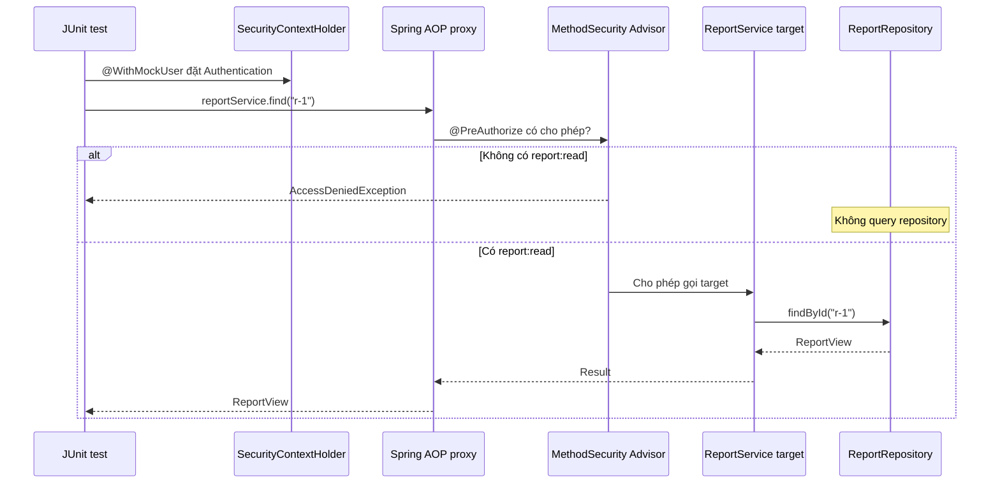

# Bảo mật — Kiểm thử method security qua Spring proxy

## 1. Vì sao method security test có thể “xanh giả”?

Trong một ứng dụng Spring Boot, bảo vệ HTTP endpoint bằng SecurityFilterChain là quan trọng nhưng chưa đủ. Cùng một service có thể được gọi từ REST controller, scheduled job, messaging listener, GraphQL resolver, batch processing hoặc một service khác. Nếu quyền truy cập dữ liệu nhạy cảm chỉ nằm ở web layer, một đường gọi nội bộ có thể bỏ qua kiểm tra.

Spring Security hỗ trợ **method-level authorization** bằng các annotation như `@PreAuthorize` và `@PostAuthorize`. Tuy nhiên, ở chế độ mặc định phổ biến, những annotation này **được thực thi bằng Spring AOP proxy**, không phải bởi JVM mỗi khi nhìn thấy annotation trong Java source.

Hãy xem:

```java
@Service
class ReportService {
    @PreAuthorize("hasRole('ADMIN')")
    public String secret() {
        return "confidential";
    }
}
```

Một phép thử:

```java
ReportService service = new ReportService();
assertEquals("confidential", service.secret());
```

có thể PASS ngay cả khi không có người dùng đã xác thực, bởi `new ReportService()` tạo **object Java thuần, không đi qua Spring proxy**. Đoạn này là *minh họa bẫy kiểm thử*, không phải test bảo mật hợp lệ.

Bài này hướng dẫn kiểm thử **đúng điểm chặn của Spring proxy**:

- `@EnableMethodSecurity` thực sự được bật trong ApplicationContext.
- Test inject chính **bean được Spring quản lý** qua `@Autowired`.
- Người dùng/quyền được thiết lập bằng `@WithMockUser`, `@WithAnonymousUser`, `@WithUserDetails` hoặc `@WithSecurityContext` theo trường hợp.
- Trường hợp không có quyền phải ném `AccessDeniedException`; với `@PreAuthorize`, **logic nghiệp vụ chưa được gọi**.
- Trường hợp có quyền phải gọi dependency và trả dữ liệu đúng.
- `@PostAuthorize` kiểm sau khi method hoàn tất; test phải chứng minh nó **khác** với kiểm trước.
- Test tránh các bẫy: `this.method()` self-invocation, `private`/`final` method, JDK/CGLIB proxy, mock nhầm bean, role prefix, sai SpEL, context test thiếu security config.

Project mẫu dùng **Java 17, Spring Boot 3.5, Spring Security 6.5, JUnit Jupiter, spring-security-test và MockitoBean**. Nó không cần Docker, database hoặc HTTP server vì mục tiêu là kiểm **lời gọi service method thông qua proxy**.

## 2. Hai ranh giới bảo mật khác nhau

| Ranh giới | Ví dụ | Công cụ quan sát |
| --- | --- | --- |
| **HTTP request authorization** | Chỉ ADMIN được `DELETE /reports/{id}` | `MockMvc` + SecurityFilterChain/filter chain |
| **Method authorization** | Chỉ ADMIN được gọi `ReportService.delete(...)`, kể cả từ scheduler | Spring context + proxied service + `@WithMockUser` |
| **Resource ownership** | Người dùng chỉ được đọc report do mình sở hữu | `@PostAuthorize` hoặc permission evaluator |
| **Domain/business validation** | ID không hợp lệ, report không tồn tại | Business exception/validation tests |
| **Data isolation** | Tenant A không thể query row tenant B | Service + repository/DB integration, tenant filters |
| **Authentication** | JWT signature, expired token, OAuth2 flow | HTTP/security integration, real/custom authentication |

**Đừng nhầm 403 ở controller với bằng chứng service có proxy bảo vệ.** Một request có thể bị Spring Security HTTP filter từ chối trước khi controller gọi service, ngay cả khi `@EnableMethodSecurity` bị bỏ hoặc service method không được annotate. Bài test method security đúng phải gọi **bean service** và kiểm phản ứng của proxy ở tầng method.

### Ví dụ luồng



## 3. Spring proxy thực sự làm gì?

Spring AOP có **proxy object** đứng giữa caller và target bean:

1. Spring tạo bean target `ReportService`.
2. Spring Security method-security infrastructure tìm các methods/annotations cần bảo vệ.
3. Spring tạo hoặc góp advisor vào AOP proxy tương ứng.
4. Caller nhận bean reference từ `ApplicationContext` (thường là proxy).
5. Khi caller gọi phương thức qua proxy, authorization interceptor lấy `Authentication` từ `SecurityContextHolder`, đánh giá SpEL và quyết định cho phép/từ chối.
6. Nếu cho phép, interceptor mới gọi target method.
7. Với `@PostAuthorize`, sau khi target trả kết quả, interceptor đánh giá `returnObject` rồi mới cho caller nhận value.

### Không phải lời gọi nào cũng đi qua proxy

```text
JUnit / Controller / Service A
           |
           v
     Spring proxy
           |
     Authorization advice
           |
           v
     Target ReportService
           |
           +---- this.otherMethod() ----> Target method trực tiếp
                                             (BỎ QUA advice)
```

- Lời gọi từ bên ngoài qua **bean proxy**: authorization có cơ hội chạy.
- `this.otherMethod()` gọi trong cùng object: **self-invocation**, không đi vòng qua proxy theo Spring AOP proxy mode.
- `new ReportService(...)`: không có Spring proxy.
- Mock `ReportService` thay cho bean thật: behavior do Mockito lập trình, không chứng minh annotation thật được thực thi.
- `private` và `final` method/class có giới hạn proxying tùy JDK/CGLIB.

**Kiểm tra cốt lõi:** inject service, dùng `AopUtils.isAopProxy(service)` làm một assertion cơ sở, rồi thực hiện **ít nhất một phép thử denied**. Chỉ assert isProxy vẫn không đủ: một bean có thể được proxy vì `@Transactional` hoặc aspect khác mà không có method-security interceptor.

## 4. Bật method security đúng cách

Spring Boot starter security **không tự bật** method security. Với Spring Security 6.5, cần khai báo:

```java
@Configuration
@EnableMethodSecurity
class MethodSecurityConfiguration {
}
```

Hoặc đặt `@EnableMethodSecurity` ngay trên class `@SpringBootApplication` ở project đơn giản. Trong sample phía sau ta dùng cách này.

`@EnableMethodSecurity` mặc định bật nhóm:

- `@PreAuthorize`: đánh giá expression **trước khi** method chạy.
- `@PostAuthorize`: đánh giá expression trên **giá trị trả về**.
- `@PreFilter`: lọc collection input được chỉ định.
- `@PostFilter`: lọc collection output.

Các annotation khác không mặc định bật:

```java
// Cấu hình minh họa cho ứng dụng CẦN @Secured/@RolesAllowed.
@EnableMethodSecurity(
    securedEnabled = true,
    jsr250Enabled = true)
class MethodSecurityConfiguration {
}
```

- `@Secured("ROLE_ADMIN")` cần `securedEnabled=true`.
- `@RolesAllowed("ADMIN")` theo Jakarta/JSR-250 cần `jsr250Enabled=true`.
- Không suy luận chỉ vì thấy annotation trên method thì interceptor tương ứng đã được đăng ký.
- `@EnableGlobalMethodSecurity` là cách cũ; ở Spring Security 6.x, ưu tiên `@EnableMethodSecurity`.
- Không gắn nhiều `@PreAuthorize` lên cùng method; dùng một expression kết hợp điều kiện hoặc một policy bean.

### Proxy mode và AspectJ

`@EnableMethodSecurity` mặc định theo **proxy-based Spring AOP**. Spring Security còn hỗ trợ kiểu weaving khác (AspectJ) với cấu hình riêng, có behavior khác về self-invocation. Bài này **chỉ kiểm Spring proxy mode**, không tráo đổi đặc tính của AspectJ vào test.

## 5. @PreAuthorize và @PostAuthorize khác nhau ở chỗ nào?

| Annotation | Điểm đánh giá | Ví dụ | Hệ quả test |
| --- | --- | --- | --- |
| `@PreAuthorize` | **Trước** target method | `hasAuthority('report:read')` | Nếu bị từ chối, repository **không được gọi** |
| `@PostAuthorize` | **Sau** target trả về | `returnObject.owner() == authentication.name` | Repository có thể **đã được gọi**, nhưng caller không nhận kết quả |
| `@PreFilter` | Trước method, lọc input collection | `filterObject.owner == authentication.name` | Target nhận danh sách đã lọc |
| `@PostFilter` | Sau method, lọc output collection | `filterObject.owner == authentication.name` | Caller chỉ thấy phần tử được phép |

Một method có cả `@PreAuthorize` và `@PostAuthorize` sẽ phải thỏa **cả hai**: trước phải được quyền gọi, sau phải được quyền nhận kết quả.

### Cảnh báo side effect của @PostAuthorize

`@PostAuthorize` chạy **sau** target. Vì thế **không phù hợp làm lớp kiểm duy nhất trên method ghi dữ liệu**:

```java
// KHÔNG NÊN: DB có thể đã commit/flush trước khi quyền bị từ chối.
@PostAuthorize("returnObject.owner() == authentication.name")
public Payment transferMoney(...) {
    // Viết tiền hoặc gửi external side effect.
}
```

Ví dụ này là **đoạn minh họa không runnable độc lập**. Thay vì “ghi xong rồi mới check quyền”, hãy xác minh quyền bằng `@PreAuthorize` hoặc policy service trước khi side effect. Khi cần check owner nằm trong DB, có thể dùng `@PreAuthorize("@reportAuth.canEdit(authentication, #p0)")` với policy bean/repository và transaction strategy rõ ràng.

## 6. Roles, authorities và principal

`@WithMockUser` của spring-security-test cho phép tạo `Authentication` giả trong `SecurityContextHolder`. Nó **không phải Mockito mock của service** và không yêu cầu tài khoản thực tồn tại.

Ví dụ:

```java
@WithMockUser(username = "alice", roles = "ADMIN")
```

sẽ cấp authority `ROLE_ADMIN`. Còn:

```java
@WithMockUser(
    username = "alice",
    authorities = {"report:read", "ROLE_ADMIN"})
```

cấp chính xác hai authority strings đã nêu.

| Trong expression | Test user cần | Dễ nhầm |
| --- | --- | --- |
| `hasRole('ADMIN')` | `ROLE_ADMIN` | `ADMIN` **không tự tương đương** |
| `hasAuthority('report:read')` | `report:read` | `ROLE_USER` không thay được |
| `isAuthenticated()` | Principal đã auth (không anonymous) | `@WithMockUser` luôn là user giả authenticated |
| `authentication.name` | Username trong `Authentication` | Không nhất thiết là database user ID |
| `hasAnyRole('ADMIN','EDITOR')` | `ROLE_ADMIN` hoặc `ROLE_EDITOR` | Đừng truyền `ROLE_` hai lần vào hasRole |
| `hasAuthority('ROLE_ADMIN')` | Exact `ROLE_ADMIN` | Không giống string `ADMIN` |

Một ứng dụng có thể cấu hình role prefix khác `ROLE_`, nên test phải theo **security config thật**. Ví dụ chính giữ prefix mặc định.

### @WithMockUser không kiểm tra JWT

Khi `@WithMockUser` đặt authentication đã được chấp nhận vào context, test **không kiểm** chữ ký JWT, issuer/audience, token expiry, bearer token filter hoặc authorities mapping từ JWT claims. Cần test HTTP/OAuth2 resource server riêng nếu những hành vi đó là mục tiêu.

## 7. Chọn đúng test level

| Mục tiêu | Test đề xuất | Bằng chứng |
| --- | --- | --- |
| Java business logic thuần | `new Service(mockRepo)` | Thuật toán/business method đúng, **không** chứng minh method security |
| `@PreAuthorize` có chặn gọi method không? | `@SpringBootTest` / Spring context + injected service | Spring proxy + authorization |
| `@PostAuthorize` có chặn trả object không? | Spring context + mock collaborator + `@WithMockUser` | Return-object authorization |
| Method có dùng chính xác authority/role? | Parameterized identities/authorities | Positive/negative authorization matrix |
| Endpoint trả 401/403 đúng? | `@WebMvcTest` + MockMvc/security config, hoặc HTTP integration | Security filter chain và response translation |
| JWT claims được map thành authorities? | OAuth2 resource server integration test | Authentication/claims mapping |
| Repository tenant filter đúng? | JPA/Testcontainers integration | SQL filter và row isolation |
| Self-invocation qua Spring AOP? | Spring bean boundary test + code review | Proxy không intercept nội bộ |
| Async/reactive security context | Executor/reactor-specific integration | Context propagation qua thread/reactive chain |

**Nguyên tắc:** muốn chứng minh method security **qua proxy**, hãy gọi bean Spring thật, không chỉ parse annotation bằng reflection hoặc Mockito verify trên service đã mock.

## 8. Dự án mẫu Maven/Java 17

Project tối giản nhưng đầy đủ có một `ReportService`:

- `find(id)`: chỉ người có authority `report:read` được gọi.
- `delete(id)`: chỉ `ROLE_ADMIN` được gọi.
- `findOwned(id)`: phải có `report:read` **và** là chủ sở hữu report hoặc ADMIN.
- `createForOwner(owner)`: username phải trùng owner hoặc ADMIN.
- `ReportRepository` là dependency để đọc/xóa dữ liệu. Trong Spring integration test, **mock chỉ repository**; `ReportService` vẫn là bean thật có security proxy.
- `ReportView` là record, không có JPA/SQL trong bài này.
- Một `InMemoryReportRepository` giúp ứng dụng có implementation khi chạy bình thường. Integration test dùng `@MockitoBean` thay bằng mock để control input và verify side effects.
- Một unit test riêng minh họa **direct new không có proxy**.

### Cây thư mục

```text
method-security-proxy-demo/
├── pom.xml
└── src/
    ├── main/
    │   ├── java/example/methodsecurity/
    │   │   ├── MethodSecurityApplication.java
    │   │   ├── ReportView.java
    │   │   ├── ReportRepository.java
    │   │   ├── InMemoryReportRepository.java
    │   │   └── ReportService.java
    │   └── resources/
    │       └── application.properties
    └── test/
        └── java/example/methodsecurity/
            ├── ReportServiceMethodSecurityTest.java
            └── DirectConstructionIsNotSecurityTest.java
```

## 9. pom.xml

```xml
<?xml version="1.0" encoding="UTF-8"?>
<project xmlns="http://maven.apache.org/POM/4.0.0"
         xmlns:xsi="http://www.w3.org/2001/XMLSchema-instance"
         xsi:schemaLocation="http://maven.apache.org/POM/4.0.0
             https://maven.apache.org/xsd/maven-4.0.0.xsd">
    <modelVersion>4.0.0</modelVersion>

    <parent>
        <groupId>org.springframework.boot</groupId>
        <artifactId>spring-boot-starter-parent</artifactId>
        <version>3.5.0</version>
        <relativePath/>
    </parent>

    <groupId>example</groupId>
    <artifactId>method-security-proxy-demo</artifactId>
    <version>1.0-SNAPSHOT</version>

    <properties>
        <java.version>17</java.version>
    </properties>

    <dependencies>
        <dependency>
            <groupId>org.springframework.boot</groupId>
            <artifactId>spring-boot-starter</artifactId>
        </dependency>

        <dependency>
            <groupId>org.springframework.boot</groupId>
            <artifactId>spring-boot-starter-security</artifactId>
        </dependency>

        <dependency>
            <groupId>org.springframework.boot</groupId>
            <artifactId>spring-boot-starter-test</artifactId>
            <scope>test</scope>
        </dependency>

        <dependency>
            <groupId>org.springframework.security</groupId>
            <artifactId>spring-security-test</artifactId>
            <scope>test</scope>
        </dependency>
    </dependencies>
</project>
```

**Vì sao chỉ bốn dependencies?**

- `spring-boot-starter`: Spring Boot core, component scan và logging.
- `spring-boot-starter-security`: method security infrastructure, Spring Security core/config.
- `spring-boot-starter-test`: JUnit Jupiter, Mockito, Spring Test/`@MockitoBean`.
- `spring-security-test`: `@WithMockUser`, `@WithAnonymousUser` và SecurityContext test listeners.

Không thêm `spring-boot-starter-web`, vì không thử HTTP controller/MockMvc trong project core. Không cần Docker, H2, Kafka hoặc OAuth2 server để xác minh proxy method authorization. Spring Boot 3.5 parent kiểm soát versions; không lấy ngẫu nhiên security-test major khác security-core.

## 10. Main application và repository không phụ thuộc database

### 10.1. MethodSecurityApplication.java

`src/main/java/example/methodsecurity/MethodSecurityApplication.java`:

```java
package example.methodsecurity;

import org.springframework.boot.SpringApplication;
import org.springframework.boot.autoconfigure.SpringBootApplication;
import org.springframework.security.config.annotation.method.configuration.EnableMethodSecurity;

@SpringBootApplication
@EnableMethodSecurity
public class MethodSecurityApplication {

    public static void main(String[] args) {
        SpringApplication.run(MethodSecurityApplication.class, args);
    }
}
```

**Dòng quyết định là `@EnableMethodSecurity`.** Nếu bỏ nó, code vẫn compile và method annotations vẫn nằm trong class file, nhưng **interceptors method authorization có thể không được đăng ký**. Một test gọi service qua Spring context và đòi denied sẽ phát hiện thay đổi này.

Trong dự án lớn, có thể chuyển annotation sang `@Configuration` riêng, import qua cấu hình chính. Không bật chỉ trong test mà production thiếu; cần xác nhận **production config** bật method security.

### 10.2. ReportView.java

`src/main/java/example/methodsecurity/ReportView.java`:

```java
package example.methodsecurity;

public record ReportView(
        String id,
        String owner,
        String title) {
}
```

Java 17 record có public accessors `id()`, `owner()`, `title()`. Expression `returnObject.owner()` có thể gọi accessor của record qua SpEL.

### 10.3. ReportRepository.java

`src/main/java/example/methodsecurity/ReportRepository.java`:

```java
package example.methodsecurity;

import java.util.Optional;

public interface ReportRepository {

    Optional<ReportView> findById(String id);

    void deleteById(String id);
}
```

Đây không phải Spring Data JPA repository. Đích kiểm thử chính là method authorization ở service; repository được dùng như **collaborator** để chứng minh method có thực thi hay không.

### 10.4. InMemoryReportRepository.java

`src/main/java/example/methodsecurity/InMemoryReportRepository.java`:

```java
package example.methodsecurity;

import java.util.Map;
import java.util.Optional;
import java.util.concurrent.ConcurrentHashMap;

import org.springframework.stereotype.Repository;

@Repository
public class InMemoryReportRepository implements ReportRepository {

    private final Map<String, ReportView> reports =
            new ConcurrentHashMap<>();

    public InMemoryReportRepository() {
        reports.put(
                "r-1",
                new ReportView("r-1", "alice", "Quarterly review"));
        reports.put(
                "r-2",
                new ReportView("r-2", "bob", "Personal draft"));
    }

    @Override
    public Optional<ReportView> findById(String id) {
        return Optional.ofNullable(reports.get(id));
    }

    @Override
    public void deleteById(String id) {
        reports.remove(id);
    }
}
```

Repository này làm project có thể tạo Spring application context ngoài test. Dữ liệu chỉ là **demo synthetic**, không phải production data store hay bằng chứng SQL row-level security.

Trong test, `@MockitoBean ReportRepository repository` sẽ thay collaborator này bằng Mockito mock. Điều đó không làm mất `@PreAuthorize` trên `ReportService` vì **service không bị mock**.

### 10.5. application.properties

`src/main/resources/application.properties`:

```properties
spring.main.banner-mode=off
```

Không cần database URL/HTTP port/token ở ví dụ. Nếu app production dùng external authentication hoặc JWT, phải có security config/handlers phù hợp; project chỉ dạy authorization của proxied method khi `Authentication` đã có.

## 11. Service được bảo vệ — ReportService.java

`src/main/java/example/methodsecurity/ReportService.java`:

```java
package example.methodsecurity;

import java.util.NoSuchElementException;

import org.springframework.security.access.prepost.PostAuthorize;
import org.springframework.security.access.prepost.PreAuthorize;
import org.springframework.stereotype.Service;

@Service
public class ReportService {

    private final ReportRepository repository;

    public ReportService(ReportRepository repository) {
        this.repository = repository;
    }

    @PreAuthorize("hasAuthority('report:read')")
    public ReportView find(String id) {
        return repository.findById(id)
                .orElseThrow(NoSuchElementException::new);
    }

    @PreAuthorize("hasRole('ADMIN')")
    public void delete(String id) {
        repository.deleteById(id);
    }

    @PreAuthorize("hasAuthority('report:read')")
    @PostAuthorize(
        "returnObject.owner() == authentication.name or hasRole('ADMIN')")
    public ReportView findOwned(String id) {
        return repository.findById(id)
                .orElseThrow(NoSuchElementException::new);
    }

    @PreAuthorize(
        "#p0 == authentication.name or hasRole('ADMIN')")
    public String createForOwner(String owner) {
        return "folder:" + owner;
    }
}
```

### 11.1. find: quyền tường minh

`hasAuthority('report:read')` đòi exact authority string. `ROLE_ADMIN` không tự mang `report:read`. Nếu muốn ADMIN mặc định bypass quyền đọc, expression phải ghi rõ:

```java
@PreAuthorize(
    "hasAuthority('report:read') or hasRole('ADMIN')")
```

Project này **không** thêm bypass vào `find`; nó kiểm đúng contract đã chọn.

### 11.2. delete: admin role

`hasRole('ADMIN')` tìm `ROLE_ADMIN` theo default role prefix. Test sẽ chứng minh authority `ADMIN` không có prefix **không đủ**. Điều đó phát hiện lỗi mapping JWT groups/roles phổ biến.

### 11.3. findOwned: pre + post

Người gọi phải có `report:read` trước, sau đó `returnObject.owner()` phải bằng `authentication.name` hoặc người gọi có `ROLE_ADMIN`.

- Không có `report:read`: repository **không bị gọi**.
- Có `report:read` nhưng không sở hữu: repository **đã được gọi**, object bị chặn không trả cho caller.
- Có `report:read` và là owner: caller nhận ReportView.
- Có `report:read` + ROLE_ADMIN: caller nhận report của người khác.

Việc đọc trước rồi bị từ chối có thể phù hợp cho ví dụ **read-only**; với hệ thống thật cần xét logging/cache/timing/side channels và quyền truy cập dữ liệu tại repository/tenant boundary.

### 11.4. createForOwner: method argument expression

`#p0` tham chiếu **tham số thứ nhất** của method. Điều này tránh dựa vào compiler parameter names. Dạng `#owner` cũng được hỗ trợ khi framework có metadata tên tham số (`-parameters`, `@P` hoặc cơ chế được hỗ trợ), nhưng code phải bảo đảm parameter discovery đúng.

**Không** ghép trực tiếp user input vào SpEL expression string tại runtime. Expression được viết cố định trong annotation; `owner` là value được so sánh, không phải mã SpEL để thực thi.

## 12. Integration test chính — Spring bean proxy và SecurityContext

`src/test/java/example/methodsecurity/ReportServiceMethodSecurityTest.java`:

```java
package example.methodsecurity;

import static org.junit.jupiter.api.Assertions.assertEquals;
import static org.junit.jupiter.api.Assertions.assertNotNull;
import static org.junit.jupiter.api.Assertions.assertThrows;
import static org.junit.jupiter.api.Assertions.assertTrue;
import static org.mockito.Mockito.verify;
import static org.mockito.Mockito.verifyNoInteractions;
import static org.mockito.Mockito.when;

import java.util.NoSuchElementException;
import java.util.Optional;

import org.junit.jupiter.api.Test;
import org.springframework.aop.support.AopUtils;
import org.springframework.beans.factory.annotation.Autowired;
import org.springframework.boot.test.context.SpringBootTest;
import org.springframework.security.access.AccessDeniedException;
import org.springframework.security.test.context.support.WithAnonymousUser;
import org.springframework.security.test.context.support.WithMockUser;
import org.springframework.test.context.bean.override.mockito.MockitoBean;

@SpringBootTest(
    webEnvironment = SpringBootTest.WebEnvironment.NONE)
class ReportServiceMethodSecurityTest {

    @Autowired
    ReportService service;

    @MockitoBean
    ReportRepository repository;

    private static ReportView aliceReport() {
        return new ReportView("r-1", "alice", "Quarterly review");
    }

    private static ReportView bobReport() {
        return new ReportView("r-2", "bob", "Personal draft");
    }

    @Test
    void injectedServiceReallyIsAnAopProxy() {
        assertNotNull(service);
        assertTrue(AopUtils.isAopProxy(service),
                "method security needs a Spring AOP proxy");
    }

    @Test
    @WithMockUser(
        username = "alice",
        authorities = "report:read")
    void permittedReadCallsRepository() {
        when(repository.findById("r-1"))
                .thenReturn(Optional.of(aliceReport()));

        ReportView result = service.find("r-1");

        assertEquals("r-1", result.id());
        assertEquals("alice", result.owner());
        verify(repository).findById("r-1");
    }

    @Test
    @WithMockUser(
        username = "bob",
        authorities = "report:write")
    void missingAuthorityDeniedBeforeQuery() {
        assertThrows(AccessDeniedException.class,
                () -> service.find("r-1"));

        verifyNoInteractions(repository);
    }

    @Test
    @WithMockUser(
        username = "admin",
        roles = "ADMIN")
    void adminCanDelete() {
        service.delete("r-1");

        verify(repository).deleteById("r-1");
    }

    @Test
    @WithMockUser(
        username = "alice",
        roles = "USER")
    void ordinaryUserCannotDelete() {
        assertThrows(AccessDeniedException.class,
                () -> service.delete("r-1"));

        verifyNoInteractions(repository);
    }

    @Test
    @WithMockUser(
        username = "alice",
        authorities = "ADMIN")
    void authorityAdminWithoutRolePrefixCannotDelete() {
        assertThrows(AccessDeniedException.class,
                () -> service.delete("r-1"));

        verifyNoInteractions(repository);
    }

    @Test
    @WithMockUser(
        username = "alice",
        authorities = "report:read")
    void ownerCanReadOwnedReport() {
        when(repository.findById("r-1"))
                .thenReturn(Optional.of(aliceReport()));

        ReportView result = service.findOwned("r-1");

        assertEquals("alice", result.owner());
        verify(repository).findById("r-1");
    }

    @Test
    @WithMockUser(
        username = "bob",
        authorities = "report:read")
    void nonOwnerReadIsBlockedAfterLookup() {
        when(repository.findById("r-1"))
                .thenReturn(Optional.of(aliceReport()));

        assertThrows(AccessDeniedException.class,
                () -> service.findOwned("r-1"));

        // @PostAuthorize xảy ra SAU target method:
        verify(repository).findById("r-1");
    }

    @Test
    @WithMockUser(
        username = "admin",
        authorities = {"report:read", "ROLE_ADMIN"})
    void adminCanReadOtherOwnersReport() {
        when(repository.findById("r-2"))
                .thenReturn(Optional.of(bobReport()));

        ReportView result = service.findOwned("r-2");

        assertEquals("bob", result.owner());
        verify(repository).findById("r-2");
    }

    @Test
    @WithMockUser(
        username = "alice",
        roles = "USER")
    void ownerCanCreateUnderTheirName() {
        assertEquals(
                "folder:alice",
                service.createForOwner("alice"));

        verifyNoInteractions(repository);
    }

    @Test
    @WithMockUser(
        username = "bob",
        roles = "USER")
    void differentUserCannotCreateUnderOtherName() {
        assertThrows(AccessDeniedException.class,
                () -> service.createForOwner("alice"));

        verifyNoInteractions(repository);
    }

    @Test
    @WithAnonymousUser
    void anonymousCannotRead() {
        assertThrows(AccessDeniedException.class,
                () -> service.find("r-1"));

        verifyNoInteractions(repository);
    }

    @Test
    @WithMockUser(
        username = "alice",
        authorities = "report:read")
    void missingRecordIsBusinessFailureNotAccessDenied() {
        when(repository.findById("missing"))
                .thenReturn(Optional.empty());

        assertThrows(NoSuchElementException.class,
                () -> service.find("missing"));

        verify(repository).findById("missing");
    }
}
```

**Có 13 phương thức `@Test`** trong class này.

### Những yếu tố khiến đây là method-security integration test

1. `@SpringBootTest` tạo ApplicationContext có `MethodSecurityApplication` và `@EnableMethodSecurity`.
2. `@Autowired ReportService` lấy **Spring bean** qua context, không `new ReportService(...)`.
3. `@MockitoBean ReportRepository` chỉ thay dependency của target để kiểm side effects/queries; không làm mất security proxy của service.
4. `@WithMockUser` tạo Authentication/authorities qua Spring Security test listener trước test.
5. `@WithAnonymousUser` tạo anonymous identity có chủ đích.
6. `assertThrows(AccessDeniedException.class)` đo hành vi của authorization advisor ở bean boundary.
7. `verifyNoInteractions(repository)` chứng minh `@PreAuthorize` chặn **trước** khi truy vấn.
8. `verify(repository).findById(...)` trong `nonOwnerReadIsBlockedAfterLookup` chứng minh `@PostAuthorize` chặn **sau** khi đã đọc.
9. `AopUtils.isAopProxy(service)` là một tín hiệu hỗ trợ, không thay thế denied tests.

### Về reset MockitoBean

Spring Framework 6.2 `@MockitoBean` có cơ chế reset theo test lifecycle mặc định (thường after each test method), nên stubs/interactions không bị tái sử dụng vô ý. Không tự dựa vào thứ tự JUnit methods. Nếu cấu hình reset khác, cần làm sạch mocks minh bạch.

### Tại sao test không gọi HTTP?

`WebEnvironment.NONE` tránh tạo servlet/web server. Đề bài là service method security; một test gọi trực tiếp proxied method đã đủ quan sát authorization ở tầng đó. HTTP status 401/403 là việc khác: không có `ExceptionTranslationFilter` HTTP ở đây; `AccessDeniedException` được ném cho test bắt.

## 13. Unit test minh họa: new không thể chứng minh annotation

`src/test/java/example/methodsecurity/DirectConstructionIsNotSecurityTest.java`:

```java
package example.methodsecurity;

import static org.junit.jupiter.api.Assertions.assertEquals;
import static org.junit.jupiter.api.Assertions.assertFalse;
import static org.mockito.Mockito.mock;
import static org.mockito.Mockito.when;

import java.util.Optional;

import org.junit.jupiter.api.Test;
import org.springframework.aop.support.AopUtils;

class DirectConstructionIsNotSecurityTest {

    @Test
    void directlyConstructedServiceBypassesAnnotations() {
        ReportRepository repository = mock(ReportRepository.class);

        when(repository.findById("r-1"))
                .thenReturn(Optional.of(
                    new ReportView(
                        "r-1", "alice", "Quarterly review")));

        // KHÔNG qua Spring container/MethodSecurity proxy.
        ReportService rawService = new ReportService(repository);

        assertFalse(AopUtils.isAopProxy(rawService));

        // Kết quả này minh họa NGUY CƠ, không phải bảo mật đúng:
        // ngay cả khi SecurityContext không có authentication,
        // annotation sẽ không được enforce trên raw instance.
        assertEquals(
                "r-1",
                rawService.find("r-1").id());
    }
}
```

**Có 1 phương thức `@Test`** bổ sung. Tổng project: **14 methods** (13 Spring integration + 1 unit demonstration).

Test này không được dùng làm tiêu chí “security passed”. Nó cố tình **chứng minh annotation trên class Java không tự thực thi**. Nếu chỉ có test này mà không có `ReportServiceMethodSecurityTest`, ứng dụng có thể hoàn toàn quên bật method security mà suite vẫn xanh.

### Vì sao không mock chính ReportService?

`@MockitoBean ReportService service` sẽ thay bean có `@PreAuthorize` bằng Mockito mock. Khi đó một `assertThrows` do `when(mock.delete(...)).thenThrow(...)` chỉ chứng minh test đã lập trình mock ném exception; không chứng minh method interceptor thực. Trong method security tests, **mock collaborators dưới service**, không mock service đang cần kiểm bảo vệ.

## 14. Chạy tests và diễn giải kết quả

Từ thư mục `method-security-proxy-demo`, với JDK 17+ và Maven:

```bash
mvn test
```

Chạy riêng:

```bash
mvn test -Dtest=ReportServiceMethodSecurityTest
mvn test -Dtest=DirectConstructionIsNotSecurityTest
```

| Class | Số JUnit methods | Điều chứng minh |
| --- | ---: | --- |
| `ReportServiceMethodSecurityTest` | 13 | Spring proxy, before/after authorization, role/authority, owner, anonymous, business error |
| `DirectConstructionIsNotSecurityTest` | 1 | Raw Java object **không** được Spring proxy bảo vệ |
| **Tổng** | **14** | 14 lượt chạy dự kiến |

**Kỳ vọng:** 14 tests PASS, 0 failures/errors/skips trong môi trường tương thích. Đây là **kết quả dự kiến từ ví dụ**, không phải log đã chạy ở đây. Không tự bịa stdout, test duration hoặc kết quả Maven. Khi thực sự chạy, kiểm `target/surefire-reports` để xác nhận tests được phát hiện và không có skipped test.

### Đọc một failure đúng cách

| Failure | Giả thuyết đầu tiên |
| --- | --- |
| `assertTrue(isAopProxy(service))` fail | Method security chưa bật, service không có advisor phù hợp |
| `missingAuthorityDeniedBeforeQuery` lại chạy repository | Bean không đi qua proxy hoặc annotation bị bypass |
| `adminCanDelete` bị denied | `ROLE_ADMIN` thiếu/role prefix khác/annotation policy khác |
| `authorityAdminWithoutRolePrefixCannotDelete` bất ngờ PASS | Role semantics/config thay đổi hoặc service không được chặn |
| `nonOwnerReadIsBlockedAfterLookup` không ném AccessDenied | PostAuthorize không active, sai returnObject/username expression |
| `nonOwnerRead...` repository không được gọi | Có precondition khác chặn trước, test không còn cô lập post authorization |
| `anonymousCannotRead` fail với exception khác | Xem SecurityContext/test listener và root cause |
| `missingRecordIsBusinessFailureNotAccessDenied` bị denied | Test identity thiếu `report:read` hoặc service policy đổi |
| `DirectConstruction...` bất ngờ bị security intercept | Có instrumentation/weaving khác Spring AOP proxy hoặc test không thật sự dùng raw instance |

**Quan trọng:** `AopUtils.isAopProxy` chỉ kiểm proxy, không xác định đó là method-security advisor. Nếu bean bị proxy vì caching/transaction hoặc metrics, check này có thể vẫn PASS khi `@PreAuthorize` không chạy. Denied tests mới là chứng cứ quan trọng.

## 15. Self-invocation: cái bẫy nổi tiếng nhất

### 15.1. Code dễ sai

```java
@Service
class DangerousReportFacade {

    public void exportAllReports() {
        this.deleteAllReports(); // BỎ QUA method-security proxy.
    }

    @PreAuthorize("hasRole('ADMIN')")
    public void deleteAllReports() {
        // Thao tác nhạy cảm.
    }
}
```

Nếu test chỉ gọi `deleteAllReports()` **từ bên ngoài proxy**, test sẽ PASS/FAIL theo role như mong muốn. Nhưng đường `exportAllReports() → this.deleteAllReports()` chạy trực tiếp trong target, không đi qua method-security interceptor của `deleteAllReports` theo proxy mode.

Điều này nguy hiểm vì **test một method annotation riêng không bao phủ toàn bộ call paths thực tế**.

### 15.2. Cách sửa ưu tiên: tách bean boundary

```java
@Service
class AdminDeletionService {

    @PreAuthorize("hasRole('ADMIN')")
    public void deleteAllReports() {
        // Thao tác nhạy cảm.
    }
}

@Service
class ReportExportFacade {

    private final AdminDeletionService adminDeletionService;

    ReportExportFacade(
            AdminDeletionService adminDeletionService) {
        this.adminDeletionService = adminDeletionService;
    }

    public void runAdministrativeCleanup() {
        adminDeletionService.deleteAllReports();
        // Lời gọi qua injected Spring proxy của bean khác.
    }
}
```

Đây là **trích đoạn kiến trúc**, cần đặt các class vào file/package và định nghĩa behavior thực trước khi chạy. Tránh một facade public không có guard nhưng gọi destructive action trực tiếp qua `this`. Nếu facade cũng là security boundary, có thể annotate facade và test cả đường gọi.

### 15.3. Không ưu tiên self-injection hoặc AopContext

Có thể inject self-proxy hoặc dùng `AopContext.currentProxy()` nếu đã bật expose proxy, nhưng những cách này làm business code phụ thuộc AOP infrastructure và dễ tạo vòng phụ thuộc hoặc khó test. **Tách service chịu trách nhiệm policy** thường đơn giản hơn.

### 15.4. Test đường đi chứ không chỉ test annotation

Nếu có Controller → Facade → ProtectedService, hãy gọi một entrypoint đại diện với user thiếu quyền và xác nhận protected action **không chạy**, ngoài test gọi trực tiếp ProtectedService. Đó mới là bằng chứng rằng đường gọi production không vô ý bỏ qua proxy.

## 16. JDK dynamic proxy, CGLIB và những method khó proxy

Spring AOP có hai nhóm proxy chính:

- **JDK dynamic proxy**: thường proxy qua interfaces.
- **CGLIB class-based proxy**: tạo subclass proxy của target class.

Việc chọn thực tế chịu ảnh hưởng bởi interfaces, AOP settings và Spring Boot auto-configuration; **không hard-code giả định mọi Spring Boot project dùng cùng một proxy type**. Test bền vững nên assert `AopUtils.isAopProxy` rồi thử behavior thay vì assert class name có `$$SpringCGLIB$$`.

### Các hạn chế đáng chú ý

| Trường hợp | Rủi ro |
| --- | --- |
| `private` method | Không thể override/intercept theo Spring AOP proxy |
| `final` method với class proxy | CGLIB không override được ⇒ advice không chạy ở method đó |
| `final` class với class proxy | Không tạo subclass proxy được |
| `this.method()` | Self-invocation bỏ qua proxy |
| Object được tạo bởi `new` | Không nằm trong Spring proxy lifecycle |
| JDK proxy và method chỉ có ở concrete class | Caller qua interface proxy có thể không truy cập method đó |
| Kotlin classes mặc định final | Cần open/plugin tương ứng nếu dùng class proxy |
| Non-public method/visibility | Có giới hạn tùy framework/proxy type |
| Bean ngoài ApplicationContext | Không có method security advisor của Spring |

Giải pháp thường là **public service methods**, classes không final nếu class-based proxy được dùng, interfaces rõ khi cần JDK proxy, DI qua Spring và tránh self-invocation.

### Interface annotation và implementation annotation

Spring Security có hỗ trợ method security annotations trên interface hoặc class/method, nhưng có thể xảy ra conflict trong inheritance/multiple interfaces. Nên đặt policy ở vị trí rõ ràng, không để nhiều interfaces đưa những annotations mâu thuẫn tới cùng một method. Test bean type thực tế và gọi qua interface/class đúng với caller production.

### AspectJ không đồng nghĩa JDK proxy

AspectJ weaving có thể áp dụng advice ngay trong bytecode và có behavior khác với self-invocation. Nếu dự án cấu hình `@EnableMethodSecurity(mode = AdviceMode.ASPECTJ)`, cần weaving/AspectJ dependencies và tests riêng; code mẫu **không dùng chế độ đó**.

## 17. Phân biệt exceptions và HTTP status

Khi gọi trực tiếp service bean:

```java
assertThrows(AccessDeniedException.class,
        () -> service.delete("r-1"));
```

là assertion của **method authorization**.

Khi gọi qua HTTP với Spring Security filter chain, kết quả có thể là:

- **401 Unauthorized** nếu request chưa authenticated và authentication entry point yêu cầu đăng nhập.
- **403 Forbidden** nếu người dùng đã authenticated nhưng không được phép.
- Redirect tới login page trong form-login setup (không phải luôn 401).
- Một error body/status khác nếu có custom `AccessDeniedHandler`, `AuthenticationEntryPoint` hoặc exception mapping.

Không assert HTTP 403 khi test không có HTTP request, và không tự xem mọi `AccessDeniedException` là HTTP 403 nếu application đang chạy trong scheduler/listener không có `ExceptionTranslationFilter`.

### Anonymous và không có Authentication

`@WithAnonymousUser` đưa anonymous principal vào security context; nó không nhất thiết giống một method call **không có Authentication object**. Nếu test muốn chính xác case không có security context, có thể dùng test không annotation và assert exception phù hợp (trong mặc định nhiều trường hợp là `AuthenticationCredentialsNotFoundException`). Loại exception cần dựa theo interceptor và SecurityContext setup cụ thể, không gộp mọi absence thành 403.

## 18. @WithMockUser, @WithUserDetails và @WithSecurityContext

### 18.1. @WithMockUser

Phù hợp khi chỉ cần username và authorities. Nó tạo một test principal kiểu Spring Security `User`, không truy vấn user database và không mô phỏng custom JWT principal.

```java
@WithMockUser(
    username = "alice",
    authorities = {"report:read", "ROLE_USER"})
```

### 18.2. @WithUserDetails

Khi app code phụ thuộc `UserDetails` custom từ `UserDetailsService`:

```java
// Trích đoạn: test context phải có UserDetailsService
// tìm được "alice" và trả về principal kiểu ứng dụng.
@Test
@WithUserDetails("alice")
void readsWithRealUserDetailsService() {
    // Gọi proxied bean thật.
}
```

`@WithUserDetails` cần user tồn tại trong test `UserDetailsService`. Nếu test context thiếu service đó hoặc user fixture, test fail ở setup trước khi method chạy.

### 18.3. @WithSecurityContext

Khi cần principal có tenant, claims hoặc `Authentication` custom, dùng meta annotation `@WithSecurityContext(factory = ...)`. Factory dựng `SecurityContext` bằng `SecurityContextHolder.createEmptyContext()` và set Authentication hợp lệ.

```java
// Minh họa khai báo annotation, cần định nghĩa factory riêng.
@Retention(RetentionPolicy.RUNTIME)
@WithSecurityContext(factory = TenantUserContextFactory.class)
public @interface WithTenantUser {
    String username();
    String tenant();
}
```

**Đây là snippet, không nằm trong project runnable** vì `TenantUserContextFactory` là kiểu ứng dụng phải tự định nghĩa. Với multi-tenant security, assertion cần chứng minh đúng tenant và database query, không chỉ đặt tenant string trong fake principal.

### 18.4. Test listener lifecycle

Spring Security Test sử dụng `WithSecurityContextTestExecutionListener` để đặt context trước khi test chạy và dọn sau test. Theo mặc định, context được thiết lập trước JUnit `@BeforeEach`. Nếu có nhu cầu setup identity **sau `@BeforeEach` nhưng trước test method**, dùng `setupBefore = TestExecutionEvent.TEST_EXECUTION` trong annotation hỗ trợ. Phải hiểu thứ tự lifecycle trước khi dùng auth trong setup.

## 19. @PreAuthorize expression và parameter names

Trong code mẫu:

```java
@PreAuthorize(
    "#p0 == authentication.name or hasRole('ADMIN')")
public String createForOwner(String owner) { ... }
```

`#p0` tham chiếu tham số đầu, không phụ thuộc tên `owner`. Một số cách khác:

- `#owner`: cần parameter-name discovery có metadata tương ứng.
- `@P("owner")` trên parameter: cung cấp tên cho Spring Security expression handler trong các phiên bản hỗ trợ.
- Compiler `-parameters`: giúp Java reflection biết tên tham số.
- `authentication.name`: username từ Authentication, **không tự là owner ID trong DB**.
- `principal.username`/custom properties: phụ thuộc loại principal đang trong context.
- `@policyBean.canRead(authentication, #p0)`: delegate phức tạp sang bean, cần test bean đó và dependency thật.

### Cảnh giác SpEL fail-open

Đừng viết expression mơ hồ kiểu `hasRole('ADMIN') or true` để test “đỡ đỏ”. Những trường hợp thiếu principal, null resource hoặc expression không resolve phải được định nghĩa **fail-closed** theo policy. Test negative permissions, not just happy path.

### Policy bean example

```java
// Snippet minh họa cần định nghĩa ReportPolicy Spring bean.
@PreAuthorize(
    "@reportPolicy.canRead(authentication, #p0)")
public ReportView find(String id) {
    return repository.findById(id).orElseThrow();
}
```

Nếu policy bean truy cập database hoặc cache, unit test policy giúp cover logic, còn integration test proxy phải giữ policy bean thật và mock ở dependency sâu hơn nếu cần.

## 20. Pre và post authorization với transaction

Method security và `@Transactional` đều thường dùng Spring AOP advisors. Khi phối hợp:

- `@PreAuthorize` nên ngăn những actions không được phép **trước side effects**.
- `@PostAuthorize` chạy sau method, có thể xảy ra khi DB write đã được flush/commit tùy advisor order/transaction management.
- Nếu method gọi external API, gửi Kafka/RabbitMQ, ghi file hoặc payment, Spring transaction không rollback các side effects ngoài DB.
- Thứ tự advisors chịu config (order/interceptor) và có thể ảnh hưởng thời điểm transaction bắt đầu hoặc kết thúc.
- Không coi ném AccessDeniedException sau `@PostAuthorize` là bảo đảm toàn bộ thao tác bên trong đã rollback.
- Với ownership check, thiết kế policy query/transaction sao cho không có TOCTOU race khi resource owner/role thay đổi.

### Một hợp đồng an toàn hơn

1. Chặn role/permission tĩnh ở `@PreAuthorize`.
2. Nếu cần ownership từ DB, kiểm owner trong policy service trước khi mutate.
3. Thực hiện write trong transaction phù hợp sau khi check.
4. Bảo vệ ở DB/tenant scoping nếu dữ liệu nhiều tenant.
5. Test denied path **không gọi write collaborator** và không có side effect.
6. Test failure/retry/concurrency bằng integration tests khi điều kiện thật cần.

### Một anti-pattern test

```java
when(repository.deleteById(...)).thenThrow(...);
// ...
```

Đây **không phải Mockito syntax phù hợp** cho `void` method (`doThrow(...).when(mock)...` mới là hướng phù hợp). Trong bài cốt lõi ta không mock exception cho delete; test denied chỉ `verifyNoInteractions(repository)`, còn admin allowed `verify(repository).deleteById(...)`. Điều đó đơn giản, chính xác và không tạo false confidence.

## 21. @WebMvcTest và sự khác biệt với security service test

`@WebMvcTest(ReportController.class)` chỉ nạp một phần web application. Nếu controller inject `ReportService` và test `@MockitoBean ReportService` để làm JSON assertions, thì service thật có `@PreAuthorize` **không được kiểm tra**.

Nếu muốn test cả HTTP security và method security:

- Với web slice: import service thật, method-security config, mock **repository** chứ không mock service.
- Hoặc dùng `@SpringBootTest` + `@AutoConfigureMockMvc` và security config thật, nhưng chi phí context lớn hơn.
- Thực hiện HTTP request với `@WithMockUser` hoặc `SecurityMockMvcRequestPostProcessors.user(...)` theo nhu cầu.
- Assert status/response **và** verify dependent collaborator để biết request đi qua method security.
- Đảm bảo Spring Security filters được tích hợp vào MockMvc nếu mục tiêu là HTTP layer.
- Nếu method security config chỉ nằm trong một class chưa được test slice import, phép thử có thể đang kiểm HTTP filters mà thiếu advisors.

### Không kết luận từ 403 đơn lẻ

Giả sử controller endpoint chỉ ADMIN được truy cập theo `authorizeHttpRequests`, nhưng service thiếu `@PreAuthorize`. MockMvc test 403 vẫn pass với USER. Để biết **service boundary thật sự bảo vệ**, gọi service bean trực tiếp trong một test độc lập như project mẫu.

## 22. @MockitoBean và @MockitoSpyBean: giới hạn đúng

Spring Framework 6.2 cung cấp:

- `@MockitoBean`: replace/create bean mock trong ApplicationContext.
- `@MockitoSpyBean`: wrap bean thật bằng Mockito spy khi cần quan sát behavior; vẫn phải cân nhắc AOP proxy/lifecycle.
- `@Mock` trong Mockito/JUnit test thuần: không tạo Spring bean hay security advisor.

### Chọn đâu khi test method security?

| Cách | Kết luận hợp lý |
| --- | --- |
| `@Autowired ReportService` + `@MockitoBean ReportRepository` | **Đúng** để test Spring method security trên service thật |
| `@MockitoBean ReportService` + stub denied exception | **Sai bằng chứng**: test chỉ kiểm Mockito |
| `@InjectMocks ReportService` + `@Mock ReportRepository` | Hữu ích cho logic, **không có Spring proxy** |
| `@MockitoSpyBean ReportService` | Có thể dùng trong một số cases nhưng dễ tạo nhầm proxy/spies và reset |
| `AopUtils.isAopProxy` | Tín hiệu AOP, **không đủ** để chứng minh policy |
| Unit test `new ReportService(mockRepo)` | Kiểm business logic thuần, annotation không được enforce |

Khi Mockito test bảo mật thật, tránh stub `when(service.delete(...))` trên method void và tránh mock chính service có annotations. Ưu tiên các tests **ngắn nhưng có negative witness**.

## 23. Bảo mật trong @Async, scheduled và reactive code

### SecurityContextHolder và threads

Spring Security `SecurityContextHolder` thường dựa trên ThreadLocal trong servlet-style apps. `@WithMockUser` đặt Authentication vào test execution thread; thread khác hoặc `@Async` method không mặc nhiên có context đó.

Với async tasks, cần cơ chế context propagation như `DelegatingSecurityContextExecutor`/`DelegatingSecurityContextAsyncTaskExecutor` hoặc tích hợp framework tương ứng. Test phải kiểm call qua executor thật, không gọi trực tiếp method async rồi tuyên bố security context đã propagate.

**Không** chuyển toàn bộ ứng dụng sang global `SecurityContextHolder.MODE_GLOBAL` chỉ để test hết failure: có thể rò danh tính giữa requests/threads.

### Scheduled jobs và messaging consumers

Một scheduler hoặc Rabbit/Kafka listener thường không có end-user Authentication giống HTTP request. Nếu nó gọi một `@PreAuthorize` method:

- Xác định service identity/authorities policy riêng.
- Không lặng lẽ skip method security trong path non-HTTP.
- Dùng authentication phù hợp cho system actor, hoặc tách những methods nội bộ được ủy quyền có chủ đích.
- Test lời gọi qua Spring proxy từ scheduler/listener boundary, không chỉ unit call target.
- Với message events có tenant, verify tenant boundary qua policy và database query.

### Reactive method security

WebFlux/Reactor thường dùng `ReactiveSecurityContextHolder`, không chỉ ThreadLocal. `@EnableReactiveMethodSecurity`/reactive method-security constructs có quy tắc riêng và test cần Reactor context setup. Project Java17 ở đây dùng **imperative method security**, không áp dụng nguyên test snippet sang reactive stream mà không điều chỉnh.

## 24. Kiểm tra proxy nhưng không phụ thuộc implementation details

`AopUtils.isAopProxy(service)` có thể trả true nếu bean là JDK hoặc CGLIB proxy. Nhưng test không nên phụ thuộc:

- Tên class được generate chứa `$$EnhancerBySpringCGLIB$$` hoặc `$$SpringCGLIB$$`.
- Số advisor chính xác khi thêm transaction/caching/metrics.
- Proxy type cố định qua các Spring versions.
- Internal implementation class names của `AuthorizationManagerBeforeMethodInterceptor`.
- Thứ tự aspect internals khi không nằm trong hợp đồng.

**Test hành vi công khai:** unauthorized call bị chặn, authorized call thành công, pre-check ngăn dependency, post-check từ chối return object. Nếu project cần debug, có thể introspect `Advised` advisors, nhưng không khóa tất cả integration tests vào snapshot advisor list.

### AopUtils không thay thế test negative

Một bean `@Transactional` có thể là proxy dù không có method security. Do đó check proxy chỉ bổ sung; tối thiểu phải test một user **thiếu quyền** và xác nhận method không chạy.

## 25. Những lỗi thường gặp

| Triệu chứng | Nguyên nhân có thể | Hướng xử lý |
| --- | --- | --- |
| `@PreAuthorize` hiện trong source nhưng mọi user đều gọi được | Quên `@EnableMethodSecurity` | Bật trên config production |
| Test denied không fail | Gọi `new Service()` thay Spring bean | `@Autowired` proxied service |
| Test security xanh khi service mock | `@MockitoBean` đặt trên service | Mock repository/collaborator, giữ service thật |
| `AopUtils.isAopProxy` false | Không bật method-security infra hoặc method không được advised | Kiểm annotations/config/visibility |
| `isAopProxy` true nhưng rule không chạy | Proxy vì transaction/caching, không phải security | Test denied behavior |
| Gọi trực tiếp `delete` bị chặn, gọi từ `this.delete` không bị chặn | Self-invocation | Tách bean boundary/đổi call path |
| Method private/final không được chặn | Proxy cannot intercept | Sửa visibility/class/proxy mode |
| `hasRole('ADMIN')` bị denied với authority ADMIN | Thiếu prefix `ROLE_` | Dùng `roles="ADMIN"` hoặc `ROLE_ADMIN` |
| `hasAuthority('report:read')` fail với ROLE_USER | Sai permission type | Thêm đúng fine-grained authority |
| `@Secured` không hoạt động | `securedEnabled=false` mặc định | Bật flag nếu dùng |
| `@RolesAllowed` không hoạt động | `jsr250Enabled=false` mặc định | Bật flag nếu dùng |
| SpEL `#owner` không resolve | Thiếu Java parameter metadata | Dùng `#p0`, `@P` hoặc `-parameters` |
| @PostAuthorize từ chối nhưng repository đã chạy | Chính là after-method semantics | Không dùng nó làm guard trước side effects |
| Test 403 ở HTTP nhưng service không được bảo vệ | Chỉ HTTP filters chặn | Viết service proxy integration test riêng |
| `@WithMockUser` test principal khác production | App cần JWT/custom principal | `@WithSecurityContext` hoặc JWT auth tests |
| Mockito verifyNoInteractions fail bất ngờ | Bean bị gọi lúc setup/fixture hoặc policy bean query | Kiểm setup/context và đúng collaborator |
| Test chạy riêng pass nhưng suite fail | SecurityContext bị rò hoặc state bean/mocks chia sẻ | Sử dụng Spring Security test listeners/reset/context isolation |
| NoSuchBeanDefinitionException cho ReportRepository | Không có bean hoặc test mock không được tạo | Kiểm component scan, `@MockitoBean` và target |
| SpEL method on returnObject fail | Return type/nullable/record accessor khác dự kiến | Kiểm expression với DTO thực |
| Method invocation báo AuthenticationCredentialsNotFoundException | SecurityContext thiếu Authentication | Dùng test identity đúng và xử lý entrypoint |
| @Async method denied mặc dù @WithMockUser | Không propagate context qua executor | Dùng delegating security executor/integration test |
| @WebMvcTest method security không active | Test slice thiếu security config/service bean | Import đúng config hoặc dùng full context |
| Build xanh nhưng tests bị skip | Maven filter, naming, disabled | Kiểm Surefire reports |
| Spring Boot 4 imports thay đổi | Spring Security 7/Boot 4 modularization | Tra docs/BOM đúng major |

### Quy trình debug

1. Xác nhận test gọi **Spring-managed bean**, không raw target/new.
2. Xác nhận `@EnableMethodSecurity` active trong context thực tế.
3. Xác nhận `spring-security-test` ở classpath test và `@WithMockUser` thiết lập authorities dự kiến.
4. In/log an toàn username/authorities khi cần; không log password/token/secrets.
5. Kiểm rule `hasRole` vs `hasAuthority` và prefix.
6. Kiểm `AopUtils.isAopProxy`, public/final/interface visibility.
7. Tìm self-invocation và đường gọi không đi qua proxy.
8. Kiểm `@PreAuthorize`/`@PostAuthorize` đang dùng đúng thời điểm.
9. Nếu qua HTTP, phân biệt filter-level 403 với method-level denial.
10. Nếu có async/reactive, kiểm SecurityContext propagation phù hợp.
11. Xem test reports và root cause trước khi sửa policy để “làm xanh”.

## 26. Checklist nghiệm thu

- [ ] `@EnableMethodSecurity` bật trong **production/application config**?
- [ ] Test lấy **bean thật qua `@Autowired`**?
- [ ] Không dùng `new ReportService` làm bằng chứng method security?
- [ ] Không `@MockitoBean` chính service đang kiểm?
- [ ] `@MockitoBean` chỉ đặt ở dependencies cần control?
- [ ] `AopUtils.isAopProxy` và ít nhất một denied case đã được kiểm?
- [ ] `@WithMockUser` dùng exact username, roles hoặc authorities?
- [ ] `hasRole('ADMIN')` được test với `ROLE_ADMIN` và negative `ADMIN`?
- [ ] `hasAuthority` được test với đúng permission string?
- [ ] `@PreAuthorize` denied khiến business dependency **không được gọi**?
- [ ] `@PostAuthorize` denied đã xác nhận method **có thể đã chạy**?
- [ ] Có test owner đúng/owner sai, admin bypass theo contract?
- [ ] Có test anonymous hoặc unauthenticated phù hợp?
- [ ] Có test business error khi user được authorize?
- [ ] Không gộp lỗi business thành AccessDenied để test xanh?
- [ ] Parameter expression dùng tên được discover hoặc `#p0`?
- [ ] Không sử dụng @PostAuthorize làm sole guard cho write/side effect?
- [ ] Không có self-invocation làm bỏ qua method advisor?
- [ ] Service method đủ visibility và không final theo proxy type?
- [ ] @Secured/@RolesAllowed chỉ dùng khi được bật?
- [ ] HTTP security và method security được test ở hai tầng?
- [ ] Không tuyên bố JWT/OAuth/HTTP auth được kiểm bởi @WithMockUser?
- [ ] Có test SecurityContext propagation nếu @Async/reactive?
- [ ] Test fixtures dùng dữ liệu giả, không PII hay credentials thật?
- [ ] CI chạy tất cả tests và kiểm skipped/failures?

## 27. Bài tập nâng cao

1. **Tắt annotation:** bỏ `@EnableMethodSecurity` tạm thời, xem những negative tests nào fail; khôi phục.
2. **Role prefix:** thay `roles="ADMIN"` bằng `authorities="ADMIN"`, quan sát `hasRole` fail.
3. **Permission + role:** thêm `@PreAuthorize("hasAuthority('report:read') or hasRole('ADMIN')")`; cập nhật positive/negative matrix.
4. **Owner condition:** thay `returnObject.owner()` bằng trường sai để xác nhận test post-check fail.
5. **Self-invocation:** tạo `Facade` gọi method protected qua `this`, quan sát bypass, sau đó tách bean để sửa.
6. **Method params:** dùng `@P("owner")` trên parameter và expression `#owner`; chạy với/không có `-parameters`.
7. **Custom principal:** xây `@WithSecurityContext` annotation với tenant; assert cùng user khác tenant bị từ chối.
8. **Policy bean:** thay SpEL inline owner logic bằng `@reportPolicy.canRead(authentication, #p0)`, test bean theo dependency.
9. **HTTP boundary:** thêm controller và `MockMvc`; kiểm service layer vẫn bảo vệ nếu HTTP endpoint mở hơn dự kiến.
10. **Async boundary:** gọi service qua `@Async` executor có và không có SecurityContext delegation; test không dùng sleep.
11. **Transactional write:** thêm method update và kiểm pre-check thực sự ngăn repository.save.
12. **JDK vs CGLIB:** tạo interface service và thay proxy config; không assert class name, chỉ behavior.
13. **Secured/JSR-250:** bật `securedEnabled/jsr250Enabled` và test annotations tương ứng.
14. **Denied side effects:** thêm audit collaborator; kiểm blocked `@PreAuthorize` không gửi message hoặc ghi DB.
15. **Mutation testing:** thay `hasAuthority('report:read')` bằng `permitAll()`, xác nhận test negative fail.

## 28. Tài liệu chính thức

1. [Spring Security 6.5 — Method Security](https://docs.spring.io/spring-security/reference/6.5/servlet/authorization/method-security.html): `@EnableMethodSecurity`, Spring AOP interceptors, pre/post authorization và policy expressions.
2. [Spring Security 6.5 — Testing Method Security](https://docs.spring.io/spring-security/reference/6.5/servlet/test/method.html): `@WithMockUser`, `@WithAnonymousUser`, `@WithUserDetails`, `@WithSecurityContext` và test listeners.
3. [Spring Framework 6.2 — AOP Proxying Mechanisms](https://docs.spring.io/spring-framework/reference/6.2/core/aop/proxying.html): JDK/CGLIB, method visibility/final, self-invocation và recommendations.
4. [Spring Boot 3.5 — Testing Spring Boot Applications](https://docs.spring.io/spring-boot/3.5/reference/testing/spring-boot-applications.html): `@SpringBootTest`, Spring context caching và `@MockitoBean`.
5. [Spring Framework 6.2 — @MockitoBean and @MockitoSpyBean](https://docs.spring.io/spring-framework/reference/6.2/testing/annotations/integration-spring/annotation-mockitobean.html): mock/spy Spring beans trong test context.
6. [Spring Security 6.5 — Authorization Architecture](https://docs.spring.io/spring-security/reference/6.5/servlet/authorization/architecture.html): `AuthorizationManager`, roles/authorities và security decisions.
7. [Spring Security 6.5 — Spring MVC Test Integration](https://docs.spring.io/spring-security/reference/6.5/servlet/test/mockmvc/index.html): filter chain vs method authorization khi kiểm HTTP endpoints.
8. [Spring Security 6.5 — SecurityContextHolder](https://docs.spring.io/spring-security/reference/6.5/servlet/authentication/architecture.html): Authentication, SecurityContext và thread context.
9. [Spring Framework 6.2 — TestContext Transaction Management](https://docs.spring.io/spring-framework/reference/6.2/testing/testcontext-framework/tx.html): test transactions và rollback boundaries.
10. [Spring Security — Current Method Security Reference](https://docs.spring.io/spring-security/reference/servlet/authorization/method-security.html): đối chiếu các thay đổi khi nâng Spring Security major.
11. [Spring Boot 4 — Testing](https://docs.spring.io/spring-boot/reference/testing/index.html): thay đổi modules/starters và API khi nâng từ Boot 3.5.

### Lưu ý Boot 4 / Security 7

Mã project nhắm **Spring Boot 3.5.0 / Spring Security 6.5 / Java 17**. Spring Boot 4 và Spring Security 7 có các thay đổi module/starter và có thể thay đổi chi tiết authorization/testing. Khi nâng major, dùng BOM, Javadoc và reference docs tương ứng; **không mặc định** rằng mọi import và cấu hình trong 3.5 được giữ nguyên.

**Kết luận:** khi kiểm thử method security, điều quan trọng nhất không phải annotation có xuất hiện trong source hay `AopUtils.isAopProxy` trả true, mà là **một lời gọi từ bên ngoài qua Spring-managed proxy với Authentication phù hợp** thực sự được cho phép/từ chối theo policy. Test denied path phải kiểm dependency không được chạy với `@PreAuthorize`; test `@PostAuthorize` phải nhận ra method đã thực thi trước khi return-object bị chặn. Hãy kiểm thêm self-invocation, role prefix, custom principal và các caller ngoài HTTP để tránh “bảo mật xanh giả”.
