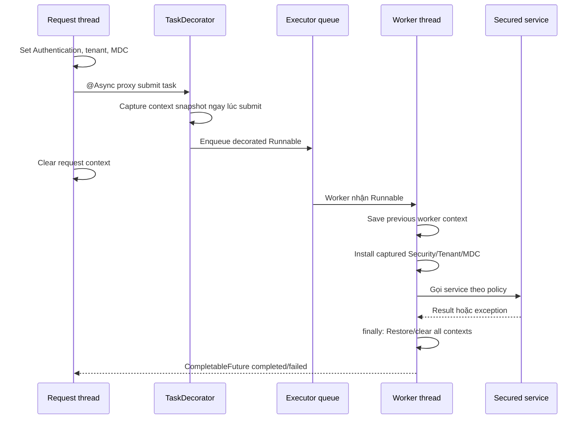

# Bất đồng bộ và lịch chạy — Truyền SecurityContext, tenant và correlation ID sang tác vụ

## 1. Vấn đề: tác vụ bất đồng bộ không tự mang theo ngữ cảnh của request

Trong Spring Boot, một HTTP request có thể được xử lý trên thread `http-nio-...` và gọi tiếp `@Async` để gửi email, tạo báo cáo, cập nhật read model, ghi audit log hoặc thực hiện một công việc dài. Ở request thread, các thông tin sau có thể đang sẵn có:

- **SecurityContext**: `Authentication`, principal và các authorities, do Spring Security lưu trong `SecurityContextHolder`.
- **Tenant context**: tenant ID của request, có thể lưu trong một `ThreadLocal` do ứng dụng tự định nghĩa.
- **Correlation ID**: ID truy vết luồng nghiệp vụ, thường được đưa vào **SLF4J MDC** dưới key như `correlationId`.
- **Tracing/Observation context**: trace ID, span ID và metadata từ Micrometer/OpenTelemetry, có lifecycle riêng.

Khi chuyển việc cho một thread khác, những ThreadLocal trên **không mặc nhiên xuất hiện ở worker thread**. Một code nhìn có vẻ hợp lý:

```java
MDC.put("correlationId", "req-123");
TenantContext.set("tenant-a");

asyncService.processOrder("order-42");
```

chỉ chứng minh caller đã đặt metadata; **không** chứng minh `processOrder` nhìn thấy chúng. Nếu pool tái sử dụng threads, còn có rủi ro nghiêm trọng hơn: một task có thể đọc **context cũ của task trước đó** nếu ai đó quên cleanup.

Bài tập trung vào chủ đề **“Truyền SecurityContext, tenant và correlation ID sang tác vụ”** của Spring Boot testing. Mục tiêu là **capture đúng lúc gửi task, install đúng lúc chạy, restore/clear trong finally, và kiểm chứng không rò context khi thread được reuse**.

### Kết quả học tập

Sau bài này bạn có thể:

1. Phân biệt request thread, task submission, executor queue, worker thread và scheduled jobs.
2. Hiểu `SecurityContextHolder`, tenant `ThreadLocal` và `MDC` hoạt động độc lập.
3. Dùng `ThreadPoolTaskExecutor.setTaskDecorator(...)` để truyền ba loại ngữ cảnh.
4. Biết lựa chọn chính thức `DelegatingSecurityContextAsyncTaskExecutor` của Spring Security.
5. Không nhầm `MODE_INHERITABLETHREADLOCAL` là giải pháp tổng quát cho thread pools.
6. Phân biệt **metadata truyền được** với **quyền truy cập tenant thật sự được phép**.
7. Viết Spring integration tests với `@Async`, `@WithMockUser`, `@PreAuthorize`, `CompletableFuture` và timeout có giới hạn.
8. Kiểm thử hai user khác nhau trên cùng một thread pool worker mà không bị lẫn danh tính.
9. Kiểm thử một task bị exception rồi task sau vẫn nhận ngữ cảnh sạch.
10. Phân biệt việc xử lý `@Scheduled`, queues, `CompletableFuture.supplyAsync`, virtual threads và Reactor.

## 2. Ba context khác nhau, ba mục đích khác nhau

| Loại | API quen thuộc | Mục đích | Nguy cơ nếu truyền sai |
| --- | --- | --- | --- |
| Security | `SecurityContextHolder.getContext().getAuthentication()` | Ai đang làm việc và có quyền gì | Chạy hành động với quyền của người khác |
| Tenant | `TenantContext.get()` (ứng dụng tự xây) | Dữ liệu/namespace nào đang được xử lý | Rò hoặc sửa dữ liệu tenant khác |
| Correlation ID | `MDC.get("correlationId")` | Ghép logs của một workflow | Logs chéo request, khó điều tra incident |
| Trace context | Micrometer/OTel APIs | Distributed tracing, spans | Mất/méo trace, sai parent span |
| Locale/time zone | `LocaleContextHolder` hoặc tham số nghiệp vụ | Dịch, thời gian hiển thị | Dùng locale request khác |
| Transaction | `TransactionSynchronizationManager` | DB transaction của thread | **Không được chuyển nguyên transaction** sang thread khác |

**SecurityContext không đồng nghĩa tenant context**: một user có thể có quyền ở tenant A nhưng `TenantContext.set("tenant-b")` vẫn có thể được gọi nhầm. Chỉ copy tenant ID mà không so với quyền của Authentication là **không đủ để bảo vệ multitenancy**.

**MDC không phải cơ chế bảo mật**: đặt `MDC.put("tenantId", ...)` chỉ ảnh hưởng logging, không tự bảo đảm database query có `WHERE tenant_id = ...`.

**Không propagate JDBC transaction bằng ThreadLocal copy**. Transaction/EntityManager thường gắn với một thread và tài nguyên có lifecycle riêng; `@Async` cần transaction boundary độc lập nếu tác vụ phải ghi DB.

## 3. Cơ chế chính xác: submit thread khác worker thread



**Tại sao capture tại submission?**

Giả sử pool bận trong 3 giây. Request A gửi task rồi request thread đã đổi danh tính/trả về pool. Nếu task chụp context **khi bắt đầu chạy**, nó có thể thấy `null` hoặc dữ liệu không còn thuộc request A. Đúng hơn là **đóng gói snapshot trong Runnable ngay lúc submit**.

**Tại sao cleanup trong finally?**

Worker của thread pool có thể chạy tiếp task B ngay sau A. Nếu A ném exception, các lệnh cleanup đặt sau `delegate.run()` sẽ không được gọi. `finally` giúp cleanup dù thành công, lỗi, timeout hoặc interruption.

### Hai thời điểm khác nhau

| Thời điểm | Nơi chạy | Hành động cần có |
| --- | --- | --- |
| Trước khi enqueue | Caller | Capture `SecurityContext`, tenant và MDC |
| Khi worker bắt đầu | Worker | Save preexisting context rồi install snapshot |
| Sau body | Worker | Restore previous (hoặc clear) trong `finally` |
| Sau khi caller trả HTTP | Request thread | Clear original request context theo lifecycle web/security |
| Sau khi future hoàn tất | Caller hoặc continuation thread | Chờ và kiểm kết quả/exception đúng boundary |

Không nên chụp context trong constructor singleton `TaskDecorator`; nếu làm vậy, **mọi request dùng lại cùng context** từ lúc khởi tạo bean. Việc capture phải nằm **bên trong `decorate(Runnable)`**, được gọi khi executor nhận task.

## 4. @Async và Spring proxy

Để `@Async` hoạt động:

```java
@Configuration
@EnableAsync
class AsyncConfiguration {
}
```

Sau đó annotation:

```java
@Service
class ReportWorker {
    @Async("contextTaskExecutor")
    public CompletableFuture<String> generate() {
        return CompletableFuture.completedFuture("created");
    }
}
```

Ở cơ chế Spring AOP proxy thường dùng:

- Caller phải gọi **Spring-managed bean** từ bên ngoài, không phải `new ReportWorker()`.
- `this.generate()` gọi nội bộ cùng bean **không đi qua @Async proxy**, nên có thể chạy đồng bộ.
- `@Async("contextTaskExecutor")` chỉ định bean executor rõ ràng, tránh nhầm với executor cho web requests hoặc jobs khác.
- Với `CompletableFuture<T>`, test chờ `get(timeout, unit)`/`join()` và kiểm kết quả hoặc nguyên nhân lỗi.
- Với `void @Async`, exception có thể đi qua `AsyncUncaughtExceptionHandler` chứ caller không có Future để assert.
- Với `@Scheduled`, framework gọi method theo lịch; **không có request caller identity** để truyền tự động.

Một test chỉ thấy method trả về `CompletableFuture` chưa đủ chứng minh chạy trên worker khác. Ví dụ sau assert cả thread prefix và context snapshot.

## 5. Ba cách triển khai và cách chọn

| Cách | Phù hợp khi | Điều cần lưu ý |
| --- | --- | --- |
| Tự viết `TaskDecorator` cho Security + tenant + MDC | Cần kiểm soát tường minh từng ThreadLocal | Snapshot, restore, null và exception rất dễ viết sai |
| Spring Security `DelegatingSecurityContextAsyncTaskExecutor` + decorator tenant/MDC | Muốn Spring Security xử lý security context chuẩn | Tránh double wrapping và kiểm lifecycle của executor nền |
| Spring Framework `ContextPropagatingTaskDecorator` + Micrometer Context Propagation | Đã có Observation/tracing/registered ThreadLocalAccessors | Không mặc định mọi custom tenant/SecurityContext đều có accessor đã đăng ký |

Bài runnable chọn cách **một TaskDecorator tự quản cả ba context** để minh họa đầy đủ capture/restore. Phần 18 trình bày cách dùng Spring Security wrapper chính thức và Spring Framework/Micrometer để tránh tự duy trì code này trong ứng dụng lớn.

## 6. Thiết kế an toàn: snapshot không chia sẻ mutable SecurityContext

Một cách dễ sai:

```java
// DỄ SAI nếu cùng SecurityContext bị đổi sau khi enqueue.
SecurityContext captured = SecurityContextHolder.getContext();
return () -> {
    SecurityContextHolder.setContext(captured);
    delegate.run();
};
```

Nếu caller sửa Authentication trong chính `SecurityContext` ấy, task có thể quan sát trạng thái mới thay vì trạng thái tại submission. Và không có `finally` nên có rủi ro rò.

Một hướng an toàn hơn cho sample:

1. Đọc `Authentication` ở caller.
2. Tạo **SecurityContext mới** và gắn Authentication tham chiếu vào đó.
3. Copy tenant String (immutable).
4. Dùng `MDC.getCopyOfContextMap()` thay vì giữ map nội bộ.
5. Ở worker, save previous contexts.
6. Install captured snapshots.
7. `try/finally` để restore mọi context dù có exception.

**Giới hạn quan trọng:** tạo `SecurityContext` mới **không deep-clone Authentication/principal**. Nếu Authentication hoặc principal có mutable state, các thread có thể vẫn chia sẻ object. Chính sách production nên dùng authenticated identity immutable/minimal, token/capability có expiry và tránh giữ credentials nhạy cảm trong background queue lâu.

### Restore previous hay chỉ clear?

- **Restore previous** hữu ích nếu decorated task chạy lồng trong một context có sẵn, hoặc executor dùng CallerRunsPolicy để chạy ngay ở caller.
- **Clear** là đủ khi worker luôn bắt đầu sạch và không có nested context, nhưng có thể phá context của caller nếu task chạy inline.
- Ở một dedicated thread pool, previous context thường rỗng. Nếu worker đã có stale context từ đoạn code không được decorate, restore stale context có thể duy trì lỗi đó; do vậy **mọi code path tới pool phải được bảo vệ đồng nhất** và có test no-leak. Không nên dùng chung raw executor cho tác vụ bypass decorator.

## 7. Dự án mẫu Java 17 + Spring Boot 3.5

Project minh họa:

- `TenantContext`: `ThreadLocal<String>` do ứng dụng quản lý và `Scope` để khôi phục context.
- `ContextView`: DTO bất biến chụp username, tenant, correlation ID và tên thread **ở bên trong task**.
- `ContextTaskDecorator`: đóng gói SecurityContext + Tenant + MDC.
- `AsyncConfiguration`: `ThreadPoolTaskExecutor` một worker để test thread reuse.
- `TenantAccessPolicy`: **kiểm tenant authority**, vì `tenantId` trong ThreadLocal không phải chứng cứ được phép.
- `ProtectedTaskService`: method có `@PreAuthorize` được gọi **qua Spring proxy** ở worker thread.
- `AsyncTaskWorker`: `@Async` chụp context, chạy guarded action, deliberate exception và blocking task để test thời điểm capture.
- `ContextPropagationIntegrationTest`: kiểm propagation, tenant authorization, không rò context và queue timing.
- `TenantContextTest`: unit tests về scope/validation.

### Cây thư mục

```text
async-context-demo/
├── pom.xml
└── src/
    ├── main/
    │   ├── java/example/asynccontext/
    │   │   ├── AsyncContextApplication.java
    │   │   ├── TenantContext.java
    │   │   ├── ContextView.java
    │   │   ├── ContextTaskDecorator.java
    │   │   ├── AsyncConfiguration.java
    │   │   ├── TenantAccessPolicy.java
    │   │   ├── ProtectedTaskService.java
    │   │   └── AsyncTaskWorker.java
    │   └── resources/application.properties
    └── test/
        └── java/example/asynccontext/
            ├── ContextPropagationIntegrationTest.java
            └── TenantContextTest.java
```

## 8. pom.xml

```xml
<?xml version="1.0" encoding="UTF-8"?>
<project xmlns="http://maven.apache.org/POM/4.0.0"
         xmlns:xsi="http://www.w3.org/2001/XMLSchema-instance"
         xsi:schemaLocation="http://maven.apache.org/POM/4.0.0
             https://maven.apache.org/xsd/maven-4.0.0.xsd">
    <modelVersion>4.0.0</modelVersion>

    <parent>
        <groupId>org.springframework.boot</groupId>
        <artifactId>spring-boot-starter-parent</artifactId>
        <version>3.5.0</version>
        <relativePath/>
    </parent>

    <groupId>example</groupId>
    <artifactId>async-context-demo</artifactId>
    <version>1.0-SNAPSHOT</version>

    <properties>
        <java.version>17</java.version>
    </properties>

    <dependencies>
        <dependency>
            <groupId>org.springframework.boot</groupId>
            <artifactId>spring-boot-starter</artifactId>
        </dependency>

        <dependency>
            <groupId>org.springframework.boot</groupId>
            <artifactId>spring-boot-starter-security</artifactId>
        </dependency>

        <dependency>
            <groupId>org.springframework.boot</groupId>
            <artifactId>spring-boot-starter-test</artifactId>
            <scope>test</scope>
        </dependency>

        <dependency>
            <groupId>org.springframework.security</groupId>
            <artifactId>spring-security-test</artifactId>
            <scope>test</scope>
        </dependency>
    </dependencies>
</project>
```

- Spring Boot starter cung cấp Logback/SLF4J MDC thông qua logging mặc định.
- Security starter cung cấp `SecurityContextHolder`, method security và authentication APIs.
- `spring-security-test` hỗ trợ `@WithMockUser` trong Spring tests.
- `@Async`, `TaskDecorator` và `ThreadPoolTaskExecutor` nằm trong Spring Framework.
- Không cần `spring-boot-starter-web`, database, Docker hoặc HTTP server cho bài proxy/executor.
- Parent quản lý version Spring Framework 6.2 và Spring Security 6.5 tương ứng Boot 3.5.

Với Spring Boot 4 và Spring Security 7, kiểm tra dependency modules/Javadoc theo BOM mới, không copy một cách máy móc imports của Boot 3.5.

## 9. AsyncContextApplication.java

`src/main/java/example/asynccontext/AsyncContextApplication.java`:

```java
package example.asynccontext;

import org.springframework.boot.SpringApplication;
import org.springframework.boot.autoconfigure.SpringBootApplication;
import org.springframework.security.config.annotation.method.configuration.EnableMethodSecurity;

@SpringBootApplication
@EnableMethodSecurity
public class AsyncContextApplication {

    public static void main(String[] args) {
        SpringApplication.run(AsyncContextApplication.class, args);
    }
}
```

`@EnableMethodSecurity` được bật để `ProtectedTaskService` thật sự kiểm tra `Authentication` khi gọi **qua proxy**. Đừng chỉ annotate method rồi giả định Spring Boot starter security tự bật method security.

## 10. TenantContext.java: ThreadLocal và scope có cleanup

`src/main/java/example/asynccontext/TenantContext.java`:

```java
package example.asynccontext;

public final class TenantContext {

    private static final ThreadLocal<String> CURRENT =
            new ThreadLocal<>();

    private TenantContext() {
    }

    public static void set(String tenantId) {
        if (tenantId == null || tenantId.isBlank()) {
            throw new IllegalArgumentException(
                    "tenantId must not be blank");
        }
        CURRENT.set(tenantId);
    }

    public static String get() {
        return CURRENT.get();
    }

    public static String requireTenant() {
        String value = CURRENT.get();
        if (value == null) {
            throw new IllegalStateException(
                    "no tenant in current thread");
        }
        return value;
    }

    public static void clear() {
        CURRENT.remove();
    }

    public static Scope open(String tenantId) {
        String previous = CURRENT.get();
        set(tenantId);

        return () -> {
            if (previous == null) {
                CURRENT.remove();
            } else {
                CURRENT.set(previous);
            }
        };
    }

    @FunctionalInterface
    public interface Scope extends AutoCloseable {
        @Override
        void close();
    }
}
```

### Khi nào dùng Scope?

```java
try (TenantContext.Scope ignored =
        TenantContext.open("tenant-a")) {
    // Chạy một operation với tenant-a.
}
// Tự trả lại tenant cũ, hoặc remove nếu ban đầu không có.
```

`open` có semantics giống scoped resource: khi code lồng thêm tenant context rồi thoát, nó khôi phục context trước đó. Điều này hữu ích cho scheduler/batch xử lý nhiều tenants liên tiếp.

**Đây chỉ là metadata carrier**, không tự xác thực tenant. Nếu tenantId đến từ header do client gửi, backend phải validate dựa trên claims/principal, tổ chức, ACL hoặc policy service trước khi tin nó.

## 11. ContextView.java: snapshot quan sát được

`src/main/java/example/asynccontext/ContextView.java`:

```java
package example.asynccontext;

import org.slf4j.MDC;
import org.springframework.security.core.Authentication;
import org.springframework.security.core.context.SecurityContextHolder;

public record ContextView(
        String username,
        String tenantId,
        String correlationId,
        String threadName) {

    public static ContextView current() {
        Authentication auth = SecurityContextHolder.getContext()
                .getAuthentication();

        return new ContextView(
                auth == null ? null : auth.getName(),
                TenantContext.get(),
                MDC.get("correlationId"),
                Thread.currentThread().getName());
    }
}
```

Không kiểm theo log text một cách yếu; test **lấy ra các values đang ở worker thread** qua record này, nên assertion chính xác và xác định. Trong production code, correlation ID vẫn nên được ghi vào log format/tracing; record chỉ dùng làm observability probe cho sample.

## 12. ContextTaskDecorator.java: trọng tâm của bài

`src/main/java/example/asynccontext/ContextTaskDecorator.java`:

```java
package example.asynccontext;

import java.util.Map;

import org.slf4j.MDC;
import org.springframework.core.task.TaskDecorator;
import org.springframework.security.core.Authentication;
import org.springframework.security.core.context.SecurityContext;
import org.springframework.security.core.context.SecurityContextHolder;

public class ContextTaskDecorator implements TaskDecorator {

    @Override
    public Runnable decorate(Runnable delegate) {

        // Đây là SUBMISSION THREAD, không phải worker thread.
        Authentication auth = SecurityContextHolder.getContext()
                .getAuthentication();

        SecurityContext capturedSecurity =
                SecurityContextHolder.createEmptyContext();
        capturedSecurity.setAuthentication(auth);

        String capturedTenant = TenantContext.get();
        Map<String, String> capturedMdc =
                MDC.getCopyOfContextMap();

        return () -> {
            // Đây là WORKER THREAD.
            SecurityContext previousSecurity =
                    SecurityContextHolder.getContext();

            String previousTenant = TenantContext.get();
            Map<String, String> previousMdc =
                    MDC.getCopyOfContextMap();

            try {
                SecurityContextHolder.setContext(capturedSecurity);

                if (capturedTenant == null) {
                    TenantContext.clear();
                } else {
                    TenantContext.set(capturedTenant);
                }

                if (capturedMdc == null) {
                    MDC.clear();
                } else {
                    MDC.setContextMap(capturedMdc);
                }

                delegate.run();
            } finally {
                // Luôn khôi phục mọi context, kể cả khi task lỗi.
                if (previousMdc == null) {
                    MDC.clear();
                } else {
                    MDC.setContextMap(previousMdc);
                }

                if (previousTenant == null) {
                    TenantContext.clear();
                } else {
                    TenantContext.set(previousTenant);
                }

                SecurityContextHolder.setContext(previousSecurity);
            }
        };
    }
}
```

### Những chi tiết cần nắm

**1. `decorate(...)` gọi ở submission.** Tại thời điểm đó người dùng/tenant/correlation của caller còn hiện diện; chúng được capture theo từng task. Không đặt `capturedSecurity` vào field singleton của decorator.

**2. Tạo SecurityContext riêng:** sample copy **Authentication reference** vào một SecurityContext mới; nó không deep-copy principal. Đây là snapshot của context container + metadata, không là bất biến tuyệt đối của authentication object.

**3. Map MDC được copy:** `MDC.getCopyOfContextMap()` trả map snapshot hoặc `null`. Khi không có MDC, phải `MDC.clear()` chứ không giữ dữ liệu của task trước.

**4. Null tenant cũng là trạng thái có ý nghĩa:** task không có tenant không được thừa hưởng tenant cũ từ thread pool.

**5. Restore trong finally:** `MDC`, tenant và SecurityContext được khôi phục sau cả success lẫn exception. Với nested execution/CallerRunsPolicy, restore previous thường tốt hơn clear vô điều kiện.

**6. Order restore:** sample restore MDC, tenant rồi security. Không cần dùng đúng thứ tự này cho mọi ứng dụng, nhưng cả ba phải được khôi phục nhất quán. Khi `MDC.setContextMap` hoặc một accessor đặc biệt có thể ném exception, production code nên thêm robust cleanup/logging để việc restore một context không ngăn restore các context còn lại.

**7. Không propagate transaction/session:** sample cố ý **không** copy `TransactionSynchronizationManager`, `EntityManager`, request attributes hoặc security credentials raw.

### Về thread reuse

Nếu pool có một worker, task A (alice/tenant-a) chạy, sau đó task B (bob/tenant-b) rồi task C không có context, cả ba phải quan sát:

```text
A: alice / tenant-a / corr-a
B: bob   / tenant-b / corr-b
C: null  / null     / null
```

Mặc dù **cùng một Java thread**, dữ liệu task A không được xuất hiện trong B/C. Bộ test bên dưới cố ý tạo đúng tình huống này.

## 13. AsyncConfiguration.java: executor đúng tên, queue có giới hạn

`src/main/java/example/asynccontext/AsyncConfiguration.java`:

```java
package example.asynccontext;

import org.springframework.context.annotation.Bean;
import org.springframework.context.annotation.Configuration;
import org.springframework.scheduling.annotation.EnableAsync;
import org.springframework.scheduling.concurrent.ThreadPoolTaskExecutor;

@Configuration(proxyBeanMethods = false)
@EnableAsync
public class AsyncConfiguration {

    @Bean("contextTaskExecutor")
    ThreadPoolTaskExecutor contextTaskExecutor() {
        ThreadPoolTaskExecutor executor =
                new ThreadPoolTaskExecutor();

        executor.setCorePoolSize(1);
        executor.setMaxPoolSize(1);
        executor.setQueueCapacity(20);
        executor.setThreadNamePrefix("context-");

        executor.setTaskDecorator(
                new ContextTaskDecorator());

        executor.setWaitForTasksToCompleteOnShutdown(true);
        executor.setAwaitTerminationSeconds(5);

        return executor;
    }
}
```

Một worker là **lựa chọn test/demo** để dễ chứng minh thread reuse. Trong production, chỉnh core/max/queue/backpressure theo latency, workload và tài nguyên; pool một luồng có thể làm tắc nghẽn nghiêm trọng.

**Không tự gọi `executor.initialize()`** trong method bean mẫu; Spring bean lifecycle của `ThreadPoolTaskExecutor` gọi khởi tạo, và destroy theo context. Nếu tự tạo executor ngoài Spring, cần initialize/shutdown có chủ đích.

### Vì sao đặt tên?

`@Async("contextTaskExecutor")` chỉ rõ task dùng executor đã gắn decorator. Nếu chỉ cấu hình một custom executor rồi để framework/web integrations tự chọn, một số path có thể dùng executor khác. Spring Boot 3.5 auto-configures `AsyncTaskExecutor` khi không có custom bean; khi có bean riêng, rules khác nhau theo `taskExecutor`, `applicationTaskExecutor`, `AsyncConfigurer` và `spring.task.execution.mode`. Test phải xác nhận **executor thật được dùng**, không suy đoán từ tên properties.

### Bounded queue và CallerRunsPolicy

- Queue không giới hạn có thể giữ quá nhiều task chứa security/tenant context, chiếm memory và kéo dài tuổi các snapshots.
- Khi queue đầy, executor có thể reject. Đừng coi rejected task đã chạy; xử lý `TaskRejectedException`/backpressure theo contract.
- Nếu dùng `CallerRunsPolicy`, task có thể chạy ngay trên **caller thread**. Vì vậy decorator restore previous contexts là cần thiết, không clear caller bất ngờ.
- Không khuyến khích set `TaskExecutor` chung cho HTTP request và nghiệp vụ background nếu isolation/capacity khác nhau.

## 14. TenantAccessPolicy.java: truyền tenant không đồng nghĩa được phép

`src/main/java/example/asynccontext/TenantAccessPolicy.java`:

```java
package example.asynccontext;

import org.springframework.security.core.Authentication;
import org.springframework.stereotype.Component;

@Component("tenantAccessPolicy")
public class TenantAccessPolicy {

    public boolean canRun(
            Authentication authentication, String tenantId) {

        if (authentication == null || tenantId == null) {
            return false;
        }

        return authentication.getAuthorities().stream()
                .anyMatch(authority ->
                        ("tenant:" + tenantId)
                                .equals(authority.getAuthority()));
    }
}
```

Đây là **policy minh họa**, dựa trên authority naming convention `tenant:<id>` để test dễ kiểm. Trong production, tenant permissions có thể nằm ở JWT claims, ACL, membership records, token scopes và cần xác minh có hiệu lực/tính cập nhật của quyền. Không lấy `TenantContext.get()` từ header rồi tin nó có đủ quyền.

Tư duy đúng:

```text
TenantContext = tenant đang được xử lý
Authentication = chủ thể và những quyền đã xác thực
TenantAccessPolicy = phép đối chiếu chủ thể có được xử lý tenant này không?
```

## 15. ProtectedTaskService.java: kiểm quyền thật khi đang ở worker

`src/main/java/example/asynccontext/ProtectedTaskService.java`:

```java
package example.asynccontext;

import org.springframework.security.access.prepost.PreAuthorize;
import org.springframework.stereotype.Service;

@Service
public class ProtectedTaskService {

    @PreAuthorize(
        "hasAuthority('task:execute') and " +
        "@tenantAccessPolicy.canRun(authentication, #p0)")
    public String process(String tenantId) {
        return "processed:" + tenantId;
    }
}
```

- `@PreAuthorize` chặn trước khi method target được thực thi.
- `hasAuthority('task:execute')` đòi permission nghiệp vụ.
- `@tenantAccessPolicy.canRun(authentication, #p0)` đối chiếu tenant authority.
- `#p0` là argument đầu, không phụ thuộc parameter name discovery.
- Caller phải đi qua Spring proxy của `ProtectedTaskService` thì interceptor mới chạy.
- Nếu SpringSecurityContext không được propagate, worker có thể bị denied do không có Authentication.
- Nếu tenant bị propagate nhầm từ task trước, check policy có thể vô tình cho phép hoặc từ chối sai.

**Phạm vi:** đây là mô phỏng authorization contract, không tự thay thế database row-level filters và protection chống cross-tenant query. Hệ thống thật còn phải bảo vệ bên dưới service layer.

## 16. AsyncTaskWorker.java: task trả Future có thể kiểm được

`src/main/java/example/asynccontext/AsyncTaskWorker.java`:

```java
package example.asynccontext;

import java.util.concurrent.CompletableFuture;
import java.util.concurrent.CountDownLatch;
import java.util.concurrent.TimeUnit;

import org.springframework.scheduling.annotation.Async;
import org.springframework.stereotype.Service;

@Service
public class AsyncTaskWorker {

    private final ProtectedTaskService protectedService;

    public AsyncTaskWorker(ProtectedTaskService protectedService) {
        this.protectedService = protectedService;
    }

    @Async("contextTaskExecutor")
    public CompletableFuture<ContextView> observe() {
        return CompletableFuture.completedFuture(
                ContextView.current());
    }

    @Async("contextTaskExecutor")
    public CompletableFuture<String> runProtected() {
        String tenantId = TenantContext.requireTenant();

        return CompletableFuture.completedFuture(
                protectedService.process(tenantId));
    }

    @Async("contextTaskExecutor")
    public CompletableFuture<Void> failIntentionally() {
        throw new IllegalStateException("intentional failure");
    }

    @Async("contextTaskExecutor")
    public CompletableFuture<Void> hold(
            CountDownLatch entered, CountDownLatch release) {

        entered.countDown();

        try {
            if (!release.await(10, TimeUnit.SECONDS)) {
                throw new IllegalStateException(
                        "worker hold timed out");
            }
        } catch (InterruptedException ex) {
            Thread.currentThread().interrupt();
            throw new IllegalStateException(
                    "worker interrupted", ex);
        }

        return CompletableFuture.completedFuture(null);
    }
}
```

Tại sao `CompletableFuture`?

- Caller có thể chờ `get(5, TimeUnit.SECONDS)` và assert chính xác nội dung worker thấy.
- Khi `runProtected` bị `AccessDeniedException`, Future hoàn tất lỗi; caller nhận `ExecutionException` với cause cần kiểm.
- Với `void @Async`, exception có thể không đến caller và test dễ xanh giả.
- `hold` tạo điều kiện queue backlog **có kiểm soát** bằng hai `CountDownLatch`, không dùng `Thread.sleep` để đoán khi nào worker bận.
- `hold` không phải API production; nó là helper dùng để chứng minh context được capture **khi enqueue** chứ không khi worker bắt đầu.

Quan trọng: `protectedService.process(...)` là lời gọi **qua một Spring bean khác**, không phải `this.protectedMethod()` self-invocation; vì vậy method-security proxy thực sự có cơ hội đánh giá Authentication được propagate.

## 17. application.properties

`src/main/resources/application.properties`:

```properties
spring.main.banner-mode=off

# Demo quản lý executor bean tường minh trong AsyncConfiguration.
# Không khai SecurityContext trong properties hoặc giữ user mặc định.
```

Không có secret, database URL, HTTP server hay external queue. Main application nếu chạy độc lập sẽ khởi tạo context và executor; các JUnit tests inject chính Spring beans ấy.

## 18. Integration tests: kiểm cả propagation, authorization và cleanup

`src/test/java/example/asynccontext/ContextPropagationIntegrationTest.java`:

```java
package example.asynccontext;

import static org.junit.jupiter.api.Assertions.assertEquals;
import static org.junit.jupiter.api.Assertions.assertInstanceOf;
import static org.junit.jupiter.api.Assertions.assertNotEquals;
import static org.junit.jupiter.api.Assertions.assertNull;
import static org.junit.jupiter.api.Assertions.assertThrows;
import static org.junit.jupiter.api.Assertions.assertTrue;

import java.util.concurrent.CompletableFuture;
import java.util.concurrent.CountDownLatch;
import java.util.concurrent.ExecutionException;
import java.util.concurrent.Executor;
import java.util.concurrent.TimeUnit;

import org.junit.jupiter.api.AfterEach;
import org.junit.jupiter.api.Test;
import org.slf4j.MDC;
import org.springframework.beans.factory.annotation.Autowired;
import org.springframework.beans.factory.annotation.Qualifier;
import org.springframework.boot.test.context.SpringBootTest;
import org.springframework.security.access.AccessDeniedException;
import org.springframework.security.authentication.UsernamePasswordAuthenticationToken;
import org.springframework.security.core.authority.AuthorityUtils;
import org.springframework.security.core.context.SecurityContext;
import org.springframework.security.core.context.SecurityContextHolder;
import org.springframework.security.test.context.support.WithMockUser;

@SpringBootTest(
    webEnvironment = SpringBootTest.WebEnvironment.NONE)
class ContextPropagationIntegrationTest {

    @Autowired
    AsyncTaskWorker worker;

    @Autowired
    @Qualifier("contextTaskExecutor")
    Executor executor;

    private static void asUser(
            String username, String... authorities) {

        SecurityContext context =
                SecurityContextHolder.createEmptyContext();

        context.setAuthentication(
                new UsernamePasswordAuthenticationToken(
                        username,
                        "N/A",
                        AuthorityUtils.createAuthorityList(
                                authorities)));

        SecurityContextHolder.setContext(context);
    }

    @AfterEach
    void cleanupCallerThread() {
        TenantContext.clear();
        MDC.clear();
        SecurityContextHolder.clearContext();
    }

    @Test
    @WithMockUser(
        username = "alice",
        authorities = {"task:execute", "tenant:tenant-a"})
    void propagatesAllThreeContextsAndAllowsProtectedAction()
            throws Exception {

        TenantContext.set("tenant-a");
        MDC.put("correlationId", "corr-101");

        ContextView view =
                worker.observe().get(5, TimeUnit.SECONDS);

        assertEquals("alice", view.username());
        assertEquals("tenant-a", view.tenantId());
        assertEquals("corr-101", view.correlationId());

        assertTrue(view.threadName().startsWith("context-"));
        assertNotEquals(
                Thread.currentThread().getName(),
                view.threadName());

        assertEquals(
                "processed:tenant-a",
                worker.runProtected().get(5, TimeUnit.SECONDS));

        // Context của caller không bị decorator lấy mất.
        assertEquals("alice",
                SecurityContextHolder.getContext()
                        .getAuthentication().getName());
        assertEquals("tenant-a", TenantContext.get());
        assertEquals("corr-101", MDC.get("correlationId"));
    }

    @Test
    @WithMockUser(
        username = "bob",
        authorities = {"task:execute", "tenant:tenant-b"})
    void propagatedTenantMustStillMatchAuthorization()
            throws Exception {

        // Metadata tenant-a có thể được set; nó KHÔNG cấp quyền.
        TenantContext.set("tenant-a");
        MDC.put("correlationId", "corr-102");

        ExecutionException error = assertThrows(
                ExecutionException.class,
                () -> worker.runProtected()
                        .get(5, TimeUnit.SECONDS));

        assertInstanceOf(
                AccessDeniedException.class, error.getCause());
    }

    @Test
    @WithMockUser(
        username = "bob",
        authorities = {"tenant:tenant-b"})
    void missingTaskPermissionIsDeniedInsideAsyncWorker()
            throws Exception {

        TenantContext.set("tenant-b");

        ExecutionException error = assertThrows(
                ExecutionException.class,
                () -> worker.runProtected()
                        .get(5, TimeUnit.SECONDS));

        assertInstanceOf(
                AccessDeniedException.class, error.getCause());
    }

    @Test
    void missingCallerContextIsObservedAsEmpty() throws Exception {
        ContextView view =
                worker.observe().get(5, TimeUnit.SECONDS);

        assertNull(view.username());
        assertNull(view.tenantId());
        assertNull(view.correlationId());
        assertTrue(view.threadName().startsWith("context-"));
    }

    @Test
    void singlePooledThreadDoesNotMixUsersOrTenants()
            throws Exception {

        asUser("alice", "task:execute", "tenant:tenant-a");
        TenantContext.set("tenant-a");
        MDC.put("correlationId", "corr-a");

        ContextView first =
                worker.observe().get(5, TimeUnit.SECONDS);

        // Cùng một JUnit thread đổi sang identity khác.
        asUser("bob", "task:execute", "tenant:tenant-b");
        TenantContext.set("tenant-b");
        MDC.put("correlationId", "corr-b");

        ContextView second =
                worker.observe().get(5, TimeUnit.SECONDS);

        SecurityContextHolder.clearContext();
        TenantContext.clear();
        MDC.clear();

        ContextView empty =
                worker.observe().get(5, TimeUnit.SECONDS);

        // Một worker trong pool để cố ý tái sử dụng thread.
        assertEquals(first.threadName(), second.threadName());
        assertEquals(second.threadName(), empty.threadName());

        assertEquals("alice", first.username());
        assertEquals("tenant-a", first.tenantId());
        assertEquals("corr-a", first.correlationId());

        assertEquals("bob", second.username());
        assertEquals("tenant-b", second.tenantId());
        assertEquals("corr-b", second.correlationId());

        assertNull(empty.username());
        assertNull(empty.tenantId());
        assertNull(empty.correlationId());
    }

    @Test
    void exceptionStillCleansUpBeforeNextTask()
            throws Exception {

        asUser("alice", "task:execute", "tenant:tenant-a");
        TenantContext.set("tenant-a");
        MDC.put("correlationId", "corr-fail");

        ExecutionException error = assertThrows(
                ExecutionException.class,
                () -> worker.failIntentionally()
                        .get(5, TimeUnit.SECONDS));

        assertInstanceOf(
                IllegalStateException.class, error.getCause());

        SecurityContextHolder.clearContext();
        TenantContext.clear();
        MDC.clear();

        ContextView next =
                worker.observe().get(5, TimeUnit.SECONDS);

        assertNull(next.username());
        assertNull(next.tenantId());
        assertNull(next.correlationId());
    }

    @Test
    void queuedTaskUsesContextAtSubmissionNotAtExecution()
            throws Exception {

        CountDownLatch entered = new CountDownLatch(1);
        CountDownLatch release = new CountDownLatch(1);

        try {
            CompletableFuture<Void> blocker =
                    worker.hold(entered, release);

            assertTrue(entered.await(5, TimeUnit.SECONDS),
                    "worker must occupy the single pool thread");

            asUser("alice", "tenant:tenant-a");
            TenantContext.set("tenant-a");
            MDC.put("correlationId", "corr-queued-a");

            // Task này đang chờ trong queue, snapshot đã được capture.
            CompletableFuture<ContextView> queued =
                    worker.observe();

            asUser("bob", "tenant:tenant-b");
            TenantContext.set("tenant-b");
            MDC.put("correlationId", "corr-queued-b");

            release.countDown();
            blocker.get(5, TimeUnit.SECONDS);

            ContextView observed =
                    queued.get(5, TimeUnit.SECONDS);

            assertEquals("alice", observed.username());
            assertEquals("tenant-a", observed.tenantId());
            assertEquals(
                    "corr-queued-a", observed.correlationId());
        } finally {
            release.countDown();
        }
    }

    @Test
    void directExecutorSubmissionAlsoGetsDecorator()
            throws Exception {

        asUser("worker-user", "tenant:tenant-d");
        TenantContext.set("tenant-d");
        MDC.put("correlationId", "corr-direct");

        CompletableFuture<ContextView> result =
                new CompletableFuture<>();

        executor.execute(() ->
                result.complete(ContextView.current()));

        ContextView view =
                result.get(5, TimeUnit.SECONDS);

        assertEquals("worker-user", view.username());
        assertEquals("tenant-d", view.tenantId());
        assertEquals("corr-direct", view.correlationId());
        assertTrue(view.threadName().startsWith("context-"));
    }

    @Test
    @WithMockUser(
        username = "alice",
        authorities = {"task:execute", "tenant:tenant-a"})
    void evenAuthorizedUserNeedsExplicitTenantContext()
            throws Exception {

        // Không set tenant: không nên âm thầm chọn default tenant.
        ExecutionException error = assertThrows(
                ExecutionException.class,
                () -> worker.runProtected()
                        .get(5, TimeUnit.SECONDS));

        assertInstanceOf(
                IllegalStateException.class, error.getCause());
    }
}
```

**Có 9 phương thức JUnit `@Test` trong class này.**

### Ý nghĩa chính xác của từng test

| Test | Bằng chứng |
| --- | --- |
| `propagatesAllThreeContextsAndAllowsProtectedAction` | Auth/tenant/MDC tới worker và method security chấp nhận |
| `propagatedTenantMustStillMatchAuthorization` | Metadata tenant không tự cấp quyền; sai tenant bị deny |
| `missingTaskPermissionIsDeniedInsideAsyncWorker` | Có quyền tenant nhưng thiếu business permission vẫn fail |
| `missingCallerContextIsObservedAsEmpty` | Task không có caller context không đọc nhầm thread cũ |
| `singlePooledThreadDoesNotMixUsersOrTenants` | Cùng một worker xử lý alice→bob→empty, không rò |
| `exceptionStillCleansUpBeforeNextTask` | Exception không để lại identity/tenant/correlation |
| `queuedTaskUsesContextAtSubmissionNotAtExecution` | Context được capture khi enqueue, trước khi caller đổi user |
| `directExecutorSubmissionAlsoGetsDecorator` | Không chỉ @Async mà `executor.execute` cũng được decorate |
| `evenAuthorizedUserNeedsExplicitTenantContext` | Không âm thầm fallback tenant mặc định |

### Vì sao không dùng Thread.sleep?

- `CountDownLatch` kiểm soát worker đang giữ một task thực sự.
- `CompletableFuture.get(5, TimeUnit.SECONDS)` giới hạn thời gian chờ.
- Không dựa vào việc “sau 100 ms chắc worker đã chạy”.
- Khi fail, test báo rõ thiếu điều kiện nào (username/tenant/correlation hoặc exception cause).
- Pool một thread làm thread reuse có thể quan sát được, không cần đoán worker nào sẽ được chọn.

### Điều kiện chạy JUnit parallel

Test class này **không thiết kế để chạy methods song song**, vì dùng pool một worker và các tests có trạng thái context trên caller test thread riêng. Nếu bật JUnit parallel project-wide, cần dùng `@Execution(SAME_THREAD)` hoặc resource lock cho class này, hoặc tạo context/executor riêng; không mặc định các tests `@WithMockUser` chia sẻ SecurityContextHolder an toàn qua nhiều threads ngoài thiết kế.

### Liệu test đã chứng minh context bị dọn sạch bên trong worker chưa?

Các tests chứng minh **không có dữ liệu task A lọt sang task sau khi đi qua cùng decorated executor**. Nó không chứng minh toàn JVM không có bất kỳ raw executor hoặc library thread nào leak, cũng không kiểm tra thread locals ngoài ba context của bài. Cần kiểm tất cả pathways được dùng trong hệ thống.

## 19. TenantContextTest.java: đơn vị nhỏ cho lifecycle

`src/test/java/example/asynccontext/TenantContextTest.java`:

```java
package example.asynccontext;

import static org.junit.jupiter.api.Assertions.assertEquals;
import static org.junit.jupiter.api.Assertions.assertNull;
import static org.junit.jupiter.api.Assertions.assertThrows;

import org.junit.jupiter.api.AfterEach;
import org.junit.jupiter.api.Test;

class TenantContextTest {

    @AfterEach
    void clearAfterTest() {
        TenantContext.clear();
    }

    @Test
    void blankTenantIsRejected() {
        assertThrows(IllegalArgumentException.class,
                () -> TenantContext.set(" "));
    }

    @Test
    void missingTenantFailsFast() {
        TenantContext.clear();

        assertThrows(IllegalStateException.class,
                TenantContext::requireTenant);
    }

    @Test
    void nestedScopeRestoresEarlierTenant() {
        TenantContext.set("tenant-outer");

        try (TenantContext.Scope scope =
                TenantContext.open("tenant-inner")) {

            assertEquals("tenant-inner",
                    TenantContext.requireTenant());
        }

        assertEquals("tenant-outer",
                TenantContext.requireTenant());

        TenantContext.clear();
        assertNull(TenantContext.get());
    }
}
```

**Có 3 phương thức JUnit `@Test`**. Không có Spring context, Docker hay @Async ở class này. Tổng sample **12 test methods** (9 integration + 3 unit), mỗi method chạy đúng một lượt.

## 20. Chạy sample và kết quả mong đợi

Yêu cầu **JDK 17+, Maven**, khả năng tải dependencies Maven. Không cần Docker. Từ thư mục `async-context-demo`:

```bash
mvn test
```

Chạy riêng:

```bash
mvn test -Dtest=ContextPropagationIntegrationTest
mvn test -Dtest=TenantContextTest
```

| Class | Methods | Cần Spring context? | Nội dung |
| --- | ---: | --- | --- |
| `ContextPropagationIntegrationTest` | 9 | Có | @Async, proxy/method security, snapshots, no-leak |
| `TenantContextTest` | 3 | Không | Tenant set/get/require/scope lifecycle |
| **Tổng** | **12** | Spring cho integration | Không Docker, không HTTP server |

**Kết quả kỳ vọng:** 12 lượt test PASS, không có failures/errors/skips trên JDK/Boot tương thích. Đây là **kỳ vọng từ mã ví dụ**, không khẳng định đã chạy Maven. Khi thực thi, kiểm `target/surefire-reports`, test discovery và root cause thực tế.

Không có stdout ứng dụng cố định; tên worker thread do `setThreadNamePrefix("context-")` sinh, suffix không cần hard-code. Test chỉ assert prefix và username/tenant/correlation là exact.

### Dấu hiệu khi chạy lỗi

- Nếu `@Async` không active, `view.threadName()` có thể là JUnit thread thay vì `context-...`.
- Nếu SecurityContext không propagate, `runProtected` có thể bị denied dù @WithMockUser có quyền.
- Nếu TenantContext không propagate, `TenantContext.requireTenant()` fail.
- Nếu MDC không propagate, correlationId trong view = null.
- Nếu cleanup thiếu, test alice→bob→empty có thể thấy tenant/correlation cũ.
- Nếu capture khi worker bắt đầu, test queued task có thể thấy Bob hoặc null.
- Nếu `@EnableMethodSecurity` không bật, negative permission tests có thể không ném AccessDeniedException.

## 21. Phương án chính thức: DelegatingSecurityContextAsyncTaskExecutor

Spring Security cung cấp `org.springframework.security.task.DelegatingSecurityContextAsyncTaskExecutor`. Nó wrap `Runnable`/`Callable` bằng delegating security context wrappers. Với constructor **không truyền một SecurityContext cố định**, wrapper có thể capture current SecurityContext khi task được submit.

Ví dụ cấu hình ý tưởng (không phải file project core):

```java
@Bean("rawContextPool")
ThreadPoolTaskExecutor rawContextPool() {
    ThreadPoolTaskExecutor raw = new ThreadPoolTaskExecutor();
    raw.setCorePoolSize(4);
    raw.setMaxPoolSize(8);
    raw.setQueueCapacity(100);

    // Decorator này CHỈ capture tenant + MDC, KHÔNG capture Security.
    raw.setTaskDecorator(new TenantAndMdcDecorator());
    return raw;
}

@Bean("contextTaskExecutor")
AsyncTaskExecutor contextTaskExecutor(
        @Qualifier("rawContextPool") ThreadPoolTaskExecutor raw) {

    return new DelegatingSecurityContextAsyncTaskExecutor(raw);
}
```

**Đây là đoạn minh họa, không runnable độc lập:** `TenantAndMdcDecorator` phải được định nghĩa và các imports/`@Configuration` cần đầy đủ. Trong thiết kế này:

- Spring Security wrapper phụ trách **SecurityContext**.
- Raw pool decorator phụ trách **Tenant/MDC**.
- @Async tham chiếu `contextTaskExecutor` đã được wrap.
- Raw pool là bean riêng để Spring quản lý initialize/shutdown.
- Không dùng `rawContextPool` trực tiếp cho nghiệp vụ có yêu cầu security propagation.
- Không gắn thêm `ContextTaskDecorator` của project core (vốn đã capture Security) vào wrapped pool này trừ khi đã phân tích rõ double wrappers/lifecycle.

### Static vs dynamic SecurityContext

`new DelegatingSecurityContextAsyncTaskExecutor(raw, fixedContext)` có thể dùng một **fixed system identity** cho mọi task; rất khác với việc capture user đang submit. Dùng fixed context cho request-driven tasks có thể vô tình chạy mọi request với quyền hệ thống — nguy cơ privilege escalation. Chỉ áp dụng cho system jobs khi policy/identity đã được thiết kế rõ.

`DelegatingSecurityContextAsyncTaskExecutor(raw)` hướng tới current caller context. Khi sử dụng, viết lại bộ test alice→bob→empty và permission deny để xác nhận implementation/version/config đang đúng.

### Tại sao không đơn giản “thêm @Async” rồi có SecurityContext?

Mặc định `SecurityContextHolder` thường dùng ThreadLocal. Một task chạy thread khác sẽ không tự nhận current authentication. `DelegatingSecurityContext...` hoặc decorator/accessor được cấu hình rõ ràng là phương tiện truyền, không phải `@Async` tự động mang user theo.

## 22. ContextPropagatingTaskDecorator và Micrometer

Spring Framework 6.1+ cung cấp `org.springframework.core.task.support.ContextPropagatingTaskDecorator`, dùng Micrometer Context Propagation để capture/restore contexts đã được **đăng ký qua ThreadLocalAccessor/context registry**. Nó rất hữu ích cho:

- Micrometer Observation context.
- Logging/tracing MDC theo instrumentation được cấu hình.
- Các ThreadLocal khác **khi có accessor tương ứng**.

Ví dụ ý tưởng:

```java
ThreadPoolTaskExecutor executor = new ThreadPoolTaskExecutor();
executor.setTaskDecorator(
        new ContextPropagatingTaskDecorator());
```

**Không tự suy luận rằng bất kỳ custom `TenantContext` hoặc mọi Spring Security Authentication đều được chuyển chỉ vì đã set decorator này.** Kiểm registry, Micrometer context-propagation dependency, framework integrations, accessors và test bằng các values cụ thể.

### Tại sao cần cẩn thận với nhiều layers?

Nếu Micrometer, OTel instrumentation, Spring Security delegating wrapper và custom TaskDecorator đều cùng thay đổi SecurityContext/MDC, có thể xảy ra:

- Chụp snapshot ở thời điểm khác nhau.
- Ghi đè một MDC map đã được tracing instrumentation thiết lập.
- Restore không đúng thứ tự.
- Duplication hoặc context leak khi task lồng nhau.
- Overhead capture/restore ở mỗi task rất nhỏ.

Chọn **một ownership model rõ ràng cho từng context**, sau đó test across actual executor path.

### So sánh

| Cách | Security | Tenant | MDC | Lưu ý |
| --- | --- | --- | --- | --- |
| `ContextTaskDecorator` sample | Explicit | Explicit | Explicit | Dễ hiểu, phải tự maintain |
| `DelegatingSecurityContextAsyncTaskExecutor` | Chính thức Spring Security | Không tự lo | Không tự lo | Kết hợp tenant/MDC separately |
| `ContextPropagatingTaskDecorator` | Chỉ khi có accessor/support phù hợp | Chỉ khi custom accessor | Khi registered/instrumented | Quan sát registry/version |
| `InheritableThreadLocal` | Có thể inherit lúc tạo child thread | Tùy setup | Không giải quyết MDC chung | Không đáng tin với reusable pools |
| Gửi identity + tenant như method args | Explicit dữ liệu | Explicit dữ liệu | Correlation truyền như argument | Phù hợp durable jobs/message payload |

## 23. Vì sao InheritableThreadLocal không giải quyết thread pool?

`SecurityContextHolder.MODE_INHERITABLETHREADLOCAL` có thể giúp một **thread mới được tạo** nhận context của parent tại thời điểm tạo. Nhưng `ThreadPoolTaskExecutor` có threads được tái sử dụng:

1. Worker thread có thể được tạo sớm bởi request A.
2. Request B đưa task vào cùng worker đã tồn tại.
3. Không có một lần “inherit” mới cho B.
4. Nếu không cleanup, B có thể đọc A; nếu cleanup tốt, B có thể nhìn thấy null.
5. Không có bảo đảm MDC/tenant custom ThreadLocal cũng được truyền.

Vì vậy **đừng bật MODE_INHERITABLETHREADLOCAL trên toàn ứng dụng để chữa @Async mất Authentication**, nhất là khi dùng thread pools. Dùng explicit task wrappers/decorators hoặc truyền các context fields cần thiết theo message contract.

## 24. @Scheduled: không có user request nào để kế thừa

Một scheduled job được gọi từ scheduler thread theo cron/fixed delay/rate. Nó **không được khởi phát từ một HTTP request cụ thể**, nên việc “copy user hiện tại” có thể không có nghĩa hoặc trở thành lỗi bảo mật.

Ví dụ một job xử lý nhiều tenants:

```java
// TRÍCH ĐOẠN KIẾN TRÚC, không nằm trong project runnable.
// Cần @EnableScheduling, một bean có lịch và danh sách tenant từ nguồn tin cậy.
@Scheduled(cron = "0 0 2 * * *")
public void nightlyJob() {
    for (String tenantId : trustedTenantRegistry.listTenants()) {
        String correlationId = "nightly-" + UUID.randomUUID();

        try (TenantContext.Scope ignored =
                TenantContext.open(tenantId)) {
            MDC.put("correlationId", correlationId);

            // Chỉ submit khi đã thiết lập tenant/MDC hợp lệ.
            worker.processTenant(tenantId);
        } finally {
            MDC.remove("correlationId");
        }
    }
}
```

Ở đây `trustedTenantRegistry`, `worker.processTenant` và imports là các thành phần ứng dụng phải định nghĩa; snippet không biên dịch độc lập. Cần xác định **service identity/authorization** riêng cho scheduler nếu task gọi methods có `@PreAuthorize`, không lấy bừa quyền ADMIN từ request cũ.

### Nguyên tắc cho scheduler

- Mỗi run có correlation ID riêng; mỗi tenant/job có ownership và authorization rõ ràng.
- Nếu job lặp qua tenants, đặt tenant context **theo từng vòng**, cleanup sau vòng đó.
- Nếu submit task bất đồng bộ, capture context khi submit; nếu chạy sau khi `finally` dọn caller, task đã có snapshot.
- Không dùng một global “system user ADMIN” cho mọi tác vụ nếu chỉ cần quyền đọc/hành động hẹp.
- Schedule nên nhận explicit tenant ID/actor trong persistent job payload khi có retry/backoff giữa nhiều JVM.
- Không bật `@EnableScheduling` trong test chỉ để chứng minh propagation nếu test không cần clock/trigger thực: timers nền làm suite flaky.

### Spring ThreadPoolTaskScheduler

Spring Framework 6.2 hỗ trợ `ThreadPoolTaskScheduler.setTaskDecorator`, nhưng thời điểm schedule một periodic callback, thread pool và loại wrapper có ảnh hưởng đến **khi nào context được capture**. Với periodic jobs do framework khởi tạo sẵn khi không có request, không nên coi decorator là cơ chế đem user của một HTTP request vào job chạy vào ngày mai.

## 25. CompletableFuture và raw executors có thể bỏ qua decorator

Một bẫy:

```java
// Bỏ qua Spring "contextTaskExecutor": common ForkJoinPool.
CompletableFuture.supplyAsync(() -> {
    return TenantContext.get();
});
```

`CompletableFuture.supplyAsync(...)` **không truyền executor** thường dùng ForkJoinPool.commonPool(), không phải Spring `contextTaskExecutor`. Nếu muốn dùng pool đã decorate:

```java
CompletableFuture.supplyAsync(
        TenantContext::get,
        contextTaskExecutor);
```

Đây là **trích đoạn**, cần injected `Executor contextTaskExecutor`. Với `thenApplyAsync`, `thenComposeAsync` và các asynchronous continuations, cũng cần xem executor được chọn. `thenApply` không có Async có thể chạy trên thread làm hoàn tất stage (caller hoặc worker), nên context nào hiện diện phụ thuộc timing.

**Truyền context không phải một phép màu transitive**: nếu task A gửi tiếp task B sang executor khác, B cần được submit qua executor có propagation hoặc nhận identity/tenant/correlation dưới dạng dữ liệu rõ ràng.

## 26. Correlation ID: log context và distributed trace khác nhau

`MDC.put("correlationId","corr-101")` giúp logs trên current thread có field correlationId khi Logback pattern/log encoder chứa nó. Nhưng:

- MDC chỉ là thread-local logging map, không phải một global log store.
- Copy MDC sang worker không tự gửi `X-Correlation-ID` qua HTTP outbound.
- Copy MDC không tự thêm message headers cho Kafka/RabbitMQ.
- Correlation ID có thể khác W3C `traceparent`/`traceId`; đừng gộp chúng thành một ID nếu observability policy không quy định.
- Tracing instruments có thể đặt `traceId`/`spanId` vào MDC; một `MDC.setContextMap` thủ công có thể ghi đè fields mới nếu timing/accessors không được phối hợp.
- Khi log PII/security-sensitive metadata, cần masking và audit policy.

### Qua HTTP hoặc message broker

Khi vượt process/JVM boundary, `ThreadLocal` không tồn tại ở process đích. Cần truyền metadata qua **HTTP headers, message headers hoặc payload contract**, xác thực nguồn và tenant access ở bên nhận. Không truyền Java `SecurityContext` serialized qua network hoặc cho downstream tin mọi tenant header do caller tự chọn.

## 27. Context leak: tình huống nghiêm trọng chứ không chỉ log sai

Giả sử worker pool 1 thread và không cleanup:

```text
Task A: Security=alice, Tenant=tenant-a, MDC=corr-a
        (quên clear)
Task B: không có user/tenant, chạy cùng thread
        (đọc alice/tenant-a từ ThreadLocal cũ)
Task C: người dùng bob nhưng không set tenant
        (có thể dùng tenant-a nếu không clear)
```

Hậu quả có thể gồm:

- Đọc/ghi dữ liệu tenant sai.
- Audit log gán hành động cho người khác.
- Một protected method dùng authorities từ user trước.
- Correlation ID của task B xuất hiện trong trace/log của A.
- Task thất bại rồi để lại context nửa chừng làm bug chỉ xuất hiện ở CI/prod.

**Bộ test no-leak nên làm hơn “assert worker thấy user”.** Nó cần chạy **nhiều tasks liên tiếp trên cùng pooled thread**, bao gồm một task không có context và một task ném exception, rồi kiểm mọi ThreadLocal đều trống hoặc đúng snapshot.

### Bảo vệ trong nhiều threads

Pool 1 worker giúp chứng minh cụ thể vấn đề thread reuse. Với production pool 8–32 workers, test concurrency/stress cần bao phủ nhiều users/tenants và cách executor chọn threads. Không dùng stress test hàng nghìn iterations làm thay thế cho một deterministic test với các negative cases dễ đọc.

## 28. Testing matrix theo hành vi

| Scenario | Caller context | Tác vụ cần quan sát | Expected |
| --- | --- | --- | --- |
| Authenticated allowed | alice + task:execute + tenant:A | runProtected(A) | Success |
| Tenant mismatch | bob được tenant:B, metadata=A | runProtected(A) | AccessDeniedException |
| Missing business authority | bob có tenant:B nhưng không task:execute | runProtected(B) | AccessDeniedException |
| No context | Security=null; tenant=null; MDC=null | observe | Cả ba null |
| User A → B | A rồi B trên cùng worker | observe nhiều lần | Context đúng từng task |
| Error cleanup | Task A ném IllegalStateException | Task B empty observe | Task B không thấy A |
| Queued delayed task | Submit Alice, đổi caller sang Bob | observe queued | Vẫn Alice |
| Direct executor | executor.execute(Runnable) | ContextView.current | Propagation hoạt động |
| Missing tenant | Alice có task authority, tenant unset | runProtected | Fail fast, không chọn default |
| Continuation/other pool | supplyAsync/thenApplyAsync | ContextView.current | Chỉ có context nếu đã propagate ở executor đó |
| Scheduler no user | job không có HTTP request | protected action | Cần explicit service identity/policy |
| HTTP→Kafka→consumer | New JVM/thread | Read metadata | Phải truyền headers/payload, không dùng ThreadLocal |

## 29. Anti-pattern thường gặp

### 29.1. Copy một SecurityContext toàn cục cho mọi tasks

Sai:

```java
private final SecurityContext context =
        SecurityContextHolder.getContext();
```

Nếu field này nằm trong singleton executor/decorator, mọi tasks có thể dùng identity của thread lúc khởi tạo hoặc một mutable instance chung. **Capture per submission**.

### 29.2. Tắt security trên background work vì thiếu context

Khi `@PreAuthorize` từ chối worker không có user, sửa bằng `permitAll()` hay tắt method security là fail-open nguy hiểm. Thay bằng propagation có kiểm soát cho user-driven tasks hoặc explicit least-privilege system identity cho jobs.

### 29.3. Dùng MDC tenant thay authorization

`MDC.put("tenant","a")` chỉ là log field; không enforce DB tenant scope. Kiểm tenant against authenticated membership/policy và database protections.

### 29.4. Chỉ clear khi thành công

`delegate.run(); MDC.clear();` bỏ cleanup nếu task throw. Dùng `finally` và test error path.

### 29.5. Đọc context trong worker thay vì chụp khi submit

Nếu caller đã clear context trước khi worker dequeue, async task có thể nhận null hoặc stale. Snapshot trong `TaskDecorator.decorate`.

### 29.6. @Async self invocation

`this.sendAsync()` thường không kích hoạt AOP proxy. Test service bean từ một caller khác hoặc tách @Async worker riêng.

### 29.7. Sử dụng InheritableThreadLocal với pooled threads

Chỉ inherit lúc thread được tạo, không mỗi submission. Không giúp tái sử dụng pool an toàn.

### 29.8. Propagate transaction/session

Không giữ `EntityManager` hoặc JDBC transaction của request để dùng trên worker khác. Tạo transaction độc lập cho task và idempotency/retries rõ.

### 29.9. CompletableFuture trên common pool

`CompletableFuture.supplyAsync` không executor argument bỏ qua Spring decorated executor. Truyền đúng executor hoặc explicit task context.

### 29.10. Future lỗi nhưng test không chờ

`worker.runProtected();` rồi test kết thúc có thể xanh dù Future đã completed exceptionally. Dùng `get(timeout)` và inspect `ExecutionException.getCause()`.

### 29.11. Hard-code Thread.sleep để test context

`Thread.sleep(500)` không chứng minh enqueue đã xảy ra hay task đã chạy; dùng CountDownLatch, Future, Awaitility có timeout.

### 29.12. Lưu Authentication/tenant lâu trong queue không kiểm hết hạn

Một queued task chạy nhiều giờ sau khi tài khoản đã bị khóa hoặc quyền tenant bị thu hồi có thể dùng snapshot authorization cũ. Với durable jobs phải chọn **re-authorize khi execute** hoặc đưa identity/resource IDs vào message để resolve quyền tươi; không serialize SecurityContext object hay credentials sống lâu.

## 30. Failures và troubleshooting

| Triệu chứng | Nguyên nhân thường gặp | Cách kiểm/sửa |
| --- | --- | --- |
| `SecurityContextHolder.getContext().getAuthentication()==null` trong @Async | Không propagate SecurityContext | Dùng decorated executor hoặc DelegatingSecurityContext... |
| Tenant null trong worker | TenantContext là ThreadLocal khác | Capture tenant per task, set ở worker |
| MDC correlation ID null | MDC không được propagate | Copy MDC map và restore sau task |
| Worker thấy user A trong task B | Context leak/thread reuse | Test A→B→empty cùng worker, finally cleanup |
| Task khi lỗi làm bẩn thread | Cleanup đặt sau run() | Restore/clear trong finally |
| @WithMockUser ở JUnit nhưng protected method bị deny | @Async executor không mang Auth | Kiểm decorator và đúng @Async qualifier |
| @PreAuthorize không có tác dụng | Quên @EnableMethodSecurity hoặc self-invocation | Bật config, gọi bean proxy qua DI |
| Tenant A lại được truy cập bởi user tenant B | Tin TenantContext mà không check policy | Tenant authority/ACL validation, DB scoping |
| Test thiếu tenant vẫn pass | Default tenant fallback | Fail fast `requireTenant` |
| Method async chạy trên JUnit thread | @EnableAsync thiếu/self-invocation/sai executor | Assert thread prefix, gọi bean ngoài proxy |
| Caller context biến mất sau submit | Decorator clear trên CallerRunsPolicy | Save/restore previous, không clear bừa |
| Tests thỉnh thoảng fail ở CI | Timing/scheduler khác | Future.get timeout, latch, deterministic queue |
| `AccessDeniedException` bị wrap | @Async returns Future | Kiểm `ExecutionException.getCause()` |
| Sau @Async callback không có MDC | Callback chạy pool khác | Explicit executor for async stages |
| `CompletableFuture.supplyAsync` mất security | Common pool | Truyền decorated executor |
| @Scheduled job dùng sai user | Scheduler không có request identity | Explicit service identity và tenant per job |
| Duplicate MDC trace fields | Nhiều decorators/instrumentations | Một ownership plan, verify registered accessors |
| ContextPropagatingTaskDecorator không mang tenant | Chưa đăng ký ThreadLocalAccessor | Đăng ký accessor hoặc explicit decorator |
| Test no-leak xanh nhưng production vẫn leak | Đường thực dùng executor khác | Enumerate tất cả submit points/executors |
| Pooled workers chạy quá nhiều tasks | Queue quá lớn/max pool nhỏ | Bounded queue, backpressure, metrics |
| Virtual threads khác behavior | Java21/Boot config thay đổi | Test theo JVM/executor mode đúng |
| Log chứa credential/PII | Context dump quá nhiều | Mask fields, log IDs an toàn |
| Test Spring context không khởi động | Bean/proxy config thiếu | Xem root cause, @EnableAsync/@EnableMethodSecurity |
| Maven test skip | CI filter/surefire settings | Kiểm `target/surefire-reports` |

### Trình tự chẩn đoán

1. Xác định **caller thread**, executor bean và actual worker thread.
2. Xác định `@Async("...")` có đi qua proxy thật không.
3. Xác định context được đặt **trước** thời điểm submit.
4. Kiểm `decorate()` capture từng task và không lưu snapshot singleton.
5. Kiểm worker nhận cả security/tenant/MDC.
6. Kiểm @PreAuthorize được áp trên bean proxy riêng.
7. Kiểm exception và Future cause.
8. Kiểm cleanup trong finally khi task throw.
9. Chạy A→B→empty trên cùng worker, rồi test queue capture.
10. Nếu cần HTTP/tracing, kiểm boundary propagation qua headers và registry.

## 31. Bảo mật và quan sát vận hành

Trong production, một cách truyền context an toàn cần giới hạn:

- **Không** chứa plaintext password, bearer token hoặc secret trong MDC/tenant fields.
- Chỉ copy metadata thực sự cần cho công việc.
- Validate tenant ID từ token/claims hoặc membership policy trước khi dùng.
- Với long-running task, đặt timeout, cancellation và re-authorization nếu quyền có thể thay đổi.
- Queue đầy phải reject/backpressure rõ, không âm thầm chạy với default system user.
- Correlation IDs cần được tạo/trust theo boundary, tránh log injection/unbounded strings từ untrusted headers.
- Chỉ log `principalName` và tenant ID theo privacy policy; không log nguyên `Authentication`.
- Metrics: active/queued/rejected tasks, execution latency, tenant mismatch deny, missing context, correlation propagation failures.
- Trace context với Micrometer/OpenTelemetry theo instrumentation chính thức; test IDs và spans khi cần.
- ThreadPoolTaskExecutor phải được shutdown đúng lifecycle, không giữ queue chứa sensitive context vô hạn.
- Với scheduler jobs, service accounts có quyền hẹp và audit actor type phân biệt system/user.
- Tránh thay `SecurityContextHolder` strategy global chỉ vì test khó.
- Đối với async code đọc database, tenant-filtering ở DB/query layer vẫn phải được kiểm bằng integration tests.

### Context object không thay thế quyền truy cập

Một task có `username=alice`, `tenant=tenant-b` và `correlationId=req-123` chưa chắc hợp lệ. Không phải cứ ba fields được copy thành công là authorization đúng. Bộ test mẫu tách:

1. **Propagation**: đúng values xuất hiện trên worker.
2. **Authorization**: `TenantAccessPolicy` xem auth có quyền tenant/task không.
3. **No-leak**: task sau không thấy values của task trước.

Cả ba đều cần để có confidence trong môi trường multi-tenant.

## 32. Checklist nghiệm thu

- [ ] Đã xác định các contexts cần truyền (security/tenant/MDC/tracing)?
- [ ] Biết context nào là security-sensitive, context nào chỉ là logging?
- [ ] `@EnableAsync` đã bật, @Async method được gọi qua Spring proxy?
- [ ] Executor bean được chọn rõ qua `@Async("contextTaskExecutor")`?
- [ ] TaskDecorator **capture khi submission**, không capture trong singleton constructor?
- [ ] SecurityContext mới được tạo thay vì dùng một mutable context container toàn cục?
- [ ] Đã cân nhắc Authentication/principal reference không được deep-clone?
- [ ] Tenant ID là immutable String và được set/clear tường minh?
- [ ] MDC map dùng `getCopyOfContextMap()` và `setContextMap()/clear()`?
- [ ] Xử lý null SecurityContext Authentication, tenant, MDC đúng?
- [ ] Restore/clear cả ba trong `finally`?
- [ ] Test thành công và test exception path đều đi qua decorated executor?
- [ ] Test cùng worker chạy A→B→empty để chứng minh không leak?
- [ ] Test queue backlog xác nhận snapshot là tại **submit time**?
- [ ] `@WithMockUser` được propagate vào worker theo @Async contract?
- [ ] Method security được enforce qua Spring-managed proxied bean?
- [ ] Có negative test thiếu task authority và tenant permission?
- [ ] Không coi tenant ThreadLocal là authorization hoặc database isolation?
- [ ] Không propagate JDBC transaction/EntityManager qua threads?
- [ ] CompletableFuture futures được join/get có timeout trong tests?
- [ ] Không dùng Thread.sleep để đoán task đã chạy?
- [ ] @Scheduled jobs có explicit actor/tenant/correlation policy?
- [ ] Không mặc định InheritableThreadLocal giải quyết reusable thread pools?
- [ ] Với CompletableFuture async stages, dùng đúng executor ở từng boundary?
- [ ] Không cho context-propagation layers chồng nhau không kiểm soát?
- [ ] Có re-authorization khi long-running queued task/permissions expire?
- [ ] CI chạy đủ tests và ghi test reports, không silent skip?
- [ ] Không copy PII/secrets vào MDC, logs hay queue snapshots?

## 33. Bài tập nâng cao

1. Bỏ `setTaskDecorator` rồi chạy tests; xác định assertions nào phát hiện missing propagation.
2. Xóa `finally` cleanup tenant/MDC rồi chạy test A→B→empty; giải thích vì sao leak có thể chỉ xuất hiện khi cùng worker.
3. Chuyển pool lên 4 threads, tạo test concurrent với nhiều users/tenants; so sánh với single-thread deterministic test.
4. Gỡ `@EnableAsync`, quan sát thread assertions; khôi phục.
5. Gỡ `@EnableMethodSecurity`, xác nhận negative auth cases không còn fail đúng cách.
6. Dùng `DelegatingSecurityContextAsyncTaskExecutor` để bảo vệ security và decorator riêng cho MDC/tenant; chạy lại suite.
7. Thêm Micrometer Context Propagation và `ThreadLocalAccessor` cho TenantContext, tránh double-propagation.
8. Thử `CompletableFuture.thenApplyAsync` chạy trên common pool vs explicit decorated executor.
9. Tạo system account có only `task:execute` cho scheduled job; kiểm tenant ACL riêng.
10. Thêm tracing ID/`traceparent` qua HTTP outbound message headers, không chỉ MDC logging.
11. Chuyển một async task sang RabbitMQ/Kafka; xác định metadata hợp đồng nào phải truyền qua message.
12. Thêm fixed clock vào job expiry policy để test authorization xảy ra lúc execute thay vì lúc enqueue.
13. Tạo queue saturation và verify rejected task không bị hiểu lầm là success.
14. Thêm DB write với @Transactional ở worker, kiểm transaction riêng và tenant query filter.
15. Thử null tenant + valid security và chứng minh fail-closed.
16. Đặt exception trong worker rồi submit task thứ hai, xác nhận không có identity leak.
17. Tạo nested TenantContext.open scopes và test restore previous tenant ngay cả khi exception.
18. So sánh Java17 thread pool với Java21 virtual threads, không dựa vào assumptions về inheritance.

## 34. Tài liệu tham khảo chính thức

1. [Spring Boot 3.5 — Task Execution and Scheduling](https://docs.spring.io/spring-boot/3.5/reference/features/task-execution-and-scheduling.html): executor bean selection, `@EnableAsync`, `ThreadPoolTaskExecutor`, scheduler và virtual threads.
2. [Spring Framework 6.2 — Scheduling and Asynchronous Execution](https://docs.spring.io/spring-framework/reference/6.2/integration/scheduling.html): `@Async`, `@Scheduled`, `TaskDecorator`, `ThreadPoolTaskExecutor`.
3. [Spring Framework 6.2 — TaskDecorator API](https://docs.spring.io/spring-framework/docs/6.2.x/javadoc-api/org/springframework/core/task/TaskDecorator.html): wrapping Runnable, context setup/cleanup và exception caveats.
4. [Spring Framework 6.2 — ThreadPoolTaskExecutor API](https://docs.spring.io/spring-framework/docs/6.2.x/javadoc-api/org/springframework/scheduling/concurrent/ThreadPoolTaskExecutor.html): `setTaskDecorator`, pool/queue settings, lifecycle.
5. [Spring Security 6.5 — Concurrency Support](https://docs.spring.io/spring-security/reference/6.5/features/integrations/concurrency.html): `DelegatingSecurityContextRunnable/Executor`, capture và cleanup.
6. [Spring Security 6.5 — DelegatingSecurityContextAsyncTaskExecutor API](https://docs.spring.io/spring-security/reference/6.5/api/java/org/springframework/security/task/DelegatingSecurityContextAsyncTaskExecutor.html): security context wrapper cho AsyncTaskExecutor.
7. [Spring Security 6.5 — Method Security](https://docs.spring.io/spring-security/reference/6.5/servlet/authorization/method-security.html): `@EnableMethodSecurity`, `@PreAuthorize` và proxy semantics.
8. [Spring Security 6.5 — Testing Method Security](https://docs.spring.io/spring-security/reference/6.5/servlet/test/method.html): `@WithMockUser` và test SecurityContextHolder.
9. [Spring Framework 6.2 — ContextPropagatingTaskDecorator API](https://docs.spring.io/spring-framework/docs/6.2.x/javadoc-api/org/springframework/core/task/support/ContextPropagatingTaskDecorator.html): Micrometer Context Propagation và logging/observation contexts.
10. [Micrometer Context Propagation](https://docs.micrometer.io/context-propagation/reference/): `ContextSnapshot`, `ThreadLocalAccessor`, registry.
11. [SLF4J MDC documentation](https://www.slf4j.org/manual.html#mdc): MDC log context, ThreadLocal semantics.
12. [Spring Framework 6.2 — AOP Proxying](https://docs.spring.io/spring-framework/reference/6.2/core/aop/proxying.html): self-invocation qua Spring proxies.
13. [Spring Framework 6.2 — @Scheduled Javadoc](https://docs.spring.io/spring-framework/docs/6.2.x/javadoc-api/org/springframework/scheduling/annotation/Scheduled.html): scheduled callbacks và triggers.

### Lưu ý Spring Boot 4 / Java 21+

Sample nhắm **Java 17 / Spring Boot 3.5.0 / Spring Framework 6.2 / Spring Security 6.5**. Với Java 21, Spring Boot có thể dùng virtual threads qua `spring.threads.virtual.enabled=true`; khi đó execution/scheduling model thay đổi, nhưng **vẫn phải quản lý security/tenant/tracing boundaries**. Với Boot 4/Security 7, kiểm test starters, proxy configurations và API changes theo BOM đúng major; không trộn import hay dependency từ nhiều major.

**Kết luận:** truyền context đúng qua `@Async` hoặc executor không chỉ là copy ba giá trị. Phải **capture trên caller lúc submit**, **install tại worker**, **restore trong finally** và **test trên cùng pooled thread** để chứng minh không rò. SecurityContext phải gắn với policy tenant thực, MDC chỉ phục vụ logging, còn scheduled/durable jobs cần identity và tenant contract riêng thay vì giả định có HTTP request đang tồn tại.
