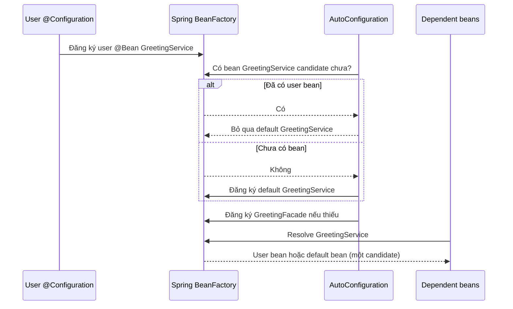

# Kiểm thử auto-configuration — Xác minh auto-configuration nhường quyền cho cấu hình người dùng

## 1. Vấn đề: starter phải tiện lợi nhưng không được áp đặt

Một thư viện Spring Boot có thể cung cấp sẵn các bean để ứng dụng dùng ngay sau khi thêm dependency. Chẳng hạn starter cho gửi thông báo tạo sẵn `NotificationClient`, starter logging tạo `AuditPublisher`, hay thư viện tích hợp đối tác cung cấp `GreetingService` mặc định.

Nhưng **cấu hình người dùng phải có quyền quyết định**. Nếu ứng dụng đã tự khai báo bean thực hiện cùng hợp đồng, auto-configuration không nên tạo thêm bản mặc định gây nhập nhằng. Đây là hành vi **back-off** — “nhường quyền” — của Spring Boot.

Ví dụ:

```java
@AutoConfiguration
class GreetingAutoConfiguration {

    @Bean
    @ConditionalOnMissingBean(GreetingService.class)
    GreetingService greetingService() {
        return name -> "Hello, " + name;
    }
}
```

Khi ứng dụng **chưa có** `GreetingService`, Spring Boot có thể tạo bean mặc định. Khi người dùng khai báo:

```java
@Configuration(proxyBeanMethods = false)
class UserConfiguration {

    @Bean("myOwnGreeting")
    GreetingService myOwnGreeting() {
        return name -> "Chào, " + name;
    }
}
```

thì auto-configuration đúng phải **không tạo thêm** bean mặc định. Tên `myOwnGreeting` khác `greetingService` nhưng **kiểu hợp đồng `GreetingService` trùng nhau**, nên điều kiện theo *type* phải phát hiện được.

Một bài test đạt yêu cầu không chỉ assert “context start được”. Nó cần chứng minh:

1. **Fallback tồn tại** khi không có cấu hình người dùng.
2. **Fallback biến mất** khi có bean người dùng phù hợp.
3. Bean sau cùng **chính là** bean của người dùng, không phải bean mặc định được đổi tên.
4. Những beans auto-config khác **còn hợp lệ** vẫn có thể được tạo và sử dụng bean tùy chỉnh.
5. Điều kiện khác như properties, classpath, context hierarchy và thứ tự auto-config không phá back-off.
6. Không cần bật `spring.main.allow-bean-definition-overriding=true` để làm nó hoạt động.

Bài này dùng **Spring Boot 3.5.0, Java 17, Maven, JUnit Jupiter, AssertJ, ApplicationContextRunner** để kiểm tra một auto-configuration mẫu bằng các contexts nhỏ, độc lập và xác định.

## 2. Cần phân biệt ba cơ chế thường bị gọi chung là “override”

| Cơ chế | Bản chất | Điều nên kiểm |
| --- | --- | --- |
| **Auto-configuration back-off** | Bean mặc định **không được đăng ký** khi phát hiện user bean | Không có bean default; chỉ bean người dùng phù hợp |
| **Bean-definition overriding** | Hai bean definitions **cùng tên** và bean sau thay bean trước | Đây là cơ chế khác; không dùng làm chiến lược back-off |
| **@Primary / @Qualifier** | Nhiều beans **đều tồn tại**, DI chọn một candidate | Count vẫn có nhiều bean; không chứng minh default đã nhường |
| **ConditionalOnProperty** | Feature configuration được bật/tắt theo Environment | Có thể không tạo bean auto; không đồng nghĩa xóa user bean |
| **@ConditionalOnSingleCandidate** | Chỉ chạy khi có một candidate phù hợp hoặc một primary rõ ràng | Hữu ích cho wiring; không thay cho missing-bean back-off |
| **Bean replacement trong test** | MockitoBean/mock hoặc test override bean | Dễ che mất registration thực; không dùng làm bằng chứng duy nhất |

**Nhường quyền** nghĩa là auto-config chủ động không cung cấp một bean mà người dùng đã tự cung cấp. Nó không phải để bean auto-config tạo ra trước, sau đó bị thay thế bằng một definition trùng tên.

### Ví dụ sai nhận thức

```java
// Không phải bằng chứng auto-configuration đã nhường quyền.
@Bean("greetingService")
GreetingService greetingService() {
    return new CustomGreetingService();
}
```

Nếu auto-config cũng cố đăng ký bean tên `greetingService` và application cho phép definition overriding, chương trình có thể khởi động nhưng đang dựa vào **đè tên bean**, không chứng minh condition đúng. Cách kiểm mạnh hơn là user bean **khác tên**, assert **không có** default bean và kiểm reference identity.

## 3. Cơ chế Spring Boot: các conditions nhìn thấy bean definitions

`@ConditionalOnMissingBean` là condition dựa trên `BeanFactory`. Nó kiểm những **bean definitions đã được xử lý đến thời điểm evaluation**.



Điểm dễ gây bug: **condition không nhìn thấy tương lai**. Nếu một bean definition của loại cần thiết chưa được register khi condition chạy, Spring Boot không thể đoán rằng nó sẽ xuất hiện sau.

Spring Boot sắp xếp các auto-configuration classes **sau user configuration**, vì thế `@ConditionalOnBean`/`@ConditionalOnMissingBean` đặc biệt thích hợp trong auto-configuration. Nhưng nếu hai auto-configurations phụ thuộc nhau, cần chỉ rõ thứ tự bằng `@AutoConfiguration(after = ...)` hoặc `@AutoConfigureAfter`.

### Không nhầm registration với instantiation

- **Registration/condition evaluation:** quyết định bean definitions nào được khai báo.
- **Instantiation:** Spring tạo object beans, dependency injection, lifecycle callbacks.
- `@AutoConfiguration(after=...)` thay đổi thứ tự **definitions được xử lý**, không bắt buộc object được instantiate trước nhau.
- Một bean có thể được khai báo nhưng chưa instantiate nếu lazy; “có definition” thường đã đủ cho bean condition.
- Một bean condition có thể dùng **return type** từ `@Bean` method; nếu method trả `Object`/interface quá rộng, metadata có thể không đủ để phát hiện implementation mong muốn.

Không nên viết test dựa trên “constructor của bean A in ra trước bean B” để chứng minh thứ tự auto-config. Hãy kiểm expected bean definitions/conditions và injection graph.

## 4. @ConditionalOnMissingBean: type, name, search và candidate semantics

### 4.1. Theo type — cách thường phù hợp nhất

```java
@Bean
@ConditionalOnMissingBean(GreetingService.class)
GreetingService greetingService() { ... }
```

Ý nghĩa: khi đã có candidate `GreetingService` phù hợp, bean mặc định sẽ không đăng ký. Bean người dùng **không cần trùng tên**.

Nếu annotation không có `value`/`type`/`name`/`annotation` trên `@Bean` method, Spring Boot mặc định suy ra type từ **return type của method**:

```java
@Bean
@ConditionalOnMissingBean
GreetingService greetingService() { ... }
```

Trường hợp này cũng nhường theo `GreetingService`. Trong bài mẫu, ta ghi rõ `GreetingService.class` vì muốn hợp đồng override dễ nhìn thấy và tránh việc một refactor return type làm đổi hành vi condition.

### 4.2. Theo name — có ý nghĩa khác theo type

```java
@Bean("systemClock")
@ConditionalOnMissingBean(name = "systemClock")
Clock defaultClock() { ... }
```

Condition theo **name** quan sát bean tên `systemClock`. Một user bean `Clock` tên `customClock` có thể **không** làm condition này back-off. Nó chỉ thích hợp nếu tên thực sự là contract muốn bảo vệ.

**Cảnh báo:** ví dụ trên là trích đoạn, phải có imports/`Clock` thích hợp trước khi compile. Trong ứng dụng muốn người dùng thay mọi implementation `Clock`, điều kiện theo **type `Clock.class`** thường là lựa chọn chuẩn hơn.

### 4.3. Theo type String, annotation, ignored và hierarchy

`@ConditionalOnMissingBean` hỗ trợ:

- `value = {SomeType.class}` hoặc `type = "fully.qualified.TypeName"`.
- `name = "beanName"`.
- `annotation = SomeMarker.class`.
- `ignored = ...` / `ignoredType = ...` để bỏ qua một số candidate.
- `parameterizedContainer = ...` để xem generic container types phù hợp.
- `search = SearchStrategy.ALL/CURRENT/ANCESTORS` để quyết định scope tìm trong parent-child contexts.

**Đừng nhầm `SearchStrategy.ALL` với quét toàn bộ JVM**. Nó chỉ liên quan hierarchy của `ApplicationContext`. Theo mặc định, candidate trong parent context có thể ảnh hưởng missing-bean condition ở child. Với hệ thống không có parent contexts, hành vi đơn giản hơn.

### 4.4. Autowire-candidate và default-candidate

Condition quan sát bean candidates theo tiêu chí framework, không đơn thuần “mỗi class instance thuộc interface là match”. Một số definitions không phải autowire candidates hoặc default candidates sẽ được bỏ qua; có thể có khác biệt theo Spring Framework/Boot version.

Vì vậy, nếu user bean được đánh dấu để không tham gia autowiring, đừng mặc định nó sẽ chặn fallback. Đây là edge case cần một test riêng nếu starter của bạn hỗ trợ các scopes/candidate flags đặc biệt.

### 4.5. @Primary không làm bean mặc định tồn tại

Nếu có hai user beans cùng implement `GreetingService` và một cái `@Primary`, auto-config vẫn phải back-off vì **đã có user beans**. `@Primary` chỉ giúp DI chọn một trong hai khi cần một candidate; không làm điều kiện missing-bean nhìn thấy “zero beans”.

## 5. Đúng vai trò của @AutoConfiguration và file imports

Trong Spring Boot 3.x, auto-configuration được đánh dấu:

```java
@AutoConfiguration
public class GreetingAutoConfiguration {
    // @Bean methods với conditions
}
```

Để một library được Spring Boot app nhận tự động khi dependency có mặt, file JAR cần:

```text
META-INF/spring/org.springframework.boot.autoconfigure.AutoConfiguration.imports
```

với mỗi fully qualified auto-configuration class name ở **một dòng**:

```text
example.autoconfig.GreetingAutoConfiguration
example.autoconfig.GreetingReporterAutoConfiguration
```

- File nằm dưới `src/main/resources` của library.
- Spring Boot đọc imports candidates khi ứng dụng dùng `@EnableAutoConfiguration` (thường thông qua `@SpringBootApplication`).
- **Không** thêm `@ComponentScan` vào auto-configuration để tự tìm bất kỳ component nào.
- Đặt auto-configuration ngoài package component-scan của ứng dụng; Spring Boot khuyến nghị chỉ load qua imports file.
- Không nhầm `META-INF/spring.factories` cũ với registration scheme của Boot 3.x.
- `@AutoConfiguration(after=GreetingAutoConfiguration.class)` khai báo quan hệ thứ tự khi một auto-config phụ thuộc bean definitions của auto-config khác.
- Test trong `ApplicationContextRunner` **explicitly** cấp `AutoConfigurations.of(...)`, nên không cần giả định có một `@SpringBootApplication` đang scan chúng.

Đây là lý do project runnable là **một library sample** và không cần dựng HTTP controller hoặc MainApplication riêng: mục tiêu là kiểm bean registration/conditional behavior, không kiểm web server.

## 6. @ConditionalOnBean, @ConditionalOnSingleCandidate và dependency graph

Một auto-configuration cấp hai muốn tạo `GreetingReporter` chỉ khi `GreetingFacade` tồn tại. Khi đó:

```java
@AutoConfiguration(after = GreetingAutoConfiguration.class)
@ConditionalOnBean(GreetingFacade.class)
class GreetingReporterAutoConfiguration {
    // ...
}
```

Nếu `GreetingFacade` do user tự khai báo thì vẫn được tạo Reporter; nếu không có facade nào thì Reporter nên vắng mặt.

**Không đặt toàn bộ `@ConditionalOnMissingBean(GreetingService.class)` ở cấp class** nếu auto-configuration còn có các beans khác có thể vẫn hữu ích khi user thay service. Một condition ở class level có thể làm cả facade/reporter mất, trái ý đồ.

Ví dụ lựa chọn:

| Địa điểm condition | Khi user cung cấp GreetingService | Có tạo GreetingFacade? |
| --- | --- | --- |
| `@ConditionalOnMissingBean` trên **bean service** | Bỏ default service | Có, nếu chưa có facade |
| `@ConditionalOnMissingBean` trên **cả class auto-config** | Bỏ cả class | Không, có thể sai thiết kế |
| `@ConditionalOnMissingBean(GreetingFacade.class)` trên bean facade | Chỉ nhường facade nếu user đã tạo | Đúng |
| `@ConditionalOnBean(GreetingFacade.class)` trên Reporter auto-config | Reporter chỉ khi facade tồn tại | Đúng nếu thứ tự xử lý đủ |

Nếu một downstream bean cần “duy nhất một client ứng viên”, có thể dùng `@ConditionalOnSingleCandidate(Client.class)` thay vì `@ConditionalOnBean(Client.class)`, vì có nhiều beans cạnh tranh làm injection mơ hồ. Nhưng `@Primary` có thể làm one-primary candidate đủ rõ cho `@ConditionalOnSingleCandidate`. Từng class vẫn nên có positive/negative tests.

## 7. Ma trận kiểm thử back-off

Một auto-configuration tốt cần test **không có user bean** và **có user bean**, ít nhất:

| Scenario | Service mặc định | Service người dùng | Facade | Reporter |
| --- | --- | --- | --- | --- |
| Không cấu hình user | Có | Không | Auto | Auto |
| User bean service khác tên | **Không** | Có | Auto dùng user bean | Auto |
| User service qua `withBean(...)` | **Không** | Có | Auto dùng object user | Auto |
| User tự tạo facade | Auto service vẫn có | Có thể không có | **User facade** | Auto dùng facade user |
| User tự tạo reporter | Auto service vẫn có | Có thể không có | Auto | **User reporter** |
| `demo.greeting.prefix=Bonjour` | Có, prefix tùy chỉnh | Không | Auto | Auto |
| `demo.greeting.enabled=false` | Không | Không | Không | Không |
| Feature disabled + user service | Không | Vẫn có | Không, nếu user không khai | Không |
| Feature disabled + user facade | Không | Không | Vẫn là user facade | Auto reporter có thể tồn tại |
| Hai user services, một `@Primary` | **Không** | Hai | Auto dùng primary | Auto |
| Bean unrelated `String` | Có | Không | Auto | Auto |
| Chỉ load Reporter auto-config, thiếu facade | Không (do service auto-config không load) | Không | Không | Không |

Những scenario này được kiểm bằng **mỗi run là một context mới**, không cần thay global application state hoặc `@DirtiesContext`.

## 8. Vì sao ApplicationContextRunner phù hợp hơn @SpringBootTest?

`ApplicationContextRunner` tạo một `ApplicationContext` nhỏ với **đúng những configuration classes và properties** mà test cần. Nó được thiết kế riêng cho kiểm auto-configuration.

### Ưu điểm

- Test độc lập, không khởi động toàn bộ application/web server.
- Mỗi `run(...)` có context riêng và tự đóng sau callback.
- Có thể cấp các user configs cụ thể bằng `withUserConfiguration(...)`.
- Có thể đăng ký bean trực tiếp bằng `withBean(...)`.
- Có thể thêm environment bằng `withPropertyValues(...)`.
- Có thể mô phỏng classpath vắng mặt qua `FilteredClassLoader`.
- Có thể mô phỏng parent context bằng `withParent(...)`.
- Có thể load auto-configuration theo Boot ordering bằng `AutoConfigurations.of(...)`.
- AssertJ có các assertion helpers như `hasSingleBean`, `doesNotHaveBean` và `hasFailed`.

**Lưu ý chính thức:** `ApplicationContextRunner` không dùng được khi chạy tests trực tiếp trong native image; nếu native testing là yêu cầu, cần chiến lược hỗ trợ native test khác.

### Bản chất fluent, không mutate runner gốc

```java
private final ApplicationContextRunner runner =
        new ApplicationContextRunner()
                .withConfiguration(
                    AutoConfigurations.of(
                        GreetingAutoConfiguration.class));
```

Mỗi lệnh `runner.withUserConfiguration(...).run(...)` tạo một biến thể context setup cho test tương ứng, không yêu cầu tự xóa user bean sau đó. Điều này giúp tests tránh lệ thuộc thứ tự JUnit.

### Khi nào vẫn cần @SpringBootTest?

Nếu cần kiểm auto-config được discover thật qua starter JAR, phối hợp hàng chục auto-configurations, custom scanning, application-specific conditions hoặc full bean graph, thêm ít nhất một **full integration/smoke test** với `@SpringBootTest`. Nhưng không dùng chỉ full context làm công cụ duy nhất để thử các tổ hợp condition — nó chậm và có nhiều dependencies gây nhiễu.

## 9. Project mẫu — Java 17 / Spring Boot 3.5.0

Thư viện ví dụ gồm:

- `GreetingService`: interface SPI người dùng có thể tự implement.
- `DefaultGreetingService`: implementation mặc định từ auto-config.
- `GreetingProperties`: giá trị cấu hình có default.
- `GreetingFacade`: bean phụ thuộc vào một `GreetingService`, phải dùng custom service nếu user đã cung cấp.
- `GreetingReporter`: downstream bean sử dụng facade.
- `GreetingAutoConfiguration`: tự cung cấp service/facade nếu thiếu; có feature flag.
- `GreetingReporterAutoConfiguration`: tạo Reporter khi có facade, xét đúng auto-config ordering.
- `AutoConfiguration.imports`: registration trong library.
- `GreetingAutoConfigurationTest`: test matrix xác minh fallback/back-off/identity/feature flag/primary và dependency graph.

### Cây thư mục chính xác

```text
greeting-autoconfig-demo/
├── pom.xml
└── src/
    ├── main/
    │   ├── java/example/autoconfig/
    │   │   ├── GreetingService.java
    │   │   ├── DefaultGreetingService.java
    │   │   ├── GreetingProperties.java
    │   │   ├── GreetingFacade.java
    │   │   ├── GreetingReporter.java
    │   │   ├── GreetingAutoConfiguration.java
    │   │   └── GreetingReporterAutoConfiguration.java
    │   └── resources/META-INF/spring/
    │       └── org.springframework.boot.autoconfigure.AutoConfiguration.imports
    └── test/java/example/autoconfig/
        └── GreetingAutoConfigurationTest.java
```

Toàn bộ imports, classes, dependencies và tests cần chạy `mvn test` nằm bên dưới. Không cần database, Docker, HTTP server hay config secrets.

## 10. pom.xml

```xml
<?xml version="1.0" encoding="UTF-8"?>
<project xmlns="http://maven.apache.org/POM/4.0.0"
         xmlns:xsi="http://www.w3.org/2001/XMLSchema-instance"
         xsi:schemaLocation="http://maven.apache.org/POM/4.0.0
             https://maven.apache.org/xsd/maven-4.0.0.xsd">
    <modelVersion>4.0.0</modelVersion>

    <parent>
        <groupId>org.springframework.boot</groupId>
        <artifactId>spring-boot-starter-parent</artifactId>
        <version>3.5.0</version>
        <relativePath/>
    </parent>

    <groupId>example</groupId>
    <artifactId>greeting-autoconfig-demo</artifactId>
    <version>1.0-SNAPSHOT</version>
    <packaging>jar</packaging>

    <properties>
        <java.version>17</java.version>
    </properties>

    <dependencies>
        <!-- Spring Boot core/auto-configuration and runtime context. -->
        <dependency>
            <groupId>org.springframework.boot</groupId>
            <artifactId>spring-boot-starter</artifactId>
        </dependency>

        <!-- JUnit Jupiter + ApplicationContextRunner + AssertJ. -->
        <dependency>
            <groupId>org.springframework.boot</groupId>
            <artifactId>spring-boot-starter-test</artifactId>
            <scope>test</scope>
        </dependency>
    </dependencies>
</project>
```

`spring-boot-starter` cung cấp Boot core, auto-configuration infrastructure, Spring context và logging. `spring-boot-starter-test` mang `spring-boot-test`, JUnit Jupiter và AssertJ. **Không cần** thêm `spring-boot-starter-web` chỉ để kiểm một `@ConditionalOnMissingBean`.

Nếu xây starter cho người dùng thật, có thể tách module `autoconfigure` khỏi module `starter` để tránh kéo dependencies không cần thiết; mẫu một module này chọn sự đơn giản. Không đặt tên artifact bắt đầu bằng `spring-boot-` của Open Source Spring Boot nếu không thuộc Spring Boot project.

## 11. GreetingService.java — contract người dùng thay được

`src/main/java/example/autoconfig/GreetingService.java`:

```java
package example.autoconfig;

@FunctionalInterface
public interface GreetingService {

    String greet(String name);
}
```

Đây là **SPI/contract**. User application có thể implement class khác, dùng lambda, tạo bean qua `@Bean`, hoặc inject Bean từ test runner.

Một condition **theo `GreetingService.class`** thể hiện chủ đích: “nếu người dùng có bất cứ implementation nào của contract thì nhường”. Nếu condition chỉ kiểm `DefaultGreetingService.class`, custom implementation **khác concrete type** có thể không làm fallback biến mất — sai mục tiêu.

## 12. DefaultGreetingService.java — implementation mặc định

`src/main/java/example/autoconfig/DefaultGreetingService.java`:

```java
package example.autoconfig;

public record DefaultGreetingService(String prefix)
        implements GreetingService {

    @Override
    public String greet(String name) {
        return prefix + ", " + name;
    }
}
```

Java 17 record mang state bất biến đơn giản. Auto-configuration tạo nó khi thiếu mọi user `GreetingService` phù hợp. Đây không phải một `@Component` tự động bị component scan lấy vào — bean được tạo **chỉ thông qua conditional @Bean method**.

Nếu đặt `@Component` trên DefaultGreetingService hoặc đưa nó vào package scan, bean có thể được đăng ký bất chấp condition; điều đó làm sai contract back-off của starter.

## 13. GreetingProperties.java — cấu hình riêng của starter

`src/main/java/example/autoconfig/GreetingProperties.java`:

```java
package example.autoconfig;

import org.springframework.boot.context.properties.ConfigurationProperties;

@ConfigurationProperties(prefix = "demo.greeting")
public class GreetingProperties {

    private String prefix = "Hello";

    public String getPrefix() {
        return prefix;
    }

    public void setPrefix(String prefix) {
        this.prefix = prefix;
    }
}
```

Các properties của thư viện có namespace riêng `demo.greeting`. Không sử dụng `spring.*` hay `server.*` cho một thư viện tùy chỉnh vì có thể xung đột với Spring Boot core properties.

Khi auto-config bật `@EnableConfigurationProperties(GreetingProperties.class)`, Spring bind `demo.greeting.prefix` vào bean. **Tùy chỉnh property không có nghĩa đã thay bean**; nó chỉ chỉnh default implementation nếu default bean thực sự được tạo.

Để production starter rõ ràng hơn, thêm validation và metadata annotation processor; với bài tập ưu tiên test registration và property-driven behavior.

## 14. GreetingFacade.java — phụ thuộc phải dùng đúng bean

`src/main/java/example/autoconfig/GreetingFacade.java`:

```java
package example.autoconfig;

public class GreetingFacade {

    private final GreetingService service;

    public GreetingFacade(GreetingService service) {
        this.service = service;
    }

    public String render(String person) {
        return service.greet(person);
    }

    public GreetingService delegate() {
        return service;
    }
}
```

Method `delegate()` là accessor minh họa để test **reference identity** của injected service. Mục tiêu quan trọng: khi user tạo `partnerService`, auto-created facade phải sử dụng **chính bean ấy**, không âm thầm gọi `new DefaultGreetingService(...)` trong constructor.

Sai pattern:

```java
@Bean
@ConditionalOnMissingBean(GreetingFacade.class)
GreetingFacade greetingFacade(GreetingProperties props) {
    // SAI: bỏ qua custom GreetingService mà người dùng đã cung cấp.
    return new GreetingFacade(
            new DefaultGreetingService(props.getPrefix()));
}
```

Đúng pattern là nhận bean dependency:

```java
@Bean
@ConditionalOnMissingBean(GreetingFacade.class)
GreetingFacade greetingFacade(GreetingService service) {
    return new GreetingFacade(service);
}
```

Khi user thay service, DI tự nối đúng implementation.

## 15. GreetingReporter.java — dependent bean cấp hai

`src/main/java/example/autoconfig/GreetingReporter.java`:

```java
package example.autoconfig;

public record GreetingReporter(GreetingFacade facade) {

    public String report(String name) {
        return "report:" + facade.render(name);
    }
}
```

Bean này dùng để kiểm rằng **auto-config sau** có thể sử dụng bean do user hoặc auto-config trước tạo ra. Việc service back-off **không** làm mất toàn bộ hệ sinh thái beans hợp lệ.

## 16. GreetingAutoConfiguration.java — quy tắc nhường quyền

`src/main/java/example/autoconfig/GreetingAutoConfiguration.java`:

```java
package example.autoconfig;

import org.springframework.boot.autoconfigure.AutoConfiguration;
import org.springframework.boot.autoconfigure.condition.ConditionalOnMissingBean;
import org.springframework.boot.autoconfigure.condition.ConditionalOnProperty;
import org.springframework.boot.context.properties.EnableConfigurationProperties;
import org.springframework.context.annotation.Bean;

@AutoConfiguration
@EnableConfigurationProperties(GreetingProperties.class)
@ConditionalOnProperty(
        prefix = "demo.greeting",
        name = "enabled",
        havingValue = "true",
        matchIfMissing = true)
public class GreetingAutoConfiguration {

    @Bean("greetingService")
    @ConditionalOnMissingBean(GreetingService.class)
    GreetingService greetingService(GreetingProperties properties) {
        return new DefaultGreetingService(
                properties.getPrefix());
    }

    @Bean("greetingFacade")
    @ConditionalOnMissingBean(GreetingFacade.class)
    GreetingFacade greetingFacade(GreetingService service) {
        return new GreetingFacade(service);
    }
}
```

### Phân tích từng annotation

**`@AutoConfiguration`:** định nghĩa class là một auto-config candidate. Bản thân nó không có nghĩa context test sẽ tự load nếu không khai `AutoConfigurations.of(...)` hoặc ứng dụng không dùng Boot auto-config import.

**`@EnableConfigurationProperties`:** register `GreetingProperties` và hỗ trợ binding `demo.greeting.prefix`.

**`@ConditionalOnProperty(... enabled ...)` ở cấp class:** toàn bộ **hai bean methods** chỉ chạy khi feature được bật (mặc định bật vì `matchIfMissing = true`). Khi property false, chính auto-config này không đăng ký service/facade. Tuy nhiên **user beans không tự bị xóa**.

**`@ConditionalOnMissingBean(GreetingService.class)` trên service:** nếu user tạo implementation bất kỳ của GreetingService, default service không được đăng ký.

**`@ConditionalOnMissingBean(GreetingFacade.class)` trên facade:** nếu user đã tự cung cấp facade, default facade không đăng ký. Đây là một điều kiện độc lập với việc người dùng có thay service hay không.

**`GreetingFacade(GreetingService service)`:** Boot inject service candidate sau condition evaluation. Với user service, facade chọn user service. Với default service, facade chọn default.

### Vì sao không đặt @ConditionalOnMissingBean ở class level?

Nếu đặt:

```java
@AutoConfiguration
@ConditionalOnMissingBean(GreetingService.class)
class WrongAutoConfiguration { ... }
```

thì khi user cung cấp service, cả class bị skip, bao gồm những bean hỗ trợ như `GreetingFacade` mà user chưa hề định nghĩa. Nó có thể đúng cho một auto-config hoàn toàn chỉ phục vụ service ấy, nhưng **không đúng** với mục tiêu sample. Hãy đặt condition tại bean methods theo phạm vi nhường quyền thực sự.

### Vì sao tên bean vẫn quan trọng dù back-off theo type?

Tên `greetingService` dùng để assertion cho default không còn tồn tại khi user service khác tên. Name là **dấu hiệu test**, còn logic back-off dùng type `GreetingService.class`. Hai thứ không tương đương.

## 17. GreetingReporterAutoConfiguration.java — thứ tự và downstream

`src/main/java/example/autoconfig/GreetingReporterAutoConfiguration.java`:

```java
package example.autoconfig;

import org.springframework.boot.autoconfigure.AutoConfiguration;
import org.springframework.boot.autoconfigure.condition.ConditionalOnBean;
import org.springframework.boot.autoconfigure.condition.ConditionalOnMissingBean;
import org.springframework.context.annotation.Bean;

@AutoConfiguration(after = GreetingAutoConfiguration.class)
@ConditionalOnBean(GreetingFacade.class)
public class GreetingReporterAutoConfiguration {

    @Bean("greetingReporter")
    @ConditionalOnMissingBean(GreetingReporter.class)
    GreetingReporter greetingReporter(GreetingFacade facade) {
        return new GreetingReporter(facade);
    }
}
```

**Lý do của after:**

- Khi Boot xử lý condition `@ConditionalOnBean(GreetingFacade.class)`, definition của facade từ auto-config trước **đã có cơ hội được đăng ký**.
- Nếu sau class không có thứ tự xác định, condition có thể bị đánh giá khi chưa có definition mà lẽ ra sẽ xuất hiện.
- Spring Boot sắp xếp auto-configurations theo annotations, không dựa vào thứ tự người viết truyền classes cho `AutoConfigurations.of(...)`.
- `@ConditionalOnMissingBean(GreetingReporter.class)` giúp user thay reporter riêng mà không xóa service/facade auto.
- Class-level `@ConditionalOnBean` có nghĩa nếu không có facade, **Reporter auto-config** không được áp dụng.
- Nếu user tự tạo facade và feature chính disabled, reporter auto-config **vẫn có thể chạy** — hai conditions không tự ràng buộc vào cùng feature flag.

### Thứ tự không bảo đảm object construction order

Ví dụ test không yêu cầu constructor `GreetingAutoConfiguration` chạy trước constructor `GreetingReporterAutoConfiguration`. Nó chỉ đòi BeanFactory có đúng dependency graph sau refresh. Đó là contract công khai có thể quan sát được.

## 18. AutoConfiguration.imports — khai báo thư viện

`src/main/resources/META-INF/spring/org.springframework.boot.autoconfigure.AutoConfiguration.imports`:

```text
example.autoconfig.GreetingAutoConfiguration
example.autoconfig.GreetingReporterAutoConfiguration
```

Không cần `spring.factories` entry riêng để đăng ký auto-config trên Spring Boot 3.5. Không gắn `@Component` lên hai auto-config classes rồi mong auto-scan là chính sách support: file imports là đường chuẩn.

Nếu rename package/class, xem `AutoConfiguration.replacements` cho migration của existing auto-config class names, nhất là khi consumers đã dùng `exclude` hoặc `before/after` references.

Trong ApplicationContextRunner test, chúng ta khai explicit `AutoConfigurations.of(...)` để kiểm isolated conditions; file imports được đưa vào library JAR để hỗ trợ **discovery thực sự** khi consumer application thêm starter. Để chứng minh file imports được packaged đúng và consumer app discover, cần một smoke test/application context riêng, không được suy luận từ runner test đơn lẻ.

## 19. Test class hoàn chỉnh — GreetingAutoConfigurationTest.java

`src/test/java/example/autoconfig/GreetingAutoConfigurationTest.java`:

```java
package example.autoconfig;

import static org.assertj.core.api.Assertions.assertThat;

import org.junit.jupiter.api.Test;

import org.springframework.boot.autoconfigure.AutoConfigurations;
import org.springframework.boot.test.context.runner.ApplicationContextRunner;
import org.springframework.context.annotation.Bean;
import org.springframework.context.annotation.Configuration;
import org.springframework.context.annotation.Primary;

class GreetingAutoConfigurationTest {

    // Đảo thứ tự truyền có chủ đích: AutoConfigurations.of
    // phải dùng Boot auto-configuration ordering/after metadata.
    private final ApplicationContextRunner runner =
            new ApplicationContextRunner()
                .withConfiguration(AutoConfigurations.of(
                    GreetingReporterAutoConfiguration.class,
                    GreetingAutoConfiguration.class));

    @Test
    void defaultsExistWhenNoUserBeanIsProvided() {
        runner.run(context -> {
            assertThat(context).hasSingleBean(GreetingService.class);
            assertThat(context).hasSingleBean(GreetingFacade.class);
            assertThat(context).hasSingleBean(GreetingReporter.class);

            GreetingService service =
                    context.getBean(GreetingService.class);

            assertThat(service)
                    .isInstanceOf(DefaultGreetingService.class);
            assertThat(service.greet("Lan"))
                    .isEqualTo("Hello, Lan");

            assertThat(context.getBean(GreetingFacade.class)
                    .delegate()).isSameAs(service);

            assertThat(context.getBean(GreetingReporter.class)
                    .report("QA")).isEqualTo("report:Hello, QA");
        });
    }

    @Test
    void userServiceWithDifferentNameMakesDefaultBackOff() {
        runner.withUserConfiguration(UserServiceConfiguration.class)
                .run(context -> {

            assertThat(context).hasSingleBean(GreetingService.class);
            assertThat(context).hasBean("partnerGreetingService");
            assertThat(context).doesNotHaveBean("greetingService");

            GreetingService supplied =
                    context.getBean("partnerGreetingService",
                            GreetingService.class);

            assertThat(context.getBean(GreetingService.class))
                    .isSameAs(supplied);
            assertThat(context.getBean(GreetingFacade.class)
                    .delegate()).isSameAs(supplied);

            assertThat(context.getBean(GreetingFacade.class)
                    .render("Lan")).isEqualTo("Chào, Lan");

            assertThat(context.getBean(GreetingReporter.class)
                    .report("Lan")).isEqualTo("report:Chào, Lan");
        });
    }

    @Test
    void programmaticallyRegisteredUserBeanWinsByType() {
        GreetingService userObject = name -> "Hola, " + name;

        runner.withBean("externalGreeting",
                        GreetingService.class,
                        () -> userObject)
                .run(context -> {

            assertThat(context).hasSingleBean(GreetingService.class);
            assertThat(context).hasBean("externalGreeting");
            assertThat(context).doesNotHaveBean("greetingService");

            assertThat(context.getBean(GreetingService.class))
                    .isSameAs(userObject);
            assertThat(context.getBean(GreetingFacade.class)
                    .delegate()).isSameAs(userObject);
        });
    }

    @Test
    void customFacadeSuppressesOnlyDefaultFacade() {
        runner.withUserConfiguration(UserFacadeConfiguration.class)
                .run(context -> {

            assertThat(context).hasSingleBean(GreetingService.class);
            assertThat(context.getBean(GreetingService.class))
                    .isInstanceOf(DefaultGreetingService.class);

            assertThat(context).hasSingleBean(GreetingFacade.class);
            assertThat(context).hasBean("customFacade");
            assertThat(context).doesNotHaveBean("greetingFacade");

            assertThat(context.getBean(GreetingFacade.class)
                    .render("Lan")).isEqualTo("Manual: Lan");

            assertThat(context.getBean(GreetingReporter.class)
                    .report("Lan"))
                    .isEqualTo("report:Manual: Lan");
        });
    }

    @Test
    void customReporterSuppressesOnlyDefaultReporter() {
        runner.withUserConfiguration(UserReporterConfiguration.class)
                .run(context -> {

            assertThat(context).hasSingleBean(GreetingService.class);
            assertThat(context).hasSingleBean(GreetingFacade.class);
            assertThat(context).hasSingleBean(GreetingReporter.class);

            assertThat(context).hasBean("customReporter");
            assertThat(context).doesNotHaveBean("greetingReporter");

            assertThat(context.getBean(GreetingReporter.class)
                    .report("QA"))
                    .isEqualTo("report:UserReport:QA");
        });
    }

    @Test
    void propertyCustomizesAutoProvidedService() {
        runner.withPropertyValues(
                    "demo.greeting.prefix=Bonjour")
                .run(context -> {

            GreetingService service =
                    context.getBean(GreetingService.class);

            assertThat(service)
                    .isInstanceOf(DefaultGreetingService.class);
            assertThat(service.greet("Lan"))
                    .isEqualTo("Bonjour, Lan");
            assertThat(context.getBean(GreetingFacade.class)
                    .render("Lan")).isEqualTo("Bonjour, Lan");
        });
    }

    @Test
    void propertyDoesNotReplaceAnExistingUserService() {
        runner.withUserConfiguration(UserServiceConfiguration.class)
                .withPropertyValues(
                    "demo.greeting.prefix=Bonjour")
                .run(context -> {

            assertThat(context).hasSingleBean(GreetingService.class);
            assertThat(context).doesNotHaveBean("greetingService");
            assertThat(context.getBean(GreetingService.class)
                    .greet("Lan")).isEqualTo("Chào, Lan");
        });
    }

    @Test
    void featureFlagFalseDisablesAutoProvidedBeans() {
        runner.withPropertyValues(
                    "demo.greeting.enabled=false")
                .run(context -> {

            assertThat(context)
                    .doesNotHaveBean(GreetingService.class);
            assertThat(context)
                    .doesNotHaveBean(GreetingFacade.class);
            assertThat(context)
                    .doesNotHaveBean(GreetingReporter.class);
        });
    }

    @Test
    void disablingAutoConfigDoesNotDeleteUserService() {
        runner.withUserConfiguration(UserServiceConfiguration.class)
                .withPropertyValues(
                    "demo.greeting.enabled=false")
                .run(context -> {

            assertThat(context).hasSingleBean(GreetingService.class);
            assertThat(context).hasBean("partnerGreetingService");
            assertThat(context).doesNotHaveBean("greetingService");
            assertThat(context)
                    .doesNotHaveBean(GreetingFacade.class);
            assertThat(context)
                    .doesNotHaveBean(GreetingReporter.class);
        });
    }

    @Test
    void independentReporterCanUseUserFacadeEvenWhenDisabled() {
        runner.withUserConfiguration(UserFacadeConfiguration.class)
                .withPropertyValues(
                    "demo.greeting.enabled=false")
                .run(context -> {

            assertThat(context)
                    .doesNotHaveBean(GreetingService.class);
            assertThat(context).hasSingleBean(GreetingFacade.class);
            assertThat(context).hasSingleBean(GreetingReporter.class);

            assertThat(context).hasBean("customFacade");
            assertThat(context.getBean(GreetingReporter.class)
                    .report("Lan")).isEqualTo("report:Manual: Lan");
        });
    }

    @Test
    void twoUserServicesWithPrimaryStillPreventFallback() {
        runner.withUserConfiguration(MultipleUserServicesConfiguration.class)
                .run(context -> {

            assertThat(context).doesNotHaveBean("greetingService");
            assertThat(context.getBeanNamesForType(
                    GreetingService.class))
                    .containsExactlyInAnyOrder(
                        "primaryUserService",
                        "secondaryUserService");

            GreetingService primary =
                    context.getBean("primaryUserService",
                            GreetingService.class);

            assertThat(context.getBean(GreetingFacade.class)
                    .delegate()).isSameAs(primary);

            assertThat(context.getBean(GreetingReporter.class)
                    .report("QA")).isEqualTo("report:Primary:QA");
        });
    }

    @Test
    void unrelatedStringBeanDoesNotSuppressDefault() {
        runner.withBean("unrelatedText", String.class,
                        () -> "unrelated")
                .run(context -> {

            assertThat(context).hasSingleBean(GreetingService.class);
            assertThat(context.getBean(GreetingService.class))
                    .isInstanceOf(DefaultGreetingService.class);
            assertThat(context.getBean("unrelatedText"))
                    .isEqualTo("unrelated");
        });
    }

    @Test
    void reporterAloneDoesNotLoadWithoutFacade() {
        new ApplicationContextRunner()
                .withConfiguration(AutoConfigurations.of(
                    GreetingReporterAutoConfiguration.class))
                .run(context -> {

            assertThat(context)
                    .doesNotHaveBean(GreetingService.class);
            assertThat(context)
                    .doesNotHaveBean(GreetingFacade.class);
            assertThat(context)
                    .doesNotHaveBean(GreetingReporter.class);
        });
    }

    @Configuration(proxyBeanMethods = false)
    static class UserServiceConfiguration {

        @Bean("partnerGreetingService")
        GreetingService userGreetingService() {
            return name -> "Chào, " + name;
        }
    }

    @Configuration(proxyBeanMethods = false)
    static class UserFacadeConfiguration {

        @Bean("customFacade")
        GreetingFacade manualFacade() {
            return new GreetingFacade(
                    name -> "Manual: " + name);
        }
    }

    @Configuration(proxyBeanMethods = false)
    static class UserReporterConfiguration {

        @Bean("customReporter")
        GreetingReporter manualReporter() {
            return new GreetingReporter(
                new GreetingFacade(
                    name -> "UserReport:" + name));
        }
    }

    @Configuration(proxyBeanMethods = false)
    static class MultipleUserServicesConfiguration {

        @Bean("primaryUserService")
        @Primary
        GreetingService main() {
            return name -> "Primary:" + name;
        }

        @Bean("secondaryUserService")
        GreetingService secondary() {
            return name -> "Secondary:" + name;
        }
    }
}
```

**Tổng: 13 phương thức JUnit `@Test`**, mỗi method tạo một context scenario. Không có `@SpringBootTest`, Docker, database, web server hoặc external environment.

### Giải thích chi tiết các tests trọng tâm

**`defaultsExistWhenNoUserBeanIsProvided`:** phải có đúng một `GreetingService` kiểu default, đúng prefix và downstream facade/reporter hoạt động. Test này chứng minh starter “works out of the box”.

**`userServiceWithDifferentNameMakesDefaultBackOff`:** *đây là test quan trọng nhất của bài*. User bean tên `partnerGreetingService` khác default `greetingService`. Test kiểm **hasSingleBean**, **không có bean default name**, service identity là cùng object của user, và facade/reporter dùng user service.

**`programmaticallyRegisteredUserBeanWinsByType`:** dùng `ApplicationContextRunner.withBean("externalGreeting", GreetingService.class, supplier)` để mô phỏng một bean người dùng không cần tạo file `@Configuration`. Assert object **isSameAs**, không chỉ có cùng output.

**`customFacadeSuppressesOnlyDefaultFacade`:** user thay facade nhưng **không** thay service. Default service vẫn có; chỉ default facade bị skip. Reporter phải nhận user facade.

**`customReporterSuppressesOnlyDefaultReporter`:** user thay reporter, còn service và facade vẫn mặc định. Đây là test condition **theo từng bean**, không phải tắt toàn bộ auto config.

**`propertyCustomizesAutoProvidedService`:** `demo.greeting.prefix` thay default behavior nhưng không thêm user bean.

**`propertyDoesNotReplaceAnExistingUserService`:** thay property không được vô tình khiến default bean xuất hiện lại hoặc override user service.

**`featureFlagFalseDisablesAutoProvidedBeans`:** khi feature off và không có user beans, service/facade vắng, reporter cũng vắng do thiếu facade.

**`disablingAutoConfigDoesNotDeleteUserService`:** feature flag tác động auto-config, không phải lệnh dọn mọi bean cùng interface. User-provided service vẫn tồn tại.

**`independentReporterCanUseUserFacadeEvenWhenDisabled`:** một case tinh tế. User cung cấp facade trong khi main auto-config disabled; Reporter auto-config có condition riêng `@ConditionalOnBean(GreetingFacade.class)` nên vẫn tạo reporter. Điều này hợp contract sample; nếu ứng dụng muốn **tắt cả reporter khi feature flag false**, phải thêm điều kiện property vào reporter auto-config hoặc điều chỉnh design, không mặc định nó cũng disabled.

**`twoUserServicesWithPrimaryStillPreventFallback`:** hai user services tồn tại; `@Primary` chọn object cho facade, nhưng fallback default vẫn không được tạo. Test tránh nhầm “primary chọn bean” với “back-off”.

**`unrelatedStringBeanDoesNotSuppressDefault`:** chỉ có một bean `String` không liên quan, nên condition theo `GreetingService.class` phải match và tạo default.

**`reporterAloneDoesNotLoadWithoutFacade`:** chứng minh `@ConditionalOnBean(GreetingFacade.class)` ở auto-config thứ hai không tự tạo facade/service, và không có bean reporter khi dependency absent.

## 20. Tại sao assert “có một bean” là chưa đủ?

Một test như:

```java
assertThat(context).hasSingleBean(GreetingService.class);
```

có thể PASS vì default bean tồn tại, **ngay cả khi người dùng mong custom bean được chọn**. Và một test như:

```java
assertThat(context.getBean(GreetingService.class)
        .greet("Lan")).isEqualTo("Chào, Lan");
```

có thể PASS nhờ default service tình cờ tạo cùng output, không chứng minh đó là object do user định nghĩa.

Một assertion tốt cho back-off gồm **ba nhân chứng**:

1. **User bean hiện diện** ở tên đã khai và có type phù hợp.
2. **Default bean không được register** (`doesNotHaveBean("greetingService")`).
3. **Identity**: context.getBean(GreetingService.class) và dependency downstream `isSameAs(userBean)`.

Kèm `hasSingleBean(GreetingService.class)` để phát hiện default + user cả hai tồn tại, gây ambiguous injection hoặc silent `@Primary` masking. Đây là kiểm chứng mạnh hơn assert context starts.

### Loại bỏ false positives từ @Primary

Nếu trong test context có default + user và user được `@Primary`, `context.getBean(GreetingService.class)` sẽ chọn user và output đúng. Tuy nhiên default **vẫn tồn tại** và có thể được tiêm bằng qualifier/name ở nơi khác. Test cần assert **default absent**, không chỉ object cuối cùng được inject.

### Loại bỏ false positives từ bean override

Nếu both configs trùng tên và bean-definition overriding được bật, user bean có thể thay definition default theo thứ tự. Test khác tên tránh con đường này. Không cần bật `spring.main.allow-bean-definition-overriding=true` trong project mẫu; back-off đúng tự hoạt động.

## 21. @Bean return type quan trọng hơn nhiều người nghĩ

Condition đánh giá dựa trên bean metadata, trong đó có **declared return type** của `@Bean` methods. Ví dụ:

```java
@Bean
Object userGreeting() {
    return new CustomGreetingService();
}
```

Bean được runtime tạo ra là GreetingService, nhưng tại thời điểm bean definitions được xử lý, thông tin declared type chỉ là `Object`. Tùy context/type prediction, `@ConditionalOnMissingBean(GreetingService.class)` có thể **không thấy** implementation và đăng ký default. Khi refresh, app có thể có hai beans cùng type hoặc behavior không như mong muốn.

Đúng hơn:

```java
@Bean
GreetingService userGreeting() {
    return new CustomGreetingService();
}
```

hoặc khai một concrete return type đủ cụ thể. Spring Boot docs khuyến nghị `@Bean` method nêu **càng nhiều type information càng tốt**, đặc biệt khi dùng bean conditions.

### Khi return interface vẫn hợp lý

Trong `GreetingAutoConfiguration` sample, method trả `GreetingService` và condition **ghi rõ `GreetingService.class`**. Điều này cố ý làm SPI contract là type để user override. Với integrations cần phát hiện subclasses/concrete types đặc biệt, expose return type phù hợp và viết thêm tests.

### Generic factory beans

Một số bean definitions biểu diễn `FactoryBean<T>` hoặc containers kiểu `ObjectProvider<T>`. `@ConditionalOnMissingBean` có options `parameterizedContainer`, `ignored` để kiểm các tình huống này. Không giả định `ObjectProvider<GreetingService>` là một bean GreetingService trực tiếp; hãy kiểm actual candidate matching semantics theo phiên bản Boot.

## 22. Tên bean, qualifiers và điều kiện type/name

### Test by type

```java
@ConditionalOnMissingBean(GreetingService.class)
```

Phù hợp khi contract là “người dùng có bất kỳ bean nào implement interface thì tự chọn”.

### Test by name

```java
@ConditionalOnMissingBean(name = "greetingService")
```

Phù hợp nếu tên bean là public contract có chủ đích. Nhưng nếu user khai `@Bean("partnerGreetingService")` thì condition theo name vẫn thấy **thiếu greetingService** và có thể tạo default, khiến có hai beans cùng interface.

### Điều kiện kết hợp type/name

```java
@ConditionalOnMissingBean(
    value = GreetingService.class,
    name = "greetingService")
```

Theo semantics condition, các requirements phải **đều không được đáp ứng** để condition match. Đừng đọc nó như câu “chỉ missing khi thiếu bean có cả type lẫn name” một cách tùy tiện; hiểu chính xác việc kiểm các requirements độc lập. Khi policy thực sự là one SPI implementation, dùng một condition theo **type** để tránh thiết kế phức tạp không cần thiết.

### @Qualifier không cứu condition sai

Một application có thể giải quyết DI bằng:

```java
@Qualifier("partnerGreetingService")
GreetingService service
```

nhưng nếu auto-created default vẫn tồn tại, nó vẫn có thể bị inject ở nơi khác và làm behavior khác nhau. `@Qualifier` giải quyết chỗ inject, **không** chứng minh back-off đúng.

## 23. Khi user cung cấp nhiều candidate

Với hai user `GreetingService` beans:

- `@ConditionalOnMissingBean(GreetingService.class)` nên back-off vì **đã có candidate**.
- Nếu không có `@Primary` hoặc qualifier, `GreetingFacade(GreetingService)` có thể fail với `NoUniqueBeanDefinitionException` khi Spring muốn inject một bean.
- Có `@Primary`, injection có thể thành công; test chứng minh default không được tạo.
- Nếu chủ ý hỗ trợ nhiều implementations, thiết kế auto-config nên inject `List<GreetingService>`/`Map<String,GreetingService>` hoặc có selection property và rõ conflict policy.
- `@ConditionalOnSingleCandidate(GreetingService.class)` hữu ích khi chỉ muốn tạo client/facade nếu dependency chọn được rõ ràng.

**Không lén bật bean overriding** để né ambiguity; nó không giải quyết hai beans **khác tên** cùng type.

## 24. @ConditionalOnProperty và sự khác biệt giữa “disabled” và “user override”

Feature flag:

```java
@ConditionalOnProperty(
    prefix = "demo.greeting",
    name = "enabled",
    havingValue = "true",
    matchIfMissing = true)
```

tạo các case:

| Property | Điều kiện main auto-config | Hệ quả |
| --- | --- | --- |
| Không có | Match do matchIfMissing=true | Có thể tạo service/facade mặc định |
| `demo.greeting.enabled=true` | Match | Có thể tạo default nếu missing user beans |
| `demo.greeting.enabled=false` | Không match | Không tạo hai auto beans |
| Giá trị khác `true` | Không match theo havingValue | Không tạo auto beans |
| false + user service | Main auto-config không match | User service vẫn tồn tại |
| false + user facade | Main auto-config không match | Reporter khác có thể match vì có user facade |

**Không** mô tả property off là “toàn ApplicationContext không có bean loại đó”. Nó chỉ ngăn auto-configuration tương ứng, trừ khi các bean đó không có nguồn đăng ký khác.

### Nếu muốn một cờ tắt toàn bộ feature

Thêm `@ConditionalOnProperty` ở **mỗi auto-configuration class thuộc feature** hoặc tổ chức conditions/feature boundaries nhất quán. Sau đó test user-bean semantics riêng: disable auto không có nghĩa được phép xóa user beans.

## 25. Điều kiện classpath: @ConditionalOnClass và FilteredClassLoader

Starter thường chỉ tạo bean khi thư viện thứ ba có trong classpath:

```java
@AutoConfiguration
@ConditionalOnClass(name = "com.vendor.client.VendorClient")
class VendorClientAutoConfiguration {
}
```

Với auto-config cần optional dependency:

- Dùng `@ConditionalOnClass`/`@ConditionalOnMissingClass`.
- Test bằng `FilteredClassLoader` để mô phỏng class bị thiếu.
- Nếu method `@Bean` trả type chỉ tồn tại ở optional dependency, phải **tách nested @Configuration** với condition classpath phù hợp; nếu không JVM có thể load method/class trước khi condition bảo vệ và ném `NoClassDefFoundError`.
- Không tự tạo một dependency giả trong test rồi kết luận auto-config đã xử lý classpath missing.

Ví dụ kiểm classpath (snippet, **không thuộc project runnable vì VendorClient không có trong dependencies**):

```java
new ApplicationContextRunner()
    .withClassLoader(new FilteredClassLoader("com.vendor.client"))
    .withConfiguration(AutoConfigurations.of(
        VendorClientAutoConfiguration.class))
    .run(context -> {
        assertThat(context).doesNotHaveBean("vendorClient");
    });
```

Cần định nghĩa/config/import classes tương ứng nếu muốn chạy snippet. Mục đích: cho thấy missing-class không được xử lý bằng Mockito mock và tách biệt với missing-bean condition.

### Class conditions và user override độc lập

Một starter tốt có thể yêu cầu **cả class tồn tại** lẫn **chưa có user bean**. Test combinations:
1. Class present, user absent → default.
2. Class present, user present → back-off.
3. Class absent, user absent → không default.
4. Class absent nhưng user bean tùy chọn theo API khác → xem design cụ thể.

## 26. Parent-child ApplicationContext và SearchStrategy

Theo mặc định, `@ConditionalOnMissingBean` có thể xét bean candidates ở parent context tùy `search=SearchStrategy.ALL`. Trong ứng dụng có child contexts (ví dụ modular web apps hoặc tests parent-child), một user bean tồn tại ở parent có thể làm default trong child **không được tạo**.

Nếu chỉ muốn xét current context:

```java
@ConditionalOnMissingBean(
    value = GreetingService.class,
    search = SearchStrategy.CURRENT)
```

Đây là trích đoạn, cần import `SearchStrategy`. `CURRENT` không nhìn parent. Chỉ dùng khi thiết kế bean scope của child thực sự cần fallback độc lập với parent; nếu không có thể tạo hai `GreetingService` trong hierarchy và khiến DI behavior khác mong đợi.

### Test parent context nếu dự án dùng hierarchy

Có thể dùng `ApplicationContextRunner.withParent(parentContext)` để tạo child runner, rồi test:

- Parent có user bean, child không có user bean.
- Với `ALL`, default child có nhường không?
- Với `CURRENT`, default child có được tạo không?
- Child dependency injection có chọn bean trong child hay parent?
- Parent/child shutdown order có ảnh hưởng resource lifecycle không?

Project core không dùng context hierarchy; không thêm parent just-for-coverage khi phần lớn applications chỉ có một context.

## 27. Debug ConditionEvaluationReport thay vì đoán

Khi một default bean xuất hiện bất ngờ, trước hết hỏi: **condition nào match và vì sao?**

Spring Boot ghi `ConditionEvaluationReport` cho các conditions:

- Positive matches: điều kiện match, configuration có thể được apply.
- Negative matches: điều kiện không match, thường có thông tin candidate/type/property.
- Unconditional auto-configuration classes: không có các conditions tương ứng.
- Không phải mọi bean đều xuất hiện trong report; report tập trung conditional auto-configurations.

Với `ApplicationContextRunner`:

```java
import org.springframework.boot.autoconfigure.logging.ConditionEvaluationReportLoggingListener;
import org.springframework.boot.logging.LogLevel;
import org.springframework.boot.test.context.runner.ApplicationContextRunner;

ApplicationContextRunner debugRunner =
        new ApplicationContextRunner()
            .withInitializer(
                ConditionEvaluationReportLoggingListener
                    .forLogLevel(LogLevel.INFO));
```

Đây là snippet về logger, không thay thế runner trong test class đầy đủ. Bạn có thể gọi `debugRunner.withConfiguration(...).run(...)` để in report tùy logging config. Spring Boot 3.5 còn hỗ trợ in condition report trong một số test failure flows.

**Đừng assert nguyên text/ordering của report** làm tiêu chí chính cho test back-off: wording thay đổi theo versions. Ưu tiên assert beans và behavior như tests mẫu; report để chẩn đoán.

### Cách điều tra thực tế

1. Xác nhận `GreetingAutoConfiguration` có được import không.
2. Xác nhận context đã load user `@Configuration`.
3. Kiểm `@Bean` declared return type có đúng interface không.
4. Kiểm `@ConditionalOnMissingBean` đang kiểm theo type hay name.
5. Kiểm bean không bị ignore vì autowire/default-candidate settings.
6. Kiểm feature flag và profile/property sources.
7. Kiểm thứ tự giữa các auto-config classes.
8. Xem ConditionEvaluationReport để biết condition decisions.
9. Dùng `ApplicationContextRunner` viết lại scenario nhỏ nhất.
10. Chạy thêm một full-app smoke test sau khi sửa để kiểm imports-file discovery.

## 28. Thứ tự xử lý user @Configuration và auto-configuration

Spring Boot thường xử lý user-defined bean definitions trước auto-configuration beans. Đây là cơ sở cho `@ConditionalOnMissingBean` nhường quyền.

Tuy vậy có các edge cases:

- Một class được annotate `@Configuration` nhưng chưa được scan/import vào context: condition không thể nhìn thấy nó.
- Một auto-config khác định nghĩa candidate sau auto-config hiện tại: cần `after`/`before` để tránh đánh giá sớm.
- Một `@Bean Object someBean()` giấu implementation type ở registration time: type detection không chính xác.
- Một factory/conditional bean từ configuration khác chỉ xuất hiện nếu property/classpath match.
- Circular dependencies, lifecycle và `@DependsOn` ảnh hưởng bean creation, **không thay thế order metadata**.
- User configuration có bean type bị đánh dấu noncandidate: condition có thể bỏ qua nó theo semantics.
- Một test chỉ chạy `@SpringBootTest` với global test component scan có thể vô ý thêm unrelated configuration và làm condition khác production.

**Giữ test context rõ ràng**: với runner, khai explicit `withUserConfiguration(UserConfig.class)` và `withConfiguration(AutoConfigurations.of(...))`, không làm một scan rộng cho toàn test package.

## 29. @Primary, @ConditionalOnSingleCandidate và bean uniqueness

Một bean `@Primary` vẫn là bean bình thường và tham gia candidate lookup. Khi có 2 user services và 1 primary:

```java
@Configuration(proxyBeanMethods = false)
class UserServices {

    @Bean
    @Primary
    GreetingService primary() {
        return name -> "primary:" + name;
    }

    @Bean
    GreetingService secondary() {
        return name -> "secondary:" + name;
    }
}
```

Hai user beans tồn tại ⇒ fallback auto không nên đăng ký. Spring injection `GreetingFacade(GreetingService)` có thể nhận primary.

`@ConditionalOnSingleCandidate(GreetingService.class)` phù hợp trong một auto-config khác khi cần một candidate duy nhất hoặc một primary rõ ràng. Nhưng nếu mục tiêu là “không tạo default khi có *bất kỳ* user GreetingService”, thì `@ConditionalOnMissingBean` vẫn là guard đúng.

Không viết unit test chỉ nhìn `getBean(GreetingService.class)`, vì `@Primary` có thể che đi một default bean đăng ký sai. Kiểm **bean names for type** và **absence của default name** như sample.

## 30. Khi nào nên dùng @ConditionalOnMissingBean ở cấp class?

Có trường hợp hợp lý:

```java
@AutoConfiguration
@ConditionalOnMissingBean(AuditPipeline.class)
class AuditPipelineAutoConfiguration {

    @Bean
    AuditPipeline auditPipeline() { ... }

    @Bean
    AuditHelper helper() { ... }
}
```

Nếu cả `AuditHelper` chỉ có ý nghĩa khi auto-config sở hữu AuditPipeline, việc bỏ cả configuration khi user pipeline đã có có thể là đúng. Nhưng nếu helper phải dùng chung cho mọi pipeline, class-level condition có thể khiến helper mất. Quyết định cần dựa vào **contract công khai**, không chỉ việc annotation đặt đâu tiện hơn.

**Test cả phụ thuộc còn cần thiết khi override**. User thay service nhưng vẫn cần health indicator, metrics binder, report publisher hoặc interceptors? Đặt conditions per bean thích hợp, test riêng each behavior.

## 31. Test negative cases đúng cách

Một suite chỉ có cases PASS cho default/case user có thể bỏ sót lỗi. Những negative witnesses tốt:

| Mutation/lỗi cố ý | Test nào phải fail? |
| --- | --- |
| Xóa `@ConditionalOnMissingBean(GreetingService.class)` | `userServiceWithDifferentNameMakesDefaultBackOff` và bean uniqueness |
| Đổi condition thành `name="greetingService"` | User bean khác tên vẫn để fallback; test fail |
| Cho facade tự `new DefaultGreetingService` | Identity check và output custom fail |
| Xóa `@ConditionalOnMissingBean(GreetingFacade.class)` | User facade test xuất hiện duplicate/fail |
| Bỏ `@ConditionalOnMissingBean(GreetingReporter.class)` | User reporter test xuất hiện duplicate/fail |
| Xóa `@AutoConfiguration(after=...)` | Reporter test có thể fail tùy registration order |
| Đặt `@ConditionalOnMissingBean(GreetingService.class)` ở class-level | User service làm mất auto facade/reporter |
| Đổi `matchIfMissing=false` | No-property default test fail |
| Bỏ condition enabled | Disabled property test fail |
| Để custom prefix ghi đè user service | User+property test fail |
| Chỉ assert @Primary chosen, không assert default absent | Mutation có thể không bị phát hiện |

**Mutation testing** (PIT hoặc chỉnh code tạm trong local branch) hữu ích để chứng minh test phát hiện lỗi thật. Không cần cố ý commit mutation vào source.

## 32. Run Maven — kết quả dự kiến

Điều kiện:

- JDK **17+**.
- Maven 3.x tương thích Spring Boot 3.5.
- Có khả năng tải Maven artifacts nếu chưa cache.
- Toàn bộ files được tạo đúng đường dẫn package/resources như mục 9.
- Không yêu cầu Docker, broker, database hoặc web server.

Tại thư mục `greeting-autoconfig-demo`:

```bash
mvn test
```

Chạy riêng class:

```bash
mvn test -Dtest=GreetingAutoConfigurationTest
```

Số lượng:

| Test class | `@Test` methods | Mục đích |
| --- | ---: | --- |
| `GreetingAutoConfigurationTest` | **13** | Default, user overrides, dependency graph, properties, primary, negative cases |
| **Tổng** | **13** | 13 lượt kiểm thử dự kiến |

**Kỳ vọng: 13 tests PASS, 0 failures/errors/skips** trên môi trường tương thích. Đây là **kỳ vọng từ source**, không phải kết quả `mvn test` đã được chạy trong quá trình soạn bài. Khi thực thi, kiểm `target/surefire-reports` để xác minh số lượt, test discovery và root cause nếu có lỗi.

Không có stdout Java cố định; JUnit/Spring Boot logs và execution time phụ thuộc môi trường. Không dựng số lượng test pass giả từ log chưa chạy.

### Khi test start lỗi thay vì assert fail

`ApplicationContextRunner.run(...)` cho phép inspect failed startup:

```java
runner.withUserConfiguration(BadConfig.class)
      .run(context -> {
          assertThat(context).hasFailed();
          assertThat(context.getStartupFailure())
              .hasRootCauseInstanceOf(
                  NoUniqueBeanDefinitionException.class);
      });
```

**Snippet không thuộc project runnable**: cần tạo `BadConfig` và import `NoUniqueBeanDefinitionException`. Nó minh họa cách kiểm một failure **có chủ đích** khi nhiều beans mà không có primary. Không nên viết test “pass nếu context fail” cho một case lẽ ra phải hoạt động; test negative phải xác định chính xác expected error.

## 33. Kiểm tra registration trong JAR khi phát hành starter

Unit runner tests load auto-config classes **explicitly**. Chúng không tự chứng minh Spring Boot sẽ discover chúng qua `AutoConfiguration.imports` ở consumer application.

Một checklist publish:

1. Build JAR bằng `mvn package`.
2. Kiểm file `META-INF/spring/org.springframework.boot.autoconfigure.AutoConfiguration.imports` được include.
3. Kiểm names trong imports file đúng với compiled classes.
4. Một consumer application nhỏ thêm dependency của starter rồi chạy `@SpringBootTest` với `@SpringBootApplication`.
5. Không khai user bean ⇒ fallback xuất hiện.
6. Có user bean khác tên ⇒ fallback nhường quyền.
7. Nếu consumer đã khai exclusions (`excludeName` / `spring.autoconfigure.exclude`), behavior phải rõ.
8. Không để auto-config bị component-scan trực tiếp, làm duplicate registrations.
9. Release documentation phải mô tả SPI override và properties namespace rõ ràng.

Không dùng `@Import(GreetingAutoConfiguration.class)` trong consumer as usual nếu mục tiêu là chứng minh **auto-discovery**. `@Import` có thể làm bean xuất hiện dù imports file thiếu; test xanh giả.

### Khác biệt AutoConfigurations.of và @Import

- `AutoConfigurations.of(...)`: Spring Boot test helper sắp auto-configuration theo ordering metadata, phù hợp runner.
- `@ImportAutoConfiguration(...)`: Spring Boot dùng để thêm auto-config vào một context/slice với semantics đúng.
- `@Import(...)`: regular Spring import; có thể không phản ánh toàn bộ auto-configuration ordering/filtering behavior.
- **Không xem một test chỉ @Import là bằng chứng starter sẽ tự kích hoạt ở app thật**.

## 34. Các lỗi thường gặp và nguyên nhân

| Triệu chứng | Nguyên nhân khả dĩ | Cách sửa/test |
| --- | --- | --- |
| User có GreetingService nhưng default vẫn xuất hiện | Thiếu/wrong `@ConditionalOnMissingBean` | Guard theo `GreetingService.class` và test user bean khác tên |
| Có hai implementations, injection fail | Default không back-off hoặc nhiều user beans không primary | Assert bean names, thiết kế selection |
| User bean trùng tên mới chạy được | Dựa vào bean definition overriding | Dùng user bean khác tên trong test |
| `@Primary` làm ứng dụng chạy nhưng default vẫn có | Primary chỉ giải quyết DI | Assert absent default, one-bean policy |
| Facade vẫn dùng default dù user thay service | Facade tự `new` service | Inject `GreetingService` qua Spring |
| User custom facade nhưng có thêm auto facade | Thiếu `@ConditionalOnMissingBean(GreetingFacade.class)` | Guard từng bean |
| User custom reporter nhưng auto reporter duplicate | Thiếu missing bean guard reporter | Guard `GreetingReporter.class` |
| Reporter biến mất khi user thay service | Condition đặt toàn class sai phạm vi | Đặt per-bean conditions |
| Reporter vắng dù facade auto được tạo | Auto-config ordering sai | `@AutoConfiguration(after=...)` |
| Property enabled=false nhưng user service vẫn tồn tại | Đây có thể là đúng semantics | Phân biệt disable auto và xóa user bean |
| Prefix property không tác dụng | `@EnableConfigurationProperties` thiếu/binding sai | Test withPropertyValues |
| Condition không nhận bean trả Object | Declared return type thiếu thông tin | Khai type interface/concrete rõ |
| `@ConditionalOnMissingBean(name="...")` không back-off by type | Sai scope condition | Dùng value/type theo contract |
| Parent bean bất ngờ làm child default vắng | SearchStrategy.ALL | Chọn CURRENT nếu hợp use case, test hierarchy |
| Context fail vì class tùy chọn không có | @Bean method reference load sớm | Nested @Configuration + @ConditionalOnClass |
| Classpath thiếu nhưng auto-config vẫn bật | Thiếu class condition | FilteredClassLoader test |
| Test pass nhưng app consumer không có bean | Thiếu AutoConfiguration.imports | Kiểm JAR packaging + smoke test |
| Auto-config bị scan dù không có imports entry | Nằm trong component-scan package | Tách package, chỉ import qua Boot |
| Điều kiện chạy không ổn định giữa versions | Bean type metadata/candidate semantics | Xem Javadoc/ConditionEvaluationReport |
| Test chỉ assert hasSingleBean nhưng sai object | Chưa assert identity | isSameAs(user bean) |
| Test dùng @MockitoBean để thay default | Mock test không phản ánh registration thực | withUserConfiguration/withBean |
| Test toàn context rất chậm | @SpringBootTest quá rộng | ApplicationContextRunner |
| Context runner thiếu web beans | Runner là non-web context | WebApplicationContextRunner nếu web-specific |
| @ConditionalOnBean match phụ thuộc thứ tự | Bean definition chưa được register | Sắp auto-config after/before |
| Test trong native image không chạy | ApplicationContextRunner không supported | Dùng native-specific test strategy |
| Test skipped bởi Maven filter | Surefire config/test naming | Kiểm target/surefire-reports |

### Trình tự điều tra một back-off regression

1. Viết lại trường hợp nhỏ nhất bằng `ApplicationContextRunner`.
2. Xem class có được load qua `AutoConfigurations.of` hay chưa.
3. Thêm `withUserConfiguration(UserServiceConfig.class)` với bean **khác tên**.
4. Assert `hasSingleBean` + `doesNotHaveBean(defaultName)` + `isSameAs(user)`.
5. Nếu fail, xem `@ConditionalOnMissingBean` có xét type phù hợp không.
6. Kiểm declared return type của user `@Bean`.
7. Kiểm class-level conditions và enabled/property.
8. Kiểm thứ tự `@AutoConfiguration(after=...)` của dependencies.
9. Dùng ConditionEvaluationReport đọc matched/unmatched conditions.
10. Chạy full consumer smoke test để loại trừ missing imports packaging.

## 35. Khi nào cần thêm WebApplicationContextRunner / ReactiveWebApplicationContextRunner?

`ApplicationContextRunner` mẫu tạo **non-web** context. Nếu auto-config chỉ chạy trong servlet app:

```java
@ConditionalOnWebApplication(type =
        ConditionalOnWebApplication.Type.SERVLET)
```

thì test non-web sẽ không kích hoạt nó. Dùng `WebApplicationContextRunner`, tương tự reactive conditional thì `ReactiveWebApplicationContextRunner`.

Đây là hai công cụ chính thức trong Spring Boot test module. Không tự giả lập web context bằng một bean `String` tên `requestScope` rồi mong tất cả servlet conditions match; framework có web environment/context criteria cụ thể.

**Back-off semantics vẫn vậy**, chỉ environment context type khác.

## 36. Test configuration order và @ConditionalOnMissingBean

Một trường hợp nâng cao: auto-config A cung cấp `GreetingService`, auto-config B cũng có fallback cho contract ấy. Nếu B được xử lý **trước** A, B có thể đăng ký default trước khi A xuất hiện; A sau đó back-off, khiến app chọn fallback B không như dự kiến.

Cần mô tả precedence rõ:

- B muốn nhường cho A ⇒ `@AutoConfiguration(after = A.class)`.
- A muốn nhường cho B ⇒ đặt relation ngược.
- Nếu cần default fallback cuối cùng, đặt nó sau các configs có độ ưu tiên cao hơn.
- Test truyền configs theo thứ tự đảo vào `AutoConfigurations.of(...)` để xác nhận Boot sorting, như sample.
- Đừng nhầm thứ tự **method calls trong cùng một @Configuration** với auto-configuration class ordering.
- Không dùng `@Order` trên `@Bean` để thay `@AutoConfiguration(after=...)`.

Nếu hai auto-configs có circular after/before, phải thiết kế lại dependency graph, không dùng nhiều `@DependsOn` để vá condition registration.

## 37. Bảo mật, hiệu năng và vận hành

Dù chủ đề là testing, auto-configuration có ảnh hưởng lớn tới runtime:

- **Không** khởi tạo kết nối production, thread pool, scheduler hoặc client từ fallback khi user đã cung cấp bean thay thế.
- Mọi default cần có sensible timeout, resource budget và chính sách shutdown.
- Không tự thêm global admin privileges, credentials hoặc insecure SSL trong auto-config.
- Không log secrets từ configuration properties hoặc bean definitions.
- Một auto-config với bean expensive có thể làm integration tests chậm; `ApplicationContextRunner` giúp kiểm conditional registration không cần mở network.
- Nhưng nếu auto-config thực có external resources, cần integration tests để kiểm lifecycle/cleanup.
- Cẩn thận test `@ConditionalOnProperty(matchIfMissing=true)` vì feature mặc định bật có thể làm startup side effects trong app consumer.
- Không biến bean-definition overriding thành workaround: nó phụ thuộc naming/order và có thể khiến users mất khả năng mở rộng.
- Theo dõi startup condition reports khi có behavior thay đổi sau nâng Boot.
- Không dựa vào thứ tự registration không được khai báo giữa unrelated auto-config classes.

## 38. Checklist nghiệm thu

- [ ] Auto-config class có `@AutoConfiguration` và đúng imports file?
- [ ] Auto-configuration **không** nằm trong application component scan?
- [ ] Default beans được guard bằng missing-bean conditions rõ ràng?
- [ ] Conditions theo **type** khi contract cho phép user thay implementation?
- [ ] Conditions theo name chỉ khi tên là contract thực sự?
- [ ] User bean khác tên nhưng cùng interface làm default **không đăng ký**?
- [ ] `hasSingleBean` và `doesNotHaveBean(defaultName)` đều được assert?
- [ ] `isSameAs(userBean)` chứng minh identity của bean do người dùng cung cấp?
- [ ] Dependent beans inject user service thay vì `new DefaultService`?
- [ ] User thay facade/reporter không xóa những auto beans còn hợp lệ?
- [ ] Class-level condition có scope đúng, không skip cả auto-config vô ý?
- [ ] `@AutoConfiguration(after/before)` thể hiện các quan hệ phụ thuộc giữa auto-configurations?
- [ ] Không nhầm registration order với object instantiation?
- [ ] `@Primary` chỉ giải quyết DI, test vẫn kiểm default absent?
- [ ] Hai user beans không khiến default xuất hiện lần thứ ba?
- [ ] Feature flag disabled ngăn auto beans, không xóa user beans?
- [ ] Property prefix tùy chỉnh default, không override user service?
- [ ] Bean return types công khai đủ metadata để condition đánh giá?
- [ ] Candidate flags/hierarchy được kiểm nếu có use case đặc biệt?
- [ ] Missing classpath conditions được bảo vệ bằng nested config khi cần?
- [ ] Runner tests độc lập, không cần `@DirtiesContext` hay external services?
- [ ] Có ít nhất một full consumer smoke test cho imports-file discovery khi publish starter?
- [ ] Không dùng test-level mock service làm bằng chứng auto-config back-off?
- [ ] Không bật `allow-bean-definition-overriding` để làm test pass?
- [ ] JUnit/Surefire reports xác nhận tests thực chạy, không skip?
- [ ] API/version phù hợp Spring Boot 3.5 trong project sample?

## 39. Bài tập tự kiểm tra

**Câu 1.** User khai `@Bean("myService") GreetingService` nhưng auto-config guarded `@ConditionalOnMissingBean(GreetingService.class)` thì sao?

> Default service **không đăng ký** vì candidate theo type đã tồn tại, dù bean name khác. Dependent facade nhận user service nếu injection không ambiguous.

**Câu 2.** Vì sao `@Primary` không đủ để chứng minh nhường quyền?

> Primary chỉ chọn bean khi injection; cả default và custom có thể tồn tại. Cần assert default bean name **không có** và bean count/identity phù hợp.

**Câu 3.** `@ConditionalOnMissingBean` ở class level có thể gây bug nào?

> Khi user thay một bean, toàn class bị skip, dẫn tới những beans khác mà user không thay cũng biến mất. Scope điều kiện phải theo contract.

**Câu 4.** Vì sao `withUserConfiguration(...)` tốt hơn sửa Spring context đang chạy?

> Mỗi context run có một tập beans/properties xác định và được đóng sau callback; không gây ô nhiễm các tests khác hoặc phụ thuộc thứ tự.

**Câu 5.** Tại sao có `@AutoConfiguration(after=...)` mà constructor bean A chưa chắc chạy trước bean B?

> Sau/trước điều chỉnh **registration order**, còn **instantiation order** phụ thuộc DI và lifecycle, không cố định theo thứ tự định nghĩa.

**Câu 6.** User bean `@Bean Object someService()` thực sự trả implementation có giúp back-off?

> Không bảo đảm: condition đánh giá bean metadata lúc registration, declared type quá rộng có thể không match đúng. Khai return type cụ thể/contract phù hợp.

**Câu 7.** Property `enabled=false` có xóa bean user đã khai không?

> Không. Nó chỉ làm auto-configuration có condition đó không match. User beans được đăng ký độc lập vẫn có thể tồn tại.

**Câu 8.** Runner tests có chứng minh JAR imports file hoạt động ở application khác không?

> Không. Runner explicitly chọn AutoConfigurations. Cần packaging inspection/consumer integration smoke test để chứng minh auto-discovery.

## 40. Tài liệu tham khảo chính thức

1. [Spring Boot 3.5 — Creating Your Own Auto-configuration](https://docs.spring.io/spring-boot/3.5/reference/features/developing-auto-configuration.html): `@AutoConfiguration`, imports file, ordering, class/bean/property conditions và `ApplicationContextRunner`.
2. [Spring Boot 3.5 — ConditionalOnMissingBean Javadoc](https://docs.spring.io/spring-boot/3.5/api/java/org/springframework/boot/autoconfigure/condition/ConditionalOnMissingBean.html): theo type/name, default return type, search, ignored candidates và processing-order caveats.
3. [Spring Boot 3.5 — ConditionalOnBean Javadoc](https://docs.spring.io/spring-boot/3.5/api/java/org/springframework/boot/autoconfigure/condition/ConditionalOnBean.html): positive bean condition, class-level/bean-level semantics.
4. [Spring Boot 3.5 — ConditionalOnSingleCandidate Javadoc](https://docs.spring.io/spring-boot/3.5/api/java/org/springframework/boot/autoconfigure/condition/ConditionalOnSingleCandidate.html): single/primary candidate resolution.
5. [Spring Boot 3.5 — ApplicationContextRunner Javadoc](https://docs.spring.io/spring-boot/3.5/api/java/org/springframework/boot/test/context/runner/ApplicationContextRunner.html): non-web test context runner.
6. [Spring Boot 3.5 — AbstractApplicationContextRunner Javadoc](https://docs.spring.io/spring-boot/3.5/api/java/org/springframework/boot/test/context/runner/AbstractApplicationContextRunner.html): `withBean`, `withUserConfiguration`, `withPropertyValues` và `withParent`.
7. [Spring Boot 3.5 — AutoConfigurations Javadoc](https://docs.spring.io/spring-boot/3.5/api/java/org/springframework/boot/autoconfigure/AutoConfigurations.html): auto-configuration ordering in tests.
8. [Spring Boot 3.5 — Testing Spring Boot Applications](https://docs.spring.io/spring-boot/3.5/reference/testing/spring-boot-applications.html): context testing, slices và full integration tests.
9. [Spring Boot 3.5 — ConditionEvaluationReportLoggingListener API](https://docs.spring.io/spring-boot/3.5/api/java/org/springframework/boot/autoconfigure/logging/ConditionEvaluationReportLoggingListener.html): condition diagnostics.
10. [Spring Framework 6.2 — Using @Bean and @Configuration](https://docs.spring.io/spring-framework/reference/6.2/core/beans/java/bean-annotation.html): Bean metadata, injection và configuration classes.
11. [Spring Framework 6.2 — @Primary/@Qualifier](https://docs.spring.io/spring-framework/reference/6.2/core/beans/annotation-config/autowired-primary.html): candidate selection khác registration.
12. [Spring Boot 3.5 — Configuration Properties](https://docs.spring.io/spring-boot/3.5/reference/features/external-config.html): property binding và Environment conditions.
13. [Spring Boot Current — Developing Auto-configuration](https://docs.spring.io/spring-boot/reference/features/developing-auto-configuration.html): đối chiếu các API thay đổi khi nâng major.

### Spring Boot 4: cần kiểm modules/imports theo major

Project mẫu nhắm **Spring Boot 3.5.0 / Spring Framework 6.2 / Java 17**. Spring Boot 4 modular hóa thêm test/autoconfiguration modules. Khi nâng 4.x:

- Dùng parent/BOM cùng major và dependency chính thức của module liên quan.
- Kiểm imports `ApplicationContextRunner`/`AutoConfigurations`/conditional annotations theo Javadoc Boot 4.
- Không trộn starter-test, auto-config và test utilities từ Boot 3.5 với Boot 4.
- Giữ nguyên **hợp đồng behavior**: default khi thiếu user bean, back-off khi có user bean, downstream dùng user bean — rồi chạy suite trên major mới.

**Kết luận:** Spring Boot auto-configuration đáng tin phải **cung cấp mặc định khi cần** và **nhường quyền khi người dùng tự cấu hình**, không phụ thuộc bean-name overriding hoặc `@Primary` để che lỗi. Một suite `ApplicationContextRunner` tốt cần kiểm **absence của default**, **presence và identity của user bean**, **wiring downstream**, **properties**, và **ordering/conditions** trong các contexts cô lập.
