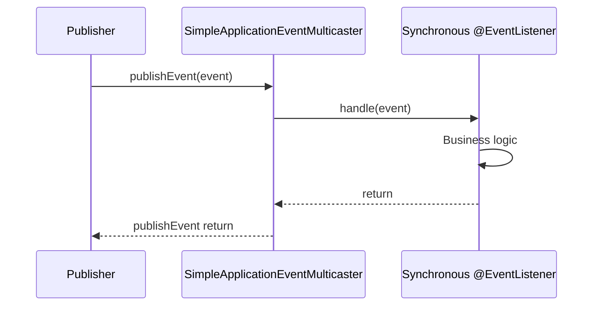
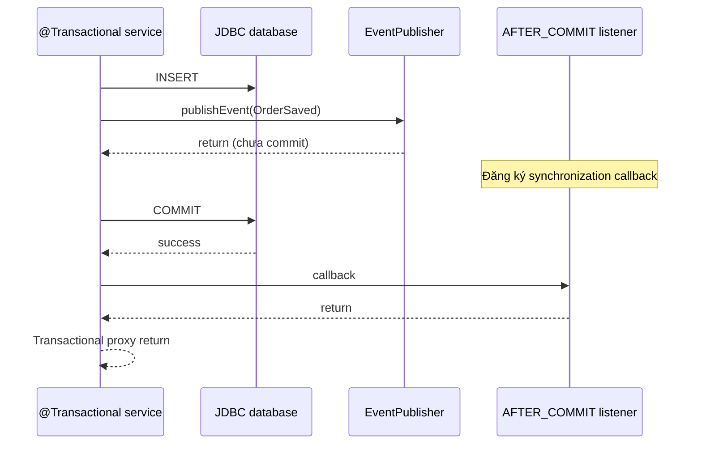

# Sự kiện và observability: Phân biệt sự kiện đã phát với listener đã xử lý xong

## 1. Vì sao hai trạng thái này khác nhau?

Trong Spring Boot, code gọi:

```java
publisher.publishEvent(new OrderCreated("ord-42"));
```

nhưng việc đó **không tự chứng minh** listener đã xử lý đơn hàng. Theo Javadoc `ApplicationEventPublisher` của Spring Framework 6.2, `publishEvent` là một **hand-off tới event multicaster**, chứ không cam kết mọi listener chạy đồng bộ, bất đồng bộ hay ngay lập tức. Trong nhiều ứng dụng, lời gọi có thể trả về khi công việc listener còn chờ executor, đang chạy hoặc mới đăng ký callback cho transaction.

Bốn mốc rất dễ bị lẫn:

| Mốc | Ý nghĩa | Cách kiểm chứng |
| --- | --- | --- |
| **Published** | Publisher gọi `publishEvent` và infrastructure ghi nhận event | `@RecordApplicationEvents`, `ApplicationEvents`, verify publisher |
| **Dispatched/started** | Listener được kích hoạt/đã vào method | `CountDownLatch started` hoặc metric ở entry |
| **Processed successfully** | Logic listener đạt success condition | Future/outcome, listener state, business assertion |
| **Durable outcome** | DB commit, external response hoặc broker ACK đúng contract | Database/HTTP/broker integration test |

**Không kết luận “processed” từ một assertion chỉ kiểm “published”.** Ngay cả listener method return cũng không tự chứng minh email đã đến inbox hoặc downstream đã commit; nó có thể chỉ submit một task khác.

### Mục tiêu học tập

1. Phân biệt `@EventListener` đồng bộ, `@Async @EventListener` và custom `ApplicationEventMulticaster`.
2. Hiểu `@TransactionalEventListener(AFTER_COMMIT)` và `AFTER_ROLLBACK`.
3. Viết test publication bằng `@RecordApplicationEvents`.
4. Viết test completion riêng bằng `CountDownLatch`/`CompletableFuture`/observable business state.
5. Kiểm được “publish return trong khi listener chưa hoàn tất” mà không `Thread.sleep`.
6. Biết khi nào sync exception truyền lên publisher và async exception không.
7. Đặt metrics/logs/trace đúng với event lifecycle.
8. Dùng outbox/broker khi cần durability qua JVM restart.

## 2. Event nội bộ Spring hoạt động ra sao?

`ApplicationEventPublisher` có các methods `publishEvent(ApplicationEvent)` và `publishEvent(Object)`. Spring hỗ trợ Java POJO/record events; nếu payload không kế thừa `ApplicationEvent`, Spring có thể bọc nó trong `PayloadApplicationEvent`.

```java
public record PaymentRequested(String paymentId) {}

@EventListener
public void onPayment(PaymentRequested event) {
    // Consumer nhận object event cùng ApplicationContext.
}
```

Đây là trích đoạn, không phải file runnable độc lập. Mặc định `SimpleApplicationEventMulticaster` xử lý `@EventListener` thông thường **đồng bộ** trên caller thread, nhưng đây là đặc tính cấu hình mặc định, **không phải bảo đảm bất biến của API publisher**.



### Khi listener đồng bộ ném lỗi

Nếu listener đồng bộ ném runtime exception và multicaster không có `ErrorHandler` chặn nó, exception có thể lan tới publisher và làm transaction rollback theo policy. Một listener lỗi cũng có thể ngăn listeners còn lại được gọi. **Đừng giả định fan-out hoàn thành khi một listener throw.**

### Khi listener dùng @Async

```java
@Async("eventExecutor")
@EventListener
public void on(PaymentRequested event) {
    // Có thể bắt đầu SAU khi publisher return.
}
```

Với `@EnableAsync` và đúng executor, invocation được chuyển lên worker. Caller có thể hoàn tất trong khi listener còn nằm trong queue hoặc đang xử lý. Exception của `void @Async` listener đi qua `AsyncUncaughtExceptionHandler`/logging, không tự quay lại call stack publisher.

Spring Framework cho phép các synchronous listeners phát follow-up event bằng return value trong một số trường hợp, nhưng **async listener không dùng method return value** như cơ chế phát event tiếp. Nếu cần, inject `ApplicationEventPublisher` rồi publish explicit completion event.

### Custom multicaster

Có thể gắn executor cho bean tên `applicationEventMulticaster`:

```java
@Bean("applicationEventMulticaster")
ApplicationEventMulticaster eventMulticaster(TaskExecutor executor) {
    SimpleApplicationEventMulticaster m =
            new SimpleApplicationEventMulticaster();
    m.setTaskExecutor(executor);
    return m;
}
```

Đây là snippet cần imports và configuration bean. Khi đó listeners cho phép async có thể chạy trên worker dù không annotate `@Async`. Nhưng `ApplicationListener.supportsAsyncExecution()` cho phép một số listeners (đặc biệt transaction-synchronized) yêu cầu chạy trên publisher thread để giữ transaction synchronization. Vì thế **không thể mặc định mọi listener đều được submit vào pool**.

## 3. Giao dịch: đã publish không có nghĩa đã commit

`@TransactionalEventListener` gắn listener vào một transaction phase:

| Phase | Listener chạy ở mốc nào? | Rủi ro suy diễn |
| --- | --- | --- |
| `BEFORE_COMMIT` | Trước commit | Commit vẫn có thể thất bại |
| `AFTER_COMMIT` | Sau successful commit (mặc định) | Không đồng nghĩa xử lý downstream bền vững |
| `AFTER_ROLLBACK` | Sau rollback | Sự kiện đã publish nhưng business write đã rollback |
| `AFTER_COMPLETION` | Sau commit hoặc rollback | Phải biết outcome cụ thể |

`fallbackExecution=false` là mặc định: publish **không có active transaction** thì transactional listener thường **không chạy**. Bật `fallbackExecution=true` chỉ khi muốn cho phép xử lý ngoài transaction và hiểu timing khác biệt.



**Cẩn thận:** sau commit, transaction resources có thể vẫn accessible. DB writes trong listener `AFTER_COMMIT` có thể không được commit theo mong đợi nếu không mở một transaction mới như `REQUIRES_NEW` trên bean/proxy phù hợp. Với side effects quan trọng, dùng transaction rõ ràng hoặc outbox. `@TransactionalEventListener` không tạo durable queue.

### @Transactional trên test method có thể gây hiểu nhầm

Spring Test thường rollback test-managed transaction cuối test. Nếu test method có `@Transactional`, service cũng dùng propagation REQUIRED và join vào transaction đó, `AFTER_COMMIT` **không chạy khi service return**, dù production code có thể đúng. Ví dụ bên dưới không dùng outer transaction trong JUnit; transaction được điều khiển bằng service/proxy hoặc `TransactionTemplate`.

## 4. Kiểm thử theo từng loại bằng chứng

| Câu hỏi | Công cụ | Điều cần assert |
| --- | --- | --- |
| Publisher có phát đúng event? | `@RecordApplicationEvents` hoặc Mockito | Event type, id, payload |
| Listener sync xử lý trước return? | Real `@EventListener` | State sau publish |
| Listener async đã bắt đầu? | `CountDownLatch started` | Bounded await |
| Listener async chưa hoàn tất? | Controlled gate | Success state còn false |
| Listener async hoàn tất thành công? | Finished latch + result marker | Cả completion lẫn success |
| Transaction callback đúng phase? | H2/JDBC + transaction manager | Before/after commit, rollback |
| Side effect ngoài hệ thống đã đạt? | HTTP/broker/DB integration | Contract-specific commit/ACK |
| Event không mất khi JVM crash? | Outbox/durable queue recovery test | Replay và idempotency |

Một test:

```java
verify(mockPublisher).publishEvent(any(OrderCreated.class));
```

chỉ chứng minh **lời gọi phương thức của mock**. Vì publisher bị mock, multicaster/listener thật có thể không tồn tại. Đó là unit test producer hợp lệ nhưng không phải test listener completion.

### @RecordApplicationEvents

Spring TestContext hỗ trợ `@RecordApplicationEvents` và `ApplicationEvents.stream(EventType.class)`. Event recorder chỉ lưu sự kiện phát trong test scope; **không lưu trạng thái hoàn tất của listeners**. Một test có thể kiểm recorder thấy một async event trong khi listener vẫn bị latch giữ lại — ví dụ runnable bên dưới làm đúng vậy.

## 5. Dự án mẫu hoàn chỉnh — Spring Boot 3.5, Java 17

Dự án có các loại events tách biệt:

- `Events.SyncSignal`: đồng bộ.
- `Events.BadSyncSignal`: cố ý throw trong synchronous listener.
- `Events.AsyncSignal`: chạy trong một worker, có gate để điều khiển trạng thái.
- `Events.StoredSignal`: gắn với JDBC commit/rollback.

Không dùng Docker, broker hay web server. H2 được dùng để test transaction thật, không phải để mô phỏng broker durability.

```text
event-publication-completion/
├── pom.xml
└── src/
    ├── main/
    │   ├── java/example/eventtest/
    │   │   ├── EventTestApplication.java
    │   │   ├── Events.java
    │   │   ├── SyncEventListener.java
    │   │   ├── AsyncExecutorConfig.java
    │   │   ├── AsyncEventListener.java
    │   │   ├── EventJournalService.java
    │   │   └── TxEventListener.java
    │   └── resources/
    │       ├── application.properties
    │       └── schema.sql
    └── test/java/example/eventtest/
        ├── SyncEventTest.java
        ├── AsyncEventTest.java
        └── TxEventTest.java
```

## 6. pom.xml

```xml
<?xml version="1.0" encoding="UTF-8"?>
<project xmlns="http://maven.apache.org/POM/4.0.0"
         xmlns:xsi="http://www.w3.org/2001/XMLSchema-instance"
         xsi:schemaLocation="http://maven.apache.org/POM/4.0.0
           https://maven.apache.org/xsd/maven-4.0.0.xsd">
    <modelVersion>4.0.0</modelVersion>
    <parent>
        <groupId>org.springframework.boot</groupId>
        <artifactId>spring-boot-starter-parent</artifactId>
        <version>3.5.0</version>
        <relativePath/>
    </parent>
    <groupId>example</groupId>
    <artifactId>event-publication-completion</artifactId>
    <version>1.0-SNAPSHOT</version>
    <properties>
        <java.version>17</java.version>
    </properties>
    <dependencies>
        <dependency>
            <groupId>org.springframework.boot</groupId>
            <artifactId>spring-boot-starter</artifactId>
        </dependency>
        <dependency>
            <groupId>org.springframework.boot</groupId>
            <artifactId>spring-boot-starter-jdbc</artifactId>
        </dependency>
        <dependency>
            <groupId>com.h2database</groupId>
            <artifactId>h2</artifactId>
            <scope>runtime</scope>
        </dependency>
        <dependency>
            <groupId>org.springframework.boot</groupId>
            <artifactId>spring-boot-starter-test</artifactId>
            <scope>test</scope>
        </dependency>
    </dependencies>
</project>
```

- Spring Boot starter: event infrastructure, ApplicationContext, logging.
- JDBC starter: `JdbcTemplate` và transaction manager.
- H2 runtime: embedded DB để kiểm commit/rollback.
- Test starter: JUnit Jupiter, Spring TestContext, assertions và event recorder.
- Parent 3.5.0/BOM quản lý dependency versions; không trộn Spring Framework 7/Boot 4 APIs vào sample này.

## 7. Application, DTOs và listener đồng bộ

`src/main/java/example/eventtest/EventTestApplication.java`:

```java
package example.eventtest;

import org.springframework.boot.SpringApplication;
import org.springframework.boot.autoconfigure.SpringBootApplication;
import org.springframework.scheduling.annotation.EnableAsync;

@SpringBootApplication
@EnableAsync
public class EventTestApplication {
    public static void main(String[] args) {
        SpringApplication.run(EventTestApplication.class, args);
    }
}
```

`src/main/java/example/eventtest/Events.java`:

```java
package example.eventtest;

public final class Events {
    private Events() {}

    public record SyncSignal(String id) {}
    public record BadSyncSignal(String id) {}
    public record AsyncSignal(String id) {}
    public record StoredSignal(String id) {}
}
```

Java 17 records là immutable payloads đơn giản. Trên production, nên đưa `eventId`/`correlationId` và schema contract ổn định thay vì JPA entities mutable/lazy-proxies.

`src/main/java/example/eventtest/SyncEventListener.java`:

```java
package example.eventtest;

import java.util.Queue;
import java.util.concurrent.ConcurrentLinkedQueue;

import org.springframework.context.event.EventListener;
import org.springframework.stereotype.Component;

@Component
public class SyncEventListener {
    private final Queue<String> completed =
            new ConcurrentLinkedQueue<>();

    @EventListener
    public void handle(Events.SyncSignal event) {
        completed.add(event.id());
    }

    @EventListener
    public void fail(Events.BadSyncSignal event) {
        throw new IllegalStateException(
                "sync-error:" + event.id());
    }

    public boolean completed(String id) {
        return completed.contains(id);
    }

    public void clear() {
        completed.clear();
    }
}
```

`completed` chỉ là một **probe trong memory**. Test sync dùng nó để quan sát method đã chạy tới success marker. Nếu listener thực gửi email, phải assert email client/broker/DB outcome theo contract, không thay bằng probe giả rồi tuyên bố hệ thống đã gửi thành công.

## 8. Executor và listener bất đồng bộ

`src/main/java/example/eventtest/AsyncExecutorConfig.java`:

```java
package example.eventtest;

import org.springframework.context.annotation.Bean;
import org.springframework.context.annotation.Configuration;
import org.springframework.scheduling.concurrent.ThreadPoolTaskExecutor;

@Configuration(proxyBeanMethods = false)
public class AsyncExecutorConfig {
    @Bean("eventExecutor")
    ThreadPoolTaskExecutor eventExecutor() {
        ThreadPoolTaskExecutor executor =
                new ThreadPoolTaskExecutor();
        executor.setCorePoolSize(1);
        executor.setMaxPoolSize(1);
        executor.setQueueCapacity(10);
        executor.setThreadNamePrefix("event-worker-");
        executor.setWaitForTasksToCompleteOnShutdown(true);
        executor.setAwaitTerminationSeconds(5);
        return executor;
    }
}
```

Chủ ý chọn **một worker** để khi task A bị chặn, task B được enqueue và chưa bắt đầu. Đây là cấu hình demo/test, không phải preset mặc định cho workload thật.

`src/main/java/example/eventtest/AsyncEventListener.java`:

```java
package example.eventtest;

import java.util.Map;
import java.util.Set;
import java.util.concurrent.ConcurrentHashMap;
import java.util.concurrent.CountDownLatch;
import java.util.concurrent.TimeUnit;

import org.springframework.context.event.EventListener;
import org.springframework.scheduling.annotation.Async;
import org.springframework.stereotype.Component;

@Component
public class AsyncEventListener {
    private final Set<String> succeeded =
            ConcurrentHashMap.newKeySet();
    private final Map<String, String> workerNames =
            new ConcurrentHashMap<>();

    private volatile CountDownLatch started =
            new CountDownLatch(0);
    private volatile CountDownLatch gate =
            new CountDownLatch(0);
    private volatile CountDownLatch finished =
            new CountDownLatch(0);

    public void arm(int count) {
        if (count < 1) {
            throw new IllegalArgumentException(
                    "count must be positive");
        }
        succeeded.clear();
        workerNames.clear();
        started = new CountDownLatch(1);
        gate = new CountDownLatch(1);
        finished = new CountDownLatch(count);
    }

    @Async("eventExecutor")
    @EventListener
    public void handle(Events.AsyncSignal event) {
        CountDownLatch s = started;
        CountDownLatch g = gate;
        CountDownLatch f = finished;

        workerNames.put(event.id(),
                Thread.currentThread().getName());
        s.countDown();

        try {
            if (!g.await(10, TimeUnit.SECONDS)) {
                throw new IllegalStateException(
                        "async listener gate timed out");
            }
            succeeded.add(event.id());
        } catch (InterruptedException ex) {
            Thread.currentThread().interrupt();
            throw new IllegalStateException(
                    "async listener interrupted", ex);
        } finally {
            f.countDown();
        }
    }

    public boolean awaitStarted(long seconds)
            throws InterruptedException {
        return started.await(seconds, TimeUnit.SECONDS);
    }

    public void release() {
        gate.countDown();
    }

    public boolean awaitFinished(long seconds)
            throws InterruptedException {
        return finished.await(seconds, TimeUnit.SECONDS);
    }

    public boolean started(String id) {
        return workerNames.containsKey(id);
    }

    public boolean succeeded(String id) {
        return succeeded.contains(id);
    }

    public String workerName(String id) {
        return workerNames.get(id);
    }
}
```

### Tại sao phải có ba tín hiệu?

- `started` latch: chứng minh listener đã đi vào method.
- `gate`: giữ listener không thể chạy tới success marker trước khi test muốn.
- `finished` latch: method kết thúc, kể cả khi exception vì `finally`.

**Finished không tự là succeeded.** Trong tests, sau `awaitFinished` cần assert thêm `succeeded(id)`. Lỗi thường gặp là countDown trong `finally` rồi dùng count 0 để khẳng định business success.

### Khi nào capture state?

Listener lấy local references tới latches ở đầu invocation. Các test trong một class reset probe trước mỗi method và đợi mọi work hoàn tất; không chạy parallel trên cùng singleton probe.

## 9. Dịch vụ ghi DB và transactional listeners

`src/main/java/example/eventtest/EventJournalService.java`:

```java
package example.eventtest;

import org.springframework.context.ApplicationEventPublisher;
import org.springframework.jdbc.core.JdbcTemplate;
import org.springframework.stereotype.Service;
import org.springframework.transaction.annotation.Transactional;

@Service
public class EventJournalService {
    private final JdbcTemplate jdbc;
    private final ApplicationEventPublisher publisher;

    public EventJournalService(
            JdbcTemplate jdbc,
            ApplicationEventPublisher publisher) {
        this.jdbc = jdbc;
        this.publisher = publisher;
    }

    @Transactional
    public void insertAndPublish(String id, boolean fail) {
        jdbc.update(
                "INSERT INTO event_log (event_id) VALUES (?)",
                id);
        publisher.publishEvent(new Events.StoredSignal(id));

        if (fail) {
            throw new IllegalStateException(
                    "rollback:" + id);
        }
    }
}
```

`src/main/java/example/eventtest/TxEventListener.java`:

```java
package example.eventtest;

import java.util.Queue;
import java.util.concurrent.ConcurrentLinkedQueue;

import org.springframework.stereotype.Component;
import org.springframework.transaction.event.TransactionPhase;
import org.springframework.transaction.event.TransactionalEventListener;

@Component
public class TxEventListener {
    private final Queue<String> committed =
            new ConcurrentLinkedQueue<>();
    private final Queue<String> rolledBack =
            new ConcurrentLinkedQueue<>();

    @TransactionalEventListener(
        phase = TransactionPhase.AFTER_COMMIT)
    public void afterCommit(Events.StoredSignal event) {
        committed.add(event.id());
    }

    @TransactionalEventListener(
        phase = TransactionPhase.AFTER_ROLLBACK)
    public void afterRollback(Events.StoredSignal event) {
        rolledBack.add(event.id());
    }

    public boolean committed(String id) {
        return committed.contains(id);
    }

    public boolean rolledBack(String id) {
        return rolledBack.contains(id);
    }

    public void clear() {
        committed.clear();
        rolledBack.clear();
    }
}
```

`@Transactional` cần lời gọi qua Spring-managed **proxy**, không phải `new EventJournalService(...)` hoặc tự gọi qua `this.method()`. Khi runtime exception được ném ra khỏi method, transaction mặc định rollback; event đã được publish nhưng `AFTER_COMMIT` không chạy.

## 10. H2 configuration

`src/main/resources/application.properties`:

```properties
spring.main.banner-mode=off
spring.datasource.generate-unique-name=true
spring.sql.init.mode=always
```

`src/main/resources/schema.sql`:

```sql
CREATE TABLE IF NOT EXISTS event_log (
    event_id VARCHAR(80) PRIMARY KEY
);
```

H2 embedded + starter-jdbc cung cấp DataSource/JdbcTemplate và PlatformTransactionManager. Schema được chạy khi Boot context khởi tạo; test tự xóa rows trước mỗi method để không phụ thuộc test order. Không trỏ đến DB production hay chứa mật khẩu thật.

## 11. Synchronous tests: 3 phương thức JUnit

`src/test/java/example/eventtest/SyncEventTest.java`:

```java
package example.eventtest;

import static org.junit.jupiter.api.Assertions.assertEquals;
import static org.junit.jupiter.api.Assertions.assertThrows;
import static org.junit.jupiter.api.Assertions.assertTrue;

import org.junit.jupiter.api.BeforeEach;
import org.junit.jupiter.api.Test;
import org.springframework.beans.factory.annotation.Autowired;
import org.springframework.boot.test.context.SpringBootTest;
import org.springframework.context.ApplicationEventPublisher;
import org.springframework.test.context.event.ApplicationEvents;
import org.springframework.test.context.event.RecordApplicationEvents;

@SpringBootTest(
    webEnvironment = SpringBootTest.WebEnvironment.NONE)
@RecordApplicationEvents
class SyncEventTest {
    @Autowired ApplicationEventPublisher publisher;
    @Autowired SyncEventListener listener;

    @BeforeEach
    void reset() {
        listener.clear();
    }

    @Test
    void synchronousListenerCompletesBeforePublisherReturns() {
        publisher.publishEvent(
                new Events.SyncSignal("sync-101"));

        assertTrue(listener.completed("sync-101"));
    }

    @Test
    void publicationAndListenerCompletionAreDistinctAssertions(
            ApplicationEvents events) {

        publisher.publishEvent(
                new Events.SyncSignal("sync-102"));

        long count = events.stream(Events.SyncSignal.class)
                .filter(e -> e.id().equals("sync-102"))
                .count();

        assertEquals(1L, count);          // Published.
        assertTrue(listener.completed("sync-102")); // Completed.
    }

    @Test
    void synchronousFailureCanPropagateToPublisher() {
        IllegalStateException error = assertThrows(
                IllegalStateException.class,
                () -> publisher.publishEvent(
                    new Events.BadSyncSignal("bad-1")));

        assertTrue(error.getMessage()
                .contains("sync-error:bad-1"));
    }
}
```

- Test 1 kiểm semantics synchronous default với listener thật.
- Test 2 dùng **hai nhân chứng**: recorder là publication, listener state là completion.
- Test 3 chứng minh exception của sync listener có thể lan lên publisher theo default behavior.

Nếu ứng dụng custom multicaster ErrorHandler, hai assertions về exception và ordering phải bám configuration thực thay vì áp dụng mặc định.

## 12. Asynchronous tests: 4 phương thức JUnit

`src/test/java/example/eventtest/AsyncEventTest.java`:

```java
package example.eventtest;

import static org.junit.jupiter.api.Assertions.assertEquals;
import static org.junit.jupiter.api.Assertions.assertFalse;
import static org.junit.jupiter.api.Assertions.assertNotEquals;
import static org.junit.jupiter.api.Assertions.assertTrue;

import org.junit.jupiter.api.AfterEach;
import org.junit.jupiter.api.BeforeEach;
import org.junit.jupiter.api.Test;
import org.springframework.beans.factory.annotation.Autowired;
import org.springframework.boot.test.context.SpringBootTest;
import org.springframework.context.ApplicationEventPublisher;
import org.springframework.test.context.event.ApplicationEvents;
import org.springframework.test.context.event.RecordApplicationEvents;

@SpringBootTest(
    webEnvironment = SpringBootTest.WebEnvironment.NONE)
@RecordApplicationEvents
class AsyncEventTest {
    @Autowired ApplicationEventPublisher publisher;
    @Autowired AsyncEventListener listener;

    @BeforeEach
    void prepare() {
        listener.arm(1);
    }

    @AfterEach
    void releaseGateOnFailure() {
        listener.release();
    }

    @Test
    void publishCanReturnWhileListenerIsIncomplete()
            throws Exception {

        publisher.publishEvent(
                new Events.AsyncSignal("async-201"));

        assertTrue(listener.awaitStarted(5));
        assertTrue(listener.started("async-201"));
        assertFalse(listener.succeeded("async-201"));

        listener.release();
        assertTrue(listener.awaitFinished(5));
        assertTrue(listener.succeeded("async-201"));
    }

    @Test
    void recordedPublicationIsNotCompletionEvidence(
            ApplicationEvents events) throws Exception {

        publisher.publishEvent(
                new Events.AsyncSignal("async-202"));

        long count = events.stream(Events.AsyncSignal.class)
                .filter(e -> e.id().equals("async-202"))
                .count();

        assertEquals(1L, count); // Event được ghi nhận.
        assertTrue(listener.awaitStarted(5));
        assertFalse(listener.succeeded("async-202"));

        listener.release();
        assertTrue(listener.awaitFinished(5));
        assertTrue(listener.succeeded("async-202"));
    }

    @Test
    void asyncListenerRunsOnNamedWorkerThread()
            throws Exception {

        String testThread =
                Thread.currentThread().getName();

        publisher.publishEvent(
                new Events.AsyncSignal("async-203"));

        assertTrue(listener.awaitStarted(5));
        assertTrue(listener.workerName("async-203")
                .startsWith("event-worker-"));
        assertNotEquals(testThread,
                listener.workerName("async-203"));

        listener.release();
        assertTrue(listener.awaitFinished(5));
        assertTrue(listener.succeeded("async-203"));
    }

    @Test
    void secondEventCanWaitInExecutorQueue()
            throws Exception {

        listener.arm(2);

        publisher.publishEvent(
                new Events.AsyncSignal("first"));
        assertTrue(listener.awaitStarted(5));

        publisher.publishEvent(
                new Events.AsyncSignal("second"));

        assertFalse(listener.succeeded("first"));
        assertFalse(listener.started("second"));
        assertFalse(listener.succeeded("second"));

        listener.release();
        assertTrue(listener.awaitFinished(5));
        assertTrue(listener.succeeded("first"));
        assertTrue(listener.succeeded("second"));
    }
}
```

### Bốn điều được chứng minh

1. Publisher đã return trong khi handler vào method nhưng bị gate chặn, `succeeded=false`.
2. `@RecordApplicationEvents` đã thấy event nhưng listener vẫn chưa hoàn tất — sự khác nhau ngay trong một test.
3. Listener chạy trên `event-worker-...`, không phải JUnit caller thread.
4. Một executor một worker có thể giữ event đầu đang chạy và event thứ hai queued, dù hai lời gọi publish đều return.

**Không dùng `Thread.sleep`**. `awaitStarted` có bounded timeout; gate chỉ mở khi test quyết định. Vì `awaitFinished` có thể hoàn thành cả khi method lỗi, luôn assert thêm `succeeded(id)`.

## 13. Transaction tests: 4 phương thức JUnit

`src/test/java/example/eventtest/TxEventTest.java`:

```java
package example.eventtest;

import static org.junit.jupiter.api.Assertions.assertEquals;
import static org.junit.jupiter.api.Assertions.assertFalse;
import static org.junit.jupiter.api.Assertions.assertThrows;
import static org.junit.jupiter.api.Assertions.assertTrue;

import org.junit.jupiter.api.BeforeEach;
import org.junit.jupiter.api.Test;
import org.springframework.beans.factory.annotation.Autowired;
import org.springframework.boot.test.context.SpringBootTest;
import org.springframework.context.ApplicationEventPublisher;
import org.springframework.jdbc.core.JdbcTemplate;
import org.springframework.test.context.event.ApplicationEvents;
import org.springframework.test.context.event.RecordApplicationEvents;
import org.springframework.transaction.PlatformTransactionManager;
import org.springframework.transaction.support.TransactionTemplate;

@SpringBootTest(
    webEnvironment = SpringBootTest.WebEnvironment.NONE)
@RecordApplicationEvents
class TxEventTest {
    @Autowired EventJournalService journal;
    @Autowired JdbcTemplate jdbc;
    @Autowired TxEventListener listener;
    @Autowired ApplicationEventPublisher publisher;
    @Autowired PlatformTransactionManager manager;

    @BeforeEach
    void reset() {
        jdbc.update("DELETE FROM event_log");
        listener.clear();
    }

    private int rowsFor(String id) {
        Integer count = jdbc.queryForObject(
                "SELECT COUNT(*) FROM event_log WHERE event_id = ?",
                Integer.class, id);
        return count == null ? 0 : count;
    }

    @Test
    void afterCommitRunsAfterSuccessfulTransaction() {
        journal.insertAndPublish("tx-301", false);

        assertEquals(1, rowsFor("tx-301"));
        assertTrue(listener.committed("tx-301"));
        assertFalse(listener.rolledBack("tx-301"));
    }

    @Test
    void rollbackDoesNotRunAfterCommit() {
        IllegalStateException error = assertThrows(
                IllegalStateException.class,
                () -> journal.insertAndPublish("tx-302", true));

        assertTrue(error.getMessage()
                .contains("rollback:tx-302"));

        assertEquals(0, rowsFor("tx-302"));
        assertFalse(listener.committed("tx-302"));
        assertTrue(listener.rolledBack("tx-302"));
    }

    @Test
    void publishingWithinTransactionIsBeforeCommit() {
        TransactionTemplate template =
                new TransactionTemplate(manager);

        template.executeWithoutResult(status -> {
            jdbc.update(
                    "INSERT INTO event_log (event_id) VALUES (?)",
                    "tx-303");

            publisher.publishEvent(
                    new Events.StoredSignal("tx-303"));

            // Đã publish nhưng chưa commit.
            assertFalse(listener.committed("tx-303"));
            assertFalse(listener.rolledBack("tx-303"));
        });

        assertEquals(1, rowsFor("tx-303"));
        assertTrue(listener.committed("tx-303"));
    }

    @Test
    void publicationOutsideTransactionSkipsTransactionalListeners(
            ApplicationEvents events) {

        publisher.publishEvent(
                new Events.StoredSignal("outside-tx"));

        long published = events.stream(Events.StoredSignal.class)
                .filter(e -> e.id().equals("outside-tx"))
                .count();

        assertEquals(1L, published);
        assertFalse(listener.committed("outside-tx"));
        assertFalse(listener.rolledBack("outside-tx"));
        assertEquals(0, rowsFor("outside-tx"));
    }
}
```

### Các bảo đảm đúng mức

- Commit thành công ⇒ DB row tồn tại, AFTER_COMMIT listener chạy.
- Rollback ⇒ DB row không tồn tại, AFTER_COMMIT không chạy, AFTER_ROLLBACK chạy.
- Đang trong transaction ⇒ đã gọi publish nhưng AFTER_COMMIT chưa chạy.
- Không có transaction ⇒ event được recorder thấy nhưng transactional listeners (default fallback=false) không chạy.

**Quan trọng:** Không gắn `@Transactional` trên test class/method trong sample này; nếu có outer test transaction rollback mặc định, AFTER_COMMIT có thể bị trì hoãn hoặc không chạy.

## 14. Chạy Maven và kết quả dự kiến

Yêu cầu Java 17+, Maven. Tạo files đúng đường dẫn rồi chạy:

```bash
mvn test
```

Chạy từng lớp:

```bash
mvn test -Dtest=SyncEventTest
mvn test -Dtest=AsyncEventTest
mvn test -Dtest=TxEventTest
```

| Test class | Số `@Test` | Mục tiêu |
| --- | ---: | --- |
| `SyncEventTest` | 3 | Default sync, recorder/completion, sync failure |
| `AsyncEventTest` | 4 | Async return, gate, worker, queue |
| `TxEventTest` | 4 | Commit/rollback/no transaction/before commit |
| **Tổng** | **11** | 11 lượt dự kiến |

**Dự kiến 11 tests PASS** khi project được tạo chính xác trên Boot 3.5/Java 17 trong môi trường Maven tương thích. Đây là **kết quả kỳ vọng theo mã**, không phải test log đã chạy. Hãy kiểm `target/surefire-reports` để xác nhận test count, failures và skips.

Không có stdout Java cố định. Spring/Maven logs và tên thread suffix có thể khác môi trường; test chỉ kiểm prefix `event-worker-`.

## 15. Các lỗi kiểm thử hay gặp

### 15.1. Chỉ đếm event bằng recorder rồi kết luận listener xong

`ApplicationEvents.stream(...)` là test về **publication**, không đo listener completion. Trong ví dụ async, event đã được recorder thấy ngay khi `succeeded=false` vì handler còn bị gate chặn.

### 15.2. Dùng mock publisher rồi mong real listener chạy

`@Mock ApplicationEventPublisher` giữ lời gọi trong Mockito, không tự đưa event qua Spring multicaster. Nếu cần test listener lifecycle, dùng `@SpringBootTest` hoặc Spring context phù hợp và listener bean thật.

### 15.3. @Async listener exception không báo cho caller

Publisher không thể bắt exception được ném sau đó trên một worker. Dùng `AsyncUncaughtExceptionHandler`, error status, result event, metrics hoặc error queue. `assertDoesNotThrow(publisher.publishEvent(...))` chỉ đo hand-off, không đo success.

### 15.4. Hoàn tất listener không phải side effect đã commit

Một listener có thể dùng `executor.submit(...)` bên trong, gửi HTTP request không đợi response, hoặc publish tiếp tới broker. Khi method listener return, nested work vẫn pending. Cần chứng cứ ở API/DB/broker nơi side effect được xác nhận.

### 15.5. @Order không đảm bảo completion order async

`@Order` chỉ giúp kiểm invocation order ở context phù hợp. Với nhiều workers hoặc async listeners, listener B có thể hoàn tất trước A. Nếu B phụ thuộc A, cần orchestration/workflow, không chỉ thứ tự annotation.

### 15.6. Đánh đồng AFTER_COMMIT với reliable delivery

Commit DB và callback sau commit vẫn có khoảng lỗi JVM crash. Nếu workflow quan trọng, dùng transactional outbox, broker durable, retries/idempotency.

### 15.7. Test @Transactional che mất AFTER_COMMIT

Test-managed transaction rollback cuối method khiến after-commit callback không chạy, dù service thật đúng. Dùng nontransactional test và `TransactionTemplate` để quan sát before/after.

### 15.8. Quên reset probes

`@SpringBootTest` có thể reuse cached context; listeners/probes là singleton. Nếu không clear state và dùng unique event IDs, test sau có thể thấy event cũ. Bài mẫu dọn state trước từng test.

### 15.9. Race do dùng Thread.sleep

Đợi 200 ms có thể pass local/fail CI. Dùng latch, bounded future hoặc Awaitility, đồng thời assert success/failure thực tế.

### 15.10. Test async parallel dùng chung state

Nếu bật JUnit parallel, hai test có thể reset `AsyncEventListener.arm(...)` cùng lúc và làm latch trỏ sai. Dùng test resource isolation, single-thread test execution hoặc mỗi test một context/probe riêng.

## 16. Observability: cần đo đúng giai đoạn

Spring Framework 6.2 không tự cung cấp Observation cho mọi `@EventListener` call theo semantics phù hợp. Nếu muốn metrics cần đặt instrumentation rõ.

| Metric | Tăng vào lúc nào? |
| --- | --- |
| `event_publish_attempt_total` | Trước `publishEvent` |
| `event_publish_return_total` | Sau khi hand-off return |
| `event_listener_started_total` | Entry của từng listener |
| `event_listener_succeeded_total` | Business logic đạt success |
| `event_listener_failed_total` | Catch/observe failure |
| `event_listener_retry_total` | Retry attempt thực |
| `event_durable_outcome_total` | DB/broker/downstream ACK theo contract |
| `event_listener_duration` | Timer từ listener entry tới success/failure |
| `event_publish_to_start` | Độ trễ từ hand-off tới start |
| `event_inflight` | Số invocations đang chạy |

Một event có thể được nhiều listeners xử lý, nên tag metric nên có **eventType**, **listener**, **outcome** với cardinality hữu hạn. Đừng dùng eventId/orderId/raw tenant IDs làm metric tags không giới hạn; đặt IDs trong structured logs/traces theo privacy policy.

### Logs và correlation ID

Ví dụ schema event:

```json
{
  "eventId": "evt-701",
  "orderId": "ord-701",
  "eventType": "order.created",
  "correlationId": "checkout-req-10",
  "schemaVersion": 1
}
```

Logs:

```text
event.publish_requested eventId=evt-701
event.listener_started eventId=evt-701 listener=MailListener
event.listener_failed eventId=evt-701 listener=MailListener error=Timeout
event.listener_retry eventId=evt-701 attempt=2
event.listener_succeeded eventId=evt-701 listener=MailListener
```

Đây là logs minh họa, không phải console output của project. Không ghi bearer token, mật khẩu hoặc PII vào logs. MDC ThreadLocal có thể không propagate qua `@Async`; nếu cần tracing context, chọn `ContextPropagatingTaskDecorator`/Micrometer Context Propagation và test IDs cụ thể, hoặc mang correlationId trong event payload.

## 17. Khi caller thực sự cần đợi thành công

`publishEvent` trả `void`. Không có mặc định `CompletionStage`/`CompletableFuture` của toàn bộ listener graph. Nếu cần kết quả, thiết kế một API explicit:

```java
// Kiến trúc minh họa; không thuộc project runnable.
// Command, Result, executor, handle phải do ứng dụng định nghĩa.
CompletableFuture<Result> submit(Command command) {
    CompletableFuture<Result> future = new CompletableFuture<>();
    executor.execute(() -> {
        try {
            future.complete(handle(command));
        } catch (Throwable failure) {
            future.completeExceptionally(failure);
        }
    });
    return future;
}
```

Caller kiểm `future.get(timeout, TimeUnit.SECONDS)`, có policy rõ cho cancellation/rejected execution. Nếu công việc cần survive JVM restart, hãy trả job ID, persist state và có status API thay vì chỉ giữ Java Future trong memory.

Đừng bắt mọi async event thành request-response: khi mục tiêu là loose coupling và latency thấp, trạng thái cuối có thể được publish thành `JobCompleted`/`JobFailed` event hoặc lưu trong workflow store.

## 18. @TransactionalEventListener không thay outbox

Một producer ghi order trong DB và publish event; ngay cả khi `AFTER_COMMIT` được gọi, JVM vẫn có thể crash **sau DB commit nhưng trước khi listener hoàn tất**. Một order đã được lưu có thể không có email, audit hoặc index update.

**Transactional outbox** giải quyết một phần khoảng lỗi:

1. Ghi business row và outbox row trong cùng DB transaction.
2. Commit cả hai.
3. Poller/CDC relay chuyển outbox tới broker.
4. Broker delivery và consumer retries có xác nhận theo protocol.
5. Consumer xử lý **idempotent** theo eventId.
6. Có DLQ/quarantine và monitoring cho failed messages.

So sánh:

| Cơ chế | Điều có thể đảm bảo | Vẫn cần làm gì? |
| --- | --- | --- |
| `@EventListener` sync | Method return theo synchronous config | Side effects/transaction/durability |
| `@Async @EventListener` | Worker task được submit | Recovery, bounded queues, error channel |
| `@TransactionalEventListener(AFTER_COMMIT)` | Chỉ xử lý sau successful commit | Crash recovery sau commit |
| Outbox + durable broker | Có record pending recoverable | Dedup/idempotency, retries |
| Broker consumer ACK | Broker thấy delivery acknowledgment | Business transaction consistency |
| Workflow status store | Theo dõi progress sau restart | Compensation và failure policy |

“Exactly-once” không xuất hiện tự động chỉ vì đã bật `@Transactional` hoặc `@Async`.

## 19. Troubleshooting

| Triệu chứng | Lý do thường gặp | Cách kiểm |
| --- | --- | --- |
| Event có trong recorder nhưng listener chưa xong | Async/gate/transaction | Quan sát start/completion riêng |
| Publisher return quá nhanh | Async executor enqueue | Kiểm queue depth/worker |
| Sync publish ném lỗi | Listener exception | ErrorHandler/transaction policy |
| Async listener throw mà publisher vẫn return | Worker error không lan ngược | AsyncUncaughtExceptionHandler/outcome channel |
| @Async listener chạy trên test thread | @EnableAsync/proxy sai | Kiểm executor và thread name |
| AFTER_COMMIT không chạy | Không có active tx hoặc rollback | TransactionTemplate + DB state |
| AFTER_COMMIT không chạy trong @Transactional test | Test rollback mặc định | Bỏ outer test transaction |
| Publish ngoài tx không gọi listener | fallbackExecution=false | Kiểm phase/fallback |
| DB write ở AFTER_COMMIT không persist | Resource sau commit, thiếu new tx | REQUIRES_NEW/outbox |
| Event mất khi process restart | In-memory Spring event | Durable outbox/broker |
| @RecordApplicationEvents không thấy event | Annotation/setup/type mismatch | Xác nhận TestContext listener |
| Spring tests pass riêng, fail toàn bộ | Shared singleton probe state | Reset/unique IDs/parallel isolation |
| Test chờ vô hạn | await không timeout | Bounded latch/future |
| H2 table không tồn tại | schema.sql/SQL init sai | Spring SQL init config |
| Listener chỉ gửi HTTP nhưng được coi hoàn tất nghiệp vụ | Chưa đo downstream outcome | Integration with real contract |
| Metrics published cao nhưng success thấp | Đang đo stages khác nhau | Success/failure/backlog counters |
| Mất correlationId trong async listener | MDC không propagate | Event payload/context propagation |
| Listener B xong trước A dù @Order | Async concurrency | Workflow orchestration |

## 20. Checklist và bài tập

### Checklist

- [ ] Hiểu `publishEvent` là hand-off, không phải completion guarantee?
- [ ] Phân biệt default sync với `@Async` và custom multicaster?
- [ ] Biết `@RecordApplicationEvents` chỉ đo publication?
- [ ] Test được started, succeeded và method finished riêng?
- [ ] Dùng latch/Future có timeout, không sleep?
- [ ] Kiểm sync exception và async error channel theo config?
- [ ] Kiểm AFTER_COMMIT và AFTER_ROLLBACK bằng transaction thật?
- [ ] Không annotate test transaction làm rollback callback bị hiểu sai?
- [ ] Biết fallbackExecution=false khi không active tx?
- [ ] Không xem @Order là completion guarantee với async?
- [ ] Có metrics/logs cho publish/start/success/failure?
- [ ] Không gắn IDs high-cardinality vào metrics labels?
- [ ] Có outbox/retry/idempotency nếu cần durability?
- [ ] Phân biệt HTTP 202 Accepted với job Completed?
- [ ] Có bằng chứng downstream commit/ACK nếu business yêu cầu?

### Bài tập mở rộng

1. Bỏ `@Async` để xem test thread/gate thất bại theo cách nào.
2. Tạo `SimpleApplicationEventMulticaster` có custom executor và so sánh với `@Async`.
3. Thêm listener lỗi async, cấu hình `AsyncUncaughtExceptionHandler` và assert failure status.
4. Thêm `BEFORE_COMMIT` callback và test ngay trong `TransactionTemplate`.
5. Thêm `fallbackExecution=true` và kiểm publish ngoài transaction.
6. Thử viết DB ở AFTER_COMMIT rồi tách bean `REQUIRES_NEW` và kiểm commit.
7. Thêm Timer/Counter Micrometer, test success counter không tăng trước gate release.
8. Tạo transactional outbox table, test business row + outbox row commit/rollback cùng nhau.
9. Thêm idempotency theo eventId khi consumer receive duplicate events.
10. Thiết kế job status API `QUEUED→RUNNING→SUCCEEDED/FAILED`.
11. Dùng PostgreSQL Testcontainers thay H2 khi cần production-like transaction semantics.
12. Viết reactive event test với Reactor `StepVerifier` và `TransactionalEventPublisher` đúng scope.
13. Test graceful shutdown khi executor đang còn queued tasks.

## 21. Nguồn tham khảo chính thức

1. [Spring Framework 6.2 — ApplicationEventPublisher](https://docs.spring.io/spring-framework/docs/6.2.6/javadoc-api/org/springframework/context/ApplicationEventPublisher.html): hand-off, không hứa sync/async/immediate execution.
2. [Spring Framework 6.2 — ApplicationContext events](https://docs.spring.io/spring-framework/reference/6.2/core/beans/context-introduction.html): default sync, @EventListener, @Async và ordering.
3. [Spring Framework 6.2 — SimpleApplicationEventMulticaster](https://docs.spring.io/spring-framework/docs/6.2.6/javadoc-api/org/springframework/context/event/SimpleApplicationEventMulticaster.html): executor/error handler/supportsAsyncExecution.
4. [Spring Framework 6.2 — Transaction-bound events](https://docs.spring.io/spring-framework/reference/6.2/data-access/transaction/event.html): AFTER_COMMIT, rollback, fallbackExecution.
5. [Spring Framework 6.2 — TransactionalEventListener API](https://docs.spring.io/spring-framework/docs/6.2.6/javadoc-api/org/springframework/transaction/event/TransactionalEventListener.html): warning về resource sau commit.
6. [Spring Framework 6.2 — Recording application events](https://docs.spring.io/spring-framework/reference/6.2/testing/testcontext-framework/application-events.html): @RecordApplicationEvents và ApplicationEvents.
7. [Spring Framework 6.2 — ApplicationEvents API](https://docs.spring.io/spring-framework/docs/6.2.6/javadoc-api/org/springframework/test/context/event/ApplicationEvents.html): stream(Class).
8. [Spring Framework 6.2 — Async](https://docs.spring.io/spring-framework/reference/6.2/integration/scheduling.html): @Async và executor semantics.
9. [Spring Framework 6.2 — Observability](https://docs.spring.io/spring-framework/reference/6.2/integration/observability.html): không mặc định instrument @EventListener và thread context.
10. [Spring Boot 3.5 — SQL databases](https://docs.spring.io/spring-boot/3.5/reference/data/sql.html): H2/JDBC embedded.
11. [Spring Boot — Database initialization](https://docs.spring.io/spring-boot/how-to/data-initialization.html): schema.sql.
12. [Spring Boot 3.5 — Testing Spring Boot applications](https://docs.spring.io/spring-boot/3.5/reference/testing/spring-boot-applications.html): @SpringBootTest.
13. [Spring Framework — Declarative transactions](https://docs.spring.io/spring-framework/reference/6.2/data-access/transaction/declarative.html): proxies và rollback.
14. [Micrometer Context Propagation](https://docs.micrometer.io/context-propagation/reference/): MDC/tracing qua workers.

**Kết luận:** `publishEvent` **chỉ chứng minh đã phát** theo API, không phải đã xử lý xong. Muốn biết listener đã hoàn tất phải kiểm **started → finished → succeeded** bằng tín hiệu thực; muốn biết dữ liệu đã commit phải kiểm **transaction outcome**; muốn biết external side effect bền vững phải có **ACK/status/outbox** riêng.
