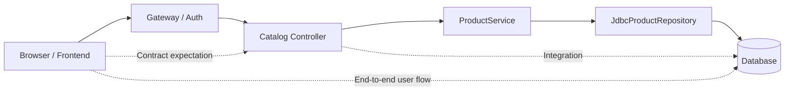
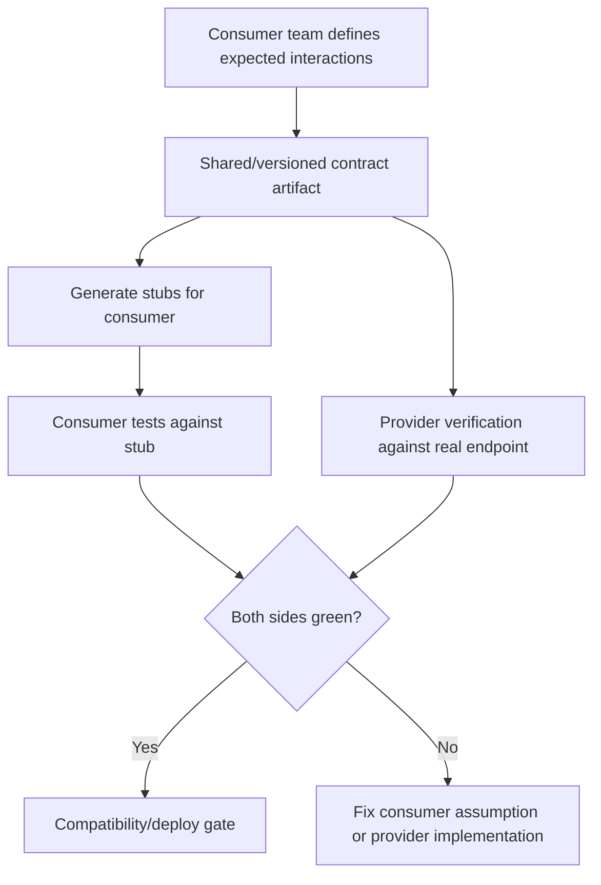
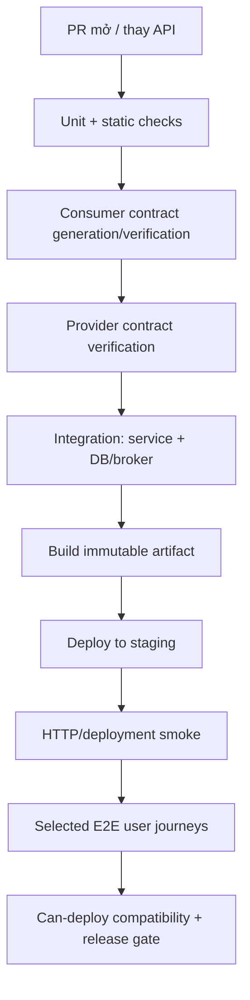

# Hợp đồng và khả năng phục hồi — Phân biệt contract test với integration test và kiểm thử đầu cuối

## 1. Một tính năng, ba câu hỏi khác nhau

Giả sử ứng dụng bán hàng cần hiển thị thông tin sản phẩm. Frontend gọi API của **Catalog Service**:

```http
GET /api/products/SKU-100
Accept: application/json
```

Bên cung cấp trả:

```json
{
  "sku": "SKU-100",
  "price": 49.90,
  "currency": "USD",
  "inStock": true
}
```

Sau một lần triển khai, backend đổi `price` từ JSON number thành chuỗi, đổi `inStock` thành `available` hoặc chuyển mã lỗi 404 thành 200 kèm `null`. Business logic nội bộ vẫn chạy, nhưng frontend có thể hỏng vì **hợp đồng giao tiếp** đã thay đổi. Ngược lại, một backend trả JSON đúng mẫu mà truy vấn DB sai vẫn là một hệ thống lỗi. Và ngay cả khi API và DB đều đúng, người dùng có thể không mua được hàng vì gateway, authentication, payment hoặc frontend gặp lỗi.

Ba loại kiểm thử giải quyết các rủi ro khác nhau:

- **Contract test** hỏi: *Bên cung cấp có thực hiện đúng những điều bên tiêu thụ được phép dựa vào tại ranh giới giao tiếp không?*
- **Integration test** hỏi: *Các thành phần thật được ghép với nhau có trao đổi dữ liệu và phối hợp đúng không?*
- **End-to-end (E2E) test** hỏi: *Một luồng nghiệp vụ của người dùng có chạy qua hệ thống đã triển khai, từ điểm bắt đầu đến kết quả cuối, đúng như mong đợi không?*

Các loại test **có phần giao nhau** nhưng không thay thế nhau. Một phép thử HTTP của một service với H2 có thể là **integration/smoke test**, chưa phải E2E xuyên cả frontend, gateway và các backend thực.

### Mục tiêu học tập

Sau bài, người học có thể:

1. Xác định **ranh giới** (boundary) được một bài test quan sát.
2. Phân biệt **provider contract**, **consumer-driven contract (CDC)**, schema/API conformance, integration và E2E.
3. Giải thích vì sao mock/stub hợp lệ trong contract test nhưng có thể che lỗi tích hợp.
4. Chọn `@WebMvcTest`, `@RestClientTest`, `@SpringBootTest` và `RANDOM_PORT` đúng mục tiêu.
5. Viết các phép thử bảo vệ HTTP status, JSON fields/types, headers và error contract.
6. Kiểm service, JDBC repository và Spring MVC wiring bằng integration test.
7. Test HTTP thực trên random port mà **không gọi đó là full-system E2E**.
8. Thiết kế CDC workflow với Spring Cloud Contract/Pact và cách publish stubs.
9. Kiểm backward compatibility, versioning và consumer expectations.
10. Tách resilience/timeout/retry tests khỏi schema compatibility tests, xây CI test pyramid hợp lý.

## 2. Bảng đối chiếu cấp độ và phạm vi

| Tiêu chí | Contract test | Integration test | E2E test |
| --- | --- | --- | --- |
| Câu hỏi chính | API/message có đáp ứng hợp đồng bên sử dụng? | Nhiều components phối hợp được? | User journey toàn hệ thống thành công? |
| Ranh giới | Consumer ↔ Provider | Controller ↔ Service ↔ DB, client ↔ HTTP stub/real dependency | Frontend ↔ gateway ↔ backend ↔ external dependencies |
| Test setup | Provider hoặc consumer với contract/stub | Một phần stack thật, mocks cho phần ngoài scope | Hệ đã triển khai đại diện, phần lớn đường đi thật |
| Tốc độ thường thấy | Nhanh và xác định | Trung bình | Chậm, nhạy với môi trường |
| Độ ổn định | Cao nếu contracts/fixtures ổn định | Tùy DB/network dependency | Dễ flaky hơn nếu nhiều systems |
| Phát hiện tốt | Breaking field name/type/status/header, schema drift | Mapping, SQL, bean wiring, transaction, serialization thật | Routing, auth flow, deployment config, workflow |
| Dễ bỏ sót | DB/query sai, môi trường, behavior ngoài hợp đồng | Consumer expectations của service khác, full user journey | Coverage biên sâu, nhiều tổ hợp dữ liệu |
| Phụ thuộc môi trường | Thấp đến vừa | Vừa | Cao |
| Cần chạy bao nhiêu? | Nhiều hợp đồng quan trọng | Các đường tích hợp cốt lõi | Ít luồng trọng yếu, chọn lọc |
| Minh chứng hoàn thành | Consumer expectation được verify ở provider | Cross-component behavior đúng | Outcome nghiệp vụ cuối đúng |

**Quan trọng:** cách đặt tên annotation không tự quyết định test thuộc loại nào. Một `@SpringBootTest(RANDOM_PORT)` gọi HTTP nội bộ tới chính service vẫn có thể chỉ là integration test. Một `@WebMvcTest` dùng **contract fixture của consumer** để kiểm provider API có thể là provider-side contract verification. Hãy phân loại theo **ranh giới, mục tiêu và những dependencies được thay bằng test doubles**, không chỉ theo tên framework.

## 3. Ba lớp trên cùng một luồng sản phẩm



**Contract test:** Consumer yêu cầu `GET /api/products/{sku}` với `200`, `application/json`, `sku` kiểu chuỗi, `price` kiểu số, `currency` kiểu chuỗi và `inStock` kiểu boolean. Provider test độc lập xác minh response đáp ứng kỳ vọng. Nếu backend đổi `price` thành string, contract fail.

**Integration test:** Dùng controller, service, JDBC repository và H2 thật: insert một record, gọi MockMvc, nhận response. Nếu query chọn sai column, row mapping lỗi hoặc service inject sai repository, test fail. Nhưng do chưa có HTTP socket và gateway thật, nó không kiểm TLS, gateway routing hoặc ingress.

**HTTP runtime test:** Start Spring Boot server trên random port, gửi một HTTP request thực từ JDK HttpClient. Nó phát hiện lỗi HTTP server/serialization/network-local binding mà MockMvc có thể không bao phủ. Tuy nhiên vẫn **chỉ một service**, nên đây là server integration/smoke test.

**Full-system E2E test:** Browser login, tìm SKU-100, đặt đơn, thanh toán qua môi trường sandbox, nhận trạng thái đơn và email/webhook theo hợp đồng; đi qua frontend, gateway, identity, catalog, order, payment, messaging, DB. Chỉ khi tất cả những boundary thực được exercise và final business outcome được quan sát mới nên gọi đây là E2E của hệ thống bán hàng.

## 4. Contract là lời hứa giữa hai phía, không chỉ một file JSON

Một **contract** mô tả những tương tác mà consumer dựa vào:

- HTTP method và path: `GET /api/products/SKU-100`.
- Request headers và media type: `Accept: application/json`.
- Query/path parameters, định dạng và ràng buộc.
- Status code: `200`, `404`, `400`, `409`, `429`…
- Response headers: `Content-Type`, caching/version headers nếu có.
- Các JSON fields **bắt buộc**, kiểu dữ liệu, enum, nullability.
- Error response shape và stable error codes.
- Semantic constraints (ví dụ currency ISO-4217, tiền phải không âm).
- Trường hợp consumer thực sự cần: pagination/ordering, idempotency key, correlation header.
- Với messaging: topic, key, headers, event schema, version, mandatory properties.

**Contract test không nên bị viết hoàn toàn theo góc nhìn provider**: nếu backend tự chọn dữ liệu trả rồi tự tạo test chỉ khớp dữ liệu đó, test có thể xanh trong khi consumer đã bị breaking change. Consumer nên **định nghĩa/duyệt kỳ vọng cần thiết** và provider CI kiểm chúng.

### Provider-driven và consumer-driven

- **Provider-driven/API conformance:** Provider công bố OpenAPI/JSON Schema/Protobuf spec, kiểm implementation đáp ứng spec. Consumer dựa vào public contract đã công bố.
- **Consumer-driven contract (CDC):** Consumer thể hiện các tương tác nó **thực sự sử dụng**, sau đó provider xác minh các expectations đó trên implementation của mình. Những artifacts này cần có ownership, versioning và CI handshake.
- **Schema compatibility:** So sánh schema versions theo rules (ví dụ Avro backward/forward) có giá trị, nhưng không kiểm một endpoint handler trả đúng code/status/business conditions.
- **Contract test một phía:** Kiểm response format theo fixture nội bộ chưa phải CDC thật nếu consumer không tham gia quản lý/vận hành contract.

Trong project runnable phía dưới, JSON fixture đóng vai **hợp đồng bên tiêu thụ**. Nếu fixture chỉ nằm ở repo provider và không được consumer sở hữu/duyệt, hãy gọi test là **provider contract-conformance test**, không nói đã triển khai đầy đủ CDC pipeline.

## 5. Contract test phát hiện điều gì, không phát hiện điều gì?

| Thay đổi ở provider | Tác động tới consumer | Test nào phù hợp? |
| --- | --- | --- |
| Đổi `price` từ JSON number thành string | Consumer parser/tính tiền có thể hỏng | Contract |
| Đổi `inStock` thành `available` | Consumer mất required field | Contract |
| Xóa `currency` bắt buộc | UI không biết loại tiền | Contract |
| Đổi 404 `PRODUCT_NOT_FOUND` thành 200 `null` | Consumer error handling hỏng | Contract |
| Thêm field `brand` tùy chọn | Thường additive/backward-compatible nếu consumer tolerant | Policy compatibility, không mặc định fail |
| Database column `price` đổi tên nhưng service vẫn trả đúng JSON | Contract vẫn xanh | Integration |
| Query trả nhầm giá sản phẩm trong DB | Response có thể đúng shape nhưng sai value | Integration + domain test |
| Gateway mất route đến Catalog | Service contract vẫn có thể xanh | Deployed E2E/smoke |
| Login token mapping sai giữa gateway và identity | Contract của Catalog không thấy | Auth integration + E2E |
| Network timeout tới pricing dependency | Schema vẫn đúng khi response có | Resilience integration/fault injection |
| Thao tác checkout fail sau payment success | Một API riêng lẻ vẫn đúng | Full-system E2E + distributed transaction tests |

Một contract tốt **không kiểm mọi business value ngẫu nhiên**. Khi viết CDC, contract nên bao phủ fields và interactions mà consumer dựa vào; provider business logic phức tạp được kiểm bằng unit/integration riêng.

### Backward-compatible hay không phụ thuộc consumer

Với JSON:
- **Thêm response field** thường tương thích nếu consumer bỏ qua unknown fields.
- **Xóa/đổi tên field required** thường breaking.
- **Đổi numeric → string**, enum value hoặc nullability có thể breaking.
- **Thêm required request field** thường breaking cho consumers cũ.
- **Đổi status/error body** có thể breaking kể cả success body giữ nguyên.
- **Thay pagination defaults/ordering** có thể phá consumer dù JSON vẫn validate.
- **Tăng timeout/latency** không nhất thiết schema-breaking nhưng là SLO/resilience regression.

Không áp dụng blanket rule “thêm field luôn an toàn”; Jackson consumer có thể bật strict unknown-fields, DTO enum không chấp nhận value mới hoặc validation phụ thuộc số lượng/trật tự. Test nên phản ánh consumer behavior thật.

## 6. Contract và mock/stub không đồng nghĩa “giả lập cho qua”

**Mock** thường là test double ghi nhận/stub method calls, ví dụ Mockito `@MockitoBean ProductService` trong provider HTTP boundary test. Nó cô lập controller khỏi DB.

**Stub server** là HTTP/messaging endpoint giả trả response theo contract mà consumer có thể chạy cùng để không phải khởi động provider thật. Spring Cloud Contract có thể sinh WireMock stubs từ contract và dùng Stub Runner; Pact có broker/provider verification workflow khác.

**Fake** thường có implementation đơn giản chạy được (in-memory repository), có thể khác SQL consistency/performance.

**Spy** bọc object để ghi nhận lời gọi, không phải bằng chứng contract conformance.

Hai điều cần giữ:

1. **Producer/provider verification** phải chạy trên implementation thật **ở boundary mà contract định nghĩa**, không mock chính controller hay endpoint đang cần verify.
2. **Consumer verification** có thể dùng stub provider để kiểm consumer gửi đúng method/path/body và parse response đúng; nhưng stub pass **không chứng minh production provider đang tương thích**. Provider phải verify cùng contract artifact.

Nếu cả consumer và provider dùng **hai bộ fixture tách biệt** do mỗi bên tự sửa, chúng có thể cùng xanh nhưng không hề đồng thuận. Dùng artifact chung, published version, provider verification và compatibility gates.

## 7. Integration test: kiểm bean wiring, SQL, transaction và data flow

Trong Spring Boot:

- `@WebMvcTest(ProductController.class)` tạo MVC slice, thường mock service bằng `@MockitoBean`; đây **chưa phải integration với repository thật**.
- `@RestClientTest(SomeClient.class)` tạo client slice và `MockRestServiceServer` để kiểm outbound HTTP request/response, hữu ích cho **consumer-side contract** hoặc client protocol behavior.
- `@SpringBootTest` tạo ApplicationContext rộng, có thể dùng `@AutoConfigureMockMvc` để exercise controller/service/repository trong memory nhưng không mở server socket.
- `@DataJpaTest` hoặc `@JdbcTest` tập trung data access; giao dịch/test rollback phụ thuộc slice.
- `@SpringBootTest(webEnvironment = RANDOM_PORT)` tạo web server thực trên một port ngẫu nhiên.

Hãy chọn scope theo bug cần tìm. Integration test nên giữ **real collaborator** tại boundary đang kiểm, và dùng mock cho external service không thuộc mục tiêu.

### @SpringBootTest không tự có HTTP server

`@SpringBootTest` mặc định ở `MOCK` web environment (nếu có Spring MVC); không có embedded server mở socket. Với `@AutoConfigureMockMvc`, MockMvc đi qua Spring MVC dispatch, filter/serializer/controller/service theo context nhưng **không test network servlet container như một HTTP request thực**. Với `RANDOM_PORT`, JDK HttpClient giao tiếp qua server thật và có thể quan sát headers/cookies/network behavior khác.

### Database: H2 không thay production PostgreSQL

H2 đủ cho ví dụ data flow đơn giản nhưng không bảo đảm PostgreSQL-specific SQL, isolation, JSONB, locking, collation hoặc sequence behavior. Với production database đặc thù, dùng Testcontainers/DB thực cho integration tests quan trọng.

### Integration không tự biết “consumer cần gì”

Nếu API trả `{"price":"49.90"}` mà controller/service/repository cùng update để vẫn chạy thành công, integration test chỉ kiểm status có thể xanh. Contract test chốt type JSON theo expectation của consumer sẽ fail. Đây là lý do không bỏ contract test dù đã có integration tests.

## 8. End-to-end test: “đầu” và “cuối” phải được định nghĩa

Một E2E scenario nên xuất phát từ **hành vi người dùng hoặc business process** chứ không chỉ start Tomcat:

```text
[Browser]
  → [Gateway + Authentication]
  → [Catalog Service]
  → [Order Service]
  → [Payment Sandbox]
  → [Database + Message Broker]
  → [Order Confirmed / Email or Status]
```

Các tiêu chí:

- Người dùng thực hiện hành động từ điểm vào (UI hoặc public API).
- Các dependencies cốt lõi đã deploy và wiring giống môi trường mục tiêu.
- Có identity/permissions/tokens đại diện, không bypass security tùy tiện.
- Quan sát được outcome cuối (DB, user-visible state, message/receipt) chứ không chỉ HTTP 202.
- Cleanup test data và tránh gửi email/charge tiền thật.
- Có deadline và retry **để đợi eventually consistent outcome**, không sleep số ms tùy ý.
- Không để một E2E test đi qua production/payment live khi chưa có phê duyệt; dùng sandbox/test accounts.

**Không phải tất cả external services bắt buộc thật**: E2E thường dùng sandbox hoặc fake ở boundary có chi phí/rủi ro cao, nhưng phải mô tả những phần bị thay thế. Nếu payment được stub, scenario chứng minh checkout orchestration tới stub, không chứng minh xử lý ngân hàng thật.

### E2E thường ít nhưng giá trị cao

Chọn happy-path checkout, login/authorization, recovery từ một thất bại chủ yếu, update trạng thái đơn. Tránh hàng nghìn tổ hợp input chi tiết trong browser E2E; chuyển logic biên cho unit/contract/integration nhanh.

## 9. Chiến lược ba tầng cho một Catalog API

Bộ ví dụ sẽ dùng một **contract fixture** với kết quả cho SKU-100, một **JDBC repository** thật và một **HTTP smoke test** trên port ngẫu nhiên:

| Test class | Cấp độ | Có mock? | Có DB thật? | Có HTTP socket? |
| --- | --- | --- | --- | --- |
| `ProductContractTest` | Provider contract conformance (MVC slice) | `ProductService` | Không | Không |
| `ProductIntegrationTest` | Service integration | Không | H2 embedded | Không, MockMvc |
| `ProductHttpSmokeTest` | HTTP runtime integration/smoke | Không | H2 embedded | Có, random port |
| E2E staging playbook | Full business E2E | Sandbox ở payment nếu cần | Deployed DB | Frontend/gateway/API thực |

Đừng nhầm dòng thứ ba với dòng thứ tư. Test HTTP của một service giúp bắt lỗi network-local và startup, **chưa phải** full-system E2E của nghiệp vụ mua hàng.

## 10. Project runnable — Java 17 / Spring Boot 3.5.0

Các classes:

1. `CatalogApplication` khởi chạy Spring Boot.
2. `Product` là model của catalog.
3. `ProductResponse` và `ApiError` là public JSON shapes.
4. `ProductRepository` là abstraction.
5. `JdbcProductRepository` truy vấn H2 bằng JdbcTemplate.
6. `ProductService` phối hợp repository và xử lý missing data.
7. `ProductNotFoundException` mô tả not-found branch.
8. `ProductController` phát HTTP GET endpoint.
9. `ProductErrorAdvice` map lỗi sang 404 JSON ổn định.
10. `ProductContractTest` dùng fixture do consumer định nghĩa, Spring MVC slice.
11. `ProductIntegrationTest` kiểm controller→service→repository→H2.
12. `ProductHttpSmokeTest` gọi TCP/HTTP tới embedded server.
13. Hai fixtures `get-product-200.json` và `get-product-404.json` thể hiện expectations.

```text
catalog-contract-demo/
├── pom.xml
└── src/
    ├── main/
    │   ├── java/example/catalog/
    │   │   ├── CatalogApplication.java
    │   │   ├── Product.java
    │   │   ├── ProductResponse.java
    │   │   ├── ApiError.java
    │   │   ├── ProductRepository.java
    │   │   ├── JdbcProductRepository.java
    │   │   ├── ProductService.java
    │   │   ├── ProductNotFoundException.java
    │   │   ├── ProductController.java
    │   │   └── ProductErrorAdvice.java
    │   └── resources/
    │       ├── application.properties
    │       └── schema.sql
    └── test/
        ├── java/example/catalog/
        │   ├── ProductContractTest.java
        │   ├── ProductIntegrationTest.java
        │   └── ProductHttpSmokeTest.java
        └── resources/contracts/
            ├── get-product-200.json
            └── get-product-404.json
```

**Phạm vi bản runnable:** không chứa Pact broker, Spring Cloud Contract plugin hoặc frontend vì mục tiêu là so sánh test levels, không yêu cầu cài thêm external infra. Phần sau hướng dẫn cách nâng cấp từ manual shared fixture sang CDC tự động. Không tự nhận toàn bộ sample là hệ thống E2E.

## 11. pom.xml

```xml
<?xml version="1.0" encoding="UTF-8"?>
<project xmlns="http://maven.apache.org/POM/4.0.0"
         xmlns:xsi="http://www.w3.org/2001/XMLSchema-instance"
         xsi:schemaLocation="http://maven.apache.org/POM/4.0.0
             https://maven.apache.org/xsd/maven-4.0.0.xsd">
    <modelVersion>4.0.0</modelVersion>

    <parent>
        <groupId>org.springframework.boot</groupId>
        <artifactId>spring-boot-starter-parent</artifactId>
        <version>3.5.0</version>
        <relativePath/>
    </parent>

    <groupId>example</groupId>
    <artifactId>catalog-contract-demo</artifactId>
    <version>1.0-SNAPSHOT</version>

    <properties>
        <java.version>17</java.version>
    </properties>

    <dependencies>
        <dependency>
            <groupId>org.springframework.boot</groupId>
            <artifactId>spring-boot-starter-web</artifactId>
        </dependency>

        <dependency>
            <groupId>org.springframework.boot</groupId>
            <artifactId>spring-boot-starter-jdbc</artifactId>
        </dependency>

        <dependency>
            <groupId>com.h2database</groupId>
            <artifactId>h2</artifactId>
            <scope>runtime</scope>
        </dependency>

        <dependency>
            <groupId>org.springframework.boot</groupId>
            <artifactId>spring-boot-starter-test</artifactId>
            <scope>test</scope>
        </dependency>
    </dependencies>
</project>
```

**Không cần spring-security-starter** vì sample tập trung HTTP contract và test boundaries, không thực hành authentication. Với ứng dụng thật, phải test security status và auth scopes trong contract/integration/E2E phù hợp. `spring-boot-starter-test` cung cấp JUnit 5, MockMvc, Mockito, AssertJ và Spring Test; Boot 3.5 dùng `@MockitoBean` từ Spring Framework, không dùng annotation `@MockBean` cũ đã deprecated.

## 12. CatalogApplication.java

`src/main/java/example/catalog/CatalogApplication.java`:

```java
package example.catalog;

import org.springframework.boot.SpringApplication;
import org.springframework.boot.autoconfigure.SpringBootApplication;

@SpringBootApplication
public class CatalogApplication {
    public static void main(String[] args) {
        SpringApplication.run(CatalogApplication.class, args);
    }
}
```

`@SpringBootApplication` component-scans package `example.catalog`, tạo MVC web app và DataSource theo dependencies. Không tự đặt `server.port=8080` trong tests; random port sẽ được framework cấp khi dùng `RANDOM_PORT`.

## 13. DTOs và repository contract

### Product.java

`src/main/java/example/catalog/Product.java`:

```java
package example.catalog;

import java.math.BigDecimal;

public record Product(
        String sku,
        BigDecimal price,
        String currency,
        boolean inStock) {
}
```

`Product` là data model do repository trả, chưa phải API contract. Dùng record đơn giản để tránh demo ORM laziness/circular references; dữ liệu giá dùng `BigDecimal` thay vì `double` trong business layer.

### ProductResponse.java

`src/main/java/example/catalog/ProductResponse.java`:

```java
package example.catalog;

import java.math.BigDecimal;

public record ProductResponse(
        String sku,
        BigDecimal price,
        String currency,
        boolean inStock) {
}
```

JSON được Jackson serialize với public fields `sku` (string), `price` (number), `currency` (string), `inStock` (boolean). JSON numeric representation như `49.9` và `49.90` có thể khác text nhưng là cùng numeric value; contract nên kiểm **type và numeric value**, không ép scale string nếu consumer không cần.

### ApiError.java

`src/main/java/example/catalog/ApiError.java`:

```java
package example.catalog;

public record ApiError(
        String code,
        String message) {
}
```

Các error codes ổn định có thể là một phần contract quan trọng hơn text messages dùng cho người đọc. Sample giữ cả hai nhất quán.

### ProductRepository.java

`src/main/java/example/catalog/ProductRepository.java`:

```java
package example.catalog;

import java.util.Optional;

public interface ProductRepository {
    Optional<Product> findBySku(String sku);
}
```

Đây là application repository interface, không phải Spring Data JPA repository. Nó cho phép provider contract slice mock service (bên trên repository), còn integration test sử dụng implementation JDBC thật.

## 14. JdbcProductRepository.java

`src/main/java/example/catalog/JdbcProductRepository.java`:

```java
package example.catalog;

import java.util.List;
import java.util.Optional;

import org.springframework.jdbc.core.JdbcTemplate;
import org.springframework.stereotype.Repository;

@Repository
public class JdbcProductRepository implements ProductRepository {
    private final JdbcTemplate jdbc;

    public JdbcProductRepository(JdbcTemplate jdbc) {
        this.jdbc = jdbc;
    }

    @Override
    public Optional<Product> findBySku(String sku) {
        List<Product> products = jdbc.query(
                "SELECT sku, price, currency, in_stock " +
                "FROM catalog_product WHERE sku = ?",
                (rs, rowNum) -> new Product(
                        rs.getString("sku"),
                        rs.getBigDecimal("price"),
                        rs.getString("currency"),
                        rs.getBoolean("in_stock")),
                sku);

        return products.stream().findFirst();
    }
}
```

`jdbc.query` chạy SQL thật ở integration/HTTP tests. Nếu schema đổi `in_stock` thành `available` nhưng query không đổi, integration sẽ fail dù provider contract test có mock service và vẫn pass. Đây là **sự phân biệt thực tế** giữa hai tầng.

## 15. Service, controller và error handler

### ProductNotFoundException.java

`src/main/java/example/catalog/ProductNotFoundException.java`:

```java
package example.catalog;

public class ProductNotFoundException
        extends RuntimeException {

    public ProductNotFoundException() {
        super("Product not found");
    }
}
```

### ProductService.java

`src/main/java/example/catalog/ProductService.java`:

```java
package example.catalog;

import org.springframework.stereotype.Service;

@Service
public class ProductService {
    private final ProductRepository repository;

    public ProductService(ProductRepository repository) {
        this.repository = repository;
    }

    public ProductResponse findBySku(String sku) {
        return repository.findBySku(sku)
                .map(p -> new ProductResponse(
                        p.sku(), p.price(),
                        p.currency(), p.inStock()))
                .orElseThrow(ProductNotFoundException::new);
    }
}
```

`ProductService` thực sự inject `ProductRepository`. Contract test mock **service** vì chỉ cần kiểm HTTP boundary. Integration/HTTP tests **không mock service/repository**, nên bảo vệ luồng kết nối và data mapping.

### ProductController.java

`src/main/java/example/catalog/ProductController.java`:

```java
package example.catalog;

import org.springframework.web.bind.annotation.GetMapping;
import org.springframework.web.bind.annotation.PathVariable;
import org.springframework.web.bind.annotation.RequestMapping;
import org.springframework.web.bind.annotation.RestController;

@RestController
@RequestMapping("/api/products")
public class ProductController {
    private final ProductService service;

    public ProductController(ProductService service) {
        this.service = service;
    }

    @GetMapping("/{sku}")
    public ProductResponse find(@PathVariable String sku) {
        return service.findBySku(sku);
    }
}
```

### ProductErrorAdvice.java

`src/main/java/example/catalog/ProductErrorAdvice.java`:

```java
package example.catalog;

import org.springframework.http.HttpStatus;
import org.springframework.http.ResponseEntity;
import org.springframework.web.bind.annotation.ExceptionHandler;
import org.springframework.web.bind.annotation.RestControllerAdvice;

@RestControllerAdvice
public class ProductErrorAdvice {

    @ExceptionHandler(ProductNotFoundException.class)
    public ResponseEntity<ApiError> notFound(
            ProductNotFoundException exception) {
        return ResponseEntity.status(HttpStatus.NOT_FOUND)
                .body(new ApiError(
                        "PRODUCT_NOT_FOUND",
                        "Product not found"));
    }
}
```

Không trả stack traces, SQL error hay internal class names trong public response. Stable `PRODUCT_NOT_FOUND` là contract mà frontend có thể map tới UI text. Khi nâng API version, thay code/status phải được consumer duyệt.

## 16. application.properties và schema.sql

`src/main/resources/application.properties`:

```properties
spring.main.banner-mode=off
spring.datasource.generate-unique-name=true
spring.sql.init.mode=always
```

`src/main/resources/schema.sql`:

```sql
CREATE TABLE IF NOT EXISTS catalog_product (
    sku VARCHAR(64) PRIMARY KEY,
    price DECIMAL(12, 2) NOT NULL,
    currency VARCHAR(3) NOT NULL,
    in_stock BOOLEAN NOT NULL
);
```

Boot tự tạo H2 embedded DataSource khi H2 nằm trên classpath và không có DataSource khác được cấu hình. `spring.sql.init.mode=always` thực thi schema khi context khởi tạo. Những test dùng JDBC sẽ tự insert dữ liệu giả theo SKU duy nhất. Không có production DB credentials.

## 17. Consumer-owned fixtures: hai tình huống mà phía dùng API dựa vào

### get-product-200.json

`src/test/resources/contracts/get-product-200.json`:

```json
{
  "request": {
    "method": "GET",
    "path": "/api/products/SKU-100",
    "accept": "application/json"
  },
  "response": {
    "status": 200,
    "body": {
      "sku": "SKU-100",
      "price": 49.90,
      "currency": "USD",
      "inStock": true
    }
  }
}
```

### get-product-404.json

`src/test/resources/contracts/get-product-404.json`:

```json
{
  "request": {
    "method": "GET",
    "path": "/api/products/MISSING",
    "accept": "application/json"
  },
  "response": {
    "status": 404,
    "body": {
      "code": "PRODUCT_NOT_FOUND",
      "message": "Product not found"
    }
  }
}
```

Đây là **định dạng fixture riêng của bài** để dễ đọc và cho consumer review; không tự nhận đây là một file Spring Cloud Contract DSL/Pact chuẩn được tool tự load. Bài test JUnit phía dưới đọc fixture này và chạy các assertions trực tiếp.

**Hợp đồng ổn định là phần consumer cần**, không nhất thiết phải so sánh toàn bộ JSON object bằng exact equality. Trong sample, test kiểm những fields bắt buộc/kiểu/value cần thiết, có thể cho phép backend thêm response fields nếu consumer tương thích.

### Hợp đồng không chỉ có happy path

Một consumer có thể dựa vào lỗi 404 hoặc 409 để hiển thị kết quả cụ thể. Vì vậy error contract cũng cần kiểm. Nếu service từ chối request với 401/403/429 hoặc phân trang, các trạng thái đó cũng cần fixtures và tests khi consumer thật sự sử dụng.

## 18. ProductContractTest.java — provider contract-conformance

`src/test/java/example/catalog/ProductContractTest.java`:

```java
package example.catalog;

import static org.assertj.core.api.Assertions.assertThat;
import static org.mockito.Mockito.verify;
import static org.mockito.Mockito.when;
import static org.springframework.test.web.servlet.request.MockMvcRequestBuilders.get;
import static org.springframework.test.web.servlet.result.MockMvcResultMatchers.content;
import static org.springframework.test.web.servlet.result.MockMvcResultMatchers.status;

import java.io.InputStream;
import java.math.BigDecimal;

import com.fasterxml.jackson.databind.JsonNode;
import com.fasterxml.jackson.databind.ObjectMapper;
import org.junit.jupiter.api.Test;
import org.springframework.beans.factory.annotation.Autowired;
import org.springframework.boot.test.autoconfigure.web.servlet.WebMvcTest;
import org.springframework.http.MediaType;
import org.springframework.core.io.ClassPathResource;
import org.springframework.test.context.bean.override.mockito.MockitoBean;
import org.springframework.test.web.servlet.MockMvc;
import org.springframework.test.web.servlet.MvcResult;

@WebMvcTest(ProductController.class)
class ProductContractTest {

    @Autowired MockMvc mvc;
    @Autowired ObjectMapper mapper;

    // Mock collaborator dưới HTTP boundary, không mock controller.
    @MockitoBean ProductService service;

    private JsonNode contract(String filename) throws Exception {
        try (InputStream in = new ClassPathResource(
                "contracts/" + filename).getInputStream()) {
            return mapper.readTree(in);
        }
    }

    @Test
    void providerMatchesConsumerSuccessContract() throws Exception {
        JsonNode spec = contract("get-product-200.json");
        JsonNode expected = spec.path("response").path("body");

        when(service.findBySku("SKU-100"))
                .thenReturn(new ProductResponse(
                    "SKU-100",
                    new BigDecimal("49.90"),
                    "USD",
                    true));

        String path = spec.path("request").path("path").asText();

        MvcResult result = mvc.perform(
                get(path).accept(MediaType.APPLICATION_JSON))
            .andExpect(status().is(
                spec.path("response").path("status").asInt()))
            .andExpect(content().contentTypeCompatibleWith(
                MediaType.APPLICATION_JSON))
            .andReturn();

        JsonNode actual = mapper.readTree(
                result.getResponse().getContentAsString());

        assertThat(actual.path("sku").isTextual()).isTrue();
        assertThat(actual.path("price").isNumber()).isTrue();
        assertThat(actual.path("currency").isTextual()).isTrue();
        assertThat(actual.path("inStock").isBoolean()).isTrue();

        assertThat(actual.path("sku").asText())
                .isEqualTo(expected.path("sku").asText());
        assertThat(actual.path("price").decimalValue())
                .isEqualByComparingTo(
                    expected.path("price").decimalValue());
        assertThat(actual.path("currency").asText())
                .isEqualTo(expected.path("currency").asText());
        assertThat(actual.path("inStock").asBoolean())
                .isEqualTo(expected.path("inStock").asBoolean());

        verify(service).findBySku("SKU-100");
    }

    @Test
    void providerMatchesConsumerNotFoundContract() throws Exception {
        JsonNode spec = contract("get-product-404.json");
        JsonNode expected = spec.path("response").path("body");

        when(service.findBySku("MISSING"))
                .thenThrow(new ProductNotFoundException());

        MvcResult result = mvc.perform(
                get(spec.path("request").path("path").asText())
                    .accept(MediaType.APPLICATION_JSON))
            .andExpect(status().is(
                spec.path("response").path("status").asInt()))
            .andExpect(content().contentTypeCompatibleWith(
                MediaType.APPLICATION_JSON))
            .andReturn();

        JsonNode body = mapper.readTree(
                result.getResponse().getContentAsString());

        assertThat(body.path("code").isTextual()).isTrue();
        assertThat(body.path("message").isTextual()).isTrue();
        assertThat(body.path("code").asText())
                .isEqualTo(expected.path("code").asText());
        assertThat(body.path("message").asText())
                .isEqualTo(expected.path("message").asText());
        assertThat(body.has("stackTrace")).isFalse();

        verify(service).findBySku("MISSING");
    }
}
```

### Vì sao đây là contract-oriented test?

- Nó lấy requests/expected responses từ **fixtures biểu diễn consumer requirements**.
- Gọi `ProductController` **thật** qua Spring MVC + Jackson.
- Kiểm status, Content-Type, JSON field names, JSON types, values và stable error code.
- Nó **không mock HTTP boundary** mà chỉ mock `ProductService` để tạo fixture state.
- Nếu controller đổi `inStock` thành `available`, bỏ `currency` hoặc trả price string, test đỏ.
- Nếu đổi repository SQL, test có thể vẫn xanh vì repository **nằm ngoài scope**.

**Giới hạn quan trọng:** Vì fixture mới nằm local trong demo, đây là provider conformance test. Để thành **consumer-driven contract verification thật**, consumer cần sở hữu/publish các interactions và provider verify **cùng artifact/version**; consumer cần có test dùng stubs sinh từ chính artifact ấy.

### Vì sao không assert exact toàn response JSON?

Nếu contract cho phép response thêm field như `brand`, việc so sánh `actual.equals(expected)` sẽ gây false break dù consumer bỏ qua unknown fields. Sample assert **required fields và types**. Nếu contract quy định không được có field ngoài, hãy thêm negative assertion một cách có chủ đích, không áp dụng strictness mặc định cho mọi API.

### Test này không kiểm database

`@MockitoBean ProductService` đã thay business service bằng mock; SQL, wiring repository và persistence đều không chạy. Không gọi đây là integration test controller→DB. Đây là lý do ta cần class kế tiếp.

## 19. ProductIntegrationTest.java — real service, repository, database

`src/test/java/example/catalog/ProductIntegrationTest.java`:

```java
package example.catalog;

import static org.assertj.core.api.Assertions.assertThat;
import static org.springframework.test.web.servlet.request.MockMvcRequestBuilders.get;
import static org.springframework.test.web.servlet.result.MockMvcResultMatchers.status;

import java.math.BigDecimal;

import com.fasterxml.jackson.databind.JsonNode;
import com.fasterxml.jackson.databind.ObjectMapper;
import org.junit.jupiter.api.BeforeEach;
import org.junit.jupiter.api.Test;
import org.springframework.beans.factory.annotation.Autowired;
import org.springframework.boot.test.autoconfigure.web.servlet.AutoConfigureMockMvc;
import org.springframework.boot.test.context.SpringBootTest;
import org.springframework.jdbc.core.JdbcTemplate;
import org.springframework.test.web.servlet.MockMvc;
import org.springframework.test.web.servlet.MvcResult;

@SpringBootTest(
    webEnvironment = SpringBootTest.WebEnvironment.MOCK)
@AutoConfigureMockMvc
class ProductIntegrationTest {

    @Autowired MockMvc mvc;
    @Autowired JdbcTemplate jdbc;
    @Autowired ObjectMapper mapper;
    @Autowired ProductRepository repository;

    @BeforeEach
    void cleanTable() {
        jdbc.update("DELETE FROM catalog_product");
    }

    @Test
    void rowInDatabaseFlowsThroughRepositoryServiceAndMvc()
            throws Exception {

        jdbc.update(
            "INSERT INTO catalog_product " +
            "(sku, price, currency, in_stock) VALUES (?,?,?,?)",
            "SKU-200", new BigDecimal("19.90"), "USD", true);

        MvcResult result = mvc.perform(
                get("/api/products/SKU-200"))
            .andExpect(status().isOk())
            .andReturn();

        JsonNode response = mapper.readTree(
                result.getResponse().getContentAsString());

        assertThat(response.path("sku").asText())
                .isEqualTo("SKU-200");
        assertThat(response.path("price").decimalValue())
                .isEqualByComparingTo("19.90");
        assertThat(response.path("currency").asText())
                .isEqualTo("USD");
        assertThat(response.path("inStock").asBoolean())
                .isTrue();

        assertThat(repository.findBySku("SKU-200"))
                .isPresent();
    }

    @Test
    void missingJdbcRowBecomesExpectedHttp404()
            throws Exception {

        MvcResult result = mvc.perform(
                get("/api/products/ABSENT"))
            .andExpect(status().isNotFound())
            .andReturn();

        JsonNode error = mapper.readTree(
                result.getResponse().getContentAsString());

        assertThat(error.path("code").asText())
                .isEqualTo("PRODUCT_NOT_FOUND");

        assertThat(repository.findBySku("ABSENT"))
                .isEmpty();
    }

    @Test
    void databaseUpdateIsVisibleInSerializedResponse()
            throws Exception {

        jdbc.update(
            "INSERT INTO catalog_product " +
            "(sku, price, currency, in_stock) VALUES (?,?,?,?)",
            "SKU-201", new BigDecimal("10.00"), "USD", false);

        jdbc.update(
            "UPDATE catalog_product SET price = ?, in_stock = ? " +
            "WHERE sku = ?",
            new BigDecimal("11.50"), true, "SKU-201");

        MvcResult result = mvc.perform(
                get("/api/products/SKU-201"))
            .andExpect(status().isOk())
            .andReturn();

        JsonNode body = mapper.readTree(
                result.getResponse().getContentAsString());

        assertThat(body.path("price").decimalValue())
                .isEqualByComparingTo("11.50");
        assertThat(body.path("inStock").asBoolean())
                .isTrue();
    }
}
```

### Những điều integration tests này có thể phát hiện

- `JdbcProductRepository` được Spring scan và inject đúng.
- H2 schema/SQL column names đúng.
- JDBC `BigDecimal` mapping giữ giá.
- Service xử lý Optional missing thành domain exception.
- `ProductErrorAdvice` map exception thành HTTP 404/JSON.
- Controller và Jackson serialize model thật.
- Database updates thực xuất hiện ở response.

**Nhưng:** MockMvc không đi qua TCP socket/real servlet container, và H2 không chứng minh production database-specific semantics. Đừng quảng cáo đây là “browser E2E”.

## 20. ProductHttpSmokeTest.java — HTTP thật, chưa phải E2E toàn hệ thống

`src/test/java/example/catalog/ProductHttpSmokeTest.java`:

```java
package example.catalog;

import static org.assertj.core.api.Assertions.assertThat;

import java.math.BigDecimal;
import java.net.URI;
import java.net.http.HttpClient;
import java.net.http.HttpRequest;
import java.net.http.HttpResponse;
import java.nio.charset.StandardCharsets;
import java.time.Duration;

import com.fasterxml.jackson.databind.JsonNode;
import com.fasterxml.jackson.databind.ObjectMapper;
import org.junit.jupiter.api.BeforeEach;
import org.junit.jupiter.api.Test;
import org.springframework.beans.factory.annotation.Autowired;
import org.springframework.boot.test.context.SpringBootTest;
import org.springframework.boot.test.web.server.LocalServerPort;
import org.springframework.jdbc.core.JdbcTemplate;

@SpringBootTest(
    webEnvironment = SpringBootTest.WebEnvironment.RANDOM_PORT)
class ProductHttpSmokeTest {

    @LocalServerPort int port;
    @Autowired JdbcTemplate jdbc;
    @Autowired ObjectMapper mapper;

    private final HttpClient client = HttpClient.newBuilder()
            .connectTimeout(Duration.ofSeconds(3))
            .build();

    @BeforeEach
    void resetDatabase() {
        jdbc.update("DELETE FROM catalog_product");
    }

    private HttpResponse<String> getProduct(String sku)
            throws Exception {

        HttpRequest request = HttpRequest.newBuilder(
                URI.create("http://127.0.0.1:" + port +
                    "/api/products/" + sku))
            .timeout(Duration.ofSeconds(5))
            .header("Accept", "application/json")
            .GET()
            .build();

        return client.send(
                request,
                HttpResponse.BodyHandlers.ofString(
                    StandardCharsets.UTF_8));
    }

    @Test
    void realHttpSocketReturnsCatalogResponse()
            throws Exception {

        jdbc.update(
            "INSERT INTO catalog_product " +
            "(sku, price, currency, in_stock) VALUES (?,?,?,?)",
            "SKU-300", new BigDecimal("29.75"), "USD", true);

        HttpResponse<String> response = getProduct("SKU-300");

        assertThat(response.statusCode()).isEqualTo(200);
        assertThat(response.headers()
                .firstValue("Content-Type").orElse(""))
                .contains("application/json");

        JsonNode body = mapper.readTree(response.body());

        assertThat(body.path("sku").asText())
                .isEqualTo("SKU-300");
        assertThat(body.path("price").decimalValue())
                .isEqualByComparingTo("29.75");
        assertThat(body.path("inStock").asBoolean())
                .isTrue();
    }

    @Test
    void realHttpSocketReturnsStableNotFoundError()
            throws Exception {

        HttpResponse<String> response = getProduct("MISSING");

        assertThat(response.statusCode()).isEqualTo(404);
        assertThat(response.headers()
                .firstValue("Content-Type").orElse(""))
                .contains("application/json");

        JsonNode body = mapper.readTree(response.body());
        assertThat(body.path("code").asText())
                .isEqualTo("PRODUCT_NOT_FOUND");
    }
}
```

**Phạm vi thật của lớp này**:

- Spring Boot web server khởi động trên random port.
- JDK HTTP client dùng socket thật gọi tới localhost.
- Endpoint/controller/service/JDBC/H2 và JSON serialization đều chạy.
- Test kiểm HTTP response headers/status/body ở tầng network-local.

**Không kiểm:** gateway/ingress, DNS public, TLS certificate, browser, identity provider, payment, distributed tracing, network policy giữa services hay database cluster production. Do đó tên `ProductHttpSmokeTest` chính xác hơn `WholeBusinessEndToEndTest`.

### Vì sao không dùng port cố định?

`@LocalServerPort` cho phép test đọc port được cấp bởi `RANDOM_PORT`. Không hard-code 8080 (dễ collision khi CI chạy parallel) và không suy luận server URL từ `server.port=0` chưa được resolve.

### Transaction caveat của RANDOM_PORT

Với `RANDOM_PORT`, HTTP client và server xử lý request ở thread khác nhau. Nếu test method có `@Transactional` và rollback cuối test, transaction đó **không rollback các writes trong server thread**. Project không annotate test method @Transactional và dọn dữ liệu trong `@BeforeEach`. Trong apps lớn, dùng isolated DB/schema/fixtures và cleanup theo ownership để tránh test pollution.

## 21. Chạy Maven và đọc số tests đúng

Yêu cầu **JDK 17+**, Maven, có thể resolve dependencies qua Maven Central. Không cần Docker, Kafka, gateway hay payment service. Tạo đúng các file như các mục ở trên, rồi chạy trong `catalog-contract-demo`:

```bash
mvn test
```

Chạy một tầng:

```bash
mvn test -Dtest=ProductContractTest
mvn test -Dtest=ProductIntegrationTest
mvn test -Dtest=ProductHttpSmokeTest
```

| Lớp | `@Test` | Ranh giới thực |
| --- | ---: | --- |
| `ProductContractTest` | 2 | MVC provider boundary với consumer fixtures |
| `ProductIntegrationTest` | 3 | MVC → service → JDBC/H2 |
| `ProductHttpSmokeTest` | 2 | HTTP socket → server → JDBC/H2 |
| **Tổng** | **7** | 7 JUnit methods dự kiến |

**Kết quả dự kiến:** 7 tests PASS, 0 failures/errors/skips nếu copy đúng source và Maven dependencies tương thích. Đây chỉ là **expected behavior của bài mẫu**; chưa phải log Maven đã chạy. Cần kiểm `target/surefire-reports` và test summary thật để khẳng định execution.

Một contract test có thể pass khi repository hỏng (vì service mock); một integration test có thể pass khi consumer đã đổi expectations (vì không đọc consumer fixtures). Chạy **cả hai**, rồi một số HTTP smoke tests, mang lại tín hiệu độc lập.

## 22. Mô hình CDC thật: consumer ↔ shared contract ↔ provider

Để áp dụng consumer-driven contract testing trong nhóm microservices:



Quy trình:

1. Consumer xác định **những tương tác thực nó dùng**, không tùy ý contract mọi field provider có.
2. Contract được review/đồng thuận, có owner và version.
3. Consumer test chạy với stub mô tả response hợp đồng, kiểm code xây đúng request và parse đúng response.
4. Provider verify **cùng contract** trên implementation thực.
5. Publish verified stub artifacts/contract results để downstream dùng.
6. CI kiểm tương thích consumer versions đang triển khai (can-I-deploy semantics với broker phù hợp).
7. Trước rollout, chạy integration tests của service và một số E2E smoke workflows.
8. Sau deploy, theo dõi error rates, canary và compatibility events; không cho rằng CI thay production observability.

**Không sử dụng “stub consumer xanh” làm bằng chứng provider đã giữ contract** nếu provider verification chưa chạy hoặc đang dùng version khác.

## 23. Spring Cloud Contract — bản đồ mở rộng từ demo

Theo tài liệu Spring chính thức, **Spring Cloud 2025.0.x** tương thích **Spring Boot 3.5.x**; release train 2025.0.0 chứa Spring Cloud Contract **4.3.0**. Đây là lựa chọn đồng bộ cho project Boot 3.5, không trộn Spring Cloud Contract 5.x dành cho stack mới vào Boot 3.5.

Spring Cloud Contract có thể:

- Định nghĩa contract qua Groovy DSL, YAML hoặc Java DSL.
- **Generate provider verification tests** từ contract descriptions.
- Sinh WireMock stub mappings và stubs artifacts.
- Cho consumer dùng Stub Runner lấy/running published stubs từ classpath/Maven repository.
- Hỗ trợ HTTP và messaging contracts theo khả năng modules tương ứng.

### Ví dụ Groovy DSL minh họa (không thuộc Maven demo ở trên)

`src/test/resources/contracts/products/shouldGetProduct.groovy`:

```groovy
import org.springframework.cloud.contract.spec.Contract

Contract.make {
    description "Consumer reads a product with price and stock"
    request {
        method GET()
        url "/api/products/SKU-100"
        headers {
            accept(applicationJson())
        }
    }
    response {
        status OK()
        headers {
            contentType(applicationJson())
        }
        body(
            sku: "SKU-100",
            price: 49.90,
            currency: "USD",
            inStock: true
        )
    }
}
```

Đây là **đoạn cấu hình contract cho một dự án Spring Cloud Contract đã có verifier plugin, dependency và base test class** — không nằm trong các file runnable của sample Maven cơ bản. Để dùng thật, cần:

- Import BOM tương thích với Boot 3.5 (Spring Cloud 2025.0 / Contract 4.3).
- Khai `spring-cloud-contract-maven-plugin` với version đúng BOM/release.
- Cấu hình `baseClassForTests` hoặc mapping/base package và `MockMvc`/real HTTP mode.
- Khai `spring-cloud-starter-contract-verifier` (test scope) cùng các dependencies cần thiết.
- Sinh và chạy generated tests trong producer CI.
- Publish generated stubs để consumer Stub Runner sử dụng đúng version.
- Không xem việc thêm file Groovy contract đơn lẻ là đã có CDC verification.

**Khác biệt version:** tài liệu online mặc định có thể đang hiển thị Spring Cloud Contract 5.x. Khi dự án dùng Boot 3.5, hãy chọn đúng phần **4.3** (không copy imports/versions từ major mới mà không đối chiếu).

### Pact và contract broker

Một lựa chọn khác là **Pact**: consumer tạo Pact interactions, broker lưu contracts/verification states, provider kiểm đối với các consumer versions đang dùng. Không cần cả Pact và Spring Cloud Contract trong cùng pipeline nếu một giải pháp đã giải quyết ownership/share/verification; chọn theo ecosystem và tổ chức.

### Contract artifact là tài sản chung

Contract nên có:

- Owner provider và các consumers active.
- Phương thức/path/message topics + phiên bản.
- Các fields mà consumers thật sự dùng.
- Rules optional/required/nullability.
- Error cases/headers.
- Consumer tags/branches/releases.
- Verification status và deployment compatibility gates.
- Sunset/deprecation strategy.

## 24. OpenAPI, JSON Schema, Pact và Spring Cloud Contract khác nhau

| Công cụ/Artifact | Chức năng chính | Tránh suy diễn |
| --- | --- | --- |
| OpenAPI | Mô tả HTTP API rộng và sinh client/docs/validators | Có spec không đảm bảo provider runtime đúng |
| JSON Schema | Kiểm cấu trúc JSON và types | Không nhất thiết kiểm HTTP status/path/semantics |
| Spring Cloud Contract | Generate producer tests và stubs theo HTTP/message contracts | Stub pass chưa chứng minh database/workflow |
| Pact | Consumer interactions và provider verification với broker workflows | Consumer chỉ định interactions nào được exercise |
| WireMock | HTTP stub server, simulated responses/requests | Stub không thay provider verification |
| Spring REST Docs | Docs/snippets dựa trên tests | Docs được sinh không tự bao phủ mọi consumer expectation |
| MockMvc | Kiểm HTTP MVC layer in-process | Không gửi network request thật |
| Testcontainers | Chạy real DB/broker containers cho integration | Không tự trở thành end-to-end UI workflow |
| Playwright/Cypress | Browser journeys | Mocked backend journey không chứng minh backend end-to-end |

Các công cụ có thể kết hợp, nhưng tên tool không quyết định mức test. **Điều quyết định là các ranh giới được thực thi thật và assertions kiểm điều gì.**

## 25. Khi nào contract test và integration test có giao nhau?

Một provider có thể verify contract bằng `@SpringBootTest` với repository real, hoặc bằng `@WebMvcTest` với service mock. Cả hai có thể thực hiện **contract verification**, khác nhau ở chi phí và scope. Nếu verified contract chỉ cần HTTP shape, MVC slice là nhanh. Nếu schema/behavior phụ thuộc domain persistence, thêm integration test.

Một consumer cũng có thể kiểm outbound HTTP client bằng `@RestClientTest` + `MockRestServiceServer`/WireMock, xác minh headers/path/JSON parsing. Đó là **consumer-side contract test** nếu expectations đến từ contract chung; nếu là stub tự tạo độc lập, nó là client integration/unit-level protocol test.

**Không có một định nghĩa giáo điều rằng contract test phải dùng mock hoặc luôn phải không có DB.** Tách theo *intent* và *evidence*:
- Contract: xác nhận shared consumer-provider promises.
- Integration: xác nhận collaborating components.
- E2E: xác nhận deployed business journey.

## 26. Resilience: contract đúng vẫn có thể thất bại khi mạng xấu

Nhóm “Hợp đồng và khả năng phục hồi” cần phân biệt **compatibility** với **resilience**:

| Failure mode | Contract test bảo vệ được? | Test nên bổ sung |
| --- | --- | --- |
| Provider đổi `price` number thành string | Có, nếu type bắt buộc | Provider/consumer contract verification |
| Provider 503 trong thời gian deploy | Thường không, nếu chỉ happy path | Client integration với 503 stub, retry/circuit breaker |
| Timeout 5 giây ở pricing dependency | Không theo schema | Timeout test với controlled delayed stub |
| Retry làm create-order hai lần | Không mặc định | Idempotency integration, duplicate request |
| Circuit breaker mở và fallback sai | Không mặc định | Resilience4j integration với virtual clock/fake downstream |
| Request vượt deadline toàn workflow | Không | E2E/SLO load and latency tests |
| Consumer không parse ProblemDetail/error code | Có nếu error contract được mô tả | Error contract/provider verification |
| RabbitMQ/Kafka duplicate/reordered messages | Message schema contract không đủ | Consumer integration/replay/idempotency |
| Deployment route mới thiếu TLS/cert | Không | Staging smoke/E2E |

**Retry** không tự đúng: request POST có side effect phải xem idempotency key, duplicate handling và retry policy. Một contract chỉ mô tả `POST /orders` response 201 không bảo đảm network timeout + retry không tạo hai orders.

### Một ví dụ test client fault injection (snippet)

```java
// Ý tưởng, không thuộc project runnable.
// MockRestServiceServer/WireMock phải được cấu hình cho client thật.
stub.respondWithStatus(503);
assertThatThrownBy(() -> client.fetchPrice("SKU-100"))
    .isInstanceOf(UpstreamUnavailableException.class);
```

Đoạn này cần định nghĩa `stub`, `client` và exception riêng; không phải code biên dịch độc lập. Trong test thực, kiểm số attempts, timeout upper bound, fallback value và request idempotency. Không chỉ assert “thấy 503” nếu resilience contract yêu cầu retry.

### Timeouts là behavior chứ không chỉ header

Nếu contract có SLA, kiểm deadline bằng controlled server/latch/virtual clock và upper bounds. Với jitter/backoff, tránh `Thread.sleep` cố định trong CI; dùng fake clock/test scheduler khi framework hỗ trợ. Không bắt E2E browser test đo microsecond latency.

## 27. Versioning và tương thích consumer cũ

Giả sử provider deploy v2:

```json
{
  "sku": "SKU-100",
  "price": 49.90,
  "currency": "USD",
  "inStock": true,
  "brand": "Example"
}
```

Nếu consumer v1 bỏ qua unknown field, đây thường là compatible addition. Nhưng một consumer v0 dùng strict Jackson `FAIL_ON_UNKNOWN_PROPERTIES=true` có thể fail. CDC pipeline nên kiểm **các consumer versions đang thực sự hoạt động** chứ không chỉ latest main branch.

Các quy tắc quan trọng:

- Không xóa/đổi kiểu một required field khi consumer cũ vẫn dùng.
- Dùng additive fields, deprecation window và migration path khi có thể.
- Với messaging, chú ý schema registry compatibility (BACKWARD/FORWARD/FULL), field defaults, optional/null.
- Ghi version ở URL/header/message schema khi thật sự cần, nhưng versioning không thay contract verification.
- Kiểm consumer deployment matrix: provider mới với consumer cũ; provider cũ với consumer mới nếu rollout độc lập.
- Không bỏ qua explicit 400/404/409/429 and error codes; consumer thường dựa vào chúng.
- Nếu API trả monetary numbers, test numeric type/precision expectation; đừng đổi sang binary floating point một cách tùy tiện.
- Với enum, thêm value có thể phá exhaustive switches bên consumer; test theo policy.

### Consumer expectation càng hẹp càng bền vững

Consumer chỉ cần `sku`, `price`, `currency` thì đừng bắt toàn bộ provider response phải exact equality với thêm 25 fields vô nghĩa. Nhưng những fields *thực sự sử dụng* phải kiểm rõ type/nullability. Trong sample, fixture bao gồm `inStock` vì frontend dùng nó để hiển thị availability.

## 28. Test data và môi trường: giảm flaky, tăng độ tin cậy

**Contract tests:**
- Dùng deterministic values/fixtures.
- Không phụ thuộc network thật hoặc secrets.
- Nên có 200/404/error cases theo consumer usage.
- Consumer versions/contracts được pin và publish.

**Integration tests:**
- Dùng isolated DB/schema/containers.
- Seed rows rõ và cleanup sau test.
- Không chia sẻ mutable global state giữa tests parallel.
- Giữ real components trong scope; mock external deps ngoài scope.
- Test transaction rollback/commit khi business yêu cầu.

**E2E tests:**
- Dùng account/sandbox riêng; không charge tiền hoặc gửi email production.
- Provision/cleanup resources theo run ID.
- Chờ eventual state bằng bounded polling thay vì sleep.
- Tách flaky infrastructure symptom khỏi deterministic contract regression.
- Có screenshot/log/tracing/HTTP response artifacts khi fail.
- Không rely vào thứ tự ngẫu nhiên hoặc shared tests đã chạy trước.
- Giới hạn test scenarios cốt lõi để CI không chậm quá mức.

### Test quarantine và failure triage

Quarantine E2E flaky **không có nghĩa bỏ kiểm compatibility**. Hãy giữ contract/integration gates chạy mỗi PR, E2E critical smoke ở release/staging và giải quyết nguyên nhân flaky. Một E2E pass duy nhất không chứng minh tất cả message ordering, timeouts hay error cases.

## 29. CI/CD pipeline gợi ý



Thực tế có thể chạy consumer/provider steps ở các repositories độc lập, chia sẻ artifacts qua registry/broker. Quan trọng là **provider không deploy breaking change khi consumer active chưa tương thích**.

### Đặt test đúng chỗ

| Gate | Thời điểm | Mức độ |
| --- | --- | --- |
| Unit tests | Mỗi commit/PR | Nhanh, chi tiết |
| Contract verification | Mỗi PR thay API/message | Nhanh-vừa, block breaking change |
| Integration tests | Mỗi PR hoặc nightly cho stack nặng | Thật hơn, bắt wiring |
| HTTP smoke | Sau build/deploy | Rẻ, kiểm server start/routing |
| E2E critical flows | Staging trước release | Ít cases có giá trị cao |
| Chaos/load/failover | Scheduled hoặc pre-release | Resilience/recovery nâng cao |

Nếu một API không có downstream consumers nội bộ, OpenAPI conformance vẫn có thể hữu ích. Nếu có nhiều consumers triển khai độc lập, CDC + deploy compatibility gates có giá trị đặc biệt.

## 30. Những hiểu lầm thường gặp

| Nhận định sai | Sửa lại |
| --- | --- |
| “@SpringBootTest là E2E test” | Nó chỉ tạo context; phải xét toàn boundary được gọi |
| “Có MockMvc thì là unit test” | MockMvc có thể kiểm contract hoặc integration tùy collaborators |
| “Contract test chỉ kiểm JSON schema” | Còn HTTP method/path, status, headers, errors, semantics |
| “Consumer stub xanh thì provider chắc chắn đúng” | Phải verify provider với cùng shared contract/version |
| “Integration test xanh nên API không breaking” | Integration thường không biết consumer expectations |
| “E2E test xanh thì đủ, bỏ contract” | E2E không cover mọi breaking fields/versions nhanh và ổn định |
| “HTTP RANDOM_PORT đã là full E2E” | Với một service đơn lẻ, đó là HTTP integration/smoke |
| “H2 pass thì PostgreSQL chắc chắn pass” | SQL/isolation/locking khác nhau; dùng DB gần production khi cần |
| “Thêm response field luôn safe” | Strict consumers có thể fail |
| “Mỗi fixture giống response là CDC” | CDC cần consumer ownership/shared artifact/provider verification |
| “Provider contract kiểm tất cả business logic” | Nó chỉ kiểm tương tác được mô tả |
| “OpenAPI có file là implementation tương thích” | Cần executable verification |
| “@Primary hay @MockitoBean sửa được contract drift” | Chúng không xác minh provider/consumer agreement |
| “Retry chắc giúp resilience” | Side effects có thể duplicate; kiểm idempotency |
| “Mỗi API cần 100 browser tests” | Dùng contract/integration cho edge cases, E2E cho journeys |
| “Exact equality luôn là tốt nhất” | Chọn strictness theo consumer contract và compatibility |
| “CI pass là production không có lỗi” | Vẫn cần monitoring/canary/rollback |

## 31. Bài tập mutation: kiểm bộ test có thật sự phát hiện breaking changes

Thực hiện trên nhánh thử nghiệm, không đưa mutation vào release:

1. Đổi `ProductResponse.price` từ `BigDecimal` thành `String`: contract test phải fail vì JSON type không còn number.
2. Đổi `ProductResponse.inStock` thành `available`: contract fail vì field required missing.
3. Đổi `ProductErrorAdvice` trả status 200 cho missing SKU: error contract fail.
4. Đổi `ProductErrorAdvice` code thành `SKU_NOT_FOUND`: error contract fail.
5. Đổi SQL `SELECT ... in_stock` thành `stock` không có trong DB: integration fail, contract slice có thể vẫn xanh.
6. Cho repository luôn trả một hard-coded price: integration fixture kiểm giá sẽ phát hiện.
7. Bỏ `@Repository` trên JdbcProductRepository: Spring full context fail khi không inject được dependency; MVC contract vẫn có thể pass.
8. Đổi port 8080 cố định và chạy tests parallel: HTTP smoke có thể conflict; trả lại RANDOM_PORT.
9. Thêm field `brand` vào response: contract được thiết kế tolerant có thể vẫn pass; ghi rõ policy.
10. Tạo provider stub cũ trong consumer repo nhưng không publish contract artifact: cả hai sides có thể xanh giả; sửa pipeline.
11. Khi một dependency trả 503 hai lần rồi 200, kiểm retry count và latency; không dùng E2E browser để kiểm mọi backoff branch.
12. Gửi cùng idempotency key hai lần khi timeout: integration phải bảo đảm chỉ một order được tạo.
13. Đổi `Content-Type` từ JSON sang text/plain: contract fail nếu consumer cần JSON.
14. Đổi permission 403 thành redirect login HTML: nếu auth contract cần 403, provider contract fail.
15. Triển khai API phía sau gateway sai route: local contract/integration có thể pass nhưng E2E/staging smoke fail.

## 32. Checklist lựa chọn và nghiệm thu

- [ ] Đã xác định ai là **consumer** và **provider** của ranh giới?
- [ ] Có shared/versioned contract artifact nếu đang tuyên bố CDC?
- [ ] Contract mô tả đúng những interactions consumer thực sự dùng?
- [ ] Contract kiểm request method/path/query/headers/body và response status/headers/body/errors?
- [ ] Fields/types/nullability được assert theo compatibility policy?
- [ ] Provider verification chạy implementation thật ở HTTP/message boundary?
- [ ] Consumer stub tests và provider verification dùng **cùng contract version**?
- [ ] Không mock controller hoặc provider endpoint khi tuyên bố verify provider?
- [ ] Có negative tests cho breaking change, 404/error code?
- [ ] Integration test dùng real service/repository/DB trong scope cần kiểm?
- [ ] Mock/stub external dependency được ghi rõ, không bị nhầm là real?
- [ ] Test H2 và production DB differences được đánh giá?
- [ ] RANDOM_PORT test có HTTP socket và không hard-code 8080?
- [ ] Không gắn tên E2E toàn hệ thống cho local single-service smoke?
- [ ] E2E đi qua đúng frontend/gateway/auth/services cốt lõi?
- [ ] E2E kiểm **kết quả nghiệp vụ cuối**, không chỉ HTTP 202 Accepted?
- [ ] Dùng sandbox/test identities và cleanup?
- [ ] Có timeout/failure-injection/idempotency tests riêng cho resilience?
- [ ] Có consumer versions/deployment compatibility policy?
- [ ] CI chia test pyramid theo tốc độ và phạm vi?
- [ ] Có logs/traces/test artifacts để điều tra E2E failures?
- [ ] JUnit/Surefire reports xác nhận tests thực chạy, không skip?
- [ ] Khi đổi Spring Boot/Spring Cloud major đã dùng BOM/versions tương thích?

## 33. Tài liệu tham khảo chính thức

1. [Spring Boot 3.5 — Testing Spring Boot Applications](https://docs.spring.io/spring-boot/3.5/reference/testing/spring-boot-applications.html): `@WebMvcTest`, `@RestClientTest`, `@SpringBootTest`, `@AutoConfigureMockMvc`, `RANDOM_PORT` và transaction caveats.
2. [Spring Framework 6.2 — MockMvc](https://docs.spring.io/spring-framework/reference/6.2/testing/spring-mvc-test-framework.html): HTTP MVC in-process testing.
3. [Spring Framework 6.2 — @MockitoBean](https://docs.spring.io/spring-framework/reference/6.2/testing/annotations/integration-spring/annotation-mockitobean.html): override collaborator bean trong test context.
4. [Spring Boot 3.5 — SQL Databases](https://docs.spring.io/spring-boot/3.5/reference/data/sql.html): H2/JDBC auto-configuration.
5. [Spring Cloud — Release Train Compatibility](https://spring.io/projects/spring-cloud/): Spring Cloud 2025.0.x với Spring Boot 3.5.x.
6. [Spring Cloud 2025.0 Release Notes](https://github.com/spring-cloud/spring-cloud-release/wiki/Spring-Cloud-2025.0-Release-Notes): Spring Cloud Contract 4.3.0.
7. [Spring Cloud Contract 4.3 — HTTP Contracts](https://docs.spring.io/spring-cloud-contract/reference/4.3/project-features-contract/http.html): request/response DSL, status/header/body examples.
8. [Spring Cloud Contract 4.3 — Stub Runner Core](https://docs.spring.io/spring-cloud-contract/reference/4.3/project-features-stubrunner/stub-runner-core.html): consumer stubs và artifact fetching.
9. [Spring Cloud Contract — Maven Project](https://docs.spring.io/spring-cloud-contract/reference/maven-project.html): generated provider tests, base test class, stubs JAR.
10. [Pact Documentation](https://docs.pact.io/): consumer-driven contract testing, provider verification và broker workflows.
11. [OpenAPI Specification](https://spec.openapis.org/oas/latest.html): HTTP API description contracts.
12. [Testcontainers Documentation](https://java.testcontainers.org/): production-like DB/broker integration testing.
13. [Playwright Documentation](https://playwright.dev/docs/intro): browser E2E automation.
14. [Martin Fowler — Consumer-Driven Contracts](https://martinfowler.com/articles/consumerDrivenContracts.html): trách nhiệm và giới hạn của CDC.

### Lưu ý phiên bản

Project runnable nhắm **Spring Boot 3.5.0 / Java 17**. Phần CDC mở rộng dùng **Spring Cloud 2025.0.x / Spring Cloud Contract 4.3.x** tương thích. Khi lên Spring Boot 4/Spring Cloud Contract 5, cần kiểm BOM, imports, test starter modules và API changes theo versions mới; không trộn plugin/test dependencies giữa major.

**Kết luận:** **Contract test** bảo vệ kỳ vọng giữa consumer/provider; **integration test** kiểm các thành phần thật phối hợp; **E2E test** kiểm luồng người dùng qua hệ thống triển khai. Chúng bổ sung nhau: contract bắt breaking API sớm, integration bắt wiring/data lỗi, E2E bắt deployment/workflow lỗi. Chọn đúng boundary, đúng fixture ownership và đúng minh chứng để không có test “xanh giả”.
