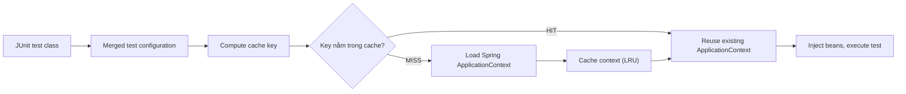

# Context cache và hiệu năng — Chuẩn hóa cấu hình test để giảm context trùng lặp

## 1. Bài toán thực tế

Trong một dự án Spring Boot, hai lớp kiểm thử có thể dùng cùng ứng dụng, cùng profile và cùng bean graph nhưng lại khai báo cấu hình hơi khác nhau. Spring TestContext sẽ coi đó là **hai context cache keys khác nhau** và khởi động thêm một `ApplicationContext`. Khi số lượng test lớn, nhiều lần khởi động Spring, tạo DataSource, thực thi auto-configuration và mở thread pools làm thời gian CI tăng đáng kể.

Ví dụ:

```java
@SpringBootTest(properties = "demo.quote.prefix=TEST")
@ActiveProfiles("test")
class QuotePriceTest { }

@SpringBootTest(properties = "demo.quote.prefix=TEST")
@ActiveProfiles("test")
class QuoteValidationTest { }
```

Nếu những thiết lập khác cũng tương đương, Spring có thể nạp context **một lần** và dùng lại cho cả hai. Nhưng chỉ cần lớp thứ hai thêm một `@MockitoBean` riêng, một `@Import` khác, đổi `@ActiveProfiles`, `@TestPropertySource` hoặc `@DynamicPropertySource`, context cache key có thể khác.

**Mục tiêu không phải ép toàn bộ test suite dùng một context.** Mục tiêu là: **những test thực sự cần cùng cấu hình phải dùng cùng cấu hình; những test có khác biệt về behavior hoặc isolation phải tách context có chủ đích**.

Sau bài này, bạn có thể:

1. Hiểu cơ chế cache theo `MergedContextConfiguration` của Spring TestContext.
2. Biết chính xác những cấu hình nào ảnh hưởng cache key.
3. Chuẩn hóa `@SpringBootTest`, `@ActiveProfiles`, `@TestPropertySource`, `@TestConfiguration`, `@MockitoBean`.
4. Xử lý `@DynamicPropertySource` và lifecycle của Testcontainers không làm reuse sai database.
5. Giảm `@DirtiesContext` không cần thiết nhưng vẫn giữ test isolation.
6. Đọc `org.springframework.test.context.cache=DEBUG`, hit/miss, capacity 32 và LRU eviction.
7. Viết Java 17/Spring Boot 3.5 tests chứng minh hai lớp dùng **cùng một ApplicationContext reference**.
8. Phân biệt lợi ích context reuse với việc chọn test slice nhỏ và đảm bảo correctness.

## 2. Cơ chế cache: context mới hay context đã có?



Spring Framework TestContext duy trì cache ánh xạ từ **cấu hình hợp nhất** sang `ApplicationContext`/`WebApplicationContext` đã khởi tạo. Các lớp test có cấu hình tương đương có thể dùng lại singleton beans và framework infrastructure.

Nhưng Spring **không tự khôi phục trạng thái nghiệp vụ của mọi singleton**. Nếu class A ghi vào in-memory cache của bean, class B dùng cùng context có thể đọc dữ liệu đó nếu không cleanup. Database, Redis, singleton mutable state, scheduled jobs và mock stubbing vẫn cần isolation riêng.

### Cùng test class ≠ cùng ApplicationContext

`@TestInstance(PER_CLASS)` chỉ thay lifecycle test instance của JUnit. Spring context cache là cơ chế khác; hai test **classes khác nhau** vẫn có thể dùng chung context, còn cùng một class có thể bị buộc load lại khi `@DirtiesContext`.

### Static cache theo JVM

Cache là static **trong một JVM**. Nó không truyền qua Maven Surefire forks, Gradle worker JVMs, CI shards, hoặc hai lệnh `mvn test` chạy riêng. Nếu mỗi test class chạy ở process khác, cấu hình chuẩn hóa không thể giúp cache hit **xuyên process**.

Trước khi tối ưu annotations, kiểm `forkCount`, `reuseForks`, Gradle `forkEvery`, JUnit parallel configuration và số JVM thực sự đang chạy. Không bỏ process isolation nếu suite cần cô lập native/static state chỉ vì muốn giảm startup time.

## 3. Các thành phần của context cache key trong Spring Framework 6.2

Theo [Spring TestContext Context Caching](https://docs.spring.io/spring-framework/reference/6.2/testing/testcontext-framework/ctx-management/caching.html), key xét các yếu tố sau:

| Key component | Nguồn cấu hình | Ví dụ khác nhau |
| --- | --- | --- |
| `locations` | `@ContextConfiguration` | File XML/config resources khác |
| `classes` | `@ContextConfiguration`, app config classes | Root Configuration khác |
| `contextInitializerClasses` | Context initializer annotations | Initializer cho test riêng |
| `contextCustomizers` | `@DynamicPropertySource`, `@MockitoBean`, `@MockitoSpyBean`, `@TestBean`, Boot customizers | Mock hoặc dynamic method khác |
| `contextLoader` | `@ContextConfiguration`/Boot loader | Loader strategy khác |
| `parent` | `@ContextHierarchy` | Parent context khác |
| `activeProfiles` | `@ActiveProfiles` | Profile test vs strict |
| `propertySourceDescriptors` | `@TestPropertySource` locations | Test properties files khác |
| `propertySourceProperties` | Inline test properties | Feature enabled vs disabled |
| `resourceBasePath` | `@WebAppConfiguration` | Web resource root khác |

Spring Boot còn cung cấp các context customizers liên quan đến test slices và `@SpringBootTest(properties=...)`. **Đừng chỉ nhìn hai lớp đều có `@SpringBootTest` rồi kết luận cache key giống nhau.**

### Phân biệt metadata với runtime state

Cache key thường phản ánh **test configuration metadata**, không chứa tất cả giá trị runtime. Thay `System.setProperty` ngay giữa tests không nhất thiết đổi key, và bean đã bind property ở lần context load trước không tự refresh.

Ngược lại, hai test chỉ khác input business như SKU/username/amount có thể dùng cùng context bằng cách seed/cleanup dữ liệu **ở method level**, thay vì thay annotation properties của class.

## 4. Cache mặc định tối đa 32 contexts, LRU eviction

Spring Framework 6.2 giới hạn cache mặc định **32 entries**. Khi một context mới cần đưa vào mà cache đầy, cache dùng chính sách **least recently used (LRU)** để evict và close context ít được dùng gần đây nhất.

Có thể cấu hình system property của **test JVM**:

```text
spring.test.context.cache.maxSize=64
```

hoặc bằng `SpringProperties`. **Đừng nâng maxSize mù quáng.** Mỗi context có thể giữ nhiều singleton beans, DB pools, embedded servers, threads và caches. Tăng từ 32 lên 64 đôi khi giảm reload nhưng làm tăng RAM/connection usage; nếu nguồn vấn đề là 40 mocks configurations gần như giống nhau, việc **chuẩn hóa config** đáng làm hơn.

### Minh họa cache

```text
Class A -> key X -> MISS, load context X
Class B -> key X -> HIT,  reuse context X
Class C -> key Y -> MISS, load context Y
...
Class Z -> key X -> HIT nếu X còn trong LRU
Class Z -> key X -> MISS nếu X đã bị evict
```

Đây là timeline minh họa, **không phải log thực**. Một JUnit test method có thể gây nhiều cache lookups từ TestExecutionListeners, nên `hitCount` không tương ứng 1:1 với số tests.

## 5. Nguồn phân mảnh cấu hình và cách chuẩn hóa

### 5.1. Profiles

```java
@ActiveProfiles("test")
class TestA { }

@ActiveProfiles({"test", "local"})
class TestB { }
```

Hai profiles có thể kích hoạt các beans/properties khác nhau, do đó key khác có lý do. Nếu `local` chỉ là copy-paste không cần thiết, thống nhất về `test`. Nhưng nếu bạn đang kiểm một policy đặc biệt hoặc conditional bean, **giữ context riêng** để kiểm behavior thật.

### 5.2. @SpringBootTest properties hoặc @TestPropertySource

```java
@SpringBootTest(properties = "demo.feature.enabled=true")
class TestA { }

@SpringBootTest(properties = "demo.feature.enabled=false")
class TestB { }
```

Đây là hai behavior khác nhau, không nên gộp chỉ để giảm cache count. Nhưng hai class đều cần `demo.feature.enabled=true` thì dùng chung một base/composed annotation, hoặc đưa vào file `application-test.properties` khi thích hợp.

`@TestPropertySource(locations=...)` và inline `properties=...` đều ảnh hưởng key. Chuẩn hóa giá trị, file và cách khai báo cho các test nhóm tương đương. Lưu ý Spring property source precedence khi chuyển giữa inline properties, test profile file và dynamic suppliers; test cần verify behavior sau refactor.

### 5.3. Nested @TestConfiguration

```java
@SpringBootTest
class FirstTest {
    @TestConfiguration
    static class FixedClock {
        @Bean Clock clock() { /* ... */ return null; }
    }
}

@SpringBootTest
class SecondTest {
    @TestConfiguration
    static class FixedClock {
        @Bean Clock clock() { /* ... */ return null; }
    }
}
```

**Snippet so sánh cấu hình, không runnable**: các methods chỉ là minh họa type/class identity. `FirstTest.FixedClock` và `SecondTest.FixedClock` là **hai classes khác nhau**, nên contexts có thể khác.

Nếu cả nhóm cần cùng fixed clock, tạo một **top-level `@TestConfiguration`** và `@Import` nhất quán trong base hoặc composed annotation. Đừng nhầm nested `@TestConfiguration` (bổ sung app config) với nested `@Configuration` (có thể thay đổi việc xác định primary Boot configuration).

### 5.4. Mocks ở từng class

Nhóm A có 3 mocks, nhóm B 4 mocks, bản chất bean overrides khác, vì vậy context khác có lý do. Nhưng nếu mocks hoàn toàn giống mà tên field/qualifier khác, có thể có phân mảnh không cần thiết.

### 5.5. @DirtiesContext quá rộng

`@DirtiesContext` làm context bị loại khỏi cache theo before/after mode. Dùng trên mọi test class/method khiến context bị tạo lại liên tục.

Chỉ dùng khi test **thật sự làm bẩn bean graph/context state** mà không thể restore đúng; nếu chỉ thay DB rows, dùng rollback/cleanup, nếu chỉ stub Mockito, dùng mock reset do TestContext cung cấp.

## 6. @MockitoBean và tên field: chi tiết dễ bị bỏ qua

Spring Framework 6.2 `@MockitoBean` có thể khai trên field trong test class **hoặc superclass**. Nếu không có explicit `@Qualifier`, **tên field là fallback qualifier**. Theo tài liệu, field names và qualifiers còn tham gia quyết định liệu contexts khác nhau có được tạo.

```java
// Test A
@MockitoBean
InventoryClient inventoryClient;

// Test B - tên khác
@MockitoBean
InventoryClient client;
```

Dù cùng type, metadata override có thể khác và dẫn tới cache key khác. Với test groups muốn mock cùng một bean, đặt **cùng field name**, hoặc dùng explicit bean name:

```java
@MockitoBean(name = "inventoryClient")
InventoryClient inventoryClient;
```

Khi override nhiều beans cùng type, `@Qualifier` hoặc `name` là điều cần thiết để tránh ambiguity. Không cố xóa qualifier để “ăn cache” nếu mock sai target.

### Mock reset khác context reset

Spring `@MockitoBean` có reset mode, mặc định `MockReset.AFTER`: mock stubbing/interactions được reset sau từng test theo TestContext lifecycle. Vì vậy cùng một mock bean **có thể reuse cùng context** mà mỗi test method tự stub kết quả riêng.

Không chọn `reset=NONE` hoặc lưu global mock stubbing tùy tiện vì nó dễ làm rò trạng thái. Khi chạy JUnit parallel tests dùng chung mock bean, cần phân tích concurrency riêng; mock reset sau method A có thể ảnh hưởng method B đang chạy nếu dùng chung context.

### Spring Boot 3.5 dùng @MockitoBean

Trong Boot 3.5/Framework 6.2, dùng:

```java
import org.springframework.test.context.bean.override.mockito.MockitoBean;
```

`@MockBean` cũ của Boot đã deprecated. Đừng trộn hai kiểu overrides trong một nhóm rồi giả định context keys vẫn tương đương; cần chạy lại suite khi migration.

## 7. @DynamicPropertySource: tăng reuse sai cũng là lỗi

`@DynamicPropertySource` static method cho phép đăng ký giá trị lấy lúc runtime:

```java
// Snippet: yêu cầu Testcontainers dependency, không thuộc demo core.
abstract class SharedDatabaseTestSupport {
    static final PostgreSQLContainer<?> postgres =
            new PostgreSQLContainer<>("postgres:16");

    @DynamicPropertySource
    static void databaseProperties(DynamicPropertyRegistry registry) {
        registry.add("spring.datasource.url", postgres::getJdbcUrl);
        registry.add("spring.datasource.username", postgres::getUsername);
        registry.add("spring.datasource.password", postgres::getPassword);
    }
}
```

Dynamic property **method metadata** ảnh hưởng cache customizer. Nếu mỗi class khai một static method khác, có thể mất reuse dù runtime endpoints giống nhau.

Ngược lại, Spring docs cảnh báo: nếu subclasses dùng **cùng inherited @DynamicPropertySource method** nhưng dynamic values thay đổi giữa subclasses, cached context có thể giữ kết nối cũ. Khi đó có thể cần `@DirtiesContext` trên base để mỗi subclass có context đúng, hoặc tổ chức shared stable container lifecycle.

**Quy tắc:** không tăng hit rate bằng cách cho test lớp B vô tình kết nối vào DB/container của lớp A. Dùng shared container chỉ khi lifecycle bền hơn cache context và test data được isolate. Với `@ServiceConnection`, kiểm cách Boot tạo connection details, scope và container lifecycle.

Dynamic properties thường có precedence cao hơn `@TestPropertySource`; không giả định chuyển hết sang file `application-test.properties` có cùng result khi vẫn còn dynamic registry overriding.

## 8. Khi nào không nên chia sẻ context?

| Hai trường hợp | Quyết định hợp lý | Vì sao |
| --- | --- | --- |
| Hai tests chỉ khác input business | Reuse | Cùng bean graph |
| Hai tests dùng cùng mocked gateway, stub khác | Reuse | Mockito reset per test |
| Profile `test` vs `strict-security` | Tách | Auth behavior khác |
| Real gateway vs mock gateway | Tách | Component graph khác |
| Feature on vs off | Tách | Conditional beans khác |
| `@SpringBootTest(NONE)` vs `RANDOM_PORT` | Tách | Web environment khác |
| `@WebMvcTest` controller A vs controller B | Có thể tách | MVC slice selection khác |
| DB container endpoint thay theo subclass | Tách hoặc shared container stable | Tránh stale datasource |
| Test thay bean definitions runtime | Có thể `@DirtiesContext` | Context đã bị thay đổi |
| Test chỉ UPDATE data trong DB | Reuse nếu cleanup đúng | Không cần refresh toàn container |

Không cần đạt “1 context cho cả repo”; cần **đủ ít context trong từng logical group** và đảm bảo behavior được kiểm đúng.

## 9. Dự án mẫu Java 17 / Spring Boot 3.5

Dự án runnable dùng một service đơn giản để nhìn thấy context reuse mà không cần Docker, database hay HTTP. Hai classes kế thừa cùng `SharedSpringTestBase` với một `@MockitoBean`; một class khác có profile riêng và real gateway.

```text
spring-context-cache-demo/
├── pom.xml
└── src/
    ├── main/java/example/contextcache/
    │   ├── ContextCacheApplication.java
    │   ├── RateGateway.java
    │   ├── DefaultRateGateway.java
    │   └── QuoteService.java
    └── test/
        ├── java/example/contextcache/
        │   ├── SharedSpringTestBase.java
        │   ├── ContextReuseEvidence.java
        │   ├── QuotePriceTest.java
        │   ├── QuoteValidationTest.java
        │   └── AlternateProfileTest.java
        └── resources/application-test.properties
```

### Ý tưởng minh chứng

- `QuotePriceTest` và `QuoteValidationTest` được nạp trong cùng JVM có **merged configuration giống nhau**.
- `ContextReuseEvidence` dùng Java object **reference identity** để xác nhận hai subclasses nhận **chính cùng một ApplicationContext**.
- `@MockitoBean RateGateway` ở base có tên field duy nhất nhất quán.
- Mockito stubbing thay đổi giữa test methods nhưng không phải context metadata.
- `AlternateProfileTest` dùng profile/property khác và **không mock** RateGateway, nên cần context khác hợp lệ.
- Stats từ Spring cache DEBUG log là bằng chứng vận hành bổ sung; không hard-code số hits trong JUnit.

## 10. pom.xml

```xml
<?xml version="1.0" encoding="UTF-8"?>
<project xmlns="http://maven.apache.org/POM/4.0.0"
         xmlns:xsi="http://www.w3.org/2001/XMLSchema-instance"
         xsi:schemaLocation="http://maven.apache.org/POM/4.0.0
           https://maven.apache.org/xsd/maven-4.0.0.xsd">
    <modelVersion>4.0.0</modelVersion>
    <parent>
        <groupId>org.springframework.boot</groupId>
        <artifactId>spring-boot-starter-parent</artifactId>
        <version>3.5.0</version>
        <relativePath/>
    </parent>
    <groupId>example</groupId>
    <artifactId>spring-context-cache-demo</artifactId>
    <version>1.0-SNAPSHOT</version>
    <properties>
        <java.version>17</java.version>
    </properties>
    <dependencies>
        <dependency>
            <groupId>org.springframework.boot</groupId>
            <artifactId>spring-boot-starter</artifactId>
        </dependency>
        <dependency>
            <groupId>org.springframework.boot</groupId>
            <artifactId>spring-boot-starter-test</artifactId>
            <scope>test</scope>
        </dependency>
    </dependencies>
</project>
```

Starter test mang JUnit 5, Mockito và `spring-test` 6.2. Không cần web/JPA starter vì test target chỉ là service bean + mock gateway; giảm dependencies cũng giảm context startup cost.

## 11. Ứng dụng mẫu (bốn file Java)

### ContextCacheApplication.java

`src/main/java/example/contextcache/ContextCacheApplication.java`:

```java
package example.contextcache;

import org.springframework.boot.SpringApplication;
import org.springframework.boot.autoconfigure.SpringBootApplication;

@SpringBootApplication
public class ContextCacheApplication {
    public static void main(String[] args) {
        SpringApplication.run(ContextCacheApplication.class, args);
    }
}
```

### RateGateway.java

`src/main/java/example/contextcache/RateGateway.java`:

```java
package example.contextcache;

import java.math.BigDecimal;

public interface RateGateway {
    BigDecimal rate(String sku);
}
```

### DefaultRateGateway.java

`src/main/java/example/contextcache/DefaultRateGateway.java`:

```java
package example.contextcache;

import java.math.BigDecimal;

import org.springframework.stereotype.Component;

@Component
public class DefaultRateGateway implements RateGateway {
    @Override
    public BigDecimal rate(String sku) {
        return new BigDecimal("0.10");
    }
}
```

### QuoteService.java

`src/main/java/example/contextcache/QuoteService.java`:

```java
package example.contextcache;

import java.math.BigDecimal;
import java.util.Objects;

import org.springframework.beans.factory.annotation.Value;
import org.springframework.stereotype.Service;

@Service
public class QuoteService {
    private final RateGateway rateGateway;
    private final String prefix;

    public QuoteService(
            RateGateway rateGateway,
            @Value("${demo.quote.prefix:QUOTE}") String prefix) {
        this.rateGateway = rateGateway;
        this.prefix = prefix;
    }

    public String quote(String sku) {
        if (sku == null || sku.isBlank()) {
            throw new IllegalArgumentException(
                    "sku must not be blank");
        }
        BigDecimal rate = Objects.requireNonNull(
                rateGateway.rate(sku),
                "rate must not be null");
        return prefix + ":" + sku + ":" + rate.toPlainString();
    }
}
```

Trong regular app context, `RateGateway` được `DefaultRateGateway` thực hiện. Trong shared tests, bean này được **override bằng Mockito mock**, còn `QuoteService` vẫn là real Spring bean.

## 12. SharedSpringTestBase.java: quy ước dùng chung

`src/test/java/example/contextcache/SharedSpringTestBase.java`:

```java
package example.contextcache;

import static org.mockito.Mockito.verifyNoInteractions;

import org.junit.jupiter.api.BeforeEach;
import org.springframework.beans.factory.annotation.Autowired;
import org.springframework.boot.test.context.SpringBootTest;
import org.springframework.context.ApplicationContext;
import org.springframework.test.context.ActiveProfiles;
import org.springframework.test.context.bean.override.mockito.MockitoBean;

@SpringBootTest(
    classes = ContextCacheApplication.class,
    webEnvironment = SpringBootTest.WebEnvironment.NONE,
    properties = "demo.quote.prefix=TEST")
@ActiveProfiles("test")
abstract class SharedSpringTestBase {
    @Autowired
    protected ApplicationContext context;

    @Autowired
    protected QuoteService quoteService;

    // Cùng type, field name và override metadata cho subclasses.
    @MockitoBean
    protected RateGateway rateGateway;

    @BeforeEach
    void confirmReuseAndCleanMock() {
        ContextReuseEvidence.assertSharedContext(context);
        verifyNoInteractions(rateGateway);
    }
}
```

Vì `@SpringBootTest`/`@ActiveProfiles` được kế thừa cùng field-level `@MockitoBean`, hai subclasses không phải tự khai duplicate properties hoặc mock field khác tên. `@BeforeEach` ở base chạy trước từng test method và kiểm shared mock chưa có interaction của method trước.

**Chú ý:** đây là fixture có chủ đích, không phải cách bắt mọi tests toàn repo sử dụng 20 mocks. Các test muốn real gateway hoặc profile khác có context riêng và không kế thừa base này.

## 13. ContextReuseEvidence.java: test identity thực

`src/test/java/example/contextcache/ContextReuseEvidence.java`:

```java
package example.contextcache;

import static org.junit.jupiter.api.Assertions.assertSame;

import java.util.concurrent.atomic.AtomicReference;

import org.springframework.context.ApplicationContext;

final class ContextReuseEvidence {
    private static final AtomicReference<ApplicationContext>
            FIRST = new AtomicReference<>();

    private ContextReuseEvidence() {
    }

    static void assertSharedContext(ApplicationContext now) {
        ApplicationContext recorded = FIRST.updateAndGet(
                old -> old == null ? now : old);

        assertSame(recorded, now,
                "SharedSpringTestBase subclasses should reuse context");
    }
}
```

`assertSame` so sánh **Java object reference**, không chỉ `ApplicationContext.getId()`; hai context objects khác nhau có thể có ID giống nhau.

Helper static này **chỉ để học cách quan sát reuse**. Trong test suite lớn, tránh giữ strong static reference tới context mãi vì có thể giữ memory; dùng framework DEBUG cache stats/timing để benchmark. Nếu Surefire chạy hai classes trong **hai JVM forks**, mỗi fork có registry riêng nên helper không chứng minh reuse xuyên process. Phải đối chiếu runner settings.

## 14. QuotePriceTest.java: ba test dùng shared config

`src/test/java/example/contextcache/QuotePriceTest.java`:

```java
package example.contextcache;

import static org.junit.jupiter.api.Assertions.assertEquals;
import static org.junit.jupiter.api.Assertions.assertThrows;
import static org.mockito.Mockito.verify;
import static org.mockito.Mockito.verifyNoInteractions;
import static org.mockito.Mockito.when;

import java.math.BigDecimal;

import org.junit.jupiter.api.Test;

class QuotePriceTest extends SharedSpringTestBase {

    @Test
    void createsQuoteWithFirstStub() {
        when(rateGateway.rate("SKU-A"))
                .thenReturn(new BigDecimal("0.15"));

        assertEquals("TEST:SKU-A:0.15",
                quoteService.quote("SKU-A"));
        verify(rateGateway).rate("SKU-A");
    }

    @Test
    void createsQuoteWithDifferentStub() {
        when(rateGateway.rate("SKU-B"))
                .thenReturn(new BigDecimal("0.20"));

        assertEquals("TEST:SKU-B:0.20",
                quoteService.quote("SKU-B"));
        verify(rateGateway).rate("SKU-B");
    }

    @Test
    void blankSkuIsRejectedBeforeGatewayCall() {
        IllegalArgumentException error = assertThrows(
                IllegalArgumentException.class,
                () -> quoteService.quote(" "));

        assertEquals("sku must not be blank",
                error.getMessage());
        verifyNoInteractions(rateGateway);
    }
}
```

**3 JUnit methods**. Mỗi method tự stub cần thiết, không dựa vào method order. Spring test infrastructure reset interactions/stubbing của `@MockitoBean` giữa methods.

## 15. QuoteValidationTest.java: ba test vẫn cùng context

`src/test/java/example/contextcache/QuoteValidationTest.java`:

```java
package example.contextcache;

import static org.junit.jupiter.api.Assertions.assertEquals;
import static org.junit.jupiter.api.Assertions.assertSame;
import static org.junit.jupiter.api.Assertions.assertThrows;
import static org.mockito.Mockito.verify;
import static org.mockito.Mockito.when;

import java.math.BigDecimal;

import org.junit.jupiter.api.Test;

class QuoteValidationTest extends SharedSpringTestBase {

    @Test
    void anotherClassCanStubSameMockBean() {
        when(rateGateway.rate("SKU-C"))
                .thenReturn(new BigDecimal("0.25"));

        assertEquals("TEST:SKU-C:0.25",
                quoteService.quote("SKU-C"));
        verify(rateGateway).rate("SKU-C");
    }

    @Test
    void injectedGatewayIsExactMockInContext() {
        assertSame(rateGateway,
                context.getBean(RateGateway.class));
    }

    @Test
    void nullRateFailsFast() {
        when(rateGateway.rate("SKU-NULL"))
                .thenReturn(null);

        NullPointerException error = assertThrows(
                NullPointerException.class,
                () -> quoteService.quote("SKU-NULL"));

        assertEquals("rate must not be null",
                error.getMessage());
    }
}
```

**3 JUnit methods**. Nhờ `SharedSpringTestBase`, không cần viết lại một tổ hợp annotation/mock field riêng có nguy cơ sai khác. `ContextReuseEvidence` được gọi trước mỗi method, bao gồm methods thuộc cả hai classes.

Nếu class này vô ý thêm `@MockitoBean` khác hoặc đổi profile, reference identity assertion phát hiện bối cảnh đã khác (khi classes được chạy cùng JVM và không bị deliberate cache eviction/dirties).

## 16. AlternateProfileTest.java: context khác có lý do

`src/test/java/example/contextcache/AlternateProfileTest.java`:

```java
package example.contextcache;

import static org.junit.jupiter.api.Assertions.assertEquals;
import static org.junit.jupiter.api.Assertions.assertThrows;

import org.junit.jupiter.api.Test;
import org.springframework.beans.factory.annotation.Autowired;
import org.springframework.boot.test.context.SpringBootTest;
import org.springframework.test.context.ActiveProfiles;

@SpringBootTest(
    classes = ContextCacheApplication.class,
    webEnvironment = SpringBootTest.WebEnvironment.NONE,
    properties = "demo.quote.prefix=ALT")
@ActiveProfiles("alternate")
class AlternateProfileTest {

    @Autowired
    QuoteService quoteService;

    @Test
    void realGatewayWorksWithAlternatePrefix() {
        assertEquals("ALT:SKU-X:0.10",
                quoteService.quote("SKU-X"));
    }

    @Test
    void alternateContextAlsoRejectsBlankSku() {
        assertThrows(IllegalArgumentException.class,
                () -> quoteService.quote(""));
    }
}
```

**2 JUnit methods**. Vì profile/property khác và không có `@MockitoBean`, dùng context thứ hai là **chính xác**. Không gọi `ContextReuseEvidence` cho class này, vì nó không thuộc nhóm mong đợi dùng chung.

## 17. application-test.properties và đọc thống kê cache

`src/test/resources/application-test.properties`:

```properties
logging.level.org.springframework.test.context.cache=DEBUG
```

Mục đích là hiển thị hit/miss/size của TestContext cache. Tùy thời điểm Boot logging system initialize, một số log sớm có thể chưa hiện; nếu cần đo toàn bộ startup, đặt mức DEBUG cho category này ở JVM/build logging configuration.

Ví dụ **minh họa**, không phải output `mvn test` đã chạy:

```text
Spring test ApplicationContext cache statistics:
size = 1, maxSize = 32, hitCount = 14, missCount = 1
...
size = 2, maxSize = 32, hitCount = 26, missCount = 2
```

Ý nghĩa:
- `size` là số contexts hiện trong cache, **không phải số test classes**.
- `hitCount` đếm cache lookups trúng, có thể nhiều lần trong một method.
- `missCount` đếm lookups chưa có key (bao gồm reload).
- `maxSize` mặc định 32.
- Context bị `@DirtiesContext` hoặc LRU eviction có thể phải load lại.

Trong project tối giản này, nếu hai shared classes chạy cùng JVM với metadata không đổi và không có framework customizer bất ngờ, kỳ vọng **một context cho cả hai**, cộng **một context cho alternate profile**. Không assert cứng số hitCount như business contract vì TestExecutionListeners/version có thể thay đổi số lookups.

## 18. Chạy Maven và kết quả mong đợi

Cần JDK 17+, Maven và dependency downloads. Từ `spring-context-cache-demo`:

```bash
mvn test
```

Chạy riêng hai lớp dùng chung:

```bash
mvn test -Dtest=QuotePriceTest,QuoteValidationTest
```

Chạy profile khác:

```bash
mvn test -Dtest=AlternateProfileTest
```

| Lớp | Số `@Test` | Context behavior |
| --- | ---: | --- |
| `QuotePriceTest` | 3 | Shared context, mock gateway |
| `QuoteValidationTest` | 3 | Cùng ApplicationContext object nếu cùng JVM |
| `AlternateProfileTest` | 2 | Context khác, real gateway |
| **Tổng** | **8** | 8 lượt test dự kiến |

**Kết quả kỳ vọng: 8 PASS**, không failures/errors/skips trên môi trường tương thích. Đây là **kỳ vọng dựa trên source**, không khẳng định Maven đã thực thi. Để xác nhận, đọc `target/surefire-reports` và cache DEBUG logs.

### Đo trước/sau một thay đổi

Nên đo trên cùng CI runner/CPU/RAM/cache/dependency trạng thái tương đương:

| Metric | Trước chuẩn hóa | Sau chuẩn hóa |
| --- | --- | --- |
| Số unique context keys/misses | Lấy từ baseline thực | So sánh |
| Cache evictions | Log baseline | So sánh |
| Context load time | Profiling/log | So sánh |
| Total test suite duration | CI report | So sánh |
| Heap/threads/DB connections | Metrics | Không tăng bất thường |
| Tests pass/fail/skip | JUnit reports | Không mất coverage |
| Flaky retries | CI history | Không tăng |

Không bịa số phần trăm “nhanh hơn 80%”; tối ưu chỉ được kết luận sau khi đo.

## 19. Vì sao không dùng @DirtiesContext làm default?

Ví dụ minh họa:

```java
@SpringBootTest
@DirtiesContext(classMode = DirtiesContext.ClassMode.AFTER_CLASS)
class ChangesApplicationBeansTest {
    // Chỉ dùng nếu class thật sự làm bẩn context.
}
```

`@DirtiesContext` yêu cầu Spring remove/close context theo mode. Dùng khi test thay bean definitions, làm hỏng context lifecycle hoặc dynamic property values khác giữa subclasses mà không thể reuse an toàn.

**Không gắn vào shared base cho tất cả tests**, vì mỗi subclass có thể evict cached context vừa dùng xong. Khi chỉ sửa dữ liệu:
- JDBC/JPA tests có thể rollback hoặc explicit cleanup.
- Mockito mocks thường reset qua Spring TestContext.
- Singleton caches có thể có clear/reset API cho test.
- Broker topics, Redis keys, files cần isolated test resources.

`@DirtiesContext` cũng **không xóa Java static state hay external database data**; đôi khi test contamination vẫn còn dù context đã khởi động lại.

## 20. Test slices: ít context không đồng nghĩa ít thời gian nhất

Spring Boot hỗ trợ `@WebMvcTest`, `@DataJpaTest`, `@JdbcTest`, `@RestClientTest` và nhiều slices khác. Một `@WebMvcTest(Controller.class)` chỉ load MVC-related beans, thường có context khác full `@SpringBootTest`, nhưng load nhẹ hơn.

Ví dụ:

```java
@WebMvcTest(InvoiceController.class)
class InvoiceHttpContractTest {
    @MockitoBean
    InvoiceService invoiceService;
}
```

Đây là snippet; `InvoiceController` và `InvoiceService` không thuộc demo runnable. Nếu kiểm HTTP contract, có thể dùng slice thay vì full context. Tuy nhiên, nếu cần xác thực integration Controller → Service → DB, slice có service mock không đủ. Tối ưu phải giữ test boundary đúng.

`@SpringBootTest(webEnvironment=RANDOM_PORT)` tạo real HTTP server và context khác `NONE`. Nếu test chỉ gọi service method, dùng `NONE`; nếu test cần HTTP socket, giữ `RANDOM_PORT`. Không hard-code port; dùng `@LocalServerPort`.

### Không tạo giant shared context

Một base chung với 20 mock beans, Kafka, Redis, HTTP server và database làm từng test nặng dù có cache hit. Nên chia **một vài nhóm cấu hình có ý nghĩa**: business service, MVC contract, persistence, messaging, full-system smoke. Dùng reuse trong từng nhóm.

## 21. Chuẩn hóa bằng composed annotation hoặc shared test config

Abstract base là lựa chọn của project runnable. Với repo lớn, có thể tạo composed annotation:

```java
// Snippet cần imports, đặt trong test source của ứng dụng.
@Target(ElementType.TYPE)
@Retention(RetentionPolicy.RUNTIME)
@SpringBootTest(
    classes = ContextCacheApplication.class,
    webEnvironment = SpringBootTest.WebEnvironment.NONE,
    properties = "demo.quote.prefix=TEST")
@ActiveProfiles("test")
public @interface SharedQuoteTest {
}
```

Imports cần có `java.lang.annotation.Target`/`ElementType`/`Retention`/`RetentionPolicy` cùng Spring test annotations. Annotation này chuẩn hóa **metadata**, không tự tạo fields/methods cho test; nếu cần mocks chung, Spring Framework 6.2 hỗ trợ type-level/meta `@MockitoBean(types=...)` nhưng phải định nghĩa qualifiers và owner rõ.

Khi cần beans test-only, dùng một **top-level `@TestConfiguration`** rồi `@Import` từ shared base hoặc composed annotation. Tránh mỗi class copy một nested configuration khác class identity.

Đừng tự đưa `@ComponentScan` rộng vào test để “giảm configs”: nó có thể load thêm beans, mất lợi thế slices và làm graph phình to.

## 22. Những edge cases ảnh hưởng tính đúng đắn

### 22.1. Mock beans và JUnit parallel

Hai tests cùng cached context có thể dùng chung mock instance. Nếu parallel execution đồng thời stub/reset, một test có thể làm reset stubbing của test kia. Cần `@Execution(SAME_THREAD)`, `@ResourceLock`, resource isolation hoặc tách nhóm khi cần. Mẫu runnable hướng đến JUnit execution tuần tự mặc định.

### 22.2. Testcontainers lifecycle

Shared context có datasource giữ kết nối tới container. Nếu container stop sau một class trong khi context còn cached, test class sau sẽ lỗi kết nối. Chọn container lifecycle bền hơn context hoặc tách/dirty context đúng. Với `@ServiceConnection`, kiểm lifecycle và ConnectionDetails thay vì đoán.

### 22.3. System properties và static state

`System.setProperty("feature.enabled","true")` giữa methods không làm Spring refresh beans đã bind config. Đừng mutate global JVM system properties trong parallel tests. Nếu cần kiểm feature toggles ở startup, khai rõ profile/property source và chấp nhận context key riêng.

### 22.4. Spring Boot Test configuration discovery

`@SpringBootTest` không có explicit `classes` thường tìm `@SpringBootApplication` từ package test. Hai test ở packages khác có thể resolve primary configs khác. Trong demo, base chỉ định `classes=ContextCacheApplication.class` để tránh ambiguity.

### 22.5. @ContextHierarchy và bean overrides

Một `@MockitoBean` trong hierarchy có thể áp vào nhiều levels nếu không chỉ rõ `contextName`, gây override ngoài ý muốn. Khi dùng `@ContextHierarchy`, thiết kế parent/child config và overrides đúng scope; không gộp context keys chỉ dựa vào tên test class.

### 22.6. @Transactional rollback và HTTP tests

`@Transactional` test methods có thể rollback cuối method, nhưng `@SpringBootTest(RANDOM_PORT)` chạy HTTP server ở thread khác, transaction của server không nằm trong test transaction để rollback tự động. Phải cleanup DB rõ ràng. Context reuse không biến transactions xuyên threads thành một transaction.

## 23. Troubleshooting

| Triệu chứng | Nguyên nhân có thể | Cách kiểm |
| --- | --- | --- |
| Log “Starting application” lặp liên tục | Nhiều keys, forks, dirties hoặc eviction | DEBUG context cache, build runner |
| Hai classes cùng @SpringBootTest nhưng khác context | Profile/mocks/imports/properties khác | So merged config |
| Mock cùng type mà key khác | Field name fallback qualifier | Chuẩn hóa field/qualifier |
| Miss tăng khi thêm một @TestConfiguration | Class/Import customizer khác | Shared top-level config |
| Context tái tạo sau mỗi method | @DirtiesContext method-level | Bỏ khi reset data đủ |
| Context được reuse nhưng DB connection chết | Container lifecycle ngắn hơn cache | Shared stable container/tách context |
| Reuse sai datasource giữa subclasses | DynamicPropertySource values thay đổi | @DirtiesContext hoặc distinct setup |
| Increase maxSize nhưng OOM | Giữ quá nhiều heavy contexts | Giảm keys/slices, tune heap |
| HitCount không khớp số methods | Nhiều framework lookups | Đừng assert số hits cố định |
| Mock stubbing rò giữa tests | Reset mode NONE/parallel race | Reset default/isolation |
| Suite chạy riêng nhanh nhưng CI chậm | More forks, no cache shared | Kiểm Surefire/Gradle process |
| Tests phụ thuộc thứ tự | Singleton/static state/DB dữ liệu cũ | Cleanup/test data isolation |
| @WebMvcTest vẫn khởi động nhiều beans | Extra imports/custom scans | Giữ đúng MVC slice |
| Different profiles “bị gom” dẫn đến wrong result | Ép reuse sai semantics | Giữ contexts riêng |
| DB rollback không tác dụng với RANDOM_PORT | HTTP handler ở thread khác | Explicit cleanup/isolation |

### Các bước chẩn đoán tối ưu

1. Bật `org.springframework.test.context.cache=DEBUG`.
2. Xác định test classes có cùng JVM hay không.
3. Đếm unique contexts và cache misses/evictions.
4. So primary classes/context loaders.
5. So active profiles và property sources.
6. So `@MockitoBean` type/name/qualifier và khác biệt trong imports/configuration classes.
7. So `@DynamicPropertySource` methods và container lifecycle.
8. Kiểm `@DirtiesContext` và shared mutable state.
9. Tách các slices/full tests theo boundary thật.
10. Sau refactor, kiểm test results và thời gian CI; chỉ sau đó cân nhắc chỉnh maxSize.

## 24. Checklist nghiệm thu

- [ ] Đã đo baseline context cache stats và suite duration?
- [ ] Biết JVM forks/CI shards đang cấu hình thế nào?
- [ ] Các tests cùng behavior dùng một bộ profile/properties cố định?
- [ ] Primary configuration, webEnvironment và imports thống nhất?
- [ ] `@MockitoBean` fields cùng type/name/qualifier khi muốn reuse?
- [ ] Không thêm mocks ngoài cần thiết chỉ để dùng một base test?
- [ ] Không đặt nested `@TestConfiguration` trùng logic ở mọi class?
- [ ] Không tùy tiện thay `@DynamicPropertySource` trong subclasses?
- [ ] Shared Testcontainers có lifecycle đủ dài và data isolation?
- [ ] `@DirtiesContext` chỉ dùng khi thực sự có state không thể restore?
- [ ] DB/singletons/static caches được cleanup hoặc tách đúng?
- [ ] Mockito reset hoạt động giữa test methods?
- [ ] JUnit parallel không tạo race trên shared mocks?
- [ ] Dùng slices khi đủ scope thay vì full ApplicationContext nặng?
- [ ] Context key khác do security/feature flags vẫn được giữ khác?
- [ ] Có chứng cứ context identity/logs khi tuyên bố reuse?
- [ ] Không assert cứng số cache hits theo version?
- [ ] Không tăng maxSize gây nhiều DataSources/threads không cần thiết?
- [ ] Có báo cáo pass/fail/skip từ Surefire khi release?
- [ ] Không thay đổi test semantics để lấy tốc độ?

## 25. Bài tập nâng cao

1. Chạy `mvn test` rồi xem cache DEBUG logs và `target/surefire-reports`.
2. Khai `@MockitoBean RateGateway gateway` riêng ở một subclass, quan sát context key thay đổi và giải thích field name fallback qualifier.
3. Thêm `@TestPropertySource(properties="demo.quote.prefix=OTHER")` cho một class, kiểm context và value mới.
4. Thêm nested `@TestConfiguration` vào một class, rồi chuyển thành shared top-level config để so cache misses.
5. Thử `@DirtiesContext` trên base, đo số lần context phải nạp lại.
6. Đổi `spring.test.context.cache.maxSize` chỉ khi có eviction, theo dõi heap.
7. Chạy mỗi class trong JVM fork riêng, kiểm giới hạn của static reference helper.
8. Bật parallel tests và khảo sát shared mock reset/stubbing race; sửa bằng resource isolation.
9. Đặt shared Postgres Testcontainer + `@DynamicPropertySource`, kiểm DB cleanup và container lifetime.
10. Cố tình cho subclass đổi datasource endpoint, phát hiện stale cache và tách context an toàn.
11. Chuyển controller test sang `@WebMvcTest`, đo load time so với `@SpringBootTest`.
12. So sánh hai cấu hình CI với cùng suite, ghi thời gian startup, misses, evictions và memory.

## 26. Tài liệu tham khảo chính thức

1. [Spring Framework 6.2 — Context Caching](https://docs.spring.io/spring-framework/reference/6.2/testing/testcontext-framework/ctx-management/caching.html): cache key, static scope, mặc định 32 entries/LRU, DEBUG stats và `@DirtiesContext`.
2. [Spring Framework 6.2 — @MockitoBean and @MockitoSpyBean](https://docs.spring.io/spring-framework/reference/6.2/testing/annotations/integration-spring/annotation-mockitobean.html): field-name fallback qualifier, overrides trên superclass và context cache.
3. [Spring Framework 6.2 — Dynamic Property Sources](https://docs.spring.io/spring-framework/reference/6.2/testing/testcontext-framework/ctx-management/dynamic-property-sources.html): `@DynamicPropertySource`, suppliers, inheritance caveat và `@DirtiesContext`.
4. [Spring Framework 6.2 — @DirtiesContext](https://docs.spring.io/spring-framework/reference/6.2/testing/annotations/integration-spring/annotation-dirtiescontext.html): cache eviction modes.
5. [Spring Boot 3.5 — Testing Spring Boot Applications](https://docs.spring.io/spring-boot/3.5/reference/testing/spring-boot-applications.html): primary config detection, test slices, `@TestConfiguration`, caching và webEnvironment.
6. [Spring Framework 6.2 — TestContext Overview](https://docs.spring.io/spring-framework/reference/6.2/testing/testcontext-framework.html): lifecycle và context management.
7. [JUnit Jupiter User Guide](https://junit.org/junit5/docs/current/user-guide/): test instance lifecycle, inheritance, parallel/resource locks.
8. [Maven Surefire Fork Options](https://maven.apache.org/surefire/maven-surefire-plugin/examples/fork-options-and-parallel-execution.html): forkCount và reuseForks.
9. [Spring Boot 3.5 — Testcontainers](https://docs.spring.io/spring-boot/3.5/reference/testing/testcontainers.html): `@ServiceConnection` và container lifecycle.
10. [Spring Framework 6.2 — @TestPropertySource](https://docs.spring.io/spring-framework/reference/6.2/testing/annotations/integration-spring/annotation-testpropertysource.html): property sources và precedence.

### Kết luận

**Chuẩn hóa cấu hình test để giảm context trùng lặp** nghĩa là chia sẻ **cùng merged configuration** cho những tests thật sự tương đương, chứ không xóa khác biệt nghiệp vụ cần kiểm. Dùng shared base/composed annotations, thống nhất profiles/properties/mocks/test configurations, quản lý dynamic resources và reset state, rồi đo cache hits/misses/evictions cùng thời gian CI. Cấu hình đúng và test đáng tin luôn quan trọng hơn một con số cache hit cao.
