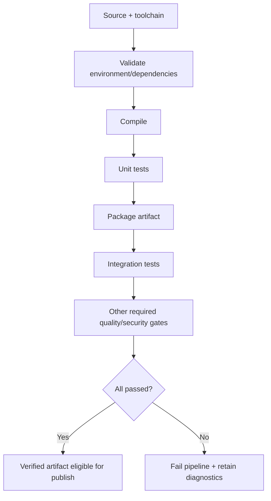

# Build và CI — Thứ tự task, dependency và kiểm tra cần chạy trước khi build thành công

## 1. Điều gì thực sự khiến build được coi là thành công?

Trong Spring Boot, build không phải một lệnh biên dịch duy nhất. Nó là **tập hợp những tác vụ**: xác thực công cụ, tải dependencies, compile, chạy unit tests, đóng gói, chạy integration tests, kiểm tra chất lượng và cuối cùng có thể publish artifact.

Một câu nói phổ biến: “CI đã tạo được `app.jar`, vậy build đã pass”. Điều đó **không đủ**. Artifact có thể được đóng gói trong khi integration test hoặc security gate chưa chạy; hoặc một task bị skip. Đặc biệt:

- `mvn compile`: biên dịch production code, chưa chạy tests.
- `mvn test`: chạy những tests do Surefire nhận diện ở phase `test`, nhưng không mặc định chạy integration tests được bind vào các phases sau.
- `mvn package`: có thể tạo JAR **trước khi** các Failsafe integration tests chạy.
- `mvn verify`: đi qua các Maven phases đến `verify`, gồm các goals **đã được bind**, chứ không tự động thực thi mọi công cụ phân tích tĩnh.
- `./gradlew bootJar`: đóng executable JAR, **không tự bảo đảm** custom verification tasks đã chạy.
- `./gradlew build`: Java plugin yêu cầu `assemble` và `check`, nhưng custom `integrationTest` chỉ chạy nếu được nối vào task graph.
- `mustRunAfter` của Gradle chỉ điều khiển thứ tự **khi cả hai tasks đã có trong graph**; nó không tự gọi một task bị thiếu.

**Câu hỏi cốt lõi:** Trước khi CI trả “SUCCESS”, những checks bắt buộc nào **thực sự được lên lịch, thực thi và pass**?

### Kết quả học tập

1. Phân biệt Maven lifecycle/phase/plugin goal với Gradle task/dependency/ordering.
2. Giải thích thứ tự `validate → compile → test → package → integration-test → verify` và ý nghĩa riêng của `clean`.
3. Cấu hình Maven Enforcer, Surefire, Failsafe và Spring Boot repackaging đúng phases.
4. Phân biệt `dependsOn`, `mustRunAfter`, `shouldRunAfter`, `finalizedBy` của Gradle.
5. Nối integration tests vào Gradle `check`, tránh “build xanh giả”.
6. Viết Spring Boot 3.5/Java 17 JUnit unit tests và HTTP integration tests.
7. Xác minh test discovery, reports, exit codes và artifact provenance.
8. Lập CI gates và tránh flags làm bỏ qua test hoặc che failure.

## 2. Build graph, artifact và quality gate là ba khái niệm khác nhau

| Thuật ngữ | Ý nghĩa | Ví dụ |
| --- | --- | --- |
| **Artifact** | Đầu ra có thể phát hành | JAR/WAR/container image |
| **Build task** | Một công việc có input/output và điều kiện chạy | Gradle `compileJava` hoặc Maven compiler goal |
| **Dependency** | Công việc A cần kết quả của B trước khi A tiếp tục | Gradle `A.dependsOn(B)` |
| **Ordering constraint** | Nếu A/B đều được chọn, quyết định thứ tự | `A.mustRunAfter(B)` |
| **Quality gate** | Quy tắc kiểm tra có thể chặn pipeline nếu fail | JUnit failures, coverage threshold, vulnerability scan |
| **Verified artifact** | Artifact gắn với revision/config đã qua các gates | JAR từ commit X cùng report kiểm thử của commit X |
| **Release approval** | Điều kiện quản trị/triển khai sau build | Environment approval, deploy window, canary |

Phụ thuộc thư viện `spring-boot-starter-web` **khác** phụ thuộc task `integrationTest.dependsOn(startDatabase)`. Cả hai đều gọi “dependency” nhưng một thứ thuộc **dependency resolution**, thứ kia thuộc **execution graph**.



Sơ đồ mô tả **một chính sách CI khuyến nghị**; mỗi tool cần được cấu hình để các cạnh tương ứng tồn tại. Maven/Gradle không tự chạy vulnerability scanner hay browser E2E chỉ vì bạn chọn lệnh có tên `verify` hoặc `build`.

## 3. Maven: lifecycle → phase → goal

Maven có ba lifecycle built-in: `default`, `clean`, `site`. Lifecycle `default` chứa các phase theo thứ tự. Chọn một phase đích sẽ chạy tất cả phase trước đó trong cùng lifecycle, với **các plugin goals được bind**.

```text
validate
  ↓
initialize
  ↓
generate-sources / process-sources
  ↓
process-resources
  ↓
compile
  ↓
process-test-resources / test-compile
  ↓
test
  ↓
prepare-package / package
  ↓
pre-integration-test
  ↓
integration-test
  ↓
post-integration-test
  ↓
verify
  ↓
install
  ↓
deploy
```

Sơ đồ là **các mốc tiêu biểu**, không liệt kê toàn bộ phases trung gian trong Maven. `clean` nằm ở lifecycle riêng: `mvn clean verify` yêu cầu clean trước, rồi default lifecycle tới verify.

| Maven command | Mốc tới được | Chưa thể suy diễn |
| --- | --- | --- |
| `mvn validate` | validate | Source compile, test pass |
| `mvn compile` | compile | Test sources compile/execute |
| `mvn test` | test | Failsafe IT ở phases sau |
| `mvn package` | package | `post-integration-test`, `failsafe:verify` |
| `mvn verify` | verify | SAST/coverage nếu goals chưa bind |
| `mvn install` | install vào local Maven repository | Deploy tới artifact repository |
| `mvn deploy` | deploy tới repository theo cấu hình | Production deployment approval |
| `mvn clean verify` | clean rồi verify | Những gates ngoài build tool nếu chưa cấu hình |

### Pha không tự là tác vụ

Một phase có thể không có goal được bind. Ví dụ gọi `mvn verify` không tự gọi SonarQube, OWASP Dependency-Check, JaCoCo hoặc SpotBugs nếu POM/CI chưa đăng ký chúng. Tên `verify` là mốc của lifecycle, **không phải lời xác nhận mọi loại chất lượng**.

### Bind goal và loại packaging

Với `jar` packaging, Maven có built-in plugin bindings cho resources/compile/test/JAR. Với `pom` aggregator, behavior khác. POM plugins và executions (hoặc parent/pluginManagement) có thể thay đổi những goals được gọi tại từng phase. Khi điều tra một build, dùng `mvn help:effective-pom` thay vì suy đoán từ một đoạn plugin definition.

## 4. Surefire vs Failsafe: không giống nhau

Theo Apache Maven:

| Plugin | Công việc | Mốc thường dùng | Default naming |
| --- | --- | --- | --- |
| **maven-surefire-plugin** | Chạy unit tests/fast tests | `test` | `Test*`, `*Test`, `*Tests`, `*TestCase` |
| **maven-failsafe-plugin** | Chạy integration tests | `integration-test` và `verify` | `IT*`, `*IT`, `*ITCase` |

Đặt tên `QuoteEndpointIT.java` không tự biến test thành “integration” về mặt kiến trúc; nội dung test phải thực sự exercise nhiều components thật. Nhưng naming quan trọng cho **test discovery**: class `QuoteEndpointIntegration.java` có thể không được plugins nhận ra nếu chưa chỉnh includes.

### Vì sao Failsafe cần integration-test và verify?

```text
pre-integration-test   → setup dependencies/test environment
integration-test       → execute integration tests
post-integration-test  → teardown test environment
verify                 → evaluate Failsafe results and fail build
```

Failsafe được thiết kế để không làm build dừng ngay ở `integration-test` vì một test failure thông thường, giúp `post-integration-test` có cơ hội cleanup. Goal `failsafe:verify` kiểm summary và fail nếu integration tests không đạt.

**Không gọi riêng `mvn integration-test` để làm release gate.** Với Maven 3, cách đó có thể bỏ qua cleanup/verify phases; đặc biệt nguy hiểm khi tests khởi động Docker/web server/databases. Dùng `mvn verify`.

### Cẩn thận Tests run: 0

Nếu file tên sai hoặc suite thiếu, plugin có thể không chạy gì. Với module bắt buộc có unit/IT tests, cân nhắc `failIfNoTests=true`, kiểm reports và test count. Với multi-module root POM hoặc modules cố ý không có IT, cần policy ngoại lệ rõ, không bật fail-if-no-tests mù quáng ở mọi module.

## 5. Gradle: task graph thay vì lifecycle phase cố định

Gradle Java plugin có các lifecycle tasks:

```text
build
├── assemble
│   └── archive/package tasks
└── check
    └── test
```

Spring Boot plugin còn tạo `bootJar`, `bootRun` và các tasks khác. **Custom integrationTest task không tự nối vào `check`** chỉ vì có tên “Test”.

Điểm quyết định:

- `dependsOn` tạo **execution dependency**: khi chạy A, B nằm trong graph.
- `mustRunAfter` quy định **thứ tự cứng khi cùng được chạy**, không thêm B vào graph.
- `shouldRunAfter` là gợi ý thứ tự mềm và có thể bị bỏ qua khi tạo cycle hoặc các tình huống parallel.
- `finalizedBy` dùng để lên lịch finalizer (cleanup/report), kể cả một số tình huống task chính fail.
- `onlyIf`, `enabled=false`, `-x test` có thể khiến task bị skip: “SKIPPED” không phải “test PASS”.

```kotlin
val integrationTest = tasks.register<Test>("integrationTest") {
    useJUnitPlatform()
    mustRunAfter(tasks.named("test"))
}

tasks.named("check") {
    dependsOn(integrationTest)
}
```

Đây là **snippet về graph**, cần source set/classpath của integrationTest để là task JUnit thực sự. `mustRunAfter` điều khiển thứ tự; **`check.dependsOn(integrationTest)` mới đưa task vào `build`**.

### Một anti-pattern nguy hiểm

```kotlin
tasks.register("integrationTest") {
    mustRunAfter("test")
    doLast {
        println("All integration tests passed")
    }
}
```

Task này chỉ in thông báo — không chạy JUnit. Thậm chí nếu CI có chạy task đó, nó **không kiểm integration**. Không tạo test “xanh giả” bằng print task, hoặc đặt tên `check` cho một bước không kiểm tra gì.

## 6. Dự án Maven thực hành: Spring Boot 3.5 + Java 17

Ví dụ dùng một HTTP API tính báo giá. Nó có:

- Maven Enforcer tại `validate` chặn JDK/Maven version không đáp ứng.
- `QuoteCalculatorTest` là **3 unit tests** thuần Java, chạy bằng Surefire tại `test`.
- Spring Boot executable JAR được đóng ở `package`.
- `QuoteEndpointIT` là **2 integration tests**: embedded HTTP server trên random port + Java `HttpClient` thực.
- Failsafe ở `integration-test` và `verify` làm pipeline fail nếu API behavior sai.
- GitHub Actions dùng `mvn clean verify` và lưu reports kể cả khi tests fail.

```text
build-ci-demo/
├── pom.xml
├── src/
│   ├── main/java/example/buildci/
│   │   ├── BuildCiApplication.java
│   │   ├── QuoteCalculator.java
│   │   └── QuoteController.java
│   └── test/java/example/buildci/
│       ├── QuoteCalculatorTest.java
│       └── QuoteEndpointIT.java
└── .github/workflows/verify.yml
```

Không cần Docker, PostgreSQL, Kafka hay external services. JDK 17+ và Maven 3.9+ là đủ để chạy project sau khi dependencies được resolve.

## 7. pom.xml: các goals được bind rõ

`pom.xml`:

```xml
<?xml version="1.0" encoding="UTF-8"?>
<project xmlns="http://maven.apache.org/POM/4.0.0"
         xmlns:xsi="http://www.w3.org/2001/XMLSchema-instance"
         xsi:schemaLocation="http://maven.apache.org/POM/4.0.0
           https://maven.apache.org/xsd/maven-4.0.0.xsd">
    <modelVersion>4.0.0</modelVersion>

    <parent>
        <groupId>org.springframework.boot</groupId>
        <artifactId>spring-boot-starter-parent</artifactId>
        <version>3.5.0</version>
        <relativePath/>
    </parent>

    <groupId>example</groupId>
    <artifactId>build-ci-demo</artifactId>
    <version>1.0.0</version>

    <properties>
        <java.version>17</java.version>
        <maven.compiler.release>17</maven.compiler.release>
    </properties>

    <dependencies>
        <dependency>
            <groupId>org.springframework.boot</groupId>
            <artifactId>spring-boot-starter-web</artifactId>
        </dependency>
        <dependency>
            <groupId>org.springframework.boot</groupId>
            <artifactId>spring-boot-starter-test</artifactId>
            <scope>test</scope>
        </dependency>
    </dependencies>

    <build>
        <plugins>
            <plugin>
                <groupId>org.apache.maven.plugins</groupId>
                <artifactId>maven-enforcer-plugin</artifactId>
                <version>3.5.0</version>
                <executions>
                    <execution>
                        <id>enforce-toolchain</id>
                        <phase>validate</phase>
                        <goals>
                            <goal>enforce</goal>
                        </goals>
                        <configuration>
                            <rules>
                                <requireJavaVersion>
                                    <version>[17,)</version>
                                </requireJavaVersion>
                                <requireMavenVersion>
                                    <version>[3.9.0,)</version>
                                </requireMavenVersion>
                            </rules>
                        </configuration>
                    </execution>
                </executions>
            </plugin>

            <plugin>
                <groupId>org.apache.maven.plugins</groupId>
                <artifactId>maven-surefire-plugin</artifactId>
                <version>3.5.2</version>
                <configuration>
                    <failIfNoTests>true</failIfNoTests>
                </configuration>
            </plugin>

            <plugin>
                <groupId>org.apache.maven.plugins</groupId>
                <artifactId>maven-failsafe-plugin</artifactId>
                <version>3.5.2</version>
                <executions>
                    <execution>
                        <id>verify-integration</id>
                        <goals>
                            <goal>integration-test</goal>
                            <goal>verify</goal>
                        </goals>
                    </execution>
                </executions>
                <configuration>
                    <failIfNoTests>true</failIfNoTests>
                </configuration>
            </plugin>

            <plugin>
                <groupId>org.springframework.boot</groupId>
                <artifactId>spring-boot-maven-plugin</artifactId>
            </plugin>
        </plugins>
    </build>
</project>
```

### Phân tích từng plugin

**Enforcer:** goal `enforce` được bind rõ vào `validate`. Yêu cầu `requireJavaVersion [17,)` và `requireMavenVersion [3.9.0,)` fail sớm khi toolchain không đáp ứng.

**Surefire:** packaging `jar` có lifecycle binding cho `surefire:test` tại `test`. `failIfNoTests=true` bảo vệ sample khỏi việc có 0 unit test nhưng command vẫn xem như pass.

**Failsafe:** khai hai goals `integration-test` và `verify`. Failsafe có default phase cho mỗi goal. `failIfNoTests=true` bảo vệ sample khi file `*IT` bị mất hoặc naming không đúng.

**Spring Boot Maven Plugin:** với `spring-boot-starter-parent`, việc khai plugin kích hoạt execution `repackage` ở phase `package` đã được parent cấu hình. Executable JAR có thể xuất hiện trước khi Failsafe báo thất bại tại `verify`. Không dựa vào sự tồn tại của JAR để quyết định publish.

**Còn thiếu theo nghĩa “enterprise gates”:** POM này **chưa bind JaCoCo, Checkstyle, SpotBugs, vulnerability scanner hoặc SBOM**. Phần sau giải thích cách quyết định bổ sung chúng; không tuyên bố sample đã kiểm những gì chưa cấu hình.

## 8. BuildCiApplication.java

`src/main/java/example/buildci/BuildCiApplication.java`:

```java
package example.buildci;

import org.springframework.boot.SpringApplication;
import org.springframework.boot.autoconfigure.SpringBootApplication;

@SpringBootApplication
public class BuildCiApplication {
    public static void main(String[] args) {
        SpringApplication.run(BuildCiApplication.class, args);
    }
}
```

Ứng dụng khởi động HTTP server khi integration test dùng `@SpringBootTest(RANDOM_PORT)`. Không có các dependencies ngoài nên test ít bị ảnh hưởng bởi network, DB schema hoặc credentials.

## 9. QuoteCalculator.java: business logic thuần

`src/main/java/example/buildci/QuoteCalculator.java`:

```java
package example.buildci;

import java.math.BigDecimal;

import org.springframework.stereotype.Service;

@Service
public class QuoteCalculator {
    private static final BigDecimal UNIT_PRICE =
            new BigDecimal("12.50");

    public BigDecimal total(int quantity) {
        if (quantity <= 0) {
            throw new IllegalArgumentException(
                    "quantity must be positive");
        }

        return UNIT_PRICE.multiply(
                BigDecimal.valueOf(quantity));
    }
}
```

Giá dùng `BigDecimal` để tránh lỗi số thực khi biểu diễn tiền. `total(2)` cho giá trị `25.00`, `total(1)` là `12.50`. Số lượng không dương gây `IllegalArgumentException`.

Dù class có `@Service`, unit test hoàn toàn có thể `new QuoteCalculator()`, không cần mở Spring context.

## 10. QuoteController.java: endpoint cho integration tests

`src/main/java/example/buildci/QuoteController.java`:

```java
package example.buildci;

import java.math.BigDecimal;

import org.springframework.http.HttpStatus;
import org.springframework.web.bind.annotation.GetMapping;
import org.springframework.web.bind.annotation.PathVariable;
import org.springframework.web.bind.annotation.RequestMapping;
import org.springframework.web.bind.annotation.RestController;
import org.springframework.web.server.ResponseStatusException;

@RestController
@RequestMapping("/api/quotes")
public class QuoteController {
    private final QuoteCalculator calculator;

    public QuoteController(QuoteCalculator calculator) {
        this.calculator = calculator;
    }

    @GetMapping("/{quantity}")
    public QuoteResponse quote(@PathVariable int quantity) {
        if (quantity <= 0) {
            throw new ResponseStatusException(
                    HttpStatus.BAD_REQUEST,
                    "quantity must be positive");
        }

        return new QuoteResponse(
                quantity,
                calculator.total(quantity));
    }

    public record QuoteResponse(int quantity, BigDecimal total) {
    }
}
```

Một request thành công có ý nghĩa:

```http
GET /api/quotes/2

HTTP/1.1 200 OK
Content-Type: application/json

{"quantity":2,"total":25.00}
```

Đây là **response minh họa**: thứ tự headers, whitespace và numeric scale có thể khác ở runtime. Integration test không so sánh raw JSON string mà parse numeric value. `GET /api/quotes/0` được map 400 Bad Request. Error JSON body của Spring Boot có thể thay đổi theo config; sample chỉ assert HTTP status.

## 11. QuoteCalculatorTest.java: Surefire chạy 3 JUnit methods

`src/test/java/example/buildci/QuoteCalculatorTest.java`:

```java
package example.buildci;

import static org.junit.jupiter.api.Assertions.assertAll;
import static org.junit.jupiter.api.Assertions.assertEquals;
import static org.junit.jupiter.api.Assertions.assertThrows;

import java.math.BigDecimal;
import org.junit.jupiter.api.Test;

class QuoteCalculatorTest {
    private final QuoteCalculator calculator =
            new QuoteCalculator();

    @Test
    void totalForTwoIsTwentyFive() {
        assertEquals(
                new BigDecimal("25.00"),
                calculator.total(2));
    }

    @Test
    void totalForOnePreservesScale() {
        assertEquals(
                new BigDecimal("12.50"),
                calculator.total(1));
    }

    @Test
    void nonPositiveQuantitiesAreRejected() {
        assertAll(
            () -> assertThrows(IllegalArgumentException.class,
                () -> calculator.total(0)),
            () -> assertThrows(IllegalArgumentException.class,
                () -> calculator.total(-1))
        );
    }
}
```

**3 JUnit methods**, không phải 4; `assertAll` có hai scenarios bên trong **một** test method. Surefire mặc định phát hiện class có suffix `*Test`. Nếu giá đổi thành 12.00, hai positive tests fail **ở phase test**, trước khi release artifacts được verify.

## 12. QuoteEndpointIT.java: Failsafe chạy 2 integration tests

`src/test/java/example/buildci/QuoteEndpointIT.java`:

```java
package example.buildci;

import static org.junit.jupiter.api.Assertions.assertEquals;
import static org.junit.jupiter.api.Assertions.assertTrue;

import java.math.BigDecimal;
import java.net.URI;
import java.net.http.HttpClient;
import java.net.http.HttpRequest;
import java.net.http.HttpResponse;
import java.time.Duration;

import com.fasterxml.jackson.databind.JsonNode;
import com.fasterxml.jackson.databind.ObjectMapper;
import org.junit.jupiter.api.Test;
import org.springframework.beans.factory.annotation.Autowired;
import org.springframework.boot.test.context.SpringBootTest;
import org.springframework.boot.test.web.server.LocalServerPort;

@SpringBootTest(
    webEnvironment = SpringBootTest.WebEnvironment.RANDOM_PORT)
class QuoteEndpointIT {
    @LocalServerPort
    int port;

    @Autowired
    ObjectMapper mapper;

    private final HttpClient client = HttpClient.newBuilder()
            .connectTimeout(Duration.ofSeconds(3))
            .build();

    private HttpResponse<String> sendGet(int quantity)
            throws Exception {

        HttpRequest request = HttpRequest.newBuilder(
                URI.create("http://127.0.0.1:" + port +
                    "/api/quotes/" + quantity))
            .timeout(Duration.ofSeconds(5))
            .header("Accept", "application/json")
            .GET()
            .build();

        return client.send(
                request,
                HttpResponse.BodyHandlers.ofString());
    }

    @Test
    void realHttpEndpointReturnsCorrectQuote()
            throws Exception {

        HttpResponse<String> response = sendGet(2);

        assertEquals(200, response.statusCode());
        assertTrue(response.headers()
                .firstValue("Content-Type").orElse("")
                .contains("application/json"));

        JsonNode body = mapper.readTree(response.body());

        assertEquals(2, body.path("quantity").asInt());
        assertTrue(body.path("total").isNumber());
        assertEquals(
                0,
                new BigDecimal("25.00").compareTo(
                    body.path("total").decimalValue()));
    }

    @Test
    void invalidQuantityReturnsBadRequest()
            throws Exception {

        HttpResponse<String> response = sendGet(0);
        assertEquals(400, response.statusCode());
    }
}
```

**2 JUnit methods.** Failsafe nhận class `*IT.java` theo convention, chạy ở `integration-test` và kiểm failures tại `verify`.

Điểm khác unit test:
- Boot `ApplicationContext` thật khởi động.
- Embedded HTTP server bind random port, inject qua `@LocalServerPort`.
- Java 17 `HttpClient` gọi request thật qua TCP/HTTP.
- Controller + dependency injection + Jackson serialization cùng hoạt động.
- Test có timeout giới hạn để không treo CI.

**Không gọi đây là E2E toàn hệ thống.** Nó là integration test của một Spring Boot service, chưa đi qua frontend, gateway hoặc external payment.

## 13. Maven commands và kết quả mong đợi

Chạy trong thư mục `build-ci-demo` với JDK 17+, Maven 3.9+:

```bash
java -version
mvn -version
mvn clean verify
```

Chạy từng mức để quan sát:

```bash
mvn clean compile
mvn test
mvn package
mvn verify
```

| Lệnh | Surefire unit | Failsafe integration | Boot JAR |
| --- | ---: | ---: | --- |
| `mvn compile` | 0 | 0 | Chưa |
| `mvn test` | 3 | 0 | Chưa |
| `mvn package` | 3 | 0 | Có nếu pass |
| `mvn verify` | 3 | 2 | Có sau package |
| `mvn clean verify` | 3 | 2 | Có sau package |

**Kỳ vọng: 5 JUnit methods PASS** (3 unit + 2 integration) trong môi trường tương thích. Đây là **kết quả dự kiến theo mã**, không phải bằng chứng chúng tôi đã chạy Maven thực tế. Cần kiểm logs và reports:

```text
target/surefire-reports/
target/failsafe-reports/
target/build-ci-demo-1.0.0.jar
```

Tên reports có thể bao gồm `TEST-example.buildci.QuoteCalculatorTest.xml` và `TEST-example.buildci.QuoteEndpointIT.xml`; Failsafe còn có summary. **JAR tồn tại ngay cả khi verify fail sau package**, vì vậy chỉ cho publish ở CI step/job chạy **sau** `mvn verify` trả exit code 0.

## 14. Các phép thử cố ý làm gate hỏng

### Trường hợp A: unit test fail trước package

Đổi:

```java
private static final BigDecimal UNIT_PRICE =
        new BigDecimal("12.00"); // Sai có chủ đích
```

`mvn clean verify` sẽ fail tại `test` vì `QuoteCalculatorTest` kỳ vọng 12.50/25.00. Build không đạt đủ điều kiện release.

### Trường hợp B: unit pass, integration fail

Giữ calculator đúng, đổi controller mapping thành:

```java
@GetMapping("/value/{quantity}") // Breaking path có chủ đích
```

`mvn test` có thể vẫn pass vì chỉ kiểm calculator. `mvn package` vẫn có thể tạo JAR. Nhưng `QuoteEndpointIT` gọi `/api/quotes/2` và nhận 404 thay vì 200. `mvn verify` phải fail ở `failsafe:verify`, chính là gate chặn release cần có.

### Trường hợp C: environment không phù hợp

Chạy Maven thấp hơn 3.9.0 hoặc JDK 16 (trên môi trường có thể khởi động Maven). Enforcer sẽ chặn ở `validate` trước compile. Dự án Spring Boot 3.5 còn yêu cầu Java 17+.

### Trường hợp D: không có integration tests được discover

Đổi tên class `QuoteEndpointIT` thành `QuoteEndpointIntegration` mà không cập nhật Failsafe include patterns. Với `failIfNoTests=true`, verify nên fail vì không có IT. Nếu project lớn có IT khác, cần test coverage/count matrix riêng, không coi một test bất kỳ là đủ coverage.

Các mutations chỉ là **bài tập tại nhánh thử nghiệm**; phải khôi phục code gốc trước merge.

## 15. Gradle Kotlin DSL: ví dụ nối integration vào check

Để chuyển cùng Java source sang Gradle, tổ chức lại:

```text
build-ci-demo-gradle/
├── settings.gradle.kts
├── build.gradle.kts
└── src/
    ├── main/java/example/buildci/
    │   ├── BuildCiApplication.java
    │   ├── QuoteCalculator.java
    │   └── QuoteController.java
    ├── test/java/example/buildci/
    │   └── QuoteCalculatorTest.java
    └── integrationTest/java/example/buildci/
        └── QuoteEndpointIT.java
```

Giữ nguyên nội dung Java của 5 files ở mục 8–12; **di chuyển** IT class vào `src/integrationTest/java`. Đây là một **dự án biến thể độc lập** của Maven project.

`settings.gradle.kts`:

```kotlin
rootProject.name = "build-ci-demo-gradle"
```

`build.gradle.kts`:

```kotlin
plugins {
    java
    id("org.springframework.boot") version "3.5.0"
    id("io.spring.dependency-management") version "1.1.7"
}

group = "example"
version = "1.0.0"

java {
    toolchain {
        languageVersion = JavaLanguageVersion.of(17)
    }
}

repositories {
    mavenCentral()
}

dependencies {
    implementation("org.springframework.boot:spring-boot-starter-web")
    testImplementation("org.springframework.boot:spring-boot-starter-test")
}

tasks.named<Test>("test") {
    useJUnitPlatform()
}

val integrationSourceSet = sourceSets.create("integrationTest") {
    java.srcDir("src/integrationTest/java")
    resources.srcDir("src/integrationTest/resources")
    compileClasspath += sourceSets.main.get().output +
        configurations.testRuntimeClasspath.get()
    runtimeClasspath += output + compileClasspath
}

configurations["integrationTestImplementation"]
    .extendsFrom(configurations.testImplementation.get())
configurations["integrationTestRuntimeOnly"]
    .extendsFrom(configurations.testRuntimeOnly.get())

val integrationTest = tasks.register<Test>("integrationTest") {
    group = "verification"
    description = "Runs the HTTP integration suite"
    testClassesDirs = integrationSourceSet.output.classesDirs
    classpath = integrationSourceSet.runtimeClasspath
    useJUnitPlatform()
    mustRunAfter(tasks.named("test"))
}

tasks.named("check") {
    dependsOn(integrationTest)
}
```

### Vì sao cấu hình này thực hiện đúng mục tiêu?

- `sourceSets.create("integrationTest")` định nghĩa nơi để Java integration test classes và classpath.
- `integrationTestImplementation` kế thừa test dependencies, nên JUnit/Spring Boot test APIs có sẵn.
- `tasks.register<Test>` là một **Gradle Test task thực**, không phải task in chữ.
- `mustRunAfter(test)` buộc integration chạy sau unit nếu cả hai cùng được chọn.
- `check.dependsOn(integrationTest)` đưa IT vào graph **mỗi khi chạy `check`/`build`**.
- Java plugin `build` phụ thuộc `check` và `assemble`; Spring Boot plugin thêm `bootJar` để tạo executable artifact.
- `./gradlew bootJar` chạy riêng **không bảo đảm** check/IT được thực thi.

Với Spring Boot 3.5 plugin, dùng Gradle 8.x tương thích (xem official Gradle plugin docs và pin wrapper version). Nếu repo dùng Gradle 9.x mới, phải xác minh lại compatibility đúng phiên bản Boot/plugin; không tự giả định mọi version được hỗ trợ.

### Lệnh để so execution graph

```bash
./gradlew tasks --all
./gradlew build --dry-run
./gradlew clean build
./gradlew test
./gradlew integrationTest
./gradlew bootJar
```

- `--dry-run` chỉ cho **task scheduling plan**, không thực thi tests.
- `test` chạy unit tests, không tự gọi custom IT.
- `integrationTest` riêng chỉ thực thi integration task và prerequisites; `mustRunAfter(test)` **không tự thêm unit test** vào graph.
- `check` và `build` yêu cầu cả unit và integration vì `dependsOn` đã được khai đúng.
- Nếu dùng Windows, lệnh là `gradlew.bat`.
- Kết quả kỳ vọng cho Gradle variant là 3 unit + 2 integration tests, **chưa thực thi thực tế trong bài**.

## 16. dependsOn, mustRunAfter, shouldRunAfter và finalizedBy

| Gradle API | Bắt task kia có mặt trong graph? | Quy định thứ tự? | Trường hợp dùng |
| --- | --- | --- | --- |
| `dependsOn` | Có, khi task chính được yêu cầu | Phụ thuộc chạy trước | Compile generated code, chạy IT trước verify |
| `mustRunAfter` | Không | Cứng nếu cả hai có mặt | Unit trước IT khi cùng chạy |
| `shouldRunAfter` | Không | Mềm; có thể bỏ qua | Ưu tiên feedback nhanh |
| `finalizedBy` | Lên lịch finalizer khi task chính chạy | Finalizer sau task chính | Stop test DB, upload report |
| `onlyIf` | Không tạo dependency | Predicate có thể skip | Điều kiện chạy task |
| `enabled=false` | Không | Disable task | Tạm thời vô hiệu task theo policy |

Gradle docs lưu ý `shouldRunAfter` có thể bị bỏ qua nếu tạo dependency cycle hoặc trong một số tình huống parallel. `mustRunAfter` cũng **không tự buộc task trước được chạy**.

### Finalizer khác gate

```kotlin
val startDb = tasks.register("startDb") {
    doLast { println("Start test database") }
}
val stopDb = tasks.register("stopDb") {
    doLast { println("Stop test database") }
}
tasks.named("integrationTest") {
    dependsOn(startDb)
    finalizedBy(stopDb)
}
```

Đây là **snippet mô tả graph**: hai tasks chỉ in log, không start/stop Docker thật. `dependsOn(startDb)` áp một setup dependency; `finalizedBy(stopDb)` yêu cầu cleanup sau integration trong các điều kiện Gradle hỗ trợ. Nếu CI runner bị kill đột ngột, finalizer không phải một bảo đảm dọn infrastructure tuyệt đối; cần TTL/teardown ngoài JVM khi resource tốn phí.

### Không phải “có task build” là không thể fail

`build` trong Gradle phụ thuộc `check` và `assemble` nhưng không nhất thiết thực thi **mọi checks trước khi tạo JAR**. Nếu một task check fail, `build` vẫn báo FAIL dù JAR đã được tạo trước đó. Vì vậy pipeline publish phải **đợi full build step pass**, không chỉ tìm file trong build/libs.

## 17. CI workflow: giữ báo cáo lỗi và không publish package sai

`.github/workflows/verify.yml` trong Maven project:

```yaml
name: verify-build

on:
  pull_request:
  push:
    branches: [main]

jobs:
  verify:
    runs-on: ubuntu-latest
    permissions:
      contents: read

    steps:
      - name: Checkout source
        uses: actions/checkout@v4

      - name: Configure Java
        uses: actions/setup-java@v4
        with:
          distribution: temurin
          java-version: '17'
          cache: maven

      - name: Run Maven quality gate
        run: mvn -B --no-transfer-progress clean verify

      - name: Preserve test reports
        if: always()
        uses: actions/upload-artifact@v4
        with:
          name: build-test-reports
          path: |
            target/surefire-reports/**
            target/failsafe-reports/**
          if-no-files-found: warn
```

Workflow này **chỉ verify**, không publish/deploy. `mvn ... verify` trả non-zero thì job fail; `if: always()` giúp upload reports khi có lỗi, không cho release bất chấp lỗi. Khi bổ sung release, job publish phải có `needs: verify` hoặc cơ chế dependency tương đương và bảo đảm dùng artifact từ đúng commit/version đã kiểm.

### Cảnh báo CI

- Không gắn `continue-on-error: true` vào required tests trừ khi có chủ trương test advisory.
- Không bọc `mvn verify || true` rồi báo “SUCCESS”.
- Nếu chuyển Maven output qua `tee`, dùng `set -o pipefail` trong Bash để giữ exit code gốc.
- Không cho job deploy chạy đồng thời/độc lập với verify nếu release policy yêu cầu verify trước.
- GitHub Actions action tags `@v4` không phải immutable commit pin; dự án supply-chain-sensitive có thể pin commit SHA.
- Bảo vệ secrets ở deployment, không print credentials hoặc raw environment variables.
- Branch protection phải **require** đúng CI check; workflow tồn tại nhưng không được yêu cầu thì vẫn có thể merge code đỏ.
- `if: always()` phù hợp lưu logs/screenshots, không phù hợp publish production image vô điều kiện.

## 18. Dependencies của build: có hai loại

**Dependency thư viện**: Maven/Gradle resolve Spring/Jackson/JUnit/JDBC artifacts, internal modules theo repositories, version constraints và BOM.

**Task dependency**: Task A cần task B, ví dụ Gradle `check.dependsOn(integrationTest)` hoặc Maven plugin goal được bind đúng lifecycle.

Không thể dùng `mvn dependency:tree` để xác nhận Failsafe đã chạy: lệnh đó chỉ giúp xem dependency graph của artifacts. Ngược lại task `integrationTest` chạy thành công không tự chứng minh dependency không có CVEs.

Các lệnh hữu ích:

```bash
mvn help:effective-pom
mvn help:active-profiles
mvn dependency:tree
./gradlew dependencies
./gradlew dependencyInsight --dependency jackson-databind --configuration runtimeClasspath
```

Kiểm:

- Versions được quản lý bởi BOM (`spring-boot-dependencies`), không override tùy tiện.
- Dependency resolution reproducible, repository có provenance phù hợp.
- Plugin versions và JDK/toolchain có policy rõ.
- Không dùng dynamic versions/SNAPSHOT không kiểm soát khi phát hành.
- License, SBOM, vulnerability policies nếu tổ chức yêu cầu.
- Test-only dependencies không vô tình thành runtime dependencies.
- Maven reactor/Gradle project dependencies được khai đúng khi multi-module.
- Test classpath/resolved versions thực đúng những gì app chạy.

**Những lệnh chẩn đoán không tự là CI gates**. Nếu cần chặn CVEs hoặc license, scanner phải có severity threshold, fail exit status và CI step bắt buộc.

## 19. Quality gates: bổ sung những gì, vào đâu?

| Cổng kiểm | Maven | Gradle | Rủi ro được phát hiện |
| --- | --- | --- | --- |
| Java/Maven/Gradle version | Enforcer/toolchain/CI | Wrapper/Java toolchain | Môi trường không phù hợp |
| Compile main/tests | Compiler | compileJava/compileTestJava | Compile/type errors |
| Unit tests | Surefire at test | test thuộc check | Business unit regressions |
| Integration tests | Failsafe integration-test + verify | Custom Test + check.dependsOn | HTTP/DB/broker wiring lỗi |
| Static analysis | Checkstyle/SpotBugs/PMD goals/CI | Checkstyle/SpotBugs tasks wired to check | Style, code smells |
| Coverage | JaCoCo check/report ở verify hoặc CI | JaCoCo coverage verification + check | Coverage dưới ngưỡng |
| Security vulnerabilities | OWASP Dependency-Check/Trivy/Snyk/CI | Plugin/CI job | Known CVEs theo policy |
| SBOM/provenance | CycloneDX/CI tool | Plugin/CI tool | Audit software supply chain |
| Container image scan | Sau package/image build | Sau bootBuildImage/image build | Base image vulnerabilities |
| Staging smoke/E2E | Release stage | Release stage | Deployed config/flow |
| Publish approval | CI environment/job dependency | CI environment/job dependency | Đưa artifact chưa đạt lên repository |

**Chỉ thực sự là gate nếu failure được truyền thành build/job failure.** Một plugin chỉ generate report, nhưng không có check/threshold, là quan sát chứ chưa chặn.

### Giảm thời gian mà không cắt bỏ gate

- Unit/quick static checks trước; DB integration tests sau.
- Dùng deterministic test data, random HTTP ports.
- Dùng Testcontainers chỉ khi cần integration thật.
- Reuse cached dependencies/build outputs có kiểm soát.
- Không chạy browser E2E hàng nghìn scenario ở mọi PR; chọn critical flows ở staging, giữ unit/contract/IT ở PR.
- Tách các CI jobs độc lập để parallel, nhưng buộc job phát hành phụ thuộc hoàn tất các gates.
- Không làm giảm coverage bằng `-DskipTests` hay `-x test` mà không có exception policy.

## 20. Bẫy test skip và cách xác minh

| Tín hiệu | Nghĩa chính xác |
| --- | --- |
| Maven `-DskipTests` | Thường skip chạy tests nhưng vẫn compile test sources |
| Maven `-Dmaven.test.skip=true` | Skip cả test compilation và execution ở plugins hỗ trợ |
| Maven `-DskipITs=true` | Có thể skip Failsafe integration tests |
| Gradle `-x test` | Loại task `test` khỏi graph |
| Gradle `UP-TO-DATE` | Gradle nhận định task outputs hiện tại theo inputs/outputs |
| Gradle `FROM-CACHE` | Dùng outputs từ cache theo task key |
| Gradle `SKIPPED` | Task có thể bị disabled/onlyIf/no source/excluded |
| Gradle `--dry-run` | Chỉ mô phỏng task graph; không thực thi checks |
| JUnit `@Disabled` | Test không thực thi |
| Surefire/Failsafe “Tests run: 0” | Không có test thực sự được chạy |
| CI `continue-on-error` | Failure không nhất thiết làm job fail |

Vì vậy ngoài process exit status, phải kiểm **test reports có suites thực sự** và gate policy có cho phép skipped tests hay không. Với Gradle caching, `UP-TO-DATE` không giống “cố ý bỏ test”, nhưng release policy có thể yêu cầu re-run một số steps: dùng `--rerun-tasks` khi phù hợp, không nhất thiết tắt cache mọi build.

### Build success khi piping logs

Bash:

```bash
set -o pipefail
mvn -B clean verify | tee maven-verify.log
```

Không có `pipefail`, trong nhiều shell exit code pipeline có thể phản ánh chỉ `tee`, che lỗi Maven. Trên PowerShell, kiểm `$LASTEXITCODE` sau invocation của native executable; không coi việc không có PowerShell exception là build thành công.

## 21. Maven multi-module và thứ tự dependency

Một repo:

```text
root/pom.xml                packaging=pom
├── common-model/pom.xml    jar
├── pricing-core/pom.xml    depends on common-model
├── catalog-api/pom.xml     depends on pricing-core
└── order-service/pom.xml   depends on catalog-api
```

Maven reactor sắp modules theo dependency graph phù hợp, không chạy đơn thuần theo thứ tự alphabet của tên module. Khi cần build một service và các modules nó phụ thuộc:

```bash
mvn -B -pl :order-service -am verify
```

- `-pl` chỉ định selected module.
- `-am` include các reactor modules được cần cho dependencies.
- `verify` kích hoạt bound goals ở modules tương ứng, theo packaging/config.
- Nếu root POM chỉ có `packaging=pom` và không có tests, `failIfNoTests=true` global cần được cấu hình ngoại lệ cho aggregator.

Maven `-T 1C verify` cho phép parallel modules độc lập, nhưng tests dùng chung DB/port/file có thể race. Gradle multi-project cũng có `implementation(project(":common-model"))` để nối project dependencies; custom verification tasks của module khác chỉ chạy nếu graph có edges cần thiết.

**Maven module dependency không tự thêm vulnerability scanner hoặc E2E gate.** Plugin executions/CI jobs phải được ràng buộc riêng.

## 22. Thứ tự thực thi trong Gradle có thể khác thứ tự bạn nhìn thấy

Gradle có task configuration avoidance, up-to-date checks, build cache và parallel execution. Java plugin `build` phụ thuộc `check` và `assemble` nhưng không có nghĩa tất cả unit/integration tests luôn chạy **trước khi archive được tạo**. Artifact có thể được viết trước khi một check fail. Gate release vẫn an toàn nếu **publish chỉ sau khi toàn bộ `build` hoàn tất success**.

- `dependsOn` tạo dependency cứng trong execution graph.
- `mustRunAfter` đặt ordering khi cả hai tasks được scheduled.
- `shouldRunAfter` ưu tiên mềm; có thể bị bỏ qua khi parallel/cycle.
- `finalizedBy` yêu cầu finalizer sau task chính, hữu ích cleanup.
- `--continue` có thể cho phép Gradle tiếp tục chạy tasks độc lập sau một failure, nhưng overall build vẫn phải báo failure; không coi tất cả outputs đã xuất hiện là thành công.
- `onlyIf` hoặc disabled tasks có thể làm verification không được chạy mà pipeline cần phát hiện theo policy.

Lệnh debug:

```bash
./gradlew build --dry-run
./gradlew build --info
./gradlew test --rerun-tasks
```

`--dry-run` chỉ giúp xác nhận **task có nằm trong graph**. Sau đó vẫn phải chạy thật và xem reports. Nếu custom `integrationTest` không có ở dry-run graph của `build`, cần nối `check.dependsOn` hoặc equivalent dependency phù hợp.

## 23. Failsafe cleanup và setup dependency

Một integration test có thể cần database/broker. Lifecycle đúng:

```text
pre-integration-test:  start test services / prepare fixtures
integration-test:      exercise real integration
post-integration-test: stop services / collect logs
verify:                fail if IT results are unsuccessful
```

Maven Failsafe thiết kế để failures của IT không chặn cleanup ở `post-integration-test`. Nếu gọi riêng `mvn integration-test` làm CI gate, bạn có thể bỏ qua teardown/verification. Ngược lại, nếu process bị kill cứng, vẫn cần cleanup resources có TTL hoặc CI cleanup job; lifecycle không thể bảo đảm trước SIGKILL/power loss.

Ở Gradle, có thể khai:

```kotlin
val startTestServices = tasks.register("startTestServices") {
    doLast { println("Set up integration environment") }
}
val stopTestServices = tasks.register("stopTestServices") {
    doLast { println("Tear down integration environment") }
}

tasks.named("integrationTest") {
    dependsOn(startTestServices)
    finalizedBy(stopTestServices)
}
```

**Snippet minh họa graph**, hai actions `println` không thực sự chạy Docker/service. Với Testcontainers, thư viện thường quản lý lifecycle trong test JVM; phải kiểm container scope và cleanup, không tự coi task in log là setup.

### Không ép thứ tự bằng sleep

`Thread.sleep(5000)` không phải dependency readiness guarantee. Dùng health endpoint/port check có bounded retries hoặc Testcontainers readiness wait strategy; tạo environment ổn định trước khi IT bắt đầu. Khi chạy parallel jobs, dùng DB/schema/port/resource identifiers riêng.

## 24. Checklist nghiệm thu CI

- [ ] Đã xác định build pass nghĩa là những gates nào?
- [ ] Maven phases và bound goals thực sự được đối chiếu bằng effective POM/log?
- [ ] Unit tests được Surefire discover và thực thi?
- [ ] Failsafe chạy cả `integration-test` và `verify`?
- [ ] CI gọi `mvn clean verify` thay vì chỉ `package` khi cần IT?
- [ ] Enforcer kiểm JDK/build tool đúng versions?
- [ ] `failIfNoTests` hoặc policy test discovery được áp đúng modules?
- [ ] Gradle custom integrationTest dùng `Test` task thật?
- [ ] Gradle `check.dependsOn(integrationTest)` bảo đảm IT nằm trong build graph?
- [ ] Không dùng `mustRunAfter` thay cho `dependsOn`?
- [ ] Không coi `bootJar` hay `--dry-run` là bằng chứng verification?
- [ ] Quality checks có policy severity/threshold và exit code?
- [ ] Dependency/BOM/plugins được quản lý versions/provenance?
- [ ] Không có skip flags trên required gate?
- [ ] Test reports và number of tests được lưu khi fail?
- [ ] Pipeline không che lỗi bằng `|| true`/`continue-on-error`?
- [ ] Artifact chỉ publish từ chính revision đã verify?
- [ ] Integration tests dùng resource isolation/readiness/teardown?
- [ ] Security, license, SBOM, E2E gates cần thiết được đặt đúng stage?
- [ ] Release approval khác build success được định nghĩa?

## 25. Bài tập

1. Chạy `mvn compile`, `test`, `package`, `verify` và ghi report/goal mỗi lệnh thực thi.
2. Đổi `UNIT_PRICE` thành 12.00, kiểm unit gate fail trước package.
3. Sửa lại calculator, đổi `@GetMapping` sang path sai, kiểm `mvn test` pass còn `mvn verify` fail.
4. Đổi `QuoteEndpointIT` sang tên không match convention và kiểm `failIfNoTests`.
5. Chạy `mvn help:effective-pom` kiểm executions của Enforcer/Failsafe/Boot.
6. Trong Gradle, bỏ `check.dependsOn(integrationTest)` rồi dùng `build --dry-run`: task IT biến mất khỏi graph.
7. Chỉ giữ `mustRunAfter(test)` rồi gọi `integrationTest`: giải thích vì sao unit test không chạy.
8. Bổ sung `finalizedBy` cho cleanup và thử failure tại IT.
9. Thêm JaCoCo `check` threshold để coverage drop làm verify/check fail.
10. Thêm dependency CVE scanner và policy fail-on-severity.
11. Chuyển `build` sang CI job, nối release job bằng `needs`, kiểm không publish nếu fail.
12. Thử multi-module reactor/Gradle project dependencies; đừng chọn order alphabet.
13. Thử parallel modules/jobs với shared port rồi sửa bằng random ports/isolated fixtures.
14. Phân biệt artifact đã có trong `target`/`build/libs` với pipeline verified.
15. Ghi một báo cáo trước/sau tối ưu: test count, time, retries, cache hit và failure signal.

## 26. Troubleshooting nhanh

| Dấu hiệu | Nguyên nhân khả dĩ | Cách xử lý |
| --- | --- | --- |
| `mvn package` success nhưng endpoint sai | Failsafe chưa chạy | `mvn verify` với IT |
| `mvn integration-test` chưa báo lỗi | Chưa chạy `failsafe:verify` | Không dùng phase đó làm release gate |
| JAR tồn tại khi pipeline fail | Artifact tạo ở package trước verify | Publish chỉ sau all gates success |
| Failsafe report thiếu | Không bind goals hoặc class không match *IT | POM, includes, failIfNoTests |
| Unit test không chạy | Surefire naming/exclusions/engine | Check JUnit reports |
| Enforcer không thực thi | Plugin chỉ trong pluginManagement | Bind execution đúng validate |
| Gradle build không có integrationTest | Chỉ mustRunAfter, thiếu dependsOn | check.dependsOn |
| Gradle bootJar pass nhưng check fail | bootJar không tự là gate | Chạy full build |
| Gradle task SKIPPED | onlyIf/disabled/-x test/no source | Audit policy |
| Chạy --dry-run không có reports | Task plan only | Chạy build thật |
| Lỗi CI bị che | `|| true`, continue-on-error, pipe không pipefail | Giữ process exit code |
| Maven dependency conflict | BOM override/transitive version | dependency:tree |
| Gradle dependencies version lạ | Dynamic versions/conflict resolution | dependencyInsight, locking |
| Scanner báo CVE mà CI xanh | Report-only, chưa chặn | Severity threshold + fail |
| Integration setup sập lúc test | Thiếu readiness/cleanup | Health check, Testcontainers wait |
| Tests flaky khi chạy parallel | Shared DB/ports/global state | Isolate resources |
| Release chạy khi verify đỏ | Job dependency/branch protection sai | Explicit needs/release gating |

## 27. Tài liệu chính thức

1. [Apache Maven — Build Lifecycle](https://maven.apache.org/guides/introduction/introduction-to-the-lifecycle.html): default/clean/site, phases và vì sao `verify` là mốc phù hợp.
2. [Apache Maven Failsafe Plugin](https://maven.apache.org/surefire/maven-failsafe-plugin/): `integration-test` và `verify`, cleanup-safe failure.
3. [Maven Surefire Test Inclusion](https://maven.apache.org/surefire/maven-surefire-plugin/examples/inclusion-exclusion.html): `*Test` conventions.
4. [Maven Enforcer Rules](https://maven.apache.org/enforcer/enforcer-rules/index.html): Java/Maven/toolchain/dependency policies.
5. [Spring Boot 3.5 — Maven Packaging](https://docs.spring.io/spring-boot/3.5/maven-plugin/packaging.html): `spring-boot:repackage` và parent bindings.
6. [Spring Boot 3.5 — Testing Applications](https://docs.spring.io/spring-boot/3.5/reference/testing/spring-boot-applications.html): `@SpringBootTest`, `RANDOM_PORT`.
7. [Gradle — Controlling Task Execution](https://docs.gradle.org/current/userguide/controlling_task_execution.html): `dependsOn`/`mustRunAfter`/`shouldRunAfter`/`finalizedBy`.
8. [Gradle — Java Plugin](https://docs.gradle.org/current/userguide/java_plugin.html): `build`, `assemble` và `check`.
9. [Gradle — Testing in Java Projects](https://docs.gradle.org/current/userguide/java_testing.html): custom source sets, Test task và integration testing.
10. [Gradle — Task Configuration Avoidance](https://docs.gradle.org/current/userguide/task_configuration_avoidance.html): lazy task registration và graph.
11. [Spring Boot 3.5 — Gradle Plugin](https://docs.spring.io/spring-boot/3.5/gradle-plugin/): compatible Gradle versions và bootJar.
12. [GitHub Actions — Workflow syntax](https://docs.github.com/en/actions/reference/workflows-and-actions/workflow-syntax): checks, job dependencies và conditions.
13. [JaCoCo Maven Plugin](https://www.jacoco.org/jacoco/trunk/doc/maven.html): coverage check/report goals.
14. [OWASP Dependency-Check](https://jeremylong.github.io/DependencyCheck/): software dependency vulnerability analysis.

### Kết luận

**Đúng thứ tự không đồng nghĩa kiểm tra đã được chạy.** Maven cần bind plugin goals vào đúng lifecycle phases và dùng `mvn clean verify` khi yêu cầu Failsafe integration tests. Gradle cần `dependsOn` để đưa verification vào `check`/`build`; `mustRunAfter` chỉ sắp thứ tự. Cuối cùng CI phải biến failures thành exit status/job failure, lưu reports, và chỉ publish **artifact từ build đã qua mọi gate bắt buộc**.
