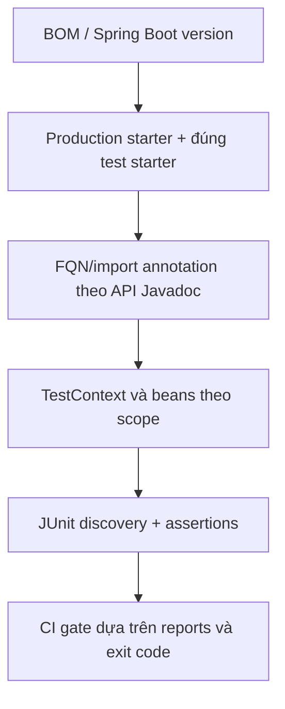
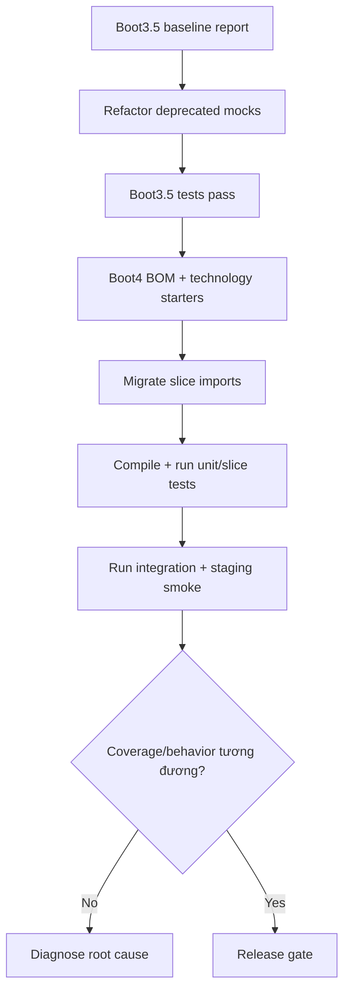

# Phiên bản và chuyển đổi — Thay đổi module, starter và package test annotation giữa các dòng Spring Boot

## 1. Bài toán: nâng phiên bản xong, tại sao test lỗi?

Một dự án Spring Boot có thể chạy tốt trên 3.5 với code như sau:

```java
import org.springframework.boot.test.autoconfigure.web.servlet.WebMvcTest;
import org.springframework.boot.test.autoconfigure.web.servlet.AutoConfigureMockMvc;
import org.springframework.boot.test.autoconfigure.orm.jpa.DataJpaTest;
import org.springframework.boot.test.mock.mockito.MockBean;
```

Đổi parent POM sang Spring Boot 4, compiler báo `package ... does not exist` hoặc `cannot find symbol: class MockBean`. Sau khi sửa import, runtime có thể báo thiếu `MockMvc` bean, `TestRestTemplate` hoặc một service trong test slice. Có nhiều nguyên nhân độc lập:

1. **Module và starter dependencies thay đổi**: Boot 4 tách test support theo công nghệ.
2. **FQN/package của nhiều test annotations thay đổi**: `@WebMvcTest` không còn ở package Boot 3.
3. **Bean override và test auto-configuration thay đổi**: Boot `@MockBean` đã bị loại bỏ, Spring Framework `@MockitoBean` thay thế; một số test HTTP clients cần cấu hình explicit.
4. **Dependency ecosystem được nâng cấp**: Framework 7, JUnit 6, Jakarta EE 11 và Jackson 3 tác động đến classpath, serialization và runtime test behavior.

Cách sửa **không phải xóa test hoặc tắt kiểm tra**. Cần phân biệt: **biên dịch được** ≠ **TestContext khởi động được** ≠ **JUnit thật sự chạy** ≠ **behavior vẫn đúng**.

### Mục tiêu học tập

Sau bài này, người học có thể:
- Nêu các thay đổi testing quan trọng ở Spring Boot **3.3 → 3.4/3.5 → 4.0/4.1**.
- Phân biệt production starter, test starter, test module và Java annotation package.
- Sửa đúng `@WebMvcTest`, `@AutoConfigureMockMvc`, `@DataJpaTest`, `@JdbcTest`, `@RestClientTest`, `@WebFluxTest`, `@WebClientTest`, `@GraphQlTest`.
- Nhận biết các imports **vẫn giữ nguyên**, như `@SpringBootTest`, `@TestConfiguration`, `@JsonTest` và `@LocalServerPort`.
- Chuyển `@MockBean`/`@SpyBean` sang `@MockitoBean`/`@MockitoSpyBean` với semantics đúng.
- Viết cùng bộ JUnit tests cho **Boot 3.5 và Boot 4.1** bằng hai bản Maven/Gradle tương ứng.
- Chẩn đoán compile/runtime/classpath lỗi và xác minh test counts/reports sau migration.

## 2. Các mốc phiên bản

| Spring Boot | Framework/test ecosystem | Tác động |
| --- | --- | --- |
| **3.3** | Framework 6.1, JUnit5 | Boot `@MockBean`/`@SpyBean`; test slices đa phần ở `spring-boot-test-autoconfigure` |
| **3.4** | Framework 6.2 | Spring Test có `@MockitoBean`/`@MockitoSpyBean`, Boot mock annotations deprecated |
| **3.5** | Framework 6.2 | Có thể chuyển mocks sớm, nhưng `@WebMvcTest` vẫn package Boot3 |
| **4.0** | Framework 7, JUnit6, Jackson3, Jakarta EE 11 | Major modularization, specialized test modules/starters, package moves, remove Boot mock annotations |
| **4.1** | Cùng mô hình modular Boot4 | Dùng Javadoc/BOM của 4.1.x, tránh trộn imports từ Boot3 hoặc snapshot dòng khác |

**Java 17 vẫn là baseline** của Boot4; không bắt buộc Java21 chỉ vì nâng major. Ngày phát hành Spring Boot 4.0.0 là **20/11/2025**. Ví dụ trong bài chọn **3.5.0** và **4.1.2** để minh họa hai dòng bằng phiên bản có tài liệu chính thức; đây là **mốc học tập**, không phải tuyên bố patch mới nhất của tất cả environments.

Quan trọng: Boot 3.3 dùng Framework 6.1 nên **không có `@MockitoBean` Spring Framework 6.2**. Nếu copy code Boot3.5 có `@MockitoBean` xuống 3.3, phải đổi annotation hoặc nâng phiên bản.

## 3. Một test slice cần đủ những thành phần nào?



Lấy `@WebMvcTest` làm ví dụ. Boot4 cần `spring-boot-webmvc-test` trên **testClasspath**, thường thông qua `spring-boot-starter-webmvc-test`, cùng Java import `org.springframework.boot.webmvc.test.autoconfigure.WebMvcTest`. Khi context chạy, test cần controller thật, `MockMvc` và mock/import collaborator thích hợp. Nếu chỉ thêm starter mà chưa sửa import, compiler lỗi; nếu chỉ sửa import mà thiếu starter, compiler cũng lỗi.

Điểm cần phân biệt:
- **Library/module dependency**: artifact chứa annotation/configuration classes.
- **Java FQN**: package + class name mà compiler import.
- **Test slice behavior**: thành phần nào được Spring scan/auto-configure.
- **Test discovery**: JUnit/Surefire/Gradle thực sự tìm ra method.

## 4. Spring Boot 3.x: test support tập trung

Spring Boot 3.5 MVC application thường có:

```xml
<dependency>
    <groupId>org.springframework.boot</groupId>
    <artifactId>spring-boot-starter-web</artifactId>
</dependency>
<dependency>
    <groupId>org.springframework.boot</groupId>
    <artifactId>spring-boot-starter-test</artifactId>
    <scope>test</scope>
</dependency>
```

`spring-boot-starter-test` cung cấp JUnit Jupiter, AssertJ, Mockito, Spring TestContext và Boot test support; `spring-boot-test-autoconfigure` tập trung nhiều test slices. Ví dụ:
- `org.springframework.boot.test.autoconfigure.web.servlet.WebMvcTest`.
- `org.springframework.boot.test.autoconfigure.orm.jpa.DataJpaTest`.
- `org.springframework.boot.test.autoconfigure.web.client.RestClientTest`.
- `org.springframework.boot.test.autoconfigure.json.JsonTest`.

Dù starter-test khá rộng, **không có nghĩa mọi technology runtime đều sẵn**. JPA test cần database driver, Spring Security cần `spring-security-test` khi dùng security helpers, Kafka integration cần broker/test support, và GraphQL có các test libraries riêng. Nói “Boot3 chỉ cần một test dependency cho tất cả mọi thứ” là sai.

## 5. Spring Boot 4.x: module hóa theo công nghệ

Spring Boot 4.0 migration guide dùng convention:

```text
spring-boot-<technology>              Production module
spring-boot-<technology>-test         Test module
spring-boot-starter-<technology>       Production starter
spring-boot-starter-<technology>-test  Test starter

org.springframework.boot.<technology>...
org.springframework.boot.<technology>.test...
```

Ví dụ Spring MVC:
- Production module: `spring-boot-webmvc`.
- Production starter: `spring-boot-starter-webmvc`.
- Test module: `spring-boot-webmvc-test`.
- Test starter: `spring-boot-starter-webmvc-test`.
- Test annotation: `org.springframework.boot.webmvc.test.autoconfigure.WebMvcTest`.

Theo migration guide, **technology test starters kéo `spring-boot-starter-test` chung transitively**. Vì vậy Boot4 `spring-boot-starter-webmvc-test` đủ làm test starter cho MVC demo; **không nhất thiết thêm general starter-test một lần nữa**.

`spring-boot-starter-test` **vẫn tồn tại** ở Boot4 nhưng không tự mang mọi technology-specific annotation. `spring-boot-starter-test-classic` là **cầu nối migration tạm** với classpath rộng hơn, không phải replacement vĩnh viễn cho specialized test starters.

Nguồn: [Spring Boot 4.0 Migration Guide](https://github.com/spring-projects/spring-boot/wiki/Spring-Boot-4.0-Migration-Guide) và [Build Systems](https://docs.spring.io/spring-boot/reference/using/build-systems.html).

## 6. Bảng production/test starter theo công nghệ

| Công nghệ | Boot 3.5 production | Boot 3.5 test thông dụng | Boot 4 production | Boot 4 test starter |
| --- | --- | --- | --- | --- |
| Spring MVC | `spring-boot-starter-web` | `spring-boot-starter-test` | `spring-boot-starter-webmvc` | `spring-boot-starter-webmvc-test` |
| Spring WebFlux | `spring-boot-starter-webflux` | `spring-boot-starter-test` | `spring-boot-starter-webflux` | `spring-boot-starter-webflux-test` |
| JPA | `spring-boot-starter-data-jpa` | `spring-boot-starter-test` + DB | `spring-boot-starter-data-jpa` | `spring-boot-starter-data-jpa-test` |
| JDBC | `spring-boot-starter-jdbc` | `spring-boot-starter-test` | `spring-boot-starter-jdbc` | `spring-boot-starter-jdbc-test` |
| Spring Data JDBC | `spring-boot-starter-data-jdbc` | `spring-boot-starter-test` | `spring-boot-starter-data-jdbc` | `spring-boot-starter-data-jdbc-test` |
| Blocking HTTP client | Web/RestClient deps | `spring-boot-starter-test` | `spring-boot-starter-restclient` | `spring-boot-starter-restclient-test` |
| WebClient client | WebFlux/reactor deps | `spring-boot-starter-test` | `spring-boot-starter-webclient` | `spring-boot-starter-webclient-test` |
| GraphQL | `spring-boot-starter-graphql` | Boot test + `spring-graphql-test` | `spring-boot-starter-graphql` | `spring-boot-starter-graphql-test` |
| MongoDB | `spring-boot-starter-data-mongodb` | `spring-boot-starter-test` | `spring-boot-starter-data-mongodb` | `spring-boot-starter-data-mongodb-test` |
| Redis | `spring-boot-starter-data-redis` | `spring-boot-starter-test` | `spring-boot-starter-data-redis` | `spring-boot-starter-data-redis-test` |
| Security | `spring-boot-starter-security` | `spring-security-test` + Boot test | `spring-boot-starter-security` | `spring-boot-starter-security-test` |
| WebServices/SOAP | `spring-boot-starter-web-services` | `spring-ws-test` + Boot test | `spring-boot-starter-webservices` | `spring-boot-starter-webservices-test` |
| Validation | `spring-boot-starter-validation` | `spring-boot-starter-test` | `spring-boot-starter-validation` | `spring-boot-starter-validation-test` |
| Kafka | Spring Kafka deps | `spring-kafka-test` + Boot test | `spring-boot-starter-kafka` | `spring-boot-starter-kafka-test` |

Boot4 `spring-boot-starter-web` và `spring-boot-starter-web-services` có tên thay thế `webmvc`/`webservices` và tên cũ được deprecated. Không nhất thiết remove ngay ở mọi patch 4.x, nhưng code mới nên dùng tên phù hợp. Tham khảo migration guide chính thức trước khi đoán test starter cho vendor technology ngoài Spring Boot.

## 7. Bảng package annotation đã thay đổi

| Annotation | Spring Boot 3.x package | Spring Boot 4.x package |
| --- | --- | --- |
| `@WebMvcTest` | `org.springframework.boot.test.autoconfigure.web.servlet.WebMvcTest` | `org.springframework.boot.webmvc.test.autoconfigure.WebMvcTest` |
| `@AutoConfigureMockMvc` | `org.springframework.boot.test.autoconfigure.web.servlet.AutoConfigureMockMvc` | `org.springframework.boot.webmvc.test.autoconfigure.AutoConfigureMockMvc` |
| `@WebFluxTest` | `org.springframework.boot.test.autoconfigure.web.reactive.WebFluxTest` | `org.springframework.boot.webflux.test.autoconfigure.WebFluxTest` |
| `@AutoConfigureWebTestClient` | `org.springframework.boot.test.autoconfigure.web.reactive.AutoConfigureWebTestClient` | `org.springframework.boot.webflux.test.autoconfigure.AutoConfigureWebTestClient` |
| `@WebClientTest` | `org.springframework.boot.test.autoconfigure.web.reactive.WebClientTest` | `org.springframework.boot.webclient.test.autoconfigure.WebClientTest` |
| `@RestClientTest` | `org.springframework.boot.test.autoconfigure.web.client.RestClientTest` | `org.springframework.boot.restclient.test.autoconfigure.RestClientTest` |
| `@DataJpaTest` | `org.springframework.boot.test.autoconfigure.orm.jpa.DataJpaTest` | `org.springframework.boot.data.jpa.test.autoconfigure.DataJpaTest` |
| `@JdbcTest` | `org.springframework.boot.test.autoconfigure.jdbc.JdbcTest` | `org.springframework.boot.jdbc.test.autoconfigure.JdbcTest` |
| `@DataJdbcTest` | `org.springframework.boot.test.autoconfigure.data.jdbc.DataJdbcTest` | `org.springframework.boot.data.jdbc.test.autoconfigure.DataJdbcTest` |
| `@AutoConfigureTestDatabase` | `org.springframework.boot.test.autoconfigure.jdbc.AutoConfigureTestDatabase` | `org.springframework.boot.jdbc.test.autoconfigure.AutoConfigureTestDatabase` |
| `@GraphQlTest` | `org.springframework.boot.test.autoconfigure.graphql.GraphQlTest` | `org.springframework.boot.graphql.test.autoconfigure.GraphQlTest` |
| `@DataMongoTest` | `org.springframework.boot.test.autoconfigure.data.mongo.DataMongoTest` | `org.springframework.boot.data.mongodb.test.autoconfigure.DataMongoTest` |
| `@WebServiceServerTest` | `org.springframework.boot.test.autoconfigure.webservices.server.WebServiceServerTest` | `org.springframework.boot.webservices.test.autoconfigure.server.WebServiceServerTest` |
| `@WebServiceClientTest` | `org.springframework.boot.test.autoconfigure.webservices.client.WebServiceClientTest` | `org.springframework.boot.webservices.test.autoconfigure.client.WebServiceClientTest` |

Đây là FQN (fully qualified names) được kiểm bằng API docs. **Nhớ đủ hai bước:** đúng Java import **và** đúng test artifact. Nếu chỉ sửa một bước, compiler vẫn có thể báo thiếu class.

Không nhầm:
- `@WebFluxTest` kiểm **server WebFlux controllers**.
- `@WebClientTest` kiểm reactive **WebClient client**.
- `@RestClientTest` kiểm blocking outbound `RestClient`/`RestTemplate`.
- `@WebMvcTest` kiểm Spring MVC controller.
- `@JdbcTest` khác `@DataJdbcTest` (Spring Data JDBC repositories).

Nguồn: [Boot 4 Test Slices](https://docs.spring.io/spring-boot/appendix/test-auto-configuration/slices.html).

## 8. Những imports không chuyển package

| Test annotation/API | FQN vẫn dùng trong Boot 3.5 và Boot 4 |
| --- | --- |
| `@SpringBootTest` | `org.springframework.boot.test.context.SpringBootTest` |
| `@TestConfiguration` | `org.springframework.boot.test.context.TestConfiguration` |
| `@JsonTest` | `org.springframework.boot.test.autoconfigure.json.JsonTest` |
| `@LocalServerPort` | `org.springframework.boot.test.web.server.LocalServerPort` |
| `@MockitoBean` | `org.springframework.test.context.bean.override.mockito.MockitoBean` |
| `@MockitoSpyBean` | `org.springframework.test.context.bean.override.mockito.MockitoSpyBean` |
| `@DynamicPropertySource` | `org.springframework.test.context.DynamicPropertySource` |
| `@ActiveProfiles` | `org.springframework.test.context.ActiveProfiles` |
| `@Sql` | `org.springframework.test.context.jdbc.Sql` |
| `@WithMockUser` | `org.springframework.security.test.context.support.WithMockUser` |
| `MockMvc` | `org.springframework.test.web.servlet.MockMvc` |
| `MockRestServiceServer` | `org.springframework.test.web.client.MockRestServiceServer` |
| JUnit `@Test` | `org.junit.jupiter.api.Test` |

`@MockitoBean` và `@MockitoSpyBean` chỉ bắt đầu từ Framework **6.2** (Boot 3.4/3.5), **không** dùng được nguyên xi trong Boot 3.3 với Framework 6.1. Các imports giữ nguyên không có nghĩa dependency đã auto được thêm: Boot4 `@JsonTest` vẫn package cũ nhưng phải kiểm JSON mapper modules; `@WithMockUser` giữ package nhưng có specialized security-test starter.

**Đừng chạy replace toàn bộ `org.springframework.boot.test...`**. Nó sẽ phá `@SpringBootTest`/`@JsonTest` vốn đúng.

## 9. Mockito migration: Boot 3.3 → 3.4/3.5 → 4.x

Boot 3.3:
```java
import org.springframework.boot.test.mock.mockito.MockBean;
import org.springframework.boot.test.mock.mockito.SpyBean;
```

Boot 3.4/3.5: annotations cũ deprecated, framework 6.2 cung cấp:

```java
import org.springframework.test.context.bean.override.mockito.MockitoBean;
import org.springframework.test.context.bean.override.mockito.MockitoSpyBean;
```

Boot4: Boot `@MockBean`/`@SpyBean` đã **remove**, phải chuyển sang Framework annotations mới. Không đổi thành Mockito `@Mock` khi mục tiêu là override **Spring bean**: `@Mock` thuần không đăng ký bean vào ApplicationContext.

### Semantics quan trọng

`@MockitoBean` mặc định sử dụng **REPLACE_OR_CREATE**. Nếu không tìm thấy bean target, có thể **tạo mock bean mới**; test vẫn start nhưng service vẫn dùng bean thật. Khi target bắt buộc tồn tại, dùng:

```java
@MockitoBean(
    name = "paymentGateway",
    enforceOverride = true)
PaymentGateway paymentGateway;
```

Với nhiều beans cùng type, dùng explicit bean `name`/qualifier. Spring Framework `@MockitoSpyBean` dùng cơ chế **WRAP** một bean hiện có. Với spy có side effects, `doReturn(...).when(spy).method(...)` thường an toàn hơn `when(spy.method(...)).thenReturn(...)` vì latter có thể gọi real method lúc stubbing.

### @Configuration không tương đương test class

Pattern cũ:

```java
@TestConfiguration
class SharedMockConfig {
    @MockBean
    PaymentClient paymentClient;
}
```

Không migrate cơ học thành `@MockitoBean` field trong `@Configuration`: Spring Framework bean override annotation được khai trên **test class field/type**, superclass hoặc composed annotation.

Ví dụ type-level shared declarations:

```java
@SpringBootTest
@MockitoBean(types = {PaymentClient.class, InventoryClient.class})
class OrderFlowTest {
}
```

Đây là **snippet phụ thuộc classes ứng dụng**, không phải file runnable của demo. Với nhiều test classes, có thể định nghĩa composed annotation `@SharedMocks` để giữ qualifiers/names nhất quán và tránh context cache fragmentation. Đối chiếu [Spring Framework MockitoBean Docs](https://docs.spring.io/spring-framework/reference/testing/annotations/integration-spring/annotation-mockitobean.html).

## 10. Boot4: @SpringBootTest và MockMvc

`@SpringBootTest` vẫn import:

```java
import org.springframework.boot.test.context.SpringBootTest;
```

Full application context dùng MockMvc nên khai explicit `@AutoConfigureMockMvc`:

Boot 3.5:

```java
import org.springframework.boot.test.autoconfigure.web.servlet.AutoConfigureMockMvc;
import org.springframework.boot.test.context.SpringBootTest;

@SpringBootTest
@AutoConfigureMockMvc
class FullMvcCheck {
}
```

Boot4:

```java
import org.springframework.boot.webmvc.test.autoconfigure.AutoConfigureMockMvc;
import org.springframework.boot.test.context.SpringBootTest;

@SpringBootTest
@AutoConfigureMockMvc
class FullMvcCheck {
}
```

Đây là **snippets annotation only**. Boot4 cần `spring-boot-starter-webmvc-test` để cung cấp MVC testing module. Một `@SpringBootTest` không mặc định cấp mọi test client; migration guide nhấn mạnh cấu hình explicit.

Phân biệt:
- `@WebMvcTest`: test **slice MVC**, mock/import business collaborators.
- `@SpringBootTest + @AutoConfigureMockMvc`: full app context, MockMvc request **in-process**, không mở HTTP socket.
- `@SpringBootTest(RANDOM_PORT)`: embedded server, HTTP socket thật; không tự là E2E toàn hệ thống.

## 11. TestRestTemplate và TestRestClient khác phiên bản

Boot3.5 thường sử dụng:

```java
import org.springframework.boot.test.web.client.TestRestTemplate;
```

Boot4 đổi:

```java
import org.springframework.boot.resttestclient.TestRestTemplate;
import org.springframework.boot.resttestclient.autoconfigure.AutoConfigureTestRestTemplate;
```

Theo Boot4 migration guide, `@SpringBootTest` **không tự cung cấp** TestRestTemplate/WebClient test beans như tests cũ có thể mong đợi; cần `@AutoConfigureTestRestTemplate` và test/runtime modules thích hợp (bao gồm `spring-boot-resttestclient` và `spring-boot-restclient`). Có thể thay bằng `RestTestClient` mới với `@AutoConfigureRestTestClient`.

Trong project runnable, bài sử dụng **Java 17 `HttpClient`** thay convenience client để có một HTTP integration test source dùng chung Boot3.5/4.1. Đừng chỉ sửa package TestRestTemplate mà quên bean auto-config.

## 12. @JsonTest giữ package, Jackson chuyển major

Boot3.5 và Boot4 đều:

```java
import org.springframework.boot.test.autoconfigure.json.JsonTest;
```

Nhưng Boot4 mặc định dùng **Jackson 3** với `tools.jackson...` APIs; Boot3 dùng Jackson2 `com.fasterxml.jackson...` APIs. Vì thế một `@JsonTest` compile vẫn có thể fail do test phụ thuộc `ObjectMapper`/module/`JacksonTester` behavior.

Cần kiểm:
- Mapper bean type (Boot4 auto-configure `JsonMapper` cho JSON).
- Custom serializer/deserializer và Java Time/Kotlin modules.
- Nullability, enum, unknown properties, precision và field naming.
- `@JacksonComponent`/`@JsonComponent` theo library đang dùng.
- Test client JSON assertions và error response shape.

Boot4 có module deprecated `spring-boot-jackson2` làm cầu nối tạm. Đừng dùng sự tồn tại của `@JsonTest` như bằng chứng rằng Jackson2 tests không cần sửa.

## 13. DataJpa/Jdbc testing: thay đúng imports và module

Boot3:

```java
import org.springframework.boot.test.autoconfigure.orm.jpa.DataJpaTest;
import org.springframework.boot.test.autoconfigure.jdbc.AutoConfigureTestDatabase;
import org.springframework.boot.test.autoconfigure.jdbc.JdbcTest;
```

Boot4:

```java
import org.springframework.boot.data.jpa.test.autoconfigure.DataJpaTest;
import org.springframework.boot.jdbc.test.autoconfigure.AutoConfigureTestDatabase;
import org.springframework.boot.jdbc.test.autoconfigure.JdbcTest;
```

Với Boot4 JPA, cần `spring-boot-starter-data-jpa-test`; JDBC dùng `spring-boot-starter-jdbc-test`. Nếu DB test dùng H2, thêm embedded driver phù hợp; nếu ứng dụng dùng PostgreSQL-specific SQL/locking/schema, Testcontainers hoặc real DB test cần được giữ.

`@DataJpaTest` vẫn tập trung entities/repositories, mặc định transactional rollback theo Javadoc; đổi package không tự giải quyết Hibernate7/Jakarta JPA/DDL migration. `@DataJdbcTest` ở Boot4 chuyển `org.springframework.boot.data.jdbc.test.autoconfigure`; nó khác `@JdbcTest`.

## 14. Các test slices khác

### REST client

Boot3 `@RestClientTest`: `org.springframework.boot.test.autoconfigure.web.client.RestClientTest`.

Boot4 `@RestClientTest`: `org.springframework.boot.restclient.test.autoconfigure.RestClientTest`, với `spring-boot-starter-restclient-test`.

`MockRestServiceServer` vẫn thuộc Spring Test `org.springframework.test.web.client`. Test slice này kiểm outbound blocking HTTP client chứ không phải MVC server.

### WebFlux server và WebClient

Boot4 `@WebFluxTest`: `org.springframework.boot.webflux.test.autoconfigure.WebFluxTest`, dùng `spring-boot-starter-webflux-test`.

Boot4 `@WebClientTest`: `org.springframework.boot.webclient.test.autoconfigure.WebClientTest`, dùng `spring-boot-starter-webclient-test`.

Không lẫn `WebFluxTest` (server) với `WebClientTest` (reactive client). Khi app có cả MVC và WebFlux trên classpath, Spring Boot có thể chọn MVC context; full WebFlux test có thể cần cấu hình `spring.main.web-application-type=reactive`.

### GraphQL và SOAP

Boot4 `@GraphQlTest`: `org.springframework.boot.graphql.test.autoconfigure.GraphQlTest`, dùng `spring-boot-starter-graphql-test`.

Boot4 `@WebServiceServerTest`/`@WebServiceClientTest`: package `org.springframework.boot.webservices.test.autoconfigure.server`/`client`, dùng `spring-boot-starter-webservices-test`.

Chúng là slices, không tự động load toàn business service/broker/DB dependencies. Tùy test goal, `@MockitoBean` collaborators hoặc `@Import` test configuration thêm đúng scope.

## 15. Dự án mẫu chung: Spring Boot 3.5 vs 4.1

Hai biến thể dùng cùng ứng dụng:
- `MigrationApplication` khởi động Boot.
- `GreetingService` xử lý tên.
- `GreetingController` là MVC HTTP endpoint trả `text/plain`.
- `GreetingServiceTest`: unit JUnit, không Boot context.
- `GreetingMvcSliceTest`: `@WebMvcTest` + `@MockitoBean`.
- `GreetingFullContextTest`: `@SpringBootTest + @AutoConfigureMockMvc`.
- `GreetingSocketTest`: `RANDOM_PORT` + JDK HttpClient.

```text
boot-testing-migration/
├── pom.xml                  # chọn bản Boot3 HOẶC Boot4
└── src/
    ├── main/java/demo/migration/
    │   ├── MigrationApplication.java
    │   ├── GreetingService.java
    │   └── GreetingController.java
    └── test/java/demo/migration/
        ├── GreetingServiceTest.java
        ├── GreetingMvcSliceTest.java
        ├── GreetingFullContextTest.java
        └── GreetingSocketTest.java
```

**Cách sử dụng:** copy các Java files, chọn một POM; ở Boot4 đổi imports trong hai test classes MVC theo hướng dẫn. Không đặt hai parent versions hoặc hai imports trong cùng project. Dùng hai Git branches/worktrees/build directories nếu muốn giữ song song. Không cần Docker, DB hay Jackson-specific test APIs.

## 16. pom.xml cho Boot 3.5.0

```xml
<?xml version="1.0" encoding="UTF-8"?>
<project xmlns="http://maven.apache.org/POM/4.0.0"
         xmlns:xsi="http://www.w3.org/2001/XMLSchema-instance"
         xsi:schemaLocation="http://maven.apache.org/POM/4.0.0
           https://maven.apache.org/xsd/maven-4.0.0.xsd">
    <modelVersion>4.0.0</modelVersion>

    <parent>
        <groupId>org.springframework.boot</groupId>
        <artifactId>spring-boot-starter-parent</artifactId>
        <version>3.5.0</version>
        <relativePath/>
    </parent>

    <groupId>demo</groupId>
    <artifactId>boot-testing-migration</artifactId>
    <version>1.0.0</version>

    <properties>
        <java.version>17</java.version>
    </properties>

    <dependencies>
        <dependency>
            <groupId>org.springframework.boot</groupId>
            <artifactId>spring-boot-starter-web</artifactId>
        </dependency>
        <dependency>
            <groupId>org.springframework.boot</groupId>
            <artifactId>spring-boot-starter-test</artifactId>
            <scope>test</scope>
        </dependency>
    </dependencies>
</project>
```

`spring-boot-starter-test` kéo Spring Framework 6.2 test support, nên `@MockitoBean` hoạt động trên Boot3.5. Spring MVC slice annotations vẫn nằm ở package Boot3.

## 17. pom.xml cho Boot 4.1.2

Thay **toàn bộ POM** mục 16 bằng:

```xml
<?xml version="1.0" encoding="UTF-8"?>
<project xmlns="http://maven.apache.org/POM/4.0.0"
         xmlns:xsi="http://www.w3.org/2001/XMLSchema-instance"
         xsi:schemaLocation="http://maven.apache.org/POM/4.0.0
           https://maven.apache.org/xsd/maven-4.0.0.xsd">
    <modelVersion>4.0.0</modelVersion>

    <parent>
        <groupId>org.springframework.boot</groupId>
        <artifactId>spring-boot-starter-parent</artifactId>
        <version>4.1.2</version>
        <relativePath/>
    </parent>

    <groupId>demo</groupId>
    <artifactId>boot-testing-migration</artifactId>
    <version>1.0.0</version>

    <properties>
        <java.version>17</java.version>
    </properties>

    <dependencies>
        <dependency>
            <groupId>org.springframework.boot</groupId>
            <artifactId>spring-boot-starter-webmvc</artifactId>
        </dependency>
        <dependency>
            <groupId>org.springframework.boot</groupId>
            <artifactId>spring-boot-starter-webmvc-test</artifactId>
            <scope>test</scope>
        </dependency>
    </dependencies>
</project>
```

Đây là **test starter theo technology**: Boot4 MVC test starter kéo Boot testing libraries chung transitively. Không cần thêm `spring-boot-starter-test` trùng lặp. Không pin Framework 6.2/JUnit5 thủ công với Boot4.1 BOM. Java vẫn 17; Framework7/JUnit6 được quản lý bởi Boot4.

## 18. MigrationApplication.java — dùng chung

`src/main/java/demo/migration/MigrationApplication.java`:

```java
package demo.migration;

import org.springframework.boot.SpringApplication;
import org.springframework.boot.autoconfigure.SpringBootApplication;

@SpringBootApplication
public class MigrationApplication {
    public static void main(String[] args) {
        SpringApplication.run(MigrationApplication.class, args);
    }
}
```

Ứng dụng scan package `demo.migration` và tìm cả service/controller. Không thêm nested `@Configuration` trong tests làm thay đổi primary configuration search.

## 19. GreetingService.java — dùng chung

`src/main/java/demo/migration/GreetingService.java`:

```java
package demo.migration;

import org.springframework.stereotype.Service;

@Service
public class GreetingService {
    public String greet(String input) {
        if (input == null || input.isBlank()) {
            throw new IllegalArgumentException(
                    "name must not be blank");
        }
        return "Hello, " + input.strip() + "!";
    }
}
```

Không phụ thuộc Jackson/JPA/HTTP test packages. `strip()` của Java17 giữ behavior ổn định giữa Boot versions.

## 20. GreetingController.java — dùng chung

`src/main/java/demo/migration/GreetingController.java`:

```java
package demo.migration;

import org.springframework.http.MediaType;
import org.springframework.web.bind.annotation.GetMapping;
import org.springframework.web.bind.annotation.PathVariable;
import org.springframework.web.bind.annotation.RestController;

@RestController
public class GreetingController {
    private final GreetingService service;

    public GreetingController(GreetingService service) {
        this.service = service;
    }

    @GetMapping(
        value = "/greet/{name}",
        produces = MediaType.TEXT_PLAIN_VALUE)
    public String greet(@PathVariable String name) {
        return service.greet(name);
    }
}
```

`GET /greet/Mai` trả status 200, `text/plain`, body:

```text
Hello, Mai!
```

Chọn text/plain để không trộn Jackson2/3 behavior vào phép so sánh test annotation/starter. Khi thêm API JSON, cần contract/serialization tests riêng.

## 21. GreetingServiceTest.java — ba unit tests

`src/test/java/demo/migration/GreetingServiceTest.java`:

```java
package demo.migration;

import static org.junit.jupiter.api.Assertions.assertEquals;
import static org.junit.jupiter.api.Assertions.assertThrows;

import org.junit.jupiter.api.Test;

class GreetingServiceTest {
    private final GreetingService service =
            new GreetingService();

    @Test
    void createsGreeting() {
        assertEquals("Hello, Mai!",
                service.greet("Mai"));
    }

    @Test
    void stripsWhitespace() {
        assertEquals("Hello, Mai!",
                service.greet("  Mai  "));
    }

    @Test
    void rejectsBlankName() {
        IllegalArgumentException ex = assertThrows(
                IllegalArgumentException.class,
                () -> service.greet("   "));

        assertEquals("name must not be blank",
                ex.getMessage());
    }
}
```

**3 JUnit methods.** JUnit Jupiter `org.junit.jupiter.api.Test` giữ package dù Boot4 dùng JUnit6. Lớp này không mở Spring context; nếu nó fail sau migration, trước tiên kiểm JDK/JUnit test dependencies và business code, không vội đổ lỗi cho MVC test starter.

## 22. GreetingMvcSliceTest.java — Boot 3.5 đầy đủ

`src/test/java/demo/migration/GreetingMvcSliceTest.java`:

```java
package demo.migration;

import static org.mockito.Mockito.verify;
import static org.mockito.Mockito.verifyNoInteractions;
import static org.mockito.Mockito.when;
import static org.springframework.test.web.servlet.request.MockMvcRequestBuilders.get;
import static org.springframework.test.web.servlet.result.MockMvcResultMatchers.content;
import static org.springframework.test.web.servlet.result.MockMvcResultMatchers.status;

import org.junit.jupiter.api.Test;
import org.springframework.beans.factory.annotation.Autowired;
import org.springframework.boot.test.autoconfigure.web.servlet.WebMvcTest;
import org.springframework.http.MediaType;
import org.springframework.test.context.bean.override.mockito.MockitoBean;
import org.springframework.test.web.servlet.MockMvc;

@WebMvcTest(GreetingController.class)
class GreetingMvcSliceTest {
    @Autowired
    MockMvc mvc;

    @MockitoBean
    GreetingService greetingService;

    @Test
    void servesMockedGreeting() throws Exception {
        when(greetingService.greet("Mai"))
            .thenReturn("Stub response");

        mvc.perform(get("/greet/Mai")
                .accept(MediaType.TEXT_PLAIN))
            .andExpect(status().isOk())
            .andExpect(content().string("Stub response"));

        verify(greetingService).greet("Mai");
    }

    @Test
    void unknownPathDoesNotInvokeService() throws Exception {
        mvc.perform(get("/unknown-path"))
            .andExpect(status().isNotFound());

        verifyNoInteractions(greetingService);
    }
}
```

**2 JUnit methods**. MVC slice load controller thật, mock collaborator. `@MockitoBean` ở Spring Framework package, dù `@WebMvcTest` còn Boot3 package. Không tự cho rằng `@WebMvcTest` load mọi `@Service` beans; nó chủ ý giới hạn MVC slice.

### Cách chuyển file này sang Boot4.1

Chỉ sửa một dòng import (không tạo hai classes):

```java
// Bỏ dòng Boot 3.5:
import org.springframework.boot.test.autoconfigure.web.servlet.WebMvcTest;

// Dùng dòng Boot 4.1:
import org.springframework.boot.webmvc.test.autoconfigure.WebMvcTest;
```

Giữ nguyên body test, `MockMvc` và `@MockitoBean`. POM Boot4 cần `spring-boot-starter-webmvc-test`. **Không giữ hai import lines trong file chạy thật.**

## 23. GreetingFullContextTest.java — full app MockMvc

`src/test/java/demo/migration/GreetingFullContextTest.java` cho Boot3.5:

```java
package demo.migration;

import static org.springframework.test.web.servlet.request.MockMvcRequestBuilders.get;
import static org.springframework.test.web.servlet.result.MockMvcResultMatchers.content;
import static org.springframework.test.web.servlet.result.MockMvcResultMatchers.status;

import org.junit.jupiter.api.Test;
import org.springframework.beans.factory.annotation.Autowired;
import org.springframework.boot.test.autoconfigure.web.servlet.AutoConfigureMockMvc;
import org.springframework.boot.test.context.SpringBootTest;
import org.springframework.test.web.servlet.MockMvc;

@SpringBootTest
@AutoConfigureMockMvc
class GreetingFullContextTest {
    @Autowired
    MockMvc mvc;

    @Test
    void usesRealServiceInFullContext() throws Exception {
        mvc.perform(get("/greet/Hoa"))
            .andExpect(status().isOk())
            .andExpect(content().string("Hello, Hoa!"));
    }
}
```

**1 JUnit method.** `GreetingService` là real Spring bean, không mock; MockMvc in-process, không HTTP socket.

Boot4.1: đổi `AutoConfigureMockMvc` import sang:

```java
import org.springframework.boot.webmvc.test.autoconfigure.AutoConfigureMockMvc;
```

Giữ nguyên `org.springframework.boot.test.context.SpringBootTest` và `org.springframework.test.web.servlet.MockMvc`. Không chỉ gắn `@SpringBootTest` rồi mặc định đã có MockMvc bean: hãy khai explicit auto-config và đúng MVC test module.

## 24. GreetingSocketTest.java — HTTP thật, imports không đổi

`src/test/java/demo/migration/GreetingSocketTest.java`:

```java
package demo.migration;

import static org.junit.jupiter.api.Assertions.assertEquals;
import static org.junit.jupiter.api.Assertions.assertTrue;

import java.net.URI;
import java.net.http.HttpClient;
import java.net.http.HttpRequest;
import java.net.http.HttpResponse;
import java.time.Duration;

import org.junit.jupiter.api.Test;
import org.springframework.boot.test.context.SpringBootTest;
import org.springframework.boot.test.web.server.LocalServerPort;

@SpringBootTest(
    webEnvironment = SpringBootTest.WebEnvironment.RANDOM_PORT)
class GreetingSocketTest {
    @LocalServerPort
    int port;

    @Test
    void usesRealHttpSocket() throws Exception {
        HttpClient client = HttpClient.newBuilder()
            .connectTimeout(Duration.ofSeconds(3))
            .build();

        HttpRequest req = HttpRequest.newBuilder(
                URI.create("http://127.0.0.1:" + port +
                    "/greet/Lan"))
            .timeout(Duration.ofSeconds(5))
            .GET()
            .build();

        HttpResponse<String> result = client.send(
                req, HttpResponse.BodyHandlers.ofString());

        assertEquals(200, result.statusCode());
        assertEquals("Hello, Lan!", result.body());
        assertTrue(result.headers()
                .firstValue("Content-Type").orElse("")
                .startsWith("text/plain"));
    }
}
```

**1 JUnit method.** `@LocalServerPort` và `@SpringBootTest` imports giữ nguyên qua Boot3.5→4.1. `RANDOM_PORT` giúp CI tránh port collision. Đây là **single-service HTTP integration test**, không phải full-system E2E.

Với DB transaction tests, lưu ý RANDOM_PORT server thread không chia sẻ test transaction rollback; cần explicit cleanup khi có writes. JDK HttpClient giảm coupling với thay đổi TestRestTemplate của Boot4.

## 25. Số lượng JUnit methods và chạy Maven

| Class | Số `@Test` | Mục đích |
| --- | ---: | --- |
| `GreetingServiceTest` | 3 | Unit Java thuần |
| `GreetingMvcSliceTest` | 2 | Controller slice + mock service |
| `GreetingFullContextTest` | 1 | Full context + MockMvc |
| `GreetingSocketTest` | 1 | Real HTTP random port |
| **Tổng mỗi biến thể** | **7** | 7 JUnit methods dự kiến |

Chọn **một** POM và đúng imports MVC rồi chạy:

```bash
java -version
mvn -version
mvn clean test
mvn -Dtest=GreetingMvcSliceTest test
mvn -Dtest=GreetingFullContextTest test
mvn -Dtest=GreetingSocketTest test
```

**Expected behavior**: 7 tests PASS, 0 errors/failures/skips nếu môi trường/dependencies tương thích. Đây **không phải kết quả Maven đã chạy trong bài**. Đọc `target/surefire-reports/` và actual command exit status trước khi tuyên bố test execution thành công.

Khi thấy `Tests run: 0`, kiểm test engine/naming/filters; một build ra JAR nhưng không discover tests **không đáp ứng quality gate**.

## 26. Gradle Kotlin DSL: dependency delta

Boot3.5:

```kotlin
plugins {
    java
    id("org.springframework.boot") version "3.5.0"
    id("io.spring.dependency-management") version "1.1.7"
}

java {
    toolchain {
        languageVersion = JavaLanguageVersion.of(17)
    }
}

repositories { mavenCentral() }

dependencies {
    implementation("org.springframework.boot:spring-boot-starter-web")
    testImplementation("org.springframework.boot:spring-boot-starter-test")
}

tasks.test { useJUnitPlatform() }
```

Boot4.1:

```kotlin
plugins {
    java
    id("org.springframework.boot") version "4.1.2"
    id("io.spring.dependency-management") version "1.1.7"
}

java {
    toolchain {
        languageVersion = JavaLanguageVersion.of(17)
    }
}

repositories { mavenCentral() }

dependencies {
    implementation("org.springframework.boot:spring-boot-starter-webmvc")
    testImplementation("org.springframework.boot:spring-boot-starter-webmvc-test")
}

tasks.test { useJUnitPlatform() }
```

Đây là **hai build alternatives**, không ghép cả hai plugin versions với nhau. Boot4 Gradle plugin cần wrapper version phù hợp (theo Boot4 docs: Gradle 8.14+ ở dòng 8.x hoặc 9.x tương thích). Đừng dùng Gradle 8.0 quá cũ rồi quy lỗi cho Java imports.

Kiểm classpath:

```bash
./gradlew dependencies --configuration testCompileClasspath
./gradlew dependencies --configuration testRuntimeClasspath
./gradlew dependencyInsight --dependency spring-boot-webmvc-test --configuration testRuntimeClasspath
./gradlew clean test
```

Maven tương ứng:

```bash
mvn dependency:tree
mvn help:effective-pom
mvn clean test
```

## 27. Classic starters: chỉ dùng làm cầu nối

Spring Boot 4 có `spring-boot-starter-classic` và `spring-boot-starter-test-classic`. Chúng cho classpath gần thế hệ Boot3 để giảm công sức nâng cấp theo đợt.

Nhưng **classic không khôi phục `@MockBean` đã remove, không bảo đảm test slice FQN cũ tồn tại**, và không nên là đích dài hạn. Quy trình hợp lý: dùng classic tạm để fix removed APIs/compile → thay bằng specialized starters theo technology → chạy lại toàn suite.

Lợi ích của technology starters là nhìn rõ dependency thực cần, hạn chế modules không liên quan. Không gắn nhiều test starters một cách tràn lan chỉ để context khởi động; điều đó dễ che missing bean/source package và làm test suite chậm.

## 28. @WithMockUser và security test starter

`@WithMockUser` của Spring Security vẫn import:

```java
import org.springframework.security.test.context.support.WithMockUser;
```

Nhưng Boot4 migration guide khuyến nghị `spring-boot-starter-security-test` để support security tests, thay vì chỉ dựa vào `spring-security-test` cộng general Boot starter như ở 3.x.

Một test chỉ compile được annotation không chứng minh security coverage. MVC tests có thể tự động nạp filters theo classpath; kiểm 401/403/200, CSRF, authority/role handling trên controller paths thực sự. Không tắt security filters vô điều kiện chỉ để upgrade qua.

## 29. Mockito @Mock/@Captor sau Boot4

Boot4 bỏ `MockitoTestExecutionListener` cũ của Spring Boot. Với plain Mockito tests dùng `@Mock` hoặc `@Captor`, hãy khai Mockito Jupiter extension:

```java
import org.junit.jupiter.api.extension.ExtendWith;
import org.mockito.Mock;
import org.mockito.junit.jupiter.MockitoExtension;

@ExtendWith(MockitoExtension.class)
class PlainMockitoExample {
    @Mock
    SomeDependency dependency;
}
```

Đây là **snippet phụ thuộc ứng dụng**, không thuộc demo core. `@Mock` không thay collaborator Spring bean. Đừng confuse `@Mock` với Spring Test `@MockitoBean`.

## 30. Phân loại lỗi migration

| Lỗi | Nguyên nhân nhiều khả năng | Sửa đúng |
| --- | --- | --- |
| `package org.springframework.boot.test.autoconfigure.web.servlet does not exist` | FQN Boot3 cũ | Boot4 import + webmvc-test starter |
| `cannot find symbol: WebMvcTest` dù đã đổi import | Thiếu Boot4 technology test module | Add starter-webmvc-test test scope |
| `cannot find symbol: MockBean` trên Boot4 | Removed API | Framework @MockitoBean |
| `cannot find symbol: MockitoBean` trên Boot3.3 | Framework6.1 chưa hỗ trợ | @MockBean cũ hoặc nâng Boot3.4+ |
| `ClassNotFoundException`/`NoClassDefFoundError` | Runtime classpath thiếu module | dependency tree, scope và version |
| `NoSuchMethodError` | Trộn Boot3/4, Framework6/7, Jackson2/3 | Align BOM; clean rebuild |
| `NoSuchBeanDefinitionException: MockMvc` | Thiếu MVC test auto-config | AutoConfigureMockMvc + starter |
| `NoSuchBeanDefinitionException: TestRestTemplate` | Boot4 cần explicit config | AutoConfigureTestRestTemplate/modules |
| `NoSuchBeanDefinitionException: service` trong MVC slice | Slice không scan @Service | @MockitoBean hoặc @Import đúng collaborator |
| `NoUniqueBeanDefinitionException` sau mock migration | Ambiguous same-type bean overrides | Named @MockitoBean qualifier |
| Mockito Wanted but not invoked | Stub/verify sai mock, ghost bean | enforceOverride=true + identity check |
| `ObjectMapper` bean không đúng | Jackson3 mapper migration | JsonMapper + library alignment |
| `@WithMockUser` import được nhưng behavior sai | Security test context/deps | security-test starter + filter tests |
| `@DataJpaTest` context fail | DB driver/scan/schema/Hibernate | Test DB, Testcontainers, datasource config |
| `@WebFluxTest` không chạy reactive app | MVC precedence khi cả hai trên classpath | spring.main.web-application-type=reactive |
| `Tests run: 0` | JUnit engine/test discovery sai | Reports + build tool includes/version |
| Tests compile nhưng assertions khác | Behavior thực thay, không chỉ import | Regression/contract reviews |

**Thứ tự chẩn đoán:** xác định Boot major → kiểm BOM/test starter → kiểm FQN → compile → inspect root cause của TestContext → kiểm test count → assert behavior. Không chỉnh hết source và dependency cùng lúc nếu có thể tách thành các bước nhỏ.

## 31. Chiến lược migrate có kiểm soát

### Giai đoạn A — chuẩn hóa trên Boot3.5 trước

1. Nâng maintenance patch Boot3.5 mà tổ chức hỗ trợ.
2. Chạy baseline `mvn clean verify`, lưu JUnit XML/Surefire/Failsafe reports, test counts và skips.
3. Migrate `@MockBean`/`@SpyBean` sang Framework `@MockitoBean`/`@MockitoSpyBean`.
4. Dùng explicit name/enforceOverride khi có nhiều bean cùng type.
5. Chuyển shared mock fields khỏi `@Configuration` pattern cũ sang test-class type/composed annotation.
6. Chạy lại tests trên Boot3.5 trước khi đổi major.

### Giai đoạn B — Boot4 module/package upgrade

1. Đổi Boot parent/BOM/plugin cùng một major.
2. Kiểm Java17+, Framework7, Jakarta/Servlet/JUnit6/Jackson3 compatibility.
3. Thay production starter renamed và thêm specialized test starters.
4. Đổi imports theo bảng moved; giữ stable imports.
5. Bổ sung explicit AutoConfigureMockMvc/TestRestTemplate setups khi cần.
6. Audit JSON mapper/Jackson APIs, Security test starters, GraphQL/WebFlux client/server.
7. Compile tests, chạy từng slice, rồi full context/HTTP/DB integrations.
8. Nếu dùng classic starter tạm, loại dần khi specialized modules đủ.

### Giai đoạn C — CI và behavior QA

- JUnit tests thực chạy, không chỉ compile.
- Không có test mới `@Disabled` hoặc skipped vô cớ.
- Test count per layer và contract assertions không giảm bất hợp lý.
- DB/transaction/schema tests chạy trên driver phù hợp.
- MVC, GraphQL, SOAP, REST client, security behaviors đúng.
- Không còn artifacts Boot3/Framework6 lẫn trong Boot4 runtime.
- Testcontainers/real dependencies vẫn được kiểm.
- Staging smoke/E2E sau deploy artifact từ build đã verify.
- Không xuất bản một JAR chỉ vì `mvn package` pass khi verify gates còn thiếu.



## 32. Multi-module Maven/Gradle: tránh version drift

Ví dụ repo có `catalog-web`, `billing-data`, `auth-service` và `shipping-client`:
- MVC module dùng `spring-boot-starter-webmvc-test`.
- JPA module dùng `spring-boot-starter-data-jpa-test`.
- Security module dùng `spring-boot-starter-security-test` và webmvc-test nếu kiểm MVC.
- REST client module dùng `spring-boot-starter-restclient-test`.

Đừng đặt tất cả technology test starters trong một global parent dependency khiến mọi child module nạp libraries không cần thiết. Parent/BOM quản lý versions; child modules khai technology dependencies thực sự sử dụng.

`mvn -pl :module -am verify` có thể build reactor dependencies nhưng không chứng minh những module độc lập khác đã verify. CI matrix cần kiểm đúng phạm vi. Khi nâng Boot major, tránh một module ép Framework6.2 trong khi module khác Framework7; linkage failures có thể không xuất hiện cho tới runtime.

## 33. Test discovery và quality gates

Trong Maven, `mvn test` thường dùng Surefire; ngoài test methods cần có JUnit engine/compatible plugin. Với Gradle phải `useJUnitPlatform()` nếu plugin/setup yêu cầu.

Đọc reports thực:
- Maven: `target/surefire-reports/`, `target/failsafe-reports/` nếu có Failsafe IT.
- Gradle: `build/test-results/test/` và `build/reports/tests/test/`.

Nếu test method JUnit5/6 vẫn import `org.junit.jupiter.api.Test` nhưng tests run=0, đó là **discovery/runtime test engine issue**, không phải chứng minh tests không còn cần thiết. Điều chỉnh build tool/test starter, không disable tests rồi merge.

Lưu CI build command, dependency graph và test counts trước/sau. Một green pipeline mà bỏ mất MVC/JPA tests vì naming/filter là green giả. Cấu hình fail-on-no-tests ở modules bắt buộc có tests, đồng thời dành ngoại lệ cho aggregator modules không có test.

## 34. Bài tập thực hành

1. Chạy Boot3.5 demo, lấy test count = 7 theo source rồi xác nhận qua Surefire.
2. Thay POM và hai imports theo Boot4.1, chạy lại 7 tests.
3. Giữ import `@WebMvcTest` cũ trong Boot4 và xem compiler error; sửa artifact lẫn FQN.
4. Xóa `spring-boot-starter-webmvc-test` và chỉ giữ `spring-boot-starter-test` ở Boot4, quan sát thiếu MVC slice module.
5. Dùng Boot3.3 + `@MockitoBean`; giải thích Framework6.1 không có.
6. Dùng Boot4 + `@MockBean` cũ; sửa bằng `@MockitoBean`.
7. Tạo two same-type beans, kiểm named mock enforceOverride behavior.
8. Đổi `@DataJpaTest` Boot3/4 imports và thêm data-jpa-test.
9. Kiểm `@JsonTest` không đổi FQN nhưng Jackson3 mapping cần QA.
10. Test `@RestClientTest` mới nhưng `MockRestServiceServer` Spring Test package vẫn giữ.
11. So `@WebFluxTest`/`@WebClientTest` và đúng test starter.
12. Bổ sung `@WithMockUser` và security-test starter, kiểm authz behavior.
13. Thử TestRestTemplate package mới với `@AutoConfigureTestRestTemplate` hoặc chuyển sang JDK HttpClient.
14. Chạy dependency tree tìm artifacts Boot3/4 trộn major.
15. Thử classic starter rồi thay bằng specialized starters và đo test classpath.
16. Cố ý làm JUnit test run=0, cấu hình gate để không báo xanh giả.
17. Đánh giá Jackson2/3 serialization semantics bằng DTO JSON tests.
18. Chạy HTTP socket test trên random port, không hard-code 8080.

## 35. Những anti-patterns cần tránh

- Replace mọi `org.springframework.boot.test...` import thay vì map per annotation.
- Dùng Mockito `@Mock` thay cho `@MockitoBean` khi cần Spring bean override.
- Trộn parent Boot4 với test jar Boot3 để giữ FQN cũ.
- Chỉ thêm `spring-boot-starter-test` ở Boot4 và bỏ specialized starter.
- Bỏ `@AutoConfigureMockMvc` rồi mong full context cung cấp MockMvc.
- Nhầm `@WebFluxTest` server với `@WebClientTest` client.
- Nhìn `@JsonTest` không đổi package rồi bỏ qua Jackson3 migration.
- Bỏ `spring-boot-starter-security-test` nhưng vẫn mong security test helpers/filters đúng.
- Bật global bean overriding để che @MockitoBean sai name/qualifier.
- Không clean build sau khi nâng major, giữ compiled test classes cũ.
- Chỉ chạy unit mocks và bỏ integration/real DB tests.
- Hard-code test HTTP port trên CI.
- Dùng classic starter mãi mà không audit dependency needs.
- Để `Tests run: 0` hoặc skipped critical tests trong verified release.
- Gọi “compile successful” là “behavior verified”.

## 36. Checklist QA trước khi chốt migration

- [ ] Đã biết chính xác Boot parent/BOM và Java/Framework versions?
- [ ] Đã phân biệt Boot3.3 vs 3.4/3.5 đối với @MockitoBean?
- [ ] Boot4 đã không còn các imports @MockBean/@SpyBean cũ?
- [ ] Có đúng production và specialized test starter theo công nghệ?
- [ ] MVC `@WebMvcTest`/`@AutoConfigureMockMvc` đã move package?
- [ ] JPA `@DataJpaTest` và `@AutoConfigureTestDatabase` đã move đúng?
- [ ] WebFlux/REST client/GraphQL/SOAP test annotations đúng FQN?
- [ ] Stable imports `@SpringBootTest`/`@TestConfiguration`/`@JsonTest` vẫn nguyên?
- [ ] @LocalServerPort/@DynamicPropertySource/@MockitoBean vẫn đúng package?
- [ ] Mock override chọn đúng bean, không tạo ghost bean?
- [ ] Shared mocks không nằm trong `@Configuration` field pattern cũ?
- [ ] TestRestTemplate có module + auto-config mới nếu dùng?
- [ ] Jackson3/JSON testers được review riêng?
- [ ] Security-test starter và auth filters/roles đúng?
- [ ] Maven/Gradle test compile/runtime classpath thống nhất?
- [ ] Không trộn artifacts Boot3/Boot4, Framework6/Framework7?
- [ ] JUnit tests thực sự được discover, không Tests run=0?
- [ ] Unit/slice/integration test counts và behavior được so baseline?
- [ ] Database/Testcontainers/HTTP integration tests pass?
- [ ] Classic starter có kế hoạch loại bỏ?
- [ ] CI report và release gates dựa vào thực thi test, không chỉ package?

## 37. Nguồn tham khảo chính thức

1. [Spring Boot 4.0 Migration Guide](https://github.com/spring-projects/spring-boot/wiki/Spring-Boot-4.0-Migration-Guide): modularization, production/test starters, package moves, classic starters, MockBean removal, TestRestTemplate/MockMvc changes.
2. [Spring Boot Build Systems](https://docs.spring.io/spring-boot/reference/using/build-systems.html): danh sách starters hiện hành.
3. [Spring Boot Test Slices](https://docs.spring.io/spring-boot/appendix/test-auto-configuration/slices.html): slice/module mapping.
4. [Spring Boot 3.5 Testing](https://docs.spring.io/spring-boot/3.5/reference/testing/spring-boot-applications.html): test annotation packages 3.5.
5. [Spring Boot 4 Testing](https://docs.spring.io/spring-boot/reference/testing/spring-boot-applications.html): test modules và runtime setup 4.x.
6. [Boot3.5 WebMvcTest API](https://docs.spring.io/spring-boot/3.5/api/java/org/springframework/boot/test/autoconfigure/web/servlet/WebMvcTest.html): import cũ.
7. [Boot4 WebMvcTest API](https://docs.spring.io/spring-boot/api/java/org/springframework/boot/webmvc/test/autoconfigure/WebMvcTest.html): import mới.
8. [Boot3.5 DataJpaTest API](https://docs.spring.io/spring-boot/3.5/api/java/org/springframework/boot/test/autoconfigure/orm/jpa/DataJpaTest.html).
9. [Boot4 DataJpaTest API](https://docs.spring.io/spring-boot/api/java/org/springframework/boot/data/jpa/test/autoconfigure/DataJpaTest.html).
10. [Boot4 AutoConfigureMockMvc API](https://docs.spring.io/spring-boot/api/java/org/springframework/boot/webmvc/test/autoconfigure/AutoConfigureMockMvc.html).
11. [Boot4 RestClientTest API](https://docs.spring.io/spring-boot/api/java/org/springframework/boot/restclient/test/autoconfigure/RestClientTest.html).
12. [Boot4 GraphQlTest API](https://docs.spring.io/spring-boot/api/java/org/springframework/boot/graphql/test/autoconfigure/GraphQlTest.html).
13. [Spring Framework MockitoBean](https://docs.spring.io/spring-framework/reference/testing/annotations/integration-spring/annotation-mockitobean.html).
14. [Boot4 System Requirements](https://docs.spring.io/spring-boot/4.0/system-requirements.html).
15. [Boot3.3 Testing](https://docs.spring.io/spring-boot/3.3/reference/testing/spring-boot-applications.html).

### Kết luận

**Nâng Spring Boot tests phải đồng bộ ba trục: module/starter dependencies, Java FQN của test annotation và runtime test behavior.** Từ Boot3.4/3.5 có thể chuyển Boot `@MockBean`/`@SpyBean` sang Spring Framework `@MockitoBean`/`@MockitoSpyBean` trước khi nâng major. Sang Boot4, hãy dùng technology-specific test starters, sửa đúng imports đã di chuyển và giữ những imports vẫn hợp lệ. Kiểm chứng cuối cùng không phải “IDE hết lỗi” mà là **test methods được thực thi, behavior đúng và CI gates thực sự pass**.
