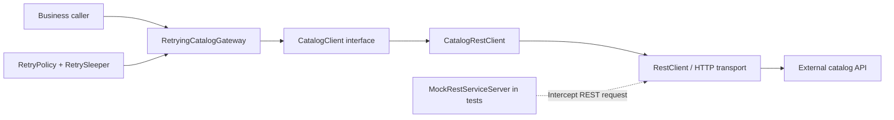

# Thực hành tích hợp — Giả lập dịch vụ ngoài với timeout, lỗi và retry có giới hạn

## 1. Bối cảnh: dịch vụ của mình không thể tin rằng dịch vụ ngoài luôn sẵn sàng

Một ứng dụng Spring Boot thường phải gọi HTTP API nằm ngoài tiến trình: kho hàng, bảng giá, vận chuyển, hệ thống thanh toán hoặc hệ thống đối tác. Ngay cả khi business code đúng, lời gọi ra ngoài có thể:

- Trả **200 OK** với JSON hợp lệ.
- Trả **404 Not Found** vì mã sản phẩm không tồn tại.
- Trả **400/401/403** vì request, token hoặc quyền không hợp lệ.
- Trả **429 Too Many Requests** khi phía đối tác giới hạn lưu lượng.
- Trả **500/502/503/504** khi server hoặc gateway tạm thời gặp sự cố.
- Kết nối quá lâu, không nhận response kịp và phát sinh **timeout**.
- Gặp lỗi DNS, TLS hoặc JSON deserialize — không nên tự động retry như mọi sự cố transient khác.

Một implementation kiểu “cứ lỗi là gọi lại đến khi thành công” có thể biến một outage nhỏ thành **retry storm**. Ngược lại, không retry lỗi tạm thời nào khiến hệ thống dễ thất bại trước một 503 ngắn.

Bài thực hành này xây **một outbound HTTP client** và một lớp retry policy, sau đó dùng **Spring MockRestServiceServer** để giả lập thành công, lỗi HTTP và `SocketTimeoutException` một cách **nhanh, xác định, không phụ thuộc Internet**.

### Kết quả phải quan sát được

1. 200 lần đầu ⇒ một request, không chờ, trả dữ liệu đúng.
2. 503 rồi 200 ⇒ hai requests, **một** khoảng chờ backoff.
3. Timeout rồi 200 ⇒ chỉ retry khi nguyên nhân thực sự là timeout được cho phép.
4. 429 rồi 200 ⇒ retry có giới hạn; chú ý chính sách `Retry-After` trong production.
5. 404/400/401/403 ⇒ **không retry** vì các lỗi này cần xử lý khác.
6. 503 liên tục ⇒ dừng đúng `maxAttempts`, giữ nguyên lỗi cuối làm `cause`.
7. DNS/TLS/JSON decode error ⇒ không bị coi là timeout chỉ vì nằm trong nhóm exception của REST client.
8. Backoff tăng theo số lần thất bại nhưng bị chặn bởi `maxDelay`, không dùng `Thread.sleep` trong tests.
9. Khi thread bị interrupt lúc chờ ⇒ khôi phục interrupt flag, dừng retry ngay.
10. Phân biệt **mô phỏng exception trong client** với **kiểm thử deadline/transport thật**.

## 2. Ba lớp cần tách để kiểm thử đúng



**Tách trách nhiệm:**

- `CatalogRestClient` chịu trách nhiệm **URI, method, headers, JSON mapping và lỗi HTTP/IO**.
- `RetryingCatalogGateway` quyết định **loại lỗi nào nên retry**, tổng số attempts, khoảng chờ và điểm dừng.
- `RetryPolicy` giữ các giới hạn rõ ràng, kiểm tra cấu hình từ đầu.
- `RetrySleeper` là cổng trừu tượng để test **ghi nhận thời gian chờ mà không ngủ thật**.
- `MockRestServiceServer` bắt request ở tầng `ClientHttpRequestFactory` và trả response giả định. Nó **không mở socket**, không đo timeout mạng thật.

Tách như vậy giúp kiểm thử logic retry mà không tạo server và vẫn kiểm được HTTP contract/exception mapping ở Spring REST client.

## 3. Định nghĩa retry có giới hạn

Không dùng từ “3 retries” mơ hồ. Bài chọn:

> `maxAttempts = 3` là **tổng số lần gọi HTTP, bao gồm lần đầu**; khi đó tối đa **2 lần thử lại** và tối đa **2 khoảng chờ**.

Ví dụ:

| Attempt | Response | Xử lý |
| --- | --- | --- |
| 1 | 503 | Chờ 40 ms |
| 2 | Timeout | Chờ 80 ms |
| 3 | 200 | Trả dữ liệu |
| 4 | — | Không bao giờ gọi |

Nếu attempt 3 vẫn 503, gateway ném exception có `attempts=3` và cause là lỗi 503 cuối cùng; **không chờ sau lần cuối**.

### Phân loại lỗi theo policy bài này

| Kết quả/lỗi | Retry? | Lý do |
| --- | --- | --- |
| HTTP 200/2xx + JSON hợp lệ | Không | Hoàn tất |
| 400 | Không | Request sai, gọi lại nguyên trạng không giúp |
| 401/403 | Không | Cần xác thực/cấp quyền, không retry token nguyên |
| 404 | Không | Không có dữ liệu; xử lý nghiệp vụ |
| 409 | Không mặc định | Chỉ retry nếu contract riêng mô tả conflict transient |
| 408 | Không trong policy mẫu | Cần quyết định theo contract/idempotency |
| 429 | Có giới hạn | Rate limit; production phải xem `Retry-After` |
| 500/502/503/504 | Có giới hạn | Các lỗi server/gateway có thể transient |
| 501/505 | Không | Thường không khắc phục được bằng retry |
| `SocketTimeoutException` | Có giới hạn | Timeout network |
| `HttpTimeoutException` | Có giới hạn | Timeout của Java HTTP client |
| `UnknownHostException` | Không trong policy mẫu | Không coi DNS chung là timeout |
| `SSLHandshakeException` | Không | Có thể là cert/TLS policy error |
| JSON parse/convert failure | Không | Lỗi dữ liệu/contract |
| Caller thread interrupted | Không | Dừng và bảo toàn interrupt signal |

**Không có policy retry đúng cho mọi dịch vụ.** Một số hệ thống retry 408/409 hoặc vài lỗi I/O khác sau khi hiểu contract. Bài chọn whitelist có chủ đích để dễ kiểm chứng. Không retry mọi `RestClientException` hoặc mọi `5xx` theo thói quen.

## 4. Dùng Spring Boot 3.5 / Spring Framework 6.2 / Java 17

Ví dụ chạy với:
- Java 17+.
- Maven 3.9+.
- Spring Boot parent `3.5.0` (mốc minh họa ổn định; dự án thực nên dùng maintenance patch được hỗ trợ).
- Spring Framework 6.2 qua Boot BOM.
- `spring-boot-starter-web` cung cấp blocking `RestClient` và JSON message converters.
- `spring-boot-starter-test` cung cấp JUnit Jupiter, Mockito, Spring Test và `MockRestServiceServer`.

Không cần Docker, database, WireMock server hay dịch vụ thật để chạy bộ test dưới đây.

```text
catalog-retry-demo/
├── pom.xml
└── src/
    ├── main/
    │   ├── java/example/catalog/
    │   │   ├── CatalogApplication.java
    │   │   ├── PriceQuote.java
    │   │   ├── CatalogClient.java
    │   │   ├── CatalogRestClient.java
    │   │   ├── RetrySleeper.java
    │   │   ├── RetryPolicy.java
    │   │   ├── RetryingCatalogGateway.java
    │   │   └── CatalogConfiguration.java
    │   └── resources/
    │       └── application.properties
    └── test/java/example/catalog/
        ├── CatalogRestClientSliceTest.java
        ├── RetryingCatalogGatewaySliceTest.java
        ├── RetryingCatalogGatewayUnitTest.java
        └── RetryPolicyTest.java
```

## 5. pom.xml — dependencies không trộn version

`pom.xml`:

```xml
<?xml version="1.0" encoding="UTF-8"?>
<project xmlns="http://maven.apache.org/POM/4.0.0"
         xmlns:xsi="http://www.w3.org/2001/XMLSchema-instance"
         xsi:schemaLocation="http://maven.apache.org/POM/4.0.0
           https://maven.apache.org/xsd/maven-4.0.0.xsd">
    <modelVersion>4.0.0</modelVersion>

    <parent>
        <groupId>org.springframework.boot</groupId>
        <artifactId>spring-boot-starter-parent</artifactId>
        <version>3.5.0</version>
        <relativePath/>
    </parent>

    <groupId>example</groupId>
    <artifactId>catalog-retry-demo</artifactId>
    <version>1.0.0</version>

    <properties>
        <java.version>17</java.version>
    </properties>

    <dependencies>
        <dependency>
            <groupId>org.springframework.boot</groupId>
            <artifactId>spring-boot-starter-web</artifactId>
        </dependency>

        <dependency>
            <groupId>org.springframework.boot</groupId>
            <artifactId>spring-boot-starter-test</artifactId>
            <scope>test</scope>
        </dependency>
    </dependencies>
</project>
```

Không thêm `spring-retry`/`resilience4j` cho mẫu này vì trọng tâm là thấy rõ vòng lặp, exception classification và bounded backoff. Production có thể dùng thư viện resilience chuyên dụng để giảm code tự viết, nhưng vẫn phải cấu hình **retry count, status whitelist, idempotency, jitter, time budget, observability**.

### Spring Boot 4 khác package test

Nếu nâng sang Boot 4.x, `@RestClientTest` chuyển từ:

```java
// Spring Boot 3.5
import org.springframework.boot.test.autoconfigure.web.client.RestClientTest;

// Spring Boot 4.x
import org.springframework.boot.restclient.test.autoconfigure.RestClientTest;
```

Trong Boot4 còn cần specialized `spring-boot-starter-restclient-test` và cập nhật các starter production theo migration guide. **Mã và POM đầy đủ bên dưới dành cho Boot 3.5**, không trộn imports Boot4 vào project rồi tuyên bố compile được.

## 6. CatalogApplication.java — Spring Boot entry point

`src/main/java/example/catalog/CatalogApplication.java`:

```java
package example.catalog;

import org.springframework.boot.SpringApplication;
import org.springframework.boot.autoconfigure.SpringBootApplication;

@SpringBootApplication
public class CatalogApplication {
    public static void main(String[] args) {
        SpringApplication.run(CatalogApplication.class, args);
    }
}
```

Class nằm ở root package `example.catalog`, nên Spring component scan được client, gateway và configuration. Khi chỉ chạy `mvn test`, `@RestClientTest` dùng context **hẹp** thay vì khởi động cả app, và không gửi request đến Internet.

## 7. PriceQuote.java — contract JSON rõ ràng

`src/main/java/example/catalog/PriceQuote.java`:

```java
package example.catalog;

public record PriceQuote(String sku, long amountCents) {
}
```

Một HTTP response hợp lệ:

```http
HTTP/1.1 200 OK
Content-Type: application/json

{"sku":"A-1","amountCents":1250}
```

Jackson trong starter-web của Boot3.5 deserialize JSON sang Java record. Dùng giá dạng **số nguyên cents** để loại bỏ sai số floating point khi minh họa retry. Nếu provider trả schema khác, tests phải phản ánh contract thật thay vì gán một shape giả.

## 8. CatalogClient.java — ranh giới network

`src/main/java/example/catalog/CatalogClient.java`:

```java
package example.catalog;

public interface CatalogClient {
    PriceQuote fetch(String sku);
}
```

Đây là port cho gateway. Test unit có thể thay bằng Mockito mock/fake. Production dùng `CatalogRestClient` để thực hiện HTTP. Không đặt retry bên trong lớp HTTP client khi muốn retry policy test độc lập.

## 9. CatalogRestClient.java — HTTP GET và mapping

`src/main/java/example/catalog/CatalogRestClient.java`:

```java
package example.catalog;

import java.util.Objects;

import org.springframework.beans.factory.annotation.Value;
import org.springframework.http.MediaType;
import org.springframework.stereotype.Component;
import org.springframework.web.client.RestClient;

@Component
public class CatalogRestClient implements CatalogClient {
    private final RestClient client;

    public CatalogRestClient(
            RestClient.Builder builder,
            @Value("${catalog.base-url}") String baseUrl) {

        this.client = builder.baseUrl(baseUrl).build();
    }

    @Override
    public PriceQuote fetch(String sku) {
        if (sku == null || sku.isBlank()) {
            throw new IllegalArgumentException(
                    "sku must not be blank");
        }

        PriceQuote result = client.get()
                .uri("/v1/prices/{sku}", sku)
                .accept(MediaType.APPLICATION_JSON)
                .retrieve()
                .body(PriceQuote.class);

        return Objects.requireNonNull(
                result, "external catalog returned an empty body");
    }
}
```

**Cơ chế:**
- `RestClient.Builder` được Spring Boot auto-configure, sau đó thêm `baseUrl` cho dịch vụ ngoài.
- `GET /v1/prices/{sku}` có URI template variable, không tự ghép query string bằng raw concatenation.
- `retrieve()` mặc định ném subclass của `RestClientException` khi HTTP response 4xx/5xx; mã mẫu **không tự đổi** error handler.
- `body(PriceQuote.class)` dùng HTTP message converters để parse JSON.
- Empty body được coi là contract error (`NullPointerException` với thông điệp rõ), **không retry** theo policy.
- Input trống là programmer/validation error, cũng không retry.

**Lưu ý:** nếu dùng `exchange()` thay `retrieve()`, status handlers không tự áp như ở `retrieve()`; phải tự xử lý 4xx/5xx trong exchange callback, nếu không test retry không phát hiện lỗi như mong đợi.

## 10. application.properties — endpoint minh họa

`src/main/resources/application.properties`:

```properties
# Chi la host minh hoa, khong phai doi tac that.
catalog.base-url=https://catalog.example.test
```

Tên miền `example.test` là tên placeholder không cần tồn tại trong DNS. **Không cố chạy HTTP production tới domain này**. Trong `@RestClientTest`, mock request factory chặn request trước khi có network. Khi triển khai thật, thay bằng URL chính xác và bảo vệ credentials bằng secret manager; không commit API keys vào repo.

## 11. RetrySleeper.java — kiểm backoff không phải chờ thật

`src/main/java/example/catalog/RetrySleeper.java`:

```java
package example.catalog;

import java.time.Duration;

@FunctionalInterface
public interface RetrySleeper {
    void pause(Duration delay) throws InterruptedException;
}
```

Production có thể dùng `delay -> Thread.sleep(delay.toMillis())`. Trong JUnit, chỉ cần `delays::add` để ghi lại `Duration`: **tốc độ test không phụ thuộc khoảng chờ thật**. Nếu một test phải `Thread.sleep(2000)` để “chứng minh backoff”, nó vừa chậm vừa flaky.

`InterruptedException` không được nuốt: retry loop phải restore `Thread.currentThread().interrupt()` rồi thoát, thay vì tiếp tục gọi dịch vụ.

## 12. RetryPolicy.java — maxAttempts và capped exponential backoff

`src/main/java/example/catalog/RetryPolicy.java`:

```java
package example.catalog;

import java.time.Duration;
import java.util.Objects;

public record RetryPolicy(
        int maxAttempts,
        Duration initialDelay,
        Duration maxDelay) {

    public RetryPolicy {
        if (maxAttempts < 1 || maxAttempts > 8) {
            throw new IllegalArgumentException(
                    "maxAttempts must be between 1 and 8");
        }

        Objects.requireNonNull(initialDelay, "initialDelay");
        Objects.requireNonNull(maxDelay, "maxDelay");

        long initialMillis = initialDelay.toMillis();
        long maximumMillis = maxDelay.toMillis();

        if (initialMillis < 1 ||
                maximumMillis < initialMillis) {
            throw new IllegalArgumentException(
                    "delays must be positive and ordered");
        }
    }

    public Duration delayAfterFailure(int failedAttempt) {
        if (failedAttempt < 1 ||
                failedAttempt >= maxAttempts) {
            throw new IllegalArgumentException(
                    "no retry is available for this attempt");
        }

        long delay = initialDelay.toMillis();
        long cap = maxDelay.toMillis();

        for (int n = 1; n < failedAttempt; n++) {
            // Saturating double, no long overflow.
            delay = delay >= cap - delay
                    ? cap
                    : delay * 2;
        }

        return Duration.ofMillis(delay);
    }
}
```

### Cách đếm

Với `new RetryPolicy(5, Duration.ofMillis(40), Duration.ofMillis(100))`:

| Failed attempt | Chờ trước attempt kế | Duration |
| --- | --- | --- |
| 1 | Trước attempt 2 | 40 ms |
| 2 | Trước attempt 3 | 80 ms |
| 3 | Trước attempt 4 | 100 ms |
| 4 | Trước attempt 5 | 100 ms |
| 5 | Không còn retry | Không gọi `delayAfterFailure` |

Giới hạn `1..8` là **guardrail minh họa**, không phải quy tắc Spring. Với production, giới hạn phải gắn với SLO, upstream quotas, lưu lượng và retry budgets.

**Về số học:** dạng `delay >= cap - delay` tránh nhân đôi bị overflow. `Duration.toMillis()` cũng có thể overflow nếu cấu hình Duration khổng lồ bất hợp lý; hãy dùng cấu hình bounded và fail fast thay vì cho phép maxDelay vài thế kỷ.

### Capped exponential backoff chưa có jitter

Mẫu **không thêm jitter** để tests so sánh chính xác delays. Trong production, nhiều clients đồng thời cùng retry sau 40, 80, 100 ms có thể tạo đồng bộ request bursts; thêm **randomized jitter** và kiểm không vượt cap, dùng random source inject được để tests deterministic.

## 13. RetryingCatalogGateway.java — phần trọng tâm

`src/main/java/example/catalog/RetryingCatalogGateway.java`:

```java
package example.catalog;

import java.net.SocketTimeoutException;
import java.net.http.HttpTimeoutException;
import java.time.Duration;

import org.springframework.stereotype.Service;
import org.springframework.web.client.ResourceAccessException;
import org.springframework.web.client.RestClientException;
import org.springframework.web.client.RestClientResponseException;

@Service
public class RetryingCatalogGateway {
    private final CatalogClient catalog;
    private final RetryPolicy policy;
    private final RetrySleeper sleeper;

    public RetryingCatalogGateway(
            CatalogClient catalog,
            RetryPolicy policy,
            RetrySleeper sleeper) {
        this.catalog = catalog;
        this.policy = policy;
        this.sleeper = sleeper;
    }

    public PriceQuote fetch(String sku) {
        for (int attempt = 1;
                attempt <= policy.maxAttempts();
                attempt++) {
            try {
                return catalog.fetch(sku);
            }
            catch (RestClientException error) {
                if (!isRetryable(error)) {
                    throw error;
                }
                if (attempt == policy.maxAttempts()) {
                    throw new AttemptsExhaustedException(
                            attempt, error);
                }

                Duration delay =
                        policy.delayAfterFailure(attempt);
                try {
                    sleeper.pause(delay);
                }
                catch (InterruptedException interrupted) {
                    Thread.currentThread().interrupt();
                    throw new RetryInterruptedException(
                            interrupted);
                }
            }
        }

        throw new IllegalStateException(
                "retry loop did not return or throw");
    }

    static boolean isRetryable(RestClientException error) {
        if (error instanceof RestClientResponseException response) {
            int status = response.getStatusCode().value();
            return status == 429 ||
                    status == 500 ||
                    status == 502 ||
                    status == 503 ||
                    status == 504;
        }

        if (error instanceof ResourceAccessException) {
            Throwable current = error;
            while (current != null) {
                if (current instanceof SocketTimeoutException ||
                        current instanceof HttpTimeoutException) {
                    return true;
                }
                current = current.getCause();
            }
        }

        return false;
    }

    public static final class AttemptsExhaustedException
            extends RuntimeException {

        private final int attempts;

        public AttemptsExhaustedException(
                int attempts, RestClientException cause) {
            super("catalog unavailable after " +
                    attempts + " attempts", cause);
            this.attempts = attempts;
        }

        public int attempts() {
            return attempts;
        }
    }

    public static final class RetryInterruptedException
            extends RuntimeException {

        public RetryInterruptedException(
                InterruptedException cause) {
            super("catalog retry interrupted", cause);
        }
    }
}
```

### Chú giải từng nhánh

- `for` đếm từ **1** tới `maxAttempts`, không dùng `while(true)`.
- Thành công trả ngay, **không retry thêm**.
- Catch chỉ `RestClientException`, nên không vô tình retry `IllegalArgumentException` của input, `NullPointerException` của missing body, hay programming errors.
- Khi status thuộc whitelist hoặc cause chain có timeout ⇒ retry được.
- Khi hết attempts ⇒ ném `AttemptsExhaustedException` chứa **attempt count** và **cause gốc**.
- Trước retry tiếp theo, gọi `policy.delayAfterFailure(attempt)`; không chờ sau lần cuối.
- Khi sleep bị interrupt ⇒ restore flag, ném `RetryInterruptedException` và không gọi HTTP tiếp.
- Không log raw request/response có thể chứa credentials hoặc dữ liệu người dùng.
- Mẫu chỉ áp dụng cho HTTP **GET** được xem là safe/idempotent theo contract; không tự copy retry policy sang POST tạo thanh toán.

### Vì sao chỉ retry một số ResourceAccessException?

`ResourceAccessException` có thể bọc timeout, DNS, SSL, connection refused hoặc lỗi I/O khác. Nếu retry toàn bộ exception này, **một chứng chỉ TLS sai có thể bị thử 8 lần** mà không ích lợi. Whitelist `SocketTimeoutException`/`HttpTimeoutException` giúp ví dụ rõ ràng. Production có thể cho phép thêm `ConnectException` khi phù hợp nhưng phải kiểm nguyên nhân và budget.

### Vì sao status 429 cũng cần thận trọng?

`429` có thể chứa `Retry-After` theo giây hoặc HTTP-date. Mẫu chỉ dùng capped backoff cố định để tập trung **cơ chế retry/test**; production phải **đọc, giới hạn và tuân theo Retry-After phù hợp**, tránh retry trước thời điểm dịch vụ cho phép. Nếu Retry-After vượt deadline/budget, nên fail/queue thay vì chờ vô hạn.

## 14. CatalogConfiguration.java — wiring production và timeout

`src/main/java/example/catalog/CatalogConfiguration.java`:

```java
package example.catalog;

import java.net.http.HttpClient;
import java.time.Duration;

import org.springframework.boot.web.client.RestClientCustomizer;
import org.springframework.context.annotation.Bean;
import org.springframework.context.annotation.Configuration;
import org.springframework.http.client.JdkClientHttpRequestFactory;

@Configuration(proxyBeanMethods = false)
public class CatalogConfiguration {

    @Bean
    RetryPolicy catalogRetryPolicy() {
        return new RetryPolicy(
                3,
                Duration.ofMillis(40),
                Duration.ofMillis(100));
    }

    @Bean
    RetrySleeper catalogRetrySleeper() {
        return delay -> Thread.sleep(delay.toMillis());
    }

    @Bean
    RestClientCustomizer catalogHttpTimeouts() {
        HttpClient httpClient = HttpClient.newBuilder()
                .connectTimeout(Duration.ofSeconds(2))
                .build();

        JdkClientHttpRequestFactory requestFactory =
                new JdkClientHttpRequestFactory(httpClient);

        requestFactory.setReadTimeout(Duration.ofSeconds(3));

        return builder -> builder.requestFactory(requestFactory);
    }
}
```

**Production behavior:**
- `connectTimeout` giới hạn thời gian thiết lập TCP connection (JDK HttpClient).
- `setReadTimeout` giới hạn thời gian chờ response ở Spring JDK request factory theo API/implementation cụ thể.
- `RetryPolicy` cho tối đa 3 attempts, delay 40 rồi 80 ms.
- `RetrySleeper` production dùng `Thread.sleep`, nhưng tests inject recorder, không chờ thật.
- `RestClientCustomizer` của Boot3.5 áp dụng cho **RestClient.Builder được Boot quản lý**. Ứng dụng ví dụ chỉ có một outbound client; nếu app có nhiều clients với SLA khác nhau, đừng dùng cùng timeout toàn cục một cách vô ý — xây dedicated client/builder hoặc cấu hình per-client.

**Lưu ý rất quan trọng về mock:** `MockRestServiceServer` cũng thay `ClientHttpRequestFactory` để intercept requests. Khi kiểm thử bằng `@RestClientTest`, không tự gọi `builder.requestFactory(realFactory)` **sau khi** mock server đã bind; nếu làm vậy, test sẽ đi network thật. `@RestClientTest(CatalogRestClient.class)` không component-scan `@Configuration` production thông thường, nên sample slice dùng builder do Boot mock auto-configure. Timeout cấu hình ở đây là production integration concern; `withException` chỉ chứng minh cách code phản ứng với timeout exception.

### Timeout riêng chưa bằng deadline tổng

Ví dụ tối đa 3 attempts, mỗi attempt có read timeout 3 giây, cộng backoff 40+80 ms; thời gian end-to-end có thể vượt 3 giây nhiều lần, còn connect/queue/DNS có semantics riêng. **Cần deadline hoặc time budget tổng** nếu upstream request có SLA 4 giây. Mẫu này cố ý chưa triển khai global deadline: production phải cân nhắc server timeout, user cancellation, circuit breaker và remaining budget trước từng attempt.

Không dùng `readTimeout=Duration.ZERO` để biểu diễn “vô hạn” khi chưa xác minh behavior của HTTP client/version; chọn timeout dương, hữu hạn theo policy.

## 15. Cách MockRestServiceServer hoạt động và giới hạn

Spring cung cấp `MockRestServiceServer.bindTo(RestClient.Builder)` từ Framework 6.1. Khi bind, server cài **mock ClientHttpRequestFactory** vào builder; request chạy qua client vẫn có URI/method/headers, nhưng response do các `expect(...).andRespond(...)` trả về.

```java
RestClient.Builder builder =
        RestClient.builder().baseUrl("https://catalog.example.test");
MockRestServiceServer server =
        MockRestServiceServer.bindTo(builder).build();
RestClient client = builder.build();
```

**Thứ tự quan trọng:** build mock server từ builder **trước** khi `builder.build()`. Nếu tạo RestClient trước rồi mới bind một builder không dùng đến, client sẽ không được intercept.

Trong Spring Boot 3.5, `@RestClientTest(CatalogRestClient.class)` auto-configures builder và `MockRestServiceServer` cho REST client được chọn. **Không cần tự bind** nếu sử dụng annotation slice như bộ test dưới đây.

### Mock được những gì?

```java
server.expect(requestTo(
        "https://catalog.example.test/v1/prices/A-1"))
    .andExpect(method(HttpMethod.GET))
    .andRespond(withSuccess(
        "{\"sku\":\"A-1\",\"amountCents\":1250}",
        MediaType.APPLICATION_JSON));
```

Có thể trả `withResourceNotFound()`, `withTooManyRequests()`, `withServiceUnavailable()`, `withStatus(HttpStatus.BAD_GATEWAY)` hoặc:

```java
.andRespond(
    withException(
        new SocketTimeoutException("simulated timeout")));
```

Spring Framework chính thức hỗ trợ `MockRestResponseCreators.withException(IOException)` để mô phỏng IOException, ví dụ `SocketTimeoutException`.

### Chú ý URI expectations: RestClient vs RestTemplate

Nếu `RestClient.Builder.baseUrl("https://catalog.example.test")`, `requestTo(...)` cần **full URI** như `https://catalog.example.test/v1/prices/A-1` theo Spring Boot 3.5 reference. Ngược lại, một số tests dùng `RestTemplateBuilder.rootUri(...)` có matcher chỉ cần path; không copy expectation pattern giữa hai APIs.

### Không đo network timeout thật bằng mock factory

`withException(new SocketTimeoutException(...))` lập tức ném exception. Nó **không đợi 3 giây**, không chứng minh:
- TCP connect timeout có được thực thi bởi JDK HTTP client không.
- Socket read timeout có phát sinh đúng thời gian không.
- Connection pooling/reuse/TLS handshake có phù hợp production không.
- Client có giải phóng sockets/resources sau timeout không.

Khi cần chứng minh transport, dùng **loopback MockWebServer/WireMock có độ trễ**, real `JdkClientHttpRequestFactory` và bounded test timeout trong suite riêng. Spring Framework testing reference khuyến nghị mock web server cho các đặc tính mạng thật, còn MockRestServiceServer cho tests cô lập.

## 16. CatalogRestClientSliceTest.java — HTTP contract không retry

`src/test/java/example/catalog/CatalogRestClientSliceTest.java`:

```java
package example.catalog;

import static org.junit.jupiter.api.Assertions.assertEquals;
import static org.junit.jupiter.api.Assertions.assertThrows;
import static org.springframework.test.web.client.match.MockRestRequestMatchers.method;
import static org.springframework.test.web.client.match.MockRestRequestMatchers.requestTo;
import static org.springframework.test.web.client.response.MockRestResponseCreators.withResourceNotFound;
import static org.springframework.test.web.client.response.MockRestResponseCreators.withSuccess;

import org.junit.jupiter.api.BeforeEach;
import org.junit.jupiter.api.Test;
import org.springframework.beans.factory.annotation.Autowired;
import org.springframework.boot.test.autoconfigure.web.client.RestClientTest;
import org.springframework.http.HttpMethod;
import org.springframework.http.MediaType;
import org.springframework.test.context.TestPropertySource;
import org.springframework.test.web.client.MockRestServiceServer;
import org.springframework.web.client.RestClientResponseException;

@RestClientTest(CatalogRestClient.class)
@TestPropertySource(
    properties = "catalog.base-url=https://catalog.example.test")
class CatalogRestClientSliceTest {

    @Autowired
    CatalogRestClient client;

    @Autowired
    MockRestServiceServer server;

    @BeforeEach
    void resetServer() {
        server.reset();
    }

    @Test
    void mapsSuccessfulJsonResponse() {
        server.expect(requestTo(
                "https://catalog.example.test/v1/prices/A-1"))
            .andExpect(method(HttpMethod.GET))
            .andRespond(withSuccess(
                "{\"sku\":\"A-1\",\"amountCents\":1250}",
                MediaType.APPLICATION_JSON));

        PriceQuote price = client.fetch("A-1");

        assertEquals("A-1", price.sku());
        assertEquals(1250L, price.amountCents());
        server.verify();
    }

    @Test
    void a404BecomesHttpException() {
        server.expect(requestTo(
                "https://catalog.example.test/v1/prices/A-1"))
            .andRespond(withResourceNotFound());

        RestClientResponseException error = assertThrows(
                RestClientResponseException.class,
                () -> client.fetch("A-1"));

        assertEquals(404, error.getStatusCode().value());
        server.verify();
    }

    @Test
    void invalidSkuNeverIssuesHttpRequest() {
        assertThrows(IllegalArgumentException.class,
                () -> client.fetch("   "));
        server.verify();
    }
}
```

**3 JUnit test methods**. `server.verify()` xác nhận expectations đã thỏa mãn, và unexpected requests thường làm mock server báo lỗi. Test thứ ba không đăng ký expectation, client từ chối input **trước HTTP call**; đây là một failure không cần retry.

Không để `@SpringBootTest` cùng `@RestClientTest`: slice chủ ý chỉ nạp REST-client-related beans. Các bean `RetryingCatalogGateway` và `CatalogConfiguration` của app **không cần có** trong slice này.

## 17. RetryingCatalogGatewaySliceTest.java — test chính của bài

Test này dùng **RestClient thực**, **MockRestServiceServer giả lập HTTP**, **RetryingCatalogGateway thực**, và `RetrySleeper` ghi nhận delays không hề sleep.

`src/test/java/example/catalog/RetryingCatalogGatewaySliceTest.java`:

```java
package example.catalog;

import static org.junit.jupiter.api.Assertions.assertEquals;
import static org.junit.jupiter.api.Assertions.assertInstanceOf;
import static org.junit.jupiter.api.Assertions.assertThrows;
import static org.junit.jupiter.api.Assertions.assertTrue;
import static org.springframework.test.web.client.match.MockRestRequestMatchers.method;
import static org.springframework.test.web.client.match.MockRestRequestMatchers.requestTo;
import static org.springframework.test.web.client.response.MockRestResponseCreators.withBadRequest;
import static org.springframework.test.web.client.response.MockRestResponseCreators.withException;
import static org.springframework.test.web.client.response.MockRestResponseCreators.withResourceNotFound;
import static org.springframework.test.web.client.response.MockRestResponseCreators.withServerError;
import static org.springframework.test.web.client.response.MockRestResponseCreators.withServiceUnavailable;
import static org.springframework.test.web.client.response.MockRestResponseCreators.withStatus;
import static org.springframework.test.web.client.response.MockRestResponseCreators.withSuccess;
import static org.springframework.test.web.client.response.MockRestResponseCreators.withTooManyRequests;
import static org.springframework.test.web.client.response.MockRestResponseCreators.withUnauthorizedRequest;

import java.net.SocketTimeoutException;
import java.net.UnknownHostException;
import java.time.Duration;
import java.util.ArrayList;
import java.util.List;

import org.junit.jupiter.api.BeforeEach;
import org.junit.jupiter.api.Test;
import org.springframework.beans.factory.annotation.Autowired;
import org.springframework.boot.test.autoconfigure.web.client.RestClientTest;
import org.springframework.http.HttpMethod;
import org.springframework.http.HttpStatus;
import org.springframework.http.MediaType;
import org.springframework.test.context.TestPropertySource;
import org.springframework.test.web.client.MockRestServiceServer;
import org.springframework.test.web.client.ResponseCreator;
import org.springframework.web.client.ResourceAccessException;
import org.springframework.web.client.RestClientException;
import org.springframework.web.client.RestClientResponseException;

@RestClientTest(CatalogRestClient.class)
@TestPropertySource(
    properties = "catalog.base-url=https://catalog.example.test")
class RetryingCatalogGatewaySliceTest {

    private static final String URL =
            "https://catalog.example.test/v1/prices/A-1";

    @Autowired
    CatalogRestClient client;

    @Autowired
    MockRestServiceServer server;

    private List<Duration> delays;
    private RetryingCatalogGateway gateway;

    @BeforeEach
    void setUp() {
        server.reset();
        delays = new ArrayList<>();

        gateway = new RetryingCatalogGateway(
                client,
                new RetryPolicy(
                        3,
                        Duration.ofMillis(40),
                        Duration.ofMillis(100)),
                delays::add);
    }

    private void expect(ResponseCreator response) {
        server.expect(requestTo(URL))
            .andExpect(method(HttpMethod.GET))
            .andRespond(response);
    }

    private static ResponseCreator success() {
        return withSuccess(
                "{\"sku\":\"A-1\",\"amountCents\":1250}",
                MediaType.APPLICATION_JSON);
    }

    @Test
    void successOnFirstAttemptNeverSleeps() {
        expect(success());

        PriceQuote quote = gateway.fetch("A-1");

        assertEquals(1250, quote.amountCents());
        assertEquals(List.of(), delays);
        server.verify();
    }

    @Test
    void serviceUnavailableThenSuccessRetriesOnce() {
        expect(withServiceUnavailable());
        expect(success());

        PriceQuote quote = gateway.fetch("A-1");

        assertEquals(1250, quote.amountCents());
        assertEquals(
                List.of(Duration.ofMillis(40)), delays);
        server.verify();
    }

    @Test
    void simulatedSocketTimeoutThenSuccessRetries() {
        expect(withException(
                new SocketTimeoutException("simulated timeout")));
        expect(success());

        PriceQuote quote = gateway.fetch("A-1");

        assertEquals("A-1", quote.sku());
        assertEquals(
                List.of(Duration.ofMillis(40)), delays);
        server.verify();
    }

    @Test
    void tooManyRequestsThenSuccessRetriesOnce() {
        expect(withTooManyRequests());
        expect(success());

        PriceQuote quote = gateway.fetch("A-1");

        assertEquals(1250, quote.amountCents());
        assertEquals(
                List.of(Duration.ofMillis(40)), delays);
        server.verify();
    }

    @Test
    void repeated503StopsAfterThreeTotalAttempts() {
        expect(withServiceUnavailable());
        expect(withServiceUnavailable());
        expect(withServiceUnavailable());

        RetryingCatalogGateway.AttemptsExhaustedException ex =
                assertThrows(
                    RetryingCatalogGateway.AttemptsExhaustedException.class,
                    () -> gateway.fetch("A-1"));

        assertEquals(3, ex.attempts());
        RestClientResponseException last =
                assertInstanceOf(RestClientResponseException.class,
                        ex.getCause());
        assertEquals(503, last.getStatusCode().value());

        assertEquals(
                List.of(
                    Duration.ofMillis(40),
                    Duration.ofMillis(80)),
                delays);
        server.verify();
    }

    @Test
    void 404DoesNotRetry() {
        expect(withResourceNotFound());

        RestClientResponseException ex = assertThrows(
                RestClientResponseException.class,
                () -> gateway.fetch("A-1"));

        assertEquals(404, ex.getStatusCode().value());
        assertTrue(delays.isEmpty());
        server.verify();
    }

    @Test
    void 400DoesNotRetry() {
        expect(withBadRequest());

        RestClientResponseException ex = assertThrows(
                RestClientResponseException.class,
                () -> gateway.fetch("A-1"));

        assertEquals(400, ex.getStatusCode().value());
        assertTrue(delays.isEmpty());
        server.verify();
    }

    @Test
    void 401DoesNotRetry() {
        expect(withUnauthorizedRequest());

        RestClientResponseException ex = assertThrows(
                RestClientResponseException.class,
                () -> gateway.fetch("A-1"));

        assertEquals(401, ex.getStatusCode().value());
        assertTrue(delays.isEmpty());
        server.verify();
    }

    @Test
    void 500And502ThenSuccessUseTwoBackoffs() {
        expect(withServerError());
        expect(withStatus(HttpStatus.BAD_GATEWAY));
        expect(success());

        PriceQuote quote = gateway.fetch("A-1");

        assertEquals(1250, quote.amountCents());
        assertEquals(
                List.of(
                    Duration.ofMillis(40),
                    Duration.ofMillis(80)),
                delays);
        server.verify();
    }

    @Test
    void 504ThenSuccessIsTransientInThisPolicy() {
        expect(withStatus(HttpStatus.GATEWAY_TIMEOUT));
        expect(success());

        PriceQuote quote = gateway.fetch("A-1");

        assertEquals(1250, quote.amountCents());
        assertEquals(
                List.of(Duration.ofMillis(40)), delays);
        server.verify();
    }

    @Test
    void dnsErrorIsNotMistakenForTimeout() {
        expect(withException(
                new UnknownHostException("simulated dns failure")));

        ResourceAccessException error = assertThrows(
                ResourceAccessException.class,
                () -> gateway.fetch("A-1"));

        assertTrue(error.getMessage().contains("dns"));
        assertTrue(delays.isEmpty());
        server.verify();
    }

    @Test
    void invalidJsonDoesNotGetRetried() {
        expect(withSuccess(
                "{invalid-json",
                MediaType.APPLICATION_JSON));

        assertThrows(RestClientException.class,
                () -> gateway.fetch("A-1"));

        assertTrue(delays.isEmpty());
        server.verify();
    }
}
```

**12 JUnit methods.** Các cases đăng ký đúng số lượng HTTP requests; `server.verify()` kiểm requests đã được tiêu thụ. Vì mỗi method gọi `server.reset()` ở `@BeforeEach`, expectations không rò sang test khác dù TestContext cache cùng application context.

**Điểm cần đặc biệt nhớ:** `withException(SocketTimeoutException)` diễn ra ngay lập tức và gateway bắt `ResourceAccessException` có cause chứa timeout, sau đó retry. Không có phép đo giây thực; test này xác nhận **classification và giới hạn attempts**, không xác nhận JDK transport readTimeout.

### Vì sao test HTTP error dùng RestClientResponseException?

`RestClient.retrieve()` mặc định ném exception cho 4xx/5xx. Test không cần giả định mọi status luôn trả cùng concrete subclass (ví dụ `HttpClientErrorException.NotFound`), mà kiểm stable API `RestClientResponseException.getStatusCode()`. Nếu project custom `onStatus` hoặc `defaultStatusHandler`, phải cập nhật policy/test classification theo exception contract mới.

### Tại sao không có delay thứ ba khi hết attempts?

Vòng lặp chỉ gọi `pause` khi **còn ít nhất một attempt khác**. Trường hợp ba lần 503 có delays [40ms, 80ms], không có 160ms. Đây là assertion quan trọng vì sleep sau attempt cuối vừa làm chậm response vừa không phục vụ lời gọi nào.

## 18. RetryingCatalogGatewayUnitTest.java — những lỗi không cần HTTP

Một số policy cases dễ kiểm trực tiếp bằng Mockito mock của `CatalogClient` thay vì mock server. Trong unit tests, gateway là POJO, không có Spring context.

`src/test/java/example/catalog/RetryingCatalogGatewayUnitTest.java`:

```java
package example.catalog;

import static org.junit.jupiter.api.Assertions.assertEquals;
import static org.junit.jupiter.api.Assertions.assertSame;
import static org.junit.jupiter.api.Assertions.assertThrows;
import static org.junit.jupiter.api.Assertions.assertTrue;
import static org.mockito.Mockito.mock;
import static org.mockito.Mockito.times;
import static org.mockito.Mockito.verify;
import static org.mockito.Mockito.when;

import java.net.SocketTimeoutException;
import java.time.Duration;
import java.util.ArrayList;
import java.util.List;

import javax.net.ssl.SSLHandshakeException;

import org.junit.jupiter.api.Test;
import org.springframework.http.HttpStatus;
import org.springframework.web.client.HttpServerErrorException;
import org.springframework.web.client.ResourceAccessException;

class RetryingCatalogGatewayUnitTest {

    @Test
    void oneAttemptMeansNoRetryAndNoSleep() {
        CatalogClient client = mock(CatalogClient.class);
        when(client.fetch("A-1")).thenThrow(
                new HttpServerErrorException(
                    HttpStatus.SERVICE_UNAVAILABLE));

        List<Duration> sleeps = new ArrayList<>();
        RetryingCatalogGateway gateway =
                new RetryingCatalogGateway(
                    client,
                    new RetryPolicy(
                        1,
                        Duration.ofMillis(40),
                        Duration.ofMillis(100)),
                    sleeps::add);

        RetryingCatalogGateway.AttemptsExhaustedException ex =
                assertThrows(
                    RetryingCatalogGateway.AttemptsExhaustedException.class,
                    () -> gateway.fetch("A-1"));

        assertEquals(1, ex.attempts());
        assertTrue(sleeps.isEmpty());
        verify(client, times(1)).fetch("A-1");
    }

    @Test
    void sslHandshakeFailureNeverRetries() {
        CatalogClient client = mock(CatalogClient.class);
        ResourceAccessException error =
                new ResourceAccessException(
                    "ssl failed",
                    new SSLHandshakeException("bad certificate"));

        when(client.fetch("A-1")).thenThrow(error);

        List<Duration> sleeps = new ArrayList<>();
        RetryingCatalogGateway gateway =
                new RetryingCatalogGateway(
                    client,
                    new RetryPolicy(
                        3,
                        Duration.ofMillis(40),
                        Duration.ofMillis(100)),
                    sleeps::add);

        assertSame(error,
            assertThrows(ResourceAccessException.class,
                () -> gateway.fetch("A-1")));

        assertTrue(sleeps.isEmpty());
        verify(client, times(1)).fetch("A-1");
    }

    @Test
    void interruptionRestoresFlagAndStops() {
        CatalogClient client = mock(CatalogClient.class);
        when(client.fetch("A-1")).thenThrow(
                new ResourceAccessException(
                    "timeout",
                    new SocketTimeoutException("fake timeout")));

        RetryingCatalogGateway gateway =
                new RetryingCatalogGateway(
                    client,
                    new RetryPolicy(
                        3,
                        Duration.ofMillis(40),
                        Duration.ofMillis(100)),
                    delay -> {
                        throw new InterruptedException(
                            "caller cancelled");
                    });

        try {
            assertThrows(
                RetryingCatalogGateway.RetryInterruptedException.class,
                () -> gateway.fetch("A-1"));

            assertTrue(Thread.currentThread().isInterrupted());
            verify(client, times(1)).fetch("A-1");
        }
        finally {
            // Clear interrupt flag after asserting it for JUnit.
            Thread.interrupted();
        }
    }

    @Test
    void invalidArgumentIsNotWrappedAsRetryable() {
        CatalogClient client = mock(CatalogClient.class);
        IllegalArgumentException error =
                new IllegalArgumentException("bad sku");
        when(client.fetch("")).thenThrow(error);

        List<Duration> sleeps = new ArrayList<>();
        RetryingCatalogGateway gateway =
                new RetryingCatalogGateway(
                    client,
                    new RetryPolicy(
                        3,
                        Duration.ofMillis(40),
                        Duration.ofMillis(100)),
                    sleeps::add);

        assertSame(error,
            assertThrows(IllegalArgumentException.class,
                () -> gateway.fetch("")));

        assertTrue(sleeps.isEmpty());
        verify(client, times(1)).fetch("");
    }
}
```

**4 JUnit methods.** Unit test thứ ba cố ý tạo `InterruptedException` từ fake sleeper, sau đó kiểm gateway **restore flag** và dừng; `finally` gọi `Thread.interrupted()` để không ảnh hưởng JUnit test thread cho các methods khác.

Mockito có thể mock interface `CatalogClient` mà không cần Spring `@MockitoBean`. Nếu dùng `@Mock` field, thêm `@ExtendWith(MockitoExtension.class)`; ở đây dùng `Mockito.mock(...)` trực tiếp.

## 19. RetryPolicyTest.java — kiểm giới hạn và số học

`src/test/java/example/catalog/RetryPolicyTest.java`:

```java
package example.catalog;

import static org.junit.jupiter.api.Assertions.assertEquals;
import static org.junit.jupiter.api.Assertions.assertThrows;

import java.time.Duration;

import org.junit.jupiter.api.Test;

class RetryPolicyTest {

    @Test
    void rejectsUnboundedOrInvalidSettings() {
        assertThrows(IllegalArgumentException.class,
                () -> new RetryPolicy(
                    0, Duration.ofMillis(40),
                    Duration.ofMillis(100)));

        assertThrows(IllegalArgumentException.class,
                () -> new RetryPolicy(
                    9, Duration.ofMillis(40),
                    Duration.ofMillis(100)));

        assertThrows(IllegalArgumentException.class,
                () -> new RetryPolicy(
                    3, Duration.ZERO,
                    Duration.ofMillis(100)));

        assertThrows(IllegalArgumentException.class,
                () -> new RetryPolicy(
                    3, Duration.ofMillis(200),
                    Duration.ofMillis(100)));
    }

    @Test
    void exponentialBackoffStopsAtTheCap() {
        RetryPolicy policy = new RetryPolicy(
                5,
                Duration.ofMillis(40),
                Duration.ofMillis(100));

        assertEquals(Duration.ofMillis(40),
                policy.delayAfterFailure(1));
        assertEquals(Duration.ofMillis(80),
                policy.delayAfterFailure(2));
        assertEquals(Duration.ofMillis(100),
                policy.delayAfterFailure(3));
        assertEquals(Duration.ofMillis(100),
                policy.delayAfterFailure(4));
    }

    @Test
    void cannotSleepBeforeAttemptOneOrAfterLast() {
        RetryPolicy policy = new RetryPolicy(
                3,
                Duration.ofMillis(40),
                Duration.ofMillis(100));

        assertThrows(IllegalArgumentException.class,
                () -> policy.delayAfterFailure(0));
        assertThrows(IllegalArgumentException.class,
                () -> policy.delayAfterFailure(3));
    }
}
```

**3 JUnit methods**. Vì `RetryPolicy` độc lập Spring và HTTP, test này chạy nhanh. Kiểm `maxAttempts` tại constructor giúp phát hiện cấu hình không hợp lệ **trước khi có network traffic**.

## 20. Chạy và đọc kết quả chính xác

Tại `catalog-retry-demo`:

```bash
java -version
mvn -version
mvn clean test
```

Chạy riêng từng nhóm:

```bash
mvn -Dtest=CatalogRestClientSliceTest test
mvn -Dtest=RetryingCatalogGatewaySliceTest test
mvn -Dtest=RetryingCatalogGatewayUnitTest test
mvn -Dtest=RetryPolicyTest test
```

| Class | Test methods | Mục tiêu |
| --- | ---: | --- |
| `CatalogRestClientSliceTest` | 3 | HTTP 200/404, input validation |
| `RetryingCatalogGatewaySliceTest` | 12 | 429/500/502/503/504, timeout, no-retry, max attempts |
| `RetryingCatalogGatewayUnitTest` | 4 | maxAttempts=1, SSL, interrupt, invalid argument |
| `RetryPolicyTest` | 3 | config validation, capped exponential backoff |
| **Tổng** | **22** | **22 JUnit methods dự kiến** |

**Đây là kết quả dự kiến theo source, không phải log Maven đã thực chạy**. Đọc `target/surefire-reports/` và exit code của Maven trước khi tuyên bố PASS. Những request/status/JSON ở code là **giả lập**, không phải dịch vụ Internet thực đã phản hồi.

Nếu Maven fail:
- `cannot find symbol RestClient`: sai Boot/Spring version/classpath.
- `NoSuchBeanDefinitionException RestClient.Builder`: không có auto-config đúng hoặc đã nạp sai slice.
- `NoSuchBeanDefinitionException CatalogRestClient` trong `@RestClientTest`: thiếu `components`/class target hoặc test configuration sai.
- `Expected 1 request(s) to execute`: client không dùng builder đã bind mock hoặc URI matcher sai.
- `Unexpected request`: retry vượt số lần hoặc expectation order sai.
- `Tests run: 0`: Surefire/JUnit discovery/method naming sai.
- `Connection refused`/`UnknownHost` đến `catalog.example.test`: mock request factory **không còn bind**, đang đi network thật.
- `NoClassDefFoundError`: trộn Spring jars khác versions.

## 21. Tại sao verify() còn quan trọng hơn chỉ assert kết quả?

Giả sử bạn viết một stub:

```java
server.expect(requestTo(
        "https://catalog.example.test/v1/prices/A-1"))
    .andRespond(withServiceUnavailable());

server.expect(requestTo(
        "https://catalog.example.test/v1/prices/A-1"))
    .andRespond(withSuccess(
        "{\"sku\":\"A-1\",\"amountCents\":1250}",
        MediaType.APPLICATION_JSON));
```

Nhưng test không gọi `server.verify()`. Một logic retry lỗi có thể chỉ gọi một lần rồi trả fallback — bạn mất dấu request thứ hai chưa được thực hiện nếu assertions business không đủ. `server.verify()` giúp xác nhận **tất cả expected requests được thực hiện**.

Ở phía khác, đăng ký 3 expectations với status 503 rồi gateway gọi lần thứ 4: mock server thường sẽ fail vì **unexpected request**, chứng minh giới hạn retry bị vi phạm. Kết hợp:
1. Assert output/exception;
2. Assert danh sách delays;
3. `server.verify()`;
4. Từ report/log xác nhận test method thực chạy.

### ExpectedCount và thứ tự

Spring MockRestServiceServer hỗ trợ `ExpectedCount.times(n)`, `once()`, `min/max/between` và `ignoreExpectOrder(true)`. Các retry scenarios ở đây cần **response tuần tự khác nhau** (503 rồi 200), nên khai **nhiều expectations với mỗi response riêng** thay vì một `times(2)` cùng response.

`ignoreExpectOrder(true)` phù hợp khi cần nhiều requests độc lập nhưng thứ tự không quan trọng. Đối với retry cùng URL và response sequence, giữ default ordering để đảm bảo **trình tự failure→success** đúng.

## 22. Timeout classification: ba tầng không được trộn

| Khái niệm | Nó giới hạn gì? | Cách test phù hợp |
| --- | --- | --- |
| **Connect timeout** | Thời gian thiết lập kết nối | Real HTTP client + mock/loopback transport, giả lập connect failure phù hợp |
| **Response/read timeout** | Thời gian chờ dữ liệu/response theo HTTP client | Real client + local server cố ý delay |
| **End-to-end deadline** | Tổng thời gian còn lại của business request, gồm retries/backoffs | Clock/deadline abstraction, bounded integration test |
| **Simulated timeout exception** | Luồng code xử lý exception | MockRestServiceServer `withException` |
| **Retry backoff** | Khoảng chờ giữa attempts | Inject `RetrySleeper` và assert Duration không sleep thật |
| **JUnit test timeout** | Thời lượng test có thể chạy | `@Timeout` để chống treo, không thay network timeout |

Nếu chỉ viết `@Timeout(5)` lên test, nó **không tự cấu hình HTTP connect/read timeout production**. Nếu dùng `MockRestServiceServer` trả exception ngay, test chạy nhanh không chứng minh real client sẽ timeout sau 3 giây.

### Kiểm test HTTP transport thật

Một suite bổ sung có thể dùng WireMock/OkHttp MockWebServer:
1. Start mock HTTP server trên `127.0.0.1` với port động.
2. Sử dụng **cùng request factory cấu hình như production**.
3. Endpoint `/slow` cố ý delay lớn hơn read timeout.
4. Assert lỗi timeout xuất hiện, client không chờ vô hạn.
5. Assert retry policy dừng đúng số attempts.
6. Giới hạn test bằng `@Timeout` tương xứng, tránh flaky threshold quá sát.
7. Stop server trong `@AfterEach`/try-with-resources phù hợp.

Spring Framework chính thức giải thích mock web servers tốt hơn khi muốn kiểm transport/network conditions, còn `MockRestServiceServer` tối ưu cho mã HTTP client logic cô lập.

## 23. Phân biệt HTTP 429, Retry-After và server overload

`429 Too Many Requests` thường có header `Retry-After`. Một backoff 40ms có thể **quá sớm** nếu provider yêu cầu chờ 2 giây. Production policy nên:

- Parse số giây hoặc HTTP-date `Retry-After`.
- Giới hạn upper bound theo request deadline và queue policy.
- Respect global client rate limiter và provider quotas.
- Tránh mỗi instance tự retry đồng bộ khi cả cluster bị throttle.
- Nếu cần chờ quá deadline, trả trạng thái phù hợp/queue job thay vì giữ request thread vô hạn.
- Có jitter và metrics để điều chỉnh theo điều kiện thực.

Mẫu test `withTooManyRequests()` **không mang Retry-After**, nên backoff [40ms] là chủ đích của bài. Không diễn giải mẫu này là một thư viện rate-limit hoàn chỉnh.

## 24. Tránh retry nhầm tác vụ không idempotent

GET đọc dữ liệu thường safe/idempotent về semantics, thích hợp retry hơn POST tạo đơn/charge thẻ.

Một HTTP timeout có thể xảy ra **sau khi server đã xử lý thành công** nhưng client chưa nhận response. Nếu bạn retry POST payment không có idempotency key, có thể tạo **hai giao dịch**.

Checklist cho operations tạo dữ liệu:
- API contract xác nhận có idempotency semantics hay không?
- Có `Idempotency-Key` ổn định cho **cùng logical operation**?
- Có unique constraint/deduplication phía server?
- Timeout response có nghĩa “không biết kết quả”, không đồng nghĩa “server chưa xử lý”?
- Có endpoint tra cứu kết quả trước khi retry?
- Có giới hạn attempt, deadline và audit log (không lộ dữ liệu nhạy cảm)?

**Không copy nguyên gateway retry GET của bài cho payment POST** chỉ vì cũng gọi RestClient.

## 25. Không tự retry lỗi vĩnh viễn

Một policy kiểu:

```java
catch (RestClientException ex) {
    // SAI: retry mọi lỗi không phân loại.
}
```

sẽ retry:
- 400 invalid request (không đổi payload).
- 401 token sai/hết hạn (cần credential refresh đúng cơ chế).
- 403 thiếu permission (retry không giúp).
- 404 product missing (đừng biến 404 thành 503 giả).
- 501 Not Implemented.
- JSON malformed do upstream contract thay đổi.
- TLS certificate invalid hoặc hostname verification fail.

Lỗi nào nên được **báo về caller** hoặc chuyển sang fallback là quyết định nghiệp vụ. Với 404, có thể map thành `Optional.empty()` hoặc domain NotFound exception; test phải làm rõ contract. Không biến tất cả exceptions thành `null` vì làm mất ý nghĩa failure.

## 26. Không tạo retry storm: backoff, jitter, budget và circuit breaker

Nếu một instance có 100 threads, mỗi thread retry 3 attempts, server đang lỗi có thể nhận gần **300 requests**. Với 20 instances, lượng requests được nhân lớn hơn.

Các biện pháp:
- Bounded `maxAttempts` (bao gồm lần đầu).
- Capped exponential backoff.
- **Jitter** để các instances không đồng bộ.
- Retry budgets/rate limits cho phép tăng tải giới hạn.
- Circuit breaker ngừng gọi tạm khi lỗi liên tiếp.
- Bulkhead/concurrency limit để bảo vệ thread pool.
- Overall deadline, không để tổng timeout x số attempts vượt SLO.
- Lưu `Retry-After` của 429 và upstream overload indicators.
- Phân biệt failure từ provider với JSON/schema lỗi không transient.

**Circuit breaker không thay retry limit**; hai cơ chế giải quyết hai loại rủi ro. Một số ứng dụng sẽ chọn fail-fast thay vì retry nếu upstream đang overloaded.

## 27. Retry ở nhiều tầng có thể nhân attempts

Nếu HTTP client tự retry 3 lần, gateway retry 3 lần và API gateway hạ tầng retry 2 lần, worst-case có thể lên tới **3 × 3 × 2 = 18 outbound calls**, không phải 3.

Trước khi cấu hình retry:
1. Kiểm SDK/HTTP transport có automatic retry không.
2. Kiểm annotation như `@Retryable` hoặc Spring Cloud/Resilience4j có được áp đồng thời không.
3. Kiểm gateway/mesh/reverse proxy retry policies.
4. Quyết định **một tầng sở hữu** retry cho từng use case.
5. Đặt end-to-end request budget chung và downstream metrics.

Tests cần xác minh số **requests thực ở boundary**, không chỉ số lần gọi Java method của một wrapper.

## 28. Thread interrupt, cancellation và thời gian chờ

Java `InterruptedException` là tín hiệu hủy có ý nghĩa. Khi `RetrySleeper.pause` bị interrupt, gateway:

```java
catch (InterruptedException ex) {
    Thread.currentThread().interrupt();
    throw new RetryInterruptedException(ex);
}
```

Phải **restore interrupt flag** và dừng. Nếu swallow exception rồi retry tiếp, thread trong web server có thể giữ tài nguyên vô ích khi caller đã hủy request.

Bài unit test sử dụng fake sleeper ném `InterruptedException`, assert flag được restore rồi clear cờ test thread trong `finally`. Không dùng real `Thread.sleep(3000)` trong CI.

Lưu ý Java `Thread.sleep(Duration)` không thuộc Java17 API của ví dụ; production bean dùng `Thread.sleep(delay.toMillis())` phù hợp Java17.

## 29. Observability mà không rò rỉ secrets

Một gateway production nên có:
- Request/attempt count phân biệt first vs retry.
- Status code family 2xx/4xx/5xx.
- Error classification (timeout/read/connect/TLS/DNS/invalid JSON).
- Latency mỗi attempt và total elapsed.
- Retry delays, exhaustion count, interrupt count.
- Upstream dependency name/operation, không đưa full URL có token/query PII.
- Trace/span correlation để phân biệt 3 network attempts của cùng một business request.

Đặt log ở mức hợp lý: DEBUG cho retry detail, WARN khi exhaustion quan trọng, không spam WARN mỗi lần retry transient ở hệ thống tải lớn. Bảo vệ thông tin khách hàng và credentials; không log raw bodies hoặc Authorization header.

Không dựa vào log string để test policy; dùng assertions trên output, exception, mock server requests và recorded durations.

## 30. Biến thể @SpringBootTest và @RestClientTest

| Tiêu chí | `@RestClientTest` (bài mẫu) | `@SpringBootTest` |
| --- | --- | --- |
| Context | Chỉ REST client slice | Full app context |
| MockRestServiceServer | Auto-configured theo builder trong Boot3.5 | Cần cấu hình/integration theo mục tiêu |
| Network | Không gọi thật khi bind mock đúng | Có thể gọi thật nếu không thay transport |
| Tốc độ | Thường nhanh hơn | Có thể chậm do nhiều beans |
| Mục tiêu | HTTP contract + client exception/retry logic | Full wiring, transaction, end-to-end service flow |
| Khi thiếu service bean | Bình thường vì slice loại beans khác | Kiểm component scan/DI thật |
| Timeout transport | Không đo thật | Phải dùng real client/mock server có delay |

Chọn `@RestClientTest` khi cần kiểm chính xác outbound request và status response. Nếu cần chứng minh Spring Boot wires `RetryPolicy`, `RetrySleeper`, security/interceptors, metrics và client timeouts ở full app, thêm một `@SpringBootTest` integration test riêng với **mock web server thực**; không cố biến mọi client test thành full context.

## 31. Những lỗi test dễ gặp và cách sửa

| Triệu chứng | Nguyên nhân có thể | Hướng xử lý |
| --- | --- | --- |
| Test gọi domain ngoài thật | Mock server không bind đúng RestClient.Builder | Bind trước build; không override requestFactory sau bind |
| `Unexpected request` khi retry | Đăng ký ít expectations hơn attempts | Khai đúng số request/status theo policy |
| `Expected requests not executed` | Retry dừng sớm, branch sai hoặc chưa verify | Assert output + delays + `server.verify()` |
| `requestTo("/v1/prices/A-1")` không match | RestClient.Builder baseUrl cần full URI | `requestTo("https://catalog.example.test/v1/prices/A-1")` |
| `NoSuchBeanDefinitionException RestClient.Builder` | Không dùng đúng Boot auto-config/slice | `@RestClientTest` + starter-web/test |
| 503 không tạo exception | Dùng `exchange()`/custom handler nuốt error | Kiểm `retrieve()` status handling |
| Timeout fake không retry | Không walk cause chain hoặc catch sai type | `ResourceAccessException` → `SocketTimeoutException` |
| Timeout test chờ rất lâu | Dùng server thật/sleep thật | `withException` cho logic; mock web server riêng cho transport |
| 404 bị retry nhiều lần | Catch mọi RestClientException | Status whitelist |
| Lỗi DNS bị retry | Nhầm ResourceAccessException với timeout | Cause classification |
| Sau lần cuối vẫn sleep | Sleep nằm trước exhaustion guard | Check attempt==max trước sleep |
| Retry 3 lần nhưng tưởng 4 requests | Nhầm retries và attempts | Định nghĩa maxAttempts bao gồm lần đầu |
| 429 vẫn gọi quá sớm | Không xét Retry-After | Rate limiter, Retry-After/deadline policy |
| InterruptedException bị nuốt | Không restore interrupt | Interrupt flag + terminate retry |
| Test flaky theo thời gian | `Thread.sleep` thật, timeout quá sát | Fake sleeper, controlled clock |
| JSON 200 response ra null | Empty body/mapper không đúng | Treat as contract error, test mapping |
| Test 0 methods nhưng build xanh | JUnit/Surefire discovery lỗi | Check test reports và fail-if-no-tests |
| Upstream overload tăng sau retry | Retry storm, nhiều tầng retries | Budget, jitter, circuit breaker |
| CI cắt tests vì quá chậm | Sleep thật trong mỗi test | Inject sleeper/no real delay |
| Boot4 không tìm thấy `@RestClientTest` | Package/starter test đổi | `restclient.test.autoconfigure` + restclient-test starter |
| Test state rò sang method sau | Mock server expectation không reset | `server.reset()` ở `@BeforeEach` |
| Có response 500 nhưng fallback xanh giả | App nuốt exception, assertions thiếu | Assert error/attempt count và HTTP contracts |

## 32. Các bài tập mở rộng

1. Thêm case `500` rồi `503` rồi `200`, assert hai delays và 3 requests.
2. Thêm case `502` rồi `504` rồi `200`, assert không có lần thứ tư.
3. Thêm case `429 Retry-After: 2`, bổ sung parser RFC-compatible và test deadline.
4. Thêm backoff jitter với nguồn ngẫu nhiên inject được, assert delay trong min/max.
5. Thêm end-to-end deadline còn lại và test từ chối retry nếu delay vượt budget.
6. Dùng WireMock/MockWebServer delay thật và real request factory để test 3s read timeout.
7. Thử `UnknownHostException`, `SSLHandshakeException` và `ConnectException` với policy tương ứng.
8. Thử POST không idempotency key, chứng minh vì sao không thể retry an toàn sau timeout.
9. Thêm HTTP request correlation ID header; mock server assert header nhưng không log credential.
10. Kiểm số attempts khi bật thêm `@Retryable`/Resilience4j, tránh retry multiplication.
11. Thêm circuit breaker để dừng gọi khi upstream outage kéo dài.
12. Kiểm toàn suite báo cáo 22 tests, 0 disabled/skipped, không dùng sleep thật.
13. Cấu hình custom `RestClientCustomizer` per-client thay vì toàn cục khi có nhiều provider.
14. Đưa test timeout transport lên CI job riêng và chọn bounded timeout đủ chống flakiness.
15. Thêm fallback cached quote nhưng phân biệt stale data với provider success, tránh che outages.

## 33. Checklist trước khi kết luận bài thực hành đạt

- [ ] Có HTTP client thực sự gọi outbound GET từ mã ứng dụng?
- [ ] Test dùng `MockRestServiceServer` đúng builder, full URI và HTTP method?
- [ ] Test JSON 200 mapping và content type?
- [ ] Test 400/401/404 không retry?
- [ ] Test 429 và 500/502/503/504 retry theo whitelist?
- [ ] Test `withException(SocketTimeoutException)` và cause-chain classification?
- [ ] Không coi lỗi DNS/TLS/invalid JSON là retryable theo policy mẫu?
- [ ] `maxAttempts` gồm lần đầu, attempts không vượt giới hạn?
- [ ] Không sleep sau lần cuối, exception giữ last cause?
- [ ] Backoff exponential có cap và constructor fail fast?
- [ ] Test ghi nhận durations bằng fake sleeper, không chờ thật?
- [ ] Interrupt flag được restore và thread dừng?
- [ ] `server.verify()` ở cuối từng test và reset expectations đúng scope?
- [ ] Timeout simulation được phân biệt với real network transport test?
- [ ] Connect/read timeouts có giá trị dương, hữu hạn ở production config?
- [ ] Có global deadline/retry budget khi sản phẩm có SLO ngặt?
- [ ] Có idempotency key khi quyết định retry writes?
- [ ] Có chính sách Retry-After/rate limiting và jitter khi retry 429?
- [ ] Không retry tự động ở nhiều tầng mà không tính worst-case requests?
- [ ] Không log URL/header chứa credential/PII?
- [ ] Unit/slice tests thực sự chạy, không có Tests run: 0?
- [ ] Maven reports được kiểm trước khi tuyên bố tests PASS?

## 34. Tài liệu chính thức

1. [Spring Framework 6.2 — Testing Client Applications](https://docs.spring.io/spring-framework/reference/6.2/testing/spring-mvc-test-client.html): `MockRestServiceServer`, expectations, response stubs, hạn chế transport, mock web server comparison.
2. [Spring Framework 6.2 — MockRestServiceServer Javadoc](https://docs.spring.io/spring-framework/docs/6.2.12/javadoc-api/org/springframework/test/web/client/MockRestServiceServer.html): `bindTo(RestClient.Builder)`, `expect`, `verify`, `reset`.
3. [Spring Framework 6.2 — MockRestResponseCreators Javadoc](https://docs.spring.io/spring-framework/docs/6.2.11/javadoc-api/org/springframework/test/web/client/response/MockRestResponseCreators.html): `withException(IOException)`, `withTooManyRequests`, `withServiceUnavailable`, `withStatus`.
4. [Spring Boot 3.5 — Testing Auto-configured REST Clients](https://docs.spring.io/spring-boot/3.5/reference/testing/spring-boot-applications.html): `@RestClientTest`, auto-configured MockRestServiceServer, RestClient full URI matching.
5. [Spring Framework — REST Clients](https://docs.spring.io/spring-framework/reference/6.2/integration/rest-clients.html): `RestClient.retrieve()` 4xx/5xx error semantics, `exchange()` không dùng status handlers.
6. [Spring Framework 6.2 — JdkClientHttpRequestFactory Javadoc](https://docs.spring.io/spring-framework/docs/6.2.7/javadoc-api/org/springframework/http/client/JdkClientHttpRequestFactory.html): `setReadTimeout(Duration)` và JDK HttpClient request factory.
7. [Spring Boot 3.5 — RestClientCustomizer API](https://docs.spring.io/spring-boot/3.5/api/java/org/springframework/boot/web/client/RestClientCustomizer.html): customize RestClient.Builder trong Boot3.5.
8. [Spring Boot 4 — REST Client Test Slice](https://docs.spring.io/spring-boot/api/java/org/springframework/boot/restclient/test/autoconfigure/RestClientTest.html): package/module mới của annotation khi nâng Boot4.
9. [RFC 9110 — HTTP Semantics](https://www.rfc-editor.org/rfc/rfc9110): idempotency, HTTP methods, status codes.
10. [RFC 6585 — Additional HTTP Status Codes](https://www.rfc-editor.org/rfc/rfc6585): `429 Too Many Requests` và `Retry-After`.

### Kết luận

**Giả lập dịch vụ ngoài phải kiểm được cả kết quả cuối lẫn số lần thử.** Với Spring Boot 3.5, dùng `@RestClientTest` và `MockRestServiceServer` để trả 200, 404, 429, 503 hoặc `SocketTimeoutException` theo kịch bản; tách retry vào gateway có **whitelist lỗi**, `maxAttempts` (bao gồm lần đầu), **capped backoff**, fake sleeper và xử lý interrupt. Khi đánh giá production readiness, bổ sung network mock server test thật cho connect/read timeout, global deadline, Retry-After, jitter/idempotency và retry budget. Không coi simulated timeout là bằng chứng transport timeout đã được đo.
