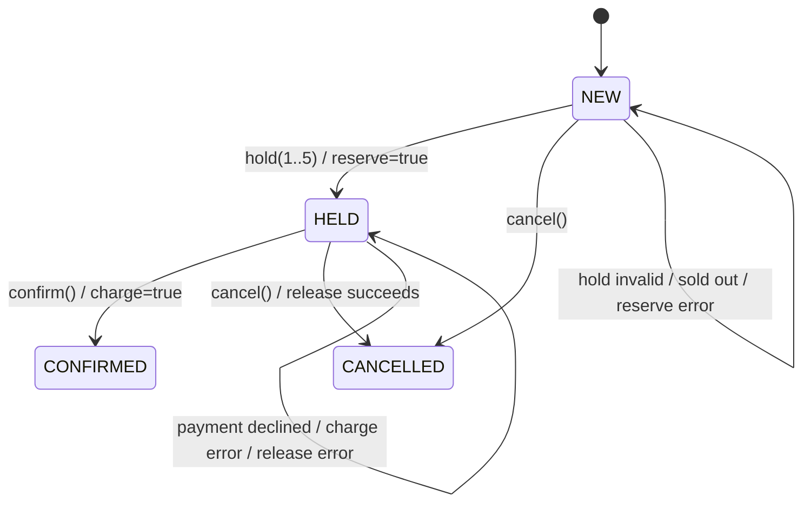

# Kiểm thử biên, trạng thái chuyển tiếp và nhánh xử lý lỗi trong unit test nghiệp vụ

## 1. Mục tiêu: kiểm thử theo quy tắc nghiệp vụ, không chỉ theo phương thức

Unit test nghiệp vụ xác nhận **quy tắc**, **sự chuyển đổi trạng thái** và **phản ứng khi thất bại** của một đối tượng/service. Một method trả về giá trị mong đợi ở tình huống thông thường vẫn có thể sai ở ranh giới, cho phép một chuyển tiếp bất hợp lệ hoặc gây tác dụng phụ khi dependency ném lỗi.

Ba góc nhìn bổ sung cho nhau:

- **Kiểm thử biên (boundary value analysis):** điều kiện nào đúng tại min/max, ngay dưới và ngay trên ngưỡng, kể cả null/trống/sai kiểu nếu tầng nghiệp vụ nhận những dữ liệu đó?
- **Kiểm thử trạng thái chuyển tiếp (state transition testing):** từ trạng thái hiện tại, sự kiện nào hợp lệ, trạng thái tiếp theo là gì; với sự kiện không hợp lệ, đối tượng và phụ thuộc có giữ nguyên không?
- **Kiểm thử nhánh lỗi (error-path/exception-path testing):** input sai, từ chối nghiệp vụ, timeout, lỗi kết nối, lỗi ghi dữ liệu... phải cho ra phản hồi/exception nào và bảo vệ bất biến nào?

Không thể suy ra chất lượng chỉ từ **code coverage 100%**: một dòng đã được chạy có thể chưa được assert đúng; 100% line coverage không nhất thiết bao phủ điều kiện hai nhánh, thứ tự chuyển trạng thái hay tác dụng phụ.

### Ba lớp bằng chứng cho một test tốt

1. **Kết quả trực tiếp:** giá trị trả về hoặc exception thuộc đúng loại, có message/code phù hợp hợp đồng.
2. **Trạng thái sau thao tác:** đối tượng đang ở state đúng, lượng tiền/hàng/đơn không bị thay đổi sai.
3. **Tương tác phụ thuộc:** dependency được gọi đúng số lần/đối số, hoặc **không được gọi** ở nhánh validation và illegal transition.

Ví dụ: với yêu cầu giữ **1 đến 5 ghế**, test `hold(0)` không dừng ở `assertThrows(IllegalArgumentException.class, ...)`; còn phải xác nhận state vẫn `NEW` và không có lời gọi giữ ghế tới hệ thống ngoài.

## 2. Định nghĩa một hợp đồng mẫu trước khi viết test

Xây dựng mô hình **BookingWorkflow** minh họa bằng Java 17, không phụ thuộc Spring context. Đối tượng làm việc với hai boundary: `Inventory` (giữ/trả ghế) và `PaymentGateway` (thu tiền). Trong dự án Spring Boot thật, các boundary này có thể là Spring beans được inject vào service.

### Các trạng thái

| State | Ý nghĩa |
| --- | --- |
| `NEW` | Chưa giữ ghế và chưa thu tiền |
| `HELD` | Giữ ghế đã được dependency xác nhận thành công |
| `CONFIRMED` | Thu tiền đã được xác nhận thành công |
| `CANCELLED` | Đặt chỗ đã hủy |

Sự kiện nghiệp vụ:

- `hold(seats)` chỉ được phép từ `NEW`; `seats` phải là **số nguyên từ 1 đến 5**, tính cả hai đầu.
- `Inventory.reserve(seats)` trả `true`: chuyển `NEW → HELD`, lưu `seats`. Trả `false`: ném `SoldOutException`, giữ `NEW`. Ném exception kỹ thuật: cho lỗi truyền ra, giữ `NEW` trong bộ nhớ.
- `confirm()` chỉ được phép từ `HELD`; gọi `PaymentGateway.charge(seats * 1_000)`. Trả `true`: chuyển `HELD → CONFIRMED`. Trả `false`: ném `PaymentDeclinedException` và giữ `HELD`. Lỗi kỹ thuật: exception truyền ra, giữ `HELD` trong bộ nhớ.
- `cancel()` từ `NEW`: chuyển `NEW → CANCELLED`, không gọi hệ thống ngoài. Từ `HELD`: gọi `Inventory.release(seats)`, nếu bình thường thì `HELD → CANCELLED`, nếu ném lỗi thì giữ `HELD` trong bộ nhớ.
- `cancel()` từ `CONFIRMED` hoặc `CANCELLED`: bị từ chối bằng `IllegalStateException`. Không có refund trong hợp đồng mẫu.
- Mọi sự kiện không được phép ở state hiện tại bị chặn **trước khi gọi dependency**. Với `hold`, kiểm tra state trước rồi mới kiểm tra `seats`; nếu cùng lúc cả state và số ghế đều sai, lỗi state được ưu tiên.

**Đây là hợp đồng giả định phục vụ học tập.** Sản phẩm thật có thể hỗ trợ hủy sau thanh toán bằng refund, hủy lặp mang tính idempotent, trạng thái `PENDING`, hoặc tách phần giữ ghế/thu tiền thành saga. Khi nghiệp vụ khác, **đổi state machine và expected outcome** chứ không sửa test sao cho luôn PASS.

### Sơ đồ chuyển trạng thái



Những vòng tự trở lại `NEW`/`HELD` biểu thị **trạng thái nội bộ không đổi**, không khẳng định hệ thống từ xa đã rollback. Đặc biệt với timeout, remote service có thể đã xử lý yêu cầu dù client báo lỗi.

## 3. Thiết kế kiểm thử biên từ miền dữ liệu

Với biến số nguyên `seats ∈ [1,5]`, trước tiên tạo **lớp tương đương**:

| Lớp dữ liệu | Ví dụ | Hợp đồng |
| --- | --- | --- |
| Nhỏ hơn min | `-1`, `0` | Từ chối |
| Đúng min | `1` | Chấp nhận nếu kho còn ghế |
| Trong khoảng | `3` | Chấp nhận nếu kho còn ghế |
| Đúng max | `5` | Chấp nhận nếu kho còn ghế |
| Lớn hơn max | `6`, `Integer.MAX_VALUE` | Từ chối |
| Cực trị âm | `Integer.MIN_VALUE` | Từ chối |

**Bộ biên tối thiểu** theo ranh giới là `0, 1, 5, 6`. Thêm `3` để đại diện lớp hợp lệ và các cực trị `Integer.MIN_VALUE`/`MAX_VALUE` nếu cần phát hiện overflow hoặc điều kiện so sánh sai. Với số nguyên, `min-1`/`max+1` đủ khi thuộc miền kiểu dữ liệu; ở cận cực trị kiểu số, không thực hiện phép cộng/trừ gây tràn số để tạo test data.

Một lỗi so sánh có thể bắt bằng test biên:

```java
// Sai: loại luôn giá trị min=1 và max=5.
if (seats <= 1 || seats >= 5) {
    throw new IllegalArgumentException();
}

// Đúng với hợp đồng [1, 5].
if (seats < 1 || seats > 5) {
    throw new IllegalArgumentException();
}
```

### Ma trận kiểm thử đầu vào

| ID | Given | When | Then và bất biến |
| --- | --- | --- | --- |
| B01 | `NEW`, kho cho phép giữ ghế | `hold(1)` | `HELD`; `reserve(1)` đúng một lần |
| B02 | `NEW`, kho cho phép giữ ghế | `hold(3)` | `HELD`; `reserve(3)` đúng một lần |
| B03 | `NEW`, kho cho phép giữ ghế | `hold(5)` | `HELD`; `reserve(5)` đúng một lần |
| B04 | `NEW` | `hold(0)` | `IllegalArgumentException`; `NEW`; không gọi kho/payments |
| B05 | `NEW` | `hold(6)` | `IllegalArgumentException`; `NEW`; không gọi kho/payments |
| B06 | `NEW` | `hold(-1)` | `IllegalArgumentException`; không có side effect |
| B07 | `NEW` | `hold(Integer.MIN_VALUE)` | `IllegalArgumentException`; không có side effect |
| B08 | `NEW` | `hold(Integer.MAX_VALUE)` | `IllegalArgumentException`; không có side effect |

**Kiểm tra tất cả phần của Then.** Nếu code gọi kho trước khi validate, test chỉ kiểm tra exception có thể vẫn PASS nhưng đã thực hiện tác dụng phụ không hợp lệ. Với mock, `verifyNoInteractions(inventory, payments)` bắt được lỗi thứ tự này.

### Những biên không nằm ở dữ liệu số

- Chuỗi: `null`, `""`, chuỗi toàn khoảng trắng, đúng độ dài tối thiểu/tối đa, Unicode nhiều code point/UTF-16, khoảng trắng đầu/cuối.
- Ngày/giờ: trước/đúng/sau hạn, đổi ngày, múi giờ, DST, `Instant` vs `LocalDateTime`; cần clock được inject để test xác định.
- Tiền: `BigDecimal`, scale, làm tròn, min/max, âm/zero, currency; không dùng `double` để biểu diễn tiền chính xác.
- Tập hợp: `0, 1, max, max+1` phần tử; duplicate, thứ tự, phần tử `null` nếu hợp đồng cho phép.
- Số lượng retries: `0, 1, maxAttempts, maxAttempts+1` lần gọi (trong đó extra attempt phải bị chặn).

Với input JSON thiếu trường, sai kiểu hoặc vi phạm `@Valid`, trách nhiệm parse/Bean Validation nằm ở tầng MVC/HTTP; unit test cho `BookingWorkflow` không một mình chứng minh HTTP `400`. Nếu cần cả hợp đồng API, bổ sung test `@WebMvcTest`/MockMvc ở tầng phù hợp.

## 4. Kiểm thử state transition: hợp lệ, bất hợp lệ và cả chuỗi sự kiện

Chỉ test các method riêng lẻ chưa đủ. Logic stateful phụ thuộc **lịch sử sự kiện**, vì cùng `confirm()` có thể hợp lệ ở `HELD` nhưng sai ở `NEW` hay `CANCELLED`.

### Transition table theo hợp đồng mẫu

| State trước | Sự kiện | Điều kiện/phụ thuộc | State sau | Lỗi nếu không thỏa |
| --- | --- | --- | --- | --- |
| `NEW` | `hold(n)` | `1≤n≤5`, reserve=true | `HELD` | Không |
| `NEW` | `hold(n)` | `n` ngoài khoảng | `NEW` | `IllegalArgumentException` |
| `NEW` | `hold(n)` | reserve=false | `NEW` | `SoldOutException` |
| `NEW` | `hold(n)` | reserve ném lỗi | `NEW` | Exception kỹ thuật |
| `NEW` | `confirm()` | Không có giữ ghế | `NEW` | `IllegalStateException` |
| `NEW` | `cancel()` | Không cần dependency | `CANCELLED` | Không |
| `HELD` | `confirm()` | charge=true | `CONFIRMED` | Không |
| `HELD` | `confirm()` | charge=false | `HELD` | `PaymentDeclinedException` |
| `HELD` | `confirm()` | charge ném lỗi | `HELD` | Exception kỹ thuật |
| `HELD` | `cancel()` | release thành công | `CANCELLED` | Không |
| `HELD` | `cancel()` | release ném lỗi | `HELD` | Exception kỹ thuật |
| `HELD` | `hold(n)` | Dù `n` hợp lệ hay sai | `HELD` | `IllegalStateException` |
| `CONFIRMED` | `hold(n)`, `confirm()`, `cancel()` | Hợp đồng không hỗ trợ | `CONFIRMED` | `IllegalStateException` |
| `CANCELLED` | `hold(n)`, `confirm()`, `cancel()` | Hợp đồng không hỗ trợ | `CANCELLED` | `IllegalStateException` |

Có thể chia mức độ bao phủ:

- **State coverage:** mỗi trạng thái đã xuất hiện trong ít nhất một test.
- **Transition coverage:** mỗi chuyển tiếp hợp lệ đã được thực hiện ít nhất một lần.
- **Invalid-transition coverage:** các sự kiện bị cấm ở từng trạng thái đã được thử, kiểm tra state không đổi và không có lời gọi phụ thuộc ngoài dự kiến.
- **Transition-pair coverage:** nếu có rule phụ thuộc lịch sử hai sự kiện liên tiếp, thử cặp chuyển tiếp (ví dụ `hold → confirm`, `hold → cancel`, `cancel → cancel`). Không phải mọi hệ thống cần toàn bộ cặp, hãy chọn theo rủi ro.

Với mỗi transition, nên đặt câu hỏi “có **side effect** hay không?”: `hold` giữ ghế, `confirm` thu tiền, `cancel` ở `HELD` trả ghế. Kết quả state đúng nhưng gọi charge **hai lần** vẫn là bug.

### Chuỗi quan trọng cần test

1. `NEW → hold(1) → HELD → confirm() → CONFIRMED`: thành công trọn luồng, đúng số lần reserve/charge.
2. `NEW → hold(5) → HELD → cancel() → CANCELLED`: cancel phải release đúng số ghế; payment không bị gọi.
3. `NEW → cancel() → CANCELLED → hold(1)`: hold sau cancel phải bị từ chối.
4. `NEW → hold(2) → HELD → confirm() (declined) → HELD`: không chuyển sang CONFIRMED khi charge=false.
5. `NEW → hold(2) → HELD → cancel() (release lỗi) → HELD`: không đánh dấu CANCELLED khi thao tác release chưa được xác nhận.
6. `NEW → confirm()`: transition sai ngay từ đầu; không có reserve/charge.
7. `NEW → hold(2) → HELD → confirm() (success) → CONFIRMED → cancel()`: không gọi release vì hủy đơn đã thanh toán ngoài hợp đồng mẫu.
8. `NEW → cancel() → CANCELLED → cancel()`: lần hủy thứ hai bị từ chối theo hợp đồng **không idempotent** của ví dụ.

## 5. Ma trận nhánh lỗi: phân biệt “lỗi input”, “không thể thực hiện” và “lỗi kỹ thuật”

| ID | Nguồn lỗi | Expected exception/response tại service | State sau | Lời gọi cần kiểm tra |
| --- | --- | --- | --- | --- |
| E01 | `hold(0)` trong NEW | `IllegalArgumentException` | NEW | Không reserve/charge |
| E02 | `reserve` trả `false` | `SoldOutException` | NEW | Reserve một lần, không charge |
| E03 | `reserve` ném `RemoteUnavailableException` | Lỗi kỹ thuật được truyền ra | NEW | Reserve một lần, không charge |
| E04 | `confirm()` từ NEW | `IllegalStateException` | NEW | Không gọi hệ thống ngoài |
| E05 | `charge` trả `false` | `PaymentDeclinedException` | HELD | Charge một lần đúng tổng tiền |
| E06 | `charge` ném `RemoteUnavailableException` | Lỗi kỹ thuật được truyền ra | HELD | Charge một lần; không tự retry |
| E07 | `release` ném `RemoteUnavailableException` | Lỗi kỹ thuật được truyền ra | HELD | Release một lần; không đánh dấu đã hủy |
| E08 | `cancel()` từ CONFIRMED | `IllegalStateException` | CONFIRMED | Không release |
| E09 | `hold/confirm/cancel` từ CANCELLED | `IllegalStateException` | CANCELLED | Không reserve/charge/release |
| E10 | `hold(n)` ở HELD | `IllegalStateException` | HELD | Không reserve lần hai |

**Lỗi domain** (hết hàng, thanh toán bị từ chối) là một trạng thái/nhánh nghiệp vụ được dự liệu. **Lỗi kỹ thuật** (timeout, kết nối hỏng, DB error) biểu thị dependency không thể đưa ra phản hồi tin cậy. Hai nhóm có thể cần chính sách retry/alert/HTTP mapping hoàn toàn khác nhau; unit test phải phản ánh contract được chốt.

Để test nhánh lỗi, không chỉ `assertThrows`. Kiểm tra rằng exception đúng loại, state vẫn đúng, và **không có side effect tiếp theo**. Khi dùng exception chứa message, có thể assert message ổn định do chính application quy định; đừng bám vào stack trace hoặc message runtime không thuộc hợp đồng.

### Giới hạn quan trọng của unit test với dependency ngoài

Giả sử `PaymentGateway.charge` ném timeout. Unit test có thể chứng minh **service chưa chuyển sang `CONFIRMED` trong bộ nhớ**, nhưng **không chứng minh ngân hàng chưa trừ tiền**. Remote side effect có thể thành công rồi response bị mất. Tương tự, `reserve`/`release` có thể đã tác động kho từ xa trước khi báo lỗi. Trong production, cần idempotency key, quy trình reconciliation, trạng thái trung gian hoặc compensation theo yêu cầu nghiệp vụ.

Không cho rằng “mock ném exception” tương đương rollback transaction thật. Với hệ thống lưu DB, việc rollback của `@Transactional`, dữ liệu đã commit, retry của Spring proxy và consistency với hệ ngoài cần integration tests riêng.

## 6. Cách chọn assertions và tương tác để test có ý nghĩa

| Hành động | Assert kết quả | Assert state | Assert dependency |
| --- | --- | --- | --- |
| `hold(1)` hợp lệ | Không exception | HELD, seats=1 | `reserve(1)` đúng 1; charge chưa gọi |
| `hold(0)` | `IllegalArgumentException` | NEW, seats=0 | `verifyNoInteractions(...)` |
| Hết hàng | `SoldOutException` | NEW | Reserve 1, không charge |
| `confirm()` thành công | Không exception | CONFIRMED | Charge đúng `seats * 1_000`, đúng 1 |
| Charge từ chối | `PaymentDeclinedException` | HELD | Charge 1, không release |
| `cancel()` từ HELD | Không exception | CANCELLED | Release đúng số ghế, đúng 1 |
| Release lỗi | Technical exception | HELD | Release 1, không chuyển trạng thái |
| Transition bất hợp lệ | `IllegalStateException` | Không đổi | Không gọi thêm bất kỳ dependency nào |

Một số API Mockito hữu ích:

```java
// Đây là đoạn minh họa, cần mock inventory/payment và object workflow.
verify(inventory, times(1)).reserve(2);
verify(payments, never()).charge(anyInt());
verify(inventory, never()).release(anyInt());
verifyNoInteractions(inventory, payments); // Chỉ ở test chưa có lời gọi nào.
```

Đặc biệt, `verifyNoInteractions(inventory, payments)` **không dùng sau khi đã gọi reserve thành công**. Khi muốn kiểm tra không có một lời gọi mới, dùng `verify(..., never()).release(...)` hoặc `verifyNoMoreInteractions(...)` sau khi đã verify các tương tác hợp lệ. Tránh khóa chặt số lời gọi không thuộc contract vì test có thể trở nên giòn khi refactor.

## 7. Bài thực hành Java 17 chạy được: state + biên + lỗi

Bộ ví dụ đầy đủ dưới đây có thể chạy bằng JUnit Jupiter và Mockito, tương thích dự án Spring Boot 3.5 với Java 17. Dùng `spring-boot-starter-test` ở scope `test`; không cần database, web server hoặc `@SpringBootTest` vì đang kiểm tra logic Java thuần.

### 7.1. Cấu trúc dự án

```text
booking-workflow-demo/
├── pom.xml
└── src/
    └── test/
        └── java/
            └── example/
                └── BookingWorkflowTest.java
```

### 7.2. pom.xml hoàn chỉnh

```xml
<?xml version="1.0" encoding="UTF-8"?>
<project xmlns="http://maven.apache.org/POM/4.0.0"
         xmlns:xsi="http://www.w3.org/2001/XMLSchema-instance"
         xsi:schemaLocation="http://maven.apache.org/POM/4.0.0
         https://maven.apache.org/xsd/maven-4.0.0.xsd">
    <modelVersion>4.0.0</modelVersion>
    <parent>
        <groupId>org.springframework.boot</groupId>
        <artifactId>spring-boot-starter-parent</artifactId>
        <version>3.5.0</version>
        <relativePath/>
    </parent>
    <groupId>example</groupId>
    <artifactId>booking-workflow-demo</artifactId>
    <version>1.0-SNAPSHOT</version>
    <properties>
        <java.version>17</java.version>
    </properties>
    <dependencies>
        <dependency>
            <groupId>org.springframework.boot</groupId>
            <artifactId>spring-boot-starter-test</artifactId>
            <scope>test</scope>
        </dependency>
    </dependencies>
</project>
```

Ví dụ gói toàn bộ domain fixture và test trong một test source để người học chỉ cần tạo hai tệp. Trong ứng dụng thực, `BookingWorkflow`, `Inventory` và `PaymentGateway` nên đặt ở `src/main/java` và test tại `src/test/java`. Không lấy việc đặt test fixture bên trong test source làm kiến trúc production.

### 7.3. BookingWorkflowTest.java hoàn chỉnh

```java
package example;

import static org.junit.jupiter.api.Assertions.assertEquals;
import static org.junit.jupiter.api.Assertions.assertThrows;
import static org.mockito.ArgumentMatchers.anyInt;
import static org.mockito.Mockito.doThrow;
import static org.mockito.Mockito.mock;
import static org.mockito.Mockito.never;
import static org.mockito.Mockito.times;
import static org.mockito.Mockito.verify;
import static org.mockito.Mockito.verifyNoInteractions;
import static org.mockito.Mockito.verifyNoMoreInteractions;
import static org.mockito.Mockito.when;

import org.junit.jupiter.api.Test;
import org.junit.jupiter.params.ParameterizedTest;
import org.junit.jupiter.params.provider.ValueSource;

class BookingWorkflowTest {

    enum State { NEW, HELD, CONFIRMED, CANCELLED }

    interface Inventory {
        boolean reserve(int seats);
        void release(int seats);
    }

    interface PaymentGateway {
        boolean charge(int amountCents);
    }

    static class SoldOutException extends RuntimeException {}

    static class PaymentDeclinedException extends RuntimeException {}

    static class RemoteUnavailableException extends RuntimeException {
        RemoteUnavailableException(String message) {
            super(message);
        }
    }

    static final class BookingWorkflow {
        private final Inventory inventory;
        private final PaymentGateway payments;
        private State state = State.NEW;
        private int seats;

        BookingWorkflow(Inventory inventory, PaymentGateway payments) {
            this.inventory = inventory;
            this.payments = payments;
        }

        State state() {
            return state;
        }

        int seats() {
            return seats;
        }

        void hold(int requestedSeats) {
            requireState(State.NEW);

            if (requestedSeats < 1 || requestedSeats > 5) {
                throw new IllegalArgumentException("seats must be 1..5");
            }
            if (!inventory.reserve(requestedSeats)) {
                throw new SoldOutException();
            }

            seats = requestedSeats;
            state = State.HELD;
        }

        void confirm() {
            requireState(State.HELD);
            if (!payments.charge(seats * 1_000)) {
                throw new PaymentDeclinedException();
            }
            state = State.CONFIRMED;
        }

        void cancel() {
            switch (state) {
                case NEW -> state = State.CANCELLED;
                case HELD -> {
                    inventory.release(seats);
                    state = State.CANCELLED;
                }
                case CONFIRMED, CANCELLED ->
                        throw new IllegalStateException(
                                "Cannot cancel from " + state);
            }
        }

        private void requireState(State expected) {
            if (state != expected) {
                throw new IllegalStateException(
                        "Expected " + expected + ", was " + state);
            }
        }
    }

    @ParameterizedTest
    @ValueSource(ints = {Integer.MIN_VALUE, -1, 0, 6, Integer.MAX_VALUE})
    void invalidSeatCountsAreRejectedBeforeReserve(int value) {
        Inventory inventory = mock(Inventory.class);
        PaymentGateway payments = mock(PaymentGateway.class);
        BookingWorkflow booking = new BookingWorkflow(inventory, payments);

        IllegalArgumentException ex = assertThrows(
                IllegalArgumentException.class,
                () -> booking.hold(value));

        assertEquals("seats must be 1..5", ex.getMessage());
        assertEquals(State.NEW, booking.state());
        assertEquals(0, booking.seats());
        verifyNoInteractions(inventory, payments);
    }

    @ParameterizedTest
    @ValueSource(ints = {1, 3, 5})
    void validSeatCountsCanBeHeld(int value) {
        Inventory inventory = mock(Inventory.class);
        PaymentGateway payments = mock(PaymentGateway.class);
        when(inventory.reserve(value)).thenReturn(true);
        BookingWorkflow booking = new BookingWorkflow(inventory, payments);

        booking.hold(value);

        assertEquals(State.HELD, booking.state());
        assertEquals(value, booking.seats());
        verify(inventory, times(1)).reserve(value);
        verifyNoMoreInteractions(inventory);
        verifyNoInteractions(payments);
    }

    @Test
    void soldOutDoesNotMoveFromNew() {
        Inventory inventory = mock(Inventory.class);
        PaymentGateway payments = mock(PaymentGateway.class);
        when(inventory.reserve(2)).thenReturn(false);
        BookingWorkflow booking = new BookingWorkflow(inventory, payments);

        assertThrows(SoldOutException.class, () -> booking.hold(2));

        assertEquals(State.NEW, booking.state());
        assertEquals(0, booking.seats());
        verify(inventory).reserve(2);
        verifyNoInteractions(payments);
    }

    @Test
    void inventoryTechnicalErrorDoesNotMoveFromNew() {
        Inventory inventory = mock(Inventory.class);
        PaymentGateway payments = mock(PaymentGateway.class);
        when(inventory.reserve(2))
                .thenThrow(new RemoteUnavailableException("inventory timeout"));
        BookingWorkflow booking = new BookingWorkflow(inventory, payments);

        RemoteUnavailableException ex = assertThrows(
                RemoteUnavailableException.class, () -> booking.hold(2));

        assertEquals("inventory timeout", ex.getMessage());
        assertEquals(State.NEW, booking.state());
        verify(inventory).reserve(2);
        verifyNoInteractions(payments);
    }

    @Test
    void confirmingNewBookingIsIllegal() {
        Inventory inventory = mock(Inventory.class);
        PaymentGateway payments = mock(PaymentGateway.class);
        BookingWorkflow booking = new BookingWorkflow(inventory, payments);

        assertThrows(IllegalStateException.class, booking::confirm);

        assertEquals(State.NEW, booking.state());
        verifyNoInteractions(inventory, payments);
    }

    @Test
    void holdThenConfirmChangesToConfirmed() {
        Inventory inventory = mock(Inventory.class);
        PaymentGateway payments = mock(PaymentGateway.class);
        when(inventory.reserve(2)).thenReturn(true);
        when(payments.charge(2_000)).thenReturn(true);
        BookingWorkflow booking = new BookingWorkflow(inventory, payments);

        booking.hold(2);
        assertEquals(State.HELD, booking.state());

        booking.confirm();

        assertEquals(State.CONFIRMED, booking.state());
        verify(inventory, times(1)).reserve(2);
        verify(payments, times(1)).charge(2_000);
        verify(inventory, never()).release(anyInt());
    }

    @Test
    void rejectedPaymentKeepsHeldState() {
        Inventory inventory = mock(Inventory.class);
        PaymentGateway payments = mock(PaymentGateway.class);
        when(inventory.reserve(3)).thenReturn(true);
        when(payments.charge(3_000)).thenReturn(false);
        BookingWorkflow booking = new BookingWorkflow(inventory, payments);
        booking.hold(3);

        assertThrows(PaymentDeclinedException.class, booking::confirm);

        assertEquals(State.HELD, booking.state());
        verify(payments, times(1)).charge(3_000);
        verify(inventory, never()).release(anyInt());
    }

    @Test
    void paymentCanSucceedOnSecondExplicitConfirmation() {
        Inventory inventory = mock(Inventory.class);
        PaymentGateway payments = mock(PaymentGateway.class);
        when(inventory.reserve(1)).thenReturn(true);
        when(payments.charge(1_000)).thenReturn(false, true);
        BookingWorkflow booking = new BookingWorkflow(inventory, payments);
        booking.hold(1);

        assertThrows(PaymentDeclinedException.class, booking::confirm);
        assertEquals(State.HELD, booking.state());

        booking.confirm();

        assertEquals(State.CONFIRMED, booking.state());
        verify(payments, times(2)).charge(1_000);
        verify(inventory, times(1)).reserve(1);
    }

    @Test
    void paymentTechnicalErrorKeepsLocalStateHeld() {
        Inventory inventory = mock(Inventory.class);
        PaymentGateway payments = mock(PaymentGateway.class);
        when(inventory.reserve(2)).thenReturn(true);
        when(payments.charge(2_000))
                .thenThrow(new RemoteUnavailableException("payment timeout"));
        BookingWorkflow booking = new BookingWorkflow(inventory, payments);
        booking.hold(2);

        assertThrows(RemoteUnavailableException.class, booking::confirm);

        assertEquals(State.HELD, booking.state());
        verify(payments, times(1)).charge(2_000);
        verify(inventory, never()).release(anyInt());
    }

    @Test
    void newBookingCancelsWithoutExternalCalls() {
        Inventory inventory = mock(Inventory.class);
        PaymentGateway payments = mock(PaymentGateway.class);
        BookingWorkflow booking = new BookingWorkflow(inventory, payments);

        booking.cancel();

        assertEquals(State.CANCELLED, booking.state());
        verifyNoInteractions(inventory, payments);
    }

    @Test
    void heldBookingReleasesTheReservedSeatsOnCancel() {
        Inventory inventory = mock(Inventory.class);
        PaymentGateway payments = mock(PaymentGateway.class);
        when(inventory.reserve(5)).thenReturn(true);
        BookingWorkflow booking = new BookingWorkflow(inventory, payments);
        booking.hold(5);

        booking.cancel();

        assertEquals(State.CANCELLED, booking.state());
        verify(inventory).reserve(5);
        verify(inventory, times(1)).release(5);
        verifyNoInteractions(payments);
    }

    @Test
    void releaseErrorLeavesHeldLocally() {
        Inventory inventory = mock(Inventory.class);
        PaymentGateway payments = mock(PaymentGateway.class);
        when(inventory.reserve(2)).thenReturn(true);
        doThrow(new RemoteUnavailableException("release timeout"))
                .when(inventory).release(2);
        BookingWorkflow booking = new BookingWorkflow(inventory, payments);
        booking.hold(2);

        assertThrows(RemoteUnavailableException.class, booking::cancel);

        assertEquals(State.HELD, booking.state());
        verify(inventory).reserve(2);
        verify(inventory, times(1)).release(2);
        verifyNoInteractions(payments);
    }

    @Test
    void confirmedBookingCannotBeCancelled() {
        Inventory inventory = mock(Inventory.class);
        PaymentGateway payments = mock(PaymentGateway.class);
        when(inventory.reserve(1)).thenReturn(true);
        when(payments.charge(1_000)).thenReturn(true);
        BookingWorkflow booking = new BookingWorkflow(inventory, payments);
        booking.hold(1);
        booking.confirm();

        assertThrows(IllegalStateException.class, booking::cancel);

        assertEquals(State.CONFIRMED, booking.state());
        verify(inventory, never()).release(anyInt());
        verify(payments, times(1)).charge(1_000);
    }

    @Test
    void cancellingTwiceIsIllegalInThisContract() {
        Inventory inventory = mock(Inventory.class);
        PaymentGateway payments = mock(PaymentGateway.class);
        BookingWorkflow booking = new BookingWorkflow(inventory, payments);
        booking.cancel();

        assertThrows(IllegalStateException.class, booking::cancel);

        assertEquals(State.CANCELLED, booking.state());
        verifyNoInteractions(inventory, payments);
    }

    @Test
    void holdAfterCancelIsRejectedBeforeReserve() {
        Inventory inventory = mock(Inventory.class);
        PaymentGateway payments = mock(PaymentGateway.class);
        BookingWorkflow booking = new BookingWorkflow(inventory, payments);
        booking.cancel();

        assertThrows(IllegalStateException.class, () -> booking.hold(1));

        assertEquals(State.CANCELLED, booking.state());
        verifyNoInteractions(inventory, payments);
    }

    @Test
    void confirmAfterCancelIsRejectedBeforeCharge() {
        Inventory inventory = mock(Inventory.class);
        PaymentGateway payments = mock(PaymentGateway.class);
        BookingWorkflow booking = new BookingWorkflow(inventory, payments);
        booking.cancel();

        assertThrows(IllegalStateException.class, booking::confirm);

        assertEquals(State.CANCELLED, booking.state());
        verifyNoInteractions(inventory, payments);
    }
}
```

### 7.4. Lệnh chạy và kết quả mong đợi

Từ thư mục chứa `pom.xml`, chạy:

```bash
mvn test -Dtest=BookingWorkflowTest
```

Hoặc dùng Maven Wrapper nếu dự án có: `./mvnw test -Dtest=BookingWorkflowTest` trên Linux/macOS; `mvnw.cmd test -Dtest=BookingWorkflowTest` trong Windows CMD.

**Kết quả kỳ vọng:** mọi test case đều PASS, không cần database hay môi trường Spring context; class không in `System.out.println` nên không có stdout chương trình cố định. JUnit chạy **16 test methods** (2 method parameterized tạo 5 + 3 invocation, cùng 14 method `@Test` tạo **22 test invocations**); số đếm báo cáo cụ thể có thể phụ thuộc runner. Nếu test nào FAIL, mở báo cáo Surefire trong `target/surefire-reports` để xem assertion hoặc verify nào sai.

**Giới hạn của demo:** data/state nằm trong bộ nhớ, không có persistence, transaction, HTTP hoặc message broker. Không thể dùng test này để kết luận rollback DB, locking hoặc remote idempotency đúng. State machine thực tế cần thiết kế cách xử lý timeout không rõ kết quả; bài chỉ mô tả phép kiểm thử ở cấp unit.

### 7.5. Test nào chứng minh điều gì?

| Tên test | Kịch bản / coverage | Kết quả & side effect |
| --- | --- | --- |
| `invalidSeatCountsAreRejectedBeforeReserve` | Min-1/max+1, âm/cực trị | Exception input; NEW; không tương tác |
| `validSeatCountsCanBeHeld` | Min/mid/max hợp lệ | HELD; reserve đúng input |
| `soldOutDoesNotMoveFromNew` | Nhánh từ chối nghiệp vụ | SoldOut; NEW; chưa charge |
| `inventoryTechnicalErrorDoesNotMoveFromNew` | Nhánh lỗi kỹ thuật giữ ghế | RemoteUnavailable; NEW |
| `confirmingNewBookingIsIllegal` | Illegal transition NEW→confirm | Exception; không side effect |
| `holdThenConfirmChangesToConfirmed` | NEW→HELD→CONFIRMED | Charge 1 lần đúng tổng tiền |
| `rejectedPaymentKeepsHeldState` | HELD và charge=false | Declined; state HELD |
| `paymentCanSucceedOnSecondExplicitConfirmation` | Chuỗi declined→success | 2 charges (được gọi rõ ràng), CONFIRMED |
| `paymentTechnicalErrorKeepsLocalStateHeld` | Lỗi kỹ thuật thanh toán | HELD trong bộ nhớ, không release |
| `newBookingCancelsWithoutExternalCalls` | NEW→CANCELLED | Không tương tác |
| `heldBookingReleasesTheReservedSeatsOnCancel` | HELD→CANCELLED | Release đúng số ghế |
| `releaseErrorLeavesHeldLocally` | Nhánh lỗi release | HELD trong bộ nhớ |
| `confirmedBookingCannotBeCancelled` | Cấm hủy sau CONFIRMED | State không đổi, không release |
| `cancellingTwiceIsIllegalInThisContract` | Cấm transition lặp | CANCELLED, không tương tác |
| `holdAfterCancelIsRejectedBeforeReserve` | Không giữ ghế sau CANCELLED | Exception, không reserve |
| `confirmAfterCancelIsRejectedBeforeCharge` | Không thu tiền sau CANCELLED | Exception, không charge |

Một số transition như gọi `hold` lần hai khi `HELD` hoặc `confirm` lần nữa khi `CONFIRMED` chưa có method test riêng trong fixture; đó là bài tập mở rộng trực tiếp từ transition table. Khi sản phẩm thật yêu cầu full invalid-transition coverage, bổ sung các case còn thiếu trước khi coi matrix hoàn tất.

## 8. Cách mở rộng coverage theo độ phức tạp thực tế

### 8.1. Branch coverage khác condition coverage

```java
if (isVip && amount >= threshold) {
    applyDiscount();
}
```

Hai bài test “VIP đủ ngưỡng” và “không VIP, dưới ngưỡng” có thể chạy cả nhánh `true`/`false`, nhưng chưa chứng minh từng điều kiện riêng rẽ ảnh hưởng quyết định thế nào. Cân nhắc:

| isVip | amount≥threshold | Nhánh mong đợi |
| --- | --- | --- |
| true | true | Áp dụng |
| true | false | Không áp dụng |
| false | true | Không áp dụng |
| false | false | Không áp dụng |

Với logic rất nhạy cảm, có thể dùng **MC/DC** để chứng minh mỗi điều kiện có ảnh hưởng độc lập lên quyết định, hoặc dùng decision table cho nhiều quy tắc kết hợp. Trong hệ thống thông thường, ưu tiên các tổ hợp nghiệp vụ rủi ro cao và bộ biên trước khi tăng số test không kiểm soát.

### 8.2. Property-based test giúp mở rộng dữ liệu biên

Với một bất biến như “giá trị ngoài `[1,5]` phải bị từ chối trước khi gọi kho”, thay vì chỉ vài input cố định có thể sinh nhiều giá trị âm/lớn để tìm bug. Công cụ property-based như jqwik có thể bổ sung, nhưng **không có sẵn chỉ nhờ Spring Boot starter test** nếu dự án chưa khai báo nó. Khi dùng generator, giữ seed tái lập được và lưu phản ví dụ nhỏ nhất để debug.

Một invariant mạnh hơn test case đơn lẻ là: “Không được vào state `CONFIRMED` nếu chưa có lần charge thành công”. Unit test có thể sinh chuỗi events hợp lệ và bất hợp lệ rồi so kết quả với state machine tham chiếu. Tuy nhiên model tham chiếu phải độc lập và đủ đơn giản; nếu sao chép nguyên production logic vào model, cùng bug có thể lặp ở cả hai phía.

### 8.3. Mutation testing phát hiện assertions yếu

Line coverage có thể cao dù mã sai. Mutation testing thay các toán tử (`<` thành `<=`, `true` thành `false`, bỏ lời gọi...) và xem test có FAIL đúng không. Ví dụ đổi `requestedSeats > 5` thành `>= 5` phải bị test `hold(5)` bắt. Nếu đổi `state = CONFIRMED` thành không gán gì, test transition phải bắt. Các công cụ như PIT có thể dùng cho Java, nhưng không mặc định được cài bởi starter test; cần cấu hình riêng.

**Không cố chạy mutation test bằng mọi giá cho tất cả modules**; ưu tiên các phần logic nhiều trạng thái, tiền bạc, phân quyền, điều kiện ngưỡng hoặc nhánh lỗi khó phát hiện.

### 8.4. Khi có dữ liệu thời gian, trạng thái bất biến và concurrency

- Dùng `Clock` inject thay vì gọi `LocalDateTime.now()` trực tiếp trong logic cần test; tạo `Clock.fixed(...)` trong unit test để thử ngay trước/tại/sau thời hạn.
- Dùng immutable value object hoặc copy state khi phù hợp; không để test sửa trực tiếp private field chỉ để tạo state không thể đạt bằng API thực.
- Test concurrent modification/race conditions cần runner nhiều luồng, synchronization hoặc test integration theo mục tiêu; unit test một luồng không chứng minh tính thread-safe.
- Với các event bất đồng bộ, chốt eventual consistency, timeout budget và retry policy; không dùng `Thread.sleep` dài như một assertion về state.
- Với persistence, kiểm thử optimistic locking, uniqueness, duplicate requests, rollback/compensation ở tầng integration hơn là chỉ mock repository.

## 9. Mẫu viết test theo Arrange–Act–Assert

Áp dụng cấu trúc có thể đọc bằng mắt:

```java
@Test
void invalidSeatCountDoesNotCallInventory() {
    Inventory inventory = mock(Inventory.class);
    PaymentGateway payments = mock(PaymentGateway.class);
    BookingWorkflow booking = new BookingWorkflow(inventory, payments);

    // Act + Assert: exception thuộc hợp đồng.
    assertThrows(IllegalArgumentException.class, () -> booking.hold(0));

    // Assert: state và side effects.
    assertEquals(State.NEW, booking.state());
    verifyNoInteractions(inventory, payments);
}
```

Đây là **trích đoạn** dùng các kiểu được định nghĩa trong class fixture ở phần 7. Test độc lập hoàn chỉnh tương ứng đã có tên `invalidSeatCountsAreRejectedBeforeReserve`; không copy đoạn này vào dự án khi chưa có các type và import.

Những quyết định thực tế:

1. **Một test chỉ nên có một lý do FAIL chính**: tên test và Given/When/Then khớp. Có thể assert nhiều khía cạnh của cùng một hành vi.
2. **Mỗi test dựng fixture mới** hoặc dùng `@BeforeEach` tạo instance sạch; test không được phụ thuộc thứ tự chạy.
3. **Không stub thừa.** Khi kiểm tra validation không cho gọi kho, đừng cấu hình `when(inventory.reserve(...))`; điều đó có thể che logic và gây cảnh báo “unnecessary stubbing”.
4. **Biến đầu vào duy nhất một yếu tố** khi kiểm tra biên; với quy tắc tương tác phức tạp thì dùng decision table / pairwise có chủ đích.
5. **Gọi dependency qua interface** và inject từ constructor giúp mock đúng boundary, tránh mock private method hoặc static global state khó kiểm soát.
6. **Assert trạng thái trước và sau** những event nhiều bước, nhất là các nhánh lỗi. Kết quả method không đủ để kết luận hệ thống vẫn nhất quán.
7. **Không over-verify.** Chỉ kiểm tra số lần gọi/thứ tự thuộc hợp đồng, không khóa chặt những internal method có thể refactor hợp lệ.

## 10. Phân biệt unit test nghiệp vụ với kiểm thử biên API và hạ tầng

| Rủi ro | Unit test nghiệp vụ phù hợp? | Test bổ sung nên có |
| --- | --- | --- |
| Sai công thức/giới hạn `[1,5]` | Có | MVC test nếu còn Bean Validation/JSON |
| Sai trạng thái sau chuỗi events | Có | Integration nếu state được lưu DB |
| Không chặn invalid transition | Có | API test nếu cần mapping HTTP |
| Reserve/charge bị gọi quá nhiều | Có (verify) | Contract/integration cho idempotency thực |
| Gateway ném exception, local state thay đổi sai | Có | Client adapter test cho timeout/upstream 5xx |
| DB transaction rollback sau lỗi | Không đủ nếu DB bị mock | `@SpringBootTest`/Testcontainers/transaction integration |
| Hai request cùng lúc giữ một ghế | Không đủ nếu single-thread | Integration/concurrency test |
| JSON `quantity=null`, sai kiểu, field thiếu | Không thuộc method `hold(int)` | `@WebMvcTest` + `MockMvc`, validation tests |
| HTTP status mapping `400/409/503` | Không do unit service tự định nghĩa | Controller/exception-handler tests |
| Phát message đúng topic, retry và dead-letter | Chỉ xác minh gọi publisher mock | Broker integration tests |

Spring Boot có `spring-boot-starter-test` cho JUnit Jupiter/Mockito và bộ công cụ nền. Trong unit test pure Java, **không cần `@SpringBootTest`**, vì tạo cả Spring context làm test chậm và khiến nguyên nhân lỗi khó tách. Với test Spring beans, có thể dùng `@SpringBootTest`, test slice (ví dụ `@WebMvcTest`/`@DataJpaTest`) và `@MockitoBean` phù hợp phiên bản Spring Framework/Spring Boot. Khi Boot 4 tách các starter test theo công nghệ, bổ sung starter tương ứng nếu test cần; tư duy phân chia tầng vẫn giữ nguyên.

## 11. Các lỗi thiết kế test thường gặp

| Sai sót | Tại sao nguy hiểm | Cách sửa |
| --- | --- | --- |
| Chỉ test `hold(3)` | Lỗi off-by-one ở `1` và `5` lọt qua | Thêm `0,1,5,6` và extreme có giá trị |
| Chỉ assert `assertThrows` | State hoặc side effect sai vẫn có thể PASS | Assert state + `verifyNoInteractions`/`verify(...)` |
| Không thử transition bị cấm | Có thể charge trước khi giữ ghế, hủy hai lần | Lập transition table cho mỗi state/event |
| Để mọi exception là `RuntimeException` và chỉ test một trường hợp | Không phân biệt nghiệp vụ vs kỹ thuật | Dùng exception types theo hợp đồng; test từng nhánh |
| Xem timeout là chắc chắn remote chưa xử lý | Có thể double-charge/reserve khi retry | Idempotency, reconciliation và integration test |
| Dùng mock tự trả `false` nhưng không stub rõ ràng | Test có thể PASS chỉ do default Mockito | Stub đúng behavior khi nó là Given của test |
| Khi lỗi release vẫn đánh dấu CANCELLED | Local state nói đã hủy dù chưa có xác nhận | Chỉ chuyển state sau phản hồi thành công |
| Dùng `@SpringBootTest` cho phép cộng số đơn giản | Tăng thời gian, phụ thuộc cấu hình hạ tầng | Pure JUnit test với Mockito boundary |
| Bỏ kiểm tra trạng thái sau exception | Bug “partial update” không bị bắt | Assert nguyên trạng/rollback thuộc phạm vi unit |
| Gộp một test dài cho tất cả chuỗi sự kiện | Khó xác định bước sai | Chia test theo transitions quan trọng, đặt tên rõ |
| Test dùng chung object state giữa nhiều method | Kết quả phụ thuộc thứ tự chạy | Fixture mới cho mỗi test, không static mutable |
| Test đòi hỏi mọi nội bộ được gọi theo một thứ tự cố định | Dễ fail do refactor hợp lệ | Assert thứ tự chỉ khi nó là business invariant |
| Code coverage cao nên bỏ state matrix | Có thể chưa thử illegal transition | Đối chiếu transition table + branch tests |
| Mock DB để khẳng định transaction rollback | Mock không có transactional behavior | Integration test với DB thích hợp |

## 12. Checklist thiết kế và nghiệm thu

Đối với mỗi yêu cầu nghiệp vụ, xác nhận:

- [ ] Đã chốt input domain, min/max và các lớp tương đương, bao gồm rỗng/null nếu hợp đồng có?
- [ ] Có test ngay dưới/tại/ngay trên mỗi biên quan trọng?
- [ ] Có state machine/transition table rõ ràng, kể cả sự kiện bị cấm?
- [ ] Tất cả chuyển tiếp hợp lệ và các illegal transition rủi ro cao đã được bao phủ?
- [ ] Từng lỗi input, từ chối nghiệp vụ và lỗi kỹ thuật được phân biệt?
- [ ] Exception đúng loại, state sau lỗi đúng, không có side effect thừa?
- [ ] Những external call có side effect được verify đúng đối số và số lần?
- [ ] Có chú ý thứ tự validate trước khi gọi dependency và thứ tự update state sau success?
- [ ] Test độc lập, dữ liệu xác định, không dựa vào wall clock/network/DB thật khi không cần?
- [ ] Nếu retry sau timeout, đã có hợp đồng idempotency và test integration xác minh?
- [ ] Đã kiểm tra các nhánh điều kiện phức tạp bằng decision table hoặc coverage phù hợp?
- [ ] Line/branch coverage được xem như tín hiệu, không thay thế assertion về nghiệp vụ?
- [ ] Các test MVC, DB, concurrency bổ sung phần unit test không thể chứng minh?
- [ ] Maven/Gradle thực sự chạy test; báo cáo không bị lọc hoặc bỏ qua ngoài ý muốn?

### Mẫu ma trận để áp dụng cho nghiệp vụ khác

| Test ID | Requirement | State trước | Input/event | Dependency outcome | Expected state/exception | Side-effect assertion |
| --- | --- | --- | --- | --- | --- | --- |
| TC-001 | Biên hợp lệ | NEW | min | success | HELD | Call đúng min một lần |
| TC-002 | Ngay dưới min | NEW | min−1 | Không được gọi | IllegalArgumentException; NEW | Không tương tác |
| TC-003 | Ngay trên max | NEW | max+1 | Không được gọi | IllegalArgumentException; NEW | Không tương tác |
| TC-004 | Transition hợp lệ | HELD | confirm | success | CONFIRMED | Charge đúng một lần |
| TC-005 | Transition sai | NEW | confirm | Không được gọi | IllegalStateException; NEW | Không charge |
| TC-006 | Từ chối nghiệp vụ | HELD | confirm | decline | PaymentDeclinedException; HELD | Charge một lần |
| TC-007 | Hạ tầng lỗi | HELD | cancel | timeout | RemoteUnavailableException; HELD cục bộ | Release một lần, cần kiểm tra remote state riêng |

Điều chỉnh các state và exception đúng domain thật; không mặc định trạng thái sau timeout phản ánh trạng thái từ xa.

## 13. Tài liệu tham khảo chính thức

1. [JUnit User Guide — Parameterized Tests](https://docs.junit.org/5.13.1/user-guide/index.html#writing-tests-parameterized-tests): `@ParameterizedTest`, `@ValueSource`, `@CsvSource` và nguồn dữ liệu test.
2. [JUnit User Guide — Assertions](https://docs.junit.org/5.13.1/user-guide/index.html#writing-tests-assertions): `assertEquals`, `assertThrows` và các kiểm tra kết quả.
3. [Mockito API](https://javadoc.io/doc/org.mockito/mockito-core/latest/org.mockito/org/mockito/Mockito.html): `when`, `verify`, `verifyNoInteractions`, `times` và mô phỏng exceptions.
4. [Spring Boot 3.5 — Testing](https://docs.spring.io/spring-boot/3.5/reference/testing/index.html) và [Testing Spring Boot Applications](https://docs.spring.io/spring-boot/3.5/reference/testing/spring-boot-applications.html): test starter, context và test slices.
5. [Spring Boot Reference — Testing](https://docs.spring.io/spring-boot/reference/testing/): đối chiếu các module theo công nghệ nếu dự án dùng Spring Boot 4.x.

**Nguyên tắc ghi nhớ:** test biên trả lời “ngưỡng có đúng không”; test chuyển trạng thái trả lời “đi tiếp có hợp lệ không”; test nhánh lỗi trả lời “khi thất bại, hệ thống còn giữ đúng bất biến không”. Một unit test nghiệp vụ đáng tin cần xác nhận cả **kết quả, trạng thái và tương tác phụ thuộc**.
