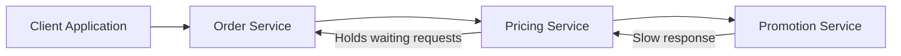

# Remote Dependencies, Partial Failures, and Cascading Failures

In a distributed system, a request often traverses multiple services before returning a result to the user. For example, an order service calls an inventory service to check stock quantities, calls a payment service to create a transaction, and calls a shipping service to calculate fees. Every network call can become slow, lose connectivity, or return an error. One service can still remain operational while a dependent service has degraded; that is a **partial failure**.

The problem becomes severe when services keep waiting on one another. Queues and connection pools gradually fill up, processing threads are held, response times climb, and healthy services start failing as well. This propagation phenomenon is known as a **cascading failure**. A circuit breaker in Spring Cloud, commonly implemented with Resilience4j, helps detect a failing or overly slow dependency, temporarily stop calling that dependency, and give the system a chance to recover.

## 1. Why Are Remote Service Calls Prone to Failure?

A call from one service to another is different from an in-process function call. It depends on the network, DNS, TLS, load balancers, target hosts, connection limits, and the processing capacity of both sides. Even when source code does not change, latency and error rates can still fluctuate with load or infrastructure incidents.

Common types of failures include:

- **Connection errors:** DNS resolution failures, inability to establish TCP/TLS connections, closed connections, or unreachable target hosts.
- **Timeouts:** the target service receives the request but takes too long to process; the caller must wait until it times out.
- **Server-side errors:** the target service returns HTTP 5xx, throws an exception, or restarts mid-processing.
- **Overload:** request volume exceeds processing capacity, causing queues to grow and thread and connection pools to deplete.
- **Data or business errors:** invalid responses, missing data, or rejected requests. These cases need to be classified separately because not every error should trip the circuit breaker.

A service might fail on only a subset of requests. For example, a profile service still returns user information normally, but every request to fetch profile avatars from a storage service times out. This is a partial failure: the entire system has not gone down, yet one functional branch has degraded.

A timeout also does not guarantee that the operation on the target service has stopped. The server may still be processing the request after the caller has given up. Therefore, if a payment creation or order creation request is automatically resent, the system risks executing the operation twice. For operations with side effects, design for idempotency or use idempotency keys before enabling retries.

## 2. How Do Partial Failures Turn into Cascading Failures?

Suppose a processing flow has three services: an order API calls a pricing service, which then calls a promotion service.



When the promotion service experiences increased latency, the pricing service has to hold onto waiting requests. Those processing threads and connections cannot serve new requests yet. The order service also has to wait on the pricing service, causing the number of in-flight requests to rise across both layers.

The process typically unfolds in the following sequence:

1. Service C responds slowly or stops responding.
2. Service B holds threads, connections, and memory while waiting on C.
3. New requests keep arriving at B; queues and connection pools approach their limits.
4. Service A waits on B, so A's processing resources become occupied as well.
5. Users resend requests or upstream layers automatically retry, adding even more traffic to B and C.
6. B or A starts timing out even though they have no internal faults of their own. C's outage has propagated to dependent services.

You can visualize resource pressure using the approximate relationship between in-flight requests, throughput, and processing time: L = λ × W. At the same throughput of 100 requests per second, an average wait time of 0.2 seconds corresponds to roughly 20 in-flight requests; if the wait time jumps to 5 seconds, that number rises to around 500. This is an illustrative example, yet it shows how rising latency can drive up resource demand very quickly even when incoming traffic stays constant.

Unbounded retries can make matters worse. If every layer retries three times, a single initial request can generate many calls at the downstream layer. When the target service is already overloaded, retry traffic keeps adding more load. Thus, the system needs limits on wait times, retry attempts, and concurrent calls, along with a mechanism to cut off calls to a degraded dependency.

## 3. Mechanisms for Containing Failure Propagation

A circuit breaker is one component of a resilience strategy. It works more effectively when combined with appropriate resource and time limits.

| Mechanism | Role | Key Considerations |
|---|---|---|
| Timeout | Limits how long a single call is allowed to wait | Set timeouts on the HTTP client and account for the overall request deadline |
| Retry | Retries transient errors that can self-recover | Cap attempt counts, use backoff and jitter; avoid retrying non-idempotent operations |
| Circuit breaker | Fails fast on a failing or overly slow dependency | Use sufficiently representative statistics and configure thresholds suited to traffic |
| Bulkhead | Limits resources allocated to a dependency | Prevent one service from exhausting all threads or concurrent call capacity |
| Fallback | Provides a degraded result when a dependency is unavailable | Return substitute data only when business rules allow; do not mask critical data errors |

**Timeout** caps the wait time of each individual call. Timeouts at the HTTP client layer still must be configured because a circuit breaker does not replace connection and read timeout settings. If the system has an overall deadline, a dependent call's timeout must fit within that budget so remaining steps still have time to finish.

**Retry** suits transient failures such as certain connection errors or 503 responses. Cap the number of attempts, use exponential backoff with jitter, and avoid retrying business errors that cannot resolve themselves. Avoid having multiple independent layers retry without a shared budget.

**Bulkhead** isolates resources. For example, if the promotion service is only allowed up to 20 concurrent calls, an incident in that service cannot consume all resources meant for other dependencies. A bulkhead limits the blast radius, whereas a circuit breaker decides when to temporarily stop calling the dependency.

**Fallback** is a way to serve in degraded mode. A product page can display basic cached information when the recommendation service is unavailable. Conversely, the system should not return a zero balance or confirm a successful payment when mandatory data could not be verified. A fallback must clearly express unavailable or stale data so the calling layer can handle it properly.

## 4. The Three States of a Circuit Breaker

A circuit breaker tracks the outcomes of calls to a dependency and transitions states based on the failure rate or slow call rate. Resilience4j provides three primary operational states:

| State | Behavior | Transition Condition |
|---|---|---|
| `CLOSED` | Allows calls to reach the target service and records outcomes | When enough samples exist and the failure rate or slow call rate exceeds the threshold, transitions to `OPEN` |
| `OPEN` | Fails fast on new calls, typically throwing `CallNotPermittedException` | After the configured wait duration, transitions to `HALF_OPEN` |
| `HALF_OPEN` | Allows only a small number of probe calls | If probe samples meet requirements, returns to `CLOSED`; if failures or slow calls still exceed thresholds, returns to `OPEN` |

In the `CLOSED` state, the circuit breaker allows the application to call the dependency as usual. It records successes, failures, and response times in a sliding window. When statistics indicate the dependency has a problem, the breaker opens the circuit.

In the `OPEN` state, calls are blocked immediately on the application side. This avoids continuing to spend wait time, threads, and connections on an unresponsive dependency. The application can switch to a fallback if one is defined and if the error case permits it.

After `waitDurationInOpenState`, the breaker transitions to `HALF_OPEN`. This state allows a limited number of probe calls to check the target service. If the probe calls show the service has recovered, the breaker closes. If the failure rate or slow call rate still exceeds thresholds, the breaker reopens and waits again.

Depending on configuration, the transition from `OPEN` to `HALF_OPEN` can happen automatically when the wait duration expires or when the next call arrives to check state. `HALF_OPEN` should not be mistaken for allowing all traffic back; the number of probe calls is always bounded.

## 5. Sliding Windows and Choosing Thresholds

A circuit breaker needs a recent sample set to evaluate a dependency's health. Resilience4j supports two sliding window types:

- **`COUNT_BASED`:** the window holds the most recent N calls, such as 20 calls. When a new call arrives, the oldest sample leaves the window.
- **`TIME_BASED`:** the window covers a time interval, such as 10 seconds, and statistics are aggregated into time buckets.

`minimumNumberOfCalls` specifies the minimum number of samples required before calculating rates to decide whether to open the circuit. This setting prevents tripping the circuit just because the first few calls in an underpopulated window fail. Conversely, if traffic is low and the minimum sample count is too high, the breaker may take a long time to assess dependency health.

For example, consider a count-based window of 20 calls, requiring a minimum of 10 samples and a 50% failure rate threshold. Once there are at least 10 samples, if the failure rate in the window reaches or exceeds 50%, the breaker can transition to `OPEN`. If only 3 calls have occurred and all 3 failed, the breaker does not yet have enough samples to apply this threshold.

In addition to errors, Resilience4j can monitor **slow calls**. A call is considered slow when its execution duration exceeds `slowCallDurationThreshold`. If the slow call rate reaches `slowCallRateThreshold`, the breaker can also open the circuit even if many calls still return successfully. This is crucial when a dependency has not stopped working completely, yet its latency already threatens the resources of calling layers.

Parameters that usually need consideration include:

- `slidingWindowType` and `slidingWindowSize`: choose a window type and size suited to traffic.
- `minimumNumberOfCalls`: avoid drawing conclusions from too few samples.
- `failureRateThreshold`: allowable failure percentage before opening the circuit.
- `slowCallDurationThreshold` and `slowCallRateThreshold`: define what counts as a slow call and the acceptable slow-call percentage.
- `waitDurationInOpenState`: rest period before attempting recovery.
- `permittedNumberOfCallsInHalfOpenState`: cap on probe calls.

No single set of thresholds fits every service. A cache lookup service might accept short timeouts and quick recovery; a payment service might need stricter error rules, fallbacks, and more cautious probing durations. Choose values based on real traffic, latency goals, data criticality, and the dependency's recovery behavior.

## 6. Integrating Circuit Breaker with Spring Cloud and Resilience4j

Spring Cloud CircuitBreaker provides an abstraction layer so applications can use a circuit breaker without tightly coupling business code to a specific library. Resilience4j is a popular implementation. The Spring Cloud version should be managed using a Spring Cloud BOM compatible with the project's Spring Boot version.

With Gradle, add the corresponding Resilience4j starter:

```kotlin
dependencies {
    implementation("org.springframework.cloud:spring-cloud-starter-circuitbreaker-resilience4j")
}
```

The example below uses `CircuitBreakerFactory` to protect a synchronous call to an inventory service. The snippet uses `RestClient` from Spring Framework 6.1 and later (typically paired with Spring Boot 3.2 and later); on older versions, use whatever HTTP client the project supports. The name `inventory` links the call in code with the configuration of the breaker of the same name.

```java
import org.springframework.cloud.client.circuitbreaker.CircuitBreakerFactory;
import org.springframework.stereotype.Service;
import org.springframework.web.client.RestClient;

@Service
public class InventoryGateway {
    private final RestClient restClient;
    private final CircuitBreakerFactory<?, ?> circuitBreakerFactory;

    public InventoryGateway(
            RestClient.Builder builder,
            CircuitBreakerFactory<?, ?> circuitBreakerFactory) {
        this.restClient = builder
                .baseUrl("http://inventory-service")
                .build();
        this.circuitBreakerFactory = circuitBreakerFactory;
    }

    public InventoryView find(String sku) {
        return circuitBreakerFactory.create("inventory").run(
                () -> restClient.get()
                        .uri("/inventory/{sku}", sku)
                        .retrieve()
                        .body(InventoryView.class),
                error -> InventoryView.unavailable(sku)
        );
    }
}
```

`run` takes a function executing the call and a fallback function receiving the error cause. When the breaker is `OPEN`, calls to the inventory service are rejected fast and the fallback can supply an unavailable state. When the breaker is `CLOSED` or allowing probes in `HALF_OPEN`, the call-executing function runs according to the breaker's rules.

The fallback in the example is illustrative only. The `InventoryView` type should clearly represent an unknown state or stale data; do not turn a connection error into a conclusion that stock is 0. In a real application, classify exceptions so business errors like a non-existent SKU are not treated the same as infrastructure outages.

You can configure the instance using `application.yml`:

```yaml
resilience4j:
  circuitbreaker:
    instances:
      inventory:
        registerHealthIndicator: true
        slidingWindowType: COUNT_BASED
        slidingWindowSize: 20
        minimumNumberOfCalls: 10
        failureRateThreshold: 50
        slowCallDurationThreshold: 2s
        slowCallRateThreshold: 60
        waitDurationInOpenState: 10s
        permittedNumberOfCallsInHalfOpenState: 3
        automaticTransitionFromOpenToHalfOpenEnabled: true
```

The numbers above are only a starting point to illustrate how configuration works. They should be tuned to the service's characteristics and validated under realistic load. You can add `recordExceptions` to specify exceptions counted as failures and `ignoreExceptions` for exceptions that should not be included in statistics. For example, connection errors and server errors are usually worth recording; some 4xx errors caused by input or business rules may need to be ignored. HTTP 429 in particular should be classified according to the service contract since it can indicate rate limiting.

A circuit breaker does not replace HTTP client timeouts. Configure connection timeouts and read/response timeouts on `RestClient` or the underlying HTTP client to match the request deadline. Resilience4j also provides `TimeLimiter` for asynchronous flows or futures; task cancellation capability depends on the executor and HTTP client in use. Do not assume that cancelling a future always stops a blocking I/O operation.

A bulkhead can be configured separately to cap the number of concurrent calls:

```yaml
resilience4j:
  bulkhead:
    instances:
      inventory:
        maxConcurrentCalls: 20
        maxWaitDuration: 0
```

In this configuration, calls exceeding the concurrency limit are rejected rather than waiting indefinitely. Circuit breaker, timeout, and bulkhead address three distinct concerns: dependency failure health, wait duration, and allowed resource consumption.

## 7. Protecting Reactive Calls

For applications using `WebClient` and Reactor, use Spring Cloud CircuitBreaker's reactive API to keep the asynchronous stream intact. Do not call `block()` just to wrap a reactive call inside a synchronous API.

```java
import org.springframework.cloud.client.circuitbreaker.ReactiveCircuitBreakerFactory;
import org.springframework.stereotype.Service;
import org.springframework.web.reactive.function.client.WebClient;
import reactor.core.publisher.Mono;

@Service
public class ReactiveInventoryGateway {
    private final WebClient webClient;
    private final ReactiveCircuitBreakerFactory<?, ?> circuitBreakerFactory;

    public ReactiveInventoryGateway(
            WebClient.Builder builder,
            ReactiveCircuitBreakerFactory<?, ?> circuitBreakerFactory) {
        this.webClient = builder
                .baseUrl("http://inventory-service")
                .build();
        this.circuitBreakerFactory = circuitBreakerFactory;
    }

    public Mono<InventoryView> find(String sku) {
        return circuitBreakerFactory.create("inventory").run(
                webClient.get()
                        .uri("/inventory/{sku}", sku)
                        .retrieve()
                        .bodyToMono(InventoryView.class),
                error -> Mono.just(InventoryView.unavailable(sku))
        );
    }
}
```

In a reactive flow, errors must propagate to the circuit breaker so the breaker records the outcome. If you convert every error into a successful value with `onErrorResume` inside the protected publisher, the breaker may only see successful outcomes and never open the circuit even though the target service is failing. Place fallback handling in the circuit breaker's fallback function or at a point where the breaker still observes the original error.

`WebClient` timeouts must be configured on the underlying HTTP client. Subscription cancellation and actual termination of underlying I/O work depend on the client and cancellation timing. Also verify how retries, timeouts, and circuit breakers are composed in the pipeline to avoid retrying beyond the request's time budget.

## 8. Monitoring and Operations

Even a properly configured circuit breaker needs observation in a live environment. When integrating Actuator and Micrometer, Resilience4j metrics can be exported to track state and call outcomes. At a minimum, monitor:

- Counts of successful, failed, ignored, and rejected calls due to an open breaker.
- Current state of each circuit breaker and number of state transitions.
- Failure rate, slow call rate, and sample count in the sliding window.
- Number of fallback invocations, timeouts, and HTTP client errors.
- Number of calls rejected by bulkheads, wait times, and thread/connection pool utilization.

Exact metric names depend on versions and integration configuration, so inspect the application's metrics endpoint after enabling Actuator/Micrometer. Tag by instance name such as `inventory`, but avoid putting user IDs, URLs containing identifiers, or high-cardinality data into metric labels.

State transition event logs help pinpoint when the breaker opened, started probing, and closed again. During incident investigation, correlate these events with remote call traces, latency, HTTP 5xx rates, timeouts, and resource utilization. If a breaker opens frequently while the target service appears healthy, inspect thresholds, exception classification, timeouts, and statistical data quality before mechanically raising thresholds.

Signals to watch include a breaker remaining `OPEN` for prolonged periods, a sudden spike in fallback rate, many rejected calls, a high slow call rate, or bulkheads continuously rejecting requests. Alerts should reflect user-facing functional impact and incident duration; a brief state transition does not always require an urgent page.

## 9. Design Workflow for a Dependency

When adding a circuit breaker for a service call, you can follow this sequence:

1. Identify the remote dependency, which features are impacted if the dependency fails, and what data can serve as a fallback.
2. Set HTTP client timeouts according to the overall request deadline; determine which errors can be retried and cap retry counts.
3. Choose bulkhead limits so one dependency cannot consume all of the calling service's resources.
4. Choose sliding window type, size, minimum sample count, failure threshold, and slow-call threshold based on traffic and latency targets.
5. Choose the duration in `OPEN` and the number of probe calls in `HALF_OPEN` so the dependency has time to recover without receiving full traffic all at once.
6. Implement a business-appropriate fallback while preserving visibility into error causes.
7. Monitor metrics and traces; test timeouts, HTTP 5xx responses, connection loss, overload, and recovery scenarios to confirm the behavior of all three states.

For example, if the product recommendation service fails, the product page can still display primary details and temporarily hide the recommendation section. The circuit breaker stops sending more requests to the recommendation service during the outage, the bulkhead caps resources allocated to that feature, and the timeout ensures the page does not wait too long. When the recommendation service recovers, probe calls in `HALF_OPEN` verify functionality before normal traffic resumes.

This design ensures that a slow or unavailable dependency only degrades the related feature within expected bounds, rather than taking down the entire chain of services. A circuit breaker cannot fix the target service and does not replace fault-tolerant design at other layers; it provides a call-control mechanism so the system can fail fast, recover in a controlled way, and keep remaining capabilities running.
