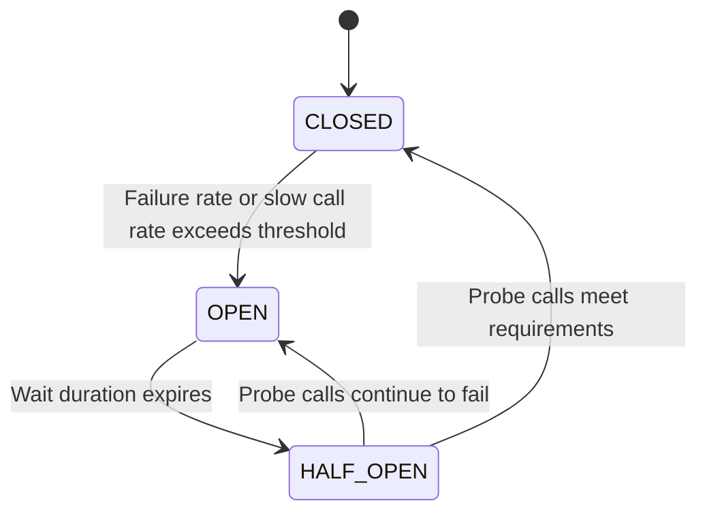

# The Role of Spring Cloud CircuitBreaker and Implementation Libraries

In a microservices architecture, a request often traverses multiple services. For example, an order service may call inventory, payment, and shipping services. If a dependent service responds very slowly or stops operating, waiting calls can exhaust the calling service's processing threads and connections. New requests keep piling up, causing the incident to spread to otherwise healthy services. This phenomenon is commonly known as a **cascading failure**.

A circuit breaker helps limit that impact. It tracks the outcomes of calls to a dependency. When the failure rate or slow call rate exceeds thresholds, the circuit breaker temporarily stops sending requests to the dependency, returns a fallback result or controlled error, and then probes a few calls after a wait duration. In the Spring ecosystem, **Spring Cloud CircuitBreaker provides a unified API layer so Spring applications can use this mechanism through a concrete implementation library**.

## 1. What Problem Does Spring Cloud CircuitBreaker Solve?

Spring Cloud CircuitBreaker decouples how an application invokes a circuit breaker from the details of the underlying library. As a result, business code can use a relatively consistent calling pattern while the development team chooses the provider suited to the system.

This integration layer helps in three ways:

- **Standardized call sites:** the application creates a circuit breaker by an identifier, then wraps calls to the dependent service with the Spring Cloud CircuitBreaker API.
- **Swappable providers:** most calling code can remain unchanged when changing the underlying library; advanced configuration and provider-specific behavior still need review.
- **Spring integration:** the provider is configured through Spring Boot's configuration mechanism and can integrate with application observability and management components.

Spring Cloud CircuitBreaker does not perform network communication itself, does not replace the HTTP client, and does not fix bugs in the dependent service. It wraps existing calls to decide when to let a call through, when to fail fast, and when to switch to a fallback. Therefore, place circuit breakers at boundaries calling dependencies that can fail independently, such as clients calling inventory or payment services.

Applications typically use one of two APIs:

- `CircuitBreakerFactory` for synchronous or imperative calls.
- `ReactiveCircuitBreakerFactory` for reactive flows, typically using Project Reactor.

Identifiers like `inventory` or `payment` link calls with each dependency's configuration and metrics. Choose identifiers by service or operation group with similar failure characteristics, rather than using one shared circuit breaker for all outbound calls.

## 2. CLOSED, OPEN, and HALF_OPEN Mechanics

A circuit breaker typically has three states:

| State | Handling Behavior | When Does It Transition? |
|---|---|---|
| `CLOSED` | Allows calls to reach the dependency and records outcomes. | Transitions to `OPEN` when failure or slow call metrics reach configured thresholds. |
| `OPEN` | Fails fast on calls, stopping further calls to the dependency during the wait duration. The application can return a fallback. | After the wait duration, transitions to `HALF_OPEN` to probe recovery. |
| `HALF_OPEN` | Allows only a limited number of probe calls. | If probe calls succeed according to policy, returns to `CLOSED`; if they continue to fail, returns to `OPEN`. |

The state transition flow can be visualized as follows:



A circuit breaker needs data to decide whether to open the circuit. Resilience4j supports two common *sliding window* types:

- **Count-based window:** evaluates a fixed number of most recent calls, such as 20 calls.
- **Time-based window:** evaluates calls within a time interval, such as the last 10 seconds.

Important parameters include window size, minimum calls before computing rates, failure rate threshold, slow call rate threshold, time in `OPEN`, and permitted calls in `HALF_OPEN`. The minimum call count is especially important: if traffic is still too low, the circuit breaker may lack sufficient data to make a reliable decision.

Slow calls can also be treated as failure signals. For example, an inventory service might still return HTTP 200 yet take 8 seconds to respond; for an order flow with a 2-second time budget, that response can still cause congestion. Configure slow call thresholds aligned with the application's latency objectives.

## 3. Common Implementation Libraries

Spring Cloud CircuitBreaker is an integration layer; actual behavior depends on the chosen provider. Common options include:

| Provider | Characteristics | When to Consider |
|---|---|---|
| **Resilience4j** | Lightweight library split into modules such as CircuitBreaker, Retry, RateLimiter, Bulkhead, and TimeLimiter; provides integrations for both synchronous and reactive applications. | A suitable choice for many modern Spring projects needing fine-grained configuration, metrics, and multiple coordinated protection mechanisms. |
| **Spring Retry** | Provides retry policies and supports circuit breaker policies within the Spring Retry ecosystem. | Worth considering when a project already uses Spring Retry and wants to continue building on its policies. Check the exact features and limits of the version in use. |
| **Netflix Hystrix** | Legacy circuit breaker solution formerly widely used in microservices systems. | Mainly encountered in legacy systems needing backward compatibility. Should not be the default choice for new projects. |

Resilience4j is usually a sensible starting choice when building new Spring services. It offers multiple composable mechanisms: CircuitBreaker controls dependency calls; Retry retries transient errors; TimeLimiter caps wait time for async tasks; Bulkhead limits concurrency; RateLimiter caps call rates. These mechanisms serve different purposes and should not all be enabled by default. In particular, Retry can increase load on a troubled service if retry policies are not bounded.

Spring Cloud CircuitBreaker's common API makes application code less coupled to a provider, though it does not give all providers identical capabilities. Detailed settings, failure accounting, async task handling, and metrics export capabilities can still differ. When relying on a Resilience4j-specific feature, the team should clearly note which code or configuration depends on Resilience4j.

## 4. Integrating Resilience4j with Spring Cloud CircuitBreaker

For a Maven application, add the starter for synchronous calls:

```xml
<dependency>
    <groupId>org.springframework.cloud</groupId>
    <artifactId>spring-cloud-starter-circuitbreaker-resilience4j</artifactId>
</dependency>
```

If the application uses Project Reactor, add the corresponding reactive starter:

```xml
<dependency>
    <groupId>org.springframework.cloud</groupId>
    <artifactId>spring-cloud-starter-circuitbreaker-reactor-resilience4j</artifactId>
</dependency>
```

Manage the Spring Cloud version with a Spring Cloud BOM compatible with your project's Spring Boot version. Avoid manually pinning individual starter versions when a BOM already manages them.

The example below wraps a synchronous call to an inventory service. `CircuitBreakerFactory` creates a circuit breaker with the identifier `inventory`; the fallback function receives the error cause and returns a fallback result of the same type as the primary call:

```java
import org.springframework.cloud.client.circuitbreaker.CircuitBreakerFactory;
import org.springframework.stereotype.Service;

@Service
public class InventoryService {
    private final CircuitBreakerFactory<?, ?> circuitBreakerFactory;
    private final InventoryClient inventoryClient;

    public InventoryService(
            CircuitBreakerFactory<?, ?> circuitBreakerFactory,
            InventoryClient inventoryClient) {
        this.circuitBreakerFactory = circuitBreakerFactory;
        this.inventoryClient = inventoryClient;
    }

    public Stock findStock(String sku) {
        return circuitBreakerFactory.create("inventory").run(
            () -> inventoryClient.findStock(sku),
            error -> Stock.unavailable(sku)
        );
    }
}
```

In the example, when the `inventory` circuit is `CLOSED`, the call is forwarded to `InventoryClient`. When the circuit breaker rejects the call because it is `OPEN`, or when the primary call throws an error recorded by the provider, the fallback function can be used to return a fallback result. Real applications should log or attach tracing details for `error`, and design `Stock.unavailable` so callers distinguish unavailable data from a stock count of zero.

The `inventory` instance can be configured in `application.yml` as follows:

```yaml
resilience4j:
  circuitbreaker:
    instances:
      inventory:
        slidingWindowType: COUNT_BASED
        slidingWindowSize: 20
        minimumNumberOfCalls: 10
        failureRateThreshold: 50
        slowCallDurationThreshold: 2s
        slowCallRateThreshold: 50
        waitDurationInOpenState: 15s
        permittedNumberOfCallsInHalfOpenState: 3
```

This is an illustrative configuration: the circuit breaker uses a 20-call window, starts evaluating only after at least 10 calls, opens the circuit when the failure rate reaches 50% or slow call rate reaches 50%, waits 15 seconds, and then allows up to 3 probe calls. Numbers must be tuned to traffic, latency targets, and dependency criticality. The instance name in configuration must match the identifier created in code.

Resilience4j can also configure which exception types are recorded or ignored. For example, input validation errors sent by users usually do not reflect the health of the inventory service and should not automatically trip the circuit. Conversely, timeouts or connection errors to the dependent service usually should be treated as failure signals. Exact rules must reflect the client-provider contract.

## 5. How Do Fallback, Timeout, and Bulkhead Coordinate?

A fallback is alternative behavior when the primary call cannot deliver a result. Good fallbacks can return sufficiently fresh cached data, meaningful defaults, or a status indicating the feature is temporarily unavailable. Never return a result that looks successful yet is fundamentally wrong. For write operations like payment or order creation, fallbacks require extra care to avoid reporting success when the transaction has not been confirmed.

Circuit breaker and timeout complement each other. Timeout limits how long a call may wait; circuit breaker tracks outcomes and stops further calls when a dependency shows signs of unhealthiness. Without client timeouts, calls can hang for a long time and tie up resources before the circuit breaker collects enough data to open. Therefore, connection and response timeouts must still be configured on the HTTP client. Resilience4j's `TimeLimiter` can add time bounds for appropriate async tasks; it does not replace all network-layer timeouts.

Bulkhead limits concurrent calls to a dependency. If a reporting service is slow, a bulkhead can stop reporting calls from consuming all threads or resources needed by other features. Resilience4j offers semaphore-based and thread-pool-based bulkheads; the choice depends on the execution model and isolation requirements. Set limits based on the target service's actual capacity and the calling service's resources.

Retry should only be used for recoverable errors and must bound attempt counts, wait intervals, and total duration. When combining Retry with CircuitBreaker, wrapping order affects actual call counts and how the circuit breaker counts failures. Deliberately design the ordering to avoid retrying continuously while the circuit is `OPEN` or adding load while the target service is overloaded.

## 6. Usage in Reactive Applications

For WebFlux or clients returning `Mono`, use the reactive starter and `ReactiveCircuitBreakerFactory`. Example:

```java
import org.springframework.cloud.client.circuitbreaker.ReactiveCircuitBreakerFactory;
import org.springframework.stereotype.Service;
import reactor.core.publisher.Mono;

@Service
public class ReactiveInventoryService {
    private final ReactiveCircuitBreakerFactory<?, ?> circuitBreakerFactory;
    private final ReactiveInventoryClient inventoryClient;

    public ReactiveInventoryService(
            ReactiveCircuitBreakerFactory<?, ?> circuitBreakerFactory,
            ReactiveInventoryClient inventoryClient) {
        this.circuitBreakerFactory = circuitBreakerFactory;
        this.inventoryClient = inventoryClient;
    }

    public Mono<Stock> findStock(String sku) {
        return circuitBreakerFactory.create("inventory")
            .run(
                inventoryClient.findStock(sku),
                error -> Mono.just(Stock.unavailable(sku))
            );
    }
}
```

The reactive fallback also returns a corresponding `Mono`. Do not call `block()` in a reactive flow just to use a synchronous circuit breaker, because blocking can stall the event loop and defeat the non-blocking model. Keep the call, error handling, and fallback within the same reactive chain.

## 7. Monitoring and Operations

A circuit breaker is only useful when operations teams know what state it is in and why states changed. Integrating Spring Boot Actuator, Micrometer, and provider-appropriate metrics configuration enables tracking metrics such as:

- current state of each circuit breaker;
- counts of successful, failed, and fast-rejected calls;
- failure rate, slow call rate, and call count in the window;
- number of state transitions between `CLOSED`, `OPEN`, and `HALF_OPEN`.

Tie circuit breaker identifiers to dependency names so dashboards and alerts can pinpoint the troubled service. Alerting when a circuit stays open for an extended period or oscillates repeatedly between states helps uncover incidents and misconfigured thresholds. Expose only necessary management endpoints and secure them according to the system's security policies.

When testing, simulate at least three scenarios: the dependency responding normally; the dependency continuously failing or responding too slowly so the circuit opens; and the dependency recovering so probe calls in `HALF_OPEN` bring the circuit back to `CLOSED`. Also verify that fallbacks return business-meaningful results, call counts to the dependency drop while the circuit is open, and metrics accurately reflect live state.

## 8. How to Choose and Apply

When starting integration, identify which dependencies can cause cascading failures and place circuit breakers on calls to those dependencies. Choose a provider according to needs: Resilience4j is a popular choice for modern Spring projects requiring multiple protection mechanisms; Spring Retry fits better when a system already relies on its policies; Hystrix is typically only a compatibility requirement for legacy systems.

Next, configure sliding windows, failure thresholds, slow call thresholds, and open durations based on traffic and latency targets. Pair this with client timeouts, bulkheads when concurrency must be capped, and business-meaningful fallbacks. Finally, monitor states and metrics in production to refine settings. A circuit breaker is one part of a fault-tolerance strategy; it does not replace timeouts, load control, business error handling, or the recoverability of the dependent service itself.
