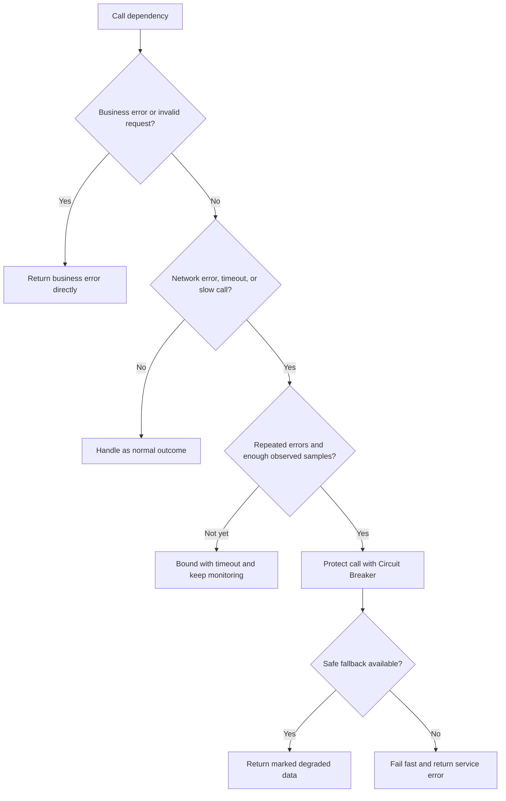

# When to Break the Circuit and When to Return Errors Directly

In the Overview section of the `SPRING_CLOUD_CIRCUIT_BREAKER` module, we explore how to use Circuit Breakers in Spring Cloud to protect an application when a dependent service responds slowly or becomes temporarily unavailable. The focus of this lesson is choosing the right scenario: when to break the circuit to stop calls that risk exhausting resources, and when to return errors directly to preserve business semantics.

A Circuit Breaker is typically implemented with Resilience4j via Spring Cloud CircuitBreaker. This mechanism tracks service call outcomes, transitions among three states—CLOSED, OPEN, and HALF_OPEN—and uses a sliding window to evaluate failure rates or slow call rates. The decision to enable circuit breaking should be based on error type, frequency, resource impact, and the ability to provide a safe alternative result.

## 1. What Problem Does Circuit Breaking Solve?

Suppose an order service calls a catalog service to retrieve product details. When catalog is operating normally, each call finishes in tens of milliseconds. During an incident, catalog takes many seconds to respond. Order service requests must wait a long time, occupying connections and threads. If new requests keep calling catalog, pending tasks build up. Repeated retry calls can also put extra load on the already troubled service.

A Circuit Breaker monitors calls to a dependency. When metrics in the observation window show the failure rate or slow call rate exceeding thresholds, the breaker transitions to OPEN and rejects new calls for a period of time. The application can return an error fast or use a fallback if suitable substitute data is available. After the wait duration, the breaker transitions to HALF_OPEN to test a limited number of probe calls. If the dependency recovers, the breaker closes; if failures persist, the breaker reopens.

Clearly distinguish this mechanism's role:

- Circuit Breaker prevents the application from continuing to pile requests onto a dependency showing signs of outage.
- Timeout limits how long a single call waits. A breaker does not replace timeouts.
- Bulkhead limits concurrent calls so one dependency cannot consume all shared resources.
- Retry re-attempts a call when an error is likely transient. Retry does not replace a breaker and can worsen an incident if unbounded.

A Circuit Breaker cannot fix a dependency, cannot guarantee request success, and cannot decide on its own which fallback data is valid from a business standpoint.

## 2. When Should You Use a Circuit Breaker?

Consider breaking the circuit when a call crosses a network boundary to an independent service and can experience transient errors or repeated performance degradation. Common indicators include:

- The dependency returns 5xx errors, loses connections, resets connections, or times out across multiple consecutive requests.
- High latency keeps threads, connection pools, or processing resources of the calling service tied up for too long.
- Traffic is sufficient for the sliding window to collect a meaningful sample size.
- The dependency can recover after a period of time, so pausing calls helps relieve pressure on the system while waiting.
- The application has a way to handle an unavailable dependency: returning an error fast, using still-valid cache, omitting optional data, or switching to a designed backup source.

For example, a product detail page also calls a review service to show star ratings. If the review service slows down, the application can open the breaker and display the product page without the review section, or use cached data flagged as potentially stale. This is supplementary information; its outage does not have to break the entire request.

Another example is a search service calling a recommendation service. When recommendations are down, the system can still return primary search results. A Circuit Breaker stops calling the recommendation service while it is degraded, keeping the main search flow largely unaffected.

Place breakers around calls to specific dependencies, with dedicated instance names and tailored configurations. Avoid grouping services with different reliability, traffic, or business semantics into a single breaker if doing so lets one service's metrics mask another's condition.

## 3. When Should You Return Errors Directly?

Not every exception is a signal to open a Circuit Breaker. Some errors are valid business outcomes or caused by invalid requests. These errors should be returned with their true meaning rather than counted as dependency outages.

| Scenario | Appropriate Handling | Reason |
|---|---|---|
| Request is missing required fields, malformed, or fails validation | Return validation error directly | Invalid requests do not indicate dependency degradation |
| User is not logged in or lacks sufficient permissions | Return authentication/authorization error directly | This is a security and business outcome |
| Product does not exist or operation violates a business rule | Return business error directly | Do not turn this valid outcome into an infrastructure failure |
| A single call fails; traffic is too low for a reliable sample | Handle errors and timeouts per existing policy; monitor further | A breaker may bring little benefit without enough samples |
| Dependency repeatedly times out or returns 5xx | Use Circuit Breaker; fallback if safe, otherwise return service error | Prevents new calls from waiting on a degraded dependency |
| Supplementary information can be served from valid cache | Use Circuit Breaker and return cached data marked as degraded | Preserves partial experience without pretending data is fresh |
| Mandatory transaction such as payment or reservation cannot complete | Can use breaker to fail fast, then return clear error | Must never report success when a transaction is unconfirmed |

One key point: "returning an error directly" does not mean always omitting a Circuit Breaker. For a mandatory dependency such as a payment gateway, a breaker can still protect the system by failing fast on calls when the gateway is down. However, if no valid substitute exists, the application must return an unavailable status to the caller. Never return a fake result like "paid" just to avoid showing an error.

Conversely, 4xx errors caused by input data or business rules usually should not increase the breaker's failure rate. Translate HTTP errors into explicit business exceptions and configure the breaker to ignore those exceptions when computing failure rates. Local programming bugs, mapping errors, or configuration errors must also be classified separately; do not let them be mistaken for dependency unavailability.

## 4. Decision Workflow for Choosing Handling Strategy

You can ask the following questions before adding a Circuit Breaker:

1. Does the call go to a dependency outside the current process? If errors only arise during validation or internal processing, a breaker is usually not the right tool.
2. Can errors repeat due to dependency slowness, connection loss, or overload? If it is an intentional business error, return the business error.
3. Is traffic sufficient to evaluate a trend? A minimum number of calls is needed before failure rates are meaningful.
4. When the dependency is unavailable, can the system supply substitute data without breaking business logic? If yes, a fallback may fit. If no, fail fast and return a clear error.
5. What does the caller need to know? Distinguish complete data, degraded data, and incomplete operations so the caller can make the right decision.

The diagram below summarizes the decision flow:



Even before enough samples exist to open the breaker, timeouts are still necessary so a call does not wait indefinitely. Once the breaker is OPEN, new requests can be rejected immediately; if there is no fallback, translate that result into a service error conforming to the API contract.

## 5. CLOSED, OPEN, HALF_OPEN, and Sliding Windows

A Circuit Breaker has three primary states:

- **CLOSED**: calls are forwarded to the dependency. The breaker records successes, failures, and slow calls. Once eligible sample counts and rates exceed thresholds, the breaker transitions to OPEN.
- **OPEN**: the breaker rejects new calls without invoking the dependency. With Resilience4j, rejected calls typically throw `CallNotPermittedException`. The application can return an error fast or execute a fallback.
- **HALF_OPEN**: after the OPEN wait duration, the breaker allows a small number of probe calls. If outcome rates meet recovery criteria, the breaker returns to CLOSED. If probe calls continue failing or are too slow, the breaker returns to OPEN.

A sliding window is a recent set of outcomes used to compute failure rates and slow call rates. Resilience4j supports two types:

- **COUNT_BASED**: observes a fixed number of most recent calls, such as 20 calls.
- **TIME_BASED**: observes outcomes within a time interval, such as the last 10 seconds.

Parameters commonly needed during configuration include:

| Parameter | Meaning |
|---|---|
| `slidingWindowType` | Selects call-count-based or time-based window |
| `slidingWindowSize` | Number of calls or time units in the window |
| `minimumNumberOfCalls` | Minimum samples before computing rates to decide whether to open the breaker |
| `failureRateThreshold` | Failure percentage threshold to transition to OPEN |
| `slowCallDurationThreshold` | Duration from which a call is considered slow |
| `slowCallRateThreshold` | Slow call percentage threshold |
| `waitDurationInOpenState` | Duration the breaker remains in OPEN |
| `permittedNumberOfCallsInHalfOpenState` | Number of probe calls permitted in HALF_OPEN |

For example, with a COUNT_BASED window of size 20 and minimum number of calls set to 10, the breaker needs at least 10 outcomes before using rates for evaluation. If the failure threshold is set to 50%, consecutive failures after reaching the minimum sample count can cause the breaker to open. Actual thresholds must be based on traffic and dependency characteristics; setting too small a window reacts easily to brief spikes, while too large a window detects incidents slowly.

Slow calls can also be a dangerous sign even without exceptions thrown. Therefore, set both failure rate and slow call rate thresholds if dependency latency can exhaust the calling service's resources.

## 6. Integrating Spring Cloud CircuitBreaker with Resilience4j

For a Spring Boot application using Gradle, add the Spring Cloud CircuitBreaker Resilience4j starter. Manage versions using a Spring Cloud BOM compatible with the project's Spring Boot version:

```kotlin
dependencies {
    implementation("org.springframework.cloud:spring-cloud-starter-circuitbreaker-resilience4j")
}
```

Spring Cloud CircuitBreaker provides an abstraction to create breakers by name. The following example uses the `productCatalog` breaker around a call fetching product details. If the call fails due to the dependency, the application tries retrieving data from cache. If the cache has no data, the application throws a service-unavailable error so the caller knows the request could not complete.

```java
import org.springframework.cloud.client.circuitbreaker.CircuitBreakerFactory;
import org.springframework.stereotype.Service;

@Service
public class ProductQueryService {
    private final CircuitBreakerFactory<?, ?> circuitBreakerFactory;
    private final ProductClient productClient;
    private final ProductCache productCache;

    public ProductQueryService(
            CircuitBreakerFactory<?, ?> circuitBreakerFactory,
            ProductClient productClient,
            ProductCache productCache) {
        this.circuitBreakerFactory = circuitBreakerFactory;
        this.productClient = productClient;
        this.productCache = productCache;
    }

    public ProductDetails findDetails(String productId) {
        return circuitBreakerFactory.create("productCatalog").run(
            () -> productClient.fetchDetails(productId),
            cause -> fallback(productId, cause)
        );
    }

    private ProductDetails fallback(String productId, Throwable cause) {
        if (cause instanceof ProductNotFoundException) {
            throw (ProductNotFoundException) cause;
        }

        return productCache.findUsable(productId)
            .orElseThrow(() ->
                new ProductCatalogUnavailableException(productId, cause));
    }
}
```

This example assumes `ProductClient` translates a "not found" response into `ProductNotFoundException`, while `ProductCache.findUsable` only returns data meeting the application's freshness policy. In real systems, clearly distinguish business errors, authentication errors, and infrastructure failures in the client. Do not use a generic fallback to turn every exception into successful data.

Resilience4j configuration can be placed in `application.yml`:

```yaml
resilience4j:
  circuitbreaker:
    instances:
      productCatalog:
        slidingWindowType: COUNT_BASED
        slidingWindowSize: 20
        minimumNumberOfCalls: 10
        failureRateThreshold: 50
        slowCallDurationThreshold: 2s
        slowCallRateThreshold: 50
        waitDurationInOpenState: 15s
        permittedNumberOfCallsInHalfOpenState: 3
        automaticTransitionFromOpenToHalfOpenEnabled: true
        ignoreExceptions:
          - com.example.ProductNotFoundException
```

This is an illustrative configuration, not a threshold set suited to every system. The instance name in configuration must match the name passed to `create("productCatalog")`. For other business errors, add the corresponding exceptions to the ignore policy or configure appropriate exception classification. Do not ignore timeout or connection errors if the goal is for the breaker to detect dependency degradation.

## 7. Designing Fallbacks Without Violating Business Logic

A fallback is only useful when the substitute result remains meaningful to the caller. Common options include:

- Using a cache with a staleness bound and returning the update timestamp or a flag indicating the data is a fallback copy.
- Omitting optional information, such as rating scores or recommendation blocks, while still returning core data.
- Returning a service-unavailable error quickly if a mandatory operation requires fresh results from the dependency.

Do not return fabricated data to hide an outage. For instance, when stock cannot be verified, returning a quantity of 0 might cause the system to reject a valid order; returning a huge quantity might cause the system to accept orders it cannot fulfill. When no trustworthy substitute data exists, return a clear error.

Fallbacks should also not call back into the same dependency protected by the breaker, as that defeats circuit breaking. Avoid placing unbounded retries inside a fallback. When using a cache, establish policies for expiration, consistency, and how stale data is communicated to callers.

## 8. Combining Timeout, Bulkhead, and Retry

A Circuit Breaker detects failure trends based on observed outcomes. If a call hangs too long without a timeout, the breaker may not receive an outcome in time to protect resources. Therefore, configure timeouts at the HTTP client or reactive layer. Timeouts must align with the overall request time budget and the dependency's normal processing time.

Bulkhead limits concurrent calls to a dependency. With a semaphore bulkhead, the application caps concurrently executing requests; with a thread-pool bulkhead, the application isolates work in a dedicated pool. When the limit is reached, new calls are rejected or must wait according to configured policy. Keep limits and queues deliberate so a slow dependency cannot exhaust the application's resources.

Retry should only apply to transient errors and operations safe to retry. Cap attempt counts, use backoff and jitter, and ensure total retry duration does not exceed the request budget. Do not retry a request already rejected by the breaker in the OPEN state. For non-idempotent operations like payment creation or order placement, require an idempotency key or duplicate-prevention mechanism before enabling retries.

These three mechanisms solve different problems: timeout limits wait duration of a single call, bulkhead limits concurrent resource usage, and Circuit Breaker stops sending new calls when metrics show the dependency is degrading.

## 9. Reactive Calls

With WebFlux and Reactor, use `ReactiveCircuitBreakerFactory` to keep the processing flow non-blocking. The example below caps the catalog call duration and uses cache when the dependency fails or the breaker is OPEN:

```java
import java.time.Duration;
import org.springframework.cloud.client.circuitbreaker.ReactiveCircuitBreakerFactory;
import org.springframework.stereotype.Service;
import org.springframework.web.reactive.function.client.WebClient;
import reactor.core.publisher.Mono;

@Service
public class ReactiveProductQueryService {
    private final ReactiveCircuitBreakerFactory<?, ?> circuitBreakerFactory;
    private final WebClient webClient;
    private final ProductCache productCache;

    public Mono<ProductDetails> findDetails(String productId) {
        Mono<ProductDetails> request = webClient.get()
            .uri("/products/{id}", productId)
            .retrieve()
            .bodyToMono(ProductDetails.class)
            .timeout(Duration.ofSeconds(2));

        return circuitBreakerFactory.create("productCatalog").run(
            request,
            cause -> productCache.findUsableReactive(productId)
                .switchIfEmpty(Mono.error(
                    new ProductCatalogUnavailableException(productId, cause)))
        );
    }
}
```

In real applications, translate 4xx responses with business meaning into dedicated exceptions and exclude them from breaker failure statistics. Also ensure reactive fallbacks do not call `block()` or perform synchronous I/O that blocks the event loop. If the cache has no usable data, the publisher should terminate with an appropriate error rather than emitting a dummy value.

## 10. Monitoring Protection Effectiveness

After deployment, observe both breaker state and impact on the request experience. You can use Micrometer alongside Spring Boot Actuator and the application's existing metrics collection system. Useful signals include:

- Current state of each breaker: CLOSED, OPEN, or HALF_OPEN.
- Counts of successful, failed, slow, and rejected calls when the breaker is OPEN.
- Failure rate, slow call rate, and dependency latency.
- Fallback invocation count, cache hit rate, and age of fallback data.
- End-to-end request success rate, p95/p99 latency, and actual errors received by callers.

Do not look solely at how often the breaker opens. An open breaker may be protecting the system properly, yet fallbacks could still fail or callers might still receive too many errors. Correlate breaker state with dependency and end-to-end request metrics. Alerts should watch for prolonged OPEN states, unusual spikes in fallback rates, or HALF_OPEN repeatedly cycling back to OPEN.

Logs should include breaker name, state, error type, and request correlation ID if available. When a breaker is OPEN, many requests can be rejected in succession; use metrics and controlled logging to avoid generating massive error log volumes during an incident.

## 11. Applying to Common Scenarios

| Scenario | Should You Use a Breaker? | What Should Be Returned to the Caller? |
|---|---|---|
| Product recommendation service frequently times out | Yes | Primary results with recommendations omitted or marked cached data |
| Product review service continuously returns 5xx | Yes | Product page still renders if reviews are optional information |
| Payment gateway is unresponsive | Can be used to fail fast | Report payment incomplete/unavailable; never confirm success |
| User submits a non-existent product SKU | Do not count as breaker failure | Return not-found error per API contract |
| Request is missing required fields | No | Return validation error |
| An internal service has a mapping bug from newly deployed code | Do not treat as a dependency network failure | Return appropriate error and fix the mapping bug |

When evaluating an implementation, answer three questions: does the breaker open when the dependency genuinely degrades; do new requests fail fast when the breaker is OPEN; and do callers receive a meaningful result when a fallback is used or when none exists? Those answers show whether the mechanism protects the system while preserving the business contract.

## Conclusion

Use a Circuit Breaker when calls to a dependency tend to fail or slow down repeatedly and continuing to wait risks affecting resources or other processing flows. Return errors directly for validation, authentication, business errors, and cases without a safe substitute result. For mandatory operations, a breaker can still help fail fast, provided the response clearly states the operation did not complete. Proper exception classification, timeouts, appropriate sliding windows, and monitoring both fallbacks and end-to-end outcomes enable Spring Cloud CircuitBreaker to fulfill its service-protection role effectively.
