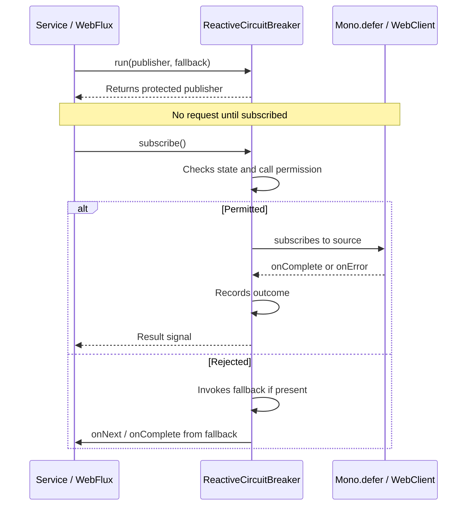

# Lazy Evaluation and Subscription Execution Time for Mono or Flux

In Reactor, `Mono` and `Flux` describe an asynchronous processing chain. Creating a publisher and executing a publisher happen at two different points in time. When an application composes operators such as `map`, `flatMap`, `filter`, or passes a publisher through Spring Cloud Circuit Breaker, the pipeline is usually only being described. Work starts when a subscriber subscribes.

This characteristic is called **lazy evaluation**. It is critical when protecting reactive calls to dependent services: the circuit breaker must observe the actual execution, from the moment the publisher is subscribed until it completes or produces an error. If a call with side effects occurs before subscription, the circuit breaker may fail to properly protect that work.

## Two phases: assembly and subscription

Reactor can be understood through two phases:

1. **Assembly:** the application creates a publisher and chains operators into a pipeline. Transformations are declared, but a typical cold data source has not yet performed any work.
2. **Subscription:** a subscriber subscribes to the publisher. Subscription triggers the cold source, propagates the `onSubscribe` signal, and then data flows through the pipeline via `onNext`, `onComplete`, or `onError`.

Simple example:

```java
Mono<String> message = Mono.just("hello")
        .map(String::toUpperCase)
        .doOnNext(value -> log.info("Received: {}", value));

// Here the pipeline has been created, but there is no subscriber yet.

message.subscribe(); // Subscription triggers the pipeline.
```

`Mono.just("hello")` holds an already available value. The `map` and `doOnNext` operators run upon subscription. With a cold data source, each independent subscription can trigger a new execution.

In a Spring WebFlux application, a controller typically returns `Mono<T>` or `Flux<T>` to the framework. WebFlux subscribes to the publisher to write the response when handling a request. Therefore, you do not need to call `subscribe()` manually in a controller or regular service. Manually subscribing creates an execution flow detached from the request lifecycle and makes error management, request cancellation, context, and backpressure harder to control.

## Distinguishing publisher creation from call execution

A publisher can be created at assembly time while only invoking its underlying source when subscription begins. However, Java code outside the publisher still executes immediately when the method is called.

The following example calls a blocking method directly while constructing the pipeline:

```java
// loadProduct runs immediately at the moment this line is executed.
Mono<Product> eager = Mono.just(loadProduct(productId));
```

`Mono.just` accepts an already-computed value. It does not defer the `loadProduct` call. If that method performs a blocking HTTP call, queries a database, or causes side effects, the work has already happened before subscription and lies outside the scope that the reactive publisher can manage.

To defer a synchronous task until subscription time, you can use `Mono.fromCallable`:

```java
Mono<Product> deferredBlocking = Mono.fromCallable(
        () -> loadProduct(productId)
);
```

The callable is invoked when a subscription occurs. However, `fromCallable` does not turn a blocking operation into a non-blocking one; it only defers when it is called. If you use blocking tasks in a reactive application, move them onto an appropriate scheduler and consider replacing them with a reactive client.

When a client method returns `Mono` or `Flux`, use `defer` to defer even calling the method that creates the publisher:

```java
Mono<Product> deferredReactive = Mono.defer(
        () -> catalogClient.findProduct(productId)
);

Flux<Product> deferredStream = Flux.defer(
        () -> catalogClient.findProducts(category)
);
```

`Mono.defer` and `Flux.defer` accept a supplier that creates a new publisher for each subscription. This approach is useful if calling `catalogClient` involves request preparation logic, context-based data lookups, or creating a publisher with side effects. With `WebClient`, typical request publishers are already cold and the network request is only sent upon subscription; `defer` still helps defer calling the client method and creates a new publisher for each subscriber.

## Cold publishers and hot publishers

Not all publishers share data among subscribers in the same way.

| Characteristic | Cold publisher | Hot publisher |
|---|---|---|
| Starts emitting data | Typically starts when a subscriber subscribes | Can emit data before a subscriber subscribes |
| Multiple subscribers | Typically triggers separate executions | Can observe the same active emission source together |
| Examples | `Mono.defer`, `Flux.defer`, typical `WebClient` requests | `Sinks.Many`, publishers already `connect`ed or shared via `share`/`publish` |

A cold publisher fits HTTP calls that must run separately for each request. A hot publisher is useful when multiple subscribers need to observe the same event source or ongoing data stream. When using a hot publisher with a circuit breaker, you must clearly understand which subscription the circuit breaker is protecting and the lifecycle of the shared source; do not assume each subscriber will trigger an independent downstream request.

Example of a cold publisher executing twice for two subscribers:

```java
AtomicInteger calls = new AtomicInteger();

Mono<Integer> cold = Mono.defer(() ->
        Mono.just(calls.incrementAndGet())
);

cold.subscribe(value -> log.info("Subscriber A: {}", value));
cold.subscribe(value -> log.info("Subscriber B: {}", value));
// The results are 1 and 2, respectively.
```

The publisher is stored in the `cold` variable, but each `subscribe()` triggers the `defer` supplier once. Therefore, do not infer that creating a `Mono` object means the task only runs once.

## Combining lazy publishers with ReactiveCircuitBreaker

Spring Cloud Circuit Breaker provides `ReactiveCircuitBreaker` to wrap a `Mono` or `Flux`. The `run` method accepts a publisher and optionally a fallback. Calling `run` creates the protected publisher; actual execution takes place when the returned publisher is subscribed to.

```java
import org.springframework.cloud.client.circuitbreaker.ReactiveCircuitBreaker;
import org.springframework.cloud.client.circuitbreaker.ReactiveCircuitBreakerFactory;
import org.springframework.stereotype.Service;
import reactor.core.publisher.Mono;

@Service
public class CatalogService {

    private final ReactiveCircuitBreakerFactory<?, ?> circuitBreakerFactory;
    private final CatalogClient catalogClient;

    public CatalogService(
            ReactiveCircuitBreakerFactory<?, ?> circuitBreakerFactory,
            CatalogClient catalogClient) {
        this.circuitBreakerFactory = circuitBreakerFactory;
        this.catalogClient = catalogClient;
    }

    public Mono<Product> findProduct(String productId) {
        ReactiveCircuitBreaker breaker =
                circuitBreakerFactory.create("catalog");

        Mono<Product> request = Mono.defer(
                () -> catalogClient.findProduct(productId)
        );

        return breaker.run(
                request,
                error -> Mono.just(Product.unavailable(productId))
        );
    }
}
```

When `findProduct` is called, the method creates a publisher and returns it to the caller. No network request is sent merely because the service method returned a `Mono`. When WebFlux or another subscriber subscribes, the circuit breaker coordinates the subscription; `Mono.defer` calls the client to build the request publisher, and the request executes under that subscription.

If the breaker is `OPEN`, the protected call may be rejected and the fallback builds a replacement result publisher. If the request executes and produces an error, the fallback can also handle that error. The fallback returns `Mono<Product>` to preserve the reactive type. Do not call `subscribe()` inside the fallback; return the publisher to the outer processing chain.

With `Flux`, the same principle applies:

```java
public Flux<Product> findProducts(String category) {
    ReactiveCircuitBreaker breaker =
            circuitBreakerFactory.create("catalog-search");

    Flux<Product> request = Flux.defer(
            () -> catalogClient.findProducts(category)
    );

    return breaker.run(
            request,
            error -> Flux.empty()
    );
}
```

In this example, the fallback returns `Flux.empty()` to represent no replacement data. This is a business decision: if returning an empty list could be misinterpreted as there being no products, return an error or a response type with an explicit status field. Having a fallback turn an error into a normally completing stream also means the caller receives a valid result under the chosen contract, while the circuit breaker metrics still reflect the outcome of the protected source.

## When state is evaluated and outcomes are recorded

With a reactive publisher, building the pipeline does not mean the circuit breaker has executed the call or recorded an outcome. A subscription is required to start the protected execution. When subscription occurs:

1. The circuit breaker checks its state and decides whether to permit the subscription to execute the source.
2. If permitted, the source publisher is subscribed to and performs the downstream work.
3. Completion or error signals pass through the circuit breaker operator to record the outcome according to the backend.
4. If a fallback is present and the error is handled, the fallback publisher emits the replacement result to the caller.



This explains why a controller returning a `Mono` without any subscriber sends no network request, executes no fallback, and has no call outcome to record. In normal WebFlux operation, the framework subscribes to handle the response; if the application creates a publisher and discards it, the pipeline does not run.

## Retry and multiple subscriptions

Each subscription to a cold publisher can create a new invocation. Operators such as `retry` or `retryWhen` can resubscribe to the source after an error. Where retry is placed relative to the circuit breaker affects the number of executions and the number of outcomes the breaker observes.

Example:

```java
import reactor.util.retry.Retry;

Mono<Product> request = Mono.defer(
        () -> catalogClient.findProduct(productId)
);

return request
        .retryWhen(Retry.max(2))
        .transformDeferred(publisher -> breaker.run(
                publisher,
                error -> Mono.just(Product.unavailable(productId))
        ));
```

In this arrangement, the circuit breaker wraps the publisher that already includes retry; it observes the final outcome of the retry sequence. If you want each attempt to be evaluated individually by the breaker, place the circuit breaker inside the retried publisher and carefully verify the backend behavior. Do not add retries mechanically: multiple concurrent attempts can increase load on a degraded service, and retries must not exceed the overall request timeout budget.

## Verifying execution timing with StepVerifier

You can test lazy evaluation without sending real network requests using `AtomicInteger` and `StepVerifier`:

```java
import static org.junit.jupiter.api.Assertions.assertEquals;

import java.util.concurrent.atomic.AtomicInteger;

import reactor.core.publisher.Mono;
import reactor.test.StepVerifier;

AtomicInteger executions = new AtomicInteger();

Mono<Integer> publisher = Mono.defer(() ->
        Mono.just(executions.incrementAndGet())
);

// Assembly has not executed the supplier yet.
assertEquals(0, executions.get());

StepVerifier.create(publisher)
        .expectNext(1)
        .verifyComplete();

assertEquals(1, executions.get());

// Second subscription triggers the supplier again.
StepVerifier.create(publisher)
        .expectNext(2)
        .verifyComplete();

assertEquals(2, executions.get());
```

`StepVerifier.create(...).verifyComplete()` subscribes to and consumes the publisher. Assertions before and after subscription verify that the supplier only runs upon subscription and runs again for the subsequent subscription.

To test the circuit breaker, you can use a mock publisher that emits an error and a fallback with its own counter. Verify that the fallback does not run before subscription; after subscription, verify that the fallback publisher emits the expected data. In the `OPEN` state, verify that the downstream source is not called and the fallback receives the rejection error. In the `CLOSED` state, verify that the source is called and outcomes are recorded according to the configuration.

## Common mistakes

- **Calling a blocking method before `Mono.just`:** the work already ran at assembly time. Use a reactive client or defer synchronous work with `fromCallable` and an appropriate scheduler.
- **Creating a publisher and never subscribing:** no work runs. Return the publisher to WebFlux or a component that manages subscription.
- **Calling `subscribe()` manually in a service:** creates an execution flow detached from the caller, making error handling and request cancellation difficult. Compose the publisher and return it instead.
- **Using `Mono.just(client.call())` when `client.call()` already performs side effects:** the side effect happens immediately. Use `Mono.defer(() -> client.call())` when you need to defer the method call.
- **Assuming a publisher only runs once:** a cold publisher can re-execute for each subscriber. Use `cache` or a sharing mechanism only when you intend to share results and understand the data lifecycle.
- **Placing retries unintentionally:** each resubscription can create a new request. Explicitly decide whether the breaker observes each attempt or the final outcome of the retry chain.

When designing a reactive flow with a circuit breaker, always identify where the publisher is created, where subscription begins, whether the source is cold or hot, and which execution scope the protective operator wraps. Those points determine when the request actually runs, how many times the dependent service is called, and which outcomes the circuit breaker records.
