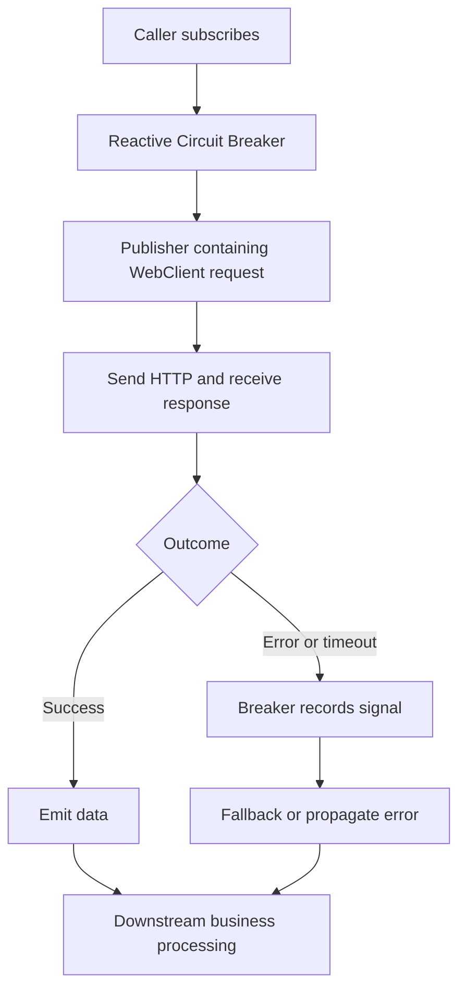

# Placing the Boundary Outside the Publisher Containing the Real Call

In a reactive application using Spring Cloud CircuitBreaker, the Circuit Breaker must wrap the Publisher that performs the call to the dependency. This boundary determines what the breaker observes: response time, completion signals, connection errors, timeouts, and call rejection state. If the breaker is placed somewhere that does not contain the actual network call, the application may think the dependency is healthy even while external requests are failing.

This lesson belongs to the **Reactive Streams** chapter of the `SPRING_CLOUD_CIRCUIT_BREAKER` module. We will use `Mono`, `Flux`, `ReactiveCircuitBreaker`, and Reactor to place the protection boundary in the right spot, understand when the Publisher executes, avoid losing error signals, and keep fallbacks from blocking the event loop.

## 1. A Publisher describes work; subscription triggers work

In Reactor, `Mono<T>` describes a stream that can emit at most one element, while `Flux<T>` describes a stream that can emit zero, one, or many elements. Many Publishers are lazy: creating a Publisher only describes the pipeline; actual work begins when a subscriber subscribes.

For example, `WebClient` returns a `Mono` representing an HTTP request:

```java
Mono<Product> request = webClient.get()
    .uri("/products/{id}", productId)
    .retrieve()
    .bodyToMono(Product.class);
```

At the time the `request` variable is created, WebClient has not necessarily sent the HTTP request yet. When the Publisher is subscribed to, Reactor executes the pipeline and performs I/O. This is why we can pass a Publisher into the Circuit Breaker before subscription occurs.

Spring Cloud CircuitBreaker provides `ReactiveCircuitBreakerFactory` to create breakers by ID. The reactive API takes a `Mono` Publisher and returns a protected `Mono`:

```java
ReactiveCircuitBreaker breaker =
    reactiveCircuitBreakerFactory.create("catalog-read");

Mono<Product> protectedRequest = breaker.run(
    request,
    error -> fallback(productId, error)
);
```

When a subscriber subscribes to `protectedRequest`, the actual call executes within the Circuit Breaker boundary. The breaker can observe the outcome and apply timeout policies, OPEN state behavior, or fallbacks.

## 2. Wrapping the Publisher that contains the real call

The key rule is that the Publisher passed into `run` must contain the actual call to the dependency. The example below places the boundary correctly:

```java
@Service
public class ReactiveCatalogService {
    private final WebClient webClient;
    private final ReactiveCircuitBreakerFactory<?, ?> breakerFactory;
    private final CatalogCache catalogCache;

    public ReactiveCatalogService(
            WebClient webClient,
            ReactiveCircuitBreakerFactory<?, ?> breakerFactory,
            CatalogCache catalogCache) {
        this.webClient = webClient;
        this.breakerFactory = breakerFactory;
        this.catalogCache = catalogCache;
    }

    public Mono<Product> findProduct(String productId) {
        Mono<Product> remoteCall = Mono.defer(() ->
            webClient.get()
                .uri("/products/{id}", productId)
                .retrieve()
                .bodyToMono(Product.class)
        );

        ReactiveCircuitBreaker breaker =
            breakerFactory.create("catalog-read");

        return breaker.run(
            remoteCall,
            error -> catalogCache.findUsable(productId)
                .switchIfEmpty(Mono.error(
                    new CatalogUnavailableException(productId, error)))
        );
    }
}
```

The `remoteCall` Publisher represents the HTTP request and response decoding. It is passed directly into `breaker.run`. When subscription occurs, the breaker protects that call; if the request fails or the breaker is OPEN, the fallback function is invoked.

Here, `Mono.defer` is used to build the request pipeline at subscription time. WebClient is already lazy, but `defer` is also useful when Publisher construction has side effects or depends on data read at subscribe time. Each subscription triggers a fresh execution of the supplier. Therefore, do not subscribe multiple times to the same request unless you intentionally want to send multiple requests.

## 3. Why must the boundary be placed outside the call?

Let's examine several common boundary-placement mistakes.

**Computing the result first and then wrapping it in a Mono**

```java
// Inappropriate: the synchronous call happens before the Circuit Breaker.
Product product = blockingCatalogClient.fetch(productId);
Mono<Product> request = Mono.just(product);

return breaker.run(request, error -> fallback(productId, error));
```

The call already happened on the `fetch` line. When the breaker receives `Mono.just(product)`, it only sees a Publisher emitting an already-available value. If the synchronous call times out or throws an exception, the failure happens before the breaker runs, so the breaker cannot record it.

**Subscribing manually before returning the Publisher**

```java
// Inappropriate: creates a subscription outside the protection boundary.
Mono<Product> request = webClient.get()
    .uri("/products/{id}", productId)
    .retrieve()
    .bodyToMono(Product.class);

request.subscribe();

return breaker.run(request, error -> fallback(productId, error));
```

The first `subscribe()` call triggers an independent request outside the breaker. When the Publisher is subscribed to again via the result of `run`, WebClient may send yet another request. As a result, the first call is unprotected, while only the second request passes through the breaker.

**Wrapping a Publisher that contains no network call**

```java
// Inappropriate: the breaker only observes a local transformation.
Mono<Product> result = Mono.just(productId)
    .map(this::buildPlaceholder);

return breaker.run(result, error -> fallback(productId, error));
```

If the actual HTTP call happens elsewhere, this breaker cannot protect the dependency. Move the call into the Publisher passed to `run`, or apply the Circuit Breaker directly at the adapter that performs the I/O.

## 4. Choosing the protected Publisher scope

The protection boundary should include the work belonging to the dependency: building the request, sending the request, receiving the response, and decoding the data needed to produce the result from the dependency. Subsequent local business processing steps can sit outside.

Example:

```java
public Mono<ProductView> findProductView(String productId) {
    Mono<Product> remoteCall = Mono.defer(() ->
        webClient.get()
            .uri("/products/{id}", productId)
            .retrieve()
            .bodyToMono(Product.class)
    );

    Mono<Product> protectedProduct = breakerFactory
        .create("catalog-read")
        .run(remoteCall, error -> fallback(productId, error));

    // Local enrichment sits after the dependency boundary.
    return protectedProduct.flatMap(product ->
        pricingService.loadLocalPrice(product)
            .map(price -> new ProductView(product, price))
    );
}
```

With this structure, the `catalog-read` breaker tracks the catalog call. If `pricingService.loadLocalPrice` fails due to a bug or a different dependency, that error is not misattributed to catalog. If pricing is also a remote dependency, protect it with its own breaker ID.

Do not wrap an entire controller pipeline in a single Circuit Breaker if the pipeline involves multiple unrelated dependencies. When a local step fails, the breaker could record a failure against a dependency that did not cause the outage. Define boundaries per dependency and protection target.

## 5. Do not swallow errors before the protection boundary

Another common mistake is using `onErrorResume` to fall back before the Publisher enters the Circuit Breaker:

```java
// Inappropriate if you want the breaker to record the original error.
Mono<Product> remoteCall = webClient.get()
    .uri("/products/{id}", productId)
    .retrieve()
    .bodyToMono(Product.class)
    .onErrorResume(error -> catalogCache.findUsable(productId));

return breaker.run(remoteCall, error -> fallback(productId, error));
```

Here, the error from WebClient is converted into a cached result before the breaker sees it. If the cache returns a product, the breaker only sees the Publisher complete successfully. Failure rate and slow call rate therefore fail to reflect actual dependency errors.

Let the error cross the Circuit Breaker boundary and declare the fallback in the `run` callback:

```java
Mono<Product> remoteCall = Mono.defer(() ->
    webClient.get()
        .uri("/products/{id}", productId)
        .retrieve()
        .bodyToMono(Product.class)
);

return breaker.run(
    remoteCall,
    error -> catalogCache.findUsable(productId)
);
```

When you need to change the exception type without recovering from the error, you can use `onErrorMap` inside the Publisher before passing it to the breaker. The error signal continues to reach the breaker, only the exception type is standardized. Avoid `onErrorComplete`, `onErrorReturn`, or a recovering `onErrorResume` before the breaker if the goal is to record the original error.

A fallback can also fail. If the cache has no data, return `Mono.error(...)` or `Mono.empty()` according to the API contract. Do not return fake data to turn an error into a success. A safe fallback must preserve data semantics and inform the caller when the result is a fallback if that affects business decisions.

## 6. Setting timeouts so the breaker receives slow or error signals

A Publisher may never emit a terminal signal if a dependency hangs. A timeout bounds the wait time and produces an error signal that the Circuit Breaker can observe.

You can place a timeout inside the protected Publisher:

```java
Mono<Product> remoteCall = Mono.defer(() ->
    webClient.get()
        .uri("/products/{id}", productId)
        .retrieve()
        .bodyToMono(Product.class)
        .timeout(Duration.ofSeconds(2))
);

return breaker.run(
    remoteCall,
    error -> catalogCache.findUsable(productId)
);
```

With this approach, the timeout exception occurs inside the Publisher passed to `run`, so the breaker can record the failed call. Choose the timeout based on normal latency and the end-to-end request time budget.

Spring Cloud CircuitBreaker with Resilience4j also supports configuring TimeLimiter by ID. Example:

```yaml
resilience4j:
  timelimiter:
    instances:
      catalog-read:
        timeoutDuration: 2s
```

If TimeLimiter is already configured for that ID, do not stack multiple different timeouts unintentionally. A timeout outside the protection boundary can cancel the subscription and prevent the breaker from receiving the exception as expected. Establish one primary timeout owner while also configuring HTTP client timeouts to bound connection and response-read times.

Reactor timeout and TimeLimiter can exhibit different cancellation behavior depending on versions and integration setup. When using both, verify through testing that the breaker records timeouts, the HTTP request is actually cancelled or stopped as supported by the client, and no background tasks continue holding resources unexpectedly.

## 7. Keep the pipeline reactive; do not block or subscribe inside services

A reactive service method should return a Publisher to the caller. WebFlux or the orchestration layer will subscribe when execution is needed. Do not call `block()` on the event loop and do not call `subscribe()` manually inside a service just to kick off work.

Patterns to avoid:

```java
// Do not use inside a WebFlux pipeline.
Product product = remoteCall.block();

// Do not create a subscription detached from the caller's processing chain.
remoteCall.subscribe();
```

If you must use a synchronous library that performs blocking I/O, isolate it on an appropriate scheduler such as `Schedulers.boundedElastic()` and control concurrency. However, if the dependency has a reactive client such as WebClient, keep the call non-blocking end to end.

When a Publisher is subscribed to multiple times, a cold Publisher such as WebClient usually performs a new request per subscription. If results are shared or cached, understand the behavior of `cache()`, `share()`, and subscriber counts. A subscription outside the Circuit Breaker can trigger an unprotected call; therefore, keep a clear execution path from the caller to the wrapped Publisher.

## 8. Protecting Flux and multi-element streams

Spring Cloud's `ReactiveCircuitBreaker` API focuses on `Mono`. When you need to protect a `Flux` that emits multiple elements, you can use Resilience4j's Reactor operator directly. The operator must be applied to the Publisher containing the real call:

```java
import io.github.resilience4j.circuitbreaker.CircuitBreaker;
import io.github.resilience4j.reactor.circuitbreaker.operator.CircuitBreakerOperator;
import reactor.core.publisher.Flux;

public Flux<ProductEvent> streamProductEvents() {
    CircuitBreaker breaker = circuitBreakerRegistry
        .circuitBreaker("product-events");

    return webClient.get()
        .uri("/product-events")
        .retrieve()
        .bodyToFlux(ProductEvent.class)
        .transformDeferred(CircuitBreakerOperator.of(breaker))
        .onErrorResume(error -> eventCache.readAvailableEvents());
}
```

`transformDeferred` applies the operator when subscription occurs, and the Circuit Breaker wraps the WebClient Publisher. `onErrorResume` is placed after the operator so the breaker receives the error signal before the fallback executes. With `Flux`, clearly define what it means when a stream errors after emitting several elements: the fallback can continue with cached items, terminate the stream with an error, or emit a degraded-status signal. Avoid silently appending stale data onto a fresh stream if ordering or consistency matters.

When a stream can be long-lived, consider the semantics of timeout, cancellation, and slow calls. A Circuit Breaker works best for calls with a defined completion point to measure outcomes. For infinite streams, a single subscription may never complete; design time limits, heartbeats, reconnects, and dedicated monitoring instead of treating each subscription as a short request.

## 9. Distinguishing dependency errors from pipeline errors

A Circuit Breaker should measure errors of the dependency it protects. Not every error emitted by a reactive pipeline is a dependency error.

| Origin | Example | Should it count toward the dependency breaker? |
|---|---|---|
| Connecting to dependency | Connection refused, DNS error, TLS handshake failure | Yes |
| Dependency error response | HTTP 5xx, 503 throttling per API contract | Usually yes |
| Slow dependency response | Exceeds timeout or slow call threshold | Yes |
| Valid business outcome | Product not found, out of stock | Usually ignored |
| Local mapping after the call | Bug converting Product to ProductView | No |
| Pre-call validation | Malformed product ID | No |
| Fallback cache miss | Cache miss after dependency failure | This is a fallback failure; not a new root dependency error |

Operator placement determines which errors pass through the breaker. Place mapping or business logic outside the boundary if you do not want local bugs to affect dependency statistics. If a transformation is an integral part of the dependency protocol, such as decoding an invalid response, you can keep it inside the boundary to record that the dependency returned unusable data.

## 10. Observing and testing the boundary

To confirm the Circuit Breaker genuinely wraps the call, test behavior when subscribed and when the dependency emits different kinds of signals.

Scenarios to test:

1. **Success:** dependency returns data; Publisher completes normally and the breaker records a success.
2. **Connection failure:** dependency is unreachable; breaker records a failure and fallback is invoked.
3. **HTTP 5xx:** dependency returns a server error; the error is mapped and passes through the breaker.
4. **Timeout:** dependency responds slower than the limit; Publisher emits a timeout error and the breaker records it per configuration.
5. **Breaker OPEN:** new calls are rejected before the HTTP request is sent; fallback or error is returned according to contract.
6. **Business error:** dependency returns an outcome like not found; the exception is classified so it does not inflate failure rate if it is a valid outcome.
7. **Local error after breaker:** mapping or enrichment fails; the dependency breaker does not record this error.
8. **Multiple subscriptions:** confirm each subscription creates the expected number of requests and no subscriptions bypass the boundary.

You can monitor metrics such as successful calls, failures, slow calls, not-permitted calls, breaker state, fallback counts, latency, and actual requests reaching the dependency. Use correlation IDs to cross-check logs between the calling service and the called service. If the breaker reports success while the downstream server receives no requests, the Publisher may not contain the actual call or subscriptions may not be flowing through the intended path.

The following diagram illustrates the proper boundary:



## Conclusion

Place the Circuit Breaker outside the Publisher containing the actual dependency call. Keep the call lazy with Reactor, route subscriptions through the protected Publisher, and avoid creating independent subscriptions before or alongside the breaker. Put fallbacks inside the `run` callback so the breaker observes the original error; place local business processing after the boundary if its errors do not belong to the dependency. Timeouts must produce signals the breaker can observe, and reactive pipelines must avoid `block()` and manual `subscribe()`. When the boundary is placed properly, sliding window metrics and CLOSED/OPEN/HALF_OPEN states accurately reflect dependency health.
