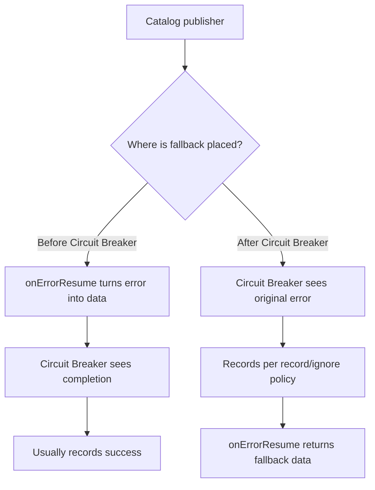

# Ordering of onErrorResume, retryWhen, timeout, and Circuit Breaker

In reactive Spring Cloud CircuitBreaker, the order of Reactor operators determines which errors the Circuit Breaker sees, how many times a failure is retried, and whether a fallback hides errors from statistics. `onErrorResume`, `retryWhen`, and `timeout` all alter the signals of a publisher. Placing them before or after `ReactiveCircuitBreaker.run(...)` can change how many samples are recorded in the sliding window and when the circuit transitions to `OPEN`.

The key principle is: operations that the Circuit Breaker needs to measure must sit inside the protected publisher. If `onErrorResume` turns an error into a normal result before the publisher enters the Circuit Breaker, the circuit will see a successful completion. If retry is inside the Circuit Breaker, the circuit typically records the final outcome of the entire retry chain; if retry is outside, each resubscription can become an individually protected Circuit Breaker call.

## Reactive publishers execute upon subscription

Unlike synchronous calls, `Mono` and `Flux` usually describe a processing flow that has not yet started. Work begins when a subscription occurs. `retryWhen` creates a new subscription to the source publisher when the retry policy allows. Therefore, a single reactive request can produce multiple actual calls to the dependent service.

Use `Mono.defer(...)` or `Flux.defer(...)` when you need to recreate the client call for each subscription. This ensures the call is reconstructed on retry rather than reusing a pre-built publisher with side effects or single-use state.

```java
Mono<Product> source = Mono.defer(() -> catalogClient.find("SKU-100"));
```

With a Circuit Breaker, subscription is also the point where call permission is checked. If the circuit is `OPEN`, a new subscription can be rejected with `CallNotPermittedException` without calling the dependent service. Consequently, blind retries may simply repeat fast rejections.

## Role of each operator

| Operator | Function | Impact to watch for |
|---|---|---|
| `onErrorResume` | Replaces an error signal with a fallback publisher | If placed before the Circuit Breaker, the original error may be converted into completion and counted as a success |
| `retryWhen` | Resubscribes to the source per retry policy | Placement determines whether the Circuit Breaker records each attempt or only the final outcome |
| `timeout` | Emits `TimeoutException` if the publisher emits no signal within the deadline | Place inside the protection scope so the Circuit Breaker receives and classifies timeouts |
| `ReactiveCircuitBreaker.run` | Protects the publisher, records outcomes, and applies fallback | Acts as the boundary defining which errors and durations the Circuit Breaker observes |

`onErrorResume` is not a retry operation. It switches to another publisher when the source errors. `retryWhen` is not a fallback. It resubscribes to the source per policy. `timeout` produces an error when the deadline expires; it does not decide to retry or return fallback data on its own.

## Ordering `onErrorResume`: fallback before or after Circuit Breaker?

### Placing `onErrorResume` before Circuit Breaker

```java
Mono<Product> result = Mono.defer(() -> catalogClient.find(sku))
    .onErrorResume(error -> cache.find(sku));

return circuitBreaker.run(result, error -> fallbackProduct(sku, error));
```

When `catalogClient` emits an error, `onErrorResume` switches to the cache. If the cache emits a `Product` and completes, the publisher protected by the Circuit Breaker has completed normally. The Circuit Breaker records this outcome as a success; it does not see the original exception to increment the failure rate. This placement fits when you intentionally want to measure the combined fallback strategy as a successful application-level call, but is usually inappropriate if the goal is to detect a failing dependency.

If the cache also errors, the Circuit Breaker will see the final error from the fallback publisher. In that case, it may classify the cache error instead of the original catalog error. Keep this in mind when the cache and the dependent service have different error policies.

### Placing `onErrorResume` after Circuit Breaker

```java
Mono<Product> result = circuitBreaker.run(
    Mono.defer(() -> catalogClient.find(sku)),
    error -> Mono.error(error));

return result.onErrorResume(error -> fallbackProduct(sku, error));
```

In this example, the Circuit Breaker receives the error signal from `catalogClient` before the outer `onErrorResume` switches to the fallback. The circuit can record the failure and update the failure rate; the caller still receives fallback data if the fallback succeeds.

When using Spring Cloud CircuitBreaker's `run(publisher, fallback)` overload, you can supply the fallback directly in the call. That fallback is applied by the Circuit Breaker layer after the source error has been observed. If you need explicit ordering control or want to separate fallback logic by error type, you can have the fallback re-emit the error via `Mono.error(error)` and handle it downstream with `onErrorResume` as shown above.



## Ordering `retryWhen`: count each attempt or only the final outcome?

### Retry inside the Circuit Breaker

```java
Mono<Product> protectedCall = Mono.defer(() -> catalogClient.find(sku))
    .retryWhen(Retry.backoff(2, Duration.ofMillis(100))
        .filter(this::isRetryable)
        .onRetryExhaustedThrow((spec, signal) -> signal.failure()));

return circuitBreaker.run(protectedCall, error -> fallbackProduct(sku, error));
```

Here, `retryWhen` sits inside the publisher protected by the Circuit Breaker. The Circuit Breaker grants permission for the retry chain's subscription and observes the final terminal signal. If two retries fail and the final attempt succeeds, the Circuit Breaker records a final outcome of success for that subscription. If retries are exhausted and still error, the circuit records one failure for that chain. Individual attempts inside the retry do not automatically generate separate Circuit Breaker samples.

This is a good fit when you want a business operation to have a chance to self-recover before the Circuit Breaker concludes the dependency has failed. Set reasonable retry limits and total time budgets so requests are not stretched excessively.

### Retry outside the Circuit Breaker

```java
Mono<Product> oneProtectedAttempt = circuitBreaker.run(
    Mono.defer(() -> catalogClient.find(sku)),
    error -> Mono.error(error));

return oneProtectedAttempt
    .retryWhen(Retry.backoff(2, Duration.ofMillis(100))
        .filter(this::isRetryable))
    .onErrorResume(error -> fallbackProduct(sku, error));
```

Here, the downstream `retryWhen` resubscribes to the entire publisher protected by the Circuit Breaker. Each subscription requests call permission again and can generate its own sample. If the first two attempts fail and the third succeeds, the sliding window can receive two failures and one success. This makes the Circuit Breaker react faster to individual attempts, but also lets retries contribute more failure samples.

Do not retry `CallNotPermittedException`. When the Circuit Breaker is `OPEN`, this error indicates the circuit actively rejected the call. Retrying repeatedly does not help the dependent service recover and can add extra load to the application. The retry predicate should only select transient errors where retrying has a chance of succeeding, such as brief connection errors or bounded timeouts.

`Retry.backoff(2, ...)` means at most two retries after the initial attempt. When retries are exhausted, Reactor can emit a `RetryExhaustedException` wrapping the final error. The example uses `onRetryExhaustedThrow((spec, signal) -> signal.failure())` to re-emit the last error, helping the Circuit Breaker or fallback classify the exact exception type. If you do not use this approach, inspect `cause` in your failure-recording predicate.

## Ordering `timeout`: per-attempt deadline versus total operation deadline

Timeout can be placed in two different positions in a retry chain:

```java
// Each attempt has at most 1 second.
Mono<Product> perAttemptTimeout = Mono.defer(() -> catalogClient.find(sku))
    .timeout(Duration.ofSeconds(1))
    .retryWhen(retryPolicy);

// The entire retry chain has at most 3 seconds.
Mono<Product> totalDeadline = Mono.defer(() -> catalogClient.find(sku))
    .retryWhen(retryPolicy)
    .timeout(Duration.ofSeconds(3));
```

In the first expression, each subscription to the source has a one-second timeout; when a timeout occurs, `retryWhen` can retry if the predicate allows it. In the second expression, the timeout wraps the entire retry chain, including backoff delays between attempts. This sets an overall deadline for the operation.

For the Circuit Breaker to record timeouts, place the timeout-wrapped publisher inside `run(...)`:

```java
Mono<Product> attempts = Mono.defer(() -> catalogClient.find(sku))
    .timeout(Duration.ofSeconds(1))
    .retryWhen(retryPolicy);

Mono<Product> bounded = attempts.timeout(Duration.ofSeconds(3));

return circuitBreaker.run(bounded, error -> fallbackProduct(sku, error));
```

In this example, both the per-attempt timeout and the total deadline occur inside the Circuit Breaker boundary. The circuit receives the final timeout signal and classifies it according to the configured `recordExceptions`/`ignoreExceptions` policy or predicate. If `.timeout(...)` is placed downstream after `circuitBreaker.run(...)`, the timeout may cancel the upstream subscription before the Circuit Breaker receives a `TimeoutException`; in that case, do not assume a downstream timeout was recorded as a failure.

A timeout only limits how long the publisher waits on the application side. Request cancellation at the client, transport, and target service depends on the implementation; a caller-side timeout does not guarantee server-side work has stopped.

## Combining all four components in Spring Cloud CircuitBreaker

The example below applies a common ordering for a product lookup API: create the publisher on subscribe, apply a per-attempt timeout, retry selectively, set a total deadline, and wrap the entire chain with a Circuit Breaker. The fallback runs after the Circuit Breaker has observed the final error.

```java
import java.io.IOException;
import java.time.Duration;
import java.util.concurrent.TimeoutException;

import org.springframework.cloud.client.circuitbreaker.ReactiveCircuitBreaker;
import org.springframework.cloud.client.circuitbreaker.ReactiveCircuitBreakerFactory;
import org.springframework.stereotype.Service;
import reactor.core.Exceptions;
import reactor.core.publisher.Mono;
import reactor.util.retry.Retry;
import io.github.resilience4j.circuitbreaker.CallNotPermittedException;

@Service
class CatalogService {

    private final ReactiveCircuitBreakerFactory<?, ?> circuitBreakerFactory;
    private final CatalogClient catalogClient;
    private final ProductCache productCache;

    CatalogService(
            ReactiveCircuitBreakerFactory<?, ?> circuitBreakerFactory,
            CatalogClient catalogClient,
            ProductCache productCache) {
        this.circuitBreakerFactory = circuitBreakerFactory;
        this.catalogClient = catalogClient;
        this.productCache = productCache;
    }

    Mono<Product> find(String sku) {
        ReactiveCircuitBreaker breaker = circuitBreakerFactory.create("catalog");

        Retry retryPolicy = Retry.backoff(2, Duration.ofMillis(100))
            .filter(this::isRetryable)
            .onRetryExhaustedThrow((spec, signal) -> signal.failure());

        Mono<Product> request = Mono.defer(() -> catalogClient.find(sku))
            .timeout(Duration.ofSeconds(1))
            .retryWhen(retryPolicy)
            .timeout(Duration.ofSeconds(3));

        return breaker.run(request, error -> fallback(sku, error));
    }

    private boolean isRetryable(Throwable error) {
        Throwable cause = Exceptions.unwrap(error);
        return !(cause instanceof CallNotPermittedException)
            && (cause instanceof IOException || cause instanceof TimeoutException);
    }

    private Mono<Product> fallback(String sku, Throwable error) {
        return productCache.find(sku)
            .switchIfEmpty(Mono.error(new CatalogUnavailableException(sku, error)));
    }
}
```

In this example, `retryWhen` is inside `breaker.run`, so the Circuit Breaker evaluates the final outcome of the retry chain per subscription. The fallback in `run` is only used when the protected chain terminates with an error or the Circuit Breaker denies permission. `fallback(...)` returns a `Mono` so it does not block reactive threads.

To trace this policy, suppose the first call times out, the second attempt also times out, and the third succeeds within the total deadline. The Circuit Breaker sees one subscription ending in success. If the total deadline expires or the final attempt emits an error, the Circuit Breaker sees one final error and updates the sliding window per its classification policy. When the circuit is `OPEN`, the factory rejects subscriptions; the retry predicate excludes `CallNotPermittedException`, and then the fallback can use the cache.

## Same error, different order yields different outcomes

| Processing chain | What the Circuit Breaker sees | Typical recorded outcome |
|---|---|---|
| `source.onErrorResume(fallback)` then passed to `run` | Completion from fallback | Success if fallback completes normally |
| `run(source, fallback)` | Source error before fallback returns result | Failure per classification policy; caller can receive fallback |
| `source.retryWhen(policy)` then passed to `run` | Final outcome of retry chain | One outcome per subscription |
| `run(source).retryWhen(policy)` with error re-emitted | Each individually protected subscription | Each attempt can produce a separate sample |
| `source.timeout(d)` then passed to `run` | Timeout emitted inside protected publisher | Timeout classified per configuration |
| `run(source).timeout(d)` | Downstream timeout may cancel source | Do not assume the Circuit Breaker records `TimeoutException` |

The rows in this table assume the fallback does not alter signals before the stated boundary and retries only continue when the predicate allows. Whenever you change operator order, re-verify which publisher sits inside `run(...)` and which publisher merely processes signals after the Circuit Breaker has finished measuring.

## Notes on Flux and multi-element streams

With `Flux`, the Circuit Breaker protects one subscription of the entire stream. If the stream emits multiple elements and then emits an error, the error at the end can still cause the subscription to be recorded as failed; elements emitted earlier do not automatically turn the call into a success. If `onErrorResume` inside the protection boundary replaces the error with a fallback stream and completes, the Circuit Breaker may see normal completion.

Retrying a `Flux` resubscribes to the source. If the source already emitted some elements before failing, those elements may be emitted again upon retry. For operations with side effects, data writes, or event publishing, use idempotency keys, checkpoints, or deduplicating consumers. Do not retry an infinite stream as if it were a finite request; use reconnect and backoff policies suited to the streaming protocol.

## Testing operator ordering

A reactive test suite should verify both return values and Circuit Breaker metrics:

1. **Fallback before Circuit Breaker:** have the source emit an error and the fallback return a value. Verify the caller receives the fallback value and the circuit records a completion under this arrangement.
2. **Fallback after Circuit Breaker:** have the source emit an error and a downstream fallback return a value. Verify the circuit records a failure while the caller still receives the fallback value.
3. **Retry inside:** have two attempts fail and the third succeed. Verify one Circuit Breaker subscription ends in success.
4. **Retry outside:** have each protected subscription fail and a later subscription succeed. Verify each attempt can produce its own sample.
5. **Timeout inside:** use a publisher that emits no signal before the deadline. Verify the timeout is classified by the Circuit Breaker per configuration.
6. **Timeout outside:** place timeout after `run(...)`, and verify cancellation and metrics for the version in use; do not assume it is equivalent to an inside timeout.
7. **Circuit OPEN:** verify `CallNotPermittedException` is not retried repeatedly and the fallback still works.

With Reactor Test, `StepVerifier` and mock publishers can control signals, timing, and subscription counts. Use virtual time for retry backoff and timeouts so tests run fast and deterministically without waiting in real time. After each scenario, check client call counts, success/failure sample counts, and Circuit Breaker state.

When debugging a reactive request that retries too many times or a Circuit Breaker that fails to open despite dependency errors, trace the order from the source publisher to `run(...)`: check whether `onErrorResume` swallows errors before the circuit, whether `retryWhen` is inside or outside the circuit, where timeouts originate, and whether the final exception matches `recordException` or `ignoreException`. Just one operator placed on the wrong side can completely change the data the Circuit Breaker relies on to protect the service.
