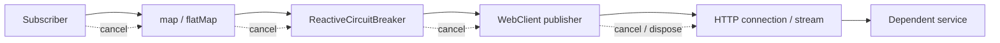
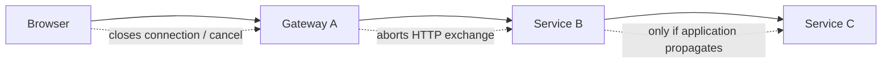

# Subscription Cancellation and Limits of Cancelling Downstream Work

In a Spring Cloud application using WebFlux and Reactor, an HTTP call is typically represented by a `Mono` or `Flux`. Work only begins when a subscription occurs. During processing, a subscriber can send a cancellation signal (`cancel`) when a user leaves a page, an upstream request times out, an operator no longer needs data, or a processing flow is superseded. Reactor propagates the cancellation signal back upstream to the publisher so components have an opportunity to stop work and release resources.

However, subscription cancellation only controls the reactive flow on the application side. It does not guarantee that all work already sent to the dependent service stops immediately. The HTTP client may cancel the network exchange or close/reset the stream, yet the server may have already received the request and continued processing. Circuit breakers, timeouts, and cancellation must therefore be designed together: the application must know where timeouts are generated, which signals the breaker observes, and whether the target system supports work cancellation.

## 1. Subscription and cancellation in Reactor

Reactor follows the Reactive Streams model. A publisher emits data to a subscriber after the subscriber subscribes. For a `Mono` source, the stream typically emits at most one value and completes; a `Flux` can emit multiple values. A subscriber can request data according to demand and send `cancel()` to indicate it no longer needs further signals.

Three terminal signals commonly need to be distinguished:

- `onComplete`: publisher completes normally.
- `onError`: publisher terminates due to an error.
- `cancel`: subscriber actively cancels the subscription; this is not an error signal emitted via `onError`.

Cancellation is a flow-control action, not a business outcome. For example, a browser closes its connection while a page is loading recommendations. The gateway can cancel the `WebClient` subscription, but that does not mean the recommendation service returned a failed result. Similarly, a cancelled request must not be treated as an empty response or a successful response.

Operators such as `take`, `next`, `switchMap`, `timeout`, or explicit cancellation logic from a subscriber can trigger upstream cancellation. With `switchMap`, when the source emits a new value, the previous inner publisher can be cancelled because the old result is no longer needed. With `take(n)`, once n elements have been received, the operator cancels upstream to avoid producing further data.

## 2. Cancellation propagates back through the publisher chain

In a Reactor pipeline, the subscriber at the end of the chain can cancel the subscription. Intermediate operators propagate the cancellation request back to the upstream source and to any inner publishers they manage. The goal is to stop producing further data, halt cancellable tasks, and release resources.



This diagram illustrates the cancellation propagation path in the client-side pipeline. Operators and the HTTP client can react by stopping emissions, cancelling running tasks, aborting the network request, or releasing the connection/stream. Exact results depend on the publisher and client in use.

For example, `WebClient` creates a publisher for an HTTP request:

```java
Mono<ProductView> request = webClient.get()
        .uri("/products/{id}", productId)
        .retrieve()
        .bodyToMono(ProductView.class);
```

With this code, the request has not been sent merely because the `request` variable was created. Only upon subscription does WebClient perform the network exchange. If the subscriber cancels before a result arrives, WebClient can abort reading the response and instruct the underlying HTTP client to terminate the corresponding exchange.

Use `Mono.defer` when you need to construct the publisher or read state per subscription:

```java
Mono<ProductView> request = Mono.defer(() ->
        webClient.get()
                .uri("/products/{id}", productId)
                .retrieve()
                .bodyToMono(ProductView.class)
);
```

`defer` postpones inner publisher creation until subscribe time. It is useful when a publisher is shared or reused, because each subscription runs source creation fresh. Whether or not `defer` is used, avoid performing synchronous side effects while assembling the pipeline before subscription.

## 3. Cancellation does not equal an error

A crucial point when using a reactive circuit breaker is distinguishing cancellation from an exception. `onError` carries an error emitted by the publisher; `cancel` is the subscriber asking to stop. Cancellation does not automatically produce a `TimeoutException`, `WebClientRequestException`, or a business exception.

Therefore, do not assume that:

- `onErrorResume` will run when a subscriber cancels.
- The fallback function of `ReactiveCircuitBreaker.run` will run when a subscriber cancels.
- A cancelled subscription is always counted as a failed call in the sliding window.
- Cancellation always releases every permit or internal state in the exact same way across all implementation versions.

With reactive Resilience4j, success and failure outcomes are observed through the publisher's corresponding signals. Cancellation is not an exception outcome. How the implementation handles cancellation during protection, especially in `HALF_OPEN`, should be verified against the exact version in use if the system depends on specific permit or metric behavior. Do not infer cancellation counts from the failure rate.

You can observe cancellation with `doOnCancel` or `doFinally`:

```java
Mono<ProductView> request = webClient.get()
        .uri("/products/{id}", productId)
        .retrieve()
        .bodyToMono(ProductView.class)
        .doOnCancel(() -> log.debug("Product request subscription cancelled"))
        .doFinally(signal -> log.debug("Product request finished: {}", signal));
```

`doOnCancel` runs when the subscription is cancelled. `doFinally` runs when the stream ends via complete, error, or cancel; the `SignalType` parameter indicates the termination type. This is the right place to record metrics and release local resources. Do not use `doOnError` as the sole way to track all termination cases, because it does not receive cancellation.

## 4. Where to place timeout relative to ReactiveCircuitBreaker?

Where `timeout` is placed in the pipeline determines which component sees `TimeoutException`. Reactor's `timeout` emits a timeout error downstream and cancels the upstream subscription. If the timeout is placed inside the publisher passed into the breaker, the breaker can observe the timeout error as a call failure outcome. If the timeout sits outside the breaker-protected publisher, the timeout can cancel the breaker's subscription and emit the error at the outer layer; the breaker may only see a cancellation.

### Timeout inside the breaker

```java
public Mono<ProductView> find(String productId) {
    Mono<ProductView> request = Mono.defer(() ->
            webClient.get()
                    .uri("/products/{id}", productId)
                    .retrieve()
                    .bodyToMono(ProductView.class)
    ).timeout(Duration.ofSeconds(2));

    return reactiveCircuitBreakerFactory.create("catalog").run(
            request,
            error -> Mono.just(ProductView.unavailable(productId))
    );
}
```

Here, `timeout` is part of the publisher passed to `run`. When two seconds pass without a signal, the timeout operator cancels the upstream HTTP publisher and emits `TimeoutException` to the breaker. The breaker can record the failure per configuration and invoke its fallback.

### Timeout outside the breaker

```java
public Mono<ProductView> find(String productId) {
    Mono<ProductView> request = Mono.defer(() ->
            webClient.get()
                    .uri("/products/{id}", productId)
                    .retrieve()
                    .bodyToMono(ProductView.class)
    );

    return reactiveCircuitBreakerFactory.create("catalog").run(
            request,
            error -> Mono.just(ProductView.unavailable(productId))
    ).timeout(Duration.ofSeconds(2));
}
```

In this approach, the timeout outside the breaker cancels the subscription of the breaker-protected publisher and emits `TimeoutException` downstream. The fallback function inside the breaker does not receive the timeout error generated by the outer operator. The breaker may observe a cancellation rather than a supplier error. If the goal is to include timeouts in the circuit breaker's failure rate, place the timeout inside the protected publisher or configure timeout at the integration layer according to the implementation's semantics.

The two approaches are not equivalent. Choose timeout placement based on the goal: a per-dependency call timeout should be evaluated by the breaker; an overall request deadline can live at a higher layer and may cancel the entire pipeline. An application may need both limits, but you must distinguish each limit clearly and test signal ordering.

## 5. ReactiveCircuitBreaker and fallbacks

Spring Cloud provides `ReactiveCircuitBreakerFactory` to create reactive breakers by ID. `ReactiveCircuitBreaker.run` accepts a publisher and a fallback function returning a publisher of the same data type.

```java
import java.time.Duration;

import org.springframework.cloud.client.circuitbreaker.ReactiveCircuitBreaker;
import org.springframework.cloud.client.circuitbreaker.ReactiveCircuitBreakerFactory;
import org.springframework.stereotype.Service;
import org.springframework.web.reactive.function.client.WebClient;

import reactor.core.publisher.Mono;

@Service
public class CatalogGateway {
    private final WebClient webClient;
    private final ReactiveCircuitBreakerFactory<?, ?> factory;

    public CatalogGateway(
            WebClient.Builder builder,
            ReactiveCircuitBreakerFactory<?, ?> factory) {
        this.webClient = builder.baseUrl("http://catalog-service").build();
        this.factory = factory;
    }

    public Mono<ProductView> find(String productId) {
        Mono<ProductView> request = Mono.defer(() ->
                webClient.get()
                        .uri("/products/{id}", productId)
                        .retrieve()
                        .bodyToMono(ProductView.class)
        ).timeout(Duration.ofSeconds(2));

        ReactiveCircuitBreaker breaker = factory.create("catalog");
        return breaker.run(
                request,
                error -> Mono.just(ProductView.unavailable(productId))
        );
    }
}
```

In this example, the timeout sits inside the protected publisher. Timeout or HTTP errors are emitted as `onError` and can be routed to the fallback. If the subscriber cancels the subscription, the fallback is not invoked merely because of cancellation. Nor should the fallback make another request to the same failing catalog service.

If you need to log cancellation, attach `doOnCancel` at an appropriate spot in the publisher:

```java
Mono<ProductView> request = Mono.defer(() ->
        webClient.get()
                .uri("/products/{id}", productId)
                .retrieve()
                .bodyToMono(ProductView.class)
).timeout(Duration.ofSeconds(2))
 .doOnCancel(() -> log.info("Catalog lookup cancelled: {}", productId));
```

Placing `doOnCancel` before or after an operator can affect which subscription the hook observes. If you need to measure cancellation of the entire gateway, place the hook on the outermost layer of the publisher returned to the caller. If you need to measure cancellation specifically for the HTTP exchange, place the hook close to the WebClient publisher. Avoid logging the same event at multiple layers and summing them as if they were separate requests.

## 6. HTTP client cancellation does not guarantee the server stops processing

When WebClient receives a cancellation, Reactor Netty or the underlying HTTP client can cancel the pending request, stop reading the response, release the stream, or close the connection depending on the protocol and exchange state. This helps save resources on the client side. However, there is an important boundary between the client stopping its wait and the server stopping its work.

Suppose gateway A sends a request to service B. B receives the request, starts processing, and sends a downstream request to service C. While B is waiting for C, the user closes the browser and A cancels the subscription:

1. A cancels the WebClient publisher and instructs the HTTP client to abort the exchange.
2. B may detect that the client disconnected or the stream was reset.
3. B only stops work if B's framework and handler code propagate cancellation to running tasks and those tasks support stopping.
4. If B already sent a request to C, B must cancel its subscription or request to C for cancellation to continue propagating.
5. If C already performed a data write or an uncancellable operation, the work may still complete even though A is no longer waiting for the result.



HTTP/1.1 may require the client to close the connection or discard the response; HTTP/2 can reset an individual stream. The server can detect a dropped connection or reset stream, but detection can be delayed and does not automatically abort every running task. A thread executing blocking code, an SQL statement already sent to the database, or a message already placed in a queue can continue after the HTTP client disappears.

Therefore, cancellation is a cooperative signal. Each layer must actively observe that signal and propagate it to cancellable child tasks. Never treat cancellation as a rollback mechanism for an operation already executed.

## 7. Blocking tasks and cancellation limits

A reactive pipeline does not make a blocking task automatically cancellable. For example, if a publisher uses `Mono.fromCallable` to call a blocking JDBC library on a scheduler, cancelling the subscription can stop Reactor from waiting, yet the already-running JDBC statement may continue on the thread or in the database.

```java
Mono<OrderView> order = Mono.fromCallable(() -> blockingOrderRepository.find(orderId))
        .subscribeOn(Schedulers.boundedElastic());
```

`subscribeOn(boundedElastic())` keeps the blocking call off the WebFlux event loop. It does not guarantee that a query already sent to the database stops when the subscriber cancels. Stopping behavior depends on the driver, thread interruption, statement cancellation APIs, and the database.

For long-running tasks, design explicit cancellation capability:

- Use non-blocking APIs that support cancellation whenever possible.
- If using JDBC or blocking libraries, check whether the driver supports `Statement.cancel()` or an equivalent mechanism and wire it into the task lifecycle.
- Keep a reference to the task handle if you need to issue a cancel command, while safely handling race conditions between completion and cancellation.
- Set timeouts on both client and server/database; a client-side timeout does not replace server-side execution time limits.
- Release resources in `doFinally`, `using`, or an appropriate resource management mechanism, ensuring safe cleanup on complete, error, and cancel.

Do not use `Thread.stop()` to halt tasks. If interruption is needed, the task must cooperate by checking the interrupt flag or handling `InterruptedException`, and the underlying library must have appropriate semantics. Calling `Future.cancel(true)` only sends an interrupt request; it does not guarantee that I/O operations or database work have terminated.

## 8. Cancellation limits in TimeLimiter and timeouts

Resilience4j `TimeLimiter` can bound the wait time of a `Future` or `CompletionStage` depending on the API used. Configuration can request cancelling the Future on timeout. However, `cancelRunningFuture` or `Future.cancel(true)` still depends on the cooperation of the task and underlying library.

In a reactive application, Reactor's `timeout` is an operator that emits `TimeoutException` and cancels upstream. With `WebClient`, cancellation can abort the client-side network exchange; for blocking tasks or work already accepted by the server, you cannot assume all activity has stopped.

Distinguish three time limits:

| Limit | What it controls | What is not guaranteed |
|---|---|---|
| HTTP client timeout | Connection or response wait time on the client side | That the server did not execute the operation or rolled it back |
| Reactor `timeout` | How long a publisher is allowed to go without emitting a signal | That all underlying tasks have completely stopped |
| TimeLimiter for Future | Task wait time and optional cancel request | That the thread, socket, database, or server definitely stops |

If a system has a 3-second overall deadline, allocate the budget across dependent calls, retries, and internal processing. An individual service timeout should be shorter than the total deadline so the gateway still has time to run a fallback and return a response. When the overall timeout occurs, cancellation can propagate down to pending calls, while already-committed operations still require business-level handling.

## 9. Cancelling operations with side effects and idempotency

For read-only operations, having the server continue processing after client cancellation mostly wastes resources. For operations with side effects such as creating an order, processing a payment, sending an email, or recording a transaction, the problem is more severe: a client not receiving a response does not mean the operation did not happen.

For example, the gateway sends a create-order command to the Order service. Order writes the data successfully, but the response is lost. The user clicks submit again because the UI reported a timeout. If the server has no mechanism to recognize duplicate requests, the system can create two orders.

Appropriate safeguards include:

- **Idempotency key:** the client sends a unique key for the logical operation; the server stores the result by key and returns the prior result on duplicate requests.
- **Business identifier:** use a unique order ID or payment intent ID rule to detect that the operation was already created.
- **Processing state:** explicitly represent `PENDING`, `COMPLETED`, `FAILED`, or `UNKNOWN` instead of treating a timeout as a definite failure.
- **Reconciliation:** for financial transactions, provide a status-query API so clients can verify the outcome after a timeout.
- **Compensation:** if the domain supports it, use a controlled compensation workflow instead of assuming cancellation rolled back the operation.

A circuit breaker stops subsequent calls from hitting a failing dependency; it does not provide idempotency and does not undo committed transactions. Fallbacks should also reflect an indeterminate state when it is impossible to know whether the operation completed.

## 10. Observing cancellation and distinguishing it from failures

The circuit breaker's failure rate metric alone is not enough to measure all cancellations. Track cancellation separately to see how many requests the system cancels, at which layer, and whether it causes wasted backend work.

Useful signals include:

- Subscriptions ending with `SignalType.CANCEL`.
- Timeouts generated inside the protected publisher versus timeouts at the outer layer.
- Fallback executions, breaker rejections, and supplier errors.
- HTTP exchanges cancelled/disposed on the client, along with latency prior to cancellation.
- Server-side tasks continuing after client disconnect, if the server can measure them.
- Blocking tasks or database queries requested to cancel versus those that actually stopped.

Example using `doFinally` to classify termination:

```java
return gateway.find(productId)
        .doFinally(signal -> {
            if (signal == SignalType.CANCEL) {
                metrics.counter("catalog.subscription.cancelled").increment();
            }
        });
```

Metrics should be tagged by breaker ID, stream type, or service name with bounded cardinality. Avoid using request IDs, user IDs, or URLs containing identifiers as metric labels because they create high cardinality. If you need to correlate a cancellation with a trace, use trace/span IDs in your tracing system rather than placing them in metric labels.

Cancellation logs must be interpreted carefully. A user leaving a page can produce normal cancellations; that is not necessarily an incident. Conversely, rising cancellation rates alongside timeouts, high latency, and overloaded backends can indicate users are abandoning slow requests. Cross-check with traces and dependent service health before tuning circuit breaker thresholds.

## 11. Testing cancellation behavior

Test cancellation with reactive tests that control time and subscriptions rather than only testing timeout exceptions. Reactor Test provides `StepVerifier` to simulate requests, cancellations, and verify publisher behavior.

Example verifying a publisher observes cancellation:

```java
AtomicBoolean cancelled = new AtomicBoolean();

Mono<String> source = Mono.<String>never()
        .doOnCancel(() -> cancelled.set(true));

StepVerifier.create(source)
        .thenCancel()
        .verify();

assertTrue(cancelled.get());
```

In gateway integration tests, include these scenarios:

1. Subscriber cancels before WebClient receives a response; verify the client-side cancellation hook runs.
2. Request completes before cancel; verify the stream completes normally without recording a spurious cancellation.
3. Timeout placed inside the breaker; verify `TimeoutException` reaches the breaker and fallback executes per configuration.
4. Timeout placed outside the breaker; verify the timeout is emitted at the outer layer and do not assume the breaker's internal fallback runs.
5. Breaker in `OPEN`; verify the source publisher is not subscribed to and the fallback is handled per the reactive API.
6. Subscriber cancels while the breaker is in `HALF_OPEN`; check permits and metrics against the Resilience4j version in use.
7. Test HTTP server records client disconnect; verify whether the server stops work according to the implemented mechanism.
8. Blocking task or database query; verify cancellation actually takes effect and resources are released.

Reactor cancellation tests do not prove the backend stopped. Integration testing across client, server, and dependent execution layers is required if business requirements demand end-to-end task termination.

## 12. Workflow for designing cancellation for a dependent call

When building a reactive gateway with a circuit breaker, clearly map the subscription path and each layer's responsibility:

1. Create a lazy publisher for the call using WebClient; avoid side effects before subscription.
2. Place the dependency's own timeout inside the breaker-protected publisher if that timeout must count as a dependency failure.
3. Use `ReactiveCircuitBreakerFactory` and fallbacks with honest business semantics.
4. Handle cancellation separately via `doOnCancel` or `doFinally`; do not treat cancellation as an exception.
5. Verify the HTTP client properly aborts exchanges/streams and releases resources.
6. On request-handling servers, propagate cancellation to child tasks when possible; check drivers, databases, and blocking libraries.
7. Protect operations with side effects using idempotency, explicit business states, and reconciliation.
8. Monitor timeouts, cancellations, fallbacks, breaker state, and backend tasks still running after disconnect.

Subscription cancellation lets a reactive application stop waiting and asks upstream publishers to stop work. Real effectiveness depends on each operator, HTTP client, server, and underlying task. Placing timeouts inside or outside the circuit breaker determines whether the breaker observes a timeout error or only receives cancellation. By understanding those limits and designing cooperative cancellation across every layer, a Spring Cloud system can release resources early, protect dependencies with a circuit breaker, and avoid mistakenly assuming a cancelled request means the server-side transaction was stopped or rolled back.
