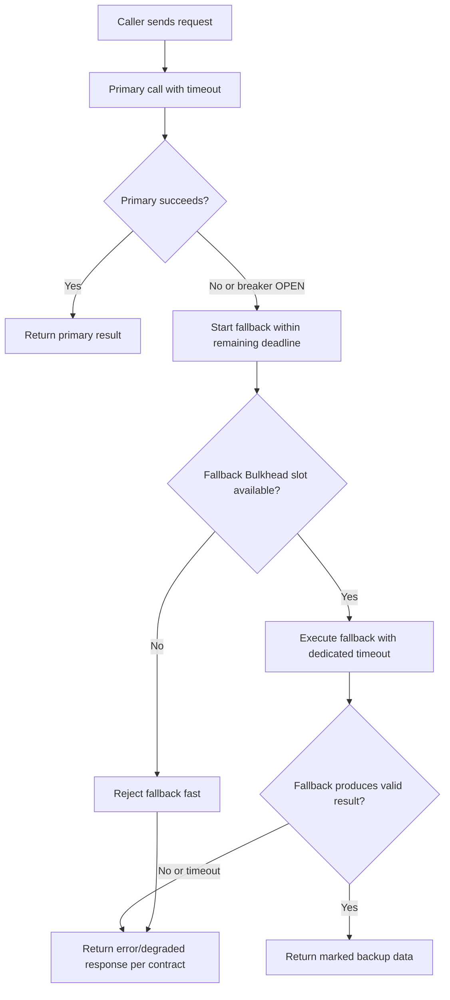

# Bounding Fallback Timeouts and Protecting Fallback Resources

Fallback helps an application continue providing a useful result when the primary dependency fails or the Circuit Breaker is `OPEN`. However, a fallback is also work that consumes resources. If a fallback waits indefinitely, calls an overloaded backup service, or gets triggered concurrently by thousands of requests, it can become a new bottleneck and cause cascading failures just like the original dependency.

In Spring Cloud CircuitBreaker with Resilience4j, fallbacks must be designed with a time budget, concurrency limits, and data sources capable of responding during an outage. This article focuses on bounding time for both primary calls and fallbacks, protecting fallback resources with a Bulkhead, keeping reactive pipelines non-blocking, and monitoring backup effectiveness.

## 1. Why Does a Fallback Also Need Protection?

Suppose the product service calls the Catalog Service for product details. When the Catalog Service fails, the application reads from a cache or calls a backup replica. If 10,000 requests switch to the cache or replica simultaneously, fallback load can spike sharply.

An unbounded fallback can cause several problems:

- **Waiting too long:** the request already failed on the primary dependency yet keeps holding threads, connections, or subscriptions while waiting on the fallback.
- **Cascading overload:** many requests hit a single backup source simultaneously, rendering it unable to serve as well.
- **Unbounded queuing:** fallback tasks wait for slots or executors, increasing latency and pinning resources.
- **Repeated retries:** the fallback keeps retrying a failing dependency, amplifying load when the system is weakest.
- **Nested fallbacks:** backup option A calls B, and B calls C; total time and resource consumption become unpredictable.
- **Masking outages:** the fallback always returns a default result without recording that both the primary and backup sources failed.

Therefore, a fallback must have its own limits. The goal is to finish the request within the allotted time budget while capping how much fallback work can run concurrently.

## 2. Allocating an End-to-End Time Budget

A request has a total time budget defined by the caller, gateway, or SLO. Time spent on the primary call and the fallback must fit inside this budget.

This principle can be expressed as:

```text
T_primary + T_fallback + T_response_margin <= T_request_deadline
```

Where:

- `T_request_deadline`: maximum time the caller waits for the entire request.
- `T_primary`: maximum time allocated to the primary dependency.
- `T_fallback`: maximum time allocated to the backup mechanism.
- `T_response_margin`: time reserved for mapping results, required logging, serializing the response, and returning it to the caller.

For example, suppose an API has a 1,500 ms deadline. You might allocate 900 ms to the Catalog Service, 350 ms to the fallback cache or backup source, and reserve around 250 ms for remaining processing. Numbers must be measured from real latencies; do not copy them verbatim into production.

| Component | Illustrative Budget |
|---|---:|
| End-to-end request | 1,500 ms |
| Catalog Service call | 900 ms |
| Fallback | 350 ms |
| Mapping and response serialization | 250 ms |

Do not set the fallback timeout equal to the end-to-end request timeout. Once the primary dependency has consumed nearly the whole budget, a long fallback causes the caller to receive the response too late. Account for retry time if retries exist: every attempt, backoff, and fallback draws from the same deadline.

In distributed systems, propagate the deadline or remaining timeout across layers instead of having each layer start a fresh timer. If the caller only has 300 ms left, a service should not call another dependency with a two-second timeout. For HTTP clients, configure connect timeout, response/read timeout, and overall request timeout to fit the remaining budget.

## 3. Bounding Time on the Primary Dependency

The Circuit Breaker needs to receive a call outcome to update its sliding window. If a call never finishes, the request can hold resources for a long time. Therefore, set timeouts on the HTTP client or inside the protected Publisher.

Example with WebClient:

```java
Mono<Product> primaryCall = webClient.get()
    .uri("/products/{id}", productId)
    .retrieve()
    .bodyToMono(Product.class)
    .timeout(Duration.ofMillis(900));

return circuitBreakerFactory.create("catalog-read").run(
    primaryCall,
    error -> fallbackService.findProduct(productId)
);
```

The timeout sits inside the Publisher passed to the Circuit Breaker. When time expires, Reactor emits a timeout error and the breaker records the failed call per configuration. The fallback callback is used to supply the alternative result.

With synchronous clients, configure timeouts directly on the HTTP client, JDBC driver, or SDK. Do not assume every synchronous call wrapped in `CircuitBreakerFactory.run(Supplier)` is automatically interrupted by TimeLimiter. Resilience4j's TimeLimiter primarily applies to compatible asynchronous tasks such as `CompletionStage`; blocking I/O timeouts still need to be configured on the client performing the I/O.

## 4. Setting a Dedicated Timeout for the Fallback

A fallback can be a cache, replica, backup service, or predefined degraded result. Each option has different latency characteristics:

- In-memory caches are usually very fast, yet cache operations can still contend on locks or reach another backing store.
- Out-of-process caches such as Redis can still experience network timeouts.
- A replica or alternative service is another network dependency and needs its own timeout.
- Local default data can return quickly, yet is only valid if it does not distort business semantics.

Example of a reactive cache fallback bounded to 250 ms:

```java
private Mono<ProductView> fallback(String productId, Throwable cause) {
    return cacheService.findUsable(productId)
        .timeout(Duration.ofMillis(250))
        .map(product -> ProductView.fromCache(product))
        .switchIfEmpty(Mono.error(
            new FallbackDataUnavailableException(productId)));
}
```

If the cache does not respond within 250 ms, the Publisher emits a timeout error. If the cache has no data, `switchIfEmpty` turns that case into an explicit error. The calling layer can map this error to an appropriate degraded-service response.

You can add a default result after the cache fallback fails, provided the API contract permits it:

```java
private Mono<ProductView> fallback(String productId, Throwable cause) {
    return cacheService.findUsable(productId)
        .timeout(Duration.ofMillis(250))
        .map(ProductView::fromCache)
        .switchIfEmpty(Mono.error(
            new FallbackDataUnavailableException(productId)))
        .onErrorResume(fallbackError ->
            Mono.just(ProductView.unavailable(productId)));
}
```

Here `ProductView.unavailable` must clearly convey that data is unavailable. Never return a dummy product, fake inventory count, or value that tricks callers into thinking the data is confirmed. When no safe fallback exists, returning a clear service-unavailable error remains the right outcome.

## 5. Limiting Concurrent Fallbacks with a Bulkhead

A timeout bounds how long one task may wait; a Bulkhead bounds how many tasks may execute simultaneously. The two mechanisms complement each other.

Resilience4j Bulkhead can use either a semaphore or a thread pool:

- **Semaphore Bulkhead:** caps concurrent calls. Once slots are full, new calls are rejected or wait up to a configured maximum duration.
- **Thread Pool Bulkhead:** executes tasks on a dedicated pool with bounded threads and a bounded queue. This isolates blocking tasks, though the queue must be bounded to prevent request buildup.

A fallback should have its own Bulkhead, independent from the primary dependency's Bulkhead. When the primary dependency fails, requests shifting to the fallback can surge sharply. A dedicated limit protects the cache, replica, or resources used for fallback.

Example creating a semaphore Bulkhead:

```java
import java.time.Duration;

import io.github.resilience4j.bulkhead.Bulkhead;
import io.github.resilience4j.bulkhead.BulkheadConfig;
import io.github.resilience4j.bulkhead.BulkheadFullException;
import io.github.resilience4j.bulkhead.BulkheadRegistry;

BulkheadConfig fallbackConfig = BulkheadConfig.custom()
    .maxConcurrentCalls(30)
    .maxWaitDuration(Duration.ZERO)
    .build();

BulkheadRegistry registry = BulkheadRegistry.ofDefaults();

Bulkhead fallbackBulkhead = registry.bulkhead(
    "catalog-fallback",
    fallbackConfig
);
```

In this example, at most 30 fallbacks execute concurrently and excess calls are rejected immediately because `maxWaitDuration` is zero. The value 30 is illustrative only; choose it based on the capacity of the cache or backup service, number of application instances, and peak traffic.

With synchronous fallbacks, you can wrap the backup operation in the Bulkhead:

```java
private Product fallback(String productId, Throwable cause) {
    try {
        return fallbackBulkhead.executeSupplier(() ->
            cacheRepository.findUsable(productId)
                .orElseThrow(() ->
                    new FallbackDataUnavailableException(productId))
        );
    } catch (BulkheadFullException ex) {
        throw new FallbackOverloadedException(productId, ex);
    }
}
```

When the Bulkhead is full, the fallback fails fast and the application can return a degraded response or overload error. Avoid waiting indefinitely for a slot; long waits defeat resource protection.

## 6. Protecting Reactive Fallbacks

With WebFlux and Reactor, use the Bulkhead operator to limit concurrent subscriptions and apply a timeout directly on the fallback Publisher:

```java
import java.time.Duration;

import io.github.resilience4j.bulkhead.Bulkhead;
import io.github.resilience4j.reactor.bulkhead.operator.BulkheadOperator;
import reactor.core.publisher.Mono;

private Mono<ProductView> fallbackReactive(
        String productId,
        Throwable cause,
        Bulkhead fallbackBulkhead) {

    return cacheService.findUsable(productId)
        .transformDeferred(BulkheadOperator.of(fallbackBulkhead))
        .timeout(Duration.ofMillis(250))
        .map(ProductView::fromCache)
        .switchIfEmpty(Mono.error(
            new FallbackDataUnavailableException(productId)))
        .onErrorResume(error ->
            Mono.just(ProductView.unavailable(productId)));
}
```

`transformDeferred(BulkheadOperator.of(...))` bounds subscriptions to the fallback Publisher. `timeout` caps wait time. If the Bulkhead is full, the cache errors, or it times out, the pipeline transitions to the defined degraded outcome.

Never call `block()` inside a reactive fallback. Never call `subscribe()` manually to run a fallback in the background, as doing so strips the caller of control over results, cancellation, and deadlines. Return the Publisher to the caller's reactive chain.

If the fallback calls a blocking library, you can isolate the work on an appropriate scheduler, while bounding concurrency and wait time. `Schedulers.boundedElastic()` does not replace a Bulkhead policy; it only supplies a scheduler for blocking work with its own bounds. Never allocate a new scheduler or thread pool per request.

## 7. Preventing Fallbacks from Triggering Cascading Failures

A good fallback should be simpler and have fewer dependencies than the primary path. If the fallback calls another network service, that service also needs its own timeout, Bulkhead, and Circuit Breaker.

Design guidelines:

- Prefer a cache or local data that can be used safely.
- If calling a replica or alternative service, use a separate Circuit Breaker ID to track that dependency.
- Never call back into the very dependency protected by the breaker inside the fallback callback.
- Never retry unboundedly inside a fallback.
- Never create unbounded queues for fallback tasks.
- Never spawn unmanaged background tasks on every fallback invocation.
- If the fallback fails, terminate with a degraded response or clear error per the API contract.

For example, suppose the Catalog Service fails and the `catalog-read` breaker is `OPEN`. The fallback can read from a Redis cache. If Redis also fails, do not call the Catalog Service again inside the same fallback. If an independent replica exists, you can call the replica via a `catalog-replica-read` breaker with a short timeout and separate Bulkhead. However, only add a backup tier if it has sufficient capacity and is genuinely independent of the primary outage.

Fallback chains should be short and bounded. Every added tier increases maximum latency, connection usage, and failure points. Calculate the total budget before adding a second backup source.

## 8. Distinguishing Fallback Timeouts from Primary Request Timeouts

These timeouts carry distinct meanings:

| Timeout | Scope | Action on Expiration |
|---|---|---|
| Primary timeout | Primary dependency call | Terminates primary call; Circuit Breaker records timeout per config and triggers fallback |
| Fallback timeout | Backup operation | Stops waiting on fallback; returns degraded result or fallback error |
| Request deadline | Entire request from caller | Stops calling additional dependencies once budget is spent |
| Connection timeout | Establishing network connection | Stops waiting to connect to endpoint |
| Read/response timeout | Waiting for data from endpoint | Terminates waiting for response per limit |

Do not reuse the same exception or the same metric for every timeout type. A primary timeout reflects the primary dependency failing to reply in time; a fallback timeout reflects the backup path failing to respond; a request deadline reflects total processing time exceeding budget.

If a fallback timeout occurs, do not automatically retry the fallback again. Retrying a fallback can add load precisely when the cache or backup service is overloaded. Retry only if the operation is safe, has a higher chance of succeeding, and time budget remains.

## 9. Configuring Timeouts and Bulkheads by ID

Resilience4j allows configuring TimeLimiter and Bulkhead per instance. Example:

```yaml
resilience4j:
  timelimiter:
    instances:
      catalog-read:
        timeoutDuration: 900ms
        cancelRunningFuture: true
      catalog-fallback:
        timeoutDuration: 250ms
        cancelRunningFuture: true

  bulkhead:
    instances:
      catalog-fallback:
        maxConcurrentCalls: 30
        maxWaitDuration: 0
```

This configuration illustrates two IDs with different roles. `catalog-read` is for the primary dependency; `catalog-fallback` is for the backup operation. Configuring a TimeLimiter for `catalog-fallback` only takes effect if the code actually wraps the fallback operation with the corresponding TimeLimiter; a fallback callback does not automatically receive a separate TimeLimiter simply because an ID exists in YAML. Resilience4j TimeLimiter applies to compatible asynchronous tasks such as `CompletionStage`. With reactive WebClient, apply `Mono.timeout` or `Flux.timeout` directly on the fallback Publisher. With blocking I/O, configure timeouts on the I/O-performing client to guarantee the operation is truly bounded.

If using Bulkhead annotations or Spring AOP, verify the corresponding integration dependencies and configuration in the application. The YAML snippet above is only instance configuration; it does not automatically protect any method whose name resembles the ID unless execution flows through the integrated Bulkhead mechanism.

## 10. Choosing the Outcome When the Fallback Cannot Respond

When the fallback times out or the Bulkhead rejects it, the application needs a clear final outcome.

| Situation | Appropriate Outcome |
|---|---|
| Cache returns data within allowed age | Return cached data and mark timestamp or source if callers need to know |
| Cache has no data | Return service-unavailable error or missing-data result per contract |
| Cache times out | Terminate fallback and return error/degraded response; never wait indefinitely |
| Fallback Bulkhead full | Reject fast; return overload status or degraded response |
| Backup replica also fails | Log replica failure and terminate fallback chain |
| Fallback unsafe for business rules | Return clear error; never fabricate data |
| Request deadline expired | Stop further steps and return result per gateway/caller policy |

For instance, a product page can display names and descriptions from a stale cache while marking inventory data as undetermined. Conversely, a payment operation cannot use a fake fallback to return "paid". If confirmation has not arrived, return an undetermined or incomplete status and allow lookup via transaction ID.

## 11. Monitoring Fallback Effectiveness

Do not merely count how often fallbacks run. You need to know whether the fallback responds within its allotted time and how many resources it consumes.

Metrics to observe:

- `fallback.calls`: number of times the fallback was triggered.
- `fallback.success`: number of times the fallback returned a usable result.
- `fallback.errors`: number of fallback errors.
- `fallback.timeouts`: number of times the fallback exceeded its timeout.
- `fallback.rejected`: number of Bulkhead rejections due to no available slots.
- Fallback latency p50, p95, p99.
- Concurrent calls and Bulkhead utilization.
- Cache hit rate, cached data age, and degraded response count.
- End-to-end request success rate and end-to-end latency.

Separate metrics for the primary dependency and the fallback. For example, rising `catalog-read` `OPEN` events indicate primary dependency trouble; rising `catalog-fallback` rejections indicate the backup mechanism is hitting capacity limits. These two signals help determine whether to fix the primary service or scale cache/replica capacity.

Logs should capture breaker ID, fallback source, original error type, fallback error type, execution duration, and correlation ID. Avoid logging sensitive data or entire payloads solely to debug fallbacks. Use traces to inspect primary duration, fallback duration, and remaining deadline budget.

## 12. Flow Diagram of a Bounded Fallback



This flow keeps the fallback within the time budget and concurrent execution limit. When fallback capacity runs out, the system terminates early instead of queuing up more waiting work.

## Conclusion

Fallbacks also require timeouts and resource limits because they typically trigger right when the system is under load or a primary dependency is failing. Allocate time budgets across primary, fallback, and response handling; use a dedicated Bulkhead to cap concurrent fallbacks; keep reactive fallbacks non-blocking; and avoid unbounded retries or fallback chains. Monitor timeouts, errors, Bulkhead rejections, and fallback latency separately to verify whether your backup strategy actually sustains availability or is becoming a new bottleneck.
