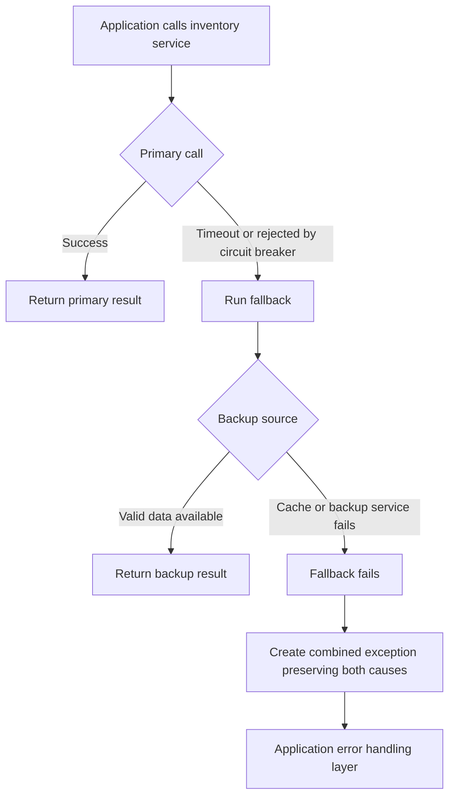

# Handling Fallback Failures While Preserving Root Causes

Fallbacks allow an application to keep serving when a call to a dependent service fails or a circuit breaker rejects the call. However, the fallback itself can also fail: the cache may be unreachable, a backup service may time out, cached data may be expired, or data transformation logic may throw an exception. When that happens, the application must handle two failures in the same flow: the original error that triggered the fallback and the new error raised while the fallback ran.

In Spring Cloud CircuitBreaker with Resilience4j, the fallback function receives the cause from the protected call. If the fallback throws another exception, that new exception can become the only error seen by the outer caller. Therefore, do not assume the original cause is preserved automatically. Explicitly construct an exception chain that retains both causes while recording primary failures and fallback failures separately.

## 1. Why Can a Fallback Fail as Well?

A fallback typically uses another data source or operation to build an alternative response. For example, when the inventory service does not respond, the application reads from a cache. Yet the cache may be expired, Redis may lose connectivity, or mapping cached data to the domain model may throw an exception.

Common scenarios:

- **Cache-based fallback:** the cache is unavailable, has no entry, or contains data older than the business limit allows.
- **Fallback calling a second service:** the backup service is also overloaded, timing out, or returning errors.
- **Data conversion fallback:** data is missing fields, malformed, or incompatible with the current model version.
- **Fallback performing auxiliary work:** writing audit logs, persisting state, or fetching configuration fails.
- **Fallback returning an invalid result:** does not throw an exception yet returns `null`, an empty publisher, or a default value that misleads the business layer.

Example failure flow:



A fallback is not guaranteed-to-succeed code. It is an operation that can fail and must be designed, time-bounded, and observed like any other dependency interaction.

## 2. Distinguishing Primary Failures from Fallback Failures

Suppose the application calls `InventoryClient` and receives a `SocketTimeoutException`. The fallback is invoked to read the cache, yet the cache throws `RedisConnectionFailureException`.

| Failure Type | When It Occurs | Meaning |
|---|---|---|
| Primary failure | Inside the supplier or when the circuit breaker rejects the call | The reason the application had to switch to the fallback. |
| Fallback failure | While executing the backup function | The backup source or logic also failed to produce a result. |
| Combined failure | Created after the fallback fails | Represents that neither the primary path nor the backup path could supply a result. |

Both errors must be preserved separately because they are handled differently. The primary failure helps investigate the protected service. The fallback failure helps investigate the cache, backup service, or alternative logic. If only the fallback failure is logged, operations may never know the primary service timed out beforehand. If only the primary failure is logged, the outage in the backup source is hidden.

The primary failure may be `CallNotPermittedException`, meaning the circuit breaker rejected the call before the supplier ran. This is still the cause that triggered the fallback, though no new request went to the dependent service. Preserve that exception type in the exception chain to distinguish it from actual timeouts or connection errors.

## 3. Preserving the Original Error Using a Combined Exception

A clean approach is creating a dedicated exception for cases where both the primary call and the fallback fail. You can retain the primary failure as the `cause` and attach the fallback failure to `suppressed`:

```java
public class FallbackExecutionException extends RuntimeException {

    public FallbackExecutionException(
            String message,
            Throwable primaryFailure,
            Throwable fallbackFailure) {
        super(message, primaryFailure);
        addSuppressed(fallbackFailure);
    }
}
```

With this structure:

- `getCause()` returns the primary failure that triggered the fallback.
- `getSuppressed()` holds the error that occurred while the fallback ran.
- Stack traces display both the cause chain and suppressed exceptions to aid investigation.

This is an intentional error representation policy: the primary failure is the root cause of the failed request; the fallback failure is retained as a secondary cause explaining why recovery also failed. If a system prefers treating the fallback failure as `cause`, you can swap how `cause` and `suppressed` are attached, provided all services follow one consistent convention.

Never replace the primary error with a generic message like `Service unavailable` while discarding the original exception. User-facing messages can stay concise, whereas internal exceptions need sufficient context for tracing.

## 4. Wrapping Imperative Fallbacks to Retain Both Failures

The example below uses Spring Cloud CircuitBreaker with the imperative factory. The fallback function receives `primaryFailure`, tries reading the cache, and if the cache also fails, throws `FallbackExecutionException`:

```java
import io.github.resilience4j.circuitbreaker.CallNotPermittedException;
import org.springframework.cloud.client.circuitbreaker.CircuitBreakerFactory;
import org.springframework.stereotype.Service;

@Service
public class InventoryService {
    private final CircuitBreakerFactory<?, ?> circuitBreakerFactory;
    private final InventoryClient inventoryClient;
    private final InventoryCache inventoryCache;

    public InventoryService(
            CircuitBreakerFactory<?, ?> circuitBreakerFactory,
            InventoryClient inventoryClient,
            InventoryCache inventoryCache) {
        this.circuitBreakerFactory = circuitBreakerFactory;
        this.inventoryClient = inventoryClient;
        this.inventoryCache = inventoryCache;
    }

    public Stock getStock(String sku) {
        return circuitBreakerFactory.create("inventory").run(
            () -> inventoryClient.getStock(sku),
            primaryFailure -> fallback(sku, primaryFailure)
        );
    }

    private Stock fallback(String sku, Throwable primaryFailure) {
        try {
            Stock cached = inventoryCache.getStock(sku);
            if (cached == null || cached.isExpired()) {
                throw new IllegalStateException("No valid cached data available");
            }
            return cached.asStaleFallback();
        } catch (RuntimeException fallbackFailure) {
            throw new FallbackExecutionException(
                "Both inventory call and fallback failed for SKU " + sku,
                primaryFailure,
                fallbackFailure
            );
        }
    }
}
```

In this example, `InventoryCache` is a hypothetical application component. Checking for `null` and cache expiration prevents returning invalid data as if it were current inventory. `asStaleFallback()` should clearly indicate the source or staleness of the data so the calling layer can decide whether it is acceptable.

The `catch` block only catches `RuntimeException` because those are the failures cache operations and business checks typically throw in the example. Avoid catching `Throwable` indiscriminately; `Error` can represent fatal JVM failures that the application should not convert into an ordinary fallback failure. If a fallback API can throw checked exceptions via another abstraction, handle those exception types according to that API's contract.

If `inventoryCache.getStock()` succeeds and the data is valid, the fallback returns the result. If it fails, the combined exception retains both `primaryFailure` and `fallbackFailure`. Outer error-handling layers can recognize `FallbackExecutionException` and log both causes.

## 5. Preventing Recursive Loops in Fallbacks

A dangerous design flaw occurs when a fallback calls back into the same service or the same failing circuit breaker. For example, `getStock()` invokes `getStockFromBackup()`, which in turn calls `getStock()` when the cache is empty. This loop can cause infinite recursion, amplify load, or create hard-to-trace fallback chains.

Structure the backup strategy as a bounded chain with a clear termination point:

1. Attempt the primary call to the inventory service.
2. If it fails, read from a still-valid cache.
3. If the cache has no data, optionally use an independent backup source if business rules allow.
4. If all sources fail, throw a combined exception for upper layers to handle.

Each step needs an appropriate timeout and resource limit. Never call the primary service again from inside a fallback using a different client just to bypass the circuit breaker. Doing so defeats the circuit-breaking decision and adds load to a struggling dependency.

If a fallback calls a second service, that service also needs a timeout and may need its own circuit breaker with a distinct ID. However, avoid creating deep multi-tier chains where every fallback fans out to more services; the more branches there are, the harder total latency and failure modes become to control.

## 6. Reactive Fallbacks Must Preserve Both Causes Too

In WebFlux applications, fallbacks typically return `Mono<T>` or `Publisher<T>`. Use `Mono.defer` so the backup operation executes only when the publisher is subscribed to. If the fallback publisher emits an error, use `onErrorMap` to wrap it together with the primary failure:

```java
import org.springframework.cloud.client.circuitbreaker.ReactiveCircuitBreakerFactory;
import org.springframework.stereotype.Service;
import reactor.core.publisher.Mono;

@Service
public class ReactiveInventoryService {
    private final ReactiveCircuitBreakerFactory<?, ?> circuitBreakerFactory;
    private final ReactiveInventoryClient inventoryClient;
    private final ReactiveInventoryCache inventoryCache;

    public ReactiveInventoryService(
            ReactiveCircuitBreakerFactory<?, ?> circuitBreakerFactory,
            ReactiveInventoryClient inventoryClient,
            ReactiveInventoryCache inventoryCache) {
        this.circuitBreakerFactory = circuitBreakerFactory;
        this.inventoryClient = inventoryClient;
        this.inventoryCache = inventoryCache;
    }

    public Mono<Stock> getStock(String sku) {
        return circuitBreakerFactory.create("inventory").run(
            inventoryClient.getStock(sku),
            primaryFailure -> Mono.defer(() -> inventoryCache.getStock(sku)
                .switchIfEmpty(Mono.error(
                    new IllegalStateException("No valid cached data available"))))
                .onErrorMap(fallbackFailure -> new FallbackExecutionException(
                    "Both inventory call and fallback failed for SKU " + sku,
                    primaryFailure,
                    fallbackFailure
                ))
        );
    }
}
```

`switchIfEmpty` handles the case where the cache completes normally without emitting any item. Without turning this case into an explicit error or clear business outcome, the fallback could return `Mono.empty()`, leaving the caller with neither a `Stock` nor an exception. In this example, an empty cache is treated as a fallback failure.

`Mono.defer` ensures errors thrown synchronously when invoking `inventoryCache.getStock(sku)` become reactive error signals rather than being thrown during chain assembly. `onErrorMap` wraps errors emitted by the fallback publisher and attaches the primary failure to the combined exception. Never call `block()` inside a reactive chain.

## 7. Distinguishing a Failed Fallback from an Empty Backup Result

In reactive programming, `Mono.empty()` or `Flux.empty()` is a publisher completing normally without emitting items. In imperative code, a method might return `null`. These outcomes are not automatically treated as fallback failures.

Define the fallback contract explicitly:

| Fallback Result | Interpretation | Recommended Handling |
|---|---|---|
| Returns valid cached data | Fallback succeeded | Return data with backup source indicator if needed. |
| Returns business-meaningful default data | Fallback succeeded per policy | Ensure callers can distinguish defaults from live data. |
| No cache (`null` or `Mono.empty()`) | Possibly no backup data available | Convert into an explicit error or an `Unavailable` result per contract. |
| Cache or backup service throws exception | Fallback failed | Preserve both primary and fallback failures in a combined exception. |
| Cached data is expired | Fallback does not meet freshness policy | Do not return as current data; report unavailable or apply bounded stale policy. |

Never use `null` to simultaneously mean "not found", "cache failure", and "fallback failure". These cases carry different meanings and should be represented with explicit result types or exceptions.

## 8. Retrying Fallbacks Can Make Outages Worse

When a fallback fails, a natural reflex is to retry. Yet repeatedly retrying a cache or backup service can add extra load while infrastructure is struggling. Before adding retries, answer:

- Is the fallback failure transient and likely to recover?
- Is the fallback operation safe to execute multiple times?
- Is there an overall timeout covering both the primary call and the fallback?
- Are retries bounded by a clear time limit and attempt count?
- Could retries accidentally call the primary service again or bypass the circuit breaker?

If a fallback operation must be retried, cap attempt counts, use backoff with optional jitter, and ensure total duration stays within the request's response budget. Never retry `CallNotPermittedException` indefinitely; that is the circuit breaker's signal rejecting calls. For write operations like payments or stock updates, require idempotency or an idempotency key before retrying.

Generally, fallbacks should be short and have minimal dependencies. A local cache or precomputed backup value is often safer than calling additional services while the system is degraded.

## 9. Logging and Metrics for Both Failure Types

When a fallback fails, logs must help trace both causes without leaking sensitive data. With the combined exception from the example, you can log as follows:

```java
try {
    return inventoryService.getStock(sku);
} catch (FallbackExecutionException error) {
    log.error(
        "Unable to retrieve inventory from primary service and backup source. sku={}",
        sku,
        error
    );
    throw error;
}
```

The combined exception's stack trace contains the primary failure in `cause` and the fallback failure in `suppressed`. Avoid logging the same exception at every layer; pick one boundary responsible for logging to prevent duplicate log entries. Traces should carry a correlation ID or trace ID to link the primary request with dependency calls and fallback executions.

Track separate metrics:

- Primary call failures by error type.
- Circuit breaker rejections (`CallNotPermittedException`).
- Fallback invocations and fallback success rate.
- Fallback failures by backup source.
- Fallback latency and total request latency.
- Count of stale data or default results returned.

Metrics should be tagged with circuit breaker ID or dependency name, while avoiding high-cardinality tags like SKU, user ID, or request ID. Per-request identifiers belong in controlled logs or traces.

If fallback counts increase while fallbacks still succeed, the primary service may be degrading while the application continues serving per policy. If the fallback failure rate increases, the backup mechanism itself is having issues and needs a separate alert. Do not merge both into a single `service_error` metric.

## 10. Testing Cases Where the Fallback Also Fails

Tests must prove that both the primary failure and the fallback failure are preserved. With JUnit and Mockito, you can simulate the primary client timing out while the cache also throws an exception:

```java
import static org.junit.jupiter.api.Assertions.assertEquals;
import static org.junit.jupiter.api.Assertions.assertSame;
import static org.junit.jupiter.api.Assertions.assertThrows;
import static org.mockito.Mockito.when;

import org.junit.jupiter.api.Test;

class InventoryServiceTest {

    @Test
    void preservesPrimaryAndFallbackFailures() {
        RuntimeException primaryFailure = new RuntimeException("inventory timeout");
        RuntimeException fallbackFailure = new RuntimeException("cache unavailable");

        when(inventoryClient.getStock("SKU-1")).thenThrow(primaryFailure);
        when(inventoryCache.getStock("SKU-1")).thenThrow(fallbackFailure);

        FallbackExecutionException error = assertThrows(
            FallbackExecutionException.class,
            () -> inventoryService.getStock("SKU-1")
        );

        assertSame(primaryFailure, error.getCause());
        assertEquals(1, error.getSuppressed().length);
        assertSame(fallbackFailure, error.getSuppressed()[0]);
    }
}
```

This is an illustrative example; instantiation of `inventoryClient`, `inventoryCache`, and `inventoryService` is supplied via test fixtures or Mockito extensions. Configure the circuit breaker so the supplier is permitted to run in this test case, avoiding accidentally testing a call rejected before reaching the client.

Add test cases for:

1. Primary call succeeds: fallback is not called.
2. Primary call fails, cache returns valid data: caller receives fallback data.
3. Primary call fails, cache is empty: caller receives unavailable outcome or contract-defined exception.
4. Primary call fails, cache throws exception: combined exception preserves both cause and suppressed.
5. Circuit breaker `OPEN`: fallback receives `CallNotPermittedException` as primary failure and no new request hits the client.
6. Reactive fallback emits `Mono.empty()`, `Mono.error()`, or data: verify each case matches the chosen contract.

## 11. Handling at the API Layer and Business Boundaries

When a combined exception reaches a controller or message handler, the boundary layer must translate it into an appropriate response. For instance, an inventory read API can return an unavailable status with a stable error code and correlation ID. Never return HTTP 200 with a stock quantity of 0 if the application does not know the real quantity.

For write commands, if the primary call times out and the fallback also fails, the transaction state may remain unknown: the request might have been processed by the target service before the connection dropped. Never automatically report definite failure or retry a non-idempotent command. Provide transaction status lookup, idempotency keys, or reconciliation processes.

Never return stack traces or internal system names to end users. API responses should give callers just enough information to know the operation could not complete right now and when they may retry if the contract allows. Detailed primary and fallback errors belong in internal logs/traces.

## 12. Design Principles for Resilient Fallbacks

Before shipping a fallback, explicitly define which data is allowed as a substitute, maximum staleness, backup source timeouts, and the outcome when that source is unavailable. Fallback chains should have a bounded number of steps, never call back into the failing primary path, and never retry infinitely.

When a fallback also fails, construct a cleanly structured combined exception. Keep the error that triggered the fallback in `cause`, keep the fallback's error in `suppressed` or follow a system-wide convention. Record primary failures, circuit breaker rejections, and fallback failures separately via metrics, logs, and traces. That way, Spring Cloud CircuitBreaker and Resilience4j protect dependent calls without losing the diagnostic trail needed when both primary and backup paths fail.
