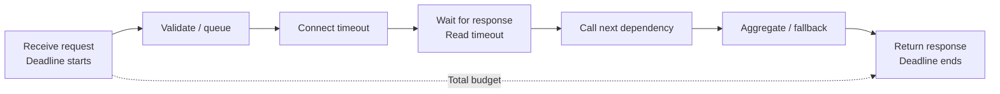
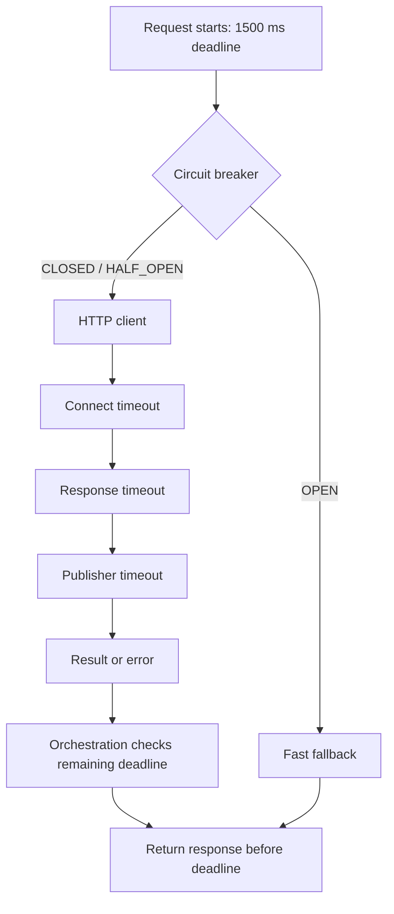

# Overall Deadline vs. Connect Timeout and Read Timeout

A request in a Spring Cloud system typically passes through many steps: waiting to acquire a connection, establishing a network connection, sending the request, waiting for the dependent service to process, reading the response, calling additional services, and aggregating results. Each step can have its own timeout, yet the user only cares about the total time from sending the request until receiving the result. Limiting that total duration is the **overall deadline**.

An overall deadline differs from connect timeout and read timeout. Connect timeout bounds the time to establish a connection. Read timeout or response timeout bounds the wait time for data according to the HTTP client's semantics. A request may stay under every individual timeout and still take too long when summing multiple calls, retries, and processing time. Conversely, one step can exceed its individual timeout even while the overall deadline still has time remaining.

Resilience4j's `TimeLimiter` and Reactor's `timeout` operator help bound the wait time for a task or publisher. They must be placed within the request's deadline budget and coordinated with HTTP client timeouts. A circuit breaker protects a failing dependency; it does not automatically create an overall deadline for the entire business flow.

## 1. Distinguishing three types of time limits

| Limit | When does counting start? | What does it control? | What does it not guarantee on its own? |
|---|---|---|---|
| Connect timeout | When the HTTP client starts establishing a connection | Time to open a TCP/TLS connection per client and configuration | Does not bound server processing time after the connection succeeds |
| Read/response timeout | When the client waits for response data or between reads, depending on the HTTP client | Wait time for data from the server | Does not necessarily bound total time to download the entire response or complete the entire request |
| Overall deadline | When the business request begins | Total time allowed for the processing chain | Does not automatically cancel all work already received by the server or database |

For example, a gateway has a 2-second deadline. Connecting to the inventory service takes 100 ms, the service processes in 700 ms, and the response is read in 100 ms. The gateway then calls the pricing service, taking another 900 ms. Each individual call may complete within a 1-second timeout, but total time has exceeded 2 seconds. If timeouts are set only on individual HTTP exchanges, the gateway can return results too late relative to its commitment to the user.

Conversely, if the inventory service cannot establish a connection within 600 ms while connect timeout is only 300 ms, the call fails even if more than one second remains on the overall deadline. Connect timeout protects connection resources; the overall deadline protects the duration of the entire request.

## 2. What does the overall deadline include?

The deadline should be measured from when the system receives the request at the business boundary until the response completes. Depending on architecture, this budget may include:

- Time spent waiting in queues, executors, or connection pools.
- DNS lookup and TCP/TLS connection establishment.
- Time spent sending the request and waiting for the dependent service to process it.
- Time spent reading and decoding the response.
- Subsequent dependent calls, whether sequential or parallel.
- Retry delays, backoff, and the duration of each attempt.
- Data transformation, business validation, logging, and response construction.
- Reserve time to run a fallback and return the result to the caller.

If calls execute sequentially, total time roughly equals the sum of each step plus overhead. If multiple calls run in parallel, critical-path duration typically depends on the slowest branch, though all branches still consume resources during that wait. Retries can cause total duration to grow rapidly if not accounted for in the budget.



The overall deadline is the bound across the entire chain. Connect timeouts, read timeouts, per-call timeouts, and fallback time must all fit inside this budget.

## 3. Example: individual calls meet timeouts, yet the request is still too slow

Suppose an order-details endpoint calls two services sequentially:

| Step | Actual time | Individual timeout |
|---|---:|---:|
| Connect and fetch inventory | 700 ms | 1,000 ms |
| Connect and fetch pricing | 850 ms | 1,000 ms |
| Aggregate response | 150 ms | Not set separately |
| **Total** | **1,700 ms** | **Deadline 1,500 ms** |

No individual call exceeded its 1-second timeout, yet the request took 1.7 seconds and violated the 1.5-second deadline. If the system only configures per-client timeouts, it cannot detect early that the entire request has exhausted its budget.

In this case, the orchestration layer needs a deadline wrapping the whole pipeline. When the deadline expires, the system stops waiting for unfinished branches and returns an appropriate result within the committed limit. Each downstream call also needs a timeout smaller than the remaining budget so one dependency cannot consume the entire request's time.

## 4. Configuring connect timeout and response timeout for WebClient

For WebClient backed by Reactor Netty, you can configure connect and response timeouts on the underlying HTTP client:

```java
import java.time.Duration;

import io.netty.channel.ChannelOption;
import reactor.netty.http.client.HttpClient;

import org.springframework.context.annotation.Bean;
import org.springframework.context.annotation.Configuration;
import org.springframework.http.client.reactive.ReactorClientHttpConnector;
import org.springframework.web.reactive.function.client.WebClient;

@Configuration
public class InventoryHttpClientConfiguration {

    @Bean
    WebClient inventoryWebClient(WebClient.Builder builder) {
        HttpClient httpClient = HttpClient.create()
                .option(ChannelOption.CONNECT_TIMEOUT_MILLIS, 300)
                .responseTimeout(Duration.ofMillis(700));

        return builder
                .baseUrl("http://inventory-service")
                .clientConnector(new ReactorClientHttpConnector(httpClient))
                .build();
    }
}
```

`CONNECT_TIMEOUT_MILLIS` bounds the time to establish a connection. Reactor Netty's `responseTimeout` sets a time limit between network data reads while receiving the response; exact semantics depend on the Reactor Netty version. It does not replace an overall deadline for the entire processing chain.

Other HTTP clients have different property names and semantics. For example, some clients define read timeout as the wait time for a single read, while others define response timeout as the interval waiting for a response. When switching clients or upgrading versions, read the documentation of the client in use and test with slow responses or chunked data transfer.

## 5. Setting a deadline for the entire reactive pipeline

In Reactor, `Mono.timeout(Duration)` limits how long a publisher is allowed to emit signals. When time expires, the operator emits `TimeoutException` and cancels the upstream subscription. Place this operator at the orchestration layer to bound the total duration of the entire workflow:

```java
import java.time.Duration;

import org.springframework.stereotype.Service;
import reactor.core.publisher.Mono;

@Service
public class OrderSummaryService {
    private final InventoryGateway inventoryGateway;
    private final PricingGateway pricingGateway;

    public OrderSummaryService(
            InventoryGateway inventoryGateway,
            PricingGateway pricingGateway) {
        this.inventoryGateway = inventoryGateway;
        this.pricingGateway = pricingGateway;
    }

    public Mono<OrderSummary> load(String sku) {
        Mono<OrderSummary> workflow = inventoryGateway.find(sku)
                .flatMap(inventory -> pricingGateway.find(sku)
                        .map(price -> OrderSummary.of(inventory, price)));

        return workflow.timeout(Duration.ofMillis(1500));
    }
}
```

The timeout here covers the inventory call, the pricing call, and the aggregation step performed in the pipeline. When total time exceeds 1.5 seconds, the publisher emits a timeout and cancels upstream. The gateways still need individual timeouts for connection and response to bound each network exchange.

If a fallback is needed for the overall deadline, place handling at the orchestration layer, which knows the entire request has run out of budget:

```java
import java.util.concurrent.TimeoutException;

return workflow
        .timeout(Duration.ofMillis(1500))
        .onErrorResume(TimeoutException.class,
                error -> Mono.just(OrderSummary.partialUnavailable()));
```

This example assumes the `OrderSummary` type can represent partial data or an unavailable state. Do not fabricate a complete result when mandatory data has not been fetched. Also preserve logs/metrics for timeouts to distinguish degraded results from complete results.

## 6. Timeout budgets must shrink at each hop

A common design mistake is that each service receiving a request sets a full timeout as if it had just started a fresh request. For example, an API gateway has a 2-second deadline, but service A consumes 1.2 seconds and then calls B with a 2-second timeout. B can keep running for up to 2 seconds, pushing total time past the gateway's deadline.

Instead, each layer should use the **remaining budget**. If the total deadline is 2 seconds and A has already spent 1.2 seconds, A only has about 800 ms left for B plus remaining processing. Reserve part of the budget for serialization, fallback, and returning the response.

You can represent the deadline as an absolute timestamp in internal contracts or propagate remaining time via context/request metadata. HTTP does not have a universal deadline header automatically understood by every framework; if using a custom header such as `X-Request-Deadline`, services must agree on format, units, and how to handle invalid values.

Example computing a local budget from a deadline passed as an `Instant`:

```java
import java.time.Duration;
import java.time.Instant;

public final class DeadlineBudget {
    private DeadlineBudget() {
    }

    public static Duration remaining(Instant deadline, Duration reserve) {
        Duration left = Duration.between(Instant.now(), deadline)
                .minus(reserve);
        if (left.isNegative() || left.isZero()) {
            return Duration.ZERO;
        }
        return left;
    }
}
```

`Instant` uses the wall clock and can be affected by clock skew across machines. For measuring elapsed time within a single process, use a monotonic clock such as `System.nanoTime()`. When propagating an absolute deadline over the network, machines must synchronize clocks and allow a safety margin for clock skew. Another option is propagating remaining time, provided each hop subtracts the time already consumed and never resets the initial budget.

## 7. Allocating budget across connect, response, and processing

Suppose a request has a 1,500 ms deadline. An illustrative budget allocation might look like this:

| Component | Budget |
|---|---:|
| DNS and connection setup | 250 ms |
| Waiting for response from inventory service | 600 ms |
| Processing and calling other dependencies | 400 ms |
| Fallback, aggregation, and returning response | 250 ms |
| **Total** | **1,500 ms** |

This is only an example. Actual budgets should be based on latency percentiles, SLO targets, network characteristics, and backend capacity. Do not set timeouts solely from average latency; p95 or p99 are usually more useful for determining protective thresholds.

For parallel calls, you can allocate a shared deadline for the whole group and bound each branch by the remaining time. When a critical branch times out, orchestration can return a degraded result or cancel branches no longer needed. For optional branches, you can allow a branch to time out while still returning the remaining data, if business rules permit.

## 8. Role of TimeLimiter in deadlines

Resilience4j `TimeLimiter` limits the wait time of asynchronous tasks such as `Future` or `CompletionStage`, depending on the integration API. In Spring Cloud CircuitBreaker, TimeLimiter can be configured by breaker ID:

```yaml
resilience4j:
  timelimiter:
    instances:
      inventory:
        timeoutDuration: 700ms
        cancelRunningFuture: true
      pricing:
        timeoutDuration: 500ms
        cancelRunningFuture: true
```

`timeoutDuration` here is the limit for the task protected by TimeLimiter per instance. It does not automatically configure the HTTP client's connect timeout or read/response timeout. If an operation is invoked via reactive WebClient, understand how the Spring Cloud CircuitBreaker version and implementation in use apply TimeLimiter to publishers; with Reactor, the `timeout` operator is the explicit way to set a time limit on a publisher.

`cancelRunningFuture: true` requests canceling the Future when TimeLimiter expires. This is a request to cancel the task, not a guarantee that the thread, socket, database, or server has stopped. If the task does not support interruption/cancellation, it may continue running after the caller has stopped waiting.

TimeLimiter normally applies to a single protected operation. If a business request has multiple sequential operations, do not give each operation the full `timeoutDuration` and treat that as an overall deadline. The orchestration layer still needs a total limit and must pass the remaining budget down to each gateway.

## 9. Combining deadlines with Circuit Breaker

Circuit breakers and deadlines solve two related but distinct problems:

- A deadline bounds the total time a request or task is allowed to consume.
- Connect/read timeouts bound stages of a network exchange.
- A circuit breaker evaluates recent outcomes of a dependency and stops sending calls when error or slow-call rates exceed thresholds.
- TimeLimiter limits the wait time of a protected task and can request task cancellation.

For example, a gateway has a 1,500 ms deadline and the `inventory` breaker is `CLOSED`. The inventory call is bounded by a 250 ms connect timeout, a 600 ms response timeout, and a 700 ms overall publisher timeout. If many timeouts or network errors are recorded, the circuit breaker can transition to `OPEN`. When the breaker opens, calls fail fast and the fallback can use the remaining budget to return an unavailable status.



Place the timeout inside the publisher passed to the reactive breaker if you want that timeout to become an error the breaker can observe. The overall deadline at the orchestration layer can sit outside individual breakers to control the entire chain. When an outer deadline cancels an inner publisher, the breaker may observe cancellation instead of the timeout exception generated by the outer layer; if you need dependency timeouts counted in the failure rate, configure the timeout on the protected publisher and verify behavior for your implementation.

Fallbacks also consume time. If the deadline is already exhausted, a complex fallback or one calling extra services can delay the response further. Prefer local fallbacks, caches, or precomputed degraded results, and reserve part of the budget for returning the response.

## 10. Retries must fit within the deadline

Retries can improve success probability on transient errors, but every attempt and backoff consumes budget. For example, three attempts with a 700 ms timeout and two 200 ms backoffs can take up to 2.5 seconds, not counting initial processing. That does not fit a request with a 1.5-second deadline.

When designing retries:

- Calculate the maximum total duration of all attempts and backoffs.
- Only retry when enough time remains for a meaningful attempt.
- Use exponential backoff and jitter to avoid many clients retrying simultaneously.
- Do not retry fixed configuration errors such as a wrong hostname or an unlistening port without a stopping condition.
- Protect operations with side effects using an idempotency key because a timeout does not prove the server has not executed the operation.
- Stop retrying when the overall deadline has expired, even if the retry policy still has attempts left.

A good retry policy should be aware of remaining budget rather than merely counting attempts. If the remaining time is smaller than the minimum timeout needed for one call, stop and return a degraded result.

## 11. Testing and observing deadlines

Testing individual timeouts is not enough to verify the overall deadline. You must also test multi-step call chains, retries, and fallbacks.

Scenarios to verify:

1. Connect timeout occurs before the overall deadline; verify the connection error is classified properly.
2. A slow response exceeds response timeout; verify the HTTP client stops waiting according to client semantics.
3. Each call completes within its individual timeout, but the total pipeline exceeds the deadline; verify orchestration returns an overall timeout.
4. One parallel branch times out; verify the remaining branches are handled per policy and cancellation propagates properly.
5. The deadline is nearly exhausted when calling the next service; verify the gateway uses the remaining budget instead of resetting to a full timeout.
6. Retries and backoff exceed the budget; verify retries stop before the request exceeds the deadline.
7. Breaker `OPEN`; verify calls fail fast and the fallback completes within the remaining budget.
8. Overall deadline expires while a server-side task is running; verify the system does not assume the task was rolled back.

Measure total latency from receiving the request to returning the response, per-dependency latency, connect time, response/read time, queue time, retry count, fallback time, and count of requests hitting the deadline. Use traces to identify which step consumes the budget. Metrics need bounded labels such as service, dependency, and timeout type; avoid high-cardinality labels like request ID or user ID.

## 12. Process for designing a gateway deadline

When implementing dependency calls in Spring Cloud, you can follow this sequence:

1. Determine the SLO or maximum time the caller allows for the entire request.
2. Create a deadline at the request boundary and carry remaining budget across layers.
3. Set connect timeout and response/read timeout appropriate for the HTTP client.
4. Set a timeout for the publisher or task protected by the circuit breaker if the breaker needs to record that timeout.
5. Set an overall deadline at the orchestration layer to cover multiple calls and internal processing.
6. Subtract elapsed time before calling the next dependency; do not re-grant the full initial budget.
7. Account for retries, backoff, and fallback in the budget; stop when insufficient time remains.
8. Monitor traces and metrics to see which timeout fired, at which layer, and whether server-side tasks keep running after the client stops waiting.

The overall deadline protects the experience and resources of the entire request; connect timeouts and read/response timeouts protect individual stages of a connection. `TimeLimiter` or Reactor `timeout` can bound a single task or publisher, while the circuit breaker decides whether to keep calling a dependency based on failure history. Combining these limits under a shared time budget helps the system return responses on time, avoid prolonged retries, and prevent a slow service from tying up resources across the entire processing chain.
