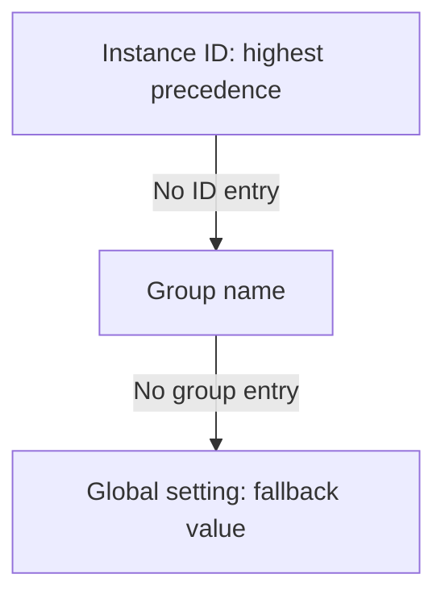

# Enabling or Disabling TimeLimiter Globally, by Group, or by Instance Where Supported

## Objectives

TimeLimiter limits the wait time of an execution protected by Spring Cloud CircuitBreaker. With the Resilience4j integration, TimeLimiter is enabled by default; the application can disable it system-wide or selectively enable/disable it by group or instance. This configuration scoping is useful when some dependencies need strict time limits, while other flows manage timeouts in the HTTP client or have longer processing durations.

After this lesson, you can:

- Distinguish TimeLimiter configuration from Circuit Breaker configuration and HTTP client timeouts.
- Disable TimeLimiter across the entire application using `disable-time-limiter`.
- Use `disable-time-limiter-map` to override by instance ID or group name.
- Apply the precedence order across instance, group, and global settings, including re-enabling an instance when global is disabled.
- Verify configuration for both synchronous and reactive factories, while recognizing implementation-specific limits.

## TimeLimiter is enabled by default

When using Spring Cloud CircuitBreaker with Resilience4j, every execution is protected by TimeLimiter by default. The deadline can come from explicit configuration or from the default `TimeLimiterConfig` if the application has not declared one.

TimeLimiter and Circuit Breaker have distinct responsibilities:

| Mechanism | Decision |
|---|---|
| Circuit Breaker | Whether to allow a call to start based on `CLOSED`, `OPEN`, or `HALF_OPEN` state. |
| TimeLimiter | Limits wait time of executions supported by the integration. |
| HTTP client timeout | Limits connection, data-wait, or response time at the network client layer. |

Disabling TimeLimiter does not disable the Circuit Breaker. The Circuit Breaker still records outcomes and can transition states according to its sliding window, failure rate, or slow-call rate. Disabling TimeLimiter also does not automatically remove timeouts configured directly on `WebClient`, Reactor, or the HTTP client.

The properties `disable-time-limiter` and `disable-time-limiter-map` belong to Spring Cloud CircuitBreaker's Resilience4j integration. They apply to both the core and reactive implementations of this integration. Do not assume the same properties exist or have the same effect for other implementations such as Spring Retry.

## Disabling TimeLimiter globally

To disable TimeLimiter for all Circuit Breakers created by the Resilience4j integration, set `spring.cloud.circuitbreaker.resilience4j.disable-time-limiter` to `true`:

```yaml
spring:
  cloud:
    circuitbreaker:
      resilience4j:
        disable-time-limiter: true
```

When this property is `true`, TimeLimiter is disabled globally. The Circuit Breaker still operates and can still reject calls when `OPEN` or limit probes when `HALF_OPEN`.

If the property is not declared, TimeLimiter is enabled by default. You can write `false` explicitly to make the intent clear:

```yaml
spring:
  cloud:
    circuitbreaker:
      resilience4j:
        disable-time-limiter: false
```

The global value is the default applied to instances or groups that do not have a matching override entry in `disable-time-limiter-map`.

## Disabling by group or instance

If only certain dependencies need TimeLimiter omitted, use `disable-time-limiter-map`. Map keys can be either the instance ID or the group name passed to the factory:

```yaml
spring:
  cloud:
    circuitbreaker:
      resilience4j:
        disable-time-limiter: false
        disable-time-limiter-map:
          slow-remote: true
          catalog-read: false
          payment-authorize: true
```

Suppose the application creates Circuit Breakers as follows:

```java
CircuitBreaker catalog = factory.create("catalog-read", "slow-remote");
CircuitBreaker inventory = factory.create("inventory-read", "slow-remote");
CircuitBreaker payment = factory.create("payment-authorize", "fast-remote");
CircuitBreaker reporting = factory.create("reporting", "batch-remote");
```

Result under the configuration above:

| Call | Map keys evaluated | TimeLimiter result |
|---|---|---|
| `catalog-read`, group `slow-remote` | Both ID `catalog-read: false` and group `slow-remote: true` exist; ID takes precedence. | Enabled. |
| `inventory-read`, group `slow-remote` | No individual ID entry; group `slow-remote: true` applies. | Disabled. |
| `payment-authorize`, group `fast-remote` | ID `payment-authorize: true`. | Disabled. |
| `reporting`, group `batch-remote` | Neither ID nor group key exists; global `false` applies. | Enabled. |

A `true` value in the map means TimeLimiter is disabled for that key. A `false` value means do not disable for that key; it can re-enable TimeLimiter even when the group or global setting is `true`.

## Precedence order: instance, group, and global

When multiple configuration scopes exist, Spring Cloud CircuitBreaker Resilience4j evaluates them in this order:



If the map contains the ID key, the ID value is used. Only when no ID key exists is the group checked; if the group is also absent, the global value is used.

Example enabling TimeLimiter globally while disabling a specific group:

```yaml
spring:
  cloud:
    circuitbreaker:
      resilience4j:
        disable-time-limiter: false
        disable-time-limiter-map:
          batch-remote: true
```

Every instance belonging to group `batch-remote` will have TimeLimiter disabled, except an instance with its own ID key overriding the group value. Other instances still use TimeLimiter.

Example disabling TimeLimiter globally while re-enabling one instance:

```yaml
spring:
  cloud:
    circuitbreaker:
      resilience4j:
        disable-time-limiter: true
        disable-time-limiter-map:
          catalog-read: false
```

In this case, `catalog-read` has TimeLimiter enabled; remaining instances without override entries have TimeLimiter disabled. This is useful when most flows already have client-side timeouts, yet one critical dependency still needs an integration-managed TimeLimiter.

## Separating enable/disable from timeout duration

`disable-time-limiter-map` decides whether TimeLimiter is applied. Duration and task cancellation behavior are configured in the `resilience4j.timelimiter` namespace.

Example declaring profiles and instances:

```yaml
resilience4j:
  timelimiter:
    configs:
      remote-default:
        timeoutDuration: 2s
        cancelRunningFuture: true
      batch-default:
        timeoutDuration: 30s
        cancelRunningFuture: true
    instances:
      catalog-read:
        baseConfig: remote-default
      payment-authorize:
        baseConfig: remote-default
        timeoutDuration: 800ms
      report-export:
        baseConfig: batch-default
```

In the example, `catalog-read` uses a two-second timeout, `payment-authorize` overrides it to 800 milliseconds, and `report-export` uses 30 seconds. If a key is disabled in `disable-time-limiter-map`, the duration declared for that key is not used to apply the integration's TimeLimiter. Those timeout values can still be useful when TimeLimiter is re-enabled in another environment or profile.

`cancelRunningFuture: true` requests canceling the future on timeout according to the task's capability. Canceling a future does not guarantee all I/O or remote-server processing stops immediately. Configure HTTP client timeouts and verify cancellation behavior of the underlying client library.

## Applying to synchronous and reactive factories

TimeLimiter toggle properties are provided in Spring Cloud CircuitBreaker Resilience4j and apply to both synchronous and reactive factories.

Synchronous example:

```java
import org.springframework.cloud.client.circuitbreaker.CircuitBreaker;
import org.springframework.cloud.client.circuitbreaker.CircuitBreakerFactory;
import org.springframework.stereotype.Service;

@Service
public class CatalogGateway {
    private final CircuitBreaker catalogBreaker;

    public CatalogGateway(CircuitBreakerFactory<?, ?> factory) {
        this.catalogBreaker = factory.create("catalog-read", "slow-remote");
    }

    public Product findById(String id) {
        return catalogBreaker.run(
                () -> loadProduct(id),
                error -> Product.unavailable(id));
    }
}
```

Reactive example:

```java
import org.springframework.cloud.client.circuitbreaker.ReactiveCircuitBreaker;
import org.springframework.cloud.client.circuitbreaker.ReactiveCircuitBreakerFactory;
import org.springframework.stereotype.Service;
import reactor.core.publisher.Mono;

@Service
public class ReactiveCatalogGateway {
    private final ReactiveCircuitBreaker catalogBreaker;

    public ReactiveCatalogGateway(ReactiveCircuitBreakerFactory<?, ?> factory) {
        this.catalogBreaker = factory.create("catalog-read", "slow-remote");
    }

    public Mono<Product> findById(String id) {
        return catalogBreaker.run(
                loadProductReactive(id),
                error -> Mono.just(Product.unavailable(id)));
    }
}
```

`loadProduct`, `loadProductReactive`, and `Product` are illustrative application components. Map configuration uses the same ID `catalog-read` and group `slow-remote` for both call styles. When switching from synchronous to reactive, the precedence rules for toggle properties do not change; you still must verify the appropriate starter has been added to the application.

## Do not confuse with disabling auto-configuration

The following property has a broader meaning:

```yaml
spring:
  cloud:
    circuitbreaker:
      resilience4j:
        enabled: false
```

`enabled: false` disables Spring Cloud CircuitBreaker's Resilience4j auto-configuration. It is not the way to selectively toggle TimeLimiter. If the goal is to keep the Circuit Breaker and only remove the integration-provided time limit, use `disable-time-limiter` or `disable-time-limiter-map`.

Similarly, setting a very large `timeoutDuration` is not equivalent to disabling TimeLimiter. TimeLimiter is still created and still applies its waiting mechanism, just with a deadline unlikely to be hit. When you want to disable it explicitly by scope, use the dedicated disable properties.

## When should you enable or disable by scope?

| Situation | Suggested configuration | Reason |
|---|---|---|
| Most calls need a common limit managed by the integration. | Keep default or set global `false`. | Establishes a consistent timeout policy. |
| A group of background tasks has long durations and its own client timeouts. | Set the group in `disable-time-limiter-map` to `true`. | Avoids two competing timeout layers if integration TimeLimiter is unnecessary. |
| One critical dependency must have an integration timeout even when global is disabled. | Global `true`, instance ID set to `false`. | Re-enables protection specifically for the needed dependency. |
| One instance has its own client timeout and cancellation mechanism. | Disable by instance ID if appropriate. | Keeps a dedicated policy for one dependency without affecting the rest of the group. |

Do not disable TimeLimiter just to hide timeout errors. If timeouts happen frequently, measure latency, review SLAs, inspect resource limits, and decide which layer should own timeouts. Removing TimeLimiter can cause calls to wait even longer if no effective timeout remains in the HTTP client or another layer.

## Monitoring and verifying configuration

To verify configuration takes effect, test both the enable/disable decision and timeout behavior:

1. Create a Circuit Breaker with an ID and group declared in the map.
2. Use a test endpoint that can delay responses longer than `timeoutDuration`.
3. When TimeLimiter is enabled, verify the call ends by integration timeout and check that the fallback is invoked as expected.
4. When TimeLimiter is disabled, verify the integration does not apply that timeout; HTTP client timeouts or dedicated timeout operators may still terminate the call.
5. Test the same group with two IDs, one having a map override entry. Verify the ID takes precedence over the group.
6. Set global `true`, then add one ID with value `false`. Verify that instance has TimeLimiter enabled while remaining instances stay disabled.
7. Repeat tests with both reactive and synchronous factories if the application uses both.

Monitor Circuit Breaker state, call counts, timeout errors, fallbacks, and HTTP latency. Exact metric names depend on the Resilience4j version and Micrometer registry; check actual metrics rather than assuming every environment uses identical names or tags.

## Common configuration mistakes

- **Confusing `disable-time-limiter` with disabling Circuit Breaker:** this property only disables TimeLimiter in the Resilience4j integration.
- **Confusing `enabled: false` with disabling TimeLimiter:** this property disables Resilience4j auto-configuration more broadly.
- **Using the wrong map key:** instance keys must match the ID in `factory.create`; group keys must match the group name passed to the factory.
- **Assuming group overrides instance:** when both are declared, the instance value takes higher precedence.
- **Failing to use `false` to re-enable:** `false` is a meaningful override value that can re-enable an instance even when group or global is disabled.
- **Setting a huge timeoutDuration to fake disabling:** TimeLimiter still exists; use the disable property when you explicitly want it off.
- **Assuming disabling TimeLimiter removes HTTP timeouts:** HTTP client, Reactor, or other library timeouts still operate independently.
- **Assuming canceling a future guarantees stopping I/O:** you must verify cancellation capability of the actual client and server.
- **Applying Resilience4j properties to another implementation:** verify the implementation's documentation before switching.

## References

- [Spring Cloud CircuitBreaker – Circuit Breaker Properties Configuration](https://docs.spring.io/spring-cloud-circuitbreaker/reference/spring-cloud-circuitbreaker-resilience4j/circuit-breaker-properties-configuration.html)
- [Spring Cloud CircuitBreaker – Resilience4j configuration](https://docs.spring.io/spring-cloud-circuitbreaker/docs/current/reference/html/spring-cloud-circuitbreaker-resilience4j.html)
