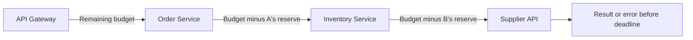

# Designing a Time Budget Across Multiple Service Call Layers

A request often traverses multiple layers: API gateway, business service, dependent service, and one or more external systems. If each layer sets its own independent timeout without knowing how much time remains on the request, total processing time can far exceed what the caller expects. TimeLimiter helps bound the wait time of a single operation; deadlines and time budgets help layers coordinate so the entire chain finishes within a shared time limit.

With Spring Cloud CircuitBreaker and Resilience4j, you should design an end-to-end deadline and allocate the remaining time to each hop. Each service must reserve time for internal processing, logging, response serialization, and returning the result. When calling the next service downstream, it passes only the remaining budget after holding back its own necessary reserve. Retries and fallbacks must also fit within that budget.

## Per-hop timeout vs. overall request deadline

A **per-hop timeout** bounds the wait time for a specific operation, such as an HTTP call from `order-service` to `inventory-service`. An **end-to-end deadline** is the latest point in time by which the entire request must complete, measured from when the request enters the system.

The two concepts are related but do not replace each other:

- If each service sets its own 2-second timeout, a sequential chain of three services can stretch to nearly 6 seconds, not counting the gateway and internal processing.
- If a request has a 2.5-second deadline, each hop must use the remaining portion of that deadline. A deeper service must not restart a fresh full 2.5-second timeout.
- A local timeout should be less than or equal to the request's remaining budget, while leaving room for post-call processing and returning the response.

Example of a sequential call chain:



The deadline is the shared boundary. Individual hop timeouts are sub-limits computed from the deadline and elapsed time.

## Allocating the budget across layers

Suppose the gateway receives a request with a total budget of 2,500 ms. The gateway spends 150 ms on authentication and routing. `order-service` needs to reserve 250 ms for data aggregation and returning the response. Thus, the call from `order-service` down to `inventory-service` has at most about 2,100 ms.

When `inventory-service` receives the request, roughly 2,100 ms remains. This service reserves 250 ms for internal processing and response creation, so the next call to `supplier-api` gets at most around 1,850 ms. `supplier-api` or its client must continue bounding the operation within the remaining budget and leave time to return the result. Illustrative numbers should be tuned to actual latency, but the rule is never to grant a child hop more time than the remaining deadline.

| Layer | Starting budget | Reserved for processing and response | Limit for next call |
|---|---:|---:|---:|
| Gateway | 2,500 ms | 150 ms | 2,350 ms for all downstream processing |
| Order service | Around 2,350 ms | 250 ms | Around 2,100 ms to inventory |
| Inventory service | Around 2,100 ms | 250 ms | Around 1,850 ms to supplier |
| Supplier client | Around 1,850 ms | Per client contract | Must not exceed remaining deadline |

When calculating the budget, include time waiting for connection pools, DNS, TCP/TLS handshakes, sending requests, waiting for responses, decoding data, and backoff between retries. Do not mechanically sum component timeouts if they run sequentially; use the overall deadline to cap the whole operation and set component timeouts smaller than that deadline.

## Propagating deadlines or remaining time between services

Each service needs to know when the request must finish. With protocols that support deadlines natively, use the protocol's built-in deadline mechanism. For instance, gRPC supports deadlines and can propagate them across subsequent calls. When using HTTP, an organization can define an internal header representing the deadline or remaining time, provided units, update rules, and handling of missing or invalid headers are standardized.

Principles when propagating budgets:

- The gateway sets the maximum cap according to the API's SLA. Never allow external clients to request an infinite timeout.
- Each service reads the received budget, applies its internal cap, and subtracts its own reserve before calling downstream.
- Never reset to the full default timeout at each hop; doing so causes total time to exceed the initial deadline.
- If propagating an absolute timestamp over HTTP, account for clock skew across machines. After receiving the deadline, convert it to a remaining duration and use a monotonic clock inside the process to track elapsed time.
- If propagating a relative duration, define clearly whether it is measured from send or receipt and subtract network transit overhead; downstream should always enforce a local cap to avoid overly long requests.
- Do not directly trust deadline headers sent by users. The gateway must validate, normalize, and clamp values before forwarding.

## Measuring remaining time with a monotonic clock

Within a Java process, use `System.nanoTime()` to measure elapsed intervals. Do not use `System.currentTimeMillis()` as an internal timeout clock because the system wall clock can be adjusted. You can represent a local deadline like this:

```java
import java.time.Duration;

final class DeadlineBudget {
    private final long deadlineNanos;

    private DeadlineBudget(long deadlineNanos) {
        this.deadlineNanos = deadlineNanos;
    }

    static DeadlineBudget start(Duration budget) {
        if (budget.isZero() || budget.isNegative()) {
            throw new IllegalArgumentException("Budget must be greater than 0");
        }
        return new DeadlineBudget(System.nanoTime() + budget.toNanos());
    }

    Duration remaining() {
        long nanos = deadlineNanos - System.nanoTime();
        return Duration.ofNanos(Math.max(0, nanos));
    }

    boolean isExpired() {
        return deadlineNanos - System.nanoTime() <= 0;
    }
}
```

This snippet manages deadlines only within the same process. Do not send the `deadlineNanos` value directly to another machine because `System.nanoTime()` shares no common epoch across processes. When receiving a request over the network, convert the system-contract deadline or timeout into a new `DeadlineBudget` based on the validated remaining time.

## Applying the budget to reactive WebClient calls

In Reactor, you can use `Mono.timeout(remaining)` to bound the publisher by the remaining budget. Place the remaining-time check inside `Mono.defer(...)` so the value is computed at subscription time rather than prematurely when constructing the publisher.

```java
Mono<Product> callCatalog(String sku, DeadlineBudget deadline) {
    return Mono.defer(() -> {
        Duration remaining = deadline.remaining();
        if (remaining.isZero() || remaining.isNegative()) {
            return Mono.error(new java.util.concurrent.TimeoutException(
                "Request budget exhausted"));
        }

        return webClient.get()
            .uri("/products/{sku}", sku)
            .retrieve()
            .bodyToMono(Product.class)
            .timeout(remaining);
    });
}
```

When this call is protected by a Reactive Circuit Breaker, place the timeout inside the publisher observed by the Circuit Breaker:

```java
Mono<Product> protectedCall = callCatalog(sku, deadline);

return reactiveCircuitBreakerFactory.create("catalog")
    .run(protectedCall, error -> productCache.find(sku)
        .switchIfEmpty(Mono.error(
            new CatalogUnavailableException(sku, error))));
```

That way, a timeout emitted from `callCatalog` is an error signal within the Circuit Breaker boundary. The breaker can classify it according to `recordExceptions`, `ignoreExceptions`, and configured failure/slow-call thresholds. The fallback returns a `Mono`, avoiding blocking the event loop.

If you use `onErrorResume` to replace a timeout with cached data before passing the publisher into the Circuit Breaker, the breaker may see only normal completion. If you want the Circuit Breaker to record dependency errors, let it observe the timeout first and then transition to fallback downstream or use the fallback of `run(...)`.

## Configuring TimeLimiter in Spring Cloud CircuitBreaker with Resilience4j

TimeLimiter limits the wait time of an asynchronous operation. With the Resilience4j backend, you can declare timeouts per instance:

```yaml
resilience4j:
  timelimiter:
    instances:
      catalog:
        timeoutDuration: 1600ms
        cancelRunningFuture: true
  circuitbreaker:
    instances:
      catalog:
        slidingWindowType: COUNT_BASED
        slidingWindowSize: 20
        minimumNumberOfCalls: 10
        failureRateThreshold: 50
        slowCallDurationThreshold: 1200ms
        slowCallRateThreshold: 50
        waitDurationInOpenState: 5s
```

In this example, TimeLimiter bounds the wait time at 1,600 ms; Circuit Breaker uses its own window to evaluate failure rate and slow call rate. `slowCallDurationThreshold` is set lower than the timeout so slow calls are tracked before hitting the timeout limit. Choose values based on the request's remaining deadline, latency percentiles, and the service's reserve time.

Spring Cloud CircuitBreaker also allows configuring `TimeLimiterConfig` via a factory customizer:

```java
import java.time.Duration;

import io.github.resilience4j.timelimiter.TimeLimiterConfig;
import org.springframework.cloud.client.circuitbreaker.Customizer;
import org.springframework.cloud.circuitbreaker.resilience4j.ReactiveResilience4JCircuitBreakerFactory;
import org.springframework.context.annotation.Bean;

@Bean
Customizer<ReactiveResilience4JCircuitBreakerFactory> catalogTimeBudget() {
    TimeLimiterConfig timeLimiter = TimeLimiterConfig.custom()
        .timeoutDuration(Duration.ofMillis(1600))
        .cancelRunningFuture(true)
        .build();

    return factory -> factory.configure(
        builder -> builder.timeLimiterConfig(timeLimiter),
        "catalog");
}
```

The Java example sets a fixed timeout value for the instance. If each request has a different remaining budget, this fixed timeout should be smaller than the committed maximum limit; use `Mono.timeout(remaining)` inside the publisher when per-request dynamic deadlines are needed. Avoid letting a fixed TimeLimiter exceed the request's dynamic deadline.

Resilience4j's TimeLimiter is normally used to bound asynchronous operations based on `Future` or `CompletionStage`; for reactive publishers, Spring Cloud CircuitBreaker/Resilience4j uses the corresponding Reactor timeout mechanism. For a synchronous call blocking a thread, do not simply wrap it in a Future and assume a timeout will stop the work. Configure timeouts on the HTTP/RPC client and consider the client's actual cancellation support.

## Coordinating TimeLimiter, Circuit Breaker, and client timeouts

The three layers have distinct roles:

| Mechanism | Role | Question to answer |
|---|---|---|
| HTTP/RPC client timeout | Limits time across stages such as connection acquisition, connect, response/read | How long does the client wait at the transport layer? |
| TimeLimiter or Reactor `timeout` | Limits wait time of the asynchronous operation/publisher | Did the application wait past the operation's budget? |
| Circuit Breaker | Tracks failures/slow calls and stops calling the dependency when thresholds are exceeded | Is the dependency failing or slow enough to open the circuit? |

Timeouts typically produce exceptions. If that exception occurs inside the publisher protected by the Circuit Breaker and is configured to be recorded, the breaker can increment its failure rate. If the timeout is converted into normal data before the Circuit Breaker, the breaker may fail to notice the dependency is slow. Clearly define the placement of timeout and fallback in the operator chain.

An application-layer timeout does not guarantee the server has stopped processing. With HTTP clients, cancellation can close or abort the client-side request while the server may still be executing work. Therefore, operations with side effects such as creating orders or deducting stock require idempotency keys and handling for uncertain outcomes.

## Calculating budget when retries are present

Retries must fit inside the total deadline. If an operation allows up to three attempts, each up to 500 ms with backoffs of 100 ms and 200 ms, worst-case total time is already 1,800 ms, excluding overhead. If only 900 ms of budget remains, you cannot run all three attempts under that configuration.

Before each retry, check the remaining budget. Only retry when:

- The exception is transient and recoverable.
- The request still has enough time for a new attempt plus minimum backoff.
- Retrying will not cause duplicate side effects or the client supports idempotency.
- The Circuit Breaker has not already rejected the call with `CallNotPermittedException`.

For example, if 700 ms remains on the deadline and each call takes up to 500 ms, do not sleep for a 300 ms backoff and then start another attempt. Exit early and switch to fallback or return an appropriate error. Retries must never extend a request beyond the caller's deadline.

## Reserving budget for fallbacks and post-call processing

Fallbacks also consume time. If waiting for a dependency takes 2 seconds and only then you query a cache with a 1-second timeout, the request can take over 3 seconds. Reserve part of the budget for fallback from the outset, or choose a faster fallback when the deadline is nearly exhausted.

For instance, with a 2,500 ms deadline, a service can reserve the final 300 ms for reading cache, logging, and returning the response. Once remaining time drops below this threshold, the service should not start a new dependency call that could consume the entire reserve. Fallbacks should have their own time limits and avoid calling the failing dependency itself again.

If the fallback also fails or times out, return a meaningful error per the API contract. Do not silently extend the deadline by starting a brand-new timeout for the fallback.

## Monitoring budgets in production

To understand where requests spend time, log or record the initial deadline, remaining time at the start of each hop, actual duration, and termination reason. Do not write sensitive data or full payloads into logs.

Useful metrics include:

- Latency per dependency and per hop, at p50, p95, and p99 percentiles.
- Number of requests whose deadline expires before starting a dependency call.
- Timeouts across connection pool, connect, response/read, and TimeLimiter.
- Retry counts, backoff durations, and retries skipped due to insufficient budget.
- Fallback successes/failures and fallback duration.
- Calls rejected by Circuit Breaker, failure rate, slow-call rate, and state transitions.

When multiple services share one deadline, correlation IDs or trace IDs link spans along the call chain. You can add a `remaining_budget_ms` attribute to spans to see which service consumed most of the budget. Avoid creating metric labels with individual deadlines or request IDs because cardinality explodes rapidly; those values fit traces or controlled logs much better.

## End-to-end deadline testing

A test suite should verify the entire chain, not just a single client's timeout in isolation:

1. Set a request deadline at the gateway, for example 2,500 ms.
2. Create mock services with deterministic delays to verify remaining budget is decremented across hops.
3. Make one dependency slower than the hop timeout; verify the caller finishes before the total deadline and Circuit Breaker receives the timeout if within its protection boundary.
4. Make one dependency fail transiently; verify retries run only while enough budget remains and never retry `CallNotPermittedException`.
5. Make the dependency fail; verify the fallback has its own time bound and does not exceed remaining budget.
6. Simulate a request arriving at a service with an already-expired deadline; verify the service rejects early without starting further downstream calls.
7. Test client cancellation and verify operations with side effects are protected by idempotency.

With Reactor, use `StepVerifier.withVirtualTime(...)` to control timeouts and backoffs without waiting in real time. With synchronous services or HTTP clients, use a mock server capable of delaying connect/response to verify each transport-layer timeout. Record actual durations and compare them against the total deadline to catch unexpected accumulation of local timeouts.

Good time-budget design lets each service know clearly how much time it has left to complete its work. TimeLimiter bounds asynchronous operations, client timeouts control the network layer, and Circuit Breaker tracks dependency health. When deadlines propagate and shrink at each hop, and retries and fallbacks obey one shared limit, requests finish on time and the system avoids holding resources for work that is already too late to return a useful result.
