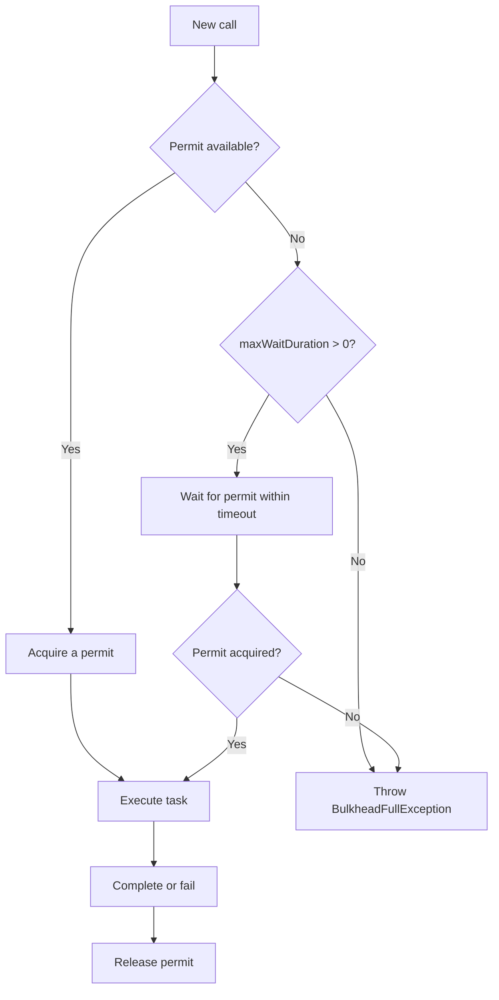

# SemaphoreBulkhead and the maxConcurrentCalls Limit

Resilience4j's `SemaphoreBulkhead` limits the number of concurrently executing calls using a semaphore. Each call is granted a permit before running and returns the permit upon completion. When all permits are in use, a new call must wait up to the configured `maxWaitDuration` or be rejected with a `BulkheadFullException`.

The most important property is `maxConcurrentCalls`: the maximum number of calls allowed to execute at the same time in a single Bulkhead instance. It controls in-flight concurrency, not the number of requests per second. If the goal is to limit request rate over time, use RateLimiter; if you want to stop sending calls to a failing service, combine with CircuitBreaker.

## How SemaphoreBulkhead Works

Suppose `maxConcurrentCalls=3`. The first three calls acquire the three permits and execute. A fourth call arriving before any permit is returned will not be allowed to start immediately. The outcome depends on `maxWaitDuration`:

- `maxWaitDuration=0`: no waiting; if a permit cannot be acquired immediately, the call is rejected.
- `maxWaitDuration` greater than `0`: the call waits for a permit up to the configured maximum duration. If an in-flight call completes and returns a permit within that window, the waiting call can proceed; if the timeout expires and no permit is available, the call is rejected.

SemaphoreBulkhead does not create a dedicated thread pool to execute tasks. Calls run on the calling thread; if it needs to wait for a permit, that thread may be held while waiting. This is an important difference from `FixedThreadPoolBulkhead`, which uses its own thread pool and bounded queue.



The permit must be released both when the task completes normally and when it ends with an error. For reactive publishers or asynchronous tasks, use the corresponding integration/operator so the permit is held throughout execution and released when the execution chain completes or is cancelled. If you only wrap the creation of a `Mono`, `Flux`, or `CompletableFuture` in a synchronous supplier, the permit may be released as soon as the asynchronous object is constructed, before the actual work completes.

## Configuring maxConcurrentCalls in application.yml

In Spring Cloud Circuit Breaker with Resilience4j integration, you can select `SemaphoreBulkhead` as the default Bulkhead type using `enableSemaphoreDefaultBulkhead`. Then configure the limit per instance name under the `resilience4j.bulkhead` namespace:

```yaml
spring:
  cloud:
    circuitbreaker:
      resilience4j:
        enableSemaphoreDefaultBulkhead: true

resilience4j:
  bulkhead:
    instances:
      catalog:
        maxConcurrentCalls: 12
        maxWaitDuration: 0ms
```

In this example, the `catalog` instance allows at most 12 concurrent calls. The 13th call is rejected immediately if all 12 permits are in use. Setting `maxWaitDuration: 0ms` prevents the calling thread from waiting for a permit. The name `catalog` must match the ID the application uses when creating the circuit breaker, such as `circuitBreakerFactory.create("catalog")`, so the instance configuration is applied properly.

When `resilience4j-bulkhead` is on the classpath, Spring Cloud Circuit Breaker's Resilience4j integration can apply Bulkhead automatically. If you want to disable Bulkhead auto-configuration completely, use the separate switch `spring.cloud.circuitbreaker.bulkhead.resilience4j.enabled=false`. This switch differs from `enableSemaphoreDefaultBulkhead`: one disables the Bulkhead feature, while the other selects the default Bulkhead type when the feature is enabled.

If `enableSemaphoreDefaultBulkhead: true` is not set, Spring Cloud Circuit Breaker Resilience4j defaults to `FixedThreadPoolBulkhead` per the integration's configuration. Therefore, verify which Bulkhead type is actually active rather than just looking at `maxConcurrentCalls` values in the configuration file.

## Configuring Directly in Java

When you need to create a standalone Bulkhead outside Spring Cloud Circuit Breaker's factory, you can build a `BulkheadConfig` and use Resilience4j's `Bulkhead`:

```java
import io.github.resilience4j.bulkhead.Bulkhead;
import io.github.resilience4j.bulkhead.BulkheadConfig;

import java.time.Duration;
import java.util.function.Supplier;

BulkheadConfig config = BulkheadConfig.custom()
        .maxConcurrentCalls(12)
        .maxWaitDuration(Duration.ZERO)
        .build();

Bulkhead catalogBulkhead = Bulkhead.of("catalog", config);

Supplier<Product> protectedCall = Bulkhead.decorateSupplier(
        catalogBulkhead,
        () -> catalogClient.findProduct(productId)
);

Product product = protectedCall.get();
```

`Bulkhead.decorateSupplier` creates a protected supplier. A permit is acquired when `protectedCall.get()` is invoked and released after the supplier completes or throws an exception. If no permit is available, the call throws `BulkheadFullException` according to the configured wait behavior.

Do not create a new Bulkhead for each request. Requests must share the same Bulkhead instance so they draw from the same pool of permits. In a Spring application, let the factory/registry manage instances by ID or register a shared bean appropriate for the application lifecycle.

## Handling BulkheadFullException

`BulkheadFullException` indicates that the application has hit its local concurrency limit. This is not necessarily proof that the downstream dependency is returning errors: the service may still be healthy, while the application already has its full allotted number of concurrent calls in flight.

With a synchronous API, you can catch the exception and map it to an appropriate result:

```java
try {
    return catalogBulkhead.executeSupplier(
            () -> catalogClient.findProduct(productId)
    );
} catch (BulkheadFullException ex) {
    return ProductView.temporarilyBusy(productId);
}
```

The `temporarilyBusy` result should accurately represent local overload according to the API contract. If no degraded response is appropriate, you can map it to HTTP `503 Service Unavailable` or a standardized error code, along with retry metadata if the system can provide a reasonable retry time.

When combining Bulkhead with CircuitBreaker, explicitly decide whether `BulkheadFullException` should count as a circuit breaker failure. This is a rejection due to application-side resource limits; if it increases the failure rate of the breaker protecting the remote service, the breaker may open even though the dependency is still healthy. Actual behavior depends on decorator ordering and exception classification settings (`recordExceptions`, `ignoreExceptions`, or a predicate). Check the integration in use and test the full-permit scenario to verify metrics, breaker state, and fallback behavior match expectations.

A fallback only runs if configured on a wrapping layer that receives the exception from the Bulkhead. Do not assume that every combination of Bulkhead and CircuitBreaker routes `BulkheadFullException` to the same fallback; verify the backend's execution order.

## Choosing maxConcurrentCalls Based on Service Capacity

Do not choose `maxConcurrentCalls` based solely on CPU count or set a huge value just to avoid rejections. The limit needs to reflect both the application's capacity and the dependency's ability to handle load.

One way to make an initial estimate is Little's Law:

\[
L = \lambda \times W
\]

Where:

- \(L\) is the average number of requests being processed concurrently.
- \(\lambda\) is the average request throughput (requests/second).
- \(W\) is the average processing time (seconds).

For example, if a dependency handles around 80 requests/second and the average response time is 0.1 seconds, the estimated average number of concurrent requests is:

\[
L = 80 \times 0.1 = 8
\]

You can start testing with a limit near 8 or with a small headroom buffer, then tune based on p95/p99 latency, burst traffic, connection pool limits, CPU, memory, and dependency quotas. The formula only gives a starting point; it does not replace load testing or production metrics.

If the limit is too low, valid requests are rejected even when the dependency still has capacity. If it is too high, the application can send more requests than the dependency can handle, increasing latency and causing many requests to time out together. Measure active calls, rejection counts, and permit wait times to choose a data-backed limit.

## Scope of the Limit and Differences from Other Mechanisms

`maxConcurrentCalls` applies to a single Bulkhead instance within one application process. If you deploy four replicas and each replica has `maxConcurrentCalls=12`, total concurrent calls can reach around 48 if load is evenly distributed and each replica uses its own instance. SemaphoreBulkhead does not automatically share permits across pods or hosts. If you need a cluster-wide limit, you need a distributed coordination mechanism or limits at an appropriate service/ingress layer.

| Mechanism | What it limits | Example goal |
|---|---|---|
| `SemaphoreBulkhead` | Number of calls running concurrently | Prevent a dependency from consuming more than 12 slots in the process |
| `RateLimiter` | Number of calls within a time window | Do not exceed 100 requests per second |
| `CircuitBreaker` | Call permission based on failure/slow-call rate and state | Temporarily stop calling a dependency after its failure rate exceeds a threshold |
| `TimeLimiter` or client timeout | Wait time for a task/request | Terminate calls that do not complete within 2 seconds |
| `FixedThreadPoolBulkhead` | Number of tasks on a dedicated pool and its queue | Isolate blocking work from calling threads |

These mechanisms can work together, but limits should be defined at each layer. SemaphoreBulkhead does not automatically cancel hung requests; configure appropriate HTTP client timeouts or TimeLimiter so permits are released within the expected timeframe.

## Notes When Using with Reactive

In a WebFlux application, do not set a long `maxWaitDuration` on event-loop threads. Waiting for a semaphore can block a thread that serves many other requests, undermining the benefits of the reactive model. Typically, set `maxWaitDuration=0` or a very small value, handle `BulkheadFullException` with a reactive fallback, and keep the pipeline asynchronous.

When using `ReactiveCircuitBreakerFactory`, choose the proper Reactor starter and configure `enableSemaphoreDefaultBulkhead` if you want to use SemaphoreBulkhead. Example of wrapping a publisher with a reactive circuit breaker:

```java
public Mono<ProductView> findProduct(String productId) {
    ReactiveCircuitBreaker breaker =
            reactiveCircuitBreakerFactory.create("catalog");

    return breaker.run(
            Mono.defer(() -> catalogClient.findProduct(productId)
                    .map(ProductView::fromProduct)),
            error -> Mono.just(ProductView.temporarilyBusy(productId))
    );
}
```

The example assumes the factory is configured to integrate Bulkhead with SemaphoreBulkhead and `catalogClient` returns a `Mono<Product>`. Do not call `subscribe()` inside the service. Return the publisher to WebFlux so the framework manages subscription, cancellation, and the response. Verify whether cancellation releases permits promptly in your Resilience4j version, especially when the caller disconnects.

## Testing Limit Behavior

To test `maxConcurrentCalls=2`, create two tasks that hold their permits until the test explicitly releases them. While those two tasks are running, invoke a third call and confirm it is rejected when `maxWaitDuration=0`.

Scenarios to verify:

1. **Below the limit:** a call acquires a permit and completes; the normal result is returned.
2. **At the limit:** two calls are running concurrently; remaining available permits equal zero.
3. **Exceeding the limit with zero wait:** a new call immediately receives `BulkheadFullException`.
4. **With wait duration:** a new call is allowed to wait; if a permit is returned before the deadline, the call proceeds, otherwise it is rejected.
5. **Error inside supplier:** the permit is released after the supplier terminates with an exception; subsequent calls can reuse the permit.
6. **Reactive cancellation:** cancel the subscription and verify the permit is not held indefinitely.
7. **Multiple replicas:** verify the limit is per-instance local, not a cluster-wide total quota.

In operation, monitor concurrent call counts, Bulkhead rejection counts, processing time, and dependency timeouts. If rejections increase while the dependency remains healthy, the limit may be too low or the application is experiencing burst traffic. If latency and timeouts rise together, inspect dependency capacity, permit hold time, and timeouts before increasing `maxConcurrentCalls`.
