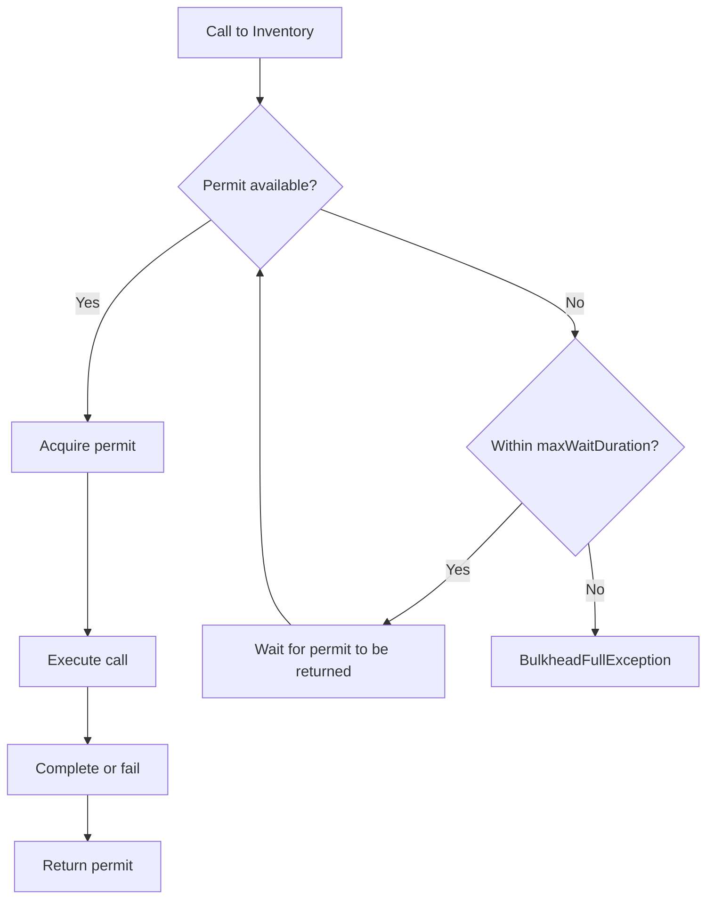

# maxWaitDuration and Behavior When Full

Bulkhead limits the number of concurrent calls sent to a resource so that a slow dependency does not exhaust the application's processing threads, connections, or workers. With Resilience4j, `maxConcurrentCalls` defines the number of calls allowed to run concurrently in a `SemaphoreBulkhead`; `maxWaitDuration` defines the maximum time a new call is allowed to wait for a permit when all slots are busy.

When a bulkhead is full, the application can either reject immediately or wait for a bounded duration. Choosing the right policy is critical in Spring Cloud CircuitBreaker: waiting too long increases latency and ties up caller resources; rejecting too early can expose callers to load errors even when a slot is about to be freed.

## 1. Bulkhead Limits Concurrent Calls

Imagine an order service calling an inventory service. If the inventory service responds slowly, many order requests may wait at the same time. Without limits, the number of waiting requests can grow until it consumes all of the order service's resources.

Bulkhead establishes an independent limit for the group of calls targeting that dependency. With `SemaphoreBulkhead`, each call must acquire a permit before running. When the call finishes or fails, the permit is returned. If no permit is available, a new call must obey `maxWaitDuration`.



The two parameters serve distinct roles:

| Parameter | Meaning |
|---|---|
| `maxConcurrentCalls` | Maximum number of calls allowed to execute concurrently in the bulkhead instance. |
| `maxWaitDuration` | Maximum duration to wait for a permit when no slot is available. |

For example, `maxConcurrentCalls: 10` allows at most 10 calls to run simultaneously. The 11th call must wait or be rejected depending on `maxWaitDuration`.

## 2. maxWaitDuration Equal to 0: Reject Immediately When Full

If `maxWaitDuration` is `Duration.ZERO`, calls do not wait for a permit. When all permits are in use, the bulkhead rejects new calls immediately with `BulkheadFullException`.

```yaml
resilience4j:
  bulkhead:
    instances:
      inventory:
        maxConcurrentCalls: 10
        maxWaitDuration: 0
```

With this configuration, at most 10 calls to `inventory` run concurrently. If all 10 slots are busy when a new call arrives, that call is rejected immediately. When an in-flight call finishes and returns its permit, the next incoming call can take the slot.

This fail-fast policy is appropriate when:

- Requests have a very tight latency budget.
- Callers can return an overload status or retry later with backoff.
- The application must avoid holding extra threads solely to wait for resources.
- Reactive flows run on an event loop and must not be blocked waiting for a semaphore.

Failing fast does not mean the dependency has failed. `BulkheadFullException` indicates the application has no remaining capacity under its local limit at that moment.

## 3. maxWaitDuration Greater Than 0: Bounded Wait

If `maxWaitDuration` is greater than 0, a new call can wait for a permit to be returned. When a permit becomes available before the deadline, the call proceeds with execution. If the wait times out without obtaining a permit, the bulkhead rejects the call with `BulkheadFullException`.

```yaml
resilience4j:
  bulkhead:
    instances:
      inventory:
        maxConcurrentCalls: 10
        maxWaitDuration: 100ms
```

In this example, at most 10 calls run concurrently. The 11th call can wait up to 100 milliseconds to acquire a permit. If an earlier call completes after 40 ms and returns a permit, the waiting call can proceed. If no permit becomes available within 100 ms, the call is rejected.

`maxWaitDuration` is a limit on how long to wait for a slot, not the call's execution time and not the HTTP client's timeout. A call can wait 80 ms and then run for another 500 ms; total time observed by the caller can exceed 500 ms.

Bounded waiting works well when some calls typically complete very quickly and a short wait absorbs minor traffic spikes. However, the longer the wait duration, the more requests can hold threads or resources while waiting. If the dependency suffers prolonged slowness, a backlog waiting for permits can cause cascading latency increases.

## 4. What Happens When Full?

With `SemaphoreBulkhead`, behavior depends on remaining permits and `maxWaitDuration`:

| Scenario | Behavior |
|---|---|
| Permit available | Acquire permit and run supplier immediately. |
| No permits, `maxWaitDuration = 0` | Reject immediately with `BulkheadFullException`. |
| No permits, positive wait duration and a permit is returned in time | Acquire permit and run supplier. |
| No permits, wait deadline expires without a permit | Reject with `BulkheadFullException`. |
| Supplier finishes or throws after acquiring a permit | Permit is released so other calls can use it. |

If the caller is rejected, the supplier is not executed. Therefore, no new request is sent to the inventory service from that rejected call. This is a rejection due to local capacity limits, distinct from timeouts or connection errors that occur after the supplier has started.

At the API layer, this condition can be mapped to an overload or temporarily unavailable response according to the system's contract. Do not return a fake business value such as zero stock if the application was never able to query the data.

## 5. YAML Configuration for SemaphoreBulkhead

Example of separate configuration for the inventory and payment services:

```yaml
resilience4j:
  bulkhead:
    instances:
      inventory:
        maxConcurrentCalls: 20
        maxWaitDuration: 100ms
      payment:
        maxConcurrentCalls: 5
        maxWaitDuration: 0
```

Meaning:

- `inventory` allows up to 20 concurrent calls and waits up to 100 ms when permits are exhausted.
- `payment` allows only up to 5 concurrent calls and rejects immediately when full.

Counts should be based on the target service's capacity, connection pool limits, thread pools, and the calling application's latency budget. For instance, if the HTTP connection pool only has 8 connections to the inventory service, setting `maxConcurrentCalls` to 100 may not increase throughput; it only pushes more requests to wait at other layers.

Instance names in configuration must match the bulkhead names created in code or the names used by the Spring Cloud CircuitBreaker integration. Confirm which bulkhead type is selected before relying on `maxWaitDuration`.

## 6. Direct Configuration with Java Duration

When creating a `SemaphoreBulkhead` directly with Resilience4j, use `BulkheadConfig`:

```java
import java.time.Duration;

import io.github.resilience4j.bulkhead.Bulkhead;
import io.github.resilience4j.bulkhead.BulkheadConfig;

BulkheadConfig config = BulkheadConfig.custom()
    .maxConcurrentCalls(10)
    .maxWaitDuration(Duration.ofMillis(100))
    .build();

Bulkhead inventoryBulkhead = Bulkhead.of("inventory", config);
```

In this example, `Duration.ofMillis(100)` explicitly sets the maximum wait duration to 100 milliseconds. You can use `Duration.ZERO` to reject immediately when permits are exhausted, or `Duration.ofSeconds(1)` if business requirements truly allow waiting up to one second.

A supplier can be wrapped with the bulkhead:

```java
import java.util.function.Supplier;

import io.github.resilience4j.bulkhead.Bulkhead;

Supplier<Stock> protectedCall = Bulkhead.decorateSupplier(
    inventoryBulkhead,
    () -> inventoryClient.getStock("SKU-1")
);

Stock stock = protectedCall.get();
```

If a permit cannot be acquired, the protected call can throw `BulkheadFullException`. In a real application, handle this exception at the appropriate boundary to return an overload response or apply a fallback designed for capacity exhaustion.

## 7. Distinguishing SemaphoreBulkhead and ThreadPoolBulkhead

Not every Resilience4j bulkhead uses `maxWaitDuration`. `SemaphoreBulkhead` limits concurrent calls using permits. `FixedThreadPoolBulkhead` isolates tasks into a fixed thread pool and a bounded queue; its configuration uses properties such as `coreThreadPoolSize`, `maxThreadPoolSize`, and `queueCapacity`.

| Characteristic | SemaphoreBulkhead | FixedThreadPoolBulkhead |
|---|---|---|
| Isolation mechanism | Permits limit the number of running calls. | Dedicated thread pool and bounded queue. |
| Capacity parameters | `maxConcurrentCalls` | `coreThreadPoolSize`, `maxThreadPoolSize`, `queueCapacity` |
| Wait duration for a slot | `maxWaitDuration` | Does not use the same `maxWaitDuration` parameter; tasks can be queued if space remains. |
| When capacity is exhausted | Can wait for a permit within the timeout or be rejected. | Rejected when neither the thread pool nor the queue can accept more tasks. |
| Best suited for | Limiting concurrency without moving tasks to a separate thread pool. | Isolating blocking tasks in a dedicated thread pool. |

Example thread pool bulkhead configuration:

```yaml
resilience4j:
  thread-pool-bulkhead:
    instances:
      inventory:
        coreThreadPoolSize: 4
        maxThreadPoolSize: 8
        queueCapacity: 20
        keepAliveDuration: 20ms
```

Here, up to 8 threads can execute according to the pool configuration and up to 20 tasks can wait in the queue. When both the pool and queue are full, new tasks are rejected. Do not try to add `maxWaitDuration` to thread pool configuration to control queue wait time; manage queue capacity and overall task timeout using the thread pool bulkhead's own mechanisms.

Spring Cloud CircuitBreaker with Resilience4j can integrate bulkheads through its starter and factory. The default implementation or selected bulkhead type may depend on configuration and the release train version. Before configuring, confirm whether the application uses `SemaphoreBulkhead` or `FixedThreadPoolBulkhead`; if using a thread pool bulkhead, the semaphore's `maxWaitDuration` does not govern the thread pool's queue.

## 8. maxWaitDuration and Call Timeouts

`maxWaitDuration`, HTTP client timeouts, and `TimeLimiter` are distinct limits:

| Mechanism | What does it limit? |
|---|---|
| `maxWaitDuration` | Time spent waiting to acquire a SemaphoreBulkhead permit. |
| HTTP connect timeout | Time spent establishing a connection to the target service. |
| HTTP response/read timeout | Time spent waiting for a response or data from the target service. |
| Resilience4j `TimeLimiter` | Wait time for an asynchronous task supported by TimeLimiter. |
| Circuit breaker `slowCallDurationThreshold` | Threshold classifying a call as slow in statistics. |

For example, suppose `maxWaitDuration` is 100 ms and the HTTP response timeout is 2 seconds. A request may wait 80 ms for a permit before starting the service call; the network response wait can then take up to 2 seconds. Total time the caller waits can approach 2.08 seconds, excluding internal processing.

Determine the total request time budget before setting individual limits. If an API only permits 1 second, do not set a 1-second bulkhead wait and then let the client wait another 2 seconds. Layers of limits must coordinate so requests complete within the business budget.

The wrapping order of Bulkhead, CircuitBreaker, and TimeLimiter affects which portion of elapsed time is measured by each mechanism. Do not assume all timeouts start at the exact same moment; verify decorator order and the behavior of your integration version.

## 9. Choosing maxWaitDuration Based on Traffic and Resources

No single `maxWaitDuration` fits every dependency. Consider the following principles:

1. **Start from the latency budget:** permit wait time must fit within the request's remaining budget after other processing steps.
2. **Measure permit hold duration:** if calls normally take several hundred milliseconds, waiting too long can cause many requests to pile up in front of the bulkhead.
3. **Consider the thread model:** in imperative flows with dedicated worker threads, a brief wait may be acceptable. On a reactive event loop, avoid blocking threads to wait for a permit; prefer fail-fast or an appropriate isolation mechanism.
4. **Consider recovery capability:** if a dependency is experiencing sustained slowness, waiting for permits does not increase its processing capacity. Failing early can protect the caller better.
5. **Align with the connection pool:** do not set concurrency far higher than the actual number of connections the client can use.
6. **Measure rejection rates and wait latency:** monitor to see whether brief waits absorb spikes or merely prolong eventual failures.

Example starting choices:

| Call characteristics | Policy to consider |
|---|---|
| Interactive API with a very tight latency budget | `Duration.ZERO` or a very short wait time. |
| Imperative call that normally finishes quickly, with brief spikes | Short wait such as 50–100 ms, then reject. |
| Background task that can wait longer and needs its own queue limit | Consider a thread pool bulkhead or bounded queue rather than extending semaphore wait time. |
| Reactive flow on an event loop | Avoid waiting on a semaphore in a way that blocks the event loop; consider fail-fast and verify the proper operator. |

These values are only starting points for experimentation. Use p95/p99 metrics, permit hold duration, concurrency, and rejection rates to tune them.

## 10. Interaction with CircuitBreaker and Fallbacks

Bulkhead and circuit breaker protect two different aspects. Bulkhead caps concurrent calls; circuit breaker tracks outcomes and blocks calls when a dependency shows signs of ill health.

When the bulkhead runs out of capacity, `BulkheadFullException` can occur before the call to the dependency even begins. If this exception flows through the circuit breaker and is recorded as a dependency failure, the failure rate may rise due to the application exhausting its own capacity, even though the target service produced no new errors.

Verify the wrapping order and exception classification rules. If the circuit breaker's goal is to measure the health of the target service, you may need to exclude `BulkheadFullException` from the failure rate with an appropriate ignore configuration, or position the bulkhead boundary so rejection errors are not mistaken for dependency execution errors. Do not ignore real timeouts or connection errors just to lower the failure rate.

A fallback can handle a full bulkhead, but it should return a result that clearly expresses unavailability or overload. Do not implement a fallback that calls the same service directly through another client to bypass the concurrency limit; doing so defeats the protection.

## 11. Notes on Using Bulkhead in Reactive Applications

In a WebFlux application, never block the event loop waiting for a semaphore. A positive `maxWaitDuration` on an execution path capable of synchronous waiting can stall a thread handling many other connections. If using a Resilience4j Reactor operator with a semaphore bulkhead, verify how the operator acquires permissions in your version and test under load.

For reactive paths requiring fail-fast behavior, a zero-wait permit configuration is usually more predictable. If an operation is blocking, move it onto an appropriate scheduler or thread pool and set explicit concurrency limits. For asynchronous tasks needing a queue, consider a thread pool bulkhead rather than blocking the event loop waiting for a semaphore.

Limiting `flatMap` concurrency is also not equivalent to a global Bulkhead. For example, `flatMap(..., 16)` caps concurrent inner publishers within one specific subscription. Multiple subscribers can still create multiple groups of 16 calls simultaneously. Only a shared Bulkhead instance limits total concurrency across the application process.

## 12. Limit Scope and Multiple Application Instances

A `SemaphoreBulkhead` normally manages permits within a single application instance. If a service is deployed as 4 replicas and each replica has `maxConcurrentCalls: 20`, total concurrent calls to the dependency can reach roughly 80 if traffic is evenly distributed and all replicas operate at peak.

Therefore, factor in the replica count when choosing limits. A local bulkhead is not a cluster-wide concurrency limit. If the target service can only handle 30 concurrent calls across the entire system, setting 20 per replica can exceed its capacity when running multiple replicas. Partition the concurrency budget across the expected replica count or enforce a centralized limit at an appropriate layer.

## 13. Testing Behavior When Full

A test needs to control when in-flight calls hold permits in order to verify waiting and rejection behavior. You can use a `CountDownLatch` inside the supplier to keep one call unfinished, then issue a second call.

Scenario with `maxConcurrentCalls = 1`:

1. Create a bulkhead allowing only one concurrent call.
2. Start the first call and hold the supplier open using a latch.
3. Issue a second call while the permit is held.
4. With `maxWaitDuration = Duration.ZERO`, verify the second call is immediately rejected with `BulkheadFullException`.
5. With a positive `maxWaitDuration`, verify the second call waits; release the latch before the deadline to confirm it proceeds, or hold the latch past the deadline to confirm it is rejected.
6. Verify the permit is released after the supplier completes or throws an error, allowing subsequent calls to run.

Also test both the case where the supplier throws an exception and the case where a waiting thread is interrupted according to the contract of your version. For reactive flows, test that the event loop is not blocked and that cancellation releases resources properly.

## 14. Metrics and Operational Signals

When integrating Micrometer and Actuator, monitor calls currently holding permits, maximum capacity, rejection counts, and wait latency if collected. Exact meter names depend on the Resilience4j version and binder in use; inspect `/actuator/metrics` or the Prometheus endpoint rather than assuming fixed names.

Key signals to watch:

- **Rising `BulkheadFullException` rate:** concurrency or permit hold duration may exceed the chosen capacity.
- **Rising request latency with low rejection rate:** permit wait time may be prolonging requests.
- **Connection pool frequently exhausted:** the bulkhead limit may exceed client capacity or connection pool settings may be misaligned.
- **Circuit breaker failure rate rising alongside a full bulkhead:** check whether `BulkheadFullException` is mistakenly counted as a dependency failure.
- **One replica frequently rejecting while others sit idle:** traffic may be unevenly distributed; local limits must be evaluated alongside load balancing.

## 15. Selection Guidelines

Use `maxConcurrentCalls` to set a capacity limit for dependency calls and choose `maxWaitDuration` based on your latency budget and thread model. Use `Duration.ZERO` when immediate rejection is required; use a positive wait duration only when a brief wait genuinely absorbs spikes without exhausting caller resources.

At the same time, confirm whether the application uses `SemaphoreBulkhead` or `ThreadPoolBulkhead`, because `maxWaitDuration` belongs to semaphore configuration whereas thread pool bulkheads use queue capacity. Distinguish `BulkheadFullException` from target service failures, coordinate ordering with circuit breakers and timeouts, test full-capacity behavior, and monitor metrics per replica. In doing so, Bulkhead in Spring Cloud CircuitBreaker bounds load in a controlled way without turning permit waiting into a new bottleneck.
