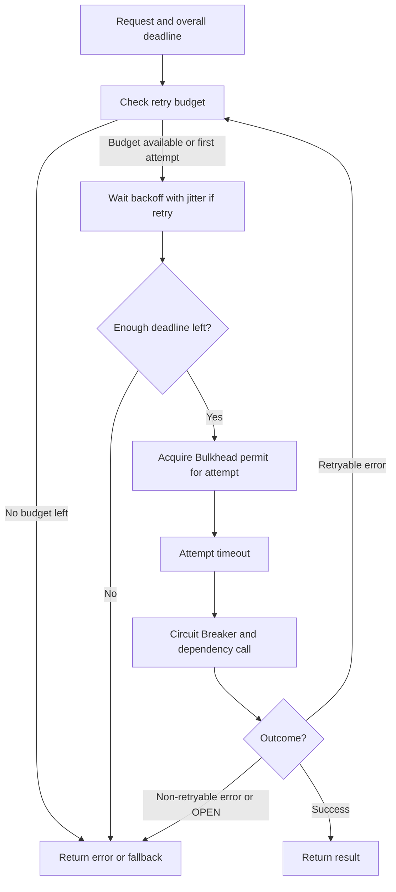

# Backoff, Jitter, and Attempt Budgets

## Objectives

Retry helps a call overcome transient errors, but retrying too quickly or too often can send extra requests to an overloaded service and slow down its recovery. When combining Retry with Circuit Breaker in Spring Cloud, you need to cap the number of attempts, space out wait intervals with backoff, spread retry timing with jitter, and set a retry budget for overall traffic.

After this lesson, you will be able to:

- Distinguish maximum attempts from additional retries.
- Calculate an exponential backoff schedule and explain the role of jitter.
- Establish a retry budget, per-attempt timeout, and full-request deadline.
- Retry only transient errors and handle operations with side effects safely.
- Choose the composition order of Retry, Circuit Breaker, Bulkhead, and TimeLimiter to avoid load amplification.

## Why Are Backoff and Jitter Needed?

Suppose a catalog service starts returning errors due to overload. If thousands of requests simultaneously retry after exactly 100 milliseconds, they can all return at the same moment, creating another load spike. If they continue retrying on a fixed interval, clients can stay synchronized and sustain the traffic surge.

**Backoff** increases the wait interval between attempts. **Jitter** adds randomness to the wait interval so clients do not retry at the same instant. The two techniques complement each other:

- Backoff reduces retry frequency when an error persists.
- Jitter spreads retries out over time, reducing synchronized request bursts.
- A retry budget caps the total amount of extra requests generated.

Retry is only useful when an error is likely to resolve during the wait period. It does not fix configuration mistakes, invalid input data, or a service that has lost availability for an extended period. Circuit Breaker adds a mechanism to cut off retries when error signals indicate the dependency is unhealthy.

## Number of Attempts and Exponential Backoff

In a retry policy, distinguish between:

- **Attempt:** one execution of the operation, including the initial call.
- **Retry:** an additional call after a previous attempt failed.
- **Max attempts:** maximum total number of attempts, usually including the first attempt.
- **Max retries:** number of additional calls, excluding the first attempt.

For example, `maxAttempts = 3` means at most three executions: one initial call and two retries. If using an API that accepts `maxRetries = 3`, the total number of attempts may be four. Always check the semantics of the property in the library you are using.

With exponential backoff, the wait interval before retry `n` can be described as:

\[
d_n = \min(d_{max}, d_0 \times m^{n-1})
\]

Where:

- `d0` is the initial wait interval.
- `m` is the multiplier, usually greater than 1.
- `dmax` is the maximum cap so wait time does not grow indefinitely.
- `n` starts at 1 for the first retry.

Example with `d0 = 100 ms`, `m = 2`, and `dmax = 1,000 ms`:

| Retry | Wait interval before jitter |
|---:|---:|
| 1 | 100 ms |
| 2 | 200 ms |
| 3 | 400 ms |
| 4 | 800 ms |
| 5 | 1,000 ms (cap reached) |
| 6 | 1,000 ms |

Bounded backoff slows down retry rate during prolonged outages while still allowing relatively fast retries on the first few attempts.

## Jitter Spreads Retry Timing

If all clients use the exact same backoff schedule, they can still synchronize. Jitter randomizes each client's wait interval.

Some common strategies:

| Strategy | How wait interval is chosen | Characteristics |
|---|---|---|
| Full jitter | Pick randomly from 0 to the current backoff cap. | Wide spread, reduces simultaneous retry bursts. |
| Equal jitter | Keep a fixed portion of backoff and randomize the rest. | Avoids overly short waits while still spreading clients out. |
| Randomized multiplier | Multiply the base wait interval by a random factor within a configured range. | Easy to configure when the library provides a randomization factor. |

For example, full jitter with a 400 ms backoff cap can pick any duration between 0 and 400 ms. Two clients encountering an error together have a much lower probability of retrying at the exact same moment.

Jitter does not replace backoff caps or retry budgets. A randomized wait can still be too short if the base limits are unreasonable. Choose `d0`, multiplier, and `dmax` according to the dependency's latency, SLA, and typical recovery time.

## Retry Budget Caps Additional Load

Per-request attempt limits can still create massive load when there are many concurrent requests. A retry budget places an overall cap on the number of retries over a period of time or as a ratio of original traffic.

For example, a service sets a budget allowing retries not to exceed 10% of initial requests in a one-minute window. If there are 1,000 initial requests in that minute, the budget allows at most 100 additional retries. Once the budget is exhausted, new requests only perform the initial attempt or return an error according to policy; no further retries are generated.

A simple implementation is a token bucket:

1. Each retry must consume one token.
2. Tokens are replenished at a defined rate, or recalculated from the count of original requests in the window.
3. If no tokens remain, skip the retry and propagate the current error to the caller.
4. Cap bucket capacity so a large burst of retries does not accumulate after a low-traffic period.

A retry budget can be scoped per dependency, per application instance, or per request group. Understand its scope: if each pod has its own budget, the cluster-wide budget scales with the number of pods. To enforce a cluster-wide limit, you need a coordination mechanism or per-instance budget allocation; do not assume a local counter represents the entire system.

A retry budget must also work alongside per-request attempt limits. The global budget controls total system retries, while `maxAttempts` prevents a single request from consuming too much of the budget.

## Deadline and Timeout for the Entire Retry Sequence

Each attempt needs its own timeout, and the entire request needs a final deadline. If you only set a per-attempt timeout without a deadline, total wait time can exceed how long the caller is still willing to wait.

The expected total time can be estimated by:

\[
T_{total} = \sum_{i=1}^{A} T_i + \sum_{i=1}^{A-1} d_i + T_{overhead}
\]

Where `A` is the total number of attempts, `Ti` is the maximum timeout of attempt `i`, `di` is the wait interval between two attempts, and `Toverhead` is additional processing overhead.

For example, three attempts of up to 500 ms each, with backoffs of 100 ms and then 200 ms, have a maximum duration of approximately:

\[
3 \times 500 + 100 + 200 = 1{,}800\text{ ms}
\]

If the API has a 1,200 ms deadline, do not start a new attempt when the remaining time is insufficient for the minimum timeout and result processing. Deadlines should be propagated across layers if the system supports propagation; each layer only uses the remaining time budget.

Attempt timeouts, TimeLimiter, and HTTP client timeouts can coexist. Decide which layer owns the overall deadline and which layer enforces actual I/O limits. Canceling a future or subscription does not guarantee that every request already sent to a remote server stops immediately.

## Retry Only Transient Errors

Do not retry every exception. A good policy classifies errors by recoverability and operation semantics:

| Error type | Recommended policy |
|---|---|
| Temporary connection errors, connection reset | Can retry with backoff and budget. |
| Timeout calling dependency | Can retry if enough deadline remains and the operation is safe. |
| HTTP 429 or 503 | Can retry; respect `Retry-After` if sent by the server. |
| Certain HTTP 5xx | Evaluate per service contract; retry only when errors are likely transient. |
| HTTP 400, 401, 403, or invalid data | Usually do not retry because the request needs fixing or re-authentication. |
| HTTP 404 | Usually a business result; do not retry unless the system has specific eventual consistency semantics. |
| Circuit Breaker rejects because `OPEN` | Usually do not retry immediately; wait for Circuit Breaker's recovery mechanism. |
| Bulkhead limit exhausted | Do not retry aggressively; return an overload error or queue according to a separate policy. |

For HTTP 429 or 503, the `Retry-After` header may contain a timestamp or number of seconds to wait. If supported, the client should respect this value, while still enforcing the deadline and retry budget. Do not let a `Retry-After` value exceed the deadline and hold request resources for too long.

## Idempotency Before Retrying

Retry can re-send an operation that the server already executed when the client did not receive the response. For example, a client sends a payment request, the server records the transaction, and the connection drops before returning the result. If the client resends without duplicate protection, the transaction could be executed twice.

Before retrying, ask:

- Is the operation idempotent according to the API contract?
- If the server executed it but the response was lost, how can the client determine the outcome?
- Can a stable idempotency key be used across all attempts of the same logical operation?
- Is there a status query endpoint to verify before resending?

For transaction creation or payment operations, use a server-supported idempotency key and keep the exact same key across all attempts. Do not generate a new key per retry because the server will treat them as separate transactions.

## Composing Retry with Circuit Breaker

The placement order of the two policies directly affects how many samples Circuit Breaker records.

**Retry outside Circuit Breaker:** each attempt goes through Circuit Breaker:

```java
Supplier<Product> protectedAttempt = CircuitBreaker.decorateSupplier(
        circuitBreaker,
        () -> catalogClient.findById(id));

Supplier<Product> retryingCall = Retry.decorateSupplier(
        retry,
        protectedAttempt);
```

In this structure, each attempt can produce a separate sample in Circuit Breaker. If errors keep occurring and the circuit transitions to `OPEN`, the next attempt will be rejected early instead of calling the dependency again. This is usually the right choice when you want Circuit Breaker to reflect each actual attempt.

**Retry inside Circuit Breaker:** Circuit Breaker wraps the entire retry sequence:

```java
Supplier<Product> retryingAttempt = Retry.decorateSupplier(
        retry,
        () -> catalogClient.findById(id));

Supplier<Product> protectedLogicalCall = CircuitBreaker.decorateSupplier(
        circuitBreaker,
        retryingAttempt);
```

Circuit Breaker typically observes the final outcome of the retry sequence as a single logical call. The dependent service may receive multiple requests before Circuit Breaker records the final failure and opens the circuit. This can be useful when you want retries to handle short-lived errors inside an operation, but you must tightly cap attempt counts and deadlines.

| Placement | What Circuit Breaker records | Consequence |
|---|---|---|
| Retry outside Circuit Breaker | Each permitted attempt. | The circuit receives error signals early and can open before remaining retries run. |
| Retry inside Circuit Breaker | Final outcome of the retry sequence. | One logical call can generate multiple requests before the circuit records a failure. |

When using the Spring Cloud CircuitBreaker factory, the `run` API includes a fallback. If the fallback converts an exception into a successful value, an outer Retry will not see the error to retry. If retries are needed, allow appropriate errors to propagate out to the retry layer that needs to observe them; only apply fallback after the retry policy finishes or for non-retryable errors.

## Configuring Retry with Resilience4j

Resilience4j Retry can be configured per instance. YAML example:

```yaml
resilience4j:
  retry:
    configs:
      remote-default:
        maxAttempts: 3
        waitDuration: 100ms
        retryExceptions:
          - java.io.IOException
          - java.net.SocketTimeoutException
        ignoreExceptions:
          - io.github.resilience4j.circuitbreaker.CallNotPermittedException
          - com.example.catalog.ProductNotFoundException
    instances:
      catalog:
        baseConfig: remote-default
```

`maxAttempts: 3` includes the first attempt, meaning at most two retries. `waitDuration` is the base wait interval. `retryExceptions` lists exceptions to retry; `ignoreExceptions` excludes exceptions that should not be retried. The example ignores `CallNotPermittedException` so Retry does not repeatedly re-attempt a call that Circuit Breaker already rejected because it is `OPEN`. Specific properties and inheritance behavior may vary by Resilience4j version; check your application's dependency version.

If exponential backoff and jitter are needed, you can build an `IntervalFunction` in Java:

```java
import java.time.Duration;

import io.github.resilience4j.retry.Retry;
import io.github.resilience4j.retry.RetryConfig;
import io.github.resilience4j.core.IntervalFunction;

RetryConfig retryConfig = RetryConfig.custom()
        .maxAttempts(3)
        .intervalFunction(IntervalFunction.ofExponentialRandomBackoff(
                Duration.ofMillis(100).toMillis(),
                2.0,
                0.5))
        .retryOnException(error -> error instanceof java.io.IOException
                || error instanceof java.net.SocketTimeoutException)
        .ignoreExceptions(
                io.github.resilience4j.circuitbreaker.CallNotPermittedException.class,
                ProductNotFoundException.class)
        .build();

Retry catalogRetry = Retry.of("catalog", retryConfig);
```

`ofExponentialRandomBackoff` produces an exponentially increasing wait interval with randomness based on the configured factor. API names or overloads may differ by library version; check the Javadoc for the version managed in your project before using. If full jitter or `Retry-After` compliance is needed, you can supply a custom interval function to compute the wait interval from the attempt number and error details.

With Reactor, you can use `Retry.backoff` and `jitter`:

```java
import java.time.Duration;

import reactor.util.retry.Retry;

Retry retrySpec = Retry.backoff(2, Duration.ofMillis(100))
        .maxBackoff(Duration.ofSeconds(1))
        .jitter(0.5)
        .filter(this::isTransientFailure);

Mono<Product> result = catalogGateway.findById(id)
        .retryWhen(retrySpec);
```

In Reactor, `Retry.backoff(2, ...)` takes the number of additional retries, not total attempts. The example can perform one initial attempt and up to two retries. The `isTransientFailure` filter must also exclude `CallNotPermittedException` so it does not retry a call already rejected by Circuit Breaker. If the publisher is already wrapped by a Circuit Breaker, where `retryWhen` is placed determines whether each retry passes through Circuit Breaker.

## Policy Composition Example for the Catalog Dependency

Suppose catalog has a 400 ms per-attempt timeout, maximum three attempts, 100 ms backoff with multiplier 2, a 500 ms backoff cap, and a 10% retry budget. Each request has a 1,500 ms deadline.

Baseline schedule before jitter:

| Phase | Maximum duration |
|---|---:|
| Attempt 1 | 400 ms |
| Wait before attempt 2 | 100 ms |
| Attempt 2 | 400 ms |
| Wait before attempt 3 | 200 ms |
| Attempt 3 | 400 ms |
| Total | 1,500 ms |

This total equals the example deadline and does not yet include overhead. In a real implementation, leave headroom for processing, data transfer, and returning the response; if remaining deadline is insufficient, skip the next attempt. Jitter can alter wait durations, so the deadline must be checked against actual remaining time rather than relying solely on the baseline schedule.

A sound operational policy could be:

1. Each request is allowed at most three attempts.
2. Retry only connection errors, timeouts, or 503 responses classified as transient.
3. Each retry consumes one token from the catalog dependency's 10% budget.
4. Each attempt passes through Circuit Breaker so errors are recorded individually; if the circuit is `OPEN`, do not continue retrying.
5. Each attempt has a 400 ms timeout and starts only if enough overall deadline remains.
6. Bulkhead grants a permit only during attempt execution; do not hold permits during backoff waits.
7. After retries or budget are exhausted, return an error or fallback conforming to the API contract.

## Limit Composition Diagram



The diagram illustrates one common organization, not a mandatory order for every library. The key points are not holding a Bulkhead permit during backoff and not starting a retry when Circuit Breaker is already open or the deadline has expired.

## Monitoring Retry Effectiveness

Monitor Retry alongside Circuit Breaker to know whether the system is helping recovery or amplifying load. Useful metrics include:

- Number of logical requests from callers.
- Total attempts and number of additional retries.
- Rate of retries succeeding on subsequent attempts.
- Number of retries rejected due to exhausted budget.
- Number of attempts rejected by Circuit Breaker.
- Backoff wait time, per-attempt latency, and full-request duration.
- Counts of timeouts, 429/503 errors, connection errors, and non-retryable errors.
- Fallback rate and Circuit Breaker state per dependency.

Resilience4j Retry and Circuit Breaker expose metrics and events via Micrometer when the appropriate binder is enabled. Metric and tag names depend on library version and registry; inspect actual output before building dashboards. Avoid looking only at final success rate: requests may eventually succeed after many retries while the dependency is still absorbing several times normal load.

A warning sign is rapidly rising retries, low retry success rate, increasing total latency, and Circuit Breaker frequently opening (`OPEN`). When that happens, lowering the retry budget, reducing max attempts, increasing backoff/jitter, or fixing the root cause is more effective than increasing attempts.

## Verification Exercises

Run in a test environment against a dependency that can return scripted failures:

1. Configure up to three attempts, exponential backoff starting at 100 ms, multiplier 2, and jitter.
2. Have the first attempt return a transient connection error and the next succeed; record request count, wait intervals, and total request time.
3. Have all attempts fail; verify total attempts do not exceed three and the final error reaches the fallback or caller.
4. Send many concurrent requests to exhaust the retry budget; verify subsequent requests stop generating retries once the budget is empty.
5. Force Circuit Breaker to `OPEN`; verify Retry stops calling the dependency after calls are rejected.
6. Lower the deadline so the next attempt no longer has enough time; verify the system skips the retry instead of exceeding the deadline.
7. Test an operation with side effects using an idempotency key; verify all attempts reuse the same key and the server does not create duplicate transactions.
8. Compare metrics when Retry is outside versus inside Circuit Breaker to observe the difference between attempt count, network request count, and Circuit Breaker sample count.

## Common Pitfalls

- **Confusing maxAttempts with maxRetries:** can accidentally trigger one extra unexpected call.
- **Immediate retries:** causes many clients to synchronize and create a new load wave.
- **Using exponential backoff without jitter:** clients can still retry at the same time.
- **Unbounded backoff:** requests can wait longer than the deadline or SLA.
- **No retry budget:** total extra requests grow linearly with concurrent requests.
- **Retrying every exception:** business errors and configuration bugs do not resolve themselves on retry.
- **Retrying non-idempotent operations:** can create duplicate transactions or side effects.
- **Holding a Bulkhead permit while waiting:** exhausts concurrency capacity even when no attempt is running.
- **Letting fallback turn an error into success before Retry:** outer Retry no longer receives the failure signal.
- **Retrying when Circuit Breaker is `OPEN`:** creates extra rejected attempts and unnecessary latency.
- **Measuring only the final outcome:** misses the extra requests Retry generated.

Backoff, jitter, and retry budgets turn Retry into a bounded policy. Combining them with deadlines, per-attempt timeouts, Bulkhead, and Circuit Breaker lets the system handle transient errors while keeping additional load and caller wait times under control.
