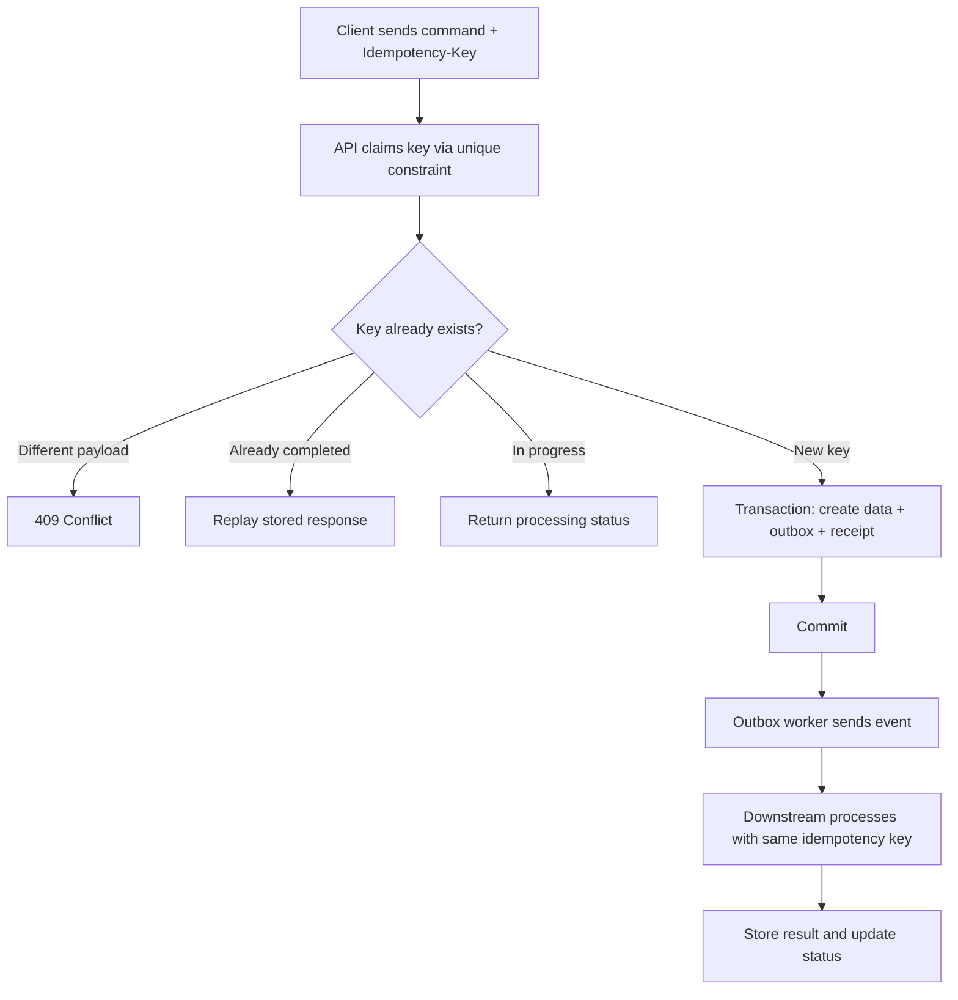

# Idempotency When Retrying Requests with Side Effects

Retries help an application overcome transient errors such as timeouts, brief connection drops, or a dependent service that just restarted. However, for requests with side effects such as creating orders, charging money, booking reservations, or submitting transaction commands, retries can cause the same action to be executed multiple times.

The hardest problem typically appears when a caller times out without knowing whether the service has already processed the request. The server may have already recorded a payment while the response was lost on the way back. If the caller resends the request as a new operation, the customer could be charged twice. **Idempotency** solves this problem by recognizing multiple resubmissions of the same logical operation and ensuring they do not create additional side effects.

In a Spring Cloud Circuit Breaker system, retry, timeout, circuit breaker, and fallback need to work together with an idempotency mechanism at the business layer. Circuit breaker stops calling a dependency when the error rate is high; timeout bounds wait time; retry resends when appropriate; idempotency protects side effects when a request is sent multiple times.

## What Does Idempotency Mean?

An idempotent operation can be executed multiple times with the same identifier while producing a final business outcome equivalent to executing it once. For example, a request to “set order status to CANCELLED” can be repeated without creating additional canceled orders. Conversely, “create a new order” or “add 100,000 VND to balance” is usually not idempotent if each call applies a new change.

| Operation | Inherently safe to repeat? | Notes |
|---|---|---|
| Read product information | Yes | Creates no business side effects |
| Set order status to `CANCELLED` | Usually yes | Must handle valid state transitions and secondary side effects such as refunds |
| Create a new order | No | Each call may create another order |
| Deduct 100,000 VND from account | No | Each call may deduct more money |
| Reserve a seat | No | Can create multiple reservations without a deduplication key |

HTTP methods `PUT` and `DELETE` are defined as idempotent by HTTP semantics, whereas `POST` usually has no such guarantee. However, the method name alone does not protect data. A `PUT` endpoint can still trigger duplicate emails, payments, or events if the implementation creates side effects on every incoming request. Idempotency must be enforced at the business processing and persistence layers.

## An Idempotency Key Identifies One Logical Operation

The client generates a unique key for a business operation and sends that key on every retry attempt, commonly via the `Idempotency-Key` header:

```http
POST /api/orders
Idempotency-Key: 8f3a0d9c-2b11-4f6a-a3c0-1a9f5b9b2e21
Content-Type: application/json

{
  "customerId": "c-102",
  "items": [
    { "productId": "p-10", "quantity": 2 }
  ]
}
```

If the response is lost, the client resends the same request with the same key. The server looks up the corresponding idempotency record. If the operation already completed, the server returns the stored result instead of creating the order again. If a request arrives with the same key but a different payload, the server must reject it because one key must not represent two different operations.

The key should be generated once at the boundary of the logical operation, then kept unchanged across all retries. Do not generate a new UUID inside each HTTP call or each service retry. If a new key is generated, the server cannot tell that those requests represent the same user intent.

Scope the key by tenant/customer and operation type, such as `(tenant_id, operation, idempotency_key)`. Do not use an unscoped global key, because two different customers or two different endpoints could accidentally collide. The key should be an opaque, hard-to-guess value containing no personal information.

## Persisting Keys and Outcomes Durably

Do not store keys only in the memory of a single application instance. When the application restarts or the next request is routed to another replica, deduplication state is lost. For critical operations, store keys and state in durable storage with a unique constraint.

PostgreSQL table example:

```sql
CREATE TABLE idempotency_record (
    tenant_id          VARCHAR(100) NOT NULL,
    operation          VARCHAR(100) NOT NULL,
    idempotency_key    VARCHAR(200) NOT NULL,
    request_hash       CHAR(64) NOT NULL,
    status             VARCHAR(20) NOT NULL,
    response_status    INTEGER,
    response_body      JSONB,
    resource_id        UUID,
    created_at         TIMESTAMPTZ NOT NULL DEFAULT now(),
    expires_at         TIMESTAMPTZ NOT NULL,
    PRIMARY KEY (tenant_id, operation, idempotency_key),
    CHECK (status IN ('IN_PROGRESS', 'COMPLETED', 'FAILED'))
);
```

`request_hash` is a hash of the semantically normalized payload. It helps detect cases where the same key is reused with different content. `response_status` and `response_body` allow replaying a completed response. `resource_id` can store the order or transaction ID so the caller can query status. Real implementations may split large responses into a separate table or store only enough data to reconstruct the response.

A database unique constraint is essential for handling concurrency. Two requests with the same key may hit two threads or two replicas almost simultaneously. Checking `if (!exists)` and then inserting without a unique constraint creates a race condition: both threads can see it does not exist and both execute the side effect.

Example of claiming processing ownership in PostgreSQL:

```sql
INSERT INTO idempotency_record (
    tenant_id, operation, idempotency_key,
    request_hash, status, expires_at
)
VALUES (
    :tenantId, :operation, :key,
    :requestHash, 'IN_PROGRESS', :expiresAt
)
ON CONFLICT (tenant_id, operation, idempotency_key) DO NOTHING;
```

If the insert creates one row, the current transaction has claimed ownership of the key. If zero rows are inserted, read the existing record, compare `request_hash`, and handle according to its status. This read and handling must occur within a controlled transaction protocol; do not replace the unique constraint with a check in Java code.

## Handling Repeated Requests

A common processing flow has three states:

| Status | Meaning | Behavior for requests with the same key |
|---|---|---|
| `IN_PROGRESS` | The request has been received and is being processed | Return an in-progress status or instruct the caller to query again; do not run the side effect again |
| `COMPLETED` | The task finished and the response is stored | Replay the stored response |
| `FAILED` | The task ended in failure | Apply the defined policy: replay the final error or allow controlled retry if certain no side effect occurred |

If the key already exists with a different payload hash, return a conflict error (typically `409 Conflict`) and do not execute. If the key is `COMPLETED`, replay the status code, body, and meaningful headers of the original response. If the key is `IN_PROGRESS`, you can return `202 Accepted` with a status polling URL, or `409 Conflict`/`Retry-After` per the API contract. The critical rule is not to start a second operation simply because the first request has not yet received a response.

Not every failure should be persisted permanently as `FAILED`. For example, validation failure before any side effect can be returned consistently; a timeout when calling a payment provider may have an undetermined outcome. For an undetermined outcome, do not mark it failed and then create a new transaction. Query the provider using the key or resend with the same key according to the provider's idempotency contract.

## Binding Idempotency to a Local Data Transaction

If the side effects are confined to the same database, you can write the idempotency record, business state changes, and stored response within a single transaction. When the transaction commits, all three succeed together; if it rolls back, all three are reverted together.

The Java example below illustrates the service-layer protocol. `tryClaim` must be implemented using an insert with a unique constraint like the SQL above; do not use an unlocked `exists`-then-`insert` pair.

```java
@Service
public class OrderService {

    private final IdempotencyRepository idempotencyRepository;
    private final OrderRepository orderRepository;
    private final ObjectMapper objectMapper;

    @Transactional
    public OrderResponse createOrder(
            String tenantId,
            String idempotencyKey,
            CreateOrderCommand command) {

        String requestHash = fingerprint(command);
        boolean claimed = idempotencyRepository.tryClaim(
                tenantId, "CREATE_ORDER", idempotencyKey,
                requestHash);

        if (!claimed) {
            IdempotencyRecord existing = idempotencyRepository
                    .findRequired(tenantId, "CREATE_ORDER", idempotencyKey);

            if (!existing.requestHash().equals(requestHash)) {
                throw new IdempotencyKeyConflictException();
            }

            if (existing.status() == IdempotencyStatus.COMPLETED) {
                return deserialize(existing.responseBody(), OrderResponse.class);
            }

            throw new RequestStillProcessingException();
        }

        Order order = orderRepository.save(Order.create(command));
        OrderResponse response = OrderResponse.from(order);

        idempotencyRepository.markCompleted(
                tenantId, "CREATE_ORDER", idempotencyKey,
                order.getId(), serialize(response));

        return response;
    }
}
```

This example assumes order creation and idempotency persistence use the same database and transaction. Under typical transaction isolation such as PostgreSQL `READ COMMITTED`, concurrent inserts on the unique key are coordinated by the database; the losing request reads the record after the winning request commits. Test specific behavior for your database and isolation level. If the winning request rolls back, the other request can claim the key and execute the operation.

Do not call a payment provider, send an email, or make HTTP calls to external systems inside an open database transaction solely to achieve atomicity. The database cannot roll back side effects that already occurred in a remote system. Those cases require a different distributed protocol.

## Side Effects in External Systems: Transactional Outbox

For side effects involving other services, use the Transactional Outbox pattern to record the intent to publish an event in the same transaction as business data and the idempotency record:

1. Within one database transaction, claim the idempotency key, create the order, and write an outbox event.
2. Commit the transaction. Now the order, idempotency record, and event intent coexist.
3. A worker reads the outbox and sends the command to the payment service or message broker.
4. If the worker does not receive an acknowledgment, it can resend the event. The consumer or provider must recognize the same event/key and prevent executing the side effect a second time.
5. Persist the downstream result and update the processing status so callers can query it.



An outbox typically guarantees at-least-once event delivery, because the worker can resend after a lost acknowledgment. Consumers should maintain an inbox/deduplication table with a unique constraint on `event_id`, and write the inbox entry together with local side effects in one transaction. If the consumer calls yet another system, forward a stable key or apply an outbox at that boundary as well.

If a payment provider supports idempotency keys, send a stable key derived from the order's payment operation and use that exact key for every retry. Do not use a fresh HTTP request's key if it represents the same payment. Check the provider's key retention period and replay rules; not all external APIs support identical semantics.

## Timeouts Produce Unknown Outcomes

A timeout does not prove that an operation failed. For example:

1. The API sends a payment command to the provider.
2. The provider records the payment successfully.
3. The response is lost or arrives after the deadline.
4. The API times out and the caller does not know whether the transaction happened.

This is an **unknown outcome** state. The right action is to query status by idempotency key or resend with the same key if the provider guarantees deduplication. Generating a new key and sending a new payment command turns a retry into a second transaction.

The fallback must also reflect this uncertainty. Do not return “payment failed” when you only know the caller timed out; do not return “payment succeeded” without confirmation. You can return `202 Accepted` with an `operationId` and status-checking endpoint, or an error code `OUTCOME_UNKNOWN` so the caller can re-query using the same key.

## Combining Retry, CircuitBreaker, and Idempotency

The three mechanisms have distinct responsibilities:

| Mechanism | Question it answers | What it does not guarantee |
|---|---|---|
| Retry | Should we resend after a transient error? | Does not prevent duplicated side effects |
| CircuitBreaker | Should we temporarily stop calling a failing dependency? | Does not tell whether a previous request was processed |
| Idempotency | Does a repeated request create additional side effects? | Does not make the dependency healthier or reduce latency |

Operational rules:

- Retry only likely transient errors, such as timeouts, connection errors, or specific `5xx` codes per contract. Do not retry validation, authorization, business conflicts, or `409` due to key/payload mismatch.
- Use bounded retry counts, exponential backoff with jitter, and an overall deadline. Excessive retries can increase load right when the dependency is degrading.
- Keep the idempotency key and logical payload unchanged across all attempts. If the caller initiates a new operation, generate a new key.
- Do not retry `CallNotPermittedException` when the circuit breaker is `OPEN`; the breaker has already decided to reject the request. Wait for the recovery cycle or return an appropriate status.
- Place fallback after applying an appropriate retry policy. The fallback must not mask an unknown side-effect outcome.

Decorator order affects how the breaker counts retries. With `Retry(CircuitBreaker(call))`, each attempt passes through the breaker and can be recorded individually. With `CircuitBreaker(Retry(call))`, the breaker sees the final outcome of the entire retry sequence. Choose based on observability goals: measuring each attempt or measuring one logical operation after retries. Either way, the idempotency key must stay identical across every call sent to the system performing side effects.

## Retention Policy and Protecting Idempotency Keys

Idempotency records must be retained longer than the window during which clients, gateways, message brokers, or workers can retry. Deleting keys too early causes an old retried request arriving after expiration to be treated as a new operation. For payments or order creation, retention may need to be long enough to satisfy reconciliation and business compliance requirements.

When cleaning up records:

- Only delete records that are completed and past the approved retention period.
- Do not delete `IN_PROGRESS` records while a worker might still finish; use a lease/heartbeat and recovery procedure if a worker dies.
- Consider keeping a tombstone containing the key, fingerprint, and resource ID after the response body expires to continue preventing duplicate side effects.
- Do not log sensitive payloads or full keys; use hashes or correlation IDs for tracing.

If processing asynchronously, the `IN_PROGRESS` state should have an owner/lease and expiration timestamp. When a lease expires, a recovery worker must inspect downstream state before proceeding, because the previous worker may have already sent the command and crashed before recording the response. A lease only coordinates processing ownership; it does not prove that a remote side effect has not occurred.

## Testing Retry and Concurrency Scenarios

An idempotency test suite should simulate both lost responses and concurrent requests:

| Scenario | Expected verification outcome |
|---|---|
| First submission with a new key | Side effect executes once and response is saved |
| Resubmission with same key and same payload after completion | Stored response is replayed; no extra side effects |
| Same key with different payload | Returns conflict; does not execute |
| Two requests with same key arrive concurrently | Unique constraint allows only one request to claim; side effect occurs once |
| Timeout after provider may have processed | Queries or retries with the same key; does not create a new transaction |
| Repeated request while still processing | Returns processing status or stored result; does not execute a second time in parallel |
| Outbox worker delivers event twice | Consumer deduplicates the event; downstream side effect is not doubled |
| Key expires and old request arrives again | Behavior matches documented retention/tombstone policy |

Simple test example for a local service:

```java
OrderResponse first = orderService.createOrder(
        "tenant-1", "order-key-123", command);

OrderResponse replay = orderService.createOrder(
        "tenant-1", "order-key-123", command);

assertEquals(first.orderId(), replay.orderId());
verify(orderRepository, times(1)).save(any(Order.class));
```

Beyond sequential tests, write integration tests running two concurrent requests against a real database or Testcontainers to verify unique constraints and transaction isolation. A mock repository cannot prove that database race-condition prevention works properly.

## Implementation Checklist

1. Define the boundary of a logical operation and business requirements for side effects.
2. Require the client to generate an idempotency key and preserve it across all retries.
3. Scope keys by tenant and operation; store the fingerprint of the normalized payload.
4. Use a unique constraint and transaction so only one request is authorized to create local side effects.
5. Persist responses or resource IDs for replay; explicitly handle `IN_PROGRESS`, `COMPLETED`, and unknown outcomes.
6. Use Transactional Outbox and downstream idempotency for side effects crossing database boundaries.
7. Configure bounded retries, backoff, jitter, and deadlines; do not retry business errors or breaker-rejected requests.
8. Choose a sufficiently long retention window and implement recovery procedures for in-progress records.
9. Monitor replay rate, key/payload conflict errors, in-progress requests, unknown-outcome timeouts, and outbox failures.
10. Test concurrent requests, ambiguous timeouts, worker crashes, and duplicate deliveries.

No single header or library automatically turns every distributed system into exactly-once execution. The practical goal is to permit at-least-once delivery while ensuring each business operation takes effect only once within a controlled boundary, through durable keys, transactions, deduplication, and clear contracts between services.
