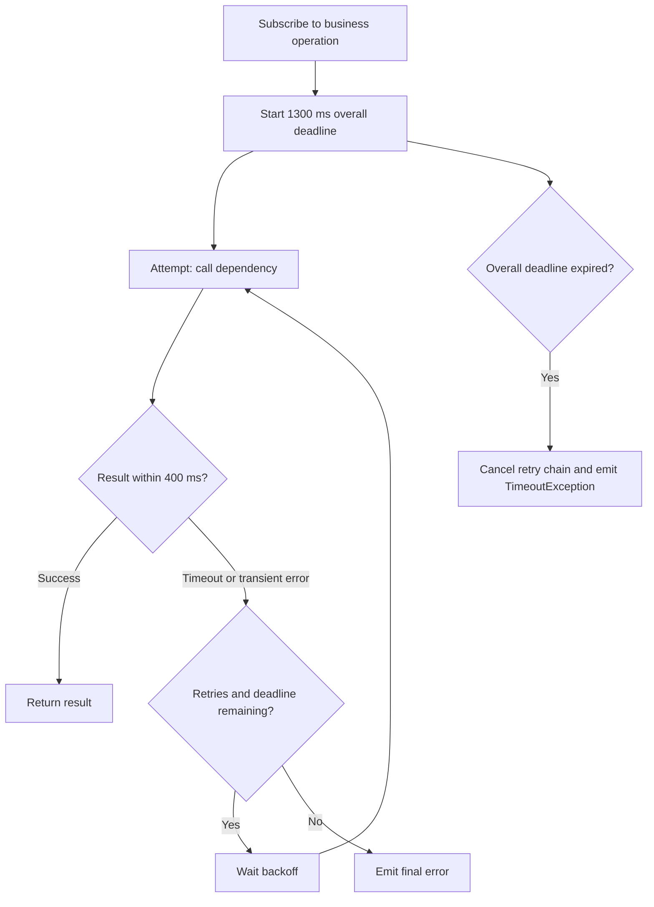

# Composing Retry with Overall Timeout and Per-Attempt Timeout

When calling a dependent service, an attempt can fail due to flaky connectivity or an overly slow response. Retry allows re-trying transient errors; per-attempt timeout bounds the wait time for each individual call; overall timeout bounds the entire sequence including attempts and backoff intervals. If you only set a per-attempt timeout, the retry chain can drag on longer than the API or user is willing to accept.

In Spring Cloud CircuitBreaker with a Resilience4j backend, you need to clearly define the boundary of a business operation, total attempts, per-attempt timeout, and overall deadline. For reactive flows, Reactor provides `timeout` and `retryWhen` to compose these policies. Operator placement determines which timeout triggers retries, whether Circuit Breaker sees a single final outcome or each individual attempt, and when fallback runs.

## Distinguishing Three Time Limits

- **Per-attempt timeout:** maximum duration for one call to the dependent service. When it expires, the attempt emits a timeout error and can be retried if policy permits.
- **Backoff:** pause interval between two attempts. Backoff reduces load when the dependency is experiencing issues and prevents synchronized retry bursts.
- **Overall timeout (overall deadline):** maximum duration for the entire operation, measured from the initial subscription until a final outcome arrives. It covers all attempt durations, backoffs, and reactive chain overhead.

For example, a request has up to three attempts, each allowed to wait 400 ms, with backoffs of 100 ms and then 200 ms. The worst-case configured budget is:

\[
T_{total} = 3 \times 400 + 100 + 200 = 1500\text{ ms}
\]

This figure does not yet include time to build the request, schedule execution, decode responses, and process after the call. If the API has a 1,300 ms deadline, you cannot let the retry sequence consume the full 1,500 ms. The overall timeout must cut off the chain when the deadline expires, even if the last attempt still has individual time left.

| Component | Example | Scope |
|---|---:|---|
| Per-attempt timeout | 400 ms | Restarted on each subscription to the source |
| 1st backoff | 100 ms | Between the first and second attempt |
| 2nd backoff | 200 ms | Between the second and third attempt |
| Overall timeout | 1,300 ms | One business execution, including retries and backoffs |

The overall timeout is typically less than or equal to the remaining deadline passed down by the caller. Do not create a fresh full deadline in every service or on every retry, because doing so allows the call chain to exceed the original request's deadline.

## Placing Per-Attempt Timeout Before `retryWhen`

In Reactor, `timeout` placed before `retryWhen` applies to each subscription to the source publisher. When the timeout fires, `retryWhen` receives that error and decides whether to perform the next attempt.

```java
Mono<Product> request = Mono.defer(() -> catalogClient.find(sku))
    .timeout(Duration.ofMillis(400))
    .retryWhen(Retry.backoff(2, Duration.ofMillis(100))
        .maxBackoff(Duration.ofMillis(200))
        .jitter(0d)
        .filter(this::isRetryable)
        .onRetryExhaustedThrow((spec, signal) -> signal.failure()));
```

`Retry.backoff(2, ...)` allows at most two retries after the initial call, meaning at most three attempts. `Mono.defer(...)` creates a fresh client call on each subscription. Omitting `defer` when the publisher contains side effects or a single-use object can prevent retries from re-executing the call as intended.

A timeout in this position resets for each attempt. If the first attempt takes 400 ms and times out, the second attempt gets up to another 400 ms after the backoff interval. Therefore, having only a per-attempt timeout still allows total duration to approach the sum of all attempt durations plus backoffs.

## Placing Overall Timeout After `retryWhen`

To bound the entire chain, place another `timeout` after `retryWhen`:

```java
Mono<Product> request = Mono.defer(() -> catalogClient.find(sku))
    .timeout(Duration.ofMillis(400))
    .retryWhen(Retry.backoff(2, Duration.ofMillis(100))
        .maxBackoff(Duration.ofMillis(200))
        .jitter(0d)
        .filter(this::isRetryable)
        .onRetryExhaustedThrow((spec, signal) -> signal.failure()))
    .timeout(Duration.ofMillis(1300));
```

The first timeout restarts on each attempt. The final timeout starts once for the entire chain when the subscription is created; it covers both call durations and backoffs. If total duration hits 1,300 ms, the publisher terminates with a timeout and cancels the active subscription via Reactor's cancellation mechanism.



The diagram shows both limits coexisting. Retry only continues when the error belongs to the allowed group and attempts remain; the overall timeout can terminate the entire chain regardless of remaining retries.

## Choosing Which Errors to Retry

Not every exception should be retried. Retry is useful for errors that are likely temporary, such as brief connection failures or a dependency timeout. Input errors, authentication errors, business errors where a resource does not exist, or configuration mistakes usually cannot be fixed by immediately calling again.

```java
private boolean isRetryable(Throwable error) {
    Throwable cause = Exceptions.unwrap(error);
    return cause instanceof IOException
        || cause instanceof TimeoutException;
}
```

In applications using Resilience4j, exclude `CallNotPermittedException`. This signals that Circuit Breaker is rejecting the call because the circuit is `OPEN`; retrying repeatedly only creates more rejected subscriptions. Also consider Bulkhead rejection errors, as retrying immediately can increase pressure on the queue or semaphore.

When using `Retry.backoff(...)`, Reactor applies exponential backoff and optionally jitter depending on configuration. In the calculation example, `maxBackoff(200 ms)` and `jitter(0)` keep the two wait intervals at 100 ms and 200 ms so the math is easy to verify. In production, enable jitter so multiple clients do not retry simultaneously; still set `maxBackoff` and cap total attempts so the chain does not overrun the deadline.

When retries are exhausted, Reactor can emit a `RetryExhaustedException` wrapping the final error. If exception classification or fallback needs the original final error, use `onRetryExhaustedThrow((spec, signal) -> signal.failure())` or inspect `cause` intentionally. Do not assume every wrapper exception is classified by Circuit Breaker the same way as the underlying error.

## Composing Retry and Circuit Breaker

The position of Circuit Breaker relative to retry determines whether the sliding window counts outcomes per business operation or per attempt.

### Circuit Breaker Wrapping the Entire Retry Sequence

```java
Mono<Product> attempts = Mono.defer(() -> catalogClient.find(sku))
    .timeout(perAttemptTimeout)
    .retryWhen(retryPolicy)
    .timeout(overallTimeout);

return reactiveCircuitBreakerFactory.create("catalog")
    .run(attempts, error -> fallbackProduct(sku, error));
```

Circuit Breaker receives the final outcome of the retry chain for one subscription. If two attempts fail but the third succeeds, the breaker records one success. If retries are exhausted or the overall timeout expires, the breaker receives the final error and records it according to its `recordExceptions`/`ignoreExceptions` policy.

This approach fits when you want Circuit Breaker to evaluate the outcome of a business operation after retries have been applied. It prevents a single request from contributing multiple failure samples just because it had multiple attempts.

### Each Attempt Passing Through Its Own Circuit Breaker

```java
Mono<Product> oneAttempt = Mono.defer(() ->
    reactiveCircuitBreakerFactory.create("catalog").run(
        Mono.defer(() -> catalogClient.find(sku))
            .timeout(perAttemptTimeout),
        error -> Mono.error(error)));

return oneAttempt
    .retryWhen(retryPolicy)
    .timeout(overallTimeout)
    .onErrorResume(error -> fallbackProduct(sku, error));
```

Here, `retryWhen` re-subscribes to the publisher protected by Circuit Breaker. Each attempt can generate an individual sample in the sliding window. This helps the circuit react faster to per-attempt errors, though one request can contribute multiple failures. Once the circuit opens after an attempt, the next retry may receive `CallNotPermittedException` and must be excluded by the retry predicate.

The overall timeout in this example sits outside the per-attempt Circuit Breaker. Therefore, the overall timeout can terminate the chain by canceling the subscription without necessarily being recorded as a failure by the per-attempt Circuit Breaker. If you need to track both per-attempt health and full-operation outcomes, consider two separate protection boundaries with clear purposes and breaker names; avoid nesting two breakers merely to count the same error twice.

| Placement | Circuit Breaker sample | Advantage | Consideration |
|---|---|---|---|
| Circuit Breaker outside retry | One sample for the final chain outcome | Evaluates the end-to-end outcome of the operation | Transient errors resolved by retry may not increase failure count |
| Circuit Breaker inside retry | One sample per protected attempt | Reacts quickly to per-attempt failures | One request can produce multiple failure samples; overall timeout sits outside the breaker |

## Complete Integration Example with Spring Cloud CircuitBreaker

The example below places Circuit Breaker around the entire retry sequence. Each call has a 400 ms timeout, at most two retries, incremental backoff of 100 ms then 200 ms, and an overall deadline of 1,300 ms. Fallback runs only after the protected sequence ends with an error or Circuit Breaker denies permission.

```java
import java.io.IOException;
import java.time.Duration;
import java.util.concurrent.TimeoutException;

import io.github.resilience4j.circuitbreaker.CallNotPermittedException;
import org.springframework.cloud.client.circuitbreaker.ReactiveCircuitBreaker;
import org.springframework.cloud.client.circuitbreaker.ReactiveCircuitBreakerFactory;
import org.springframework.stereotype.Service;
import reactor.core.Exceptions;
import reactor.core.publisher.Mono;
import reactor.util.retry.Retry;

@Service
class CatalogService {

    private final ReactiveCircuitBreakerFactory<?, ?> circuitBreakerFactory;
    private final CatalogClient catalogClient;
    private final ProductCache productCache;

    CatalogService(
            ReactiveCircuitBreakerFactory<?, ?> circuitBreakerFactory,
            CatalogClient catalogClient,
            ProductCache productCache) {
        this.circuitBreakerFactory = circuitBreakerFactory;
        this.catalogClient = catalogClient;
        this.productCache = productCache;
    }

    Mono<Product> find(String sku) {
        Duration perAttemptTimeout = Duration.ofMillis(400);
        Duration overallTimeout = Duration.ofMillis(1300);

        Retry retryPolicy = Retry.backoff(2, Duration.ofMillis(100))
            .maxBackoff(Duration.ofMillis(200))
            .jitter(0d)
            .filter(this::isRetryable)
            .onRetryExhaustedThrow((spec, signal) -> signal.failure());

        Mono<Product> attempts = Mono.defer(() -> catalogClient.find(sku))
            .timeout(perAttemptTimeout)
            .retryWhen(retryPolicy)
            .timeout(overallTimeout);

        ReactiveCircuitBreaker breaker = circuitBreakerFactory.create("catalog");
        return breaker.run(attempts, error -> fallback(sku, error));
    }

    private boolean isRetryable(Throwable error) {
        Throwable cause = Exceptions.unwrap(error);
        return !(cause instanceof CallNotPermittedException)
            && (cause instanceof IOException || cause instanceof TimeoutException);
    }

    private Mono<Product> fallback(String sku, Throwable error) {
        return productCache.find(sku)
            .switchIfEmpty(Mono.error(
                new CatalogUnavailableException(sku, error)));
    }
}
```

`Mono.defer(...)` recreates the client call on each attempt. The 400 ms timeout sits before `retryWhen`, so per-attempt timeouts can trigger retries. The 1,300 ms timeout sits after retry, bounding the total duration of the entire sequence. Because Circuit Breaker wraps the `attempts` publisher, it sees the final result of the chain and can record the overall timeout if that timeout is classified as a failure.

The fallback reads the cache and returns a `Mono`; it does not block the reactive thread. In real applications, put a separate timeout on the cache if the cache itself can be slow, and ensure the fallback does not push past the request deadline. If the fallback returns an error, the caller receives that error per the API contract.

## Resilience4j Configuration and Boundaries of Responsibility

Retry and TimeLimiter policies can be configured via properties for APIs using Resilience4j auto-configuration:

```yaml
resilience4j:
  retry:
    instances:
      catalog:
        maxAttempts: 3
        waitDuration: 100ms
        enableExponentialBackoff: true
        exponentialBackoffMultiplier: 2
  timelimiter:
    instances:
      catalog:
        timeoutDuration: 1300ms
        cancelRunningFuture: true
  circuitbreaker:
    instances:
      catalog:
        slidingWindowType: COUNT_BASED
        slidingWindowSize: 20
        minimumNumberOfCalls: 10
        failureRateThreshold: 50
        waitDurationInOpenState: 5s
```

`maxAttempts: 3` consists of one initial call and up to two retries. `waitDuration` is the base pause; with exponential backoff enabled, the wait scales by the multiplier. This is a Resilience4j Retry configuration and does not automatically ensure a dynamic per-request deadline across the entire sequence. TimeLimiter above sets a per-instance operation limit; if requests have varying remaining budgets, apply a dynamic timeout on the publisher, such as `Mono.timeout(remaining)`, and keep it inside the Circuit Breaker boundary that needs to measure it.

In reactive applications, Reactor's `retryWhen` and `Mono.timeout` are the direct way to control retry order and publisher deadlines. Do not simultaneously apply multiple Retry or TimeLimiter layers to the same publisher without clearly defining which layer owns attempt counts and the overall deadline; otherwise, actual call counts and wait times become hard to predict.

## Common Pitfalls When Combining Retry and Timeout

- **Setting only a per-attempt timeout:** each retry gets a fresh time budget, allowing total duration to exceed the caller's deadline. Add an overall timeout after `retryWhen`.
- **Placing the overall timeout before retry:** each retry can restart that timeout. Place the overall timeout after `retryWhen` so it spans the whole sequence.
- **Not using `defer` for calls with side effects:** retry may re-subscribe to a publisher without creating a fresh request as expected. Create the client call inside `Mono.defer`.
- **Retrying every exception:** business errors, auth errors, or `CallNotPermittedException` are retried pointlessly. Use a predicate restricted to transient errors.
- **Fallback before Circuit Breaker:** errors are replaced with data before the breaker observes them, making a failing dependency look like a success. Place fallback outside the measurement boundary if you want Circuit Breaker to record upstream errors.
- **Overall timeout outside the breaker while expecting the breaker to record it:** a downstream timeout may simply cancel the subscription. Place the deadline inside the protected publisher if you want Circuit Breaker to observe the overall timeout.
- **Retrying non-idempotent operations:** requests creating orders or deducting stock can execute side effects multiple times. Use an idempotency key or duplicate-execution protection.

## How to Test

Tests should verify completion time, dependency call count, and Circuit Breaker metrics:

1. Have the first attempt time out while the second succeeds. Verify each attempt has its own timeout and the request returns before the overall deadline.
2. Have all attempts time out. Verify retries stop after max attempts or when the overall timeout expires, whichever comes first.
3. Return a non-retryable error, such as a validation error. Verify the client is called only once.
4. Put Circuit Breaker in `OPEN`. Verify `CallNotPermittedException` does not trigger a retry.
5. Compare Circuit Breaker wrapping retry against Circuit Breaker inside retry. Verify an operation creates one final sample or multiple samples according to design.
6. Make the fallback slow. Verify the fallback has its own bound and does not exceed the request deadline.
7. For requests with side effects, replay the same idempotency key and verify no duplicate operations are created.

With Reactor Test, use `StepVerifier.withVirtualTime(...)` to test timeouts and backoff without waiting in real time. Use a mock publisher counting subscriptions to verify `retryWhen` executes the exact expected number of times. After each scenario, check client call count, Circuit Breaker state, failure rate, and the final error received by the caller.

Good design keeps the three policies independent yet coordinated under a single budget: per-attempt timeout keeps one attempt from hanging too long, Retry re-attempts only recoverable errors, and overall timeout guarantees the entire operation finishes on time. Circuit Breaker observes the chosen boundary so the sliding window consistently reflects dependency health.
