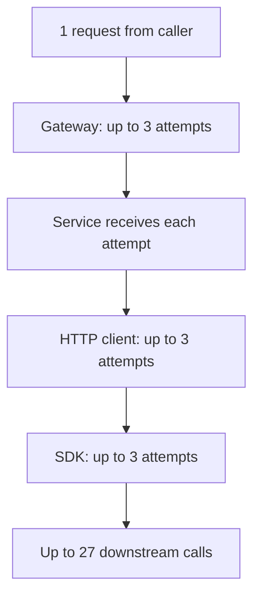
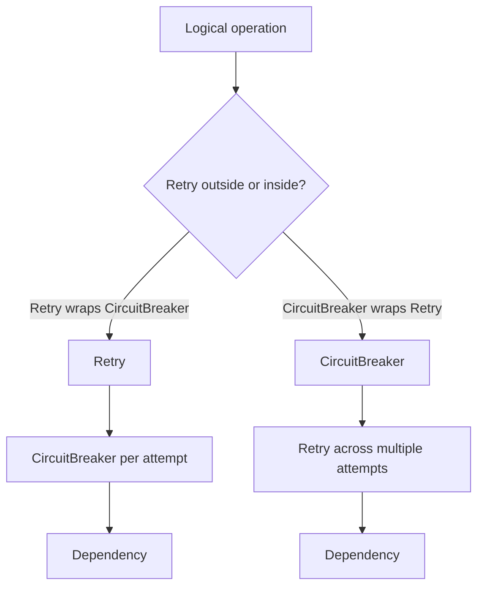

# Avoiding Multi-Layer Retry Multiplication Across Gateway, Client, and SDK

Retries help overcome transient errors, yet every retry adds load to the system. In a microservices architecture, a single request may pass through Spring Cloud Gateway, a service HTTP client, and a vendor SDK. If all three layers retry independently, the number of calls reaching the target service can grow exponentially. When a service is overloaded, stacked retries easily turn a minor hiccup into a retry storm and prolong recovery.

When deploying Spring Cloud CircuitBreaker, Resilience4j, and clients along the same request path, design retry as a unified policy. Identify which layer owns retries for each error type, bound total attempts with deadlines and a retry budget, and use a circuit breaker to stop sending requests when a dependency shows signs of unhealthiness.

## 1. Why Do Multiple Retry Layers Multiply Requests?

Suppose a request passes through three layers:

1. Spring Cloud Gateway receives the request from the user.
2. A business service calls the inventory service via an HTTP client.
3. The HTTP client uses an SDK that has an internal retry mechanism.

If each layer executes up to 3 attempts per call it makes, one incoming request can generate up to:

\[
3 \times 3 \times 3 = 27\text{ calls to the target service}
\]

The attempts at one layer become full-chain invocations at the next layer. Gateway retries the request to the service; each new request triggers the client; each client retry can cause the SDK to retry again.



This multiplication is the worst-case upper bound when every attempt reaches the underlying layer and meets retry conditions. In practice, call counts may be lower because one layer might succeed early, an error might not match retry criteria, or a request might be rejected by a circuit breaker. Nevertheless, the design must account for the worst case, especially during a dependency outage.

## 2. Distinguishing Retry Count from Total Attempts

Libraries do not always share the same naming convention. Some properties express total attempts including the first call; others express additional retries after the first call.

| Configuration term | Meaning | Total attempts |
|---|---|---:|
| `maxAttempts: 3` in Resilience4j Retry | Includes the initial call and subsequent attempts | 3 |
| `retries: 2` in Spring Cloud Gateway Retry filter | Two retries after the initial request | 3 |
| SDK `maxRetries: 2` | Usually two additional attempts, but verify SDK docs | Usually 3 |

Do not directly add configuration values from different libraries. Convert each value into total attempts for that layer before taking the product.

If layer `(i)` has `(R_i)` additional retries, the maximum total attempts at that layer is `(A_i = R_i + 1)`. When nested layers all retry the same operation, the maximum calls reaching the destination is approximately:

\[
A_{total} = \prod_{i=1}^{n} A_i
\]

For example, Gateway has 2 additional retries, the client has 1 additional retry, and the SDK has 2 additional retries:

\[
(2+1) \times (1+1) \times (2+1) = 18\text{ attempts}
\]

This estimates the upper bound for a sequential request path. If a request also calls multiple services in parallel or fans out across partitions, total calls can be even higher. Calculate branch counts and attempts per branch separately.

## 3. Designating One Layer Responsible for Retries

Do not let Gateway, service client, and SDK all retry the same error category without coordination. Assign ownership per scope:

| Layer | Role it can take | When appropriate |
|---|---|---|
| Gateway | Retry safe HTTP requests by selected method, status, or exception. | Wanting to handle transient errors at the ingress boundary while the caller can wait within the deadline. |
| Service client | Retry calls to a specific dependency with awareness of timeouts, network errors, and idempotency. | Wanting the service itself to control retries per the dependency's contract. |
| SDK | Retry protocol or connection errors well understood by the SDK. | The SDK is the sole retry layer, or SDK retries are bounded and counted in the overall budget. |

A practical rule is to designate **one primary retry layer per error type and per operation**. Set retries to 0 or 1 attempt on the remaining layers unless there is a clear reason for a distinct error type. For instance, the SDK might retry connection setup errors before a request is transmitted, while the service client handles retrying 503 responses. Confirm that the two policies never overlap on the same condition.

Example division of responsibility:

- Gateway does not retry order-write requests; it propagates controlled errors back to the caller.
- Service client owns retries for inventory read calls, with at most one retry.
- The underlying SDK is configured not to retry those same HTTP 5xx errors, or only retries a specific transport error excluded from the client's policy.

A single retry layer makes call counts, maximum latency, and generated load predictable. When policies need tuning, developers can edit one place and clearly assess the impact.

## 4. Retry Only Recoverable Errors

Retry only helps when an error is likely transient and a subsequent attempt has a chance of succeeding. Not every error should be retried.

| Error group | Typically appropriate handling |
|---|---|
| Temporary connection error before request is sent | Can do bounded retry if the operation is safe. |
| Timeout while waiting for response | Must determine whether the target already processed the request; be extra cautious with writes. |
| HTTP 502, 503, or 504 | Can retry per policy and deadline; consider `Retry-After` if present. |
| HTTP 429 | Respect `Retry-After` or returned rate limits; do not retry aggressively. |
| HTTP 400, 401, 403, or validation error | Usually do not retry because retrying will not fix the request or permissions. |
| Unrecoverable business error | Return the business error; do not auto-retry. |
| `CallNotPermittedException` | Do not retry immediately; circuit breaker is actively rejecting calls. |

A response read timeout does not prove a write operation was not executed. The target service may have processed the transaction while the response was lost on the return path. If the client resends an order creation or payment command, the system may create duplicate transactions.

For operations with side effects, require an idempotency key or server-side deduplication. The same logical operation must reuse the exact same idempotency key across all attempts. Do not generate a new key per retry, as the server would treat each attempt as a separate transaction.

## 5. Place Retries at the Boundary That Understands the Operation

Gateway knows the HTTP method, path, and status, but rarely understands the full business semantics of a request. Service clients know much better whether a specific call is idempotent, which timeouts are transient, and which outcomes can be retried.

Therefore, choose the retry layer based on the context available to that layer:

- Gateway retries suit idempotent read requests with clear HTTP conditions.
- Service client retries suit decisions depending on dependency specifics, exception types, or operation budgets.
- SDK retries should only remain enabled when the team knows the exact attempt count, error types, and wait intervals the SDK applies internally.

If Gateway retries an entire request after the service has already done partial work, the service can receive the same request again and re-run earlier steps. Especially for POST or write commands, enable retries only when the endpoint contract guarantees idempotency.

## 6. Bounded Retry Example in Spring Cloud Gateway

The Spring Cloud Gateway Retry filter lets you select retry count, HTTP methods, statuses, exceptions, and backoff. The example below retries only `GET` requests to the inventory route on selected temporary gateway errors:

```yaml
spring:
  cloud:
    gateway:
      routes:
        - id: inventory-read
          uri: http://inventory-service
          predicates:
            - Path=/inventory/**
          filters:
            - name: Retry
              args:
                retries: 2
                methods:
                  - GET
                statuses:
                  - BAD_GATEWAY
                  - SERVICE_UNAVAILABLE
                  - GATEWAY_TIMEOUT
                exceptions:
                  - java.io.IOException
                backoff:
                  firstBackoff: 50ms
                  maxBackoff: 200ms
                  factor: 2
                  basedOnPreviousValue: false
```

`retries: 2` means two extra attempts after the initial request, so up to three attempts at Gateway. Configuration limits the method to `GET` to avoid automatically resending write operations. Status and exception lists must match errors Gateway actually observes; if the service returns a business error or unlisted status, the filter does not retry.

Backoff increases wait duration between attempts. This example starts at 50 ms, scales by factor 2, and caps at 200 ms. In production, account for backoff time inside the request deadline and consider jitter if supported by the mechanism or orchestration layer.

## 7. Service Client Retry Example with Resilience4j

If the service client is the sole owner of retries for the `inventory` dependency, configure Resilience4j Retry:

```yaml
resilience4j:
  retry:
    instances:
      inventory:
        maxAttempts: 2
        waitDuration: 100ms
        enableExponentialBackoff: true
        exponentialBackoffMultiplier: 2
        retryExceptions:
          - java.io.IOException
          - java.net.SocketTimeoutException
        ignoreExceptions:
          - com.example.inventory.InvalidSkuException
```

In Resilience4j, `maxAttempts: 2` covers the first call and one retry. The exception list must match actual exceptions emitted by the HTTP client; if the client wraps timeouts in another exception, configure the corresponding exception type or predicate. Validation errors are ignored to avoid retrying invalid requests.

Service example combining circuit breaker and retry:

```java
import org.springframework.cloud.client.circuitbreaker.CircuitBreakerFactory;
import org.springframework.stereotype.Service;
import io.github.resilience4j.retry.Retry;

@Service
public class InventoryService {
    private final Retry inventoryRetry;
    private final CircuitBreakerFactory<?, ?> circuitBreakerFactory;
    private final InventoryClient inventoryClient;

    public InventoryService(
            Retry inventoryRetry,
            CircuitBreakerFactory<?, ?> circuitBreakerFactory,
            InventoryClient inventoryClient) {
        this.inventoryRetry = inventoryRetry;
        this.circuitBreakerFactory = circuitBreakerFactory;
        this.inventoryClient = inventoryClient;
    }

    public Stock getStock(String sku) {
        var retryingCall = Retry.decorateSupplier(
            inventoryRetry,
            () -> inventoryClient.getStock(sku)
        );
        return circuitBreakerFactory.create("inventory").run(
            retryingCall,
            error -> Stock.unavailable(sku)
        );
    }
}
```

The Java snippet illustrates placing Resilience4j Retry inside the supplier protected by a circuit breaker. The `Retry` bean can be obtained from `RetryRegistry` by the configured instance name `inventory`. Do not add Spring Retry or internal SDK retries for the same errors without explicit intent and a pre-calculated attempt budget.

## 8. Retry and CircuitBreaker Ordering Affects Statistics

When combining Retry with CircuitBreaker, wrapping order determines whether the circuit breaker sees each attempt or the final outcome of the entire retry sequence.



The two arrangements have different semantics:

| Conceptual order | What CircuitBreaker observes | Impact |
|---|---|---|
| `Retry(CircuitBreaker(call))` | Each attempt passes through circuit breaker. | Multiple failures from one logical operation can contribute multiple samples to the sliding window. Once open, subsequent attempts may be rejected. |
| `CircuitBreaker(Retry(call))` | Final outcome after the retry sequence. | One logical operation typically yields one success or failure sample for the circuit breaker. |

There is no single right order for every case. If you want circuit breaker to react fast to individual dependency failures, let it observe each attempt. If you want statistics on the outcome of one logical operation after retries complete, place Retry inside circuit breaker. Regardless of choice, cap both attempts and total duration.

Do not hot-retry `CallNotPermittedException`. When circuit breaker is `OPEN`, it is rejecting calls to relieve load on the dependency. An outer Retry would keep hitting the circuit breaker and receiving consecutive rejections without increasing chances of success.

## 9. Calculate Overall Deadline Instead of Only Per-Attempt Limits

Setting only a per-attempt timeout is not enough to guarantee requests finish on time. Total duration can include:

- Execution time of each attempt.
- Backoff between attempts.
- Bulkhead permit wait time.
- Processing time at Gateway and service.
- Fallback execution time.

For example, a client allows 3 attempts, each with an 800 ms response timeout, and two backoff intervals of 100 ms and 200 ms. The maximum time for the client alone can already reach roughly:

\[
3 \times 800\text{ ms} + 100\text{ ms} + 200\text{ ms} = 2.7\text{ s}
\]

This does not yet include wait times at Gateway, bulkhead, internal processing, and fallback. If the incoming request deadline is only 2 seconds, this configuration can leave the service working after the caller has already timed out.

Propagate deadlines or timeout budgets from the ingress boundary down to dependent calls when supported by the system. Each layer uses only its remaining budget; do not start a new retry if remaining time is insufficient for a meaningful attempt.

## 10. Backoff, Jitter, and Retry-After

Immediate retries without pause can cause many clients to flood back simultaneously right as a dependency is recovering. Backoff spaces attempts out. Exponential backoff typically grows wait intervals exponentially:

\[
t_n = \min(t_{max}, t_{base} \times m^{n-1})
\]

Where `t_base` is the initial wait time, `m` is the multiplier, and `t_max` is the upper cap. Jitter adds randomness so clients do not synchronize retries at the same instant.

For HTTP 429 or 503, if the server returns `Retry-After`, clients should honor that value within deadline and operational policy bounds. Do not ignore backoff guidance and retry even more aggressively.

Backoff does not replace attempt caps. You need maximum attempts, maximum wait duration, and an overall deadline. For interactive requests, retrying many times can yield a worse experience than returning a temporary error and letting the caller decide when to try again.

## 11. Retry Budget and Protection Against Retry Storms

A retry budget bounds traffic generated by retries over a time window. For example, an operations team may require total retries not to exceed a fixed percentage of original requests within an observation window. Once the budget is spent, new requests perform no additional retries even if the error matches the retry list.

A safe retry policy typically includes:

1. A small, explicit maximum attempt count.
2. Bounded backoff with jitter when appropriate.
3. An overall deadline propagated across layers.
4. A retry budget to cap extra traffic during widespread incidents.
5. A circuit breaker to stop calling an unhealthy dependency.
6. Bulkheads and rate limiters to cap concurrency and request rate.

Retry, circuit breaker, bulkhead, and rate limiter serve distinct purposes. Retry improves success odds for transient failures; circuit breaker stops calls when a dependency shows signs of failure; bulkhead caps concurrent calls; rate limiter caps call rate. Do not raise retries to compensate for an under-provisioned or overloaded dependency.

## 12. Idempotency When Gateway or Client Retries

Retrying a read request is generally safer than retrying a write request. For write operations, verify whether the server can safely receive the same logical operation multiple times.

For example, when creating an order, the client sends a stable `Idempotency-Key` for the logical operation. If a response times out and the client retries, the new request reuses the exact same key. The server stores the result tied to that key and returns the processed outcome instead of creating a second order.

Principles to follow:

- Only retry operations that are idempotent or backed by reliable deduplication.
- Preserve the same idempotency key across Gateway, service client, and SDK.
- Do not create a new sub-transaction every time an attempt begins.
- Enforce key retention lifetimes and reject cases where the same key is sent with a different payload.
- When uncertain whether a prior request was processed, query status before re-issuing a write operation.

Circuit breaker does not solve duplicate transactions. It only decides whether to permit a call through; idempotency remains part of the API contract and business logic.

## 13. Retry Policy Matrix for a Request Path

Before rollout, build a table for each dependency specifying who retries and who does not:

| Situation | Gateway | Service client | SDK | Retry owner |
|---|---|---|---|---|
| Inventory GET returns temporary 503 | Forward, do not retry | At most 1 extra retry | Do not retry 503 | Service client |
| Connection error before sending request | Do not retry | Do not retry if SDK handles | At most 1 bounded retry | SDK |
| Order creation POST times out | Do not auto-retry | Retry only with idempotency key | Disable default retries | Service client if idempotent |
| HTTP 400 validation | Do not retry | Do not retry | Do not retry | No retry |
| `CallNotPermittedException` | Do not repeat immediately | Do not retry | Do not retry | No retry; wait for circuit breaker recovery |

The matrix above is illustrative only. Teams must substitute their system's real error types, methods, idempotency guarantees, and timeouts. Crucially, every layer must know its neighbor's policy so multiple layers never retry the same failure category.

## 14. End-to-End Attempt Count Testing

Testing an individual RetryTemplate or SDK in isolation will not reveal retry amplification across the entire request path. Run an integration test or staging harness capable of counting how many times the destination service receives a request.

Recommended scenario:

1. Send a single incoming request through Gateway.
2. Configure the dependency to return a retryable error consecutively.
3. Record requests Gateway sends to the service, calls the service makes to the client, and requests received by the target service.
4. Verify total attempts do not exceed the limit calculated from the layers' policies.
5. Test a non-retryable error like HTTP 400 and verify only one attempt occurs.
6. Test `CallNotPermittedException` and verify there are no hot retries.
7. Test a write operation timeout and verify the idempotency key prevents duplicate transactions.
8. Measure total elapsed time, including backoff, to verify the request stays within deadline.

Test first-attempt success, subsequent-attempt success, and complete retry exhaustion. Metrics must distinguish logical requests from downstream attempts; counting only incoming requests can hide a retry storm.

## 15. Monitoring Retries in Production

Metrics and traces should separate logical operations from actual attempts. Useful indicators include:

- Total incoming requests and logical operations.
- Total attempts sent to each dependency.
- Retry counts broken down by layer and error type.
- First-attempt success rate versus success-after-retry rate.
- Requests hitting the retry budget or overall deadline.
- Circuit breaker open counts and rejected call counts.
- Overall request latency and per-attempt latency.

Do not use request IDs, user IDs, or idempotency keys as high-cardinality metric tags. Put identifying values into traces or controlled logs. When retry rates climb alongside dependency latency, consider shedding load or tripping the circuit breaker rather than increasing attempts.

## 16. Composition Principles

To prevent multiple retry layers from multiplying requests, calculate total attempts across Gateway, client, and SDK before release. Designate one layer responsible for retrying each error category; keep other layers from duplicating retries. Select recoverable errors, cap attempt counts and backoff, propagate overall deadlines, enforce idempotency for writes, and monitor retry budgets.

When combining Spring Cloud CircuitBreaker with Resilience4j Retry, decide explicitly whether the circuit breaker observes each attempt or the final logical operation outcome. Do not hot-retry `CallNotPermittedException`, and never treat retries as a cure for overload. A coordinated policy across the request path protects dependencies, keeps latency bounded, and avoids amplifying incidents during system degradation.
