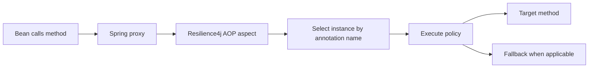
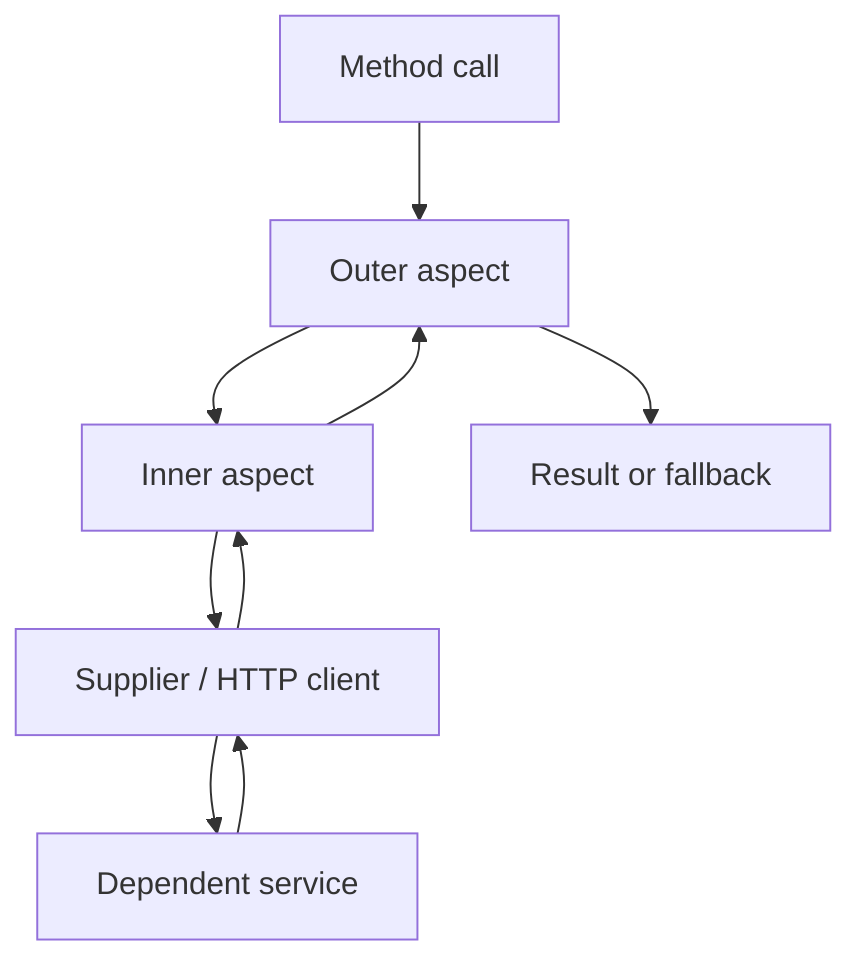

# Dependencies and Conditions for Spring AOP to Activate Annotations

Annotations such as `@CircuitBreaker`, `@Retry`, `@Bulkhead`, `@RateLimiter`, and `@TimeLimiter` allow placing resilience policies directly on service call methods. However, an annotation is only metadata. For the protective behavior to actually run, the application needs the right Resilience4j integration library, the Spring AOP mechanism, a Spring-managed bean, and a call that goes through the proxy Spring creates.

This is an important point when implementing a circuit breaker in Spring Cloud: having the dependency for `CircuitBreakerFactory` does not mean Resilience4j annotations are activated. The Spring Cloud CircuitBreaker API and Resilience4j's annotation aspects are two related integration approaches, but they have separate contracts and initialization conditions. Understanding these conditions helps avoid a situation where the code compiles and the application starts, yet the annotated method runs like an ordinary Java call.

## 1. Annotations Need an Aspect to Execute

Spring AOP implements intercepted calls using proxies. When a bean is created by Spring, the container can wrap that bean in a proxy. A call going through the proxy is inspected by aspects before or after the target method executes. Resilience4j provides aspects that recognize annotations and wrap the method with a circuit breaker, retry, bulkhead, rate limiter, or time limiter.



Without a matching proxy/aspect, Java still permits placing annotations on methods, but the annotation does not alter how the call executes on its own. For example, `@CircuitBreaker(name = "inventory")` does not automatically intercept requests just because the class imports the right annotation. The aspect must be loaded and the method must be invoked through the proxy.

## 2. Distinguishing the Two Spring Cloud and Resilience4j Integrations

In a Spring Cloud system, two API layers are commonly encountered:

| Integration Approach | Main Components | Purpose |
|---|---|---|
| Spring Cloud CircuitBreaker | `CircuitBreakerFactory`, `ReactiveCircuitBreakerFactory` | Obtain a breaker by ID and wrap calls through Spring Cloud's common API |
| Resilience4j Spring Boot annotations | `@CircuitBreaker`, `@Retry`, `@Bulkhead`, `@RateLimiter`, `@TimeLimiter`, and aspects | Intercept Spring bean methods using AOP and apply Resilience4j policies |

The `spring-cloud-starter-circuitbreaker-resilience4j` starter provides the Resilience4j implementation for the Spring Cloud CircuitBreaker abstraction. If you want to use Resilience4j's annotation aspects, you need to add the corresponding Spring Boot integration module such as `resilience4j-spring-boot3` or `resilience4j-spring-boot2`, depending on your project's Spring Boot version.

Both approaches can coexist in the same application, but you should not assume the Spring Cloud starter automatically enables all Resilience4j annotation aspects. Choose the right dependencies according to the API you intend to use. If your code calls `CircuitBreakerFactory`, you need the corresponding Spring Cloud starter. If your code relies on `@CircuitBreaker` and other Resilience4j annotations, you need the Spring Boot/AOP integration that provides those aspects.

For reactive applications using Spring Cloud's factory API, you need the corresponding reactive starter, such as `spring-cloud-starter-circuitbreaker-reactor-resilience4j`. For annotations on methods returning reactive types, verify support for the aspect and Resilience4j version; in many cases, the `ReactiveCircuitBreaker` API or explicit Reactor operators make it easier to control semantics.

## 3. Required Dependencies

### Spring Boot 3

To use Resilience4j annotation aspects on Spring Boot 3, the standard integration dependency is `resilience4j-spring-boot3`. The application also needs Spring AOP; declaring `spring-boot-starter-aop` explicitly makes the proxy-based AOP requirement clear and avoids relying on another starter pulling AOP in transitively.

Gradle example:

```kotlin
dependencies {
    implementation("io.github.resilience4j:resilience4j-spring-boot3")
    implementation("org.springframework.boot:spring-boot-starter-aop")
    implementation("org.springframework.boot:spring-boot-starter-actuator")
}
```

### Spring Boot 2

For Spring Boot 2, use the corresponding integration module:

```kotlin
dependencies {
    implementation("io.github.resilience4j:resilience4j-spring-boot2")
    implementation("org.springframework.boot:spring-boot-starter-aop")
    implementation("org.springframework.boot:spring-boot-starter-actuator")
}
```

Do not add both `resilience4j-spring-boot2` and `resilience4j-spring-boot3` to the same application. Choose the module matching the Spring Boot, Java, and Spring Framework versions in use. Manage versions using the project's dependency management or compatible BOM; do not copy arbitrary versions onto individual dependencies.

### When Using the Spring Cloud CircuitBreaker Factory

If the gateway uses the `CircuitBreakerFactory` API, add the Spring Cloud Resilience4j starter:

```kotlin
dependencies {
    implementation("org.springframework.cloud:spring-cloud-starter-circuitbreaker-resilience4j")
}
```

For Spring Cloud's reactive API, use the matching reactive starter:

```kotlin
dependencies {
    implementation("org.springframework.cloud:spring-cloud-starter-circuitbreaker-reactor-resilience4j")
}
```

These artifacts should be managed according to the Spring Cloud release train compatible with the application's Spring Boot version. Do not mix arbitrary versions of Spring Cloud, Spring Boot, and Resilience4j, as this can lead to class loading errors, missing methods, or non-working auto-configuration.

## 4. Why Is spring-boot-starter-aop Needed?

Resilience4j annotations are processed by aspects. `spring-boot-starter-aop` brings Spring AOP and the required AspectJ libraries onto the classpath, while enabling Spring Boot's AOP auto-configuration mechanism. In a typical Spring Boot application, you do not need to write a custom aspect for each annotation.

Some projects may already receive Spring AOP from another dependency. Even so, inspect the dependency tree to confirm that `spring-aop` and the necessary components are actually present. Merely adding `aspectjweaver` or importing the annotation does not replace the Resilience4j integration module that provides the aspect.

Spring Boot's Spring AOP primarily uses runtime proxies. It is not AspectJ compile-time weaving and does not automatically intercept all internal calls in bytecode. Therefore, bean-level proxy conditions and how methods are called are critical.

## 5. Beans Must Be Managed by Spring

An annotation aspect only has a chance to intercept objects created and proxied by Spring. A bean can be registered via `@Service`, `@Component`, `@Repository`, `@Bean`, or the corresponding Spring configuration mechanism.

Example of a Spring-managed gateway:

```java
import org.springframework.stereotype.Service;
import io.github.resilience4j.circuitbreaker.annotation.CircuitBreaker;

@Service
public class InventoryGateway {

    private final InventoryClient inventoryClient;

    public InventoryGateway(InventoryClient inventoryClient) {
        this.inventoryClient = inventoryClient;
    }

    @CircuitBreaker(name = "inventory", fallbackMethod = "fallback")
    public InventoryView find(String sku) {
        return inventoryClient.find(sku);
    }

    private InventoryView fallback(String sku, Throwable error) {
        return InventoryView.unavailable(sku);
    }
}
```

Spring creates `InventoryGateway` and can wrap it with a proxy. When another bean injects `InventoryGateway` and calls `find`, the call goes through the proxy so the aspect handles the annotation.

Do not instantiate the object manually with `new InventoryGateway(...)` in business code:

```java
// Does not go through the Spring proxy, so AOP annotations are not applied.
InventoryGateway gateway = new InventoryGateway(inventoryClient);
```

A manually created object is not managed by the container, has no Spring-created proxy, and does not have aspects applied like a normal bean. Inject beans via constructors or retrieve them from the application context in special framework scenarios.

## 6. Calls Must Go Through the Proxy

A proxied bean alone is not enough; the call must pass through that proxy. The most common reason an annotation does not run is **self-invocation**: one method in a class calls another method on the same instance using `this` or by calling the method name directly.

```java
@Service
public class OrderService {

    public OrderView place(String orderId) {
        // Internal call on this, bypassing the proxy.
        return loadInventory(orderId);
    }

    @CircuitBreaker(name = "inventory")
    public OrderView loadInventory(String orderId) {
        // Call the inventory service.
        return ...;
    }
}
```

When `place` executes on the proxy and then calls `loadInventory` internally, the internal call does not go back through the proxy. The `@CircuitBreaker` aspect can be bypassed. The standard fix is to move the protected method into a separate bean:

```java
@Service
public class InventoryGateway {
    @CircuitBreaker(name = "inventory", fallbackMethod = "fallback")
    public InventoryView find(String sku) {
        return inventoryClient.find(sku);
    }

    private InventoryView fallback(String sku, Throwable error) {
        return InventoryView.unavailable(sku);
    }
}

@Service
public class OrderService {
    private final InventoryGateway inventoryGateway;

    public OrderService(InventoryGateway inventoryGateway) {
        this.inventoryGateway = inventoryGateway;
    }

    public OrderView place(String sku) {
        InventoryView inventory = inventoryGateway.find(sku);
        return OrderView.from(inventory);
    }
}
```

Here, `OrderService` calls the injected `InventoryGateway` bean. The call passes through the gateway's proxy and the aspect can execute.

Another option is to redesign bean boundaries so that external calls always pass through a proxy. Injecting a bean into itself or retrieving the proxy from the application context can solve some cases, but makes the structure harder to understand; separating responsibilities into distinct beans is usually easier to test and maintain.

## 7. Proxy Type Affects Which Methods Are Intercepted

Spring AOP can use either JDK dynamic proxies or class-based proxies (CGLIB). Whether interception works depends on the proxy type and the method's characteristics.

| Characteristic | JDK dynamic proxy | Class-based proxy (CGLIB) |
|---|---|---|
| Creation mechanism | Interface-based proxy | Subclasses the bean class |
| Methods callable through proxy | Methods declared on the proxy interface | Overridable methods of the class |
| `final` methods | Can be intercepted if exposed via the proxy interface; the proxy intercepts at the interface boundary | Cannot be overridden, so cannot be intercepted by a subclass proxy |
| `private` methods | Not part of the interface | Cannot be overridden |
| `static` methods | Not an instance call through the proxy | Cannot be overridden |
| Self-invocation | Bypasses the proxy | Bypasses the proxy |

With a JDK proxy, callers must invoke the method through the interface implemented by the proxy. Because the proxy is a separate object implementing the interface, a `final` method in the implementation can still be intercepted by the aspect when the call goes through the interface proxy; the `final` restriction mainly affects class-based proxies. Injecting a concrete implementation type where only a JDK proxy exists can cause type mismatch errors; inject the interface or configure proxy mode consistently.

With CGLIB, the bean class must not be `final` and the method to be intercepted must not be `final` or `private`. A `protected` or package-private method may be handled by a class proxy depending on the Spring version and visibility, but `public` methods on Spring beans remain the most predictable choice for Resilience4j annotations.

Spring Boot can choose the proxy type based on AOP configuration and the classpath. Do not rely on an implicit proxy type when designing methods. Check `spring.aop.proxy-target-class` and the actual bean/proxy type if diagnostics are needed.

## 8. Annotation and ID Must Match Instance Configuration

The annotation's `name` attribute identifies the Resilience4j instance to use. It must match the ID in configuration:

```java
@CircuitBreaker(name = "inventory", fallbackMethod = "fallback")
public InventoryView find(String sku) {
    return inventoryClient.find(sku);
}
```

```yaml
resilience4j:
  circuitbreaker:
    instances:
      inventory:
        slidingWindowType: COUNT_BASED
        slidingWindowSize: 20
        minimumNumberOfCalls: 10
        failureRateThreshold: 50
        waitDurationInOpenState: 10s
```

If the annotation uses `name = "inventory"` while YAML only declares `instances.stock`, the `stock` configuration does not automatically apply to `inventory`. Depending on default settings and version, the instance may be created with default configuration or raise a configuration error. Therefore, keep names consistent across annotations, configuration, logs, and metrics.

Do not construct instance names from user IDs, order IDs, or per-request changing values. Each ID can create a separate breaker and corresponding metrics; an unbounded number of IDs increases memory consumption and metric cardinality.

## 9. Fallback Methods Must Also Follow the Contract

With Resilience4j annotations, `fallbackMethod` points to a fallback method in the same class. The fallback method must accept the business parameters matching the original method, optionally add the exception as the last parameter, and return a type compatible with the original method.

Example:

```java
@CircuitBreaker(name = "inventory", fallbackMethod = "fallback")
public InventoryView find(String sku) {
    return inventoryClient.find(sku);
}

private InventoryView fallback(String sku, CallNotPermittedException error) {
    return InventoryView.unavailable(sku);
}

private InventoryView fallback(String sku, Throwable error) {
    return InventoryView.unavailable(sku);
}
```

Resilience4j selects the fallback matching the exception type; a general overload accepting `Throwable` can handle remaining errors. Avoid creating multiple fallback overloads with equal specificity that make method resolution ambiguous. Ensure the fallback does not call back into the protected dependency itself and does not turn unknown data into fabricated business results.

If the fallback does not exist, has the wrong name, wrong parameters, or an incompatible return type, the application may fail when the aspect tries to locate and invoke the fallback. Verify fallback signatures during development and write tests for both failure and success paths.

## 10. Return Types Must Match the Annotation

Not every annotation applies uniformly to all return types. `@CircuitBreaker`, `@Retry`, `@Bulkhead`, and `@RateLimiter` can protect synchronous calls; aspects also support certain asynchronous types depending on the module and version. `@TimeLimiter` is typically used with `Future`/`CompletionStage` and requires an asynchronous task to which a time limit can be applied.

Example of an asynchronous method:

```java
import java.util.concurrent.CompletableFuture;

@TimeLimiter(name = "inventory", fallbackMethod = "fallback")
public CompletableFuture<InventoryView> findAsync(String sku) {
    return CompletableFuture.supplyAsync(() -> inventoryClient.find(sku));
}
```

`CompletableFuture.supplyAsync` does not automatically guarantee that the task runs on an appropriate executor or stops on timeout. In production applications, use a managed executor and understand the cancellation behavior of background tasks. `cancelRunningFuture` can request Future cancellation, but does not guarantee that all underlying I/O or server operations have stopped.

With WebFlux/Reactor, do not assume a synchronous annotation can protect a publisher with proper reactive semantics. If you need to protect `Mono` or `Flux`, use a reactive API supported by your version's documentation, such as `ReactiveCircuitBreakerFactory`, or use the appropriate Resilience4j Reactor operators. Test cancellation, timeout, and fallback on publishers rather than extrapolating from `CompletableFuture` tests.

## 11. Multiple Annotations on the Same Method and Aspect Ordering

A method may require multiple policies such as retry, circuit breaker, rate limiter, and bulkhead. Each annotation creates an aspect; when multiple aspects apply together, the nesting order determines which mechanism runs first and which observes exceptions from inner mechanisms.

For example, if retry wraps outside circuit breaker, each retry attempt can pass through the breaker and be evaluated individually by the breaker. If circuit breaker wraps outside retry, the breaker may only observe the final outcome of the entire retry sequence. Similarly, if circuit breaker wraps outside bulkhead, `BulkheadFullException` may be treated as an exception of the protected call; if bulkhead wraps outside breaker, bulkhead rejections may not enter breaker statistics.



Resilience4j allows configuring aspect order via the module's corresponding order properties. Property names and default values should be verified against the version in use; do not rely on default ordering if business policy requires a specific order. When explicit semantics are required, you can compose decorators using the programmatic API instead of placing multiple annotations on the same method.

Do not attach multiple annotations just to "turn everything on" without defining order and exception semantics. Decide explicitly whether retries should happen when the breaker is open, whether bulkhead rejections count as failures, and whether timeouts are recorded into the breaker or only enforce an outer deadline.

## 12. Common Reasons Annotations Do Not Work

| Symptom | Common Cause | How to Check or Fix |
|---|---|---|
| Annotation compiles but calls are not protected | Missing Resilience4j Spring Boot/AOP module | Check dependency tree and auto-configuration |
| Bean has no proxy | Bean is not managed by Spring or AOP is disabled | Register the bean with Spring and check AOP configuration |
| Internal calls do not trigger the aspect | Self-invocation through `this` | Move the method to another bean and inject that bean |
| Method is not intercepted | Method is `private`, `static`, or `final` with class-based proxy; method is not exposed on the interface with JDK proxy | Use a proxyable instance method, preferring `public` |
| JDK proxy injection type mismatch | Injecting the implementation when the proxy only implements the interface | Inject the interface or choose the appropriate proxy type |
| Configuration is not applied | `name` in annotation differs from the ID in YAML | Synchronize instance names |
| Fallback is not invoked | Wrong name or fallback signature | Check parameters, trailing exception, and return type |
| TimeLimiter does not stop the task | Task does not support cancellation or runs blocking code | Check Future/executor/client and actual cancellation support |
| Reactive annotation behaves unexpectedly | Aspect/API does not support the publisher type or timeout is placed at the wrong layer | Use the version-appropriate reactive API and test signals |

Several useful quick checks:

- Verify whether the injected bean is a proxy, for example via `AopUtils.isAopProxy(bean)` in a test or during debugging.
- Enable appropriate logging for Spring AOP/Resilience4j in development environments to confirm aspects and instances are initialized.
- Check Actuator/metrics endpoints if enabled to confirm calls update the instance's metrics.
- Write tests that invoke the method from another bean, not just calling the object directly in a unit test.
- Inject controlled failures in a mock dependency and confirm the fallback or breaker state actually changes.

## 13. Testing AOP Activation Conditions

A unit test that instantiates a class with `new` only tests Java logic; it does not test proxies and aspects. To verify that annotations work, use a Spring test context to retrieve the bean from the container and invoke it through that bean.

Cases that should be covered:

1. **Spring-managed bean:** retrieve the gateway from the context, call the method, and confirm the aspect executes.
2. **Call through another bean:** call the gateway from another service to verify the proxy is traversed.
3. **Self-invocation:** create an internal call case and confirm the inner annotation is not triggered, then test the separated-bean approach.
4. **Instance configuration:** use the exact ID in the annotation and confirm the corresponding breaker/metrics are created.
5. **Fallback:** simulate dependency failures and confirm the fallback with matching signature is invoked.
6. **Proxy type:** verify interface proxy or class proxy according to application configuration; confirm the method is exposed through the proxy.
7. **Aspect order:** if multiple annotations are present, test failure scenarios to confirm ordering and statistics match requirements.
8. **Reactive/async:** verify return types, timeouts, cancellation, and fallbacks using test utilities appropriate for Reactor or `CompletableFuture`.

With Resilience4j, you can inspect breaker state and metrics via the API or Actuator in integration tests. Do not simply check that the annotation is present via reflection and conclude that AOP is active.

## 14. When to Use Annotations vs. the Programmatic API?

Annotations fit well when a method has a relatively stable policy, a clear configuration ID, and calls always go through a Spring proxy. This keeps code concise and places the policy close to the dependency call.

A programmatic API such as `CircuitBreakerFactory` or Resilience4j decorators fits well when you need precise control over ordering, runtime policy selection based on data, composing multiple publishers, or handling complex cancellation/timeout logic. It is also useful when the call is not inside a proxyable Spring bean or when you want to avoid self-invocation limitations.

Do not wrap the same call with both an annotation and another programmatic circuit breaker without a clear goal. Two breakers can record the same errors, open at different times, or create two confusing layers of fallback. Choose one primary owner for each policy and test behavior whenever multiple mechanisms are nested.

## 15. Checklist for Verifying Annotation Activation

When adding Resilience4j annotations to a Spring Cloud gateway, verify in order:

1. Choose the right integration approach: Spring Cloud `CircuitBreakerFactory` or Resilience4j Spring Boot annotations.
2. Add the right starter matching your Spring Boot and Spring Cloud versions; manage versions with a compatible BOM.
3. Confirm `spring-boot-starter-aop` and the module providing Resilience4j aspects are present.
4. Register the class as a Spring bean and inject it via the container; do not instantiate it with `new`.
5. Ensure calls to the method come from outside the proxy, avoiding self-invocation.
6. Use a proxyable instance method; check interface/JDK proxy or class/CGLIB proxy behavior.
7. Align `name` in the annotation with the instance ID in configuration.
8. Check that the fallback and return type match synchronous, asynchronous, or reactive execution.
9. Define the order when multiple aspects apply together and test raised exceptions.
10. Use Spring integration tests to prove the proxy and policy work when the dependency succeeds, fails, or is slow.

Annotations are only the declaration point for a policy. Spring AOP must create the proxy, Resilience4j must provide the matching aspect, and the call must go through the proxy for the circuit breaker or other resilience mechanisms to be applied. Once dependencies, beans, proxies, configuration IDs, and return types are verified, a Spring Cloud application can use annotations predictably; for reactive flows or complex policy ordering, the programmatic API remains a clear choice for controlling behavior.
